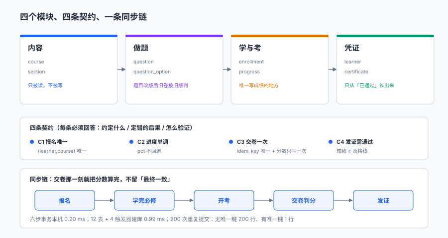

# 架构边界与四条契约：把「模块划分」写成能拦住人的东西

需求章交付了十二张表和六条不变量。这一章不新增表，只回答一个问题：**这四个模块之间，谁可以写谁、谁只能读谁、跨过去会发生什么。**

如果没有这一章，第 2 周的编码会自然走向一个结果：所有逻辑都写在「学与考」里，内容与凭证变成两张字典表，最后「成绩」这个数有五个地方在写。

::: tip 当日目标
定下**四个模块的单向依赖**、**四条必须由数据库而非代码守护的契约**、**一条同步判分链**，并让四条契约在本机各被拦住一次。
:::

本页判据族 `LNA-A` ~ `LNA-H`，共 8 条。

## 一、当日做了什么

| 动作 | 产物 | 落点 |
| --- | --- | --- |
| 划四个模块的写权限 | 模块-表矩阵 | 本文第二节 |
| 定四条契约 | 每条三问（约定 / 后果 / 验证） | 第三节 + DDL |
| 定同步判分链 | 五步时序与六步事务 | 第四节 |
| 定接口分三类 | 命令 / 查询 / 回调 | 第五节 |
| 四条契约各拦一次 | 4 个负向用例 | 第六节 |



## 二、四个模块与单向依赖

| 模块 | 拥有的表 | 写权限 | 只读依赖 |
| --- | --- | --- | --- |
| 内容 | `course` / `section` / `lesson` | 只由内容侧写 | 无 |
| 做题 | `question` / `question_option` / `exam` | 只由题库侧写 | 内容（`course_id`） |
| 学与考 | `enrollment` / `progress` / `attempt` / `answer` | 唯一写「学习与考试事实」的地方 | 内容 + 做题 |
| 凭证 | `learner` / `certificate` | 只从「已通过」长出来 | 学与考 |

**依赖方向是单向的**：内容 ← 做题 ← 学与考 ← 凭证。反方向的引用一律不允许，包括「凭证模块去改 `enrollment.state`」这种看起来很自然的操作。

为什么这条约束值钱？因为它是**唯一能防止「成绩被二次写入」的结构性手段**。只要「学与考」是唯一能写 `attempt.score` 的模块，「这个分数是谁改的」就永远只有一个答案。

::: danger 三种「看起来无害」的反向依赖
1. **凭证模块把 `enrollment.state` 改成「已结业」**：发证时顺手改状态，看起来很自然。后果是「结业」有两个写入点，出问题时无法判断是学完自动结业还是发证触发结业。
2. **做题模块读 `attempt` 统计题目正确率**：为了让题库页面好看一点。后果是题库模块依赖了考试数据，改考试表结构会连带改题库。
3. **内容模块读 `progress` 显示「多少人学完」**：后果同上，而且这个统计口径会和报表口径打架。

正确做法一律是**由下游模块订阅事件、在自己的库里算**，而不是反向读上游的表。
:::

## 三、四条契约

每条契约必须回答三问：**约定什么 / 定错的后果 / 怎么验证**。只写第一问的契约，等于没有契约。

### C1 报名唯一

| 问 | 答 |
| --- | --- |
| 约定什么 | 同一学习者对同一课程只能有一条 `enrollment` |
| 定错的后果 | 重复报名 → 两份进度 → 两次开考 → 两张证书 |
| 怎么验证 | `UNIQUE(learner_id, course_id)`，重复插入被拒 |

```sql
CREATE TABLE enrollment (
  enroll_id  TEXT PRIMARY KEY,
  learner_id TEXT NOT NULL REFERENCES learner,
  course_id  TEXT NOT NULL REFERENCES course,
  state      TEXT NOT NULL CHECK (state IN ('报名','在读','已完课','已结业')),
  UNIQUE (learner_id, course_id)          -- 契约 C1
);
```

### C2 进度单调

| 问 | 答 |
| --- | --- |
| 约定什么 | `progress.pct` 只增不减 |
| 定错的后果 | 学员刷新页面后进度倒退，客服无法解释 |
| 怎么验证 | 更新语句把 100 改成 40 被拒 |

```sql
CREATE TRIGGER trg_progress_monotonic
BEFORE UPDATE ON progress
WHEN NEW.pct < OLD.pct
BEGIN SELECT RAISE(ABORT, 'PROGRESS_BACKWARD'); END;
```

「只增不减」这个约束有一个副作用必须提前想清楚：**课程改版删掉一节时，总进度分母变小，分子可能超过分母**。所以 `pct` 应该是「已完成必修节数 / 必修节总数」在写入时算好的结果，而不是每次读的时候现算。

### C3 交卷一次

| 问 | 答 |
| --- | --- |
| 约定什么 | 一次交卷只能落一条 `attempt` 分数，重复提交不重复计分 |
| 定错的后果 | 网络重试导致两次判分，第二次覆盖第一次，学员分数莫名变化 |
| 怎么验证 | 同 `idem_key` 二次提交被拒；对已打分的 `attempt` 改分被拒 |

```sql
CREATE TABLE attempt (
  attempt_id   TEXT PRIMARY KEY,
  enroll_id    TEXT NOT NULL REFERENCES enrollment,
  exam_id      TEXT NOT NULL REFERENCES exam,
  no           INTEGER NOT NULL,
  score        REAL,
  idem_key     TEXT UNIQUE,                 -- 契约 C3 之幂等
  submitted_at TEXT NOT NULL,
  UNIQUE (enroll_id, exam_id, no)           -- 契约 C3 之「第几次」
);

CREATE TRIGGER trg_attempt_one_submit
BEFORE UPDATE OF score ON attempt
WHEN OLD.score IS NOT NULL AND NEW.score IS NOT OLD.score
BEGIN SELECT RAISE(ABORT, 'ALREADY_SCORED'); END;
```

两个唯一键各自负责一件事：`idem_key` 防「同一次提交被处理两遍」，`(enroll_id, exam_id, no)` 防「同一次考试记成两次」。缺任何一个都会有洞——只有幂等键时，换一个 `idem_key` 就能刷两次分；只有序号约束时，网络重试会因为「序号相同」而报错，用户体验成「交卷失败」。

### C4 发证需通过

| 问 | 答 |
| --- | --- |
| 约定什么 | 没有一次 `attempt.score >= exam.pass_score`，不得发证 |
| 定错的后果 | 证书与成绩不符，撤销时无法举证 |
| 怎么验证 | 用一个 40 分（及格 60）的交卷记录发证，被拒 |

```sql
CREATE TRIGGER trg_cert_needs_pass
BEFORE INSERT ON certificate
WHEN NOT EXISTS (
  SELECT 1 FROM attempt a JOIN exam e ON e.exam_id = a.exam_id
   WHERE a.enroll_id = NEW.enroll_id AND a.score >= e.pass_score)
BEGIN SELECT RAISE(ABORT, 'NOT_PASSED'); END;
```

这条契约刻意写成「存在一次通过」而不是「最后一次通过」：**考两次、第一次过第二次没过，仍然应当发证**。如果把条件写成「最新一次通过」，就会惩罚「想刷高分反而丢了证书」的学员。

## 四、一条同步链：为什么判分不做异步

| 环节 | 谁写 | 写什么 |
| --- | --- | --- |
| 报名 | 学与考 | `enrollment` |
| 学完必修 | 学与考 | `progress.pct = 100` |
| 开考 | 学与考 | `attempt`（`no = 1`，`score` 为空） |
| 交卷判分 | 学与考 | `attempt.score` + `answer.score`（同一事务） |
| 发证 | 凭证 | `certificate`（触发器校验通过） |

**判分在交卷那一刻同步完成**，不做异步队列。理由在需求章已经写过，这里是它的架构后果：

| 若异步判分 | 后果 |
| --- | --- |
| 交卷后 0~3 秒内分数为空 | 学员刷新看到「未判分」，再点一次交卷 → 两条 attempt |
| 判分失败需重试 | 需要一个「判分中」状态，而这个状态没有业务含义 |
| 补偿逻辑 | 最终一致意味着「有一段时间分数是错的」，而分数没有「暂时错」这个选项 |

同步判分的代价是「交卷接口的 P99 包含判分耗时」。本机六步事务 0.20 ms，判分（10 题选择题）在微秒级——**代价小到不值得为它引入最终一致**。

::: warning 同步不等于「一个事务包住所有事」
发证不在交卷事务里：交卷成功但发证失败（比如证书编号撞了），不应该让整次考试回滚。正确的边界是**交卷事务只包住 `attempt` + `answer`**，发证是一个独立的后续动作，失败可重试。
:::

## 五、接口分三类

| 类型 | 特征 | 例子 | 幂等要求 |
| --- | --- | --- | --- |
| 命令 | 改变状态，带幂等键 | 报名、交卷、发证 | 必须 |
| 查询 | 只读，可缓存 | 我的课程、我的成绩 | 天然幂等 |
| 回调 | 外部触发，可能重投 | 支付回调（本期不做）、证书校验 | 必须 |

三类接口的错误码要分层，不能一律 500：

```json
{ "error": { "code": "ATTEMPT_ALREADY_SCORED", "message": "该次考试已判分", "retryable": false } }
```

`retryable` 这个字段是给调用方看的：**`false` 的错误重试一万次也是同一个结果**，而 `true` 的错误（如数据库忙）应当退避重试。

## 六、四条契约各拦一次（本机实测）

```text
12 张表 + 1 索引 + 4 触发器建库 0.99 ms
一次「报名 → 进度 → 开考 → 交卷 → 发证」六步事务 0.20 ms
无唯一键：200 次重复提交落 200 行
有唯一键：同一 idem_key 第二次提交被拒 → UNIQUE constraint failed: attempt.idem_key
PASS 重复计分（同卷二次写分） 被拒 → ALREADY_SCORED
PASS 进度倒退 被拒 → PROGRESS_BACKWARD
PASS 超次数交卷 被拒 → ATTEMPT_LIMIT
PASS 未通过发证 被拒 → NOT_PASSED
EXIT=0
```

四个 `PASS` 覆盖的是四条契约里最容易被写成「业务代码里判断一下」的部分。写成触发器的好处不是性能，是**绕过接口直接改库也拦得住**——而这正是事故最常见的发生方式。

::: danger 幂等键的两个常见错法
1. **用「请求内容哈希」当幂等键**：学员改一个答案重交，哈希变了，幂等失效。幂等键应当是**客户端生成的请求 ID**，与内容无关。
2. **幂等键只存在内存里**：进程重启后失效，重试就重复计分。必须落库并加唯一约束。
:::

## 七、下一步是什么

第 1 周还剩两步：

| 步 | 内容 | 交付判据 |
| --- | --- | --- |
| 第 3 步 | 接口契约细化：把三类接口写成请求/响应样例 + 错误码表 | 每个命令接口都有幂等键与错误码；每个查询接口都有分页与排序规则 |
| 第 4 步 | 库表设计定稿：补索引、补约束、写迁移脚本 | `schema.sql` 可在空库一次建成功；索引覆盖五条高频查询 |

第 2 周第 1 步会按这一章的四条契约写「报名」与「进度上报」两个接口。**如果第 3 步的接口契约没有把幂等键的位置定下来，第 2 周一定会返工**——因为幂等键要在请求头里，而不是在 body 里。

## 八、本页判据

| 判据 | 断言 | 验证方式 |
| --- | --- | --- |
| `LNA-A` | 四个模块的写权限互不重叠 | 模块-表矩阵里每张表只有一个写模块 |
| `LNA-B` | 依赖方向单向 | 不存在「凭证写 `enrollment`」这类反向 SQL |
| `LNA-C` | 四条契约每条都有一句话约定 | 契约表四行齐全，无空行 |
| `LNA-D` | 每条契约都有负向用例 | 4 个 `PASS` 全部命中 |
| `LNA-E` | 幂等键落库且有唯一约束 | `attempt.idem_key` 上能查到 `UNIQUE` |
| `LNA-F` | 判分与交卷同一事务 | `attempt.score` 与 `answer.score` 在同一 `COMMIT` 内写入 |
| `LNA-G` | 发证不参与交卷事务 | 发证失败不回滚交卷记录 |
| `LNA-H` | 错误码带可重试标记 | 每个错误码都有 `retryable` 字段 |

## 验证方式

```shell
# 1. 建库耗时与对象数（期望 12 表 / 4 触发器）
python3 lh_arch.py | head -2
sqlite3 lh.db "select type, count(*) from sqlite_master
               where type in ('table','trigger') and name not like 'sqlite_%' group by type;"

# 2. 四条契约的负向用例（期望 4 个 PASS / EXIT=0）
python3 lh_arch.py | grep -c "^PASS"
python3 lh_arch.py > /dev/null; echo "EXIT=$?"

# 3. 幂等键必须落库（期望输出 idem_key 上有唯一索引）
sqlite3 lh.db "select name from pragma_index_list('attempt') where \"unique\" = 1;"

# 4. project/ 下不允许出现代码文件
find project -type f ! -name "*.md" ! -name "*.png" ! -name "*.svg" ! -name "*.jpg"
# 期望：输出为空
```

第 3 步的 `pragma_index_list` 会同时列出 `UNIQUE(enroll_id, exam_id, no)` 与 `idem_key` 两个唯一索引——**两个都在，才说明「重复交卷」这件事被两个维度同时挡住了**。

## 参考资料

- IMS Global《Open Badges Specification 3.0》：可验证凭证的签发、校验与撤销模型，本章「发证需通过」的契约对应其「evidence 必须可核验」的要求。
- ISO/IEC 19788-1:2011《信息技术 学习、教育和培训 学习资源元数据 第 1 部分：框架》：课程与章节的元数据分层，本章「内容 / 做题」两模块的划分参考其资源与内容对象的区分。
- SQLite 官方文档《CREATE TRIGGER》：`BEFORE UPDATE OF score` 的列级触发语义，本章「分数只写一次」依赖它。
- 与本项目相邻：[需求与领域边界](../Requirements/index.md)、[项目总览](../index.md)；技术侧的幂等讨论见[幂等状态机](../../../../docs/Backend/IdempotencyStateMachine/IdempotencyKey/index.md)。
