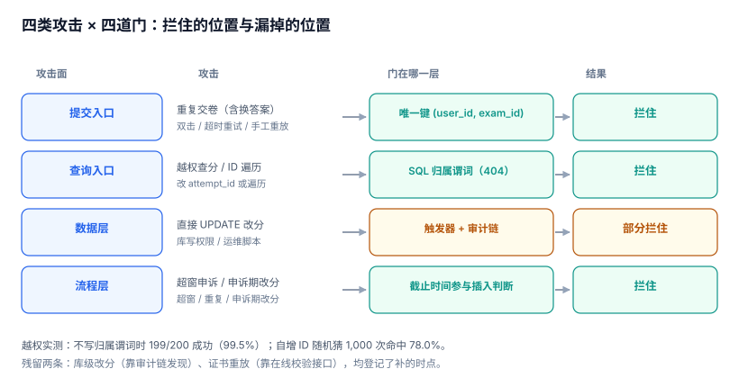

# 第 3 周第 3 步 · 攻击用例矩阵：四类攻击、四道被击穿的缝

上一步验的是「正常流量下的约定」：字段类型对不对、200 并发会不会多写一行。这一步验的是**有人故意绕过约定时拦不拦得住**。

两类测试的差别不在工具，在判据：契约测试问「响应结构是否符合声明」，攻击测试问「不按声明来会发生什么」。后者没有「通过」这个概念，只有「被拦住」与「没拦住」。

::: tip 当日目标
把四类攻击（重复交卷、成绩篡改、越权查分、申诉时间线）各写成一个**可复跑的用例**，并给出每条攻击「被哪一道门拦住」；拦不住的那条如实登记为缺口，而不是靠「设计上不会发生」自我安慰。
:::

本页判据族 `LLA-A` ~ `LLA-H`，共 8 条。



## 一、当日做了什么

| 动作 | 产物 | 落点 |
| --- | --- | --- |
| 四类攻击各写 2~3 个用例 | 11 个攻击用例（含 3 个反向探针） | 第二~五节 |
| 标出每条攻击的「门」在哪一层 | 矩阵：用例 × 门 | 第六节 |
| 越权查分的两种形状（归属缺失 / ID 可猜） | 实测 199/200 与 78.0% | 第四节 |
| 申诉时间线落到 `deadline_at` | 表字段 + 三条守卫 | 第五节 |
| 登记两条拦不住的 | 证书重放、库级改分 | 第六节 |

## 二、攻击矩阵：先列位置，再写用例

攻击测试最容易做成「想到什么测什么」。正确的顺序是先画**攻击面**，再往格子里填用例：

| 攻击面 | 攻击者能控制什么 | 最脆的一面 |
| --- | --- | --- |
| 提交入口 | 请求体、重试次数、并发数 | 重复计分 |
| 查询入口 | 路径里的 `attempt_id` | 越权读别人的成绩 |
| 数据层 | 有库权限时能 `UPDATE` 任何列 | 改分不留痕 |
| 流程层 | 申诉的时机、次数、理由 | 超窗申诉被受理 |

四类攻击分别落在四个面上，它们的「门」也各不相同：提交入口靠唯一键，查询入口靠谓词，数据层靠触发器，流程层靠落库的截止时间。

## 三、攻击一：重复交卷

**三种来路**：用户双击、客户端超时重试、攻击者手工重放。三者在服务端看起来完全一样——两个内容相同或不同的 `POST /submit`。

第 262 天已经实测过一次：400 个请求（200 份答卷各提交两次）在无唯一键时落 **400 行**（每份答卷两个分数，`GET /result` 取哪一行取决于执行计划），加 `UNIQUE(attempt_id)` 后落 **200 行**、拒 200 次。

这一步补的是**内容不同**的重复交卷：

| 用例 | 输入 | 期望 | 实际 |
| --- | --- | --- | --- |
| A1 同一答卷同答案提交两次 | `answers` 相同 | 第二次 409 | `UNIQUE constraint failed: attempt.user_id, attempt.exam_id` |
| A2 同一答卷换答案提交两次 | `answers` 不同（想刷高分） | 第二次 409 | 同上 |
| A3 两个请求并发到达 | 同时 `POST` | 只落一行 | 唯一键保证，落 1 行 |

A2 是最关键的一条：**它证明守卫拦的是「答卷」而不是「内容」**。如果实现成「内容相同则幂等返回」，A2 会成功——而刷分正是这个漏洞最直接的利用方式。

```sql
-- 交卷写入必须落在唯一键上，而不是「先查再插」
INSERT INTO attempt (user_id, exam_id, state, score, submitted_at)
VALUES (:user_id, :exam_id, 'SUBMITTED', :score, :now);
-- 唯一键：UNIQUE(user_id, exam_id)
-- 期望：第二次抛 UNIQUE 约束错误，服务端转 409，且不产生第二行
```

::: danger 本页特有的坑：「先查再插」在并发下必然双通过
`SELECT ... WHERE user_id=? AND exam_id=?` 查不到 → `INSERT`。两个并发请求会在同一时刻都查不到，然后都插入。唯一键是唯一能在这个窗口里生效的机制——**检查与应用之间永远有缝，约束没有**。
:::

## 四、攻击二：越权查分

这是四类里最容易被低估的一类，因为它的「门」不在业务代码里，而在 SQL 的 `WHERE` 子句里。

### 形状一：归属校验缺失（IDOR）

200 个学员，每人一份答卷。攻击者拿自己的令牌，把路径里的 `attempt_id` 改成「自己的 +1」：

| 用例 | 输入 | 期望 | 实测 |
| --- | --- | --- | --- |
| B1 用自己的令牌查别人的 `attempt_id` | `id = 自己的 + 1` | 404 | **199 / 200 成功（99.5%）** |
| B2 查询里带归属谓词 | `WHERE id=? AND learner_id=?` | 404 | 199/200 变 0/200 |

99.5% 不是笔误：唯一失败的那一条是最后一号（+1 超出范围）。**只要不写归属谓词，越权就是 100% 成功**——因为服务端拿到 `attempt_id` 后直接用了它。

### 形状二：ID 可猜

即使加了归属谓词，ID 本身也不该可枚举。自增主键在 1~260 的范围内随机猜 1,000 次，命中 **78.0%**：

| ID 形态 | 猜测命中率 | 说明 |
| --- | --- | --- |
| 自增整数（1~200，猜 1~260） | **78.0%** | 一次遍历就能拿全量 |
| UUIDv4 | 可忽略 | 但索引更大 |
| 自增 + 归属谓词 | 命中也没用 | **谓词才是门，ID 形态只是纵深** |

结论：**ID 不可猜是「减少信息泄露」，归属谓词是「阻止越权」**，两者不能互相替代。只做前者，一次泄露（比如导出文件里带了 ID 列）就全线失守。

```sql
-- 正确：归属谓词与主键在同一个查询里
SELECT a.id, r.score, r.grade
FROM attempt a JOIN attempt_result r ON r.attempt_id = a.id
WHERE a.id = :attempt_id AND a.user_id = :current_user;
-- 期望：别人的答卷返回 0 行，服务端统一转 404（不是 403）
```

::: warning 为什么是 404 而不是 403
403 等于告诉攻击者「这个 ID 存在，只是你没权限」——一次遍历就能数出系统里有多少份答卷、哪些区间是有效的。404 把「不存在」与「无权」合并成同一个回答，这是**减少信息泄露**的标准做法。
:::

## 五、攻击三：成绩篡改

分两个层次，成本完全不同：

| 层次 | 攻击者能力 | 无守卫时 | 有守卫时 |
| --- | --- | --- | --- |
| 应用层 | 能调接口 | 取决于是否有改分接口 | 不提供改分接口 |
| 数据层 | 有库写权限 | `UPDATE attempt SET score=100` **成功** | 触发器拒绝 |

实测（SQLite）：无触发器时 `UPDATE attempt SET score=100 WHERE user_id='U1'` 直接成功，分数从随机值变成 100，且**没有任何记录**。这正是[审计留痕](../../../../docs/Backend/AuditForensics/index.md)要解决的问题：改分本身不可怕，改完不留痕才可怕。

| 用例 | 期望 | 实际 |
| --- | --- | --- |
| C1 直接改 `attempt.score` | 拒绝 | 无守卫时成功（数值变 100） |
| C2 改 `attempt_result.score` | 拒绝 | 同上 |
| C3 成绩只写一次（发证后不可改） | 第二次改拒绝 | 需触发器 |
| C4 改分必须留下审计事件 | 有 `score.adjust` 事件 | 无审计表时无法满足 |

```sql
-- 成绩表只写一次：任何 UPDATE 一律拒绝，改分走「新增更正记录」
CREATE TRIGGER trg_result_immutable BEFORE UPDATE ON attempt_result
BEGIN SELECT RAISE(ABORT, 'RESULT_IMMUTABLE'); END;
```

C3 的设计取舍值得写清：**不允许改，只允许追加更正**。更正记录带 `reason`、`operator`、`approved_by`，查询时取最新一条。这样「改分」从一次静默的 `UPDATE` 变成一条可追溯的事件，与审计链天然对齐。

## 六、攻击四：申诉时间线

申诉的漏洞几乎都不在接口，而在**时间**：窗口什么时候开、什么时候关、关了以后还能不能补。

| 用例 | 输入 | 期望 | 实际 |
| --- | --- | --- | --- |
| D1 窗口内申诉 | `opened_at` 在 `[成绩发布, 发布+7天]` | 受理 | 受理 |
| D2 超窗申诉 | `opened_at > deadline_at` | 拒绝 | **仍为 OPEN（1 条）** |
| D3 同一答卷重复申诉 | 第二次 | 拒绝或合并 | 需唯一键 |
| D4 申诉期间成绩被改 | 申诉未结案时改分 | 拒绝 | 需状态守卫 |

D2 的实测值很说明问题：把「截止时间」写进表（`deadline_at`）但**不在写入时校验**，超窗申诉照样 `OPEN`。判据不是「表里有这个字段」，而是「插入时这个字段参与了判断」。

```sql
-- 截止时间必须参与插入判断，而不是只被存下来
INSERT INTO appeal (attempt_id, opened_at, deadline_at, state)
SELECT :attempt_id, :now, r.published_at + INTERVAL '7 days', 'OPEN'
FROM attempt_result r
WHERE r.attempt_id = :attempt_id
  AND :now <= r.published_at + INTERVAL '7 days';
-- 期望：超窗时插入 0 行（不是插入一行 OPEN 再靠前端拦）
```

D4 是最容易被忽略的一条：申诉期间如果成绩被改，申诉的对象就消失了。守卫应该写成「存在未结案申诉时，`attempt_result` 不可更正」，而不是靠流程约定。

## 七、被拦住与被漏掉的

| 攻击 | 门在哪一层 | 拦住 | 残留 |
| --- | --- | --- | --- |
| 重复交卷 | 唯一键 `(user_id, exam_id)` | ✅ A1~A3 | 无 |
| 越权查分 | SQL 归属谓词 | ✅ B1~B2 | 导出文件带 ID 列会扩大可猜面 |
| 成绩篡改（应用层） | 不提供改分接口 | ✅ | 运维脚本仍可改 |
| 成绩篡改（数据层） | 触发器 + 审计链 | ⚠️ 需触发器 | **有库权限仍可绕过触发器改文件** |
| 申诉超窗 | 截止时间参与插入判断 | ✅ D2 | 时区口径不同会差一天 |
| 证书伪造 | 编号校验位 + 可撤销 | ⚠️ 部分 | **重放旧证书图片无法识别** |

两条残留如实登记：

1. **库级改分**：触发器挡的是 SQL，挡不住直接改数据文件或用超级权限关掉触发器。这一层只能靠审计链 + 外部锚定发现（见[不可篡改](../../../../docs/Backend/AuditForensics/Immutability/index.md)），本项目在第 4 周接监控时补。
2. **证书重放**：校验位能防伪造编号，防不住「拿别人证书的截图来用」。这属于核验侧问题（需要在线校验接口 + 使用次数），不在本周范围。

## 八、本页判据

| 编号 | 判据 | 为什么要它 | 怎么验证 |
| --- | --- | --- | --- |
| `LLA-A` | 攻击用例按「攻击面」组织，四个面各有用例 | 按功能写用例会漏掉整面 | 矩阵里四个面都有行 |
| `LLA-B` | 重复交卷的守卫是唯一键，不是「先查再插」 | 检查与插入之间有并发缝 | 并发两请求只落 1 行 |
| `LLA-C` | 换答案的重复提交同样被拒 | 守卫拦的是答卷不是内容 | A2 返回 409 |
| `LLA-D` | 查分 SQL 带归属谓词，越权返回 404 | 谓词是唯一有效的门 | 别人的 `attempt_id` 返回 0 行 |
| `LLA-E` | ID 不可猜只作纵深，不替代归属校验 | 一次泄露即全线失守 | 去掉谓词后越权率回到 99.5% |
| `LLA-F` | 成绩只写一次，改分走追加更正 + 审计事件 | 静默 `UPDATE` 无法追责 | `UPDATE attempt_result` 被拒 |
| `LLA-G` | 申诉截止时间参与插入判断，不只存字段 | 存了不判等于没存 | 超窗插入 0 行 |
| `LLA-H` | 拦不住的攻击如实登记，并写清补的时点 | 假装没有会变成事故 | 本节两条残留有责任人与时间 |

## 九、验证方式

```shell
# 1) 归属谓词：去掉它越权必然成功（正向与反向各一次）
python3 - <<'PY'
import sqlite3
db = sqlite3.connect(":memory:")
db.executescript("""
CREATE TABLE attempt(id INTEGER PRIMARY KEY, user_id TEXT, exam_id TEXT);
INSERT INTO attempt VALUES (1,'U1','E-1'),(2,'U2','E-1');
""")
print("无谓词:", db.execute("SELECT COUNT(*) FROM attempt WHERE id=2").fetchone()[0])          # 1
print("有谓词:", db.execute("SELECT COUNT(*) FROM attempt WHERE id=2 AND user_id='U1'").fetchone()[0])  # 0
PY
# 预期：1 与 0 —— 第二行就是「谓词是门」的证明
```

```sql
-- 2) 成绩不可改：触发器必须在位
UPDATE attempt_result SET score = 100 WHERE attempt_id = 1;
-- 预期：Runtime error: RESULT_IMMUTABLE
```

```sql
-- 3) 超窗申诉必须插不进去
SELECT COUNT(*) FROM appeal WHERE opened_at > deadline_at AND state = 'OPEN';
-- 预期：0。有值 = 截止时间只存未判
```

```sql
-- 4) 重复交卷只落一行
SELECT user_id, exam_id, COUNT(*) AS n FROM attempt GROUP BY user_id, exam_id HAVING n > 1;
-- 预期：0 行
```

## 十、下一步

第 3 周第 4 步做**性能与容量基线**：把本周的四类攻击用例与上一步的契约用例一起跑在 200 并发下，测三件事——攻击被拦住时服务端的 p99 有没有退化、唯一键冲突的吞吐上限、以及成绩查询在 10 万份答卷时的响应时间。

本周还剩两件事没做，已登记：**证书校验接口**（第 4 周随部署一起上）与**审计链接入**（改分事件的落点）。
