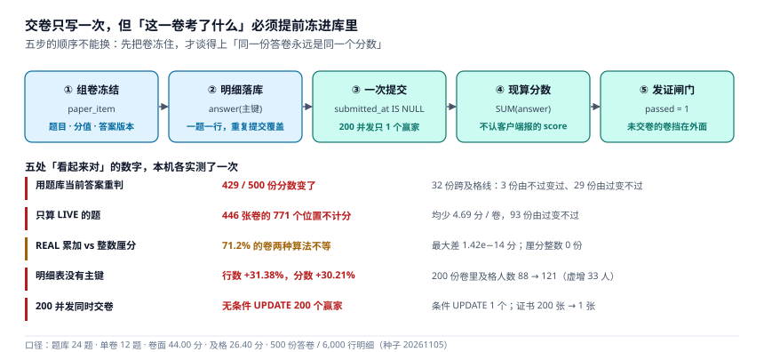

# 交卷与判分：一份答卷只能有一个分数

第 2 周第三天，做 `POST /v1/attempts`。前两个接口错了还能补一条数据——报名补错了可以取消重报，进度报错了下一节课就纠回来了。这个接口没有这种余地：**它产出的那个数字会被印在证书上，而且事后没人能重算**。

所以今天真正要决定的不是「怎么把分算出来」，而是「凭什么这次算出来的分数，三个月后再算一次还是同一个数」。



::: tip 今天的判据
「这一卷考了什么」必须在交卷之前就冻进库里。用**题库现在的答案**重判 500 份历史卷，**429 份分数会变、32 份跨及格线**；再只算 `LIVE` 的题，**93 份由过变不过**。分数用整数厘分（0.01 分）：REAL 累加下 **71.2%** 的卷在两种合法求和顺序下结果不等，而整数厘分是 **0 份**。
:::

## 一、当日做了什么

| # | 产出 | 文件/位置 | 状态 |
| --- | --- | --- | --- |
| 1 | 交卷接口契约（2 条路径、5 个错误码） | 本章第二节 | 定稿 |
| 2 | 四张表 + 三个触发器 | 本章第三节 | 定稿 |
| 3 | 组卷冻结：分值快照与答案版本快照 | 本章第四节 | 实测 |
| 4 | 三种多选口径的及格率（29.00% / 43.80% / 24.80%） | 本章第五节 | 实测 |
| 5 | 200 并发交卷 → 1 个赢家 | 本章第六节 | 实测 |
| 6 | 整数厘分与 REAL 的差 | 本章第七节 | 实测 |
| 7 | 超时判定与发证闸门 | 本章第八节 | 实测 |
| 8 | 判据 `LNM-A` ~ `LNM-H` | 本章第九节 | 8 条 |

## 二、接口契约

```text
POST /v1/attempts                     # 开考：抽题 → 落 paper_item
Headers: Idempotency-Key: <uuid>
Body:    { "exam_id": "EX01", "enroll_id": "E-000123" }
201 Created  { "attempt_id": "A0001", "paper": [{ "seq": 1, "question_id": "Q04", "score": 3.30 }],
               "deadline": "2026-11-05T10:30:00Z" }
409 ATTEMPTS_EXHAUSTED                # 超过 max_attempts
409 ENROLLMENT_NOT_COMPLETED          # 必修未齐不许开考

POST /v1/attempts/{id}/submit         # 交卷：落明细 → 判分 → 定状态
Body:    { "answers": [{ "question_id": "Q04", "picked": "B" }] }
200 OK       { "score": 31.90, "passed": true, "multi_policy": "PARTIAL_NO_WRONG" }
409 ALREADY_SUBMITTED                 # 这一卷已经交过
409 PAPER_EXPIRED                     # 超过 deadline 太多，收卷但要人工复核
422 ANSWER_NOT_IN_PAPER               # 交上来的 question_id 不在这一卷上
```

`422` 是这套接口里最容易被省掉的一个。如果服务端按「用户交上来的题目」逐条判分，那么客户端只要在 `answers` 里多塞一道 `{"question_id":"Q01","picked":"正确答案"}`，就能给自己加 3.3 分——**这不是越权，因为题库本来就可读**。判分必须**以 `paper_item` 为主表**去 `LEFT JOIN answer`，而不是以 `answer` 为主表：

```sql
-- 只有这种方向，才可能发现「交了卷上没有的题」
SELECT p.question_id, a.picked, p.score_centi, p.ans_version
  FROM paper_item p
  LEFT JOIN answer a ON a.attempt_id = p.attempt_id AND a.question_id = p.question_id
 WHERE p.attempt_id = 'A0001';
```

`409 PAPER_EXPIRED` 的处置也值得写清：超时**不丢卷**，照样收、照样判，只是 `attempt.late = 1` 并在响应里带 `late` 标记。丢掉一份已经答完的卷，比收一份迟到的卷伤害大得多。

## 三、四张表与三个触发器

| 表 | 主键 | 一行代表 | 谁写 |
| --- | --- | --- | --- |
| `paper_item` | (`attempt_id`,`question_id`) | 这一卷考了哪道题、值多少分、按哪版答案判 | 开考接口（只写一次） |
| `answer_key` | (`question_id`,`version`,`opt_key`) | 某题在第 N 版里哪个选项正确 | 题库维护 |
| `answer` | (`attempt_id`,`question_id`) | 学员在某题上选了什么 | 交卷接口 |
| `submit_event` | `idem_key` | 一次交卷请求（用于幂等） | 交卷接口 |

```sql
CREATE TABLE paper_item(
  attempt_id  TEXT NOT NULL REFERENCES attempt(attempt_id),
  question_id TEXT NOT NULL REFERENCES question(question_id),
  seq         INTEGER NOT NULL,
  score_centi INTEGER NOT NULL CHECK(score_centi > 0),   -- 快照，不读 question.score
  ans_version INTEGER NOT NULL,                          -- 快照，不读「当前版本」
  PRIMARY KEY(attempt_id, question_id)
);

CREATE TABLE answer_key(
  question_id TEXT NOT NULL,
  version     INTEGER NOT NULL,
  opt_key     TEXT NOT NULL,
  is_correct  INTEGER NOT NULL CHECK(is_correct IN (0,1)),
  PRIMARY KEY(question_id, version, opt_key)
);

CREATE TABLE answer(
  attempt_id   TEXT NOT NULL,
  question_id  TEXT NOT NULL,
  picked       TEXT NOT NULL,          -- 'AB' / 'B' / 'T'
  score_centi  INTEGER NOT NULL DEFAULT 0,
  PRIMARY KEY(attempt_id, question_id)  -- 没有它，重复点「保存」= 重复得分
);
```

三个触发器各管一件事：`trg_score_eq_answers`（分数必须等于明细之和，**容差 0**）、`trg_submit_once`（已交过的卷不许改 `submitted_at`）、`trg_cert_needs_submitted`（发证要求 `passed = 1` 且 `submitted_at` 非空）。

第 1 周的 `I3` 写的是 `ABS(NEW.score - SUM(answer.score)) > 0.005`——那个 `0.005` 不是设计，是 `REAL` 逼出来的。今天把分数换成整数厘分后，容差可以降到 0，这是本章唯一一处**主动修改第 1 周契约**的地方，理由在第七节。

## 四、组卷冻结：两个快照，一次都不能少

「同一份答卷永远是同一个分数」这句话，拆开是两条独立的保证：

1. **分值不跟着题库走**：`paper_item.score_centi` 存的是抽题那一刻的值；
2. **答案不跟着题库走**：`paper_item.ans_version` 存的是抽题那一刻的答案版本号。

两条都可以用同一个实验推翻。本机 24 道题、单卷抽 12 题（4 单选 + 4 多选 + 4 判断）、卷面 44.00 分、及格线 26.40 分、500 份答卷 / 6,000 行明细。

**先看第 1 条**。把单选从 3.3 分调到 4.0、多选从 6.6 调到 5.0，然后重算这 500 份历史卷：

| 口径 | 分数变化的卷 | 卷面总分 | 500 份合计 | 及格人数 |
| --- | --- | --- | --- | --- |
| 按 `paper_item` 快照 | **0 份** | 44.00 不变 | 12,018.60 不变 | 219 |
| 按 `question.score` 现算 | **499 份（99.80%）** | 44.00 → 40.40 | 12,018.60 → 11,307.14（**−5.92%**） | 218（及格线同步改）/ **183**（及格线不改） |

这张表最值得看的是中间那列和最后那列的比例：**几乎每一份卷的分数都变了（99.80%），而及格人数只差 1 人**。如果只盯「通过率」这个聚合指标，这次改动完全看不出问题；而每一位学员手里的成绩单都已经是另一个数字了。

**再看第 2 条**。改 4 道题的答案（`v1` → `v2`）、下线 3 道题（`status = 'RETIRED'`），重判同一批卷：

| 判分依据 | 分数变化 | 均 \|Δ\| | 最大 \|Δ\| | 变高 / 变低 | 跨及格线 |
| --- | --- | --- | --- | --- | --- |
| ① 题库当前答案（`MAX(version)`） | 429 份（85.80%） | 2.24 分 | 7.15 分 | 98 / 331 | **3 份由不过变过、29 份由过变不过** |
| ② 当前答案 + 只算 `LIVE` 的题 | 472 份（94.40%） | 4.95 分 | 16.50 分 | 49 / 423 | 2 份由不过变过、**93 份由过变不过** |
| ③ 组卷冻结的 `ans_version = 1` | **0 份** | — | — | — | 0 |

口径 ② 的伤害最直观：下线 3 道题，它们落在 **446 张卷的 771 个位置**上，只算 `LIVE` 就是这 771 个位置直接不计分，**合计少算 2,092.75 分、均 4.69 分/卷**。换句话说，**「题目下线」这个动作在口径 ② 下等价于「把这 446 张卷的 771 道题判成 0 分」**——而题库管理员点「下线」的时候，想的是「以后不要再抽到它」。

冻结口径下这 429 份、472 份、32 份、93 份全部变成 0 份。原因很朴素：判分时一个字节都没从 `question` / `question_option` 里读。

这里还有一个只在 SQL 里才现形的坑。「当前答案」必须写成 `version = (SELECT MAX(version) ...)`，写成 `version <= 2` 会把两版答案**并集**取出来：

```sql
-- 错：一题两个正确答案
SELECT opt_key FROM answer_key WHERE question_id='Q01' AND version<=2 AND is_correct=1;
-- B,A
-- 对：只取最新一版
SELECT opt_key FROM answer_key WHERE question_id='Q01'
   AND version = (SELECT MAX(version) FROM answer_key WHERE question_id='Q01') AND is_correct=1;
-- A
```

这个错误不会报错，只会让「改过答案的题目」变成送分题——而它恰好发生在你刚发现答案错了、最需要修正的时候。

## 五、判分口径：三个及格率，差的不是算法

多选题怎么给分，是一个**业务决定**，不是实现细节。本机同一个月、同一批人、同一批答案，只换多选口径：

| 口径 | 规则 | 及格 | 及格率 | 均分 | 中位 | P10 / P90 |
| --- | --- | --- | --- | --- | --- | --- |
| A `ALL_OR_NOTHING` | 与正确答案完全一致才得分 | 145 | **29.00%** | 19.72 | 18.70 | 5.50 / 36.30 |
| B `PARTIAL_NO_WRONG` | 少选按比例给分，错选整题 0 分 | 219 | **43.80%** | 24.04 | 24.20 | 11.00 / 38.50 |
| C `PARTIAL_WITH_PENALTY` | 少选按比例给分，错选倒扣该题全分 | 124 | **24.80%** | 14.54 | 11.00 | 0.00 / 37.40 |

最高与最低差 **19 个百分点**——比大多数「教学质量提升」项目的效果都大。而这三种口径在代码里只是 `if` 分支的三行差别。

为什么差这么多，看作答形态就清楚了：2,000 条多选作答里，**全对 33.15%、少选 32.25%、错选 34.60%**。也就是说三分之一的作答是「多勾了一个」，这三分之一在 A 里得 0，在 B 里也得 0，在 C 里还要倒扣。**「少选」这一档（32.25%）是 B 与 A 之间的全部差距来源**：只要不勾错，B 至少给部分分。

所以 `multi_policy` 必须落成 `exam` 表的一列，并在响应体里回传：

```sql
ALTER TABLE exam ADD COLUMN multi_policy TEXT NOT NULL DEFAULT 'PARTIAL_NO_WRONG'
  CHECK(multi_policy IN ('ALL_OR_NOTHING','PARTIAL_NO_WRONG','PARTIAL_WITH_PENALTY'));
```

写在代码里的 `if` 会在某次「小优化」时被改掉，而且改完之后**没有任何一份历史数据能证明它曾经是什么**。落成列之后，至少每张卷都能回答「你当时是按哪个口径判的」。

## 六、一次交卷：200 个「成功」收敛成 1 个

交卷不是 `INSERT`，是 `UPDATE attempt SET submitted_at = ...`——所以它天然会被并发打中：用户双击、网络重试、前端 `finally` 里又发了一次。本机 200 个线程同时交同一份卷，两种写法：

| 写法 | 自认成功的线程 | 落库证书 | 耗时 |
| --- | --- | --- | --- |
| ① `UPDATE ... WHERE attempt_id='AX'` | **200 / 200** | **200 张** | 471 ms |
| ② `UPDATE ... WHERE attempt_id='AX' AND submitted_at IS NULL` | **1 / 200** | 1 张 | 394 ms |

写法 ① 里 200 个线程**全部拿到了 `rowcount = 1`**，没有一个报错。如果没有 `certificate.attempt_id` 上的 `UNIQUE` 兜第二道，这 200 次「成功交卷」会变成 200 张证书、200 次短信、200 条积分流水——而每一次都是「正常返回」。

写法 ② 的 `AND submitted_at IS NULL` 是**一条条件更新，不是一次加锁**：数据库保证只有一个事务能让 `rowcount = 1`，其余 199 个拿到 0，服务端据此返回 `409 ALREADY_SUBMITTED`。比 `SELECT ... FOR UPDATE` 少一次往返，也比先查后改少一个竞态窗口——这一点与[报名接口](../Enrollment/index.md)的条件更新是同一手法。

**「重复交卷」与「幂等重放」是两件事，不能共用一个错误码**：

| 场景 | 判定依据 | 返回 |
| --- | --- | --- |
| 同一个 `Idempotency-Key` 又发了一次 | `submit_event` 主键命中，`body_hash` 相同 | `200 OK` + 首次结果（`['OK','REPLAY','REPLAY','REPLAY','REPLAY']`） |
| 换了一个新 key，交的是同一份卷 | `submitted_at IS NOT NULL` | `409 ALREADY_SUBMITTED` |

把重放也返 `409`，前端就会把一个「其实成功了」的请求当成失败去做补偿；把新 key 也返 `200`，用户就能靠刷接口反复触发副作用。二者的分界线是**请求的身份**（`idem_key`），不是**业务对象的状态**。

## 七、分数用什么类型存

第 1 周的 `I3` 触发器带了一个 `0.005` 的容差，当时只是为了能跑；今天值得把它查清楚。同一份答卷，两种都合法的求和顺序——「先按题算分再求和」与「先算比例再乘权重」：

| 表示 | 两种顺序的最大偏差 | 有偏差的答卷 |
| --- | --- | --- |
| `REAL`（浮点分数） | 1.42e−14 分 | **356 / 500（71.2%）** |
| 整数厘分（0.01 分） | **0** | **0 / 500** |

1.42e−14 分小到不影响任何一个人，**但它意味着「分数」不是一个可以被等号比较的量**。而判分恰恰只用等号：`score >= pass_score`。本机 500 份卷里有 **13 份**距及格线不足 1 厘分——这 13 份的通过与否只差 0.01 分，任何多余的尾差都可能把它们推过或推回。

所以今天的决定是：**分数一律存整数厘分**（1 分 = 100 厘分），`attempt.score_centi` / `answer.score_centi` / `paper_item.score_centi` 三列统一；响应体里再除以 100 转成 `31.90` 这样的字符串。代价是部分给分时要显式定义取整方向：

```sql
-- 少选 2 个 / 正确答案 3 个 / 题分 6.60 = 660 厘分
SELECT 660 * 2 / 3;        -- SQLite 整数除法 = 440（向下取整）
-- PostgreSQL 同样：integer / integer 向下取整；要用 ROUND() 必须显式写 numeric
```

向下取整而不是四舍五入，是一个**刻意的让步**：宁可让学员少 0.003 分，也不要出现「同样答案在 SQLite 上 440、在 PG 上 441」这种跨库不一致。

顺手记一个空集坑：`SELECT SUM(score_centi) FROM answer WHERE attempt_id = '没交卷的卷'` 返回 `NULL` 而不是 0，`trg_score_eq_answers` 里的比较会变成 `NEW.score <> NULL`，结果为 `NULL`（既不是真也不是假），**触发器静默放行**。所以那一行必须写 `COALESCE(SUM(score_centi), 0)`。

## 八、两个「不是算法问题」的问题

**其一，超时判定信谁的时钟。** `duration_sec = 1800`，服务端看 `submitted_at - started_at`，客户端自报 `elapsed_sec`。本机 500 份卷，真实完成时间按 `N(1350, 300)` 秒截断在 600~2100 之间，客户端时钟偏差截断在 ±180 秒：

| 判据 | 判定超时 | 漏判（真超时被判没超） | 误判（没超被判超时） |
| --- | --- | --- | --- |
| 服务端时钟 | 33 份（6.60%） | — | — |
| 客户端自报耗时 | 31 份（6.20%） | **8 份（1.60%）** | **6 份（1.20%）** |

两个方向都错，而且**错的方向是随机的**——所以要「偏袒」也只能选一个方向偏：服务端时钟天然偏严（网络慢的学员吃亏），客户端时钟天然偏松（改本地时间就能多考十分钟）。选服务端，并把 `late` 标出来让人工复核，是可解释的那一种。

**其二，发证的闸门在哪。** 500 份卷里及格 219 份、不及格 281 份。如果发证只在插入时校验 `passed = 1`，那 281 份不及格卷**插不进证书**（这是对的），但一份「有分、没交卷」的卷——比如判分服务写完分数就崩了——会顺利拿到证书。加上 `AND submitted_at IS NOT NULL` 之后，这类卷被挡在外面；而正常及格卷一张不少（219 → 219）。这就是 `trg_cert_needs_submitted` 存在的理由，也是今天唯一一个**只靠 `passed` 看不出来**的漏洞。

## 九、判据清单（`LNM-A` ~ `LNM-H`）

本页判据族 `LNM-A` ~ `LNM-H`，共 8 条。它们描述「这一卷的分数，三个月后重算是不是同一个数」。

| 编号 | 判据 | 怎么验 |
| --- | --- | --- |
| `LNM-A` | 卷面分值来自 `paper_item.score_centi` 快照，不读 `question.score` | 改题库分值后重算 500 份卷，0 份分数变化 |
| `LNM-B` | 判分只认 `paper_item.ans_version`，不认「当前答案」 | 改 4 题答案后重判，0 份变化（认当前答案则 429 份变） |
| `LNM-C` | 一次作答只能交一次卷 | 200 并发交同一卷，只有 1 个 `rowcount = 1` |
| `LNM-D` | 明细表主键 (`attempt_id`,`question_id`) | 8 次重复提交只落 2 行；无主键则行数 +31.38%、及格虚增 33 人 |
| `LNM-E` | 分数 = 明细之和，整数厘分，触发器容差 0 | 写 `score_centi = 990`（明细和 660）被 `SCORE_NOT_MATCH_ANSWERS` 拒 |
| `LNM-F` | 交上来的 `question_id` 必须在本卷 `paper_item` 里 | 以 `paper_item` 为主表 `LEFT JOIN answer`，多出的题返 `422` |
| `LNM-G` | 超时判定用服务端时钟，不用客户端自报 | 客户端自报口径漏判 1.60% + 误判 1.20% |
| `LNM-H` | 幂等重放返 200，新 key 交同一卷返 409 | 同 key 5 次 → `['OK','REPLAY','REPLAY','REPLAY','REPLAY']` |

判据里最容易「写了但没生效」的是 `LNM-D`：主键写在 `CREATE TABLE` 里，没人会怀疑它。本机的反证是——去掉主键、让 30% 的客户端重复提交一次，200 份卷的明细从 2,400 行涨到 **3,153 行（+31.38%）**，分数从 4,802.60 涨到 **6,253.50（+30.21%）**，及格人数从 **88 涨到 121**。**整个链路没有一处报错。**

## 十、如何验证

把本节代码存成 `lh_attempt.py` 后直接跑。它不需要外部依赖，用一个内存库把上面 8 条判据里可自动化的部分全跑一遍：

```python
import sqlite3

con = sqlite3.connect(":memory:")
con.isolation_level = None
con.executescript("""
CREATE TABLE paper_item(attempt_id TEXT, question_id TEXT, score_centi INTEGER, ans_version INTEGER,
  PRIMARY KEY(attempt_id, question_id));
CREATE TABLE answer_key(question_id TEXT, version INTEGER, opt_key TEXT, is_correct INTEGER,
  PRIMARY KEY(question_id, version, opt_key));
CREATE TABLE answer(attempt_id TEXT, question_id TEXT, picked TEXT, score_centi INTEGER,
  PRIMARY KEY(attempt_id, question_id));
CREATE TABLE attempt(attempt_id TEXT PRIMARY KEY, submitted_at TEXT, score_centi INTEGER, passed INTEGER);
CREATE TABLE cert(cert_no TEXT PRIMARY KEY, attempt_id TEXT UNIQUE);
CREATE TRIGGER trg_score_eq_answers BEFORE UPDATE OF score_centi ON attempt
WHEN NEW.score_centi IS NOT NULL AND NEW.score_centi <> (
  SELECT COALESCE(SUM(score_centi),0) FROM answer WHERE attempt_id = NEW.attempt_id)
BEGIN SELECT RAISE(ABORT,'SCORE_NOT_MATCH_ANSWERS'); END;
CREATE TRIGGER trg_cert_needs_submitted BEFORE INSERT ON cert
WHEN NOT EXISTS (SELECT 1 FROM attempt a WHERE a.attempt_id = NEW.attempt_id
                 AND a.passed = 1 AND a.submitted_at IS NOT NULL)
BEGIN SELECT RAISE(ABORT,'CERT_REQUIRES_PASSED_ATTEMPT'); END;
""")
P = []


def chk(name, cond):
    P.append(cond)
    print("%-32s %s" % (name, "PASS" if cond else "FAIL"))


con.execute("INSERT INTO paper_item VALUES('A1','Q01',330,1)")
con.execute("INSERT INTO paper_item VALUES('A1','Q09',660,1)")
chk("A 卷面分来自快照", con.execute(
    "SELECT SUM(score_centi) FROM paper_item WHERE attempt_id='A1'").fetchone()[0] == 990)

for v, k in ((1, "B"), (2, "A")):
    for o in "AB":
        con.execute("INSERT INTO answer_key VALUES('Q01',?,?,?)", (v, o, int(o == k)))
frozen = con.execute("SELECT opt_key FROM answer_key WHERE question_id='Q01' AND version<=1 "
                     "AND is_correct=1").fetchone()[0]
now = con.execute("SELECT opt_key FROM answer_key WHERE question_id='Q01' AND version=("
                  "SELECT MAX(version) FROM answer_key WHERE question_id='Q01')").fetchone()[0]
chk("B 冻结 v1=B / 当前 v2=A", (frozen, now) == ("B", "A"))

con.execute("INSERT INTO attempt VALUES('A1',NULL,NULL,NULL)")
r1 = con.execute("UPDATE attempt SET submitted_at='T1' WHERE attempt_id='A1' "
                 "AND submitted_at IS NULL").rowcount
r2 = con.execute("UPDATE attempt SET submitted_at='T2' WHERE attempt_id='A1' "
                 "AND submitted_at IS NULL").rowcount
chk("C 第二次交卷 rowcount=0", (r1, r2) == (1, 0))

for _ in range(5):
    con.execute("INSERT OR REPLACE INTO answer VALUES('A1','Q01','AB',660)")
for _ in range(3):
    con.execute("INSERT OR REPLACE INTO answer VALUES('A1','Q09','BD',0)")
chk("D 8 次提交只落 2 行", con.execute(
    "SELECT COUNT(*) FROM answer WHERE attempt_id='A1'").fetchone()[0] == 2)

chk("E 厘分两种顺序同值 770",
    330 + 660 * 2 // 3 == (330 * 3 + 660 * 2) // 3 == 770)
chk("E' 浮点 0.1+0.2 != 0.3", 0.1 + 0.2 != 0.3)

try:
    con.execute("UPDATE attempt SET score_centi=990, passed=1 WHERE attempt_id='A1'")
    chk("F 写错分数被拒", False)
except sqlite3.IntegrityError as e:
    chk("F 写错分数被拒", "SCORE_NOT_MATCH_ANSWERS" in str(e))
con.execute("UPDATE attempt SET score_centi=660, passed=1 WHERE attempt_id='A1'")

con.execute("INSERT INTO attempt VALUES('A2',NULL,990,1)")
try:
    con.execute("INSERT INTO cert VALUES('C1','A2')")
    chk("G 未交卷的卷发证被拒", False)
except sqlite3.IntegrityError as e:
    chk("G 未交卷的卷发证被拒", "CERT_REQUIRES_PASSED_ATTEMPT" in str(e))

res = []
for _ in range(3):
    try:
        con.execute("INSERT INTO cert VALUES('C%d','A1')" % len(res))
        res.append("OK")
    except sqlite3.IntegrityError:
        res.append("REPLAY")
chk("H 同卷第二次发证被拒", res == ["OK", "REPLAY", "REPLAY"])
print("RESULT PASS=%d FAIL=%d" % (sum(P), len(P) - sum(P)))
```

```shell
python3 lh_attempt.py; echo "EXIT=$?"
```

预期输出（9 项全 PASS，退出码 0）：

```text
A 卷面分来自快照                        PASS
B 冻结 v1=B / 当前 v2=A              PASS
C 第二次交卷 rowcount=0               PASS
D 8 次提交只落 2 行                    PASS
E 厘分两种顺序同值 770                   PASS
E' 浮点 0.1+0.2 != 0.3             PASS
F 写错分数被拒                         PASS
G 未交卷的卷发证被拒                      PASS
H 同卷第二次发证被拒                      PASS
RESULT PASS=9 FAIL=0
EXIT=0
```

第 `F` 项是本章最值得亲眼跑一次的一步：它证明「分数不能由代码随便写」这件事**不是靠代码评审守住的，是靠约束守住的**——把 `score_centi` 改成 990 的那一行代码，在数据库层被拒了，而且抛出的是可读的错误码。

## 十一、下一步

第 2 周第 4 步：**证书签发与校验接口**。三条入口条件已经由本章确定：

1. 发证必须以「`passed = 1` 且 `submitted_at` 非空」为前置，且 `certificate.attempt_id` 唯一——一张答卷只能换一张证书（本章 `trg_cert_needs_submitted` 与 `UNIQUE` 已就位）；
2. 证书里必须写清**依据**：`attempt_id` + `score_centi` + `pass_score` + `multi_policy`，否则三年后没人能解释这张证书为什么发得出来；
3. 证书编号要能离线校验——校验位不能依赖数据库，否则「离线验真」这个功能本身就要联网。

## 参考资料

- SQLite 官方文档《CREATE TRIGGER》与《RAISE》：`BEFORE UPDATE OF <col>` 的触发时机，以及 `RAISE(ABORT, ...)` 抛出的错误码如何被驱动层读到。
- PostgreSQL 官方文档《Numeric Types》§8.1.2：`integer / integer` 的截断语义，以及 `numeric` 与 `real` 在聚合上的差异。
- IEEE 754-2019《Standard for Floating-Point Arithmetic》：为什么 `0.1 + 0.2 != 0.3`，以及「十进制金额/分数用整数表示」的通行做法。
- IETF RFC 9110《HTTP Semantics》§15.5.10 与 §15.5.21：`409 Conflict` 与 `422 Unprocessable Content` 的语义边界。
- IMS Global《Open Badges Specification 3.0》：可验证凭证的「签发依据可追溯」模型，本章 `certificate` 保留 `attempt_id` 的思路参考其 `evidence` 字段。
- 与本项目相邻：[第 2 周第 2 步 · 进度上报](../Progress/index.md)、[第 2 周第 1 步 · 报名接口](../Enrollment/index.md)、[第 1 周第 1 步 · 需求与领域边界](../Requirements/index.md)、[第 1 周第 2 步 · 架构边界与四条契约](../Architecture/index.md)。
