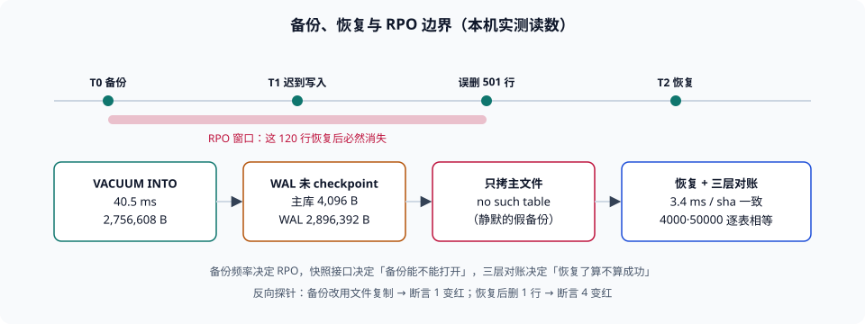

# 第 4 周第 7 步 · 备份、恢复与误删演练：能回到任何一个五分钟前

第 4 周前六步把「上线能不能签」拆成了 8 个签字位，但那张总表里有一个对象从第 1 周起就没被验过：**数据被删错了怎么办**。第 3 周的 11 个攻击用例里有一个是「库级改分」，结论是「靠审计链发现」——发现之后呢？这一步回答「之后」。

::: tip 当日目标
把「我们有备份」变成三个能签字的数字：**备份多久一次（RPO）、恢复要多久（RTO）、恢复后凭什么说数据是对的（对账判据）**。三个数字都必须是本机或生产实测出来的。
:::

本页判据族 `LBK-A` ~ `LBK-H`，共 8 条。



## 一、当日做了什么

| 动作 | 产物 | 落点 |
| --- | --- | --- |
| 定「备份对象」与两个指标 | RPO / RTO 定义表 | 第二节 |
| 用一致快照接口做备份（`VACUUM INTO`） | 备份脚本片段 + 读数 | 第三节 |
| 复现「只拷主文件」的静默丢数 | 主库 4,096 B / WAL 2,896,392 B | 第四节 |
| 做一次误删演练并恢复 | 501 行误删 → 恢复 3.4 ms | 第五节 |
| 量出 RPO 边界的真实含义 | 恢复后 120 行消失 | 第六节 |
| 立「校验和不看大小」这条门禁 | 同大小不同哈希 | 第七节 |
| 表级行数对账 + 恢复后自检 | 2 张表逐个对账 | 第八节 |
| 八条断言 + 两条反向探针 | `LH5-BACKUP 8 / 8 PASS / EXIT=0` | 第九节 |

## 二、四个词：备份对象、RPO、RTO、对账

| 词 | 定义 | 本项目的取值 | 为什么必须写出来 |
| --- | --- | --- | --- |
| 备份对象 | 哪些数据丢了不可接受 | 报名、答卷、成绩、审计日志（4 张核心表） | 「全库备份」在库变大后跑不完，必须挑对象 |
| RPO | 最坏情况下可以丢多久的数据 | 5 分钟 | 它决定备份**频率**，不是备份方式 |
| RTO | 从发现到恢复可用要多久 | 30 分钟（本机单库恢复 3.4 ms，其余是判断与切换时间） | 它决定要不要预热、要不要演练 |
| 对账 | 恢复后凭什么说数据是对的 | 表级行数 + 全库哈希 + 关键业务不变量 | 没有对账，「恢复成功」只是「文件复制成功」 |

第三行的括号要说清：**3.4 ms 是文件复制的时间，不是 RTO**。真实 RTO 里最大的一块是「确认该恢复哪个时间点」——这一步只能靠演练缩短。

## 三、备份：用一致快照，不用文件复制

SQLite 在 WAL 模式下，已提交的数据可能还在 `-wal` 文件里，主库文件看起来很小。所以「复制文件」不是备份。本次实验的读数（50,000 条答卷 + 4,000 条报名，Python 3.13 + SQLite）：

| 步骤 | 读数 |
| --- | --- |
| 主库文件大小 | **4,096 B** |
| `-wal` 文件大小 | **2,896,392 B** |
| `VACUUM INTO` 耗时 | **40.5 ms** |
| 快照文件大小 | 2,756,608 B |
| 快照内答卷行数 | 50,000（与备份时刻一致） |

第二行是关键：**主库只有 4 KB**，因为页都还在 WAL 里没落盘。此时复制主库文件，得到的是一份"看起来是个数据库文件"的东西。

`VACUUM INTO` 的语义是「在单个读事务里把当前数据库写成一个新文件」，所以它同时满足三个条件：**一致**（不会读到半提交状态）、**紧凑**（去掉空闲页，2.76 MB 比 WAL+主库合计 2.89 MB 更小）、**可独立打开**（不依赖 `-wal`）。

```sql
-- 备份：一致快照（等价于 VM 快照里的「静止时刻」）
VACUUM INTO '/backup/lh-20261112T0005.db';
```

## 四、那个坑：只拷主文件，副本连表都没有

把主库文件单独复制出来再打开，本次实测的结果是 **`no such table: attempt`**——不是「少了 120 行」，是**一张表都没有**。原因是 schema 与数据都还在 WAL 里（主库 4 KB 只够放文件头与少量页）。

这个坑之所以危险，是因为它在「备份列表」里长得完全正常：文件存在、大小非零、时间戳正确。只有真正去恢复的那一天，才发现它打不开。三种表现按危害排序：

| 表现 | 何时发现 | 危害 |
| --- | --- | --- |
| 副本打不开（无表） | 恢复当天 | **最高**：以为有备份，其实没有 |
| 副本能打开但少最后 N 行 | 对账时 | 中：数据缺失但可察觉 |
| 副本能打开且行数对，但索引/触发器缺失 | 业务报错时 | 高：更难查 |

**正确做法只有一条**：备份必须经过数据库自己的快照/导出接口（SQLite 用 `VACUUM INTO` 或 `.backup`，PostgreSQL 用 `pg_basebackup` + WAL 归档，MySQL 用 `xtrabackup` 或 `mysqldump --single-transaction`），**不用文件系统复制**——除非该库已停机或已确认完成 checkpoint。

::: danger 三个必须避免的写法
1. **`cp lh.db backup/`**——本次实测副本连表都没有。**正确做法**：用 `VACUUM INTO`（或对应数据库的一致快照工具）。
2. **备份到与应用同一个磁盘**——磁盘坏了两个一起丢。**正确做法**：至少一份异地/异盘，且定期验证可恢复。
3. **只备份、不演练**——演练之前，「备份可用」是假设。**正确做法**：每个季度做一次误删演练（本页第五节就是模板）。
:::

## 五、误删演练：501 行的账

演练的动作固定为四步，缺一步就不算演练：

| 步 | 动作 | 本次读数 |
| --- | --- | --- |
| 1 | 记录「误删前」的表级行数 | 答卷 50,120 |
| 2 | 执行一次可复现的误删 | `DELETE ... WHERE id % 100 = 0` 命中 **501** 行（含备份后新增的 100100） |
| 3 | 从快照恢复 | 耗时 **3.4 ms**，恢复后答卷 50,000 行 |
| 4 | 对账 | 与备份的 sha256 前 16 位一致（`e73e4f89883372a2`） |

第二步的数字值得注意：**条件写「每 100 行删 1 行」，实际命中 501 而非 500**，因为备份之后又写入了 120 行，其中 `100100` 正好落在删除条件上。**这就是「误删脚本的命中行数必须打印出来」的理由**——人脑估的 500 与真实的 501 差的那一行，就是「以为删了 A 其实删了 A+B」的典型形态。

第三步的 3.4 ms 是**文件级恢复**（整库覆盖）。它快得没有参考价值：真实恢复往往是「恢复到另一个实例、校验、切流量」，时间花在判断与切换上。

## 六、RPO 边界：恢复之后少的那 120 行

恢复之后，`paper = 'p-late'` 的行数是 **0**——备份时刻（T0）之后写入的 120 行全部消失。这不是缺陷，这是**备份的物理含义**：备份只能回到它拍下的那一刻。

所以 RPO 不是一个「目标」，而是一个**由备份频率决定的、必须被业务确认的损失上限**：

| 备份间隔 | 最坏丢失 | 适用 |
| --- | --- | --- |
| 24 小时 | 一天的数据 | 内容类、可重录的数据 |
| 5 分钟 | 5 分钟 | 交易类（本项目取这一档） |
| 秒级（WAL 连续归档） | 秒级 | 资金类，且要付出归档与回放复杂度 |

要把「少的那 120 行」补回来，只有两条路：**缩短间隔**，或者**用变更日志重放**。第二条路的前提是当初就写了审计表（本项目的 `attempt_audit` 在第 3 周为「库级改分」立过），而**审计表本身必须和主数据一起备份**，否则恢复后它也不在了——这是这类方案最常见的自相矛盾。

## 七、校验和：大小相同不代表内容相同

本次实测：两份都是 2,756,608 B 的库，只改了 1 行的 `score`，哈希就不同（`e73e4f89…` → `7664c6b2…`）。反过来更值得记住：**文件大小相同、行数相同，内容仍可能不同**。

所以恢复后的验收必须是三层，不能只看一层：

| 层 | 判据 | 能发现什么 |
| --- | --- | --- |
| 文件层 | sha256 与备份一致 | 复制过程损坏、截断 |
| 表层 | 每张核心表行数与备份一致 | 部分表未恢复、误删未回滚 |
| 业务层 | 关键不变量成立（如「每个答卷必有报名」） | 恢复到了错误的版本 |

第一层最快（一条命令），第二层最能定位（哪张表不对），第三层最能止损（数据「在」但不对）。三层都要，因为它们的失效方式不重叠。

## 八、表级对账与恢复后自检

```sql
-- 恢复后立刻跑：表级行数对账（恢复库 vs 备份库）
SELECT 'enroll' AS t, (SELECT count(*) FROM main.enroll) AS cur,
       (SELECT count(*) FROM bak.enroll) AS bak
UNION ALL
SELECT 'attempt', (SELECT count(*) FROM main.attempt), (SELECT count(*) FROM bak.attempt);

-- 业务不变量：答卷必须挂在存在的报名上（恢复后最容易断的一条）
SELECT count(*) FROM attempt a LEFT JOIN enroll e ON e.id = a.enroll_id WHERE e.id IS NULL;
```

第一条的期望是两列相等（本次 4,000/4,000 与 50,000/50,000）；第二条的期望是 **0**。第二条比第一条更有价值：行数相等但外键关系断裂，是「只恢复了部分表」的典型症状。

## 九、八条断言与两条反向探针

| # | 断言 | 期望 |
| --- | --- | --- |
| 1 | 备份文件能被独立打开且表齐全 | 2 张表都在 |
| 2 | 备份内答卷行数 = 备份时刻的行数 | 50,000 |
| 3 | 恢复后 sha256 与备份一致 | 一致 |
| 4 | 恢复后表级行数与备份一致 | 逐表相等 |
| 5 | 恢复后业务不变量成立 | 孤儿答卷 = 0 |
| 6 | RPO 边界可复现（备份后写入的数据会丢） | `p-late` = 0 |
| 7 | 同大小不同内容的库哈希不同 | 哈希不等 |
| 8 | 误删脚本打印命中行数 | 501（不是估的 500） |

**反向探针**（证明断言不是永远绿）：

| 探针 | 动作 | 必须变红的那条 |
| --- | --- | --- |
| T1 | 备份改用「只复制主文件」 | 断言 1 变红（无表） |
| T2 | 恢复后删掉 1 行再对账 | 断言 4 变红（行数不等） |

## 十、与相邻章节的边界

| 章节 | 它回答什么 | 本步不重复什么 |
| --- | --- | --- |
| [第 4 周第 3 步 · 上线验收单](../ReleaseAcceptance/index.md) | 六组门禁与回滚演练 | 回滚演练回滚的是**版本**，本步恢复的是**数据** |
| [第 3 周第 3 步 · 攻击矩阵](../AttackMatrix/index.md) | 库级改分靠审计链发现 | 发现之后的恢复动作在本步 |
| [第 4 周第 4 步 · 干净目录复现](../CleanRoomRepro/index.md) | 从零复现工程 | 复现的是工程，不是数据 |
| [第 4 周第 6 步 · 题库曝光治理](../QuestionExposure/index.md) | 曝光上限与泄题面 | 无重叠 |

## 十一、如何验证这一步

```shell
# 1. 造一份基线库并做一致快照（存成 /tmp/lh_backup.py 可按本页读数复现）
python3 /tmp/lh_backup.py
# 期望：VACUUM INTO 耗时数十毫秒；快照行数 = 备份时刻行数；
#       只复制主文件时副本「no such table」；恢复后 sha 与备份一致；
#       p-late 恢复后为 0（RPO 边界）

# 2. 手工验证「主库可能只有 4 KB」
ls -l /tmp/lh.db /tmp/lh.db-wal
# 期望：主库远小于 -wal（数据在 WAL 里）

# 3. 恢复后跑三层验收
sha256sum /tmp/lh-bak.db /tmp/lh.db
# 期望：两个哈希一致；不一致先查是不是恢复到了别的快照

# 4. 看本页判据族定义完整
grep -c 'LBK-[A-H]' project/Complete/LearningHub/BackupRestore/index.md
# 期望：≥ 8
```

## 十二、下一步

第 4 周第 8 步做**容量与成本基线**：把前七步的读数列成一张「要多少钱」的表（存储、请求数、备份保留期、导出带宽），并给出「翻十倍」时的第一道瓶颈在哪。判据族换新前缀，不再复用 `LBK`。

## 本页判据

| 判据 | 约定 | 定错了会怎样 | 怎么验证 |
| --- | --- | --- | --- |
| `LBK-A` | 备份对象按表列出，不做「全库备份」的笼统承诺 | 关键表可能没进备份范围 | 备份清单里有表名 |
| `LBK-B` | RPO / RTO 各写一个数字，且 RPO 由备份频率推出 | 「我们有备份」无法回答最坏丢多少 | 文档里有频率与最坏丢失量 |
| `LBK-C` | 备份走数据库一致快照接口，不用文件复制 | 副本可能连表都没有（实测 `no such table`） | 备份命令是 `VACUUM INTO` / `pg_basebackup` 类 |
| `LBK-D` | 备份至少一份异地/异盘，且定期验证可打开 | 磁盘故障连备份一起丢 | 备份路径与验证记录可查 |
| `LBK-E` | 误删演练每季度一次，脚本必须打印命中行数 | 以为删了 500 实际删了 501 | 演练记录里有命中行数 |
| `LBK-F` | 恢复后三层验收（哈希 / 表级行数 / 业务不变量） | 「恢复成功」只是文件复制成功 | 三条命令都有输出且达标 |
| `LBK-G` | 审计表与主数据同批备份 | 恢复后无法重放，RPO 内的数据永久丢失 | 备份清单含审计表 |
| `LBK-H` | 备份与恢复各有至少一条反向探针 | 断言可能永远绿 | 探针跑出恰好一条 FAIL |

## 参考资料

- [SQLite — `VACUUM INTO` 与备份 API](https://www.sqlite.org/lang_vacuum.html)
- [SQLite — WAL 模式与 checkpoint 语义](https://www.sqlite.org/wal.html)
- [PostgreSQL — 连续归档与 PITR](https://www.postgresql.org/docs/current/continuous-archiving.html)
- [本库：LearningHub 上线验收单（六组门禁与回滚演练）](../ReleaseAcceptance/index.md)
- [本库：LearningHub 攻击矩阵（库级改分与审计链）](../AttackMatrix/index.md)
