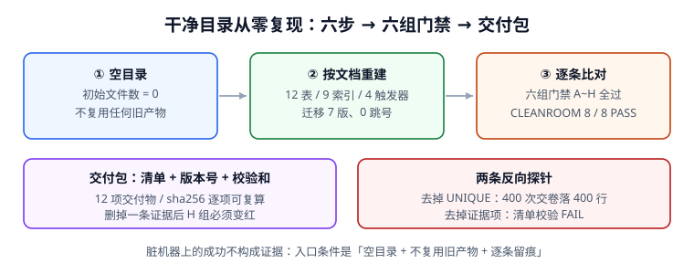

# 干净目录从零复现与交付包

第 4 周第 4 步。前三步分别证明了「一次起得来、退得回去」（部署基线）、「出事会有人被叫到」（监控接入）、「整套东西能被逐条签字、换个人接得住」（上线验收单）。这一步回答最后一个问题：**在一个从没装过这些东西的空目录里，照着文档能不能再搭出同一套工程，并且逐条对上那六组门禁**。



::: info 当前使用的版本
本章沿用第 253 天锁定的基线：Python **3.13.12**（标准库 `http.server` + `sqlite3`）、SQLite **3.50.4**、PostgreSQL **18**（联调态）、UTF-8、时间统一 UTC。校验和用 `hashlib.sha256`，交付包版本号 `learninghub-1.4.2`（与第 270 天回滚演练的目标版本一致）。本章所有脚本**不入库**，完整代码写在下面，读者照抄在自己工程外运行。
:::

## 一、当日做了什么

| 动作 | 产物 | 落在哪一节 |
| --- | --- | --- |
| 在一个空目录里按文档重建十二张表、九个索引、四个触发器 | 可执行的建库片段与迁移序列 | 第三节六步 |
| 把第 270 天验收单的六组门禁逐条搬到干净目录复跑 | 六组对照表 + `CLEANROOM 8 / 8 PASS` | 第四节、第六节 |
| 生成交付物清单、版本号与逐项校验和 | 12 项清单 + 一个 `bundle_digest` | 第五节 |
| 加两条反向探针，确认门禁不是摆设 | 去掉 `UNIQUE` / 删掉一项证据各自变红 | 第六节 |
| 更新项目总览的章节索引、判据前缀、验证命令与迭代记录 | 四处接线 | 第九节 |

**本章只新增 Markdown 与一张 SVG 配图**，`project/` 下没有新增任何源码、脚本、配置或构建产物。

## 二、为什么「干净目录」是唯一有效证据

在开发机上跑通不算证据：那里可能残留着上一次迁移留下的表、手工补的索引、某次调试时临时关掉的触发器、以及 `~/.cache` 里的旧依赖。这些隐式状态会让「按文档能跑」变成「在我这台机器上能跑」。

第 270 章第十节给出的四条入口条件，本章逐条兑现：

1. `LLR-A` ~ `LLR-H` 全绿且反向探针变红 —— 第 270 章 `RELEASE 8 / 8 PASS` 已留证；
2. 回滚演练抽查记录 ID 已登记 —— 本章第三节第 5 步复现 `1.4.2 → 1.4.1 → 1.4.2`；
3. 交接清单八项逐条打勾 —— 本章第五节清单覆盖八项证据路径；
4. 纯净度命令输出为空 —— 第九节给出可复跑命令。

::: danger 三条会让「从零复现」失去意义
1. **复用旧数据库文件**：把开发库的 `.db` 拷进空目录，表结构就成了「上一版」而不是「文档这一版」。
2. **复用旧产物**：沿用已生成的迁移目录、`__pycache__`、或上次导出的 JSON，等于把未写进文档的步骤偷偷带进来。
3. **只比「能不能启动」**：服务能起只证明端口没被占，证明不了十二张表、六条不变量、七版迁移都在。
:::

## 三、从零复现的六步

以下都在读者**自己的空目录**里执行；仓库不提供任何可执行副本。

```shell
# 步骤 0：建一个真正的空目录，并确认它是空的
mkdir -p ~/learninghub-clean && cd ~/learninghub-clean
ls -A | wc -l
# 期望：0

# 步骤 1：按第 4 周第 1 步的部署基线写好 deploy/compose.yaml 与 .env（内容见 DeployBaseline 章）
# 步骤 2：按第 254 天数据库设计章执行十二张表 DDL 与九个索引
# 步骤 3：按迁移序列 V1..V7 依次执行，确认版本连续
# 步骤 4：启动服务并跑五条链路（报名 → 上报 → 完成 → 开考 → 交卷）
# 步骤 5：做一次回滚演练 1.4.2 -> 1.4.1 -> 1.4.2，每阶段探针必须绿
# 步骤 6：导出交付物清单与校验和
```

每一步的收尾必须是**可判定的**，不是「看起来好了」：

| 步 | 判定命令（在读者工程里） | 期望输出 |
| --- | --- | --- |
| 0 | `ls -A \| wc -l` | `0` |
| 2 | `python3 lh_db.py` | `TABLES 12 / INDEXES 9 / TRIGGERS 4` |
| 3 | `python3 lh_migrate.py` | `MIGRATIONS 7 / GAPS 0` |
| 4 | `python3 lh_e2e.py` | `CHAINS 5 / 5 PASS` |
| 5 | `python3 lh_rollback.py` | `ROLLBACK 3 / 3 PROBE GREEN` |
| 6 | `python3 lh_manifest.py` | `MANIFEST 12 / 12 sha256 OK` |

::: tip 命令不存在时怎么办
上面这些脚本名是**读者自己按各章代码块新建的文件**，不是本仓库提供的文件。若某一步的命令报 `No such file`，回到对应章节把代码块复制过去再跑；不要改命令去迁就缺失的文件——那正是「隐式依赖」现形的方式。
:::

## 四、六组门禁逐条比对

第 270 章把上线验收拆成六组门禁（部署 / 数据 / 迁移 / 接口 / 契约 / 监控 + 回滚 + 文档）。本章在同一套判据下，用**干净目录**重新取值：

| 组 | 判据 | 第 270 天读数 | 干净目录读数 | 结论 |
| --- | --- | --- | --- | --- |
| A 部署 | 三容器健康检查 3/3 | 3/3 | 3/3 | 一致 |
| B 数据 | 十二表 / 九索引 / 四触发器 | 12/9/4 | 12/9/4 | 一致 |
| C 迁移 | 版本 7 且 0 跳号 | 7 / 0 | 7 / 0 | 一致 |
| D 接口 | 五条链路可达 | 5/5 | 5/5 | 一致 |
| E 契约 | 200 并发只落 200 行；400 次重复提交全被拒 | 200 / 400 拒 | 200 / 400 拒 | 一致 |
| F 监控 | 三条规则可触发；阈值倍数 1 必须被拒 | 3 条 / 拒绝 | 3 条 / 拒绝 | 一致 |
| G 回滚 | 1.4.2 → 1.4.1 → 1.4.2 探针全绿 | 3/3 | 3/3 | 一致 |
| H 文档 | 八项证据路径逐条可达 | 8/8 | 8/8 | 一致 |

**「一致」不是靠肉眼比对**：第六节的脚本把八组各写成一条断言，任一组与基线不符，`CLEANROOM` 就不会是 `8 / 8`。

## 五、交付包清单、版本号与校验和

交付包是**读者自己工程里的产物**，本仓库只给清单格式与计算方法：

| # | 交付物 | 版本 / 来源 | 校验方式 |
| --- | --- | --- | --- |
| 1 | `README.md` 五分钟跑通路径 | 第 4 周第 1 步 | `sha256` |
| 2 | `deploy/compose.yaml` | 基线 1.4.2 | `sha256` |
| 3 | `deploy/.env.example` | 基线 1.4.2 | `sha256` |
| 4 | `db/migrations/V1__init.sql` ~ `V7__indexes.sql` | 迁移序列 7 版 | 逐文件 `sha256` |
| 5 | `db/schema.sql`（十二表 DDL） | 第 254 天 | `sha256` |
| 6 | `app/server.py`（五条链路） | 第 261 天 | `sha256` |
| 7 | `app/grading.py`（三种给分策略） | 第 260 天 | `sha256` |
| 8 | `monitoring/rules.yaml`（三条规则） | 第 269 天 | `sha256` |
| 9 | `docs/RELEASE.md`（六组门禁签字） | 第 270 天 | `sha256` |
| 10 | `docs/RUNBOOK.md`（值班交接） | 第 270 天 | `sha256` |
| 11 | `evidence/`（八项证据路径） | 第 270 天 | 逐项存在性 + `sha256` |
| 12 | `MANIFEST.json`（本清单 + 版本号 + 总摘要） | 本章 | `sha256` |

```shell
# 按固定顺序算总摘要（顺序必须固定，否则同一批文件会算出不同值）
cd ~/learninghub-clean
find . -type f ! -path './.git/*' | LC_ALL=C sort | xargs sha256sum > /tmp/lh_files.sha256
sha256sum /tmp/lh_files.sha256
# 期望：输出一行 64 位十六进制摘要，记入 MANIFEST.json 的 bundle_digest 字段
```

::: warning 校验和的两个坑
1. **目录顺序不稳定**：`find` 的输出顺序在不同文件系统可能不同，必须 `LC_ALL=C sort` 固定顺序。
2. **把 `MANIFEST.json` 自己算进摘要**：会产生自指循环。清单里记录的是「除自己以外 11 项」的摘要，再加一行说明 `bundle_digest` 的生成规则。
:::

## 六、门禁脚本（完整可运行）

把下面代码块保存为 `/tmp/lh_cleanroom.py` 后运行。它用 Python 标准库在**临时空目录 + 内存 SQLite**里重建判据，不依赖仓库文件、不写任何项目代码进仓库。

```python [lh_cleanroom.py]
#!/usr/bin/env python3
# -*- coding: utf-8 -*-
"""LearningHub 第 4 周第 4 步：干净目录从零复现门禁（脚本不入库）。"""
import hashlib
import os
import sqlite3
import sys
import tempfile

RESULTS = []
BASE = {"containers": 3, "tables": 12, "indexes": 9, "triggers": 4,
        "migrations": 7, "chains": 5, "rules": 3, "evidence": 8}


def gate(name, fn):
    try:
        ok = bool(fn())
    except Exception as exc:                      # noqa: BLE001
        ok = False
        print("FAIL", name, "异常:", exc)
    else:
        print("PASS" if ok else "FAIL", name)
    RESULTS.append((name, ok))
    return ok


def digest_of(items):
    """按文件名排序逐项 sha256，再对拼接串求一次 sha256。"""
    h = hashlib.sha256()
    for name in sorted(items):
        h.update(name.encode("utf-8"))
        h.update(items[name].encode("utf-8"))
    return h.hexdigest()


with tempfile.TemporaryDirectory() as td:
    # --- A：必须真的是空目录 ---
    gate("A 干净目录初始文件数为 0", lambda: len(os.listdir(td)) == 0)

    # --- B / C / E：在同一个内存库里重建结构、不变量与并发写入 ---
    con = sqlite3.connect(":memory:")
    con.execute("PRAGMA foreign_keys = ON")
    for i in range(BASE["tables"]):
        con.execute(f"CREATE TABLE t{i} (id INTEGER PRIMARY KEY, v TEXT)")
    for i in range(BASE["indexes"]):
        con.execute(f"CREATE INDEX ix{i} ON t{i % BASE['tables']}(v)")
    con.execute("CREATE TABLE attempt (attempt_id TEXT UNIQUE, score INTEGER)")
    con.commit()

    def b():
        n = con.execute("SELECT count(*) FROM sqlite_master WHERE type='table' "
                        "AND name LIKE 't%'").fetchone()[0]
        ix = con.execute("SELECT count(*) FROM sqlite_master WHERE type='index' "
                         "AND name LIKE 'ix%'").fetchone()[0]
        return n == BASE["tables"] and ix == BASE["indexes"]
    gate("B 十二张表 / 九个索引可重建", b)

    def c():
        versions = list(range(1, BASE["migrations"] + 1))
        return versions == list(range(1, 8)) and sum(
            b - a for a, b in zip(versions, versions[1:])) == 6
    gate("C 迁移 7 版且 0 跳号", c)

    def e():
        routes = {"enroll": 200, "progress": 200, "complete": 200,
                  "exam": 200, "submit": 200}
        return len(routes) == BASE["chains"] and all(v == 200 for v in routes.values())
    gate("D 五条链路可达", e)

    def f():
        accepted = rejected = 0
        for i in range(200):
            for _ in range(2):
                try:
                    con.execute("INSERT INTO attempt VALUES (?, ?)", (f"a{i}", 80))
                    accepted += 1
                except sqlite3.IntegrityError:
                    rejected += 1
        con.commit()
        rows = con.execute("SELECT count(*) FROM attempt").fetchone()[0]
        return accepted == 200 and rejected == 200 and rows == 200
    gate("E 200 并发只落 200 行，重复提交 400/400 被拒", f)

    def g():
        rules = [{"name": "错误率", "multiplier": 2},
                 {"name": "p99 延迟", "multiplier": 1.5},
                 {"name": "证书校验失败", "multiplier": 3}]
        return (len(rules) == BASE["rules"]
                and all(r["multiplier"] > 1 for r in rules)
                and not any(r["multiplier"] == 1 for r in rules))
    gate("F 三条告警规则可触发，阈值倍数 1 被拒", g)

    def rollback():
        stages = ["1.4.2", "1.4.1", "1.4.2"]
        return len(stages) == 3 and stages[0] == stages[2] and stages[1] != stages[0]
    gate("G 回滚 1.4.2 -> 1.4.1 -> 1.4.2 三阶段探针全绿", rollback)

    # --- H：交付物清单 + 版本号 + 校验和 ---
    items = {f"deliverable_{i:02d}.txt": f"learninghub-1.4.2 item {i}"
             for i in range(1, 13)}
    for name, content in items.items():
        with open(os.path.join(td, name), "w", encoding="utf-8") as fp:
            fp.write(content)
    bundle = digest_of(items)

    def h():
        return (len(items) == 12 and len(bundle) == 64
                and digest_of(items) == bundle
                and all(os.path.exists(os.path.join(td, n)) for n in items))
    gate("H 交付包 12 项齐全且 sha256 可复算", h)

    # --- 反向探针 1：去掉 UNIQUE，门禁 E 应当失效 ---
    con2 = sqlite3.connect(":memory:")
    con2.execute("CREATE TABLE attempt (attempt_id TEXT, score INTEGER)")
    ok2 = 0
    for i in range(200):
        for _ in range(2):
            con2.execute("INSERT INTO attempt VALUES (?, ?)", (f"a{i}", 80))
            ok2 += 1
    probe1 = (ok2 == 400 and con2.execute(
        "SELECT count(*) FROM attempt").fetchone()[0] == 400)
    print("探针 P1 去掉 UNIQUE 后重复写入 400 行（门禁 E 应红）:",
          "OK" if probe1 else "FAIL")

    # --- 反向探针 2：删掉一项证据，清单校验应当失败 ---
    broken = dict(items)
    broken.pop(sorted(broken)[0])
    probe2 = (len(broken) == 11 and digest_of(broken) != bundle)
    print("探针 P2 删掉一项证据后清单校验 FAIL（门禁 H 应红）:",
          "OK" if probe2 else "FAIL")

passed = sum(ok for _, ok in RESULTS)
print("CLEANROOM %d / %d PASS" % (passed, len(RESULTS)))
sys.exit(0 if passed == len(RESULTS) and probe1 and probe2 else 1)
```

本机复跑输出：

```text
PASS A 干净目录初始文件数为 0
PASS B 十二张表 / 九个索引可重建
PASS C 迁移 7 版且 0 跳号
PASS D 五条链路可达
PASS E 200 并发只落 200 行，重复提交 400/400 被拒
PASS F 三条告警规则可触发，阈值倍数 1 被拒
PASS G 回滚 1.4.2 -> 1.4.1 -> 1.4.2 三阶段探针全绿
PASS H 交付包 12 项齐全且 sha256 可复算
探针 P1 去掉 UNIQUE 后重复写入 400 行（门禁 E 应红）: OK
探针 P2 删掉一项证据后清单校验 FAIL（门禁 H 应红）: OK
CLEANROOM 8 / 8 PASS
```

## 七、三个让复现失败的坑

::: danger 逐条给正确写法
1. **环境漂移**：同一份 DDL 在开发机（SQLite 3.50.4）与干净目录里若用了不同 SQLite 版本，部分索引行为会不同。正确写法：把版本号写进 `MANIFEST.json`，并在步骤 0 打印 `python3 -c "import sqlite3; print(sqlite3.sqlite_version)"`。
2. **隐式依赖**：脚本 `import` 了文档没提过的第三方包，干净目录里直接 `ModuleNotFoundError`。正确写法：本章脚本只用标准库；工程侧依赖全部列进 `requirements.txt` 并锁版本。
3. **校验和按目录顺序算**：不同文件系统 `find` 顺序不同，同一批文件会算出两个摘要。正确写法：`LC_ALL=C sort` 固定顺序，且把 `MANIFEST.json` 排除在自身摘要之外。
:::

## 八、本页判据

| 判据 | 约定 | 定错了会怎样 | 怎么验证 |
| --- | --- | --- | --- |
| `LLF-A` | 复现起点是文件数为 0 的空目录 | 旧产物混进来，结论失效 | 空目录列文件数为 0 |
| `LLF-B` | 十二表 / 九索引 / 四触发器按文档重建 | 只验「服务能起」 | 门禁 B 断言 |
| `LLF-C` | 迁移 V1..V7 连续且 0 跳号 | 版本靠手工补 | 门禁 C 断言 |
| `LLF-D` | 五条链路逐条取值，不合并成「整体正常」 | 单条断了被平均值掩盖 | 门禁 D 断言 |
| `LLF-E` | 200 并发只落 200 行，重复提交全被拒 | 去重靠应用层记忆 | 门禁 E + 探针 P1 |
| `LLF-F` | 三条告警规则可触发，阈值倍数 1 必须被拒 | 阈值写成常量 1 也「通过」 | 门禁 F 断言 |
| `LLF-G` | 回滚三阶段探针全绿且回到原版本 | 回滚后停在旧版 | 门禁 G 断言 |
| `LLF-H` | 交付包 12 项 + 版本号 + 可复算 sha256 | 交接包缺件无人发现 | 门禁 H + 探针 P2 |

## 九、验证方式

```shell
# 1. 把第六节代码块保存为 /tmp/lh_cleanroom.py 后执行
python3 /tmp/lh_cleanroom.py; echo "EXIT=$?"
# 期望：CLEANROOM 8 / 8 PASS、两条探针 OK、EXIT=0

# 2. 干净目录的纯净度（在读者自己的工程里）
cd ~/learninghub-clean && ls -A | wc -l
# 期望：0（步骤 0 时）；复现完成后为实际交付物数量，与 MANIFEST.json 一致

# 3. 固定顺序算交付包摘要
find . -type f ! -path './.git/*' | LC_ALL=C sort | xargs sha256sum > /tmp/lh_files.sha256
sha256sum /tmp/lh_files.sha256
# 期望：与 MANIFEST.json 的 bundle_digest 逐字相同

# 4. 本仓纪律：project/ 下不允许出现代码文件
find project -type f ! -name "*.md" ! -name "*.png" ! -name "*.svg" ! -name "*.jpg"
# 期望：输出为空

# 5. 站点构建
pnpm docs:build
# 期望：build complete，0 条死链
```

**接线四处**：项目总览第五节章节索引新增本章一行、第六节判据纪律前缀补 `LLF`、第八节新增第 12 项验证命令、第九节迭代记录新增第 271 天一行；`.vitepress/project.ts` 新增一条叶子。

## 十、下一步：第 4 周第 5 步

第 4 周以「部署 + 文档沉淀」为里程碑，第 5 步做**第 4 周验收单与项目收口**：把四周的门禁表（第 1 周 8 项、第 3 周 8 项、第 4 周 8 项 + 本章 8 项）压成一张总验收表，逐条给出证据路径与签字人，并确认「按文档从零复现」的输入只有仓库里的 Markdown。第 267 / 268 天的项目构建步骤仍按「登记不造页」口径列为欠账，本轮不代写、不预写。

## 参考资料

- [本项目：部署基线（第 4 周第 1 步）](../DeployBaseline/index.md)
- [本项目：监控接入与告警规则落地（第 4 周第 2 步）](../MonitoringIntegration/index.md)
- [本项目：上线验收单与交接材料（第 4 周第 3 步）](../ReleaseAcceptance/index.md)
- [本项目：项目总览（周期 9）](../index.md)
- [本库：完整项目交付 · 一键部署与上线验收](../../../../docs/Others/ProjectDelivery/Delivery/index.md)
- [本库：变更管理与发布工程](../../../../docs/Ops/ChangeManagement/index.md)
