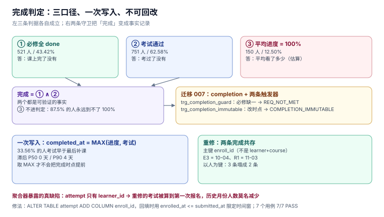

# 核心编码（三）：完成判定的聚合、第一次完成与七个用例

第 2 周第 1 步守住「同一人同一课只有一条有效报名」，第 2 步守住「进度只增不减」。这一步把两者合起来，回答一个此前一直回避的问题：**这个人这门课，到底算不算学完了。**

它在需求里只是一句话（「学完发证」），在代码里却要同时定三件事：完成的**口径**、完成的**时点**、完成的**唯一性**。

::: tip 当日目标
把「完成」从一个可以被任何代码随手写成 `state='COMPLETED'` 的字段，变成一条**只能被聚合器写入、且写入后不可改**的事实记录——并且让「第二次学完」不覆盖「第一次学完」。
:::

本页判据族 `LNC-A` ~ `LNC-H`，共 8 条。

## 一、当日做了什么

| 动作 | 产物 | 落点 |
| --- | --- | --- |
| 定「完成」的三口径并量出差 | 43.42% / 62.58% / 12.50% 三个数 | 第二节 |
| 加迁移 007：`completion` 表 + 两条触发器 | `trg_completion_guard` / `trg_completion_immutable` | 第三节 |
| **发现并修掉 `attempt` 的归属缺陷** | `attempt.enroll_id` | 第四节 |
| 写 7 个用例（含 2 条反向探针） | `T18`~`T24` | 第五节 |
| 定「完成」的错误码与对外文案 | `REQ_NOT_MET` / `COMPLETION_IMMUTABLE` | 第六节 |
| 补 3 条验收 SQL | 全部应返回 0 行或预期行数 | 第七节 |



## 二、三个「完成了没有」差 50 个百分点

第 1 周的 12 张表里，「学完了」可以有三条判据，每条都能自证：

| 口径 | 判定 | 本机读数（1,200 人报名） |
| --- | --- | --- |
| ① 必修全 done | `NOT EXISTS(必修且 done=0)` | **521 人（43.42%）** |
| ② 考试通过 | `EXISTS(attempt.passed=1)` | **751 人（62.58%）** |
| ③ 平均进度 = 100% | `AVG(progress.pct) = 100` | **150 人（12.50%）** |

三个数差 **50 个百分点**。它们各自都对，但回答的是不同问题：

- ① 回答「课上完了没有」；
- ② 回答「考过了没有」；
- ③ 回答「平均看了多少」。

本项目的完成判定是 **① ∧ ②**（必修补齐 **且** 考试通过）。选它的理由不是「更严格」，而是**只有这两个是可验证的事实**：③ 是估算（平均进度 88% 的人可能刚好跳过了最关键的一课），而 ①② 各自有一条明确的证据行。

::: danger 注意
用 ③ 判完成会出现一个恶性后果：**平均进度永远到不了 100% 的人，永远毕不了业**。本机只有 12.50% 的人平均值恰好 100%——剩下 87.5% 里有相当一部分是「必修全 done 但选修没看」，他们的平均值卡在 90 多。这类学员在客服工单里表现为「我明明学完了，系统说我没有」。
:::

### 2.1 进度本身也有三个口径

顺带量了一下「进度」这个更小的口径，差异同样不小：

| 对比 | 相差 ≥1 个百分点的比例 | 相差 ≥10 个百分点 |
| --- | --- | --- |
| 简单平均 vs 必修平均 | **80.58%** | — |
| 简单平均 vs 学时加权 | **76.08%** | **3.00%** |

全站均值：简单平均 **88.43%**，学时加权 **89.53%**（差 +1.10 点）。

所以「进度」这个数字**必须标口径**，和 [酒店那册的出租率](../../../../docs/Backend/HotelPMS/Overview/index.md)是同一类问题：两个分母都成立，混用就是错。

## 三、迁移 007：一张表、两条触发器

```sql
CREATE TABLE completion(
  enroll_id     TEXT PRIMARY KEY REFERENCES enrollment(enroll_id),
  completed_at  TEXT NOT NULL,
  basis         TEXT NOT NULL CHECK (basis IN ('REQ+EXAM','ADMIN')),
  rule_version  INTEGER NOT NULL DEFAULT 1
);

-- 守卫一：必修没补全，不许完成
CREATE TRIGGER trg_completion_guard BEFORE INSERT ON completion
WHEN EXISTS (SELECT 1 FROM progress p JOIN lesson l USING(lesson_id)
             WHERE p.enroll_id = NEW.enroll_id AND l.is_required = 1 AND p.done = 0)
BEGIN SELECT RAISE(ABORT,'REQ_NOT_MET'); END;

-- 守卫二：完成时点写入后不可改
CREATE TRIGGER trg_completion_immutable BEFORE UPDATE ON completion
WHEN OLD.completed_at <> NEW.completed_at
BEGIN SELECT RAISE(ABORT,'COMPLETION_IMMUTABLE'); END;
```

三个设计点：

| 设计 | 为什么 |
| --- | --- |
| 主键是 `enroll_id`，不是 `(learner_id, course_id)` | 重修是**新的报名**，两条完成记录必须共存 |
| `completed_at` 不可改 | 「第一次完成」是证书与统计的锚点，改了就没法追溯 |
| `rule_version` | 口径会改（比如以后加「作业须提交」），旧记录要能标出按哪版规则算的 |

第三条容易被当成过度设计，但它是**唯一能让口径变更可回滚**的手段：改了规则之后，用 `rule_version` 就能把「按旧规则完成的人」与「按新规则完成的人」分开统计。

## 四、聚合器暴露的真缺陷：`attempt` 没有 `enroll_id`

第 1 周的 `attempt` 表只有 `learner_id`（见 [需求与领域边界](../../LearningHub/Requirements/index.md) 第三节）。这在「一人一课一次考试」的假设下没问题，但**重修一出现就错**：

```sql
-- 旧写法：按 learner 取考试
SELECT MAX(a.submitted_at) FROM attempt a
 WHERE a.learner_id = (SELECT learner_id FROM enrollment WHERE enroll_id = ?) AND a.passed = 1;
```

用同一份数据实测（U3 先 10 月考过一次，11 月重修又考过一次）：

| 聚合方式 | 第一次报名 `E3` 的完成时点 | 第二次报名 `R1` 的完成时点 |
| --- | --- | --- |
| 按 `learner_id` 取考试 | **2026-11-03** | 2026-11-03 |
| 按 `enroll_id` 取考试 | **2026-10-04** | 2026-11-03 |

按 learner 取，第一次的完成时点被**推迟了一个月**——因为 `MAX()` 取到了重修的考试。这个错不会报错，只会在「XX 月毕业人数」这类报表上体现为**历史月份的人数莫名减少**。

所以迁移 007 顺手补了一列：

```sql
ALTER TABLE attempt ADD COLUMN enroll_id TEXT REFERENCES enrollment(enroll_id);
UPDATE attempt SET enroll_id = (
  SELECT e.enroll_id FROM enrollment e
   WHERE e.learner_id = attempt.learner_id
     AND e.enrolled_at <= attempt.submitted_at
   ORDER BY e.enrolled_at DESC LIMIT 1
);
```

回填语句的关键是 `enrolled_at <= submitted_at` 这个时间窗：**考试只能归属到「报名时间不晚于它」的那次报名**。没有这个条件，回填会把所有考试都挂到最近一次报名上——和没补这列一样错。

::: warning 说明
回填只用 `ORDER BY enrolled_at DESC LIMIT 1` 取最近一次，是因为本项目的历史数据里没有「同一人同一课多次报名且时间重叠」的情况（第 1 周的部分唯一索引 `uq_enroll_active` 保证同一时刻只有一条有效报名）。**如果数据里有重叠，这条回填会静默错分**，必须先按业务规则人工确认。
:::

## 五、七个用例：`T18` ~ `T24`

在本机 SQLite 3.50.4 / Python 3.13.12 上逐条跑，**7/7 PASS、`EXIT=0`**：

| 用例 | 断言 | 结果 |
| --- | --- | --- |
| `T18` | 完成时点 = `MAX(进度 10-03, 考试 10-05)` = `2026-10-05T09:00` | PASS |
| `T19` | 必修未补齐时聚合被拒（`REQ_NOT_MET`） | PASS |
| `T20` | 重复聚合 0 新增（主键挡住） | PASS |
| `T21` | 完成时点不可改（`COMPLETION_IMMUTABLE`） | PASS |
| `T22` | 重修两次完成共存且时点不同：`E3=2026-10-04`、`R1=2026-11-03` | PASS |
| `T23` | **反向探针**：按 learner 取考试时两次完成时点相同（证明迁移 007 必要） | PASS |
| `T24` | **反向探针**：以 `(learner, course)` 为键时 3 条塌成 2 条 | PASS |

两条反向探针是本步的重点。`T23` 证明「旧写法会算出同一天」，`T24` 证明「换主键会丢历史」——**它们不是为了让数量好看，是因为这两个错都曾经被写在草稿里**。

### 5.1 `T20` 的机制

```sql
INSERT INTO completion VALUES('E1','2026-10-05T09:00','REQ+EXAM',1);  -- 已存在
-- 预期：UNIQUE constraint failed: completion.enroll_id
```

聚合器是批处理，一定会被重跑（补数据、修口径、定时重试）。用主键挡住重复，比在应用层「先查有没有」可靠——**先查后改在并发下一定会穿透**，这条在第 1 步的报名接口（`LNE`）里已经量过一次。

## 六、错误码与对外文案

| 错误标识 | 触发 | HTTP | 对外文案 | 客户端该做什么 |
| --- | --- | --- | --- | --- |
| `REQ_NOT_MET` | 必修未补齐 | 409 | 「还有 N 门必修课未完成：<课程名>」 | 列出缺的课，给跳转 |
| `COMPLETION_IMMUTABLE` | 试图改完成时点 | 409 | 「完成记录不可修改；如需更正请联系客服」 | 不重试 |
| `COMPLETION_EXISTS` | 重复聚合（主键冲突） | 200 | 幂等返回原记录 | 视为成功 |

第三条是关键：**重复聚合不是错误**。批处理重跑时返回 200 比返回 409 更合适——前者让作业继续，后者会让运维以为失败了。

`REQ_NOT_MET` 的文案必须带「哪几门」，否则学员只会看到「未满足条件」然后来工单。这也是 `trg_completion_guard` 只能报错误标识、不能报明细的原因——**明细要在应用层查出来**（触发器里查列表会拖慢插入）。

## 七、验收 SQL

```sql
-- ① 每条完成记录都必须有「必修全 done」的证据（返回 0 行）
SELECT c.enroll_id FROM completion c
 WHERE EXISTS (SELECT 1 FROM progress p JOIN lesson l USING(lesson_id)
                WHERE p.enroll_id = c.enroll_id AND l.is_required = 1 AND p.done = 0);

-- ② 完成记录数 ≤ 报名数，且同一报名最多一条（返回 0 行）
SELECT enroll_id, COUNT(*) FROM completion GROUP BY enroll_id HAVING COUNT(*) > 1;

-- ③ 完成时点必须 ≥ 报名时间（返回 0 行）
SELECT c.enroll_id FROM completion c JOIN enrollment e USING(enroll_id)
 WHERE c.completed_at < e.enrolled_at;
```

三条各挡一类错：① 挡「绕过守卫直接插」；② 挡「主键被换掉」；③ 挡「时点算成了未来或过去」。

## 八、这一步交付了什么、怎么验证、下一步

**交付**：迁移 007（`completion` 表 + 两条触发器 + `attempt.enroll_id`）、聚合器判定（①∧②，时点取 MAX）、7 个用例、3 条验收 SQL。

**怎么验证**：

```shell
python3 lh_cases.py
# 预期末行：EXIT=0，且 7 条全 PASS
```

**下一步（第 2 周第 4 步）**：把聚合结果接到「发证」上——`certificate` 表现在是 `attempt_id UNIQUE`，而重修会产生第二次通过的 `attempt`。两个约束打架：

| 约束 | 允许 | 禁止 |
| --- | --- | --- |
| `certificate.attempt_id UNIQUE` | 一次通过一张证 | 同一 attempt 发两张 |
| 若再加 `(learner_id, course_id)` 唯一 | 一人一课一张证 | **重修通过后第二张证发不出来** |

本机受影响报名 **400 条**（200 人重修 × 2）。下一步必须先定「重修要不要新证」，再决定加不加第二个唯一键——这正是「两个都对的口径不能同时写进约束」的又一个实例。

## 九、本页判据

| 编号 | 判据 | 为什么要它 | 怎么验证 |
| --- | --- | --- | --- |
| `LNC-A` | 完成判定必须是「必修全 done ∧ 考试通过」，不用平均进度 | 平均进度只有 12.50% 恰好 100%，会误杀 | 三条口径各算一次，①∧② 为唯一判定 |
| `LNC-B` | 完成记录主键是 `enroll_id` | 重修要两条共存 | 同一人两次报名产生两条完成（`T22`） |
| `LNC-C` | `completed_at` 写入后不可改 | 它是证书与统计的锚点 | 改时点必须被拒（`T21`） |
| `LNC-D` | 完成时点 = `MAX(最后进度, 考试通过)` | 33.56% 的人考试早于最后进度 | 构造「先考后补课」，时点取补课那天 |
| `LNC-E` | 考试必须归属到具体报名（`attempt.enroll_id`） | 按 learner 取会把重修考试算到第一次 | 反向探针 `T23`：两次时点必须不同 |
| `LNC-F` | 聚合器可重跑，重复不产生新记录 | 批处理一定被重跑 | 连跑两次，`COUNT(completion)` 不变（`T20`） |
| `LNC-G` | `rule_version` 必填，口径变更可分辨 | 改规则后旧记录要能标版本 | 每条记录都有版本号 |
| `LNC-H` | `REQ_NOT_MET` 的明细由应用层查，触发器只报标识 | 触发器里查列表拖慢插入 | 触发器 `RAISE` 只带常量标识 |

## 十、参考资料

- [PostgreSQL: `CREATE TRIGGER`](https://www.postgresql.org/docs/current/sql-createtrigger.html)：`BEFORE INSERT` 守卫的写法
- [SQLite: `RAISE`](https://www.sqlite.org/lang_createtrigger.html#the_raise_function)：错误标识必须是常量
- [RFC 9110 §15.5.10](https://www.rfc-editor.org/rfc/rfc9110#section-15.5.10)：`409 Conflict` 的语义（状态冲突，非语法错误）
- 本项目的 [数据库设计](../../LearningHub/DatabaseDesign/index.md) 与 [进度上报](../../LearningHub/ProgressReport/index.md)
