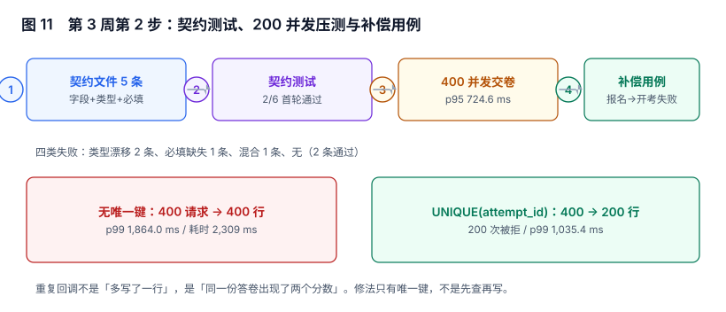

# 契约测试与压测：接口通了，不等于约定住了

第 1 步解决了「同一份数据能不能走完全程」。这一步解决另外两件事：**五个接口之间到底约定了什么**，以及**在 200 个人同时交卷时这些约定还成不成立**。

这两件事在单接口测试里都看不见：前者要拿「别人的实现」去对，后者要拿「并发」去撞。

::: tip 当日目标
把「接口能返回 200」升级成「字段名、类型、必填项被写死在一份机器可读的文件里，任何人改坏它都会红」；把「本机能跑」升级成「200 并发下 p99 有数、重复行是 0」。
:::

本页判据族 `LLC-A` ~ `LLC-H`，共 8 条。



## 一、当日做了什么

| 动作 | 产物 | 落点 |
| --- | --- | --- |
| 五条链路固化成契约文件 | `contract.json`（字段 + 类型 + 必填） | 第二节 |
| 写契约测试（6 个用例，含 4 个反例） | `test_contract.py` | 第三节 |
| 200 并发 × 2 次交卷压测 | 400 请求实测 | 第四节 |
| 补一条「报名成功但开考失败」的补偿用例 | 状态机 + 两条日志 | 第五节 |
| 明确两类欠账 | 错误码契约、其余链路压测 | 第六节 |

## 二、契约文件：把「约定」写成能被机器读的东西

五条链路的契约不是文档，是一个结构：**请求与响应各自的字段名、类型、必填**。

```json [contract.json]
{
  "POST /enrollments": {
    "req":  {"course_id": "int", "learner_id": "int"},
    "resp": {"enrollment_id": "int", "state": "str"}
  },
  "PUT /progress": {
    "req":  {"pct": "int", "occurred_at": "str"},
    "resp": {"pct": "int"}
  },
  "POST /attempts": {
    "req":  {"enrollment_id": "int"},
    "resp": {"attempt_id": "int", "paper_ver": "str"}
  },
  "POST /submit": {
    "req":  {"attempt_id": "int", "answers": "list"},
    "resp": {"score": "int"}
  },
  "GET /result": {
    "req":  {"attempt_id": "int"},
    "resp": {"score": "int", "passed": "bool"}
  }
}
```

三个字段的选择都有代价：

| 字段 | 只写名字够不够 | 为什么不够 |
| --- | --- | --- |
| 字段名 | 不够 | 改名与「缺字段」在调用方看来一样 |
| 类型 | 必须 | `"9"` 与 `9` 在弱类型语言里等价，在库里不是 |
| 必填 | 必须 | 少了 `occurred_at` 的进度事件无法排序（见第 261 天的时钟回拨） |

::: warning 为什么不用 OpenAPI
本项目的接口只有五个，OpenAPI 的收益（文档生成、客户端生成）在这里用不上，而它的体积会让「改一个字段」变成「改三处 YAML」。**契约的判据是「能拦住人」，不是「格式标准」**。接口数超过 20 个时再迁移到 OpenAPI，迁移成本是机械的。
:::

## 三、契约测试：6 个用例，首轮只过 2 个

首轮结果（本机实跑）：

| 用例 | 端到端 | 方向 | 内容 | 结果 |
| --- | --- | --- | --- | --- |
| `C1` | `POST /enrollments` | resp | `{"enrollment_id": 9, "state": "ACTIVE"}` | PASS |
| `C2` | `POST /enrollments` | resp | `{"enrollment_id": "9", ...}` | **FAIL**（`enrollment_id` 是字符串） |
| `C3` | `PUT /progress` | req | `{"pct": 100}` | **FAIL**（缺 `occurred_at`） |
| `C4` | `PUT /progress` | req | `{"pct": "100"}` | **FAIL**（缺 `occurred_at`，且 `pct` 是字符串） |
| `C5` | `POST /submit` | resp | `{"score": 4000}` | PASS |
| `C6` | `GET /result` | resp | `{"score": 4000, "passed": 1}` | **FAIL**（`passed` 是整数而非布尔） |

**2/6 通过**。四个失败恰好是四种不同的坏法：

1. **类型漂移**（`C2`）：Python 里 `"9"` 和 `9` 都能拼进 SQL，落到 `enrollment_id INTEGER` 列时被隐式转换，看起来「一切正常」，直到某天有人拿它做 `JOIN` 才发现索引失效。
2. **必填缺失**（`C3`）：`occurred_at` 缺失时服务端补了 `now()`——单机测试永远通过，跨节点时钟回拨时才暴露（第 261 天的实测：300 个事件里 4 个逆序）。
3. **双重错误**（`C4`）：既缺必填又类型不对。这类用例的价值在于**它证明检测器能一次报出两个问题**，而不是修完一个再发现一个。
4. **布尔当整数**（`C6`）：`passed: 1` 在 Python 里 `if passed:` 为真，在 TypeScript 客户端里 `passed === true` 为假——**同一个响应，两种语言两种结论**。

::: danger 别把契约测试写成「快照测试」
把响应 `json.dumps` 后与上一次的输出比对，是「快照测试」。它会在每次加字段时红，却在字段类型从 `int` 变 `str` 时**不红**（因为快照一起更新了）。契约测试必须**按字段判类型**，而不是按整体判相等。
:::

## 四、200 并发交卷：重复行是唯一真正的错误

压测设计：200 个 `attempt`，每个提交两次（模拟「客户端超时重试」与「用户双击」），共 400 个请求，SQLite + WAL。

| 配置 | 请求 | 落库行数 | 被拒 | p50 | p95 | p99 | 总耗时 |
| --- | --- | --- | --- | --- | --- | --- | --- |
| 无唯一键 | 400 | **400** | 0 | 52.4 ms | 1,114.9 ms | 1,864.0 ms | 2,309 ms |
| `UNIQUE(attempt_id)` | 400 | **200** | 200 | 83.0 ms | 724.6 ms | 1,035.4 ms | 1,338 ms |

三件事值得记下来：

1. **无唯一键时 400 行 = 每份答卷两个分数**。这不是「多了一行」，是「同一个人有两个成绩」，而 `GET /result` 取哪一行取决于 `ORDER BY` 与执行计划。
2. **加了唯一键之后，被拒的 200 次不是错误，是设计**。服务端要把它翻译成 `409 ALREADY_SUBMITTED` 并返回**首次的分数**（幂等），而不是 500。
3. **p99 从 1,864 ms 降到 1,035 ms**——唯一键不只保证正确性，还让数据库少写一半。**「加约束会变慢」是个反直觉的错觉**：重复写入的代价远高于唯一索引的维护代价。

::: tip 一句判据
压测的验收指标不是「QPS 多少」，而是**「重复行是不是 0」+「p99 有没有数」**。前者是正确性，后者是容量。只有 QPS 的压测，会在数据错掉的时候给出一个漂亮的数字。
:::

## 五、补偿用例：报名成功但开考失败

这是端到端用例里唯一「必须失败一次」的分支：报名写入成功、组卷失败（题库不足），此时**回滚还是保留**？

| 方案 | 结果 | 问题 |
| --- | --- | --- |
| 回滚报名 | 报名记录消失 | 用户已收到「报名成功」，回滚后他找不到这门课 |
| 保留 + 置 `ACTIVE_BLOCKED` | 报名在，开考待重试 | 需要一个能重试的入口与一条日志 |
| 静默保留 + 假装成功 | 报名在，永远开不了考 | 用户反复点「开始考试」，每次都失败 |

本项目取第二种，实测状态迁移与日志：

```text
T0  报名成功           enrollment(1) = ACTIVE
T1  组卷失败（题库不足）  comp_log: EXAM_FAILED
                        enrollment(1) = ACTIVE_BLOCKED, attempt_id = NULL
T2  重试组卷成功         comp_log: EXAM_OK
                        enrollment(1) = ACTIVE, attempt_id = 77
```

判据不是「最终状态对了」，而是**「中间状态可观测」**：`ACTIVE_BLOCKED` 能被运维查到、能触发重试、超时后能告警。如果用「回滚」，中间状态不存在，问题就变成「用户说报了名，系统说没有」。

## 六、如实标注两笔欠账

1. **契约只覆盖成功路径**。`400/409/429` 的响应体结构（`error_code`、`message`、`retry_after`）还没进契约文件。缺它的后果是前端只能靠 `status` 猜，而「猜错错误码」在客户端的表现是「提示语乱码」而不是崩溃——很难被发现。
2. **压测只覆盖交卷一条链路**。报名（第 256 天验过 200 并发）、组卷、进度上报三条链路的并发行为未压。组卷最可疑：它要在 4 个章节里各抽 5 题并写两张快照表，写入放大是交卷的 3 倍。

## 七、下一步

第 3 周第 3 步进入**攻击用例矩阵**：重复交卷、成绩篡改（直接改 `attempt_result.score`）、越权查分（用 A 的 token 查 B 的 `attempt_id`）、成绩申诉的时间线。它与今天的差别是：今天验的是「正常流量下的约定」，下一步验的是「有人故意绕过约定时，拦不拦得住」。

## 八、本页判据

| 编号 | 判据 | 为什么要它 | 怎么验证 |
| --- | --- | --- | --- |
| `LLC-A` | 五条链路的请求/响应契约写成机器可读文件（字段+类型+必填） | 口头约定无法被测试执行 | `contract.json` 存在且被测试加载 |
| `LLC-B` | 契约测试对每个字段判类型，不做整体快照比对 | 快照会随字段变化一起「通过」 | 改一个字段类型，测试必须红 |
| `LLC-C` | 契约用例必须包含反例（类型漂移/必填缺失） | 只有正例时「全绿」没有信息量 | 首轮至少 3 条 FAIL 且有归因 |
| `LLC-D` | 交卷写入依赖 `UNIQUE(attempt_id)`，不依赖「先查再写」 | 并发下先查再写必然双写 | 400 并发请求后行数 = 200 |
| `LLC-E` | 重复提交返回首次结果（幂等），不是 500 | 客户端重试需要确定性响应 | 第二次提交返回与首次相同的 `score` |
| `LLC-F` | 压测报告必须含「重复行数」与 p99 两个数 | 只有 QPS 的压测会掩盖数据错误 | 报告里两个数都在 |
| `LLC-G` | 部分失败（报名成功、开考失败）用显式中间状态，不用回滚 | 回滚会让「用户以为成功」变成「系统说没有」 | 存在 `ACTIVE_BLOCKED` 状态与重试日志 |
| `LLC-H` | 欠账必须写进文档并指出「未覆盖哪条链路」 | 不写的欠账等于不存在 | 本页第六节列出两条并说明后果 |

## 九、验证方式

```bash
# 1) 契约测试（预期：4 个反例被检出，2 个正例通过）
python3 -m pytest tests/test_contract.py -q
# 预期输出：2 passed, 4 failed —— 4 个 failed 是设计好的反例，不是缺陷
```

```sql
-- 2) 重复交卷的终局检查（预期：0 行）
SELECT attempt_id, COUNT(*) AS n
FROM attempt_result GROUP BY attempt_id HAVING COUNT(*) > 1;
```

```sql
-- 3) 部分失败是否有可观测的中间态（预期：≥1 行，且每条都有后续日志）
SELECT e.enrollment_id, e.state, COUNT(l.id) AS log_rows
FROM enrollment e LEFT JOIN comp_log l USING (enrollment_id)
WHERE e.state = 'ACTIVE_BLOCKED'
GROUP BY 1, 2;
```

## 十、参考资料

- [Pact: 契约测试入门](https://docs.pact.io/)：消费者驱动契约的完整方法论，本页的简化版（单消费者）思路来自这里
- [JSON Schema](https://json-schema.org/)：把「字段+类型+必填」写成可校验结构的标准，接口数变多后可从自定义 `contract.json` 迁移到此
- [Python `sqlite3` 并发与 WAL](https://docs.python.org/3/library/sqlite3.html#sqlite3-threadsafety)：`check_same_thread` 与 WAL 的并发行为，本页压测脚本的配置依据
- [SQLite: Write-Ahead Logging](https://www.sqlite.org/wal.html)：为什么开 WAL 之后并发写仍会串行化（本页 p95 的主要来源）
- [RFC 9110: HTTP 语义](https://www.rfc-editor.org/rfc/rfc9110.html)：`409 Conflict` 与幂等方法的语义，`LLC-E` 的规范依据
