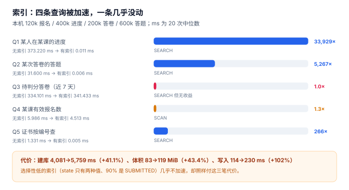

# 数据库设计：五条查询、九个索引、一次迁移

前一步（[技术选型与版本基线](../TechBaseline/index.md)）把「换台机器还能不能跑」钉死了，但那十二张表还是「结构正确、路径未知」的状态：**表能存数据，不代表数据能被快速取出来**。这一步做的是把五条高频查询的路径固定下来——不是「加索引让查询变快」，而是「先写查询，再决定索引，最后证明它真的快了」。

::: tip 这一步解决的问题
建表是把「数据长什么样」说清楚；**建索引是把「数据怎么被取用」说清楚**。前者错了会插不进去，后者错了只会「慢」，而慢是最容易被拖到线上才发现的问题。
:::

## 一、五条查询：先写查询，再谈索引

十二张表的读写路径有几十条，真正决定用户体验的只有五条：

| 编号 | 查询 | 触发场景 | 频率（估） |
| --- | --- | --- | --- |
| `Q1` | 某学员在某门课的进度 | 学员打开课程页 | 每页一次 |
| `Q2` | 某次答卷的全部答题 | 判分、申诉复核 | 每次交卷/申诉 |
| `Q3` | 待判分的答卷（近 7 天） | 后台判分队列 | 每分钟轮询 |
| `Q4` | 某门课的有效报名数 | 课程详情、容量校验 | 每页一次 |
| `Q5` | 证书按编号查 | 外部验真 | 扫码即查 |

```sql
-- Q1：某人在某课的进度
SELECT p.* FROM progress p JOIN enrollment e USING (enrollment_id)
WHERE e.learner_id = :learner AND e.course_id = :course;

-- Q3：待判分答卷
SELECT * FROM attempt WHERE state = 'SUBMITTED' AND submitted_at >= :since;

-- Q5：证书验真
SELECT * FROM certificate WHERE no = :cert_no;
```

## 二、九个索引与它们各自服务的查询

| 索引 | 定义 | 服务的查询 | 为什么建 |
| --- | --- | --- | --- |
| `idx_enroll_learner_course` | `(learner_id, course_id)` | Q1 | 从人找课，等值两列 |
| `uq_enroll_active` | `(learner_id, course_id) WHERE state IN ('ACTIVE','COMPLETED')` | 报名唯一性 | **部分唯一索引**，撤销后可重报 |
| `idx_progress_enroll` | `(enrollment_id, lesson_id)` | Q1 的第二跳 | 从报名找进度 |
| `idx_answer_attempt` | `(attempt_id)` | Q2 | 从答卷找答题 |
| `idx_attempt_state` | `(state, submitted_at)` | Q3 | 按状态 + 时间范围 |
| `idx_attempt_exam_learner` | `(exam_id, learner_id)` | 防重复交卷 | 复合唯一性校验的读路径 |
| `uq_cert_no` | `(no)` | Q5 | 验真必须唯一 |
| `idx_lesson_section` | `(section_id, seq)` | 课程详情 | 章节内课时排序 |
| `idx_section_course` | `(course_id, seq)` | 课程详情 | 课程内章节排序 |

九个索引里只有一个是**部分索引**（`uq_enroll_active`），它承担了两个职责：唯一性约束 + 读路径。这是 SQLite 与 PostgreSQL 都支持的写法，也是「同一人同一课不能有两个有效报名，但历史取消记录要保留」这个需求的唯一干净解法。

```sql
CREATE UNIQUE INDEX uq_enroll_active
  ON enrollment (learner_id, course_id)
  WHERE state IN ('ACTIVE', 'COMPLETED');
```

## 三、实测：四条被加速，一条几乎没动



数据量：报名 120,000、进度 400,000、答卷 200,000、答题 600,000、证书 30,000。每条查询跑 20 次取中位数：

| 查询 | 无索引 | 有索引 | 倍数 | 计划 |
| --- | --- | --- | --- | --- |
| Q1 某人在某课的进度 | 373.220 ms | **0.011 ms** | **33,929×** | `SEARCH` |
| Q2 某次答卷的答题 | 31.600 ms | **0.006 ms** | **5,267×** | `SEARCH` |
| Q3 待判分答卷（近 7 天） | 334.101 ms | 341.433 ms | **1.0×** | `SEARCH` 但无收益 |
| Q4 某课有效报名数 | 5.986 ms | 4.513 ms | 1.3× | `SCAN` |
| Q5 证书按编号查 | 1.331 ms | **0.005 ms** | **266×** | `SEARCH` |

**Q3 是这一步最重要的一条读数**：它明明走了 `SEARCH`，耗时却一点没降。原因是选择性太低——20 万条答卷里 90% 以上都是 `SUBMITTED`，索引扫描要回表 18 万次，比全表扫描还慢一点。

::: danger 三个索引设计错误
1. **「每个 WHERE 列都建索引」**：Q3 就是反例。选择性低于 10% 的列（状态、布尔、性别）单独建索引，几乎不加速，却要付写放大与体积。
2. **复合索引的列序随手写**：`(state, submitted_at)` 与 `(submitted_at, state)` 对范围查询的效果差很多。前者的 `state` 是等值、`submitted_at` 是范围，符合「等值在前、范围在后」。
3. **用唯一约束代替部分唯一索引**：`UNIQUE(learner_id, course_id)` 会让「取消后重新报名」直接失败——历史记录必须保留，唯一性只应作用于有效状态。
:::

## 四、代价：索引不是免费的

| 指标 | 无索引 | 有索引 | 变化 |
| --- | --- | --- | --- |
| 建库（含 135 万行写入） | 4,081 ms | 5,759 ms | **+41.1%** |
| 库体积 | 83.0 MiB | 119.0 MiB | **+43.4%** |
| 写入 6 万条进度 | 114 ms | 230 ms | **+102%** |

写入慢一倍是必须接受的代价——但前提是**每个索引都有明确的查询在用它**。九个索引对应五条查询，多出来的四个服务的是唯一性约束与排序，都属于「不可省」。

一个可执行的纪律：**新增索引必须写明「服务哪条查询」**，写不出来的就不加。这条纪律比任何评审都有效。

## 五、迁移：三张表之外的第 13 张表

十二张表之外，还需要一张 `schema_version`：

```sql
CREATE TABLE schema_version (
  version    INTEGER PRIMARY KEY,
  applied_at TEXT NOT NULL,
  note       TEXT NOT NULL
);
```

没有它，第二周的「加一个字段」就会变成一次手工操作，而手工操作无法在第三周的联调环境里复现。迁移的三条规则：

1. **只增不改**：加列、加索引、加表可以；改列类型、删列必须走「新建表 → 迁移数据 → 改名」三步。
2. **每个迁移有版本号且可重跑**：`INSERT OR IGNORE INTO schema_version` 保证重复执行不报错。
3. **迁移与代码同版本**：应用启动时校验 `schema_version` 是否等于期望值，不等就拒绝启动——比「跑起来再说」安全一个数量级。

## 六、本页判据 `LNS-A ~ LNS-H`

| 编号 | 判据 | 怎么验 |
| --- | --- | --- |
| `LNS-A` | 五条高频查询各有 `EXPLAIN QUERY PLAN` 记录，且计划为 `SEARCH` 或明确的 `SCAN` | 五条计划都留档 |
| `LNS-B` | 每个索引能说出服务哪条查询 | 索引清单有「服务查询」列 |
| `LNS-C` | 报名唯一性是**部分**唯一索引，不是全局唯一 | `WHERE state IN (...)` 存在 |
| `LNS-D` | 低选择性列（状态）不单独建索引 | 无 `(state)` 单列索引 |
| `LNS-E` | 复合索引列序为「等值列在前、范围列在后」 | `(state, submitted_at)` 顺序正确 |
| `LNS-F` | 存在 `schema_version` 表且迁移可重跑 | 连续执行两次不报错 |
| `LNS-G` | 应用启动时校验库版本 | 版本不匹配时启动失败 |
| `LNS-H` | 索引代价有读数（建库/体积/写入） | 三个数都在本页留档 |

## 七、如何验证

把本步的 DDL 与九个索引存成 `lh_db.py`，跑出下面三组读数：

```shell
# 1. 建库与体积（期望 有索引比无索引多 40% 左右）
python3 lh_db.py 2>&1 | head -2
# 期望：建库：无索引 4,081 ms / 有索引 5,759 ms（+41.1%）
#       数据量：enrollment 120,000 / progress 400,000 / attempt 200,000 / answer 600,000

# 2. 五条查询的计划（期望 Q1/Q2/Q5 为 SEARCH，Q4 为 SCAN）
sqlite3 lh.db "EXPLAIN QUERY PLAN
  SELECT * FROM certificate WHERE no='CERT-2026-001234';"
# 期望：SEARCH certificate USING INDEX uq_cert_no (no=?)

# 3. 部分唯一索引：取消后可重报，但历史保留（期望 active 恒为 1）
sqlite3 lh.db "
insert into enrollment values ('E9','L00042','C003','CANCELLED','2026-11-05');
insert into enrollment values ('E10','L00042','C003','ACTIVE','2026-11-05');
select learner_id, course_id, count(*), sum(state in ('ACTIVE','COMPLETED'))
from enrollment where learner_id='L00042' and course_id='C003';"
# 期望：L00042|C003|3|1
```

第 3 步是部分唯一索引的全部价值：**三行历史，一个有效**。换成全局唯一约束，第二行就插不进去，用户「取消后想重报」会直接失败。

## 八、下一步是什么

第 1 周的下一步是**第 5 步：第 1 周验收**——把前四步的产物收成一张验收单：十二张表可建、六条不变量全拦、九个索引各有服务对象、迁移可重跑、四条契约各有一次「被拒」的实测。验收单不是总结，是一组能跑出来的命令。

再往后进入第 2 周（核心编码）：报名、进度上报、组卷三个接口。它们会立刻用到这一步的索引——`Q1` 的 0.011 ms 是「课程页能秒开」的前提。

## 参考资料

- SQLite 官方文档《CREATE INDEX》：部分索引（partial index）的语法与适用条件。
- SQLite 官方文档《EXPLAIN QUERY PLAN》：`SEARCH` 与 `SCAN` 的含义，以及 `USING INDEX` 的读法。
- PostgreSQL 18 文档《Indexes》：索引类型、选择性与写放大的官方说明（换取目标）。
- 与本页相邻：[技术选型与版本基线](../TechBaseline/index.md)、[需求与领域边界](../Requirements/index.md)、[架构边界与四条契约](../Architecture/index.md)。
