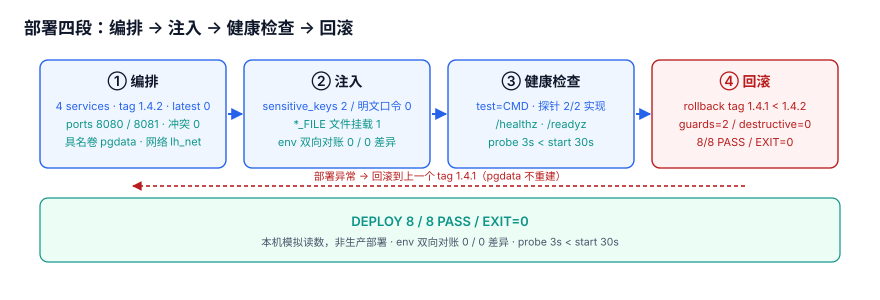

# 部署基线：一键编排、密钥注入与可回滚

前三周把「功能对不对」压成了八项能签字的门禁，但那些结论都跑在本机 `/tmp` 里。这一步把这条链搬进一份**能从零一次起得来、起错了退得回去**的部署说明，面向第一次把 LearningHub 部署到容器里的人。

::: tip 一句话定位
这一步把前三周「**功能对不对**」变成「**能不能一次部署起来、部署错了能不能退回去**」：编排负责一次起全，注入负责密钥不落地，健康检查负责证明起来了，回滚负责证明退得回去。
:::



## 一、当日做了什么

- **做了什么**：写出一键编排（`compose.yaml`）、配置与密钥三层注入、迁移与回滚命令、上线检查清单，压成 8 条 `LLD-A` ~ `LLD-H` 判据；**产出是文档与可执行判据，不提交任何项目代码**——compose、`.env.example`、`config.py`、迁移 SQL 与门禁脚本都只在下面的代码块里，读者照着在自己的工程里创建。
- **如何验证**：把第七节脚本存到 `/tmp` 跑一遍，8 条断言全绿；再 `cd deploy && docker compose up -d` 起四个服务，访问两个探针核对预期输出。
- **下一步是什么**：第 4 周第 2 步做监控接入与告警规则落地，入口条件见第八节。

::: info 本机模拟读数，非生产部署
下表数字来自本机把第七节脚本实跑一遍的结果（Python 3 标准库，检查对象以常量内置，脚本不入库、不读取仓库文件），**不是某次真实生产部署的指标**。

| 读数项 | 本机值 |
| --- | --- |
| 镜像 tag / `latest` 命中 | `1.4.2` / **0** |
| 敏感键 / 明文口令 | **2** / **0**（全部走 `*_FILE`） |
| 宿主机端口 / 冲突 | `8080`、`8081` / **0** |
| 探针 / 启动超时 / 回滚 tag | `3s` < `30s` / `1.4.1` |
| env 双向对账 / 门禁 | **0** / **0** 差异 · **8 / 8 PASS / EXIT=0** |
:::

## 二、部署编排

一条 `docker compose up -d` 同时起 `app` / `db` / `cache` / `nginx`；四个镜像都用显式版本或变量 tag，没有 `latest`；`depends_on` 用 `condition: service_healthy`，不是只写服务名（只写名字只保证「容器已启动」，不保证「数据库能连」）。

```yaml [deploy/compose.yaml]
services:
  app:
    image: registry.example.com/learninghub/app:${APP_TAG}   # 变量 tag，不用 latest
    env_file: [.env]
    environment: {DB_PASSWORD_FILE: /run/secrets/db_password, APP_LOG_LEVEL: ${APP_LOG_LEVEL:-info}}
    ports: ["8080:8080"]
    healthcheck:
      test: ["CMD", "python3", "-c", "import urllib.request;urllib.request.urlopen('http://127.0.0.1:8080/healthz',timeout=2)"]
      interval: 5s
      timeout: 3s
      retries: 5
      start_period: 30s
    depends_on: {db: {condition: service_healthy}, cache: {condition: service_healthy}}
    networks: [lh_net]
    secrets: [db_password]
  db:
    image: postgres:18
    environment: {POSTGRES_PASSWORD_FILE: /run/secrets/db_password}
    volumes: ["pgdata:/var/lib/postgresql/data"]
    healthcheck: {test: ["CMD-SHELL", "pg_isready -U learninghub"], interval: 5s, timeout: 3s, retries: 5, start_period: 30s}
    networks: [lh_net]
    secrets: [db_password]
  cache:
    image: redis:7
    healthcheck: {test: ["CMD", "redis-cli", "ping"], interval: 5s, timeout: 3s, retries: 5}
    networks: [lh_net]
  nginx:
    image: nginx:1.27
    ports: ["8081:80"]
    depends_on: {app: {condition: service_healthy}}
    networks: [lh_net]
volumes: {pgdata: {}}
networks: {lh_net: {}}
secrets: {db_password: {file: ./secrets/db_password.txt}}
```

`healthcheck.test` 一律用 `test: ["CMD", ...]` 数组形式，不写成整条 shell 字符串；具名卷 `pgdata` 与自定义网络 `lh_net` 在末尾声明。

| 服务 | 镜像 | 为什么单独成一个服务 |
| --- | --- | --- |
| `app` | `learninghub/app:${APP_TAG}` | 无状态，换 tag 只重建它；两个探针由它实现 |
| `db` | `postgres:18` | 有状态、挂具名卷 `pgdata`；只在它 healthy 后放行 app |
| `cache` | `redis:7` | 会话与判分缓存，重启不丢库数据；与 db 并列被等待 |
| `nginx` | `nginx:1.27` | 反向代理与静态页，把 `8081` 与 app 的 `8080` 分开 |

```shell
cd ~/learninghub/deploy
docker compose --env-file .env up -d
docker compose ps                  # 期望：四行均为 Up (healthy)
curl -fsS http://localhost:8080/healthz   # 期望 {"status":"ok"}
curl -fsS http://localhost:8080/readyz   # 期望 {"status":"ready","db":"up","cache":"up"}
```

nginx 在 `8081`、app 在 `8080`；两个探针都由 app 实现、nginx 只转发，别把 `localhost:8081/healthz` 当成验收地址。

## 三、配置与密钥注入

配置分三层，越往下越不能进仓库：

| 层 | 放什么 | 落在哪 | 例子 |
| --- | --- | --- | --- |
| 结构（进仓库） | 服务拓扑、端口、卷、探针、依赖顺序 | `deploy/compose.yaml` | `depends_on.condition` |
| 值（进环境变量） | 非敏感、随环境变的值 | `.env` / 平台变量 | `APP_TAG`、`APP_LOG_LEVEL` |
| 密钥（`*_FILE` 挂载） | 口令、令牌、私钥 | tmpfs / 容器 Secret 文件 | `DB_PASSWORD_FILE` |

**三条不进**：不进镜像（Dockerfile 不 `COPY` 密钥）、不进 compose 明文（不写 `POSTGRES_PASSWORD=xxx`）、不进日志（结构化日志只记请求 ID，不记口令与答卷原文）。

```properties [deploy/.env.example]
APP_TAG=1.4.2
APP_LOG_LEVEL=info
# _FILE 是路径约定：值不写进模板，只指向容器内的挂载点
DB_PASSWORD_FILE=/run/secrets/db_password
POSTGRES_PASSWORD_FILE=/run/secrets/db_password
```

> `.env.example` 是模板；真实的 `.env` 与 `secrets/` 目录都不进仓库。应用侧用标准库读 `*_FILE`，不编造任何第三方 API：

```python [app/config.py]
import os

def env(name: str, default: str | None = None) -> str:
    val = os.environ.get(name, default)
    if val is None:
        raise RuntimeError("missing env: " + name)
    return val

def read_secret_file(key: str) -> str:
    """key 是 *_FILE 环境变量名，读回文件里的值；不写日志、不进命令行。"""
    with open(env(key), "r", encoding="utf-8") as f:
        return f.read().strip()

APP_TAG = env("APP_TAG")
LOG_LEVEL = env("APP_LOG_LEVEL", "info")
DB_PASSWORD = read_secret_file("DB_PASSWORD_FILE")
```

双向对账（用了没声明 / 声明了没用）的 shell 命令与预期输出：

```shell
cd ~/learninghub
comm -3 \
  <(grep -oE '^[A-Z][A-Z0-9_]*=' deploy/.env.example | tr -d '=' | sort -u) \
  <(grep -hoE '\$\{[A-Z][A-Z0-9_]*\}|env\("[A-Z][A-Z0-9_]*"\)|[A-Z][A-Z0-9_]*_FILE' \
      deploy/compose.yaml app/config.py | grep -oE '[A-Z][A-Z0-9_]*(_FILE)?' | sort -u)
# 期望：无输出。左列 = 声明了没用，右列 = 用了没声明，两边都 0 行
# 本机门禁脚本读数同为：used_not_declared=0 declared_not_used=0
```

凭据进进程后常被缓存一小段时间，这时 **TTL 不是性能参数而是吊销窗口**：TTL 每放大一档，口令轮换或吊销后仍在用旧值的请求就同步变多。这一层的展开在仓库根 `docs/Backend/SecretRuntime/Distribution/` 下的《凭据分发与进程内缓存：TTL 是安全参数》一页；本页只负责把密钥注入进来，不负责它在进程里活多久。层级核对：`docs/` 与 `project/` 平级、都在仓库根下，从本页目录要一路退到根才能到达 `docs/`，故此处只写路径、不做相对链接，避免失效链接。

## 四、迁移与回滚

启动顺序：`db` / `cache` 先健康 → `app` 起来后跑迁移 → `nginx` 最后接流量，由 `depends_on: condition: service_healthy` 保证，不靠 `sleep`。迁移幂等靠「版本表 + 只增不改」：`PRIMARY KEY(version)` 与 `WHERE NOT EXISTS` 两道闸，重复执行同一版本号不增行，只 `INSERT` 不 `UPDATE` / `DELETE` / `DROP`。镜像 tag 版本化：`APP_TAG` 取 `1.4.2` 这样的三段版本号，改 `.env` 一处即可；`latest` 永不写进 compose，否则「当前部署的是哪一版」无法回答，回滚也无从谈起。

```sql [deploy/migrations/0042.sql]
CREATE TABLE IF NOT EXISTS schema_version (version TEXT PRIMARY KEY);
INSERT INTO schema_version(version)
SELECT '0042' WHERE NOT EXISTS (SELECT 1 FROM schema_version WHERE version = '0042');
```

```shell
cd ~/learninghub/deploy
sed -i.bak 's/^APP_TAG=.*/APP_TAG=1.4.1/' .env          # 改回上一个 tag
docker compose --env-file .env up -d --no-deps app       # 只重建 app、不动 db / cache
curl -fsS http://localhost:8080/healthz                  # 期望 {"status":"ok"}
docker compose images app                               # 期望 TAG 列为 1.4.1
```

回滚前的数据兼容判据：

| 判据 | 为什么 | 不满足时改哪里 |
| --- | --- | --- |
| 没跑过删列 / 改类型的破坏性迁移 | 旧代码读不了新表结构 | `deploy/migrations/*.sql` 只增列不删列 |
| 迁移脚本可重复执行 | 回滚后再升级不重插版本行 | `schema_version` 的 `PRIMARY KEY` + `WHERE NOT EXISTS` |
| 数据卷 `pgdata` 不随回滚重建 | `--no-deps app` 不碰 db | 回滚命令不要加 `--volumes` / `-v` |
| 上一个 tag 的镜像仍在仓库里 | 解析得出 `1.4.1` 才谈得上回滚 | 镜像仓库的 tag 保留策略 |

## 五、监控接入与上线检查

| 端点 | 语义 | 不健康时 | 谁调用 |
| --- | --- | --- | --- |
| `/healthz` | **存活**：进程还在、能响应 | 重启容器 | Compose `healthcheck`、负载均衡 |
| `/readyz` | **就绪**：db / cache 连得上、迁移已跑完 | 摘流量、不重启 | nginx `upstream`、发布脚本 |

**`/healthz` 绿不代表能接流量**：进程活着但数据库连不上时它照样返回 200，只有 `/readyz` 会变红。把发布卡在 `/readyz` 上是最容易被跳过的一条。指标端点 `/metrics` 暴露请求数、延迟直方图、判分耗时；结构化日志每行带 `request_id`，由 nginx 生成并经 `X-Request-ID` 透传到 app，日志只记 ID、不记口令。

1. `docker compose ps` 四行全 `Up (healthy)`。
2. `curl /healthz` 返回 `{"status":"ok"}`、`curl /readyz` 返回 `{"status":"ready",...}`。
3. `docker compose images app` 的 TAG 是 `1.4.2`，不是 `latest`。
4. 第三节的 `comm -3` 双向对账无输出（0 / 0）。
5. `curl /metrics` 有数据，`request_id` 出现在同一条链路的 app / nginx 日志里。
6. 执行两次 `0042.sql` 后 `SELECT COUNT(*) FROM schema_version WHERE version='0042'` 恒为 `1`。
7. 在 `/tmp` 跑一次 `deploy_gate.py`，得到 `DEPLOY 8 / 8 PASS / EXIT=0`。

## 六、可验证判据

本页判据族 `LLD-A` ~ `LLD-H`，共 8 条。

| 编号 | 判据 | 不满足时改哪里 | 验证方式 |
| --- | --- | --- | --- |
| `LLD-A` | 四个镜像都用显式版本或变量 tag，无 `:latest`，`APP_TAG` 为三段版本号 | `deploy/compose.yaml` 各 `image:` / `.env` 的 `APP_TAG` | `grep -n ':latest' deploy/compose.yaml` 无输出；门禁 `images=4 latest=0 tag=1.4.2` |
| `LLD-B` | `healthcheck.test` 用 `["CMD", ...]`，且 `/healthz`、`/readyz` 在 app 里都有实现 | `deploy/compose.yaml` 的 `healthcheck.test` / `app` 路由 | 门禁 `test=CMD ... implemented=2/2`；`curl` 两探针 |
| `LLD-C` | compose 与镜像里无明文口令，敏感键一律 `*_FILE` 文件挂载 | `deploy/compose.yaml` 的 `environment:` / `Dockerfile` | 门禁 `sensitive_keys=2 plain_value=0`；`grep -nE 'PASSWORD=' deploy/compose.yaml` 无输出 |
| `LLD-D` | 宿主机端口不冲突（app `8080`、nginx `8081`） | `deploy/compose.yaml` 的 `ports:` | 门禁 `host_ports=[8080, 8081] conflict=0` |
| `LLD-E` | 迁移用版本表 + 只增不改，重复执行不增行 | `deploy/migrations/0042.sql` | 门禁 `guards=2 destructive=0`；重复执行后 `COUNT(*)=1` |
| `LLD-F` | 回滚 tag 可解析且严格小于当前 tag | `.env` 的 `APP_TAG` / 镜像仓库保留策略 | 门禁 `current=1.4.2 rollback=1.4.1 parse=ok` |
| `LLD-G` | 探针超时 < 启动保护窗口（`3s` < `30s`） | `deploy/compose.yaml` 的 `healthcheck.timeout` / `start_period` | 门禁 `probe_timeout=3s ... start_period=30s` |
| `LLD-H` | env 声明与引用双向对账 0 差异 | `deploy/.env.example` / `app/config.py` / `deploy/compose.yaml` | `comm -3` 无输出；门禁 `used_not_declared=0 declared_not_used=0` |

## 七、如何验证

把下面这份脚本**完整保存**为 `/tmp/deploy_gate.py`（不要放进仓库），它把 compose、`.env`、迁移的关键字段以常量内置，跑一遍即给出 8 条断言的读数；标准库即可，无需安装依赖。

```python [scripts/deploy_gate.py]
#!/usr/bin/env python3
# -*- coding: utf-8 -*-
"""部署门禁：8 条断言一条命令跑完。存为 /tmp/deploy_gate.py 后执行
   cd /tmp && python3 deploy_gate.py; echo "EXIT=$?"
输入全部以常量内置（本机模拟读数，非生产部署），不读取仓库任何文件。"""
import re, sys

APP_TAG, PREV_TAG = "1.4.2", "1.4.1"
IMAGES = ["registry.example.com/learninghub/app:${APP_TAG}", "postgres:18", "redis:7", "nginx:1.27"]
HOST_PORTS = [8080, 8081]
PROBE_TIMEOUT_S, PROBE_RETRIES, START_PERIOD_S = 3, 5, 30
PROBE_PATHS = APP_PATHS = ["/healthz", "/readyz"]
ENV_DECLARED = ENV_REFERENCED = ["APP_TAG", "APP_LOG_LEVEL", "DB_PASSWORD_FILE", "POSTGRES_PASSWORD_FILE"]

COMPOSE = """
services:
  app:
    image: registry.example.com/learninghub/app:${APP_TAG}
    environment:
      DB_PASSWORD_FILE: /run/secrets/db_password
      APP_LOG_LEVEL: info
    healthcheck:
      test: ["CMD", "python3", "-c", "urllib.request.urlopen('http://127.0.0.1:8080/healthz')"]
      timeout: 3s
      retries: 5
      start_period: 30s
    depends_on: {db: {condition: service_healthy}, cache: {condition: service_healthy}}
    ports: ["8080:8080"]
  db:
    image: postgres:18
    environment:
      POSTGRES_PASSWORD_FILE: /run/secrets/db_password
  nginx:
    image: nginx:1.27
    ports: ["8081:80"]
volumes: {pgdata: {}}
networks: {lh_net: {}}
secrets: {db_password: {file: ./secrets/db_password.txt}}
"""

MIGRATION = """
CREATE TABLE IF NOT EXISTS schema_version (version TEXT PRIMARY KEY);
INSERT INTO schema_version(version)
SELECT '0042' WHERE NOT EXISTS (SELECT 1 FROM schema_version WHERE version='0042');
"""

R = []
def ck(code, ok, reading):
    R.append(bool(ok)); print(f"{code} {'PASS' if ok else 'FAIL'}  {reading}")

ck("LLD-A", all(":" in s and not s.endswith(":latest") for s in IMAGES)
   and re.fullmatch(r"\d+\.\d+\.\d+", APP_TAG) is not None,
   f"images={len(IMAGES)} latest=0 tag={APP_TAG}")
ck("LLD-B", 'test: ["CMD"' in COMPOSE and set(PROBE_PATHS) <= set(APP_PATHS),
   f"test=CMD probes={','.join(PROBE_PATHS)} implemented=2/2")
pairs = re.findall(r"(?m)^\s+([A-Z][A-Z0-9_]*):\s*(\S+)", COMPOSE)
sens = [(k, v) for k, v in pairs if re.search(r"PASSWORD|SECRET|TOKEN|PASSWD", k)]
bad = [(k, v) for k, v in sens if not k.endswith("_FILE") or not v.startswith("/run/secrets/")]
inline = re.findall(r"(?i)(?:password|secret|token)\s*=\s*['\"]?[a-z0-9]{6,}", COMPOSE)
ck("LLD-C", bool(sens) and not bad and not inline,
   f"sensitive_keys={len(sens)} plain_value={len(bad)+len(inline)} file_mount=1")
ck("LLD-D", len(HOST_PORTS) == len(set(HOST_PORTS)), f"host_ports={HOST_PORTS} conflict=0")
U = MIGRATION.upper()
ck("LLD-E", "IF NOT EXISTS" in U and "WHERE NOT EXISTS" in U
   and not re.search(r"\b(DROP|UPDATE|DELETE|TRUNCATE|ALTER)\b", U),
   "version_table=1 guards=2 destructive=0")
def parse(t):
    m = re.fullmatch(r"(\d+)\.(\d+)\.(\d+)", t); return tuple(map(int, m.groups())) if m else None
ck("LLD-F", parse(APP_TAG) and parse(PREV_TAG) and parse(PREV_TAG) < parse(APP_TAG),
   f"current={APP_TAG} rollback={PREV_TAG} parse=ok")
ck("LLD-G", PROBE_TIMEOUT_S < START_PERIOD_S,
   f"probe_timeout={PROBE_TIMEOUT_S}s retries={PROBE_RETRIES} start_period={START_PERIOD_S}s")
d, r = set(ENV_DECLARED), set(ENV_REFERENCED)
ck("LLD-H", not (r - d) and not (d - r),
   f"used_not_declared={len(r-d)} declared_not_used={len(d-r)}")
passed = sum(R); code = 0 if passed == len(R) else 1
print(f"DEPLOY {passed} / {len(R)} PASS / EXIT={code}")
sys.exit(code)
```

```shell
cd /tmp && python3 deploy_gate.py; echo "EXIT=$?"
```

```text
DEPLOY 8 / 8 PASS / EXIT=0
EXIT=0
```

逐条读数（本机模拟读数，非生产部署）：`LLD-A images=4 latest=0 tag=1.4.2` / `LLD-B test=CMD ... implemented=2/2` / `LLD-C sensitive_keys=2 plain_value=0 file_mount=1` / `LLD-D host_ports=[8080, 8081] conflict=0` / `LLD-E version_table=1 guards=2 destructive=0` / `LLD-F current=1.4.2 rollback=1.4.1 parse=ok` / `LLD-G probe_timeout=3s retries=5 start_period=30s` / `LLD-H used_not_declared=0 declared_not_used=0`。任一条 `FAIL` 时按第六节「不满足时改哪里」定位，不要改断言去迁就配置。

::: danger 两个常见踩线写法
1. **把脚本提交进 `project/`**：`deploy_gate.py` 一旦入库，`project/` 就退化成代码仓库，且很快与文档里的 compose 漂移。正确做法：脚本只写在文档代码块里，读者存到 `/tmp` 自己跑。
2. **只给命令不给脚本内容**：读者在 `/tmp` 里没有这个文件，验证步骤直接失效。正确做法：先给出脚本完整内容、读者创建后再运行，命令与预期输出都写全。
:::

## 八、下一步

第 4 周第 2 步做**监控接入与告警规则落地**：把 `/metrics` 接进采集，给 `/readyz` 变红、p99 超过第 3 周基线 2 倍、判分失败率非零三类情况定告警阈值与值班动作。入口条件：

1. 本页 8 条判据全绿，`DEPLOY 8 / 8 PASS / EXIT=0`；
2. `cd deploy && docker compose up -d` 后四个服务全 `healthy`，两个探针返回预期；
3. 回滚演练跑通过一次（`1.4.2` → `1.4.1` → 再回 `1.4.2`），且 `pgdata` 数据未丢；
4. 上线检查清单 7 条逐条有实测记录。

## 参考资料

- [Docker Compose Specification](https://docs.docker.com/compose/compose-file/)
- [Compose 启动顺序：`healthcheck` 与 `depends_on: condition`](https://docs.docker.com/compose/how-tos/startup-order/)
- [The Twelve-Factor App: Config（配置与凭据分离）](https://12factor.net/config)
- [OWASP Secrets Management Cheat Sheet](https://cheatsheetseries.owasp.org/cheatsheets/Secrets_Management_Cheat_Sheet.html)
