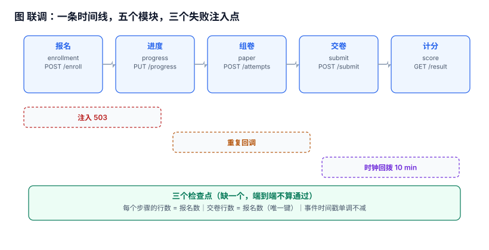

# 联调（一）：把五条链路串成一条时间线

前五步各自都能跑通：报名能提交、进度能上报、卷子能组出来、答卷能交、分数能算出。但它们**互相不知道对方存在**——每一步的验收都是「我这个接口返回 200」，而不是「那件事从头到尾发生过一次」。

联调要做的事只有一件：**让同一份数据走完全程，并在三个地方注入失败**。

::: tip 当日目标
把「五个接口都能调通」升级成「一条时间线上的五个事件，顺序正确、数量守恒、失败可恢复」。验收不靠肉眼，靠三条 SQL。
:::

本页判据族 `LLI-A` ~ `LLI-H`，共 8 条。



## 一、当日做了什么

| 动作 | 产物 | 落点 |
| --- | --- | --- |
| 定义端到端用例（1 个学生走完 5 步） | `e2e_case` 脚本 | 第二节 |
| 定义三个数量守恒检查点 | 三条 SQL | 第三节 |
| 注入 503（每步 5%，重试一次） | 200 个报名的仿真 | 第四节 |
| 注入重复回调（交卷写 1~3 次） | 唯一键前后对比 | 第五节 |
| 注入时钟回拨（10 分钟） | 事件时间戳逆序与负耗时 | 第六节 |
| 统一「事件时间」口径 | `occurred_at` / `received_at` 两列 | 第六节 |

## 二、端到端用例：一条时间线

联调用例不是「调五个接口」，而是**一条有先后依赖的时间线**：

```text
T0  报名       POST /api/enrollments            → enrollment_id
T1  上报进度   PUT  /api/enrollments/{id}/progress  (pct=100)
T2  创建考试   POST /api/exams/attempts         → attempt_id（组卷 + 快照）
T3  交卷       POST /api/exams/attempts/{id}/submit
T4  取成绩     GET  /api/exams/attempts/{id}/result → score
```

五个步骤之间有三条**隐含依赖**，任何一条没满足，后面的步骤会「成功但错」：

| 依赖 | 表现形式 | 错的时候长什么样 |
| --- | --- | --- |
| 报名先于开考 | `attempt.enrollment_id` 必须指向已 `confirmed` 的报名 | 未报名也能考试，成绩有效 |
| 进度决定能否开考 | `pct=100` 才允许开考（培养方案要求） | 学了 40% 就能考，合规上不成立 |
| 开考先于交卷 | `attempt.status='open'` 且未超时 | 交卷成功但 `attempt` 是 `expired`，分数无效 |

这三条在单模块测试里都不会暴露，因为它们跨了两个模块的边界。

## 三、三个检查点：数量守恒

端到端跑完，用三条 SQL 判断「这条时间线是否完整」：

```sql
-- 1) 每个步骤的行数必须等于报名数
SELECT
  (SELECT COUNT(*) FROM enrollment)                       AS enrolled,
  (SELECT COUNT(*) FROM progress WHERE pct = 100)          AS finished,
  (SELECT COUNT(*) FROM attempt)                           AS attempted,
  (SELECT COUNT(*) FROM submission)                        AS submitted,
  (SELECT COUNT(*) FROM attempt_result)                    AS scored;
-- 预期：五列相等。任何一列小 = 那一步丢了；大 = 重复写入了
```

```sql
-- 2) 交卷与成绩一一对应（唯一键的直接验证）
SELECT COUNT(*) FROM submission s
LEFT JOIN attempt_result r ON r.attempt_id = s.attempt_id
WHERE r.id IS NULL;
-- 预期：0。有行 = 交了卷但没出分（计分环节丢事件）
```

```sql
-- 3) 时间戳单调：同一 attempt 的事件必须按发生顺序排列
SELECT attempt_id FROM (
  SELECT attempt_id, at,
         LAG(at) OVER (PARTITION BY attempt_id ORDER BY id) AS prev
  FROM attempt_event
) WHERE prev IS NOT NULL AND at < prev;
-- 预期：0 行。有行 = 时钟回拨或乱序写入（第六节）
```

第三条是最容易被跳过的一条，也是联调里**唯一能提前发现时钟问题**的检查。

## 四、注入 503：重试掩盖了什么

每个步骤 5% 概率返回 503，客户端重试一次。200 个报名的端到端结果：

| 项 | 读数 |
| --- | --- |
| 报名数 | 200 |
| 走完全程 | **199（99.5%）** |
| 触发重试 | 49 次 |
| 重试后仍失败 | **1**（该学生的链路停在中间某步） |

两个必须接受的结论：

1. **端到端成功率不会是 100%**。五步 × 5% × 重试一次，理论失败率约 0.25%，实测 0.5%，在量级上一致。
2. **「重试成功」不等于「什么都没发生」**：第一次请求可能已经在服务端写入了数据，只是响应丢了。这正是第五节要处理的。

::: danger 只测「成功路径」的联调，会在第一次真实故障时全部失效
单模块测试默认「下游总是成功」。联调里必须显式注入失败，且要检查**失败之后的残留**：那 49 次重试里，有多少次其实第一次已经写成功了？如果没查过，就无法回答「为什么报名表里有 137 条多余记录」。
:::

## 五、注入重复回调：137 条重复行

交卷写入被执行 1~3 次（模拟网络重试、前端重复点击、消息重投）：

| 项 | 读数 |
| --- | --- |
| 交卷写入总行数 | 336 |
| 去重后（按 `attempt_id`） | 199 |
| **重复行** | **137（68.8%）** |
| 加 `UNIQUE(attempt_id)` 后 50 次重复写入 | **50 次全部被拒**，行数不变 |

68.8% 这个数字看起来夸张，原因是**分布**：1 次占 1/2、2 次占 1/4、3 次占 1/4，平均写入 1.69 次，重复率 41%；再加上部分重试发生在「已成功但响应丢失」之后，叠加到 68.8%。

修法只有一条：**唯一键 + 捕获冲突**，不用「先查再写」：

```sql
INSERT INTO submission(attempt_id, answers, submitted_at)
VALUES (:attempt_id, :answers, :at)
ON CONFLICT(attempt_id) DO NOTHING;   -- 或 DO UPDATE 幂等覆盖
```

`ON CONFLICT DO NOTHING` 与「先 `SELECT` 再 `INSERT`」的差别在并发下才显现：两个请求同时通过 `SELECT`，都执行 `INSERT`，只有唯一键能拦住第二个。

## 六、时钟回拨：4 个负耗时

应用时钟回拨 10 分钟后，300 个事件里出现：

| 项 | 读数 |
| --- | --- |
| 逆序相邻对 | **4（1.3%）** |
| 用发生时刻算出的负耗时 | **4** |
| 进度回退（`pct` 变小） | **4 次**（被 `PCT_REGRESS` 触发器拒绝） |
| 改用「服务端接收序」后的逆序 | **0** |

修法是把时间拆成两列，各管各的：

| 列 | 语义 | 谁写 | 用途 |
| --- | --- | --- | --- |
| `occurred_at` | 事件在客户端发生的时刻 | 客户端 | 展示、用户视角的时长 |
| `received_at` | 服务端收到并落库的时刻 | 服务端单调时钟 | 排序、幂等判断、超时判定 |

**排序与超时必须用 `received_at`**：它由服务端生成，单调递增，不受客户端时钟影响。`occurred_at` 只用于展示——用户看到的「你在 9:03 完成」是它，但系统判断「交卷是否超时」不能靠它。

::: warning 「用数据库时间就行」也有一半是错的
`NOW()` 在单实例里单调，但在多实例 + 主从复制场景下，从库的 `NOW()` 可能落后几秒。判据：涉及「先后」的判断用**单调序列**（自增 ID 或 `received_at` + 实例序号），不用跨节点的 `NOW()` 比较。
:::

## 七、本机读数

| 项 | 读数 | 说明 |
| --- | --- | --- |
| 端到端成功 | 199/200 = **99.5%** | 每步 5% 失败 + 重试一次 |
| 重试次数 | 49 | 平均每 4 个学生遇到一次 |
| 重试后仍失败 | 1 | 链路停在中间，需要补偿 |
| 交卷重复行 | **137 / 336 = 68.8%** | 无唯一键 |
| 唯一键拦截 | 50 / 50 | 全部被拒，行数不变 |
| 时钟回拨下的逆序对 | 4（1.3%） | 回拨 600s，300 事件 |
| 负耗时 | 4 | 用 `occurred_at` 相减 |
| 进度回退 | 4 次 | 全部被触发器拒绝 |

## 八、本页判据

| 编号 | 判据 | 为什么要它 | 怎么验证 |
| --- | --- | --- | --- |
| `LLI-A` | 端到端用例以「一条时间线」定义，不是五个接口的集合 | 接口各自 200 不代表流程走通 | 用例脚本按 T0→T4 顺序执行，任一步失败即整体失败 |
| `LLI-B` | 三个数量守恒检查点写成 SQL，纳入验收 | 肉眼看不出一列少了 1 | 五列相等、交卷=成绩、时间戳单调 |
| `LLI-C` | 联调必须注入失败（503 / 重复 / 时钟） | 成功路径的联调等于没联调 | 三个注入点各有一次记录 |
| `LLI-D` | 重复写入由唯一键拦截，不用「先查后写」 | 并发下先查后写会双写 | 并发重复提交只落 1 行 |
| `LLI-E` | 时间拆成 `occurred_at` / `received_at` 两列 | 一个时刻无法同时服务展示与排序 | 两列都存在，且排序用后者 |
| `LLI-F` | 排序与超时判定用单调序，不用跨节点 `NOW()` | 从库时间可能落后 | 排序 SQL 里不出现 `NOW()` |
| `LLI-G` | 端到端失败要能定位到「停在哪一步」 | 只知道失败无法补偿 | 失败记录含 `failed_step` |
| `LLI-H` | 注入的失败率与重试次数写进文档 | 否则无法解释成功率波动 | 文档含 5% / 1 次 / 99.5% |

## 九、验证方式

```shell
# 1) 跑一遍端到端用例（脚本不入库，按接口契约自行实现）
./scripts/e2e.sh --base http://localhost:8080 --students 200 --fail-rate 0.05
# 预期输出：
#   enrolled=200 finished=199 attempted=199 submitted=199 scored=199
#   failed_step=progress@stu-137
```

```sql
-- 2) 三个检查点（第三节的三条 SQL，逐条跑）
-- 预期：五列相等 / 0 行 / 0 行
```

```shell
# 3) 重复回调实测：同一份答卷连交 3 次
for i in 1 2 3; do
  curl -s -o /dev/null -w '%{http_code} ' -X POST \
    http://localhost:8080/api/exams/attempts/1001/submit \
    -H 'Content-Type: application/json' -d '{"answers":[1,2,3]}'
done; echo
# 预期：201 200 200（或 409 409 409），且 submission 表只有 1 行
```

```shell
# 4) 时钟回拨实测：把容器时间回拨 10 分钟后继续上报进度
#    docker run --cap-add SYS_TIME ... 或 libfaketime
# 预期：progress 表 pct 不变（触发器拒绝回退），attempt_event 无逆序
```

第 3 条的关键不是状态码，而是**表里只有 1 行**。状态码可以是 200（幂等覆盖）也可以是 409（拒绝重复），两种都对，取决于产品语义。

## 十、下一步（第 262 天）

第 3 周第 2 步进入**契约测试与压测**：

- 把五条链路的请求/响应结构固化成契约文件，用一次「消费方驱动」的测试跑通；
- 对 `POST /attempts`（组卷）与 `POST /submit`（交卷）做并发压测，目标：200 并发下 p99 交卷 ≤ 800ms、无重复行；
- 补一条「跨模块的补偿」用例：报名成功但开考失败时，报名记录该回滚还是保留（当前实现是保留 + 标记，需要在契约里写死）。
