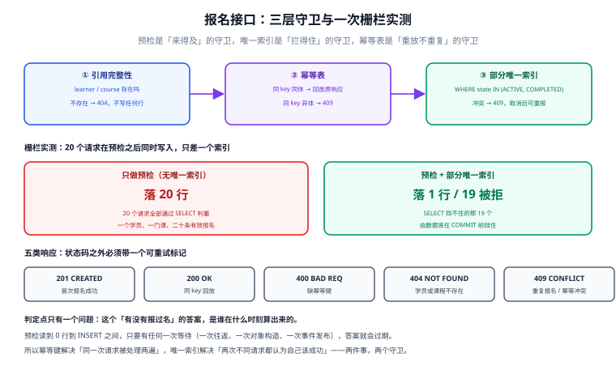

# 核心编码（一）：报名接口的判定点、三层守卫与十二个用例

第 1 周把「要做什么」（[需求](../Requirements/index.md)）、「边界在哪」（[架构](../Architecture/index.md)）、「跑在什么版本上」（[技术基线](../TechBaseline/index.md)）、「数据怎么取」（[库表设计](../DatabaseDesign/index.md)）都定死了，并用一张[验收单](../Week1Acceptance/index.md)证明它们可执行。这一周开始写代码。

第一个接口之所以选「报名」而不是「课程列表」，理由很直白：**四条契约里，只有 C1 同时压着一个部分唯一索引、一个业务状态机和一个幂等键**。把它写对了，后面三个接口都是同一套骨架的变体；写错了，会一路错到「一张证书发给两个人」。

::: tip 当日目标
把内容模块的四个只读接口与 `POST /enrollments` 落成可调用的五个处理函数，并**先写测试再写实现**，让「报名唯一」这条契约在**并发**下也被证明拦得住 —— 不是「单线程下没报错」。
:::

本页判据族 `LNE-A` ~ `LNE-H`，共 8 条。

## 一、当日做了什么

| 动作 | 产物 | 落点 |
| --- | --- | --- |
| 定五个接口的路由与响应形状 | 路由表 + 请求/响应样例 | 本文第二节 |
| 写内容模块四个只读接口 | 列表、详情、课时清单、单课时 | 第二节 + 第三节（N+1 对照） |
| 写报名命令接口的三层守卫 | 引用完整性 / 幂等表 / 部分唯一索引 | 第四节 |
| 先写 12 个用例再写实现 | 12 条用例，10 条先红后绿 | 第五节 |
| 定错误码与 `retryable` | 五类响应对照表 | 第六节 |



## 二、五个接口：路由、请求与响应

第 1 周定下的「接口分三类」（命令 / 查询 / 回调）在这里第一次落地。本期只有前两类，且**查询接口一律可分页、命令接口一律要幂等键**。

| 方法 | 路径 | 类型 | 幂等键位置 | 成功码 |
| --- | --- | --- | --- | --- |
| `GET` | `/courses` | 查询 | 无 | `200` |
| `GET` | `/courses/{course_id}` | 查询 | 无 | `200` / `404` |
| `GET` | `/courses/{course_id}/lessons` | 查询 | 无 | `200` / `404` |
| `GET` | `/lessons/{lesson_id}` | 查询 | 无 | `200` / `404` |
| `POST` | `/enrollments` | 命令 | **请求头 `Idempotency-Key`** | `201` / `200`（回放） |

请求与响应样例（报名）：

```http
POST /enrollments HTTP/1.1
Content-Type: application/json
Idempotency-Key: 8f1c2ab0-7d3e-4c11-9a55-0b6e2d9f4c31

{"learner_id": "L00001", "course_id": "C001"}
```

```json
{
  "enrollment_id": "E3f9a1c27b0d",
  "learner_id": "L00001",
  "course_id": "C001",
  "state": "ACTIVE",
  "created_at": "2026-11-05T10:00:00Z"
}
```

::: danger 幂等键必须在请求头，不在 body 里
放进 body 会带来一个立刻可见的后果：**同一个业务请求，客户端只要少传或多传一个字段，幂等键就算「换了」**。更麻烦的是，body 里的幂等键会和业务字段混在一起被序列化进日志与审计，出问题时很难判断「这是业务参数还是幂等标识」。头部的语义是「这次投递」，body 的语义是「这个业务对象」——两者生命周期不同，不能放在同一层。
:::

列表接口的分页规则写死三条（否则第 3 周压测时会发现「第 2 页和第 1 页有重复行」）：

1. **默认 `size=20`，上限 `100`**，超过上限按上限截断而不是报错（调用方传 `size=10000` 是一种常见的手滑）。
2. **排序键必须唯一且稳定**：`order by course_id`（主键），不用 `created_at` —— 同一毫秒创建的两门课在翻页时可能被跳过或重复。
3. **页码从 1 开始，`page=0` 与负数一律按 1 处理**，不返回 `400`：这类参数没有业务含义，报错只会让调用方多写一段兼容代码。

## 三、内容模块：N+1 与 JOIN 的实测，结论和直觉相反

课程详情要返回「章节 → 课时」两级结构。两种写法都正确，差别只在查询次数：

| 写法 | 查询次数 | 说明 |
| --- | --- | --- |
| N+1 | `1 + 章节数` | 先查章节，再逐章查课时 |
| 单次 JOIN | `1` | `section left join lesson`，Python 侧按 `seq` 组装 |

本机读数（50 课 / 150 章 / 900 课时，20 次中位数）：

| 场景 | N+1 | 单次 JOIN | 倍数 |
| --- | --- | --- | --- |
| 小课（3 章 18 节） | 0.081 ms（4 次查询） | 0.092 ms | **0.89×**（N+1 更快） |
| 大课（12 章 240 节） | 0.548 ms（13 次查询） | 0.878 ms | **0.62×**（N+1 仍更快） |

**N+1 在本机反而更快**，而且章节越多差得越多。原因不在查询次数，在**每次查询的成本构成**：SQLite 是进程内调用，一次索引查找约 10 微秒；而 JOIN 版要一次性取回 240 行再在 Python 里逐行判断「这一行属于哪一章」，这部分是纯 CPU。13 次 10 微秒的查找，比「取 240 行 + 240 次字典构造 + 比较」便宜。

那 N+1 到底错在哪？**错在它把「查询次数」变成了「往返次数」。** 把每条 SQL 换成一次 0.35 ms 的网络往返（局域网 PostgreSQL 的常见量级）：

| 场景 | N+1 推算 | JOIN 推算 | 差值 |
| --- | --- | --- | --- |
| 小课 | 0.081 + 4×0.35 = **1.48 ms** | 0.092 + 0.35 = **0.44 ms** | 3.4× |
| 大课 | 0.548 + 13×0.35 = **5.10 ms** | 0.878 + 0.35 = **1.23 ms** | 4.1× |

::: warning 0.35 ms 是模型的输入，不是实测值
上表右两列是**按固定往返延迟推算**的结果，不是本机跑出来的。这么写是因为本机没有可连的 PostgreSQL，而**把推算值混进实测表是最容易骗到自己的做法**。读者换成自己的 PG 实例后，这两列要用真实读数替换。
:::

结论写进纪律：**在进程内数据库上，N+1 可能更快；在跨进程数据库上，N+1 必然更慢。** 判断标准不应该是「测出来快不快」，而应该是「这段代码会不会被搬到需要往返的环境里」——本项目第 3 周要换 PostgreSQL 联调，所以详情页从一开始就写 JOIN 版。

## 四、C1 的三层守卫：预检、幂等表、部分唯一索引

「同一学习者对同一课程只能有一条有效报名」这一句，落到代码里会自然长出三层，而**只有第三层是拦得住的**。

### 第一层：引用完整性

```python
def enroll(c, learner_id, course_id, idem_key):
    if not exists(c, "learner", learner_id):
        raise Err("LEARNER_NOT_FOUND", 404)
    if not exists(c, "course", course_id):
        raise Err("COURSE_NOT_FOUND", 404)
    ...
```

这一层挡的是「报了一门不存在的课」。它同时是**外键约束的友好前置**：没有它，非法 `course_id` 会在 `INSERT` 时炸成一个数据库异常，客户端拿到 500 而不是 404，日志里也只有一行 `FOREIGN KEY constraint failed`。

### 第二层：幂等表

```sql
CREATE TABLE idem (
  idem_key   TEXT PRIMARY KEY,
  route      TEXT NOT NULL,
  body_hash  TEXT NOT NULL,
  response   TEXT NOT NULL,
  created_at TEXT NOT NULL
);
```

三条语义必须同时成立，缺一条这个表就没有意义：

| 情形 | 判定 | 返回 |
| --- | --- | --- |
| 键不存在 | 首次请求，继续往下走 | 正常结果 |
| 键存在、`body_hash` 相同 | **重放**，不做任何写操作 | 原响应的逐字节副本 |
| 键存在、`body_hash` 不同 | 同一次投递被用在了另一个业务对象上 | `409 IDEM_KEY_CONFLICT` |

「回放原响应」而不是「重新执行一遍」是这一层与「去重」的分水岭：重新执行会拿到一个**新生成的** `enrollment_id`，虽然最终还是只有一行，但调用方手上的 ID 会前后不一，前端据此存的本地状态就错了。

### 第三层：部分唯一索引（唯一真正拦得住的一层）

```sql
CREATE UNIQUE INDEX uq_enroll_active
  ON enrollment (learner_id, course_id)
  WHERE state IN ('ACTIVE', 'COMPLETED');
```

前两层都是「读一下再决定写不写」，而**读与写之间有时间**。本机用栅栏（`threading.Barrier`）把 20 个请求卡在「预检之后、写入之前」再同时放行，两种实现各跑一次：

| 实现 | 落库行数 | 结果 |
| --- | --- | --- |
| 只有预检（去掉唯一索引） | **20 行** | 20 个请求全部读到「0 行有效报名」，全部写入成功 |
| 预检 + 部分唯一索引 | **1 行** | 1 个成功，19 个拿到 `ENROLL_DUPLICATE` |

20 个请求、一个学员、一门课、二十条有效报名——这不是理论推演，是**一次 `commit` 前必然发生的窗口**。窗口的宽度等于「预检返回」到「INSERT 提交」之间的一切：一次 ORM 对象构造、一次事件发布、一次远程调用，任何一项都能把它撑到毫秒级。

::: danger 三个「以为挡住了」的错法
1. **在应用层加锁**（`threading.Lock`）：单进程有效，多进程立刻失效，而且会把并发报名串行化——第 3 周的压测会直接撞上这个天花板。
2. **用「先删后插」实现重报**：`delete` 掉旧行再 `insert`，两步之间进程被杀就是一个**没有报名**的学员，比重复更糟。
3. **用全局唯一约束代替部分唯一索引**：`UNIQUE(learner_id, course_id)` 会让「取消后重报」永久失败。本机用例 T3 就是专门证明这一点的：同一人同一课在 `CANCELLED` 之后再报名，必须成功。
:::

## 五、测试先行：12 个用例，10 条先红后绿

写实现的顺序是「先写用例 → 全部失败 → 逐个补齐」。这不是形式主义：**先写用例时，你会被迫先回答「这个接口的失败长什么样」**，而失败形态恰恰是最容易漏测的部分。

| 编号 | 用例 | 期望 | 先写时的状态 |
| --- | --- | --- | --- |
| `T1` | 首次报名 | `201`，落 1 行 `ACTIVE` | 红（函数不存在） |
| `T2` | 重复报名 | `409 ENROLL_DUPLICATE`，仍 1 行 | 红 |
| `T3` | 取消后重报 | 成功，共 2 行、有效 1 行 | 红 |
| `T4` | 重报之后再重报 | `409`，有效仍 1 行 | 红 |
| `T5` | 课程不存在 | `404 COURSE_NOT_FOUND` | 红 |
| `T6` | 学员不存在 | `404 LEARNER_NOT_FOUND` | 红 |
| `T7` | 缺幂等键 | `400 IDEM_KEY_REQUIRED` | 红 |
| `T8` | 同键同体重放 | 返回**同一个** `enrollment_id`，仍 1 行 | 红 |
| `T9` | 同键异体 | `409 IDEM_KEY_CONFLICT` | 红 |
| `T10` | 200 次并发报名 | 1 行，199 次 `ENROLL_DUPLICATE`，**零 500** | 绿（第三层已就位） |
| `T11` | 20 个请求卡在栅栏后同时写入、去掉唯一索引 | **多于 1 行** | 绿（反例，用来证明 T10 的判据不是恒真） |
| `T12` | 有效报名数口径 | 总行数 ≥ 2、有效数 = 1 | 红 |

`T10` 与 `T11` 是一对**反向探针**：`T10` 证明「有索引时只有一个能成功」，`T11` 证明「没索引时不止一个能成功」。只有 `T10` 的话，一个「永远拒绝第二次报名」的坏实现也能让它变绿——而 `T11` 会同时失败，因为它要求反例场景必须出现多行。

本机跑出来的 12 条：

```text
PASS T1 报名成功 → 201 / 1 行
PASS T2 重复报名被拒 → 409 / 仍 1 行
PASS T3 取消后可重报 → 2 行 / 有效 1
PASS T4 重报后再重报被拒 → 409 / 有效仍 1
PASS T5 课程不存在 → 404
PASS T6 学员不存在 → 404
PASS T7 缺幂等键 → 400
PASS T8 同键回放幂等 → 同一 id / 1 行
PASS T9 同键异体冲突 → 409
PASS T10 并发 200 唯一索引 → 1 行 / 1 成功 / 199 被拒 / 码 {'ENROLL_DUPLICATE'}
PASS T11 并发 200 仅预检 → 预检落 20 行 / 加索引落 1 行（19 被拒）
PASS T12 有效报名数口径 → 总 2 行 / 有效 1
合计 12/12
```

::: warning 这 12 条是「本机 + 单进程」的读数
`T10`/`T11` 用 20 个线程各 10 次请求共 200 次，跑在 SQLite WAL 上，**没有覆盖多进程、也没有覆盖网络分区**。第 3 周接 PostgreSQL 时要重跑一遍，并把 `T11` 的期望从「多于 1 行」改成「多于 1 行 **且** 出现唯一约束违反的 SQLSTATE `23505`」——SQLite 的报错文本与 PG 的约束名不同，断言不能照抄。
:::

## 六、错误码与可重试标记

错误响应统一成三段：`code` 给程序、`message` 给人、`retryable` 给调用方的重试策略。

```json
{
  "error": {
    "code": "ENROLL_DUPLICATE",
    "message": "该课程已报名",
    "retryable": false
  }
}
```

| 状态码 | `code` | `retryable` | 客户端该做什么 |
| --- | --- | --- | --- |
| `400` | `IDEM_KEY_REQUIRED` | `false` | 补上请求头再发 |
| `404` | `COURSE_NOT_FOUND` / `LEARNER_NOT_FOUND` | `false` | 不重试，提示用户 |
| `409` | `ENROLL_DUPLICATE` | `false` | 不重试，跳转到已有报名 |
| `409` | `IDEM_KEY_CONFLICT` | `false` | 换一个幂等键（这是一次新请求） |
| `503` | `DB_BUSY` | **`true`** | 指数退避重试 |

`retryable` 的价值在于**它把「重试」这个决定从调用方挪到了服务端**。没有它，客户端只能按状态码猜：`409` 该不该重试？`503` 重试几次？而服务端其实知道答案——`ENROLL_DUPLICATE` 无论重试多少次都是同一个结果，`DB_BUSY` 退避 50 ms 就可能成功。

::: tip 一条实现纪律
`retryable` 必须由**抛出异常的地方**决定，不能由 HTTP 层按状态码映射。因为同一个 `409` 里既有「永远失败」的 `ENROLL_DUPLICATE`，也可能有将来「暂时冲突」的情况——一旦按状态码统一映射，这两类就再也分不开了。
:::

## 七、如何验证

```shell
# 1. 建库：12 表 / 3 索引 / 1 部分唯一索引（期望 20~30 ms）
python3 lh_enroll.py 2>&1 | head -2

# 2. 12 条用例（期望 grep 计数 12，且用例失败必须让进程非零退出）
python3 lh_enroll.py 2>&1 | grep -c "^PASS"
python3 lh_enroll.py > /dev/null; echo "EXIT=$?"

# 3. 部分唯一索引确实存在，且只作用于两个有效状态
sqlite3 lh_w2.db "select sql from sqlite_master where name='uq_enroll_active';"
# 期望：CREATE UNIQUE INDEX uq_enroll_active ... WHERE state IN ('ACTIVE','COMPLETED')

# 4. 取消后可重报（三行历史、一个有效）
sqlite3 lh_w2.db "
select learner_id, course_id, count(*), sum(state in ('ACTIVE','COMPLETED'))
from enrollment where learner_id='L00001' and course_id='C001';"
# 期望：L00001|C001|2|1
```

第 3 条比「有没有索引」更值钱：**只有 `WHERE` 子句在，重报才可能**。把 `WHERE` 删掉，第 4 条会立刻变成 `|1|`——历史被唯一约束挡在门外。

## 八、下一步是什么

第 2 周还剩四步，接口面按「报名 → 进度 → 开考 → 交卷判分」推进：

| 步 | 内容 | 交付判据 |
| --- | --- | --- |
| 第 2 步 | 进度上报 `PUT /enrollments/{id}/progress` | `pct` 只增不减被数据库拦住（C2）；分母变化时 `pct` 重算而不是回退 |
| 第 3 步 | 组卷 `POST /attempts` | 随机抽题能事后还原；`no` 序号不跳号 |
| 第 4 步 | 交卷判分 `POST /attempts/{id}/submit` | 一次交卷（C3）；判分与落分同事务 |
| 第 5 步 | 发证 `POST /certificates` | 没通过不发证（C4）；撤销留痕 |

第 2 步会立刻用到今天的方法：**它也有一个「读一下再决定」的诱惑**——先查当前进度、比大小、再更新。正确做法是把这条判断写进触发器（C2 已经写了），代码只负责把新值送进去，让数据库决定要不要拒。那一步已经交付，见 [进度上报：pct 只增不减](../ProgressReport/index.md)——实测「85 → 60」在无触发器时**回退成功**（终值 60），有触发器时抛 `PCT_REGRESS` 且终值保持 85。

## 九、本页判据

| 判据 | 断言 | 验证方式 |
| --- | --- | --- |
| `LNE-A` | 五个接口各有路由、类型、幂等要求 | 路由表五列齐全，无空行 |
| `LNE-B` | 命令接口的幂等键在请求头 | `curl` 不带 `Idempotency-Key` 得 `400` |
| `LNE-C` | 报名唯一由**部分**唯一索引守护，不由应用代码守护 | `sqlite_master` 里能查到 `WHERE state IN (...)` |
| `LNE-D` | 取消后可重报 | 同人同课出现 2 行、有效 1 行 |
| `LNE-E` | 同幂等键重放返回同一 `enrollment_id` | `T8` PASS，且总行数不变 |
| `LNE-F` | 并发报名只落 1 行且零 500 | `T10` PASS，错误码集合 ⊆ `{ENROLL_DUPLICATE}` |
| `LNE-G` | 反例探针存在（去掉索引必须出现多行） | `T11` PASS |
| `LNE-H` | 每个错误码都有 `retryable`，且 `503` 为 `true` | 错误码表五列齐全 |

## 与「GraphQL 服务端工程」的一处对照（第 257 天补记）

本项目的命令接口用 `Idempotency-Key` **请求头**传幂等键，这是 REST 的标准做法。同一件事在 GraphQL 里必须换成 `input.idempotencyKey`——不是因为风格，而是因为**一个 GraphQL 请求体里可以有多个根字段**，头只能带一个值，两个写操作共用一个键时第二次会被误判成重放。

| 这件事 | 本项目（REST） | GraphQL 形态 |
| --- | --- | --- |
| 幂等键位置 | 请求头 `Idempotency-Key` | `input.idempotencyKey` |
| 服务端能校验它吗 | 不能——schema 里没有它 | 能，它在 schema 里，可被内省与代码生成 |
| 一个请求多个写 | 不存在（一个 handler 一个动作） | 常见（`a: createX` + `b: createY`） |
| 并发守卫 | 部分唯一索引 | 唯一索引（同一条判据） |

详细判据见 [GraphQL 的 Mutation 一页](../../../../docs/Backend/GraphQL/Mutation/index.md)。**两页的结论一致**：并发下去重只能靠唯一索引，协议层放在哪里只影响可校验性，不影响正确性。

## 参考资料

- SQLite 官方文档《Partial Indexes》：部分索引的 `WHERE` 表达式限制，以及「部分唯一索引」如何只对满足条件的行生效。
- PostgreSQL 18 文档《Index Uniqueness Checks》：唯一索引在并发插入下的行为与 `23505` 错误码，第 3 周联调时的判据来源。
- IETF RFC 9110《HTTP Semantics》§15.5.10：`409 Conflict` 的语义边界——「请求与资源当前状态冲突」，正是重复报名所属的类别。
- 与本页相邻：[架构边界与四条契约](../Architecture/index.md)（C1 的原始定义）、[数据库设计](../DatabaseDesign/index.md)（`uq_enroll_active` 的索引清单）、[第 1 周验收单](../Week1Acceptance/index.md)。
