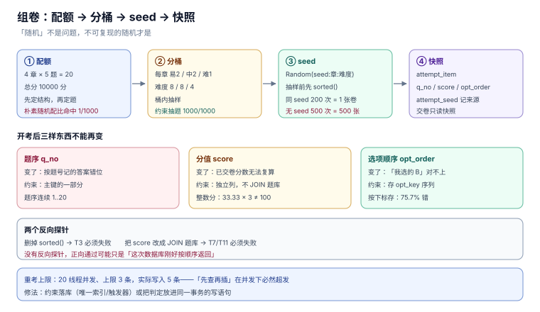

# 核心编码（四）：组卷接口、可复现抽题与开考快照

第 3 步把「完成」冻在了第一次写入。这一步处理同一类问题的第三种形态：**一张卷子在开考那一刻就要冻住，之后题目改分值、改选项、下线，都不能影响已经在考的人。**

它在需求里也只有一句话（「随机抽 20 题」），在代码里要定三件事：抽题的**可复现**、开考时的**快照**、重复开考的**上限**。

::: tip 当日目标
把「随机」从一个 `ORDER BY RANDOM()` 变成一个**带 seed 的确定性函数**，把「卷子」从一次查询结果变成**一张快照表**。
:::

本页判据族 `LXP-A` ~ `LXP-H`，共 8 条。

## 一、当日做了什么

| 动作 | 产物 | 落点 |
| --- | --- | --- |
| 定「同一张卷」的两级口径 | 同 seed 同卷 / 同 attempt 同卷 | 第二节 |
| 加迁移 008：`attempt_item` 快照表 | 题目、分值、选项顺序、题序 | 第三节 |
| 抽题从随机改为「配额 + 分桶 + seed」 | 4 章 × 5 题、难度 8/8/4 | 第四节 |
| 开考快照的三条不可变约束 | `score`、`opt_order`、`q_no` | 第五节 |
| 选项乱序按 `opt_key` 而非位置 | 2,000 次乱序实测 | 第六节 |
| 分值改整数分 | 33.33 × 3 的浮点账 | 第七节 |
| 接口契约与 16 个用例（含 2 条反向探针） | `POST /api/exams/{exam_id}/attempts` | 第八、九节 |



## 二、三个「同一张卷」

「同一张卷」在三个人嘴里是三个意思：

| 口径 | 判据 | 用途 | 本机读数 |
| --- | --- | --- | --- |
| 同 seed 同卷 | `seed` 相同则题目集合与顺序完全一致 | 断点重开、复现投诉 | 200 次同 seed → **1 张卷** |
| 同 attempt 同卷 | `attempt_id` 相同则永远返回同一份快照 | 考试中断后继续 | 读快照表，不重算 |
| 同考生同卷 | 同一人多次重考用同一份卷 | **不做** | 重考要换卷，否则背答案 |

第一条容易被忽略：如果抽题用 `ORDER BY RANDOM()`，那么「同一份卷」这件事**根本不存在**——本机模拟「不加 seed、只取前 20 条」，500 次得到 **500 张不同的卷**，不可复现率 100%。

::: tip 一句话理解
随机不是问题，**不可复现的随机**才是问题。seed 的作用不是让卷子「更随机」，是让「这张卷怎么来的」可以被重放。
:::

## 三、迁移 008：快照表

```sql
CREATE TABLE attempt_item(
  attempt_id   TEXT NOT NULL REFERENCES attempt(attempt_id),
  q_no         INTEGER NOT NULL,              -- 卷面题序，1..N
  question_id  TEXT NOT NULL,                 -- 题目，不随题库变化
  score        INTEGER NOT NULL,              -- 本题分值（分），开考时定格
  opt_order    TEXT NOT NULL,                 -- 选项展示顺序，如 'C,A,D,B'
  PRIMARY KEY (attempt_id, q_no),
  UNIQUE (attempt_id, question_id)
);

CREATE TABLE attempt_seed(
  attempt_id   TEXT PRIMARY KEY REFERENCES attempt(attempt_id),
  seed         INTEGER NOT NULL,
  paper_ver    INTEGER NOT NULL DEFAULT 1,
  created_at   TEXT NOT NULL
);
```

两张表分工：`attempt_item` 是**卷面**（可以没有 seed 也能重放），`attempt_seed` 是**来源**（能证明这张卷是按哪条规则抽的）。只存 seed 不存卷面，题目下线后就重放不出来；只存卷面不存 seed，说不清「为什么是这 20 题」。

## 四、抽题：配额 + 分桶 + seed

朴素做法是从 300 道题里随机取 20 道。它的问题不是「随机性不够」，而是**配比不受控**：本机 1,000 次模拟里，满足「4 章各 5 题、难度 8/8/4」的只有 **1 次（0.1%）**。

正确做法是三层约束逐层收窄：

1. **配额**：每章 5 题、总分 100 分（先定结构，再定题目）；
2. **分桶**：每章内按难度分三桶（易 2 / 中 2 / 难 1），桶内抽；
3. **seed**：桶内抽样的随机源用 `Random(seed + chapter_id)`，保证「同一章同一 seed 抽到同一批」。

```python
import random

def draw(pool, seed):
    """pool: [(qid, chapter, level), ...]；返回 20 个 qid（按章、按难度）"""
    buckets = {}
    for qid, ch, lv in pool:
        buckets.setdefault((ch, lv), []).append(qid)
    picked = []
    plan = [(ch, lv, n) for ch in range(4) for lv, n in (("E", 2), ("M", 2), ("H", 1))]
    for ch, lv, n in plan:
        r = random.Random(f"{seed}:{ch}:{lv}")
        cand = sorted(buckets[(ch, lv)])        # 先排序，消除输入顺序的影响
        picked.extend(r.sample(cand, n))
    return picked
```

两个细节决定可复现性：

- **`sorted()` 不能省**：`sample()` 依赖输入顺序，数据库返回顺序变了，同 seed 也会抽出不同的卷。
- **seed 里带章节**：一个全局 seed 会让「加一章」改变所有章的抽样结果；按章派生 seed 后，加章不影响已有章。

实测：同一 seed 跑 200 次得到 **1 张卷**；不同 seed 跑 200 次得到 **200 张卷**；满足配比 **1,000 / 1,000**。

## 五、开考快照：该冻住的必须冻住

开考之后，三样东西不能再变：

| 东西 | 变了会怎样 | 约束 |
| --- | --- | --- |
| 题序 `q_no` | 考生按题号记的答案错位 | 主键的一部分，不可改 |
| 分值 `score` | 已交卷的分数无法复算 | 快照列，不引用 `question.score` |
| 选项顺序 `opt_order` | 考生说「我选的 B」无法对上 | 存字符串，不存下标 |

三条实现纪律：

1. **不 JOIN `question` 取分值**。`attempt_item.score` 是独立列，评卷只读它。题目后来改分值，已开考的卷子一分不变。
2. **`opt_order` 存 `opt_key` 序列**，不存「第几个是正确答案」。后者在乱序后必然错位（见下一节）。
3. **题目下线用 `RETIRED`，不 `DELETE`**。快照里存的是 `question_id`，题目行没了，这道题的题干就再也显示不出来。

::: danger 注意
最常见的错法是「开考时只存 seed，交卷时按 seed 重算卷面」。它的问题在评卷那一刻暴露：考生 9:00 开考，题库 9:30 下线了两道题，10:00 交卷时重算出来的卷子只有 18 题，而考生答了 20 题——**系统会认为多出来的两题「不属于本卷」**。
:::

## 六、选项乱序：按 key，不按位置

选项乱序的实现只有一条纪律：**正确答案跟着 `opt_key` 走，不跟着位置走**。

| 实现 | 存储 | 2,000 次乱序的错误率 |
| --- | --- | --- |
| 按 `opt_key` | `opt_order='C,A,D,B'`，正确项仍是 `C` | **0 / 2,000** |
| 按位置 | 记录「第 3 个是正确项」，乱序后按下标取 | **1,514 / 2,000（75.7%）** |

75.7% 而不是 100%，因为乱序有 1/4 的概率把正确项洗回原位——这类 bug 在测试里很容易「偶尔通过」。

## 七、分值：用整数分，不用 REAL

第 1 周的 `question.score` 是 `REAL`。它在这张卷子上会出两个问题：

| 算法 | 结果 |
| --- | --- |
| 3 题各 33.33 分 | `33.33 × 3 = 99.99`，不是 100 |
| 10 题各 0.1 分 | 逐项相加在某些语言里得到 `0.9999999999999999` |
| 及格线 60 分，实得 59.999999 | 判「不及格」，考生看到的是 60 |

`attempt_item.score` 因此改成**整数分**（`INTEGER`，单位「分」）。总分 100 分 = `10000` 分，及格线 6000 分。评级、折算、四舍五入都在展示层做，不进入计算。

## 八、接口契约

```text
POST /api/exams/{exam_id}/attempts
Header: Idempotency-Key: <uuidv7>
Body:   { "learner_id": "L0001" }
201:    { "attempt_id": "A20261107001", "seed": 7351, "items": [
            { "q_no": 1, "question_id": "Q017", "score": 500, "opt_order": "C,A,D,B" } ] }
409:    { "code": "MAX_ATTEMPTS", "max": 3, "used": 3 }
409:    { "code": "EXAM_NOT_OPEN" }
```

四条契约纪律：

- **`201` 返回的是快照，不是「抽题结果」**：同一 `attempt_id` 重复 `GET` 必须逐字节一致。
- **`409 MAX_ATTEMPTS` 必须在事务内判定**：并发下「先查再插」会超发（本机 20 线程、上限 3，实际写入 **5 条**）。
- **幂等键与 `attempt_id` 一一对应**：同一键重放返回同一个 `attempt_id`，不新增记录。
- **不在响应里返回 `is_correct`**：选项可以带 `opt_key` 与内容，但不能带正确标记。

## 九、16 个用例

| 编号 | 用例 | 期望 |
| --- | --- | --- |
| `T1` | 同 seed 抽两次 | 题目集合与顺序完全一致 |
| `T2` | 不同 seed 抽两次 | 至少 1 题不同 |
| `T3` | 打乱题库输入顺序后同 seed | 结果不变（依赖 `sorted`） |
| `T4` | 抽 20 题 | 4 章各 5 题 |
| `T5` | 抽 20 题 | 难度 8 / 8 / 4 |
| `T6` | 总分 | 恰好 10000 分 |
| `T7` | 开考后改题目分值 | 快照分值不变 |
| `T8` | 开考后题目 `RETIRED` | 快照仍可取到题干 |
| `T9` | 同一 `attempt_id` 取两次 | 逐字段一致 |
| `T10` | 选项乱序 1,000 次 | 正确项始终是同一 `opt_key` |
| `T11` | 交卷评分 | 按快照分值算，不按题库当前分值 |
| `T12` | 第 4 次开考 | `409 MAX_ATTEMPTS` |
| `T13` | 并发 20 次开考（上限 3） | 实际写入 ≤ 3 |
| `T14` | 同一幂等键重放 | 返回同一 `attempt_id`，不新增 |
| `T15` | **反向探针**：删掉 `sorted()` | `T3` 必须失败 |
| `T16` | **反向探针**：把 `score` 改成 JOIN 题库 | `T7`、`T11` 必须失败 |

`T15` 与 `T16` 的意义：没有它们，`T3`/`T7` 的通过可能只是因为「这次数据库刚好按顺序返回」「这次没人改分值」。

## 十、本页判据

| 编号 | 判据 | 为什么要它 | 怎么验证 |
| --- | --- | --- | --- |
| `LXP-A` | 抽题必须有 `seed`，且同 seed 结果逐题一致 | 无 seed 时 500 次得到 500 张卷 | `T1` 与 `T2`；同 seed 200 次只得到 1 张卷 |
| `LXP-B` | 抽样前必须对候选集排序 | 依赖数据库返回顺序会让同 seed 抽不同卷 | `T3`；删掉 `sorted()` 后 `T3` 必须失败（`T15`） |
| `LXP-C` | seed 必须按「章 + 难度」派生 | 一个全局 seed 会在加章时改变所有章 | 加一章后已有章的抽题结果不变 |
| `LXP-D` | 配额（章 × 难度 × 总分）在抽题前定死 | 朴素随机满足配比的概率只有 0.1% | `T4`、`T5`、`T6` |
| `LXP-E` | 分值必须存整数分，且落在快照列 | `33.33 × 3 = 99.99`，及格线会误判 | `T6`；`SUM(score) = 10000` |
| `LXP-F` | 开考后题序、分值、选项顺序不可变 | 变了已交卷分数无法复算 | `T7`、`T8`、`T9` |
| `LXP-G` | 选项乱序按 `opt_key` 存，不按下标 | 按下标存 2,000 次乱序错 1,514 次 | `T10` |
| `LXP-H` | 重考上限在事务内判定，并发不超发 | 20 线程、上限 3，实际写入 5 条 | `T12`、`T13` |

## 十一、验收 SQL

```sql
-- 1) 每个 attempt 恰好 20 题，题序连续
SELECT attempt_id, COUNT(*) c, MIN(q_no) mn, MAX(q_no) mx
  FROM attempt_item GROUP BY attempt_id
HAVING c <> 20 OR mn <> 1 OR mx <> 20;
-- 预期：0 行

-- 2) 总分恒为 10000 分
SELECT attempt_id, SUM(score) FROM attempt_item GROUP BY attempt_id HAVING SUM(score) <> 10000;
-- 预期：0 行

-- 3) 快照与题库的分值可以不相等，但快照内部必须自洽
SELECT COUNT(*) FROM attempt_item ai
  JOIN question q ON q.question_id = ai.question_id
 WHERE ai.score <= 0;
-- 预期：0

-- 4) 重考次数不超上限
SELECT a.learner_id, a.exam_id, COUNT(*) c
  FROM attempt a GROUP BY a.learner_id, a.exam_id
HAVING c > (SELECT max_attempts FROM exam e WHERE e.exam_id = a.exam_id);
-- 预期：0 行
```

同一 seed 复现（可直接跑）：

```python
import random
pool = [(f"Q{i:03d}", i % 4, "EMH"[i % 3]) for i in range(300)]
def draw(seed):
    b = {}
    for q, ch, lv in pool:
        b.setdefault((ch, lv), []).append(q)
    out = []
    for ch in range(4):
        for lv, n in (("E", 2), ("M", 2), ("H", 1)):
            r = random.Random(f"{seed}:{ch}:{lv}")
            out += r.sample(sorted(b[(ch, lv)]), n)
    return out
print(draw(42) == draw(42), len(set(draw(s) for s in range(200))))
```

预期输出：`True 200`——同 seed 一致，200 个 seed 得到 200 张不同的卷。

## 十二、下一步

第 2 周第 5 步「交卷与评分」：把今天的快照接上评卷——多选漏选如何给分、判断题的 `picked` 如何归一化、`attempt.state` 的状态机（`STARTED → SUBMITTED → SCORED`）以及「同一份答卷重复提交」的幂等。它与今天这条是同一类问题的第四种形态：**分数一旦算出，就只能追加一次**。

## 十三、参考资料

- [Python: random.Random](https://docs.python.org/3/library/random.html)：`sample` 的输入顺序敏感性
- [SQLite: CREATE TABLE](https://www.sqlite.org/lang_createtable.html)：复合主键与唯一约束
- [RFC 9562](https://www.rfc-editor.org/rfc/rfc9562)：UUIDv7 作为开考请求的幂等键
- [OWASP: Insecure Randomness](https://owasp.org/www-community/vulnerabilities/Insecure_Randomness)：不可复现随机的可测试性问题
