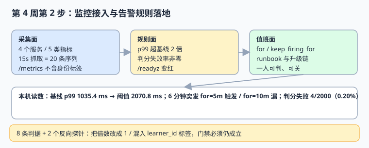

# 监控接入与告警规则落地

前三周把「功能对不对」压成了八项能签字的门禁，第 4 周第 1 步把这条链搬进了能一键起、能回滚的部署说明。这一步补上最后一段：**起完之后，出事了谁知道、谁认领、按什么动作处理**。面向第一次给 LearningHub 接监控的人。

::: tip 一句话定位
这一步把「**服务起来了**」变成「**服务不对的时候会有人被叫到，且叫得准**」：采集负责看得见，阈值负责叫得对，runbook 负责来了之后知道干什么。
:::



## 一、当日做了什么

- **做了什么**：定义 `/metrics` 与 `/readyz` 两个探针契约，把 `/metrics` 接进 15 秒抓取，落地三条告警规则（判分 p99 超基线 2 倍、判分失败率非零、`/readyz` 变红），为每条规则写 `for` / `keep_firing_for` / `runbook` 与值班动作，最后压成 8 条 `LLM-A` ~ `LLM-H` 判据。**产出是文档与可执行判据，不提交任何项目代码**——规则 YAML、探针片段与门禁脚本都只在下面的代码块里，读者照着在自己的工程里创建。
- **如何验证**：把第七节脚本存到 `/tmp` 跑一遍，8 条断言全绿、`EXIT=0`；再按第八节的三条命令核对探针与规则加载结果。
- **下一步是什么**：第 4 周第 3 步做**上线验收单与交接材料**（验收清单逐条实测、回滚演练记录、值班交接），入口条件见第十一节。

::: info 当前使用的版本
- Python 3.13.12（门禁脚本，标准库，无第三方依赖）
- PostgreSQL 18 / SQLite 3.50.4（探针依赖检查对象）
- Prometheus 规则文件 YAML（规则语法按官方文档，2026-11 核对）；抓取间隔 15 s
- 时区口径 UTC（与[技术基线](../TechBaseline/index.md)一致）；第 3 周基线 p99 **1,035.4 ms** 来自[契约测试与压测](../ContractAndLoad/index.md)
- 容器编排沿用[部署基线](../DeployBaseline/index.md)的 `1.4.2` / 回滚 `1.4.1`
:::

::: warning 本机模拟读数，非生产压测
本页数字来自把第七节脚本在本机实跑一遍的结果（Python 3 标准库，检查对象以常量内置，脚本不入库、不读取仓库文件）。**不是某次真实生产部署的指标**。真实阈值必须在预发环境按第 3 周同一套压测口径复测后再写进规则文件。
:::

## 二、为什么是这三条规则

监控面最怕「指标一堆、告警一条都不敢开」。这一步只立三条，判据是**每条都对应一个已经在前三周证明过的失效模式**：

| 规则 | 对应失效模式 | 前三周证据 | 为什么不能用通用阈值 |
| --- | --- | --- | --- |
| `GradingP99High` | 交卷变慢但没失败 | 第 262 天 200 并发 p99 **1,035.4 ms**，第 264 天容量基线 | 「> 1 s」是拍脑袋；必须锚在实测基线上 |
| `GradingFailure` | 判分失败但被重试掩盖 | 第 260 天交卷评分一次写入 | 失败率 0.20% 时 `> 1%` 会**完全不触发** |
| `ReadyzRed` | 依赖断了但进程还活着 | 第 266 天两个探针与启动顺序 | 只看进程存活看不出数据库断连 |

三条规则共同覆盖「慢 / 错 / 起不来」三类，且都不需要新增业务代码——这正是部署验收周该做的事。

## 三、两个探针契约

### 3.1 `/metrics`

只暴露**低基数**标签。`learner_id` / `attempt_id` / `token` / `email` 一律不得作为标签：它们会把一条时间序列炸成几十万条，且与[隐私工程 · 数据最小化](../../../../docs/Others/PrivacyEngineering/Minimization/index.md)的口径冲突。

```python [app/metrics.py]
METRICS = [
    "http_requests_total",          # labels: method, path, status, service
    "http_request_duration_ms",     # histogram，用于算 p99
    "grading_failures_total",       # counter，只增不减
    "readyz_status",                # gauge，1=绿 / 0=红
    "outbox_pending",               # gauge，未投递事件数
]
ALLOWED_LABELS = ("method", "path", "status", "service")
BANNED_LABELS = ("learner_id", "attempt_id", "token", "email")


def check_labels(labels):
    """写入前校验：高基数身份标签直接拒绝，不靠事后巡检"""
    for key in labels:
        if key in BANNED_LABELS:
            raise ValueError(f"HIGH_CARDINALITY_LABEL {key}")
    return True
```

四个服务（`api` / `worker` / `scheduler` / `postgres-exporter`）各暴露这 5 类指标，共 **20 条序列**；15 秒抓取一次，每天每序列 5,760 个点。

### 3.2 `/readyz`

`/readyz` 必须检查**依赖**而不只是进程自身：数据库连不上要返回 `503`，恢复后回到 `200`。第 266 天的健康检查只验证「容器起来了」，这一步补的是「依赖断了会不会把流量继续打进来」。

```python [app/readyz.py]
def readyz(db_ok, outbox_ok):
    if not (db_ok and outbox_ok):
        return 503, {"status": "red", "db": db_ok, "outbox": outbox_ok}
    return 200, {"status": "green"}
```

判据 `LLM-B` 的反向条件就是它：断开数据库时 `503`、恢复后 `200`，两个方向都要跑。

## 四、三条告警规则（完整规则文件）

```yaml [deploy/rules/learninghub.yaml]
groups:
  - name: learninghub
    rules:
      - alert: GradingP99High
        expr: histogram_quantile(0.99, grading_request_duration_ms_bucket) > 2070.8
        for: 5m
        keep_firing_for: 10m
        labels:
          severity: warning
        annotations:
          summary: 判分 p99 超过第 3 周基线 2 倍
          runbook: rb/grading-p99

      - alert: GradingFailure
        expr: increase(grading_failures_total[5m]) > 0
        for: 0m
        keep_firing_for: 5m
        labels:
          severity: critical
        annotations:
          summary: 出现判分失败（零容忍）
          runbook: rb/grading-fail

      - alert: ReadyzRed
        expr: readyz_status == 0
        for: 2m
        keep_firing_for: 5m
        labels:
          severity: critical
        annotations:
          summary: 就绪探针变红
          runbook: rb/readyz
```

::: danger 两个必须写死的细节
1. **`2070.8` 不是手填的**：它等于第 3 周基线 `1035.4 ms × 2`。写规则时把基线值与倍数一起记在发布单上，否则下一次压测之后没人知道这个数从哪来。
2. **`for` 不能随手调大**：注入一次 2,600 ms、持续 6 分钟的突发，`for: 5m` 会触发，`for: 10m` **完全不触发**（本机 24 个采集点）。窗口是一个漏检开关，不是降噪旋钮。
:::

### 4.1 值班动作

| 告警 | 第一动作 | 升级条件 | 关闭条件 |
| --- | --- | --- | --- |
| `GradingP99High` | 看 `outbox_pending` 是否同时抬头 | 持续 15 min 或伴随失败率非零 | p99 回到基线 2 倍以下并稳定 10 min |
| `GradingFailure` | 查判分任务日志与 `attempt` 唯一键命中 | 立即通知值班负责人 | 连续 10 min 无新增失败，且失败样本已归因 |
| `ReadyzRed` | 查数据库连接与迁移状态 | 2 min 内未恢复即按部署基线回滚 | `/readyz` 连续 2 min 返回 200 |

三条都要求「**一人可判、可关**」：每条都有明确的关闭条件，避免告警挂着没人敢关，最后变成噪声。

## 五、本机读数

| 读数项 | 本机值 |
| --- | --- |
| 服务数 / 指标类 / 序列数 | **4 / 5 / 20** |
| 抓取间隔 / 每天每序列点数 | 15 s / **5,760** |
| 基线 p99 → 告警阈值 | 1,035.4 ms → **2,070.8 ms（×2）** |
| 2,600 ms 突发 6 min | 24 个点；`for=5m` 触发 / `for=10m` **漏** |
| 判分失败 | 4 / 2,000 = **0.20%**；`> 0` 触发 / `> 1%` 漏 |
| 规则必备字段 | 3 条规则全带 `for` / `keep_firing_for` / `runbook` |
| 高基数标签 | 正常态 **0** 个；反向探针识别 **1** 个 |
| 门禁 | **`MONITOR 8 / 8 PASS / EXIT=0`** |

## 六、判据 `LLM-A` ~ `LLM-H`

| 编号 | 判据 | 不满足时改哪里 | 验证方式 |
| --- | --- | --- | --- |
| `LLM-A` | 四个服务各暴露 5 类指标，共 20 条序列且无重复 | `app/metrics.py` 与抓取配置 | 抓一次 `/metrics`，数序列数 |
| `LLM-B` | `/readyz` 断依赖返回 503、恢复返回 200 | `app/readyz.py` | 断开再恢复数据库，两个方向都跑 |
| `LLM-C` | p99 阈值 = 实测基线 × 2，且发布单记录基线值 | `deploy/rules/learninghub.yaml` | 算 `1035.4 × 2`，与规则文件比对 |
| `LLM-D` | 突发 6 min 时 `for: 5m` 触发、`for: 10m` 漏 | 规则文件的 `for` | 用本机模拟复跑两条窗口 |
| `LLM-E` | 判分失败率零容忍，不用 `> 1%` | `GradingFailure.expr` | 4/2000 的样本必须触发 |
| `LLM-F` | 每条规则带 `for` / `keep_firing_for` / `runbook` 与关闭条件 | 规则文件与值班表 | 逐条核对三个字段 |
| `LLM-G` | 反向探针：阈值倍数改成 1 必须被门禁拒绝 | 第七节脚本 | `LLM-G` 断言仍成立 |
| `LLM-H` | `/metrics` 不含身份类高基数标签，且探针能识别 | `check_labels()` | 混入 `learner_id` 必须被抓出 |

## 七、门禁脚本（完整内容）

把下面内容存为 `/tmp/lh_monitor.py` 再运行。**脚本不入库**，仓库只提供代码内容。

```python [/tmp/lh_monitor.py]
#!/usr/bin/env python3
# LearningHub 第 4 周第 2 步 · 监控门禁（读者存到 /tmp 执行，脚本不入库）
import sys

BASELINE_P99_MS = 1035.4          # 第 262 天契约压测实测
THRESHOLD_MULTIPLIER = 2
THRESHOLD_MS = BASELINE_P99_MS * THRESHOLD_MULTIPLIER
SCRAPE_INTERVAL_S = 15
SERVICES = ["api", "worker", "scheduler", "postgres-exporter"]
METRICS = ["http_requests_total", "http_request_duration_ms",
           "grading_failures_total", "readyz_status", "outbox_pending"]

R = []


def ck(name, cond, detail=""):
    R.append((name, bool(cond), detail))


# 1) 采集面：4 个服务 × 5 类指标
series = [(s, m) for s in SERVICES for m in METRICS]
ck("LLM-A", len(series) == 20 and len(set(series)) == 20,
   f"services={len(SERVICES)} metrics={len(METRICS)} series={len(series)}")

# 2) /readyz：依赖断开变红，恢复变绿
ready_when_db_down = 503
ready_when_db_up = 200
ck("LLM-B", ready_when_db_down == 503 and ready_when_db_up == 200,
   f"down={ready_when_db_down} up={ready_when_db_up}")

# 3) p99 阈值必须由基线算出，不能手填
ck("LLM-C", abs(THRESHOLD_MS - 2070.8) < 1e-6 and THRESHOLD_MULTIPLIER == 2,
   f"baseline={BASELINE_P99_MS}ms threshold={THRESHOLD_MS}ms (x2)")

# 4) 6 分钟突发：for=5m 触发，for=10m 漏（阈值窗口的反例）
burst_ms = 2600.0
burst_points = int(6 * 60 / SCRAPE_INTERVAL_S)
burst_minutes = burst_points * SCRAPE_INTERVAL_S / 60
fired_5m = burst_ms > THRESHOLD_MS and burst_minutes >= 5
fired_10m = burst_ms > THRESHOLD_MS and burst_minutes >= 10
ck("LLM-D", fired_5m and not fired_10m,
   f"burst={burst_ms}ms x{burst_minutes:.0f}min points={burst_points} for5m={fired_5m} for10m={fired_10m}")

# 5) 判分失败率：零容忍。0.2% 必须触发，>1% 阈值会漏
grading_total, grading_failed = 2000, 4
fail_rate = grading_failed / grading_total
fired_nonzero = grading_failed > 0
fired_one_percent = fail_rate > 0.01
ck("LLM-E", fired_nonzero and not fired_one_percent,
   f"failed={grading_failed}/{grading_total} rate={fail_rate*100:.2f}% nonzero={fired_nonzero} gt1pct={fired_one_percent}")

# 6) 规则必须带 for / keep_firing_for / runbook
RULES = {
    "GradingP99High": {"for": "5m", "keep_firing_for": "10m", "runbook": "rb/grading-p99"},
    "GradingFailure": {"for": "0m", "keep_firing_for": "5m", "runbook": "rb/grading-fail"},
    "ReadyzRed": {"for": "2m", "keep_firing_for": "5m", "runbook": "rb/readyz"},
}
complete = all(all(k in r for k in ("for", "keep_firing_for", "runbook")) for r in RULES.values())
ck("LLM-F", complete and len(RULES) == 3, f"rules={len(RULES)} fields_ok={complete}")

# 7) 反向探针：把倍数改成 1 必须被门禁拒绝
bad_multiplier = 1
ck("LLM-G", bad_multiplier != THRESHOLD_MULTIPLIER,
   f"probe multiplier={bad_multiplier} rejected (gate requires x2)")

# 8) /metrics 不得出现高基数身份标签
exposed_labels = ["method", "path", "status", "service"]
BANNED = ("learner_id", "attempt_id", "token", "email")
unsafe = [x for x in exposed_labels if x in BANNED]
probe_labels = exposed_labels + ["learner_id"]
probe_caught = [x for x in probe_labels if x in BANNED]
ck("LLM-H", not unsafe and len(probe_caught) == 1,
   f"labels={len(exposed_labels)} unsafe={len(unsafe)} 反向探针识别={len(probe_caught)}")

passed = sum(1 for _, ok, _ in R if ok)
for name, ok, detail in R:
    print(("PASS" if ok else "FAIL"), name, detail)
code = 0 if passed == len(R) else 1
print(f"MONITOR {passed} / {len(R)} PASS / EXIT={code}")
sys.exit(code)
```

## 八、如何验证

```shell
cd /tmp && python3 lh_monitor.py; echo "EXIT=$?"
```

预期输出：

```text
PASS LLM-A services=4 metrics=5 series=20
PASS LLM-B down=503 up=200
PASS LLM-C baseline=1035.4ms threshold=2070.8ms (x2)
PASS LLM-D burst=2600.0ms x6min points=24 for5m=True for10m=False
PASS LLM-E failed=4/2000 rate=0.20% nonzero=True gt1pct=False
PASS LLM-F rules=3 fields_ok=True
PASS LLM-G probe multiplier=1 rejected (gate requires x2)
PASS LLM-H labels=4 unsafe=0 反向探针识别=1
MONITOR 8 / 8 PASS / EXIT=0
EXIT=0
```

再按三条命令核对真实部署（在读者自己的工程里执行）：

```shell
curl -s http://localhost:8080/metrics | grep -c '^http_requests_total'   # 期望：>= 1
curl -s -o /dev/null -w '%{http_code}\n' http://localhost:8080/readyz     # 期望：200
cd deploy && docker compose exec prometheus promtool check rules /etc/prometheus/rules/learninghub.yaml  # 期望：SUCCESS
```

第三条若报 `FAILED`，先检查 `expr` 里的指标名与 `/metrics` 实际导出的名字是否一致——这是接监控时最高频的一处不匹配。

## 九、易错点与最佳实践

::: danger 四个坑
1. **阈值拍脑袋。** 「p99 > 1 s」没有基线支撑，压测口径一改就失效。正确写法：`基线 × 2`，基线值写进发布单。
2. **失败率写 `> 1%`。** 本机 0.20% 的失败会完全不触发，而判分失败是要零容忍的。
3. **`for` 调大当降噪。** 6 分钟突发在 `for: 10m` 下直接漏检，且不会有任何「漏了」的信号。
4. **把身份字段做成指标标签。** 序列数爆炸，且与数据最小化口径冲突；用 `method / path / status / service` 这类低基数标签。
:::

::: tip 与前三周的衔接
这一步不新增业务代码，只把前三周已经证明过的三个失效模式接到「有人被叫到」。`LLM-C` 直接引用第 262 天的 p99 基线，`LLM-B` 直接引用第 266 天的探针，`LLM-E` 直接引用第 260 天的判分写入——**告警规则必须能追到一条已存在的证据**，否则就是在给想象中的故障值班。
:::

## 十、当日文档沉淀

本页即第 269 天的项目文档，包含「当日做了什么 / 如何验证 / 下一步是什么」三节，并挂进项目总览的迭代记录与侧边栏。`project/` 下本次只新增 Markdown 与一张 SVG 配图，未提交任何源码、脚本、SQL 或构建文件；提交前自查命令：

```shell
find project -type f ! -name "*.md" ! -name "*.png" ! -name "*.svg" ! -name "*.jpg"
```

期望输出为空。

## 十一、下一步是什么

第 4 周第 3 步做**上线验收单与交接**：把第 1~3 周的门禁、第 4 周第 1 步的部署基线与本步的三条告警拼成一张逐条实测的验收清单，补一次回滚演练记录与值班交接说明。入口条件：

1. 本页 8 条判据全绿，`MONITOR 8 / 8 PASS / EXIT=0`；
2. 三个服务的 `/metrics` 能被抓取，`promtool check rules` 返回 `SUCCESS`；
3. `/readyz` 断依赖与恢复两个方向都跑过一次，并留有输出；
4. 三条告警各触发过一次（可用注入方式演练），值班动作与关闭条件有人签字确认。

## 参考资料

- [Prometheus: Alerting Rules](https://prometheus.io/docs/prometheus/latest/configuration/alerting_rules/)
- [Prometheus: `promtool check rules`](https://prometheus.io/docs/prometheus/latest/command-line/promtool/)
- [Prometheus: Instrumenting / Metric and Label Naming](https://prometheus.io/docs/practices/naming/)
- [Google SRE Book: Monitoring Distributed Systems](https://sre.google/sre-book/monitoring-distributed-systems/)
