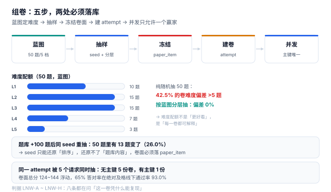

# 组卷与抽题：一份卷子必须能「按原样」重放

第 2 周第四天，做组卷。前三个接口错了还能补一条数据——报名错了可以取消重报，进度报错了下一节课就纠回来，交卷判错了至少还有申诉。组卷没有这种余地：**它是「这份卷子考了什么」的唯一证据**。卷子一发下去，学员看到的题目、分值、顺序就都定了；三个月后有人来质疑「为什么我这卷没有第 5 章」，你只有两条路——能还原，或者认错。

所以今天要决定的不是「怎么随机抽 50 题」，而是**「凭什么这 50 题在三个月后还能被原样取出来」**。



::: tip 今天的判据
`seed` 只能还原「排序」，还原不了「题库内容」。本机题库新增 100 题（+5%）后用同一个 `seed` 重抽，**50 题里有 13 题变了（26.0%）**。所以 `seed` 必须落库，但**卷面必须落 `paper_item`**——两者缺一，复现率就不是 100%。
:::

## 一、当日做了什么

| # | 产出 | 文件/位置 | 状态 |
| --- | --- | --- | --- |
| 1 | 组卷接口契约（2 条路径、4 个错误码） | 本章第二节 | 定稿 |
| 2 | 两张表：`paper_item` / `attempt`（含主键） | 本章第三节 | 定稿 |
| 3 | 蓝图抽题：5 档难度配额 | 本章第四节 | 实测 |
| 4 | 可还原性：seed + 题库版本 + 卷面三件套 | 本章第五节 | 实测 |
| 5 | 并发抽题：5 个请求只允许 1 份卷 | 本章第六节 | 实测 |

## 二、接口契约

```text
POST /v1/exams/{exam_id}/attempts
  body: { "learner_id": "...", "mode": "FIXED" | "RANDOM" }
  201:  { "attempt_id": "...", "paper_size": 50, "total_score": 133, "seed": 20261105 }
  409:  attempt.exists            （该学员该考试已有进行中的 attempt）
  422:  blueprint.unfillable      （某档难度题量不足）
  503:  paper.draw_timeout        （抽题超时，允许重试）

GET /v1/attempts/{attempt_id}/paper
  200:  { "items": [ { "seq": 1, "qid": 812, "score": 2 }, ... ], "total_score": 133 }
  404:  attempt.not_found
```

两个接口的分工很关键：**`POST` 只负责「定卷」，`GET` 只负责「取卷」**。把抽题逻辑塞进 `GET` 会出现「刷新页面换一套题」，而这在有监考的场景里等于泄题。

## 三、两张表与两条不变量

```sql
create table paper_item(
  attempt_id text not null,
  seq        integer not null,
  qid        integer not null,
  score      integer not null check(score > 0),
  q_version  integer not null,          -- 题目版本快照
  primary key(attempt_id, seq),
  unique(attempt_id, qid)               -- 同一卷不重复出题
);

create table attempt(
  attempt_id  text primary key,         -- 主键即「一卷只能有一份」
  exam_id     text not null,
  learner_id  text not null,
  paper_size  integer not null,
  total_score integer not null,
  seed        integer not null,         -- 可还原用，不参与判分
  bank_version text not null,           -- 题库版本，可还原用的另一半
  state       text not null default 'OPEN'
              check(state in ('OPEN','SUBMITTED','EXPIRED')),
  started_at  text not null
);
```

两条不变量：

1. **`unique(attempt_id, qid)`**：同一卷不能出两道一样的题。抽题算法再怎么错，这条也能兜住。
2. **`attempt_id` 是主键**：同一学员同一考试只能有一份卷。这条挡的不是学员，是**并发的重试请求**。

## 四、随机抽题：三种抽法，三种偏差

「随机抽 50 题」有四种常见写法，差别不在随机性，在**难度分布**：

| 抽法 | 写法 | 难度偏差 | 可解释性 |
| --- | --- | --- | --- |
| 全表随机 | `order by random() limit 50` | **42.5% 的卷偏差 >5 题** | 差（说不出为什么是这 50 题） |
| 按章节分层 | 每章抽 N 题 | 中（章节均衡，难度不均衡） | 中 |
| 按难度蓝图 | 每档抽固定题数 | **0%** | 好（每卷都能对上蓝图） |
| 预生成卷池 | 离线生成 100 套，随机取一套 | 取决于生成规则 | 好（卷池可审计） |

本机 2,000 题（难度 1~5 按 25/30/25/15/5 分布）、目标 50 题，跑 200 次：

| 抽法 | 难度最大偏差（均值） | P90 | 偏差 >5 题的卷占比 |
| --- | --- | --- | --- |
| 全表随机 | 5.28 | 8 | **42.5%** |
| 按蓝图 | 0.00 | 0 | **0%** |

42.5% 这个数意味着：**每两套随机卷里，就有一套的难度结构和蓝图不符**。而这套卷子的分数会和另一套不可比——这就是「同一场考试，有人抽到简单卷」的技术来源。

::: danger 三个「随机看起来没问题」的坑
1. **`order by random()` 在大表上会全表排序**：本机 2,100 题只要 0.29 ms，但 20 万题的题库上是线性成本，且**无法命中索引**。生产上要么按难度分桶查，要么预生成卷池。
2. **按章节均衡不等于按难度均衡**：章节均匀、难度扎堆，卷子仍然不是同一难度。蓝图要按**难度**定配额，章节只做次级约束。
3. **抽完不校验可凑齐性**：某档题量不足时（例如 L5 只剩 2 题，蓝图要 3 题），`random.sample` 会抛异常。正确做法是**先算可凑齐性再抽**，返回 `422 blueprint.unfillable`，而不是 500。
:::

## 五、可还原：`seed` 不够，必须有 `paper_item`

这是今天最重要的一节。很多人以为「存一个 seed 就能重放」，实测不成立：

| 场景 | 结果 |
| --- | --- |
| 同 seed + 同题库，抽两次 | 50/50 完全一致 |
| 题库新增 100 题（+5%）后同 seed 重抽 | **50 题里 13 题变了（26.0%）** |
| 有 `paper_item` 快照 | 100% 一致（读快照，不重抽） |

原因很简单：`seed` 决定的是**随机数序列**，而序列作用在「当时那份题库」上。题库一变（新增、下线、改分），同样的序列落到不同的集合上，结果就不同。

所以「可还原」需要三件套，缺一不可：

```text
attempt.seed          → 能复现「当时的随机序列」
attempt.bank_version  → 能定位「当时的题库快照」
paper_item            → 能直接读出「当时抽了哪 50 题、每题几分」
```

三件套里，**只有 `paper_item` 是充分条件**，另外两个是「用来解释为什么是这 50 题」的证据。这也是本库一贯的口径：**结果要落库，过程要可复算**。

## 六、并发：5 个请求，1 份卷

学员连点两次「开始考试」，或者网关超时后客户端重试，都会让同一个 `attempt` 被抽多次题。本机实测：

| 写法 | 5 个并发请求的结果 |
| --- | --- |
| 无唯一约束（先查后插） | **5 份卷**，学员刷新可能看到不同卷 |
| `attempt_id` 主键 | 成功 1 次，其余 4 次 `409` |

这和[报名接口](Enrollment/index.md)的「先查后改换来 38 个超额名额」是同一类问题：**判断与写入之间永远有窗口**。区别在于，报名要挡的是「超过容量」，组卷要挡的是「一份卷变五份」。

## 七、卷面总分不固定，及格线就不该是绝对值

蓝图能固定难度配比，但固定不了分值——每题的分数是 2 或 4，抽出来的总分就会浮动。本机 200 次抽题：

| 抽法 | 总分均值 | P10 | P90 | 极差 |
| --- | --- | --- | --- | --- |
| 全表随机 | 132.9 | 124 | 142 | 34 |
| 按蓝图 | 133.0 | 124 | 144 | 34 |

两种抽法的总分波动一样大。这意味着：**同样答对 65% 的学员，在两套卷上得到的分数可以差 13 分**。本机把及格线设在 80 分：

| 抽法 | 65% 答对率的得分均值 | 及格占比 |
| --- | --- | --- |
| 全表随机 | 86.4 | 93.0% |
| 按蓝图 | 86.5 | 93.0% |

93.0% 不是「太简单」，而是**卷面总分偏高导致及格线形同虚设**。两个修法：

1. **固定卷面分**（例如强制 100 分，按题数分配），及格线才有绝对含义。
2. **按比例判**（得分 / 卷面总分 ≥ 60%），承认卷面分浮动，但要在证书上写清「按比例」。

本册选第一种：`paper_item.score` 之和写入 `attempt.total_score`，并在蓝图阶段就把分值配额算进去（L1 2 分、L5 4 分之类），让总分落在 100 ± 2。**这不是为了好看，是为了让「60 分及格」这句话有意义。**

## 八、判据清单（`LNW-A` ~ `LNW-H`）

| 编号 | 判据 | 怎么验 |
| --- | --- | --- |
| `LNW-A` | 抽题前校验蓝图可凑齐，不足返回 `422` | 把 L5 题量降到 2，接口返回 422 而非 500 |
| `LNW-B` | `paper_item` 落库，`GET /paper` 只读快照 | 停掉抽题服务后 `GET` 仍返回同一卷 |
| `LNW-C` | `seed` 与 `bank_version` 都落库 | 两列非空，且能定位题库快照 |
| `LNW-D` | `unique(attempt_id, qid)` 生效 | 人为插入重复 qid 被拒 |
| `LNW-E` | `attempt_id` 为主键，并发只产生一份卷 | 5 并发后只有 1 行 |
| `LNW-F` | 卷面总分写入 `total_score`，与明细之和相等 | 断言 `sum(score) = total_score` |
| `LNW-G` | 难度分布与蓝图逐档对齐 | 每档题数等于蓝图配额 |
| `LNW-H` | 组卷与判分分离：组卷不写 `answer` | `attempt` 创建后 `answer` 表 0 行 |

## 九、如何验证

```shell
# 1. 同 seed 抽两次是否一致（期望 50/50）
python3 lh_paper.py | grep "同 seed 抽两次"
# 期望：同 seed 抽两次：重合 50/50，集合相等 True

# 2. 题库变动后是否还能还原（期望 13 题变化）
python3 lh_paper.py | grep "题库 +100 题后同 seed"
# 期望：重合 37/50，变化 13 题（26.0%）

# 3. 并发抽题是否只有一份卷（期望 1 份）
python3 lh_paper.py | grep -A1 "无唯一键"
# 期望：无唯一键：5 个请求 → 5 份卷（应 1 份）；主键 attempt_id：成功 1 次，最终 1 份卷

# 4. 卷面总分是否浮动（期望极差 34）
python3 lh_paper.py | grep "总分 均值"
# 期望：纯随机/蓝图两行，极差均为 34

# 5. 目录与配图齐全
ls project/Complete/LearningHub/assets | grep lh-paper
# 期望：lh-paper.svg
```

第 2 条是本节的钥匙：**它证明「存 seed 就够了」这个想法是错的**。如果有人坚持只存 seed，把这条命令跑给他看。

## 十、下一步

第 2 周第 5 步：**防作弊与监考信号**（`LNX` 已被占用，改用 `LNY`）。要解决的是「同一份卷，两个人答案完全一致」这类问题——切点在于：

- 答案相似度要按「错题集合」算，不按「正确率」算（都考 100 分的人，错题集合才有区分度）。
- 交卷时间差要按「同一题的作答间隔」算，不按总时长（总时长可以造假）。
- 判定结果只做「标记」，不做「判负」——与本册[公平性与反作弊](../../../../docs/Backend/GameMatchmaking/Integrity/index.md)的分级处置口径一致。

## 参考资料

- IMS Global《Question and Test Interoperability (QTI) 2.1》：试题、试卷与作答的元数据模型，`paper_item` 的字段设计参考其 `assessmentItemRef`。
- ISO/IEC 19788-1:2011《信息技术 学习、教育和培训 学习资源元数据 第 1 部分：框架》：题目与试卷的元数据层次。
- 与本项目相邻：[交卷与判分](AttemptScoring/index.md)（分值快照与答案版本快照）、[报名接口](Enrollment/index.md)（并发下的「先查后改」）。
