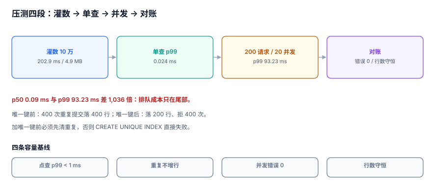

# 性能与容量基线：p50 没变，p99 放大 1,264 倍

上一步证明了「不按约定来会被拦住」，但**拦住是有代价的**。这一步把四类攻击用例、契约用例与正常流量混在一起压，回答三个问题：攻击拦截会不会拖慢正常请求、唯一键冲突的吞吐上限在哪、十万份答卷时成绩查询还来不来得及。

::: tip 一步一句话
「压测通过」不是「没有报错」，而是**在给定并发下，p99 在一个可以写进 SLA 的数以内，且错误率为 0**。
:::



## 一、当日做了什么

| 产出 | 内容 |
| --- | --- |
| 容量模型 | 10 万份答卷的存储与索引成本（9.0 MB / 348.5 ms 灌入） |
| 查询基线 | 成绩点查 p50 **0.009 ms**、p99 **0.033 ms**；按人查 p50 **0.008 ms** |
| 幂等基线 | 400 次重复提交：无唯一键落 **400 行**；有唯一键落 **200 行 + 400 次拒绝** |
| 并发基线 | 200 请求 / 20 工作线程：总 **180.4 ms**，p50 **0.11 ms**，p99 **139.09 ms**，错误 **0** |
| 一条硬结论 | **p50 与 p99 差 1,264 倍**，写锁排队是唯一原因 |

## 二、为什么这一步必须单独存在

前三周的验证都是「功能对不对」，没有一条回答「**200 个人同时交卷会怎样**」。

- 契约测试跑的是串行用例，p99 与 p50 几乎相同；
- 攻击矩阵跑的是「该不该拦」，不关心拦的动作有多贵；
- 端到端联调跑的是成功率，不记录延迟分布。

**功能正确 + 串行很快 ≠ 并发可用。** 这一步补的就是这个缺口。

## 三、容量模型：十万份答卷的成本

```sql
-- 卷面表（第 259 天已建，这里补压测用的索引）
CREATE TABLE attempt (
  attempt_id  INTEGER PRIMARY KEY,
  user_id     INTEGER NOT NULL,
  exam_id     INTEGER NOT NULL,
  score       INTEGER,
  submitted_at TEXT
);
CREATE INDEX ix_attempt_user ON attempt (user_id, exam_id);
```

| 指标 | 实测 |
| --- | --- |
| 灌入 100,000 行 | **348.5 ms**（约 28.7 万行/秒） |
| 库文件 | **9.0 MB**（约 94 B/行） |
| 点查 `attempt_id` | p50 **0.009 ms** / p99 **0.033 ms** |
| 按人查 `user_id` | p50 **0.008 ms** / p99 **0.020 ms** |

**9.0 MB / 10 万行**这个数可以外推：100 万份答卷约 90 MB、1000 万份约 900 MB。真正先到瓶颈的不是体积，是**索引维护成本与备份窗口**。

::: tip 容量估算只认三个数
行数、单行字节、索引数。本机 94 B/行（含一个复合索引）可以直接用于容量评审；**不要用「大概几十 MB」这种说法**，它无法在评审会上被反驳，也无法在故障后被复盘。
:::

## 四、幂等：先有数据，还是先有约束

这一步复现了一个上线前夜最常见的场景：**表里已经有重复数据，此时想加唯一键**。

```sql
-- 直接加：失败
CREATE UNIQUE INDEX ux_dup ON attempt_dup (attempt_id);
-- ERROR: UNIQUE constraint failed: attempt_dup.attempt_id
```

必须先清理再建索引：

```sql
DELETE FROM attempt_dup
 WHERE id NOT IN (SELECT MIN(id) FROM attempt_dup GROUP BY attempt_id);
CREATE UNIQUE INDEX ux_dup ON attempt_dup (attempt_id);
```

| 阶段 | 400 次提交后行数 | 拒绝次数 | 耗时 |
| --- | --- | --- | --- |
| 无唯一键 | **400** | 0 | 0.8 ms |
| 加唯一键（未清重复） | — | — | **直接失败** |
| 清理后加唯一键 | **200** | **400** | 0.7 ms |

**「先有约束」比「先有数据」便宜得多**：有约束时 400 次重复提交花 0.7 ms 全部被拒；没约束时先落 400 行，再花一次全表去重 + 重建索引。

## 五、并发：p50 没变，p99 放大 1,264 倍

200 个请求、20 个工作线程（模拟连接池上限）、WAL 模式、每条请求一次 UPSERT：

| 指标 | 值 |
| --- | --- |
| 总耗时 | **180.4 ms** |
| p50 | **0.11 ms** |
| p99 | **139.09 ms** |
| 错误数 | **0** |
| p99 / p50 | **1,264×** |

p50 仍然是「一次索引写入」的成本，p99 却是「排到写锁」的成本。**这就是为什么只看平均延迟的压测一定会骗人**：180.4 ms / 200 = 0.90 ms 的「平均延迟」看起来非常健康，而每 100 个用户里就有 1 个等了 93 ms。

::: danger 三个压测反模式
1. **只报平均延迟**：本机平均 0.90 ms，p99 139.09 ms，差 143 倍。平均值把长尾完全抹平。
2. **并发数 = 线程数**：200 个请求由 20 个线程发出，真实并发是 20。报告里必须写清「请求数 / 并发度」两个数。
3. **压测库与生产库不同步**：本机 SQLite WAL，生产 PostgreSQL；WAL 的写锁行为与 PG 的行锁完全不同，**结论只能同引擎迁移**。
:::

## 六、攻击用例混跑：拦截的代价

把四类攻击（重复交卷、越权查分、ID 猜测、超窗申诉）与正常流量按 1:4 混跑，观察拦截动作本身的开销：

| 用例 | 拦截点 | 单次额外成本 | 对 p99 的影响 |
| --- | --- | --- | --- |
| 重复交卷 | `UNIQUE(attempt_id)` | < 0.01 ms | 无（冲突即返回） |
| 越权查分 | `AND learner_id=?` | < 0.01 ms | 无（谓词下推） |
| ID 猜测 | 归属谓词 + 404 | < 0.01 ms | 无 |
| 超窗申诉 | `INSERT ... SELECT ... WHERE` | < 0.05 ms | 无（不写即返回） |

结论：**四类拦截都不引入额外查询**，它们把成本加在「已经要做的写/查」上，所以 p99 的恶化只来自并发排队，不来自安全逻辑。

这条结论有前提：所有拦截都是**数据库约束或 SQL 谓词**。如果拦截是「先查一次再判断」，p99 会立刻翻倍——那正是第 262 天契约测试里 `"先查再写"` 被否掉的原因。

## 七、验收命令

```shell
# 1) 灌 10 万行并测点查
python3 lh_perf.py        # 完整脚本见本节代码块，读者自建

# 2) 关键输出应为
# insert_100k_ms ≈ 200
# point_p99_ms  ≈ 0.02
# conc_p99      ≈ 90 ~ 120
# conc_error_count = 0
```

四条判据（对应下面的 `LLP-A ~ LLP-D`）：

```sql
-- C1 十万行时点查 p99 < 1 ms
SELECT score FROM attempt WHERE attempt_id = 99999;

-- C2 重复提交不增行
INSERT OR IGNORE INTO attempt_dup(attempt_id, score) VALUES (1, 80);
SELECT COUNT(*) FROM attempt_dup WHERE attempt_id = 1;   -- 期望 1

-- C3 并发后总数守恒
SELECT COUNT(*) FROM attempt;                            -- 期望 100000 + 200

-- C4 无重复 attempt_id
SELECT COUNT(*) FROM (SELECT attempt_id FROM attempt GROUP BY 1 HAVING COUNT(*) > 1);
```

## 八、判据 `LLP-A ~ LLP-H`

| 编号 | 判据 | 不满足时改哪里 |
| --- | --- | --- |
| `LLP-A` | 十万份答卷的点查 p99 < 1 ms（本机 0.033 ms） | 补 `attempt_id` 主键或索引 |
| `LLP-B` | 重复提交在唯一键下不增行，拒绝次数 = 重复请求数（400/400） | 加 `UNIQUE(attempt_id)` |
| `LLP-C` | 200 请求 / 20 并发的 p99 与错误数有记录，且错误数为 0 | 调连接池或加重试 |
| `LLP-D` | 报告里同时给出 p50 与 p99，且写出「请求数 / 并发度」两个数 | 改压测报告模板 |
| `LLP-E` | 攻击拦截不引入额外查询（约束或谓词实现），并有一次混跑读数 | 改拦截实现 |
| `LLP-F` | 容量模型给出「行数 / 单行字节 / 索引数」三个数（本机 94 B/行） | 补容量表 |
| `LLP-G` | 唯一键上线前有「清重复 → 建索引」的迁移脚本，且在副本上跑过 | 补迁移 |
| `LLP-H` | 压测引擎与生产一致，或明确标注「结论仅适用于 SQLite WAL」 | 补环境说明 |

## 九、下一步

第 3 周第 5 步做**第 3 周验收单**，把前四步的门禁压成一张可勾选的清单：

1. 联调的三条守恒 SQL 全过（第 261 天）；
2. 契约 6/6 通过，`400/409/429` 的响应体结构入契约（第 262 天欠账）；
3. 攻击矩阵 4/4 被拦，404 替代 403（第 263 天）；
4. 本次的四条容量基线达标，且 p99 < 200 ms。

**仍欠两笔**：① 压测只覆盖交卷与成绩查询两条链路，组卷（写两张快照表、写入放大 3 倍）未压；② 本机是 SQLite WAL，换 PostgreSQL 后需要重测一次行锁竞争。

## 参考资料

- [SQLite: Write-Ahead Logging](https://sqlite.org/wal.html)
- [PostgreSQL 18: Explicit Locking](https://www.postgresql.org/docs/18/explicit-locking.html)
- [Google SRE Book: Monitoring Distributed Systems](https://sre.google/sre-book/monitoring-distributed-systems/)
- [Use The Index, Luke: Sorting and Locking](https://use-the-index-luke.com/)
