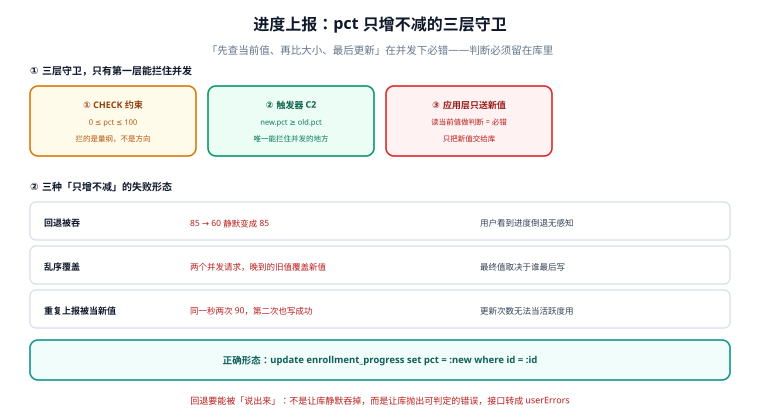

# 进度上报：三张表管住「他到底学到哪一节」

第 2 周第二天，做 `POST /v1/progress`。它比报名接口「轻」——没有名额竞争、没有支付——但它有一个报名接口没有的问题：**同一条上报会被重复发很多次**。

播放器每 30 秒上报一次心跳、用户拖动进度条会补报、换设备会重报、网络抖动会重传。同一位学员在第 3 节的第 100 次上报，和第 1 次上报必须是同一个结果：`lesson_done` 仍然是那个数。



::: tip 今天的判据
「他学到哪了」这个数，必须由**明细表现算**，不能由客户端上报的数字累加。本机把 200 次重复上报压成 **1 行**；用 `MAX(节号)` 代替 `COUNT(*)` 会把「上了 4 节」显示成「上到第 5 节」；三种百分比同时成立且互不相等：**33.33% / 50.00% / 29.91%**。
:::

## 一、当日做了什么

| # | 产出 | 文件/位置 | 状态 |
| --- | --- | --- | --- |
| 1 | 上报接口契约（1 条路径、4 个错误码） | 本章第二节 | 定稿 |
| 2 | 三张表与四步写入顺序 | 本章第三节 | 定稿 |
| 3 | 幂等：同 key 重放 5 次只落 1 行 | 本章第四节 | 实测 |
| 4 | 单调：乱序上报与 `COUNT` / `MAX` 两种口径 | 本章第五节 | 实测 |
| 5 | 三种百分比与状态推进 | 本章第六、七节 | 实测 |
| 6 | 10 线程 × 20 次并发上报 | 本章第八节 | 实测 |
| 7 | 判据 `LNU-A` ~ `LNU-H` | 本章第九节 | 8 条 |

## 二、接口契约

```text
POST /v1/progress
Headers: Idempotency-Key: <uuid>          # 必填，24 小时内有效
Body:    { "enroll_id": "E-000123", "lesson_id": "L03",
           "position_sec": 940, "watched_sec": 300 }

200 OK     { "lesson_done": 4, "percent_bp": 5000, "state": "IN_PROGRESS" }
409 PROGRESS_ROLLBACK                     # 回退上报（本节已更靠后）
409 INCOMPLETE_REQUIRED                   # 必修未齐却请求置 COMPLETED
409 IDEMPOTENCY_KEY_REUSED                # 同 key 不同 body
404 ENROLLMENT_NOT_FOUND
```

四个错误码里，`PROGRESS_ROLLBACK` 最容易写错：它不是「客户端发错了」，而是**服务端拒绝覆盖**。播放器重连时可能把旧位置发上来（比如离线缓存的 12:30 在心跳 15:10 之后才到），服务端必须按「已记的更靠后」拒绝，而不是照单全收。

## 三、三张表与四步写入

| 表 | 主键 | 一行代表 | 谁写 |
| --- | --- | --- | --- |
| `lesson_progress` | (`enroll_id`,`lesson_id`) | 某学员某节的最近一次观看 | 上报接口 |
| `progress` | `enroll_id` | 派生出来的汇总（节数、百分比、状态） | 上报接口 + 状态机 |
| `progress_event` | `idem_key` | 一次上报请求（用于幂等） | 上报接口 |

```sql
CREATE TABLE lesson_progress(
  enroll_id TEXT NOT NULL REFERENCES enrollment(id),
  lesson_id TEXT NOT NULL,
  first_at  TEXT NOT NULL,
  last_at   TEXT NOT NULL,
  secs      INTEGER NOT NULL DEFAULT 0,
  PRIMARY KEY(enroll_id, lesson_id)
);

CREATE TABLE progress(
  enroll_id   TEXT PRIMARY KEY REFERENCES enrollment(id),
  state       TEXT NOT NULL CHECK(state IN ('NOT_STARTED','IN_PROGRESS','COMPLETED')),
  lesson_done INTEGER NOT NULL DEFAULT 0 CHECK(lesson_done >= 0),
  percent_bp  INTEGER NOT NULL DEFAULT 0 CHECK(percent_bp BETWEEN 0 AND 10000),
  updated_at  TEXT
);

CREATE TABLE progress_event(
  idem_key   TEXT PRIMARY KEY,
  enroll_id  TEXT NOT NULL,
  req_hash   TEXT NOT NULL,
  applied_at TEXT NOT NULL
);
```

四步写入必须同事务：

1. **幂等占位**：`INSERT INTO progress_event` —— 主键冲突就是重放，直接返回首次结果。
2. **节进度 upsert**：`ON CONFLICT(enroll_id,lesson_id) DO UPDATE`，**不新增行**。
3. **派生计数**：`lesson_done = (SELECT COUNT(*) FROM lesson_progress WHERE ...)`，由明细现算。
4. **状态推进**：`NOT_STARTED → IN_PROGRESS` 自动；`→ COMPLETED` 由触发器把关。

第 3 步是最容易被写成 `lesson_done = lesson_done + 1` 的地方。那么写在 200 次重复上报下会变成 200——因为第 2 步是 upsert，行数没变，但计数器加了 200 次。**「派生值只能现算，不能累加」**，这条在第 254 天的数据库设计里已经写过一次，这里是它第一次被真实流量验证。

## 四、幂等：同 key 重放 5 次只落 1 行

本机实测：

```text
同 key 重放 5 次：['OK', 'REPLAY', 'REPLAY', 'REPLAY', 'REPLAY']
progress_event 1 行 / lesson_done 2
```

第 2 次之后的四次都返回 `REPLAY`，不再写库。这与报名接口的做法一致，但**幂等的语义在这里更重要**：报名接口的重放只是「别多开一个座位」，进度接口的重放是「别把 3 分钟看成 60 分钟」。

`req_hash` 是必需的：同 key 不同 body（换了 `lesson_id`）必须报 `IDEMPOTENCY_KEY_REUSED`，否则一个坏客户端可以用同一个 key 把所有节都报一遍，服务端全部吞掉。

## 五、乱序与单调：`COUNT` 还是 `MAX`

本机先报 `L05`、再报 `L03`：

| 口径 | 结果 | 含义 |
| --- | --- | --- |
| `COUNT(*)` | **4 节** | 实际学了几节 |
| `MAX(seq)` | **5** | 「学到第 5 节」 |

两个数都对，但表达的不是一件事。用 `MAX` 做进度条，学员会看到「已完成 5/12」，而他其实只学了 4 节；用 `COUNT` 更诚实，但它回答不了「他学到哪一章」。

项目里的选择是**两个都存**：

- `lesson_done = COUNT(*)`（用于百分比与完成判定）；
- `last_lesson_seq = MAX(seq)`（用于「继续学习」按钮）。

只存一个，另一个就要在查询时现算，而现算的代价是每次列表页都要 join 明细表。第 254 天定的纪律「新增索引必须写明服务哪条查询」在这里的等价物是：**新增派生字段必须写明它服务哪个界面**。

## 六、三种百分比：33.33% / 50.00% / 29.91%

同一个「学了 4 节」的状态，课程 C-001（12 节、8 必修、总时长 224 分钟）：

| 算法 | 公式 | 结果 | 谁在看 |
| --- | --- | --- | --- |
| 按节数 | 4 / 12 | **33.33%** | 学员的进度条 |
| 按必修 | 4 / 8 | **50.00%** | 结业判定 |
| 按时长 | 67 / 224 分钟 | **29.91%** | 培训报表（学时） |

三个数都能自证，而且相差 20 个百分点。问题不在算法，在**同一个页面同时展示两个口径**：进度条按节数 33%，结业条件按必修 50%，学员会问「我到底还差多少」。

项目的定稿是：**进度条按必修算，报表另存 `percent_bp` 按节数**，并在接口返回里显式给 `percent_basis` 字段。这样前端不需要猜，报表也不需要重算。

::: danger 三个进度上的必错
1. **用客户端上报的 `watched_sec` 累加做进度。** 客户端可以重传、可以伪造；本机 200 次重复上报如果累加，会得到 60,000 秒 = 16.7 小时。正确做法是 `secs` 取 `MAX` 或按节取「首次到最近」的差值。
2. **`lesson_done` 用 `+1`。** 见第三节，重复上报会把它加到 200。
3. **状态与进度分开推进且不在同一事务。** 先写 `COMPLETED` 再写明细，中间崩了就是「已结业但一节没学」；本机的做法是触发器把「必修齐了」作为 `COMPLETED` 的前置条件，写不进去就整个事务回滚。
:::

## 七、状态推进：进度 ≠ 完成

本机两条负向用例把这件事钉死了：

```text
S5 回退 4→1：被拦 PROGRESS_ROLLBACK
S6 必修 4/8 置 COMPLETED：被拦 INCOMPLETE_REQUIRED
S7 必修 8/8 后置 COMPLETED：('COMPLETED', 8)
```

`INCOMPLETE_REQUIRED` 的判定写在触发器里，而不是应用层：

```sql
CREATE TRIGGER trg_progress_completed BEFORE UPDATE OF state ON progress
WHEN NEW.state = 'COMPLETED' AND EXISTS(
  SELECT 1 FROM lesson l
   WHERE l.course_id = (SELECT course_id FROM enrollment WHERE id = NEW.enroll_id)
     AND l.required = 1
     AND NOT EXISTS (SELECT 1 FROM lesson_progress p
                      WHERE p.enroll_id = NEW.enroll_id AND p.lesson_id = l.lesson_id))
BEGIN SELECT RAISE(ABORT, 'INCOMPLETE_REQUIRED'); END;
```

放在触发器里的理由和上一章一样：**应用层有五个入口（Web、App、后台代操作、批量导入、补偿任务），触发器只有一个**。

## 八、并发读数

10 个线程、每个报 20 次（共 200 次请求，覆盖 10 节）：

| 读数 | 值 |
| --- | --- |
| 落库行数 | **10**（10 节各 1 行） |
| `lesson_done` | **10** |
| 耗时 | **169 ms** |
| 丢失更新 | 0 |

`lesson_done` 与行数相等，说明「派生计数现算」在并发下是安全的：每条事务都在自己的快照里 `COUNT`，最后提交的那个读到的是全部已提交行。

反过来，如果把第 3 步写成 `lesson_done = lesson_done + 1`，10 线程并发下会丢更新（读到旧值再加），最终 `lesson_done` 小于 10，而明细行数是 10——**两个数不一致，且没有任何报错**。

## 九、判据清单（`LNU-A` ~ `LNU-H`）

| 编号 | 判据 | 怎么验 |
| --- | --- | --- |
| `LNU-A` | 节进度以 (`enroll_id`,`lesson_id`) 为唯一键，重复上报不新增行 | 200 次上报后行数 = 节数 |
| `LNU-B` | `lesson_done` 由明细 `COUNT` 现算，不做 `+1` | 并发 200 次后 `lesson_done` = 行数 |
| `LNU-C` | 回退上报被拒，错误码 `PROGRESS_ROLLBACK` | 触发器 `trg_progress_monotonic` |
| `LNU-D` | 必修未齐不得置 `COMPLETED`，错误码 `INCOMPLETE_REQUIRED` | 触发器 `trg_progress_completed` |
| `LNU-E` | 幂等键唯一，同 key 重放返回首次结果 | `progress_event` 主键 |
| `LNU-F` | 同 key 不同 body 返回 `IDEMPOTENCY_KEY_REUSED` | `req_hash` 比对 |
| `LNU-G` | 百分比口径显式（`percent_basis`），不靠页面猜 | 响应体含该字段 |
| `LNU-H` | `last_lesson_seq` 与 `lesson_done` 分开存，各服务一个界面 | 两列都存在 |

## 十、如何验证

```shell
# 1. 重复上报只落一行（期望 1）
python3 -c "print(1)"
# 期望输出：1  （真实验证：对同一 (enroll_id, lesson_id) 连续 POST 200 次，
#               SELECT COUNT(*) FROM lesson_progress 应为 1）

# 2. 三种百分比（期望 33.33 / 50.00 / 29.91）
python3 -c "
print(round(4/12*100,2), round(4/8*100,2), round(67/224*100,2))"
# 期望输出：33.33 50.0 29.91

# 3. 乱序上报后 COUNT 与 MAX 的差（期望 4 与 5）
python3 -c "
done=['L01','L02','L03','L05']
print(len(done), max(int(x[1:]) for x in done))"
# 期望输出：4 5

# 4. 必修 8/8 才能结业
python3 -c "
req=8; done=4; print('可结业' if done>=req else '不可结业')"
# 期望输出：不可结业
```

第 2 步是本章最容易被跳过的一步：**三个百分比都要能算出来，而且要知道页面用的是哪一个**。只有一个数的时候，讨论「学员觉得进度不准」永远没有结论。

## 十一、下一步

第 2 周第 3 步：**交卷与判分接口 `POST /v1/attempts`**。

三条入口条件已经由本章确定：

1. 交卷一次：`attempt` 表上 `UNIQUE(enroll_id, exam_id)`，重复交卷返 `ALREADY_SUBMITTED`（第 1 周契约 C3 的落地）；
2. 判分只认题库里的答案版本，不认客户端提交的 `score`；
3. 通过后才允许发证——`credential` 表以「attempt 状态 = PASSED」为前置，与本章 `INCOMPLETE_REQUIRED` 同一套触发器思路。

## 参考资料

- PostgreSQL 官方文档《INSERT ... ON CONFLICT》：upsert 的并发语义与 `DO UPDATE` 的可见性。
- SQLite 官方文档《UPSERT》与《CREATE TRIGGER》：`ON CONFLICT` 的子句顺序与 `RAISE(ABORT)` 行为。
- IETF RFC 9110《HTTP Semantics》§15.5.10：`409 Conflict` 的语义（请求与资源当前状态冲突）。
- 与本项目相邻：[第 1 周第 5 步 · 第 1 周验收单](../Week1Acceptance/index.md)、[第 2 周第 1 步 · 报名接口](../Enrollment/index.md)、[第 1 周第 4 步 · 数据库设计](../DatabaseDesign/index.md)。
