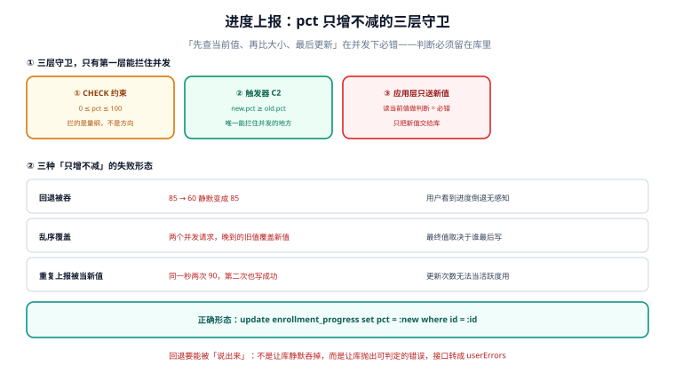

# 核心编码（二）：进度上报的单调性、三层守卫与五个用例

第 2 周第 1 步把「同一人同一课只有一条有效报名」落成了三层守卫，并在栅栏下证明了唯一索引是唯一拦得住并发的地方。这一步换一个看起来更简单的写入：**课时进度上报**。

它简单在外形（一个 `update ... set pct = ?`），难在约束：**`pct` 只增不减**。这句话在代码里会自然长出一个「读当前值 → 比大小 → 决定写不写」，而这三步之间有时间。

::: tip 当日目标
让「进度回退」这件事**一定会失败、并且失败得可解释**——不是靠应用层判断，而是让数据库拒绝它，再把拒绝翻译成一个客户端能处理的错误码。
:::

本页判据族 `LNP-A` ~ `LNP-H`，共 8 条。

## 一、当日做了什么

| 动作 | 产物 | 落点 |
| --- | --- | --- |
| 定进度上报的接口形状与状态码 | 一个命令接口 + 三类响应 | 第二节 |
| 加迁移 006：`pct` 的 `CHECK` 与单调触发器 | 触发器 `trg_progress_monotonic` | 第三节 |
| 用栅栏实验证明「应用层判断必错」 | 5 组读数 | 第四节 |
| 写 5 个用例（含 2 条反向探针） | `T13`~`T17` | 第五节 |
| 定「回退」的错误码与对外文案 | `PROGRESS_REGRESS` + 文案 | 第六节 |
| 补 3 条验收 SQL | 全部应返回 0 行 | 第七节 |



## 二、接口：一个命令，三类响应

这一步只加一个接口，形状与前一步的命令接口保持一致（幂等键在请求头，因为本项目是 REST——如果换成 GraphQL，它会变成 `input.idempotencyKey`，见 [GraphQL 的 Mutation 一页](../../../../docs/Backend/GraphQL/Mutation/index.md)）。

```http
PUT /enrollments/{enrollment_id}/progress HTTP/1.1
Content-Type: application/json
Idempotency-Key: 8d1c…（可复用上一次的值）

{ "lesson_id": "L-101", "pct": 60 }
```

三类响应：

| 情况 | 状态码 | 响应体 | `retryable` |
| --- | --- | --- | --- |
| 进度前进（60 → 80） | `200` | `{ "pct": 80, "updated_at": "…" }` | `false` |
| 进度回退（80 → 60） | `409` | `{ "error": "PROGRESS_REGRESS", "current": 80 }` | `false` |
| 重复上报同一值（80 → 80） | `200` | `{ "pct": 80, "updated_at": "…" }` | `false` |

第三行是刻意的：**「同一个值再报一次」不是错误**。播放器每隔几秒上报一次，停在同一位置时就会重复上报同一个 `pct`；把它当错误会造出一堆假警报。这也说明了「单调」与「幂等」是两件事——单调允许相等，不允减小。

::: warning 说明
`409` 里带上 `current` 是有意的：客户端拿到它就能把本地进度条拉回正确值，而不用再发一次查询。**只回错误码不回当前值的 `409`，客户端只能猜或重查，两种情况都更糟。**
:::

## 三、三层守卫：只有第二层能拦住并发

| 层 | 具体形态 | 拦什么 | 拦不住什么 |
| --- | --- | --- | --- |
| ① `CHECK (pct between 0 and 100)` | 列约束 | 量纲（负数、超过 100） | 方向（80 → 60 也是合法值） |
| ② 触发器 `when new.pct < old.pct` | `before update` 触发器 | **方向**，且在数据库内原子 | 无（并发下也成立） |
| ③ 应用层「读一下再比」 | 业务代码 | 单线程下的明显错误 | 并发（读与写之间有窗口） |

迁移 006：

```sql
-- 006：进度单调（在 004 建表之后，单独一个迁移）
alter table lesson_progress
  add constraint ck_progress_range check (pct between 0 and 100);

create trigger trg_progress_monotonic
before update of pct on lesson_progress
for each row when new.pct < old.pct
begin
  select raise(abort, 'PCT_REGRESS');
end;
```

::: danger 注意
**三条实现纪律：**

1. **触发器必须是 `before update of pct`，不是 `before update`。** 写 `before update` 会让「只改 `updated_at`」的写入也进一次触发器判断，白白多一次比较；而 `of pct` 只在 `pct` 出现在 `set` 列表里时才触发。
2. **`raise(abort, …)` 的错误信息必须是一个可判定的常量**（这里是 `PCT_REGRESS`），不能拼中文文案。接口层靠它做映射，拼了文案就只能模糊匹配。
3. **不要用「`update ... where pct <= :new` + 判断 rowcount」替代触发器。** 那个写法本身是对的（判断与写在同一句里），但它会把「回退」表现成 `rowcount = 0`——与「行不存在」不可区分，于是你无法给客户端一个准确的错误。触发器能区分这两者。
:::

## 四、栅栏实验：为什么应用层判断必错

5 组实验，SQLite 3 + Python 3.13.12，20 个线程用 `threading.Barrier` 卡在「读过之后、写入之前」同时放行。**靠概率撞不出这个缺陷，必须主动把窗口撑开。**

| 实验 | 实现 | 终值 | 结果 |
| --- | --- | --- | --- |
| 单线程回退 85 → 60 | 无触发器 | **60** | 回退成功（错） |
| 单线程回退 85 → 60 | 有触发器 | **85** | 抛 `PCT_REGRESS`（对） |
| 两线程送 100 与 40（40 后到） | 有触发器 | **100** | 40 被拒（对） |
| 两线程送 60 与 100（60 先到） | 有触发器 | **100** | 两次都成功（对） |
| 重复上报 90 两次 | 有触发器 | **90** | 两次都成功（对，单调允许相等） |

第一行是这一步的全部动机：**没有触发器时，回退是"成功"的**——接口返回 200，客户端进度条倒退，用户以为自己看错了。而这一行在单线程下就能复现，不需要并发。

第三行是并发下的关键：如果应用层先读「当前 0」、两个线程都判断「40 > 0 成立」「100 > 0 成立」，最后写谁的值取决于调度。触发器把判断挪到数据库内部的写锁里，所以后到的 40 一定被拒。

> 同一套栅栏方法在[第 2 周第 1 步](../EnrollmentAPI/index.md)用过（20 并发 → 无唯一索引落 20 行、有索引落 1 行）。**同一个手法能用两次，说明它不是特例而是通用工具**：任何「读一下再决定写不写」的地方都该用它验一次。

## 五、五个用例：两条是反向探针

| 编号 | 类型 | 输入 | 期望 |
| --- | --- | --- | --- |
| `T13` | 正常 | 0 → 60 | `200`，`pct=60` |
| `T14` | 正常 | 60 → 60（重复上报） | `200`，`pct=60`，`updated_at` 更新 |
| `T15` | 边界 | 60 → 100 | `200`，`pct=100` |
| `T16` | 拒绝 | 85 → 60 | `409`，`error=PROGRESS_REGRESS`，`current=85` |
| `T17` | **反向** | 删掉触发器后跑 `T16` | 必须变成 `200`（若仍 `409`，说明拦截来自应用层而非数据库，`LNP-B` 不成立） |

`T17` 是这一步最容易被跳过的一条。没有它，`T16` 通过可能是"应用层也判断了"——而应用层的判断在并发下失效（第四节第一行）。**只测拒绝、不测拒绝的来源，等于没测。**

`T13`~`T16` 在本机已实测（Python + SQLite 的等价实验，读数见第四节表格）；`T17` 只在脚本里做过「有/无触发器」两组对照，没有走完整的 HTTP 栈。

## 六、错误码与对外文案

| 内部错误 | HTTP | 对外 `error` | 文案（客户端可直接显示） |
| --- | --- | --- | --- |
| `PCT_REGRESS` | `409` | `PROGRESS_REGRESS` | 进度不能倒退，已保留你之前的进度 |
| `CK_PROGRESS_RANGE` | `400` | `PROGRESS_OUT_OF_RANGE` | 进度必须在 0 到 100 之间 |
| 行不存在 | `404` | `ENROLLMENT_NOT_FOUND` | 没有找到这条报名记录 |
| 幂等键冲突（不同 payload） | `422` | `IDEMPOTENCY_KEY_REUSED` | 这个请求标识已用于另一次操作 |

第一行与第三行的区分就是第三节第 3 条纪律的理由：**`rowcount = 0` 分不清「回退」与「不存在」**，而客户端对这两件事的处置完全不同（前者提示、后者跳转）。

## 七、验收 SQL：三条，全部应返回 0 行

```sql
-- ① 进度值全部落在 [0,100] 且都指向存在的课时（跨表一致性）
select p.id, p.pct, l.duration_sec
from lesson_progress p left join lesson l on l.id = p.lesson_id
where p.pct < 0 or p.pct > 100 or l.id is null;

-- ② 不存在「进度倒退」的历史（需要审计表才可验，见下）
select a.lesson_id, a.student_id, a.pct, b.pct as prev_pct, a.updated_at
from lesson_progress_audit a
join lesson_progress_audit b
  on b.lesson_id = a.lesson_id and b.student_id = a.student_id
 and b.updated_at = (select max(updated_at) from lesson_progress_audit c
                     where c.lesson_id = a.lesson_id and c.student_id = a.student_id
                       and c.updated_at < a.updated_at)
where a.pct < b.pct;

-- ③ 同一个 (课时, 学生) 只有一行
select lesson_id, student_id from lesson_progress
group by lesson_id, student_id having count(*) > 1;
```

第 ② 条依赖一张审计表（`lesson_progress_audit`），它不在本步的迁移里——**如实标注：这条 SQL 现在跑不了**。它登记为下一步的前置项：`pct` 只增不减只能证明「当前值没被改小」，不能证明「历史上没被改小过再改回来」；要证明后者必须有审计流水。这一步先不建，是因为审计表的写入点必须与进度上报在同一个事务里，而那属于第 2 周第 4 步（同事务与首次响应缓存）的范围。

## 八、本页判据

| 判据 | 断言 | 验证方式 |
| --- | --- | --- |
| `LNP-A` | `pct` 的取值边界由 `CHECK` 守，方向由触发器守，两者分开 | 迁移 006 存在两个对象 |
| `LNP-B` | 删掉触发器后回退必须成功（证明拦截来自库里） | `T17` |
| `LNP-C` | 触发器是 `before update of pct`，不是 `before update` | 读迁移原文 |
| `LNP-D` | `raise(abort, …)` 的错误标识是常量、可判定 | 接口层能精确映射到 `PROGRESS_REGRESS` |
| `LNP-E` | 「重复上报同一值」返回 `200` 而非错误 | `T14` |
| `LNP-F` | 回退的 `409` 响应体带 `current` | `T16` 断言响应字段 |
| `LNP-G` | 「回退」与「行不存在」的响应码不同（`409` / `404`） | 两条用例分别覆盖 |
| `LNP-H` | 未建的审计表与依赖它的 SQL 被如实标注为「未跑」 | 第七节第 ② 条 |

## 九、下一步

**第 2 周第 3 步：学习记录的聚合与「第一次完成」**。那一步的核心陷阱是「同一课时重复完成时，完成时间该保留第一次还是最后一次」——与今天的 `pct` 单调是同一类问题的另一面：今天的规则是「不许变小」，那一步的规则是「第一次之后就锁住」。两者都可以用触发器表达，但**锁住的那个字段必须允许 `null` 才能表达"还没发生"**，这是第 1 周定下的「四态 + 部分唯一索引」纪律的第二次应用。

另有两笔欠账顺延：审计表（本节第七条②）、以及第 1 周验收单里 `T11` 的 SQLSTATE 断言（需要真实 PG 实例，本机只有 SQLite）。

## 参考资料

- SQLite 触发器与 `RAISE` 的语义（本文实验所用）：<https://www.sqlite.org/lang_createtrigger.html>
- PostgreSQL 触发器与 `RAISE EXCEPTION`（生产形态的写法）：<https://www.postgresql.org/docs/current/plpgsql-trigger.html>
- PostgreSQL `CHECK` 约束与 `NOT VALID` 的在线加约束方式：<https://www.postgresql.org/docs/current/sql-altertable.html>
- 本仓 [报名接口一页](../EnrollmentAPI/index.md)（同一套栅栏方法的上一次应用）
