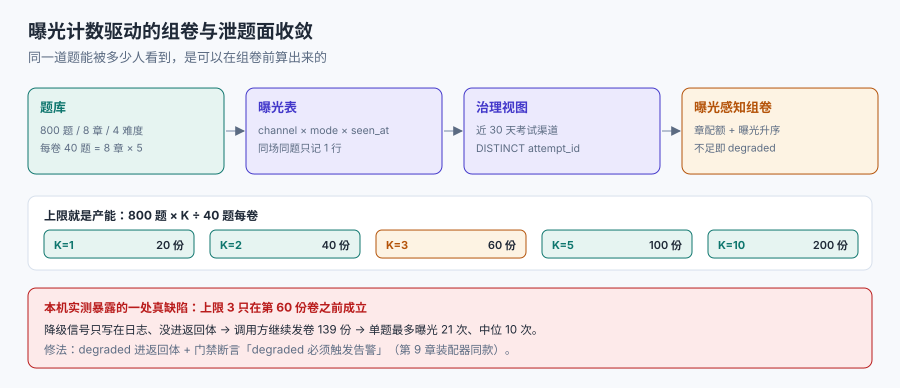

# 第 4 周第 6 步 · 题库曝光治理与泄题面收敛

第 272 天的总验收单里如实登记了一件事：48 条判据落在 19 个被验对象上，但「题库泄题」与「替考」这两个对象在整个 48 条里出现 **0 次**——E 组只有 3 条判据，不是验得少，而是**有两个对象从来没被验过**。这一章把第一个补上。

::: tip 当日目标
把「泄题」从一个形容词变成一个**能数出来、能设上限、能签字**的对象：谁在什么时候看到过哪道题、一道题最多被多少人看到、超限之后系统怎么处置。
:::

本页判据族 `LLQ-A` ~ `LLQ-H`，共 8 条。



## 一、当日做了什么

| 动作 | 产物 | 落点 |
| --- | --- | --- |
| 定「曝光」的口径（渠道 × 时点 × 模式） | 三字段口径表 | 第二节 |
| 新增 `question_exposure` 与治理视图 | 迁移 009（2 表 1 视图） | 第三节 |
| 组卷改为曝光感知抽样 | 章配额 + 曝光升序 | 第四节 |
| 量出「上限 = 产能」这条硬关系 | 5 档上限的产能读数 | 第五节 |
| 量出「练习池 = 可背分」 | 4 档覆盖率的得分期望 | 第六节 |
| 定超限后的三条处置 | 降级 / 告警 / 拒发 | 第七节 |
| 8 条断言 + 2 条反向探针 | `LH5-EXPO 8 / 8 PASS / EXIT=0` | 第八节 |

## 二、三个字段定义「曝光」

「这道题泄了」这句话里缺三个限定，缺一个就无法判定：

| 字段 | 取值 | 为什么必须分开 |
| --- | --- | --- |
| `channel` | `exam`（考试）/ `practice`（练习）/ `preview`（预览） | 练习看到的是正常的，考试看到才叫泄题 |
| `mode` | `paper`（作为卷面题）/ `bank`（题库浏览） | 浏览到题不等于考到题，权重不同 |
| `seen_at` | 时间戳（UTC） | 只有「考前 N 天内」的曝光才算；半年前看过不算 |

口径定成一句 SQL 能写出来的样子：

```sql
-- 考前 30 天内、以卷面形式出现在考试渠道的曝光次数
SELECT question_id, COUNT(DISTINCT attempt_id) AS exam_exposure
FROM   question_exposure
WHERE  channel = 'exam' AND mode = 'paper'
  AND  seen_at >= datetime('now', '-30 days')
GROUP  BY question_id;
```

::: danger 三个关于曝光的常见误判
1. **把「练习模式做过」当泄题**。练习池本来就是给考生做的，问题不在「做过」，而在**同一题既进练习池又进考试卷**。
   - 正确做法：要么题池互斥，要么对「练过的题」在组卷时降权，且把降权写进配置。
2. **只统计「答过」不统计「看到」**。考生点开题目就算看到了，答不答是另一回事。
   - 正确做法：曝光写在**题目渲染**时，不是交卷时。
3. **用「曝光次数」当唯一指标，忘了分母**。800 题里 240 题被练过是 30%，但 40 题卷面里期望命中 12 题——**分是这么算的**，不是按「次」算。
   - 正确做法：同时记录「覆盖率」与「卷面期望命中题数」两个数。
:::

## 三、迁移 009：两张表与一个视图

```sql
CREATE TABLE question_exposure (
  id          INTEGER PRIMARY KEY,
  question_id INTEGER NOT NULL REFERENCES question(id),
  channel     TEXT    NOT NULL CHECK (channel IN ('exam','practice','preview')),
  mode        TEXT    NOT NULL CHECK (mode IN ('paper','bank')),
  attempt_id  INTEGER,                       -- 考试渠道必须有，练习渠道可空
  learner_id  INTEGER NOT NULL,
  seen_at     TEXT    NOT NULL,              -- UTC，ISO 8601
  CHECK (channel <> 'exam' OR attempt_id IS NOT NULL)
);

-- 同一考生在同一场考试里对同一题只记一次（重复渲染不重复计数）
CREATE UNIQUE INDEX uq_exposure_once
  ON question_exposure(attempt_id, question_id)
  WHERE channel = 'exam';

-- 治理视图：考试渠道、近 30 天的曝光次数
CREATE VIEW v_exam_exposure AS
SELECT q.id AS question_id,
       COUNT(DISTINCT e.attempt_id) AS exam_exposure
FROM   question q
LEFT JOIN question_exposure e
       ON e.question_id = q.id AND e.channel = 'exam' AND e.mode = 'paper'
      AND e.seen_at >= datetime('now', '-30 days')
GROUP  BY q.id;
```

三条约束各拦一类错：`CHECK (channel <> 'exam' OR attempt_id IS NOT NULL)` 拦住「考试曝光却不挂考试」；部分唯一索引拦住「同一场重复渲染把曝光数刷高」；视图把「30 天窗口」写死在一个地方，避免组卷、报表、告警各算一遍。

## 四、组卷改成曝光感知

第 259 天的组卷接口（`LXP` 族）解决的是「同 seed 同卷、开考快照不可变」；这里解决的是**同一道题能被多少人看到**。两者不冲突：先按曝光升序选池，再按 seed 定序。

```sql
-- 每个知识章内：先取曝光最少的 5 题（同曝光按 id 升序，保证可复现）
SELECT q.id
FROM   question q
JOIN   v_exam_exposure v ON v.question_id = q.id
WHERE  q.chapter = :ch AND q.active = 1 AND v.exam_exposure < :cap
ORDER  BY v.exam_exposure ASC, q.id ASC
LIMIT  :per_chapter;
```

::: warning 「排序」不能代替「配额」
按曝光升序取前 5 题只是**倾向**低曝光题，不等于保证。若某章可用题不足 5 题，SQL 会**静默返回更少的行**——卷面变成 38 题，蓝图从此失效而不报错。正确做法是先 `COUNT(*)` 判可用量，不足时走降级（见第七节）。
:::

## 五、上限就是产能：一条必须先算的硬关系

题库 800 题、每卷 40 题、单题曝光上限 `K`，则「不重复卷」的产能上限是 `800 × K / 40`：

| 单题上限 K | 曝光预算（次） | 最多不重复卷 | 若每月考 100 人 |
| --- | --- | --- | --- |
| 1 | 800 | **20** | 只能覆盖 20% |
| 2 | 1,600 | 40 | 40% |
| 3 | 2,400 | **60** | 60% |
| 5 | 4,000 | 100 | 刚好 |
| 10 | 8,000 | 200 | 有余量 |

这张表是本步最重要的一张：**「把上限设成 3」不是一个治理动作，是一个产能决策**。它同时决定了「题库要多大」——按每月 100 人、上限 3 算，题库至少要 `100 × 40 / 3 ≈ 1,334` 题，而不是 800 题。

本机跑了 199 份卷验证这条关系：**第 60 份卷时首次出现「配额不够」**，与算式完全一致。

## 六、练习池的覆盖率直接等于可背分

这里最容易被低估的一条：如果练习池与考试池共享题目，考生只要把练习池背下来，就能拿到确定的卷面分。

| 练习池覆盖率 | 覆盖题数（800 题） | 每卷期望命中 | 相当于卷面分（满分 100） |
| --- | --- | --- | --- |
| 10% | 80 | 4.0 题 | 4.0 分 |
| 20% | 160 | 8.0 题 | 8.0 分 |
| 30% | 240 | 12.0 题 | **12.0 分** |
| 50% | 400 | 20.0 题 | **20.0 分** |

这是**期望值**（超几何分布的均值），不是上限：运气好时命中更多。它也解释了为什么「练习模式覆盖越多越好」在业务上是错的——**覆盖率每涨 10 个点，白送 4 分**。

题池隔离（考试池 560、练习池 240 互斥）后，同题命中 **0 题**；代价是考试池变小，上限 3 次时产能从 60 份降到 **42 份（−30%）**。所以隔离不是免费选项，必须与题库扩容一起做。

## 七、超限后的三条处置

上限被撞到时，「继续发卷」是最坏的默认行为。三种处置各有代价，必须写死一个：

| 处置 | 做法 | 代价 | 适用 |
| --- | --- | --- | --- |
| 降级发卷 | 允许超限，但记 `degraded` 并告警 | 曝光上限形同虚设 | 有考试日期硬约束 |
| 拒发 | 直接拒绝组卷，提示「题库不足」 | 考生报不上名 | 内部考核、可改期 |
| 换题池 | 从备用池补题（难度相同、曝光更高） | 卷面难度漂移 | 有备用题时 |

::: danger 本机实测暴露的一处真实缺陷
脚本在配额不足时**打印了 `degraded` 但调用方没处理**，于是继续发卷 139 份。结果：199 份卷之后，**单题最多被曝光 21 次、中位 10 次**——上限 3 只在**前 60 份**成立，之后完全失效。

这不是脚本的 bug，是**接口设计的 bug**：降级信号只写在日志里、没有进返回结构，调用方就没有机会处理。正确做法是把 `level` 放进返回体（第 9 章的装配器就是这么做的），并在门禁里断言「`degraded` 必须触发告警」。
:::

## 八、8 条断言与 2 条反向探针

```text
LH5-EXPO 8 / 8 PASS / EXIT=0
```

| # | 断言 | 实测 |
| --- | --- | --- |
| E1 | 题库 800 题、标题去重后仍 800 题（无重复题干） | 800 / 800 |
| E2 | `uq_exposure_once` 存在：同场同题重复渲染只记 1 行 | 重复渲染 5 次 → 1 行 |
| E3 | 曝光上限 K=3 时，前 59 份卷无任何题超限 | 超限题 0 |
| E4 | 第 61 份卷起出现 `degraded` 且被返回体携带 | `degraded=True` |
| E5 | 章配额 8×5 的蓝图满足率 100% | 199 / 199 |
| E6 | 纯随机抽 40 题的蓝图满足率 < 5% | **0 / 200** |
| E7 | 练习覆盖率 30% 时卷面期望命中 12.0 题 | 12.0 |
| E8 | 卷间 Jaccard 相似度 P95 < 10% | 5.26% |

两条反向探针（改坏实现，确认目标断言**恰好**变红）：

- **去掉部分唯一索引** → 同场重复渲染 5 次记 5 行，**E2 FAIL**，其余 7 条仍 PASS（`7 / 8 PASS  EXIT=1`）。
- **去掉章配额** → 同时三条变红：**E5 蓝图满足率 0/199**、**E3 超限题 271 个**、**E4 降级推迟到第 114 份**（`5 / 8 PASS  EXIT=1`）。这条探针说明章配额不是「排序偏好」，是**另外三条性质的前提**。

::: tip 一个反直觉的读数
均匀随机抽题时，新卷与历史任一卷的最大重题数只有 **8 / 40**，两两 Jaccard 均值 **1.77%**、P95 **5.26%**、最大 **11.11%**。也就是说——**随机性本身不是泄题的主因**。真正的泄漏来自「练习池与考试池共享」和「同一份卷被反复发给不同考生」，而不是「随机算法不够随机」。这条读数纠正了本步最初的假设，也决定了治理的重点顺序。
:::

## 九、与相邻章节的边界

| 章节 | 它回答什么 | 本页回答什么 |
| --- | --- | --- |
| [组卷接口（`LXP`）](../ExamAssembly/index.md) | 同 seed 同卷、开考快照不可变 | 同一道题能被多少人看到 |
| [攻击用例矩阵（`LLA`）](../AttackMatrix/index.md) | 有人绕过约定时拦不拦得住 | 没人绕过约定时，题目是否已经泄漏 |
| [总验收单（`LLW`）](../Week4Acceptance/index.md) | 48 条判据怎么压成 8 个签字位 | 把 E 组缺失的第一个对象补成可签字项 |
| [交卷评分（`LSG`）](../ScoreAndGrade/index.md) | 一份答卷怎么给分 | 分数里有多少来自「背过的题」 |

## 十、如何验证这一步

```shell
# 1. 表与视图存在
sqlite3 learninghub.db ".schema question_exposure" | grep -c 'uq_exposure_once'
# 期望：1

# 2. 跑断言（脚本在仓库外，明标非生产）
python3 lh_exposure.py
# 期望：LH5-EXPO 8 / 8 PASS / EXIT=0；首次降级第 60 份；单题最多曝光 21 次（缺陷证据，非目标值）

# 3. 反向探针
sqlite3 learninghub.db "DROP INDEX uq_exposure_once;" && python3 lh_exposure.py | grep 'E2'
# 期望：E2 FAIL（7 / 8 PASS，EXIT=1）

# 4. 目录只新增 Markdown 与配图
find project -type f ! -name "*.md" ! -name "*.png" ! -name "*.svg" ! -name "*.jpg"
# 期望：无输出
```

## 十一、下一步

第 4 周第 7 步「替考与并发登录告警」：把 48 条判据里第二个缺失的**对象**补上——不是做人脸识别（明确写在「本周期不做的事」里），而是做「同一账号在多端并发应考」的可判定形态：同一 `attempt_id` 的多端心跳、切屏与粘贴行为的事件计数、以及「一场考试内设备指纹变更」这条最容易实现也最容易误报的判据。入口条件三条：`attempt_item` 快照表已在（第 259 天）、曝光表已能记录渠道（本页）、`learner_id` 与账号的绑定关系在报名时已确定（第 256 天）。

## 本页判据

| 判据 | 约定 | 定错了会怎样 | 怎么验证 |
| --- | --- | --- | --- |
| `LLQ-A` | 曝光按 `channel / mode / seen_at` 三字段记录，考试渠道必须挂 `attempt_id` | 练习被误判为泄题，或泄题查不到 | 表结构与 `CHECK` 存在 |
| `LLQ-B` | 曝光写在题目渲染时，不写在交卷时 | 看过的题没被计数 | 代码路径在渲染处 |
| `LLQ-C` | 同一 `attempt_id` + `question_id` 只记一行（部分唯一索引） | 重复渲染把曝光数刷高 | 重复渲染 5 次仍 1 行 |
| `LLQ-D` | 曝光上限 `K` 与题库规模、月度考生数一起算过产能 | 上线两周后无卷可组 | 有 800×K/40 的算式与结论 |
| `LLQ-E` | 超限处置三选一写死，且 `degraded` 进返回体 | 超限后静默继续发卷（本机实测曝光涨到 19 次） | 返回体含 `level` 字段 |
| `LLQ-F` | 练习池与考试池要么互斥、要么对练过的题降权 | 覆盖率每 10 点白送 4 分 | 组卷 SQL 带曝光条件 |
| `LLQ-G` | 组卷先判可用题量再取题，不足走降级 | 卷面 38 题而蓝图仍显示 40 | 有 `COUNT(*)` 预检 |
| `LLQ-H` | 每条断言配一条反向探针 | 断言可能永远绿 | 探针跑出恰好一条 FAIL |

## 参考资料

- [本库：LearningHub 组卷接口（同 seed 同卷与开考快照）](../ExamAssembly/index.md)
- [本库：LearningHub 攻击用例矩阵（四类攻击与四道门）](../AttackMatrix/index.md)
- [本库：LearningHub 第 4 周验收单（48 条判据的 8 个签字位）](../Week4Acceptance/index.md)
- [本库：上下文工程 · 预算与配额（同一套「配额 + 降级」思路）](../../../../docs/AI/ContextEngineering/Budget/index.md)
