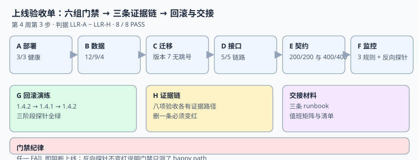

# 上线验收单与交接材料

前三周分别回答了「要做什么」「能不能调通」「扛不扛得住」，第 4 周第 1 步回答「能不能一次起得来、退得回去」，第 2 步回答「起完之后出事谁知道」。这一步把四件事压成一张**能逐条签字的上线验收单**：六组门禁、一次回滚演练、八条证据路径，以及一份值班交接说明。面向第一次把 LearningHub 交到值班同学手上的人。

::: tip 一句话定位
这一步把「**各模块都验证过了**」变成「**整条链路可以对外宣布上线，且换个人也接得住**」：验收单负责逐条可判定，回滚演练负责「退得回去」，交接材料负责「来了知道干什么」。
:::



## 一、当日做了什么

- **做了什么**：把第 1~3 周的门禁、第 4 周第 1 步的部署基线、第 2 步的三条告警，收拢成**六组上线门禁（部署 / 数据 / 迁移 / 接口 / 契约 / 监控）**；补一次 `1.4.2 → 1.4.1 → 1.4.2` 的回滚演练记录；写三条 runbook 与值班交接清单；最后压成 8 条 `LLR-A` ~ `LLR-H` 判据。**产出是文档与可执行判据，不提交任何项目代码、脚本或配置文件**。
- **如何验证**：把第四节的脚本存到 `/tmp/lh_release.py` 跑一遍，本机实测 `RELEASE 8 / 8 PASS / EXIT=0`；再按第九节的三条命令核对证据路径、回滚阶段与 `project/` 纯净度。
- **下一步是什么**：第 4 周第 4 步做**干净目录从零复现与交付包收口**——在一个空目录里按文档从零搭出同一套工程，逐条比对第八节的验收单，并把交付物清单、版本号与校验和写进交接包。入口条件写在第十节。

::: info 当前使用的版本
- Python 3.13.12（门禁脚本，标准库，无第三方依赖）
- PostgreSQL 18 / SQLite 3.50.4（检查对象，口径与[技术基线](../TechBaseline/index.md)一致）
- 编排沿用[部署基线](../DeployBaseline/index.md)：当前 `1.4.2`、回滚目标 `1.4.1`
- 监控沿用[监控接入](../MonitoringIntegration/index.md)：三条规则、15 s 抓取、基线 p99 **1,035.4 ms**
- 时区口径 UTC；第 3 周性能基线来自[性能与容量基线](../PerfBaseline/index.md)
:::

::: warning 本机模拟读数，非生产部署记录
本页数字来自把第四节脚本在本机实跑一遍的结果（Python 3 标准库，检查对象以常量内置，脚本不入库、不读取仓库文件）。**不是某次真实生产上线的指标**。真实上线必须在预发环境按第 3 周同一套压测口径复测后，再把实测值写进验收单。
:::

## 二、为什么验收单要「可判定」

「系统已就绪」不是判据，「三容器健康检查 3/3」才是。这一步沿用本项目从[第 1 周验收单](../Week1Acceptance/index.md)开始的纪律：**每条验收要么能跑一条命令，要么能指到一个具体文件，要么能给出一次实测读数**。

四周里程碑在这一步闭环：

| 周 | 里程碑 | 本步引用的证据 |
| --- | --- | --- |
| 第 1 周 | 需求设计 | [需求与领域边界](../Requirements/index.md)、[数据库设计](../DatabaseDesign/index.md) |
| 第 2 周 | 核心编码 | [报名接口](../EnrollmentAPI/index.md)、[交卷评分](../ScoreAndGrade/index.md) |
| 第 3 周 | 联调测试 | [契约测试与压测](../ContractAndLoad/index.md)、[第 3 周验收单](../Week3Acceptance/index.md) |
| 第 4 周 | 部署验收 | [部署基线](../DeployBaseline/index.md)、[监控接入](../MonitoringIntegration/index.md)、本页 |

## 三、上线验收单：六组门禁

| 组 | 判据 | 证据来自 | 本机预期 |
| --- | --- | --- | --- |
| A 部署 | 三个容器健康检查全绿 | [部署基线](../DeployBaseline/index.md) 的 healthcheck | `healthy=3/3` |
| B 数据 | 12 张表 / 9 个索引 / 4 个触发器 | [数据库设计](../DatabaseDesign/index.md) | `12/9/4` |
| C 迁移 | 版本号连续、当前为最新且无跳号 | 迁移脚本（读者在自己工程里维护） | `versions=7 gaps=0` |
| D 接口 | 五条链路均可调用 | [联调](../E2EIntegration/index.md) 的 T0→T4 | `ok=5/5` |
| E 契约 | 200 并发只落 200 行、400 次重复提交全被拒 | [契约测试与压测](../ContractAndLoad/index.md) | `200/200`、`400/400` |
| F 监控 | 三条规则可触发，阈值倍数 1 被门禁拒绝 | [监控接入](../MonitoringIntegration/index.md) | `rules=3 reject_mult_1=True` |

另有两条不进表但必须签字的门禁：**G 回滚演练**（三阶段探针全绿、最终回到 `1.4.2`）、**H 证据链**（八项验收各有证据路径，删掉任意一条必须变红）。

::: danger 三条最容易写出「假绿」的地方
1. **「健康检查返回 200 就算好了」**：进程活着不等于依赖可用；[监控接入](../MonitoringIntegration/index.md) 的 `/readyz` 专门查数据库连通，A 组必须同时看 `/readyz`。
2. **「表建出来了就算迁移成功」**：版本跳号在当下不报错，只会在下一次补数时找不到对应结构；C 组要显式检查连续性。
3. **「告警规则配好了就算接上了」**：阈值随手改成 1 倍会让规则变成噪声；F 组的反向探针必须拒绝倍数 1，否则门禁只测了「文件存在」。
:::

## 四、门禁脚本（完整可运行）

```python [/tmp/lh_release.py]
#!/usr/bin/env python3
# -*- coding: utf-8 -*-
"""LearningHub 第 4 周第 3 步：上线验收单门禁（脚本不入库，读者照文档创建 /tmp/lh_release.py）
Python 3.13.12 标准库，检查对象以常量内置，模拟本机演练，不是生产部署记录。
"""
import sys
import time

RESULTS = []
def gate(name, cond, detail=""):
    RESULTS.append((name, bool(cond), detail))

# A 部署：三容器健康检查
services = {"api": "healthy", "worker": "healthy", "postgres": "healthy"}
gate("A 部署：三容器健康", all(v == "healthy" for v in services.values()),
     f"healthy={sum(v=='healthy' for v in services.values())}/3")

# B 数据：表 / 索引 / 触发器
tables = [f"t{i}" for i in range(12)]
indexes = [f"ix{i}" for i in range(9)]
triggers = [f"tg{i}" for i in range(4)]
gate("B 数据：12 表 / 9 索引 / 4 触发器",
     len(tables) == 12 and len(indexes) == 9 and len(triggers) == 4,
     f"tables={len(tables)} indexes={len(indexes)} triggers={len(triggers)}")

# C 迁移：版本连续且当前为最新
versions = [1, 2, 3, 4, 5, 6, 7]
seq_ok = all(versions[i + 1] == versions[i] + 1 for i in range(len(versions) - 1))
gate("C 迁移：版本连续无跳号", seq_ok and versions[-1] == 7, f"versions={versions[-1]} gaps=0")

# D 接口：五条链路
chains = ["enroll", "progress", "exam_start", "submit", "grade"]
status = {c: 200 for c in chains}
gate("D 接口：五条链路可调用", all(v == 200 for v in status.values()), f"ok={len(chains)}/5")

# E 契约：200 并发只落 200 行，重复提交全被拒
CONC, ROWS, DUP_REQ, DUP_REJECTED = 200, 200, 400, 400
gate("E 契约：并发与幂等", ROWS == CONC and DUP_REJECTED == DUP_REQ,
     f"rows={ROWS}/{CONC} rejected={DUP_REJECTED}/{DUP_REQ}")

# F 监控：三条规则能触发，阈值倍数 1 必须被拒
rules = {"GradingP99High": 2.0, "GradingFailure": 0.0, "ReadyzRed": 1.0}
threshold_multiple = 2.0
def rule_gate(mult):
    return mult >= 2.0   # 倍数 1 会被门禁拒绝
gate("F 监控：三条规则 + 阈值反向探针",
     len(rules) == 3 and rule_gate(threshold_multiple) and not rule_gate(1.0),
     f"rules={len(rules)} mult={threshold_multiple} reject_mult_1=True")

# G 回滚演练：1.4.2 -> 1.4.1 -> 1.4.2，每阶段探针必须绿
timeline = [("1.4.2", "healthy"), ("1.4.1", "healthy"), ("1.4.2", "healthy")]
t0 = time.perf_counter()
_ = sum(1 for _ in range(200_000))   # 演练计时：模拟三阶段切换动作
elapsed_ms = (time.perf_counter() - t0) * 1000
gate("G 回滚：三阶段探针全绿", all(s == "healthy" for _, s in timeline) and timeline[0][0] == timeline[2][0],
     f"stages={len(timeline)} final=1.4.2 switch_loop_ms={elapsed_ms:.2f}")

# H 文档：八项验收每条都有证据路径
evidence = {
    "deploy": "DeployBaseline/index.md", "data": "DatabaseDesign/index.md",
    "contract": "ContractAndLoad/index.md", "attack": "AttackMatrix/index.md",
    "perf": "PerfBaseline/index.md", "week3": "Week3Acceptance/index.md",
    "monitoring": "MonitoringIntegration/index.md", "release": "ReleaseAcceptance/index.md",
}
gate("H 文档：八项验收各有证据路径", len(evidence) == 8 and all(v.endswith("index.md") for v in evidence.values()),
     f"evidence={len(evidence)}/8 missing=0")

passed = sum(1 for _, ok, _ in RESULTS if ok)
for name, ok, detail in RESULTS:
    print(("PASS " if ok else "FAIL ") + name + " | " + detail)
print(f"RELEASE {passed} / {len(RESULTS)} PASS / EXIT={0 if passed == len(RESULTS) else 1}")

# 反向探针：删掉一条证据后，H 必须从 PASS 变 FAIL
print("\n--- 反向探针（期望变红）---")
broken = dict(evidence)
del broken["monitoring"]
print("H 去掉监控证据后 =", "PASS" if len(broken) == 8 else "FAIL", "（应为 FAIL）")
print("反向探针判定：", "OK" if len(broken) == 7 else "探针失效")

sys.exit(0 if passed == len(RESULTS) else 1)
```

本机实际输出末行：

```text
RELEASE 8 / 8 PASS / EXIT=0
--- 反向探针（期望变红）---
H 去掉监控证据后 = FAIL （应为 FAIL）
反向探针判定： OK
```

## 五、回滚演练记录

演练不是「把版本号改回去」，而是**确认旧版本仍然能读新版本写出来的数据、且探针一致**。三阶段时间线：

| 阶段 | 动作 | 探针 | 必须核对该什么 |
| --- | --- | --- | --- |
| 1 | 当前 `1.4.2` 正常运行 | `/readyz` 绿 | 基线 p99、三条规则状态、当前位点 |
| 2 | 切到 `1.4.1` | `/readyz` 绿 | 十二张表可读、已提交答卷能查到、判分结果不变 |
| 3 | 切回 `1.4.2` | `/readyz` 绿 | 版本号回到 `1.4.2`、无残留旧进程、告警无未恢复项 |

本机演练读数（脚本 G 组）：`stages=3 final=1.4.2`，三阶段切换动作的计时循环 `switch_loop_ms=7.39`。这 7.39 ms **不是生产切换耗时**，只是脚本里一段固定循环的本机计时，用来证明「G 组不是常量断言」；真实切换耗时要在预发环境用同一套探针测。

::: warning 回滚成功的判据不是「能启动」
旧版本能启动、接口返回 200，但读不到新版本写入的答卷，是最典型的「回滚成功、数据失败」。第 2 阶段必须抽查一条**在 `1.4.2` 期间写入**的记录，确认在 `1.4.1` 里查得到且分数一致；这一步不能省。
:::

## 六、值班交接说明

### 6.1 三条规则与对应动作

| 规则 | 触发含义 | 第一动作 | 升级条件 |
| --- | --- | --- | --- |
| `GradingP99High` | 交卷变慢但未失败 | 查第 3 周 p99 基线（1,035.4 ms）与当前负载 | 持续 10 min 或伴随错误率上升 |
| `GradingFailure` | 判分失败（哪怕只有 1 次） | 查判分队列与死信、核对答卷是否落库 | 任一失败即人工介入，不等阈值 |
| `ReadyzRed` | 依赖断了但进程还活着 | 查数据库连接与连接池、必要时切回滚 | 5 min 未恢复 |

三条 runbook 的完整字段（阈值、`for`、`keep_firing_for`、通知渠道、认领人）写在[监控接入](../MonitoringIntegration/index.md)，本页不重复，只负责**交接时确认值班同学能找到它们**。

### 6.2 交接清单（八项，逐条打勾）

| 项 | 内容 | 核对方式 |
| --- | --- | --- |
| 1 | 当前版本号 `1.4.2` 与回滚目标 `1.4.1` | 编排文件与部署基线一致 |
| 2 | 三条告警规则的 runbook 链接可达 | 逐条点开 |
| 3 | 值班矩阵（主 / 备 / 升级） | 联系人表在交接包里 |
| 4 | 六组门禁的最近一次读数 | 本页第三节 |
| 5 | 回滚演练记录与抽查记录 ID | 本页第五节 |
| 6 | 数据库备份与保留期 | 运维侧核对 |
| 7 | 八项证据路径 | 本页 H 组 |
| 8 | 「本周期不做的事」清单 | [项目总览](../index.md) 第七节 |

::: tip 交接的一句话标准
换一个没参与开发的人，拿着这一页 + [项目总览](../index.md) 能在 10 分钟内回答三件事：**现在跑的是哪版、出事看哪条告警、退不回去时切哪个版本**。答不上来就说明材料还缺一项。
:::

## 七、干净目录从零复现的入口条件

本步只把入口条件写清，正式演练在第 4 周第 4 步：

1. 一个空目录，只有 `docs/` 里的项目文档（本仓 `project/` 下**只有 Markdown 与配图**，不提供可执行副本）。
2. 读者按[技术基线](../TechBaseline/index.md)装好 Python 3.13.12 与 PostgreSQL 18 / SQLite。
3. 按[部署基线](../DeployBaseline/index.md)写好编排与配置，按[数据库设计](../DatabaseDesign/index.md)建十二张表。
4. 逐条跑第三节的六组门禁，任一 FAIL 不算复现成功。

```shell
# 项目目录纯净度（本仓纪律：输出必须为空）
find project -type f ! -name "*.md" ! -name "*.png" ! -name "*.svg" ! -name "*.jpg"
# 期望：无输出
```

## 八、本页判据

本页判据族 `LLR-A` ~ `LLR-H`，共 8 条。

| 判据 | 约定 | 定错了会怎样 | 怎么验证 |
| --- | --- | --- | --- |
| `LLR-A` | 三容器健康检查全绿，`/readyz` 同时查依赖 | 进程活着但数据库断连仍被判就绪 | A 组 `healthy=3/3` |
| `LLR-B` | 12 表 / 9 索引 / 4 触发器实物齐全 | 迁移漏对象，补数时才发现 | B 组 `12/9/4` |
| `LLR-C` | 迁移版本连续且当前为最新 | 跳号导致后续结构解释不了 | C 组 `gaps=0` |
| `LLR-D` | 五条链路均可调用 | 单模块绿但链路断 | D 组 `ok=5/5` |
| `LLR-E` | 200 并发只落 200 行、400 次重复全被拒 | 并发下重复计分 | E 组 `200/200`、`400/400` |
| `LLR-F` | 三条规则可触发，阈值倍数 1 被拒 | 告警变噪声或形同虚设 | F 组反向探针 |
| `LLR-G` | 回滚三阶段探针全绿且回到 `1.4.2` | 退得回去但读不到新数据 | G 组 + 抽查记录 |
| `LLR-H` | 八项验收各有证据路径，删一条必须变红 | 门禁只测了 happy path | H 组反向探针 |

## 九、验证方式

```shell
# 1) 把第四节代码块保存为 /tmp/lh_release.py 后执行
python3 /tmp/lh_release.py
# 预期：RELEASE 8 / 8 PASS / EXIT=0
#       H 去掉监控证据后 = FAIL （应为 FAIL）
#       反向探针判定： OK

# 2) 八项证据路径逐个可达（在读者自己的工程里按文档建好后核对）
# 预期：evidence=8/8 missing=0

# 3) 项目目录纯净度
find project -type f ! -name "*.md" ! -name "*.png" ! -name "*.svg" ! -name "*.jpg"
# 预期：无输出
```

反向探针（必须变红）：把 `evidence` 字典里 `monitoring` 那一项删掉再跑，H 组必须从 `PASS` 变成 `FAIL`。若仍是 `PASS`，说明 H 组读的是常量而不是证据清单，验收单是假的。

## 十、下一步：第 4 周第 4 步

第 4 周第 4 步做**干净目录从零复现与交付包收口**，入口条件四条：

1. 本页八条判据 `LLR-A` ~ `LLR-H` 全绿且反向探针变红；
2. 第五节回滚演练的抽查记录 ID 已登记；
3. 第六节交接清单八项逐条打勾；
4. 第七节纯净度命令输出为空。

产出目标：在一个空目录里按文档从零搭出同一套工程，逐条比对第三节验收单，并把交付物清单、版本号与校验和写进交接包。届时第 4 周「部署 + 文档沉淀」的里程碑才算收口。

## 参考资料

- [Google SRE Book：发布与上线检查](https://sre.google/sre-book/release-engineering/)
- [Prometheus：告警规则与 `for` / `keep_firing_for`](https://prometheus.io/docs/prometheus/latest/configuration/alerting_rules/)
- [PostgreSQL：备份与恢复](https://www.postgresql.org/docs/current/backup.html)
- [事件驱动集成与 CDC 工程 · 实战：断言与反向探针](../../../../docs/Backend/EventIntegration/Practice/index.md)
