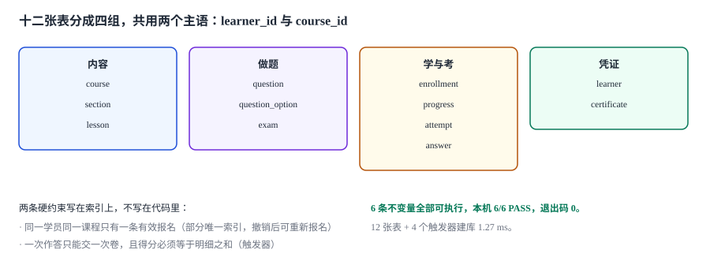

# 需求与领域边界：八条故事、十二张表、六条不变量

产品经理给的需求是：「学员能选课，看完视频算学完，考试通过发证书。」

这三句话里有四个词没有定义：**看完**（看到 90% 算不算）、**学完**（必修都看完还是总时长达标）、**通过**（60 分还是排名前 80%）、**证书**（一张 PDF 还是一条可校验的记录）。每一个没定义的词，都会在第 2 周变成一次「你说的是哪个意思」。

::: tip 一句话理解
需求拆分不是把一句话拆成十句话，而是**把每个形容词换成一个能被查询判定的字段或约束**。换不掉的，就是这一版不做的东西。
:::

本页判据族 `LNH-A` ~ `LNH-H`，共 8 条。定义表在第八节「本页判据」。

## 一、八条用户故事与它们的验收

每条故事都必须带一条**能被一条 SQL 或一次请求判定**的验收，否则它会在开发时被解释成三种样子。

| # | 故事 | 可判定的验收 |
| --- | --- | --- |
| U1 | 学员能报名一门在售课程 | 重复报名被部分唯一索引拒绝；撤销后可重新报名 |
| U2 | 学员的学习进度能在多端接续 | `progress.position_sec` 只能增大；回退更新被拒 |
| U3 | 学员能看到「必修还剩几节」 | `必修总数 − done 的必修数` 可由一条 SQL 算出 |
| U4 | 系统能按规则组一张卷 | 组卷结果落库，事后能还原「当时抽了哪几题」 |
| U5 | 学员交卷后立刻拿到分数 | 交卷请求返回的分数 = `answer.score` 之和 |
| U6 | 同一场考试不能重复计分 | 二次交卷被触发器拒绝 |
| U7 | 通过的学员能拿到可校验的证书 | 未通过时插入证书被拒；证书编号可反查成绩 |
| U8 | 运营能更正错误成绩并留痕 | 更正写入 `score_fix`，原分数不被覆盖 |

第 8 条最容易在需求阶段被砍掉（「成绩怎么会错」），也最容易在上线后变成紧急需求。**没有更正通道的系统，错误只能靠改数据库**——而改数据库不会留痕。

## 二、四个词的定义（本项目的口径）

| 词 | 本项目口径 | 为什么不用另一种 |
| --- | --- | --- |
| 看完 | `done = 1`，由播放器上报「进度 ≥ 95% 且停留 ≥ 80% 时长」后置位 | 「看到 100%」会让拖到最后 1 秒的人无法完成 |
| 学完 | **所有必修节** `done = 1` | 「总时长达标」可被挂机刷出来 |
| 通过 | `score ≥ exam.pass_score` | 「排名前 N%」在小样本下不稳定（3 人考取第 1 名） |
| 证书 | 一条带编号、可撤销、可反查成绩的记录 | 一张 PDF 无法撤销，也无法证明来源 |

::: danger 三个必须在第 1 周定下来的口径
1. **`done` 是快照不是事件**：进度表存「当前状态」，事件表存「每次上报」。只存事件时，查「还剩几节」要把全部事件重放一遍；只存快照时，无法解释「为什么这节变成了未完成」。
2. **必修/选修写在 `lesson.is_required`**：写在课程配置的 JSON 里，会让「加一节必修」变成一次代码发布。
3. **试卷必须落库**：随机组卷如果不记「抽了哪几题」，考后申诉时无法复现——这是同类系统最常见的死结。
:::

## 三、十二张表



```sql
CREATE TABLE learner(
  learner_id TEXT PRIMARY KEY, name TEXT NOT NULL,
  email TEXT NOT NULL UNIQUE, created_at TEXT NOT NULL
);
CREATE TABLE course(
  course_id TEXT PRIMARY KEY, title TEXT NOT NULL,
  version INTEGER NOT NULL DEFAULT 1,
  status TEXT NOT NULL CHECK (status IN ('DRAFT','LIVE','RETIRED'))
);
CREATE TABLE section(
  course_id TEXT NOT NULL REFERENCES course(course_id),
  seq INTEGER NOT NULL, title TEXT NOT NULL,
  PRIMARY KEY (course_id, seq)
);
CREATE TABLE lesson(
  lesson_id TEXT PRIMARY KEY,
  course_id TEXT NOT NULL, section_seq INTEGER NOT NULL,
  seq INTEGER NOT NULL, title TEXT NOT NULL,
  duration_sec INTEGER NOT NULL CHECK (duration_sec > 0),
  is_required INTEGER NOT NULL DEFAULT 1 CHECK (is_required IN (0,1)),
  UNIQUE (course_id, section_seq, seq),
  FOREIGN KEY (course_id, section_seq) REFERENCES section(course_id, seq)
);
CREATE TABLE enrollment(
  enroll_id TEXT PRIMARY KEY,
  learner_id TEXT NOT NULL REFERENCES learner(learner_id),
  course_id TEXT NOT NULL REFERENCES course(course_id),
  course_version INTEGER NOT NULL,
  state TEXT NOT NULL CHECK (state IN ('ACTIVE','COMPLETED','WITHDRAWN','EXPIRED')),
  enrolled_at TEXT NOT NULL
);
CREATE UNIQUE INDEX uq_enroll_active ON enrollment(learner_id, course_id)
  WHERE state IN ('ACTIVE','COMPLETED');
```

前六张表里有两处刻意的设计：

- **`enrollment.course_version`**：报名时冻结课程版本。课程升版（加一节必修）后，老学员不该突然「不合格」——这与[产品模型版本](../../../../docs/Backend/CPQ/Configuration/index.md)是同一个道理。
- **`uq_enroll_active` 是部分唯一索引**：只约束「有效」状态，撤销（`WITHDRAWN`）之后可以重新报名。写成 `UNIQUE(learner_id, course_id)` 的话，退课一次就永远不能再报。

```sql
CREATE TABLE progress(
  enroll_id TEXT NOT NULL REFERENCES enrollment(enroll_id),
  lesson_id TEXT NOT NULL REFERENCES lesson(lesson_id),
  position_sec INTEGER NOT NULL DEFAULT 0 CHECK (position_sec >= 0),
  done INTEGER NOT NULL DEFAULT 0 CHECK (done IN (0,1)),
  updated_at TEXT NOT NULL,
  PRIMARY KEY (enroll_id, lesson_id)
);
CREATE TABLE question(
  question_id TEXT PRIMARY KEY, course_id TEXT NOT NULL,
  kind TEXT NOT NULL CHECK (kind IN ('SINGLE','MULTI','BOOL')),
  stem TEXT NOT NULL, score REAL NOT NULL CHECK (score > 0),
  status TEXT NOT NULL DEFAULT 'LIVE' CHECK (status IN ('LIVE','RETIRED'))
);
CREATE TABLE question_option(
  question_id TEXT NOT NULL REFERENCES question(question_id),
  opt_key TEXT NOT NULL, body TEXT NOT NULL,
  is_correct INTEGER NOT NULL DEFAULT 0 CHECK (is_correct IN (0,1)),
  PRIMARY KEY (question_id, opt_key)
);
CREATE TABLE exam(
  exam_id TEXT PRIMARY KEY, course_id TEXT NOT NULL,
  pass_score REAL NOT NULL, total_score REAL NOT NULL,
  duration_sec INTEGER NOT NULL, max_attempts INTEGER NOT NULL DEFAULT 3,
  CHECK (pass_score <= total_score)
);
CREATE TABLE attempt(
  attempt_id TEXT PRIMARY KEY,
  exam_id TEXT NOT NULL REFERENCES exam(exam_id),
  learner_id TEXT NOT NULL REFERENCES learner(learner_id),
  started_at TEXT NOT NULL, submitted_at TEXT,
  score REAL, passed INTEGER CHECK (passed IN (0,1))
);
CREATE TABLE answer(
  attempt_id TEXT NOT NULL REFERENCES attempt(attempt_id),
  question_id TEXT NOT NULL REFERENCES question(question_id),
  picked TEXT NOT NULL,
  score REAL NOT NULL DEFAULT 0,
  PRIMARY KEY (attempt_id, question_id)
);
CREATE TABLE certificate(
  cert_no TEXT PRIMARY KEY,
  learner_id TEXT NOT NULL, course_id TEXT NOT NULL,
  attempt_id TEXT NOT NULL UNIQUE REFERENCES attempt(attempt_id),
  issued_at TEXT NOT NULL, revoked_at TEXT
);
```

`question.status` 是这套表里最容易被忽略的一列：题目下线必须是 `RETIRED` 而不是 `DELETE`。删掉之后，历史 `answer` 会指向一个不存在的题目，**那次考试的分数就再也解释不了了**。

## 四、六条不变量：可执行的才算

写进文档的约束会在第一次「赶进度」时被绕过；写进数据库的约束绕不过去。

| # | 不变量 | 实现 | 违反时的形态 |
| --- | --- | --- | --- |
| I1 | 同一学员同一课程只有一条有效报名 | 部分唯一索引 | 两次报名，进度分裂 |
| I2 | 学习进度只能前进 | 触发器 `PROGRESS_REGRESSED` | 看回放导致进度倒退 |
| I3 | 得分 = 明细之和 | 触发器 `SCORE_NOT_MATCH_ANSWERS` | 分数被单独更新 |
| I4 | 一次作答只能交一次卷 | 触发器 `ALREADY_SUBMITTED` | 重复计分、多张证书 |
| I5 | 未通过不许签发证书 | 触发器 `CERT_REQUIRES_PASSED_ATTEMPT` | 证书可伪造 |
| I6 | 及格分不高于总分 | `CHECK (pass_score <= total_score)` | 全员不合格 |

```sql
-- I2：进度只能前进（done 未变时，position 不许回退）
CREATE TRIGGER trg_progress_monotonic BEFORE UPDATE ON progress
WHEN NEW.position_sec < OLD.position_sec AND NEW.done >= OLD.done
BEGIN
  SELECT RAISE(ABORT, 'PROGRESS_REGRESSED') END;
END;

-- I3：得分必须等于明细之和
CREATE TRIGGER trg_attempt_score BEFORE UPDATE OF score ON attempt
WHEN NEW.score IS NOT NULL AND ABS(NEW.score - (
  SELECT COALESCE(SUM(score),0) FROM answer WHERE attempt_id = NEW.attempt_id
)) > 0.005
BEGIN
  SELECT RAISE(ABORT, 'SCORE_NOT_MATCH_ANSWERS') END;
END;

-- I4：交卷只能一次
CREATE TRIGGER trg_submit_once BEFORE UPDATE OF submitted_at ON attempt
WHEN OLD.submitted_at IS NOT NULL AND NEW.submitted_at IS NOT NULL
BEGIN
  SELECT RAISE(ABORT, 'ALREADY_SUBMITTED') END;
END;

-- I5：没过不能发证
CREATE TRIGGER trg_cert_requires_pass BEFORE INSERT ON certificate
WHEN NOT EXISTS (SELECT 1 FROM attempt a WHERE a.attempt_id = NEW.attempt_id
                 AND a.passed = 1 AND a.learner_id = NEW.learner_id
                 AND a.submitted_at IS NOT NULL)
BEGIN
  SELECT RAISE(ABORT, 'CERT_REQUIRES_PASSED_ATTEMPT') END;
END;
```

I2 的 `AND NEW.done >= OLD.done` 是一个刻意的让步：**允许「完成状态被重置」时进度归零**（例如课程升版后重学）。如果不加这个条件，`done` 从 1 改回 0 会同时触发「进度回退」，而这是合法操作。

## 五、实跑输出：6/6 全部拦住

```text
I1 重复报名（ACTIVE+ACTIVE） PASS -> UNIQUE constraint failed: enrollment.learner_id, enrollment.course_id
I2 进度回退 300→120 PASS -> PROGRESS_REGRESSED
I3 直接写 score=88（明细只有 10） PASS -> SCORE_NOT_MATCH_ANSWERS
I4 二次交卷 PASS -> ALREADY_SUBMITTED
I5 未通过签发证书 PASS -> CERT_REQUIRES_PASSED_ATTEMPT
I6 及格分高于总分 PASS -> CHECK constraint failed: pass_score <= total_score
build_ms=1.27 tables=12 triggers=4 re_enroll_rows=2
INVARIANT 6/6  PASS
EXIT 0
```

两处值得注意：

- **`re_enroll_rows=2`**：撤销后再报名，同一个学员同一门课在表里有 2 行——这正是部分唯一索引要的效果（历史保留，有效只有一条）。
- **`build_ms=1.27`**：12 张表 + 4 个触发器建库 1.27 ms（`:memory:`，50 次平均）。这个数在第 4 周做「一键部署」时会再出现一次：建库耗时决定冷启动是否需要在 `make up` 里等待。

## 六、四条接口契约（草案）

第 1 周只定形状，不定实现。四条契约覆盖了「报名 → 上报 → 开考 → 交卷」的主干。

| 接口 | 方法 | 关键字段 | 幂等键 | 主要错误码 |
| --- | --- | --- | --- | --- |
| `/v1/enrollments` | POST | `learner_id` `course_id` | `Idempotency-Key` | `409 already_enrolled` |
| `/v1/progress` | POST | `enroll_id` `lesson_id` `position_sec` `done` | `(enroll_id, lesson_id, 序号)` | `409 progress_regressed` |
| `/v1/attempts` | POST | `exam_id` `learner_id` | `Idempotency-Key` | `409 attempts_exhausted` |
| `/v1/attempts/{id}/submit` | POST | `answers[]` | 天然（`attempt_id`） | `409 already_submitted` |

```http
POST /v1/progress HTTP/1.1
Content-Type: application/json
Idempotency-Key: 8f3c...b1

{
  "enroll_id": "N3",
  "lesson_id": "K1",
  "position_sec": 300,
  "client_seq": 17
}
```

`client_seq` 是这一版契约里唯一「多出来」的字段：移动端会离线缓存上报，重连后可能乱序到达。**进度上报必须是「单调合并」而不是「最后写入胜出」**，否则一条迟到的旧位置会把进度打回去——这正是 I2 在接口层的对应约束。

## 七、下一步是什么

第 252 天做**技术选型与版本基线**：把 Python/SQLite 的版本、`PRAGMA` 设置（`foreign_keys`、`journal_mode`）、时区与字符集定下来，并给出「换 PostgreSQL 时要改哪三处」的清单。今天的 `CHECK` 与部分唯一索引在两边语义一致，但 `RAISE(ABORT)` 的触发器语法不是——这一点会写进下一章的方言差异表。

## 八、本页判据

| 判据 | 断言 | 验证方式 |
| --- | --- | --- |
| `LNH-A` | 八条故事各有一条可判定验收 | 每条验收能写成一个 SQL 或一次请求 |
| `LNH-B` | 四个模糊词有落地字段 | 「看完/学完/通过/证书」都能指到列或表 |
| `LNH-C` | 报名唯一性用部分索引而非全唯一 | 撤销后可重新报名（`re_enroll_rows=2`） |
| `LNH-D` | 报名冻结课程版本 | `enrollment.course_version` 非空 |
| `LNH-E` | 六条不变量各有一次被拦住的实测 | 6/6 PASS，退出码 0 |
| `LNH-F` | 题目下线用状态不用删除 | `question.status` 存在 `RETIRED` |
| `LNH-G` | 试卷可还原（抽了哪几题） | 组卷结果落库表（第 2 周补 `paper_item`） |
| `LNH-H` | 四条契约各有幂等键与错误码 | 表中四行都有值 |

## 验证方式

把本页第三节的 `CREATE TABLE` 与第四节的四个触发器原样存成 `lh_req.py` 的 DDL/TRG 常量（断言部分照第五节输出写），以下命令即可复跑。

```shell
# 1. 建库：12 张表 + 4 个触发器
python3 lh_req.py 2>&1 | tail -3
# 期望：build_ms=... tables=12 triggers=4 ... / INVARIANT 6/6  PASS / EXIT 0

# 2. 部分唯一索引的语义：撤销后可重新报名，但历史保留
sqlite3 lh.db "
select learner_id, course_id, count(*) as rows,
       sum(case when state in ('ACTIVE','COMPLETED') then 1 else 0 end) as active
from enrollment group by learner_id, course_id;"
# 期望：rows ≥ 2 时 active 必须为 1

# 3. 反证：删掉 trg_submit_once，I4 必须变红
sed '/CREATE TRIGGER trg_submit_once/,/^END;/d' lh_req.py > lh_req_nosubmit.py
python3 lh_req_nosubmit.py 2>&1 | tail -2
# 期望：INVARIANT 5/6  FAIL
```

第 3 步和第 CPQ 专题的实战页是同一个方法：**一条约束只有在删掉它之后断言会变红，才算真的存在**。

## 参考资料

- ISO/IEC 19788-1:2011《信息技术 学习、教育和培训 学习资源元数据 第 1 部分：框架》：课程—章节—课时的层级元数据参考。
- IMS Global《Open Badges Specification 3.0》：可验证凭证的签发、校验与撤销模型。
- 《教育部等十一部门关于促进在线教育健康发展的指导意见》（教发〔2019〕11 号）：在线课程学时与学习成果认定的政策依据。
- 与本页相邻：[项目总览](../index.md)、[配置与版本](../../../../docs/Backend/CPQ/Configuration/index.md)（版本冻结的同构问题）。
