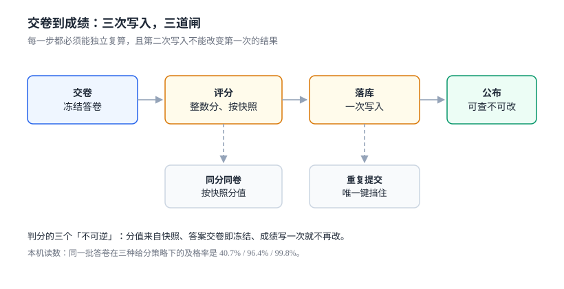

# 核心编码（五）：交卷评分、整数分与一次写入

第 3 步把「完成」冻在了第一次写入，第 4 步把「卷子」冻在了开考那一刻。这一步处理最后一种不可逆：**分数一旦算出，就只能被追加一次，不能被改写**。

它在需求里也只有一句话（「交卷后出分」），在实现里要定三件事：**给分策略**（多选漏选给不给分）、**分值口径**（浮点还是整数）、**写入次数**（重复交卷会发生什么）。

::: tip 当日目标
把「评分」从一个函数变成一个**可复算的过程**：同一份答卷、同一份快照、同一套规则，永远得到同一个分数。
:::

本页判据族 `LSG-A` ~ `LSG-H`，共 8 条。



## 一、当日做了什么

| 动作 | 产物 | 落点 |
| --- | --- | --- |
| 定三种给分策略并实测及格率 | 严格 / 漏选半分 / 按比例 | 第二节 |
| 答案归一化（多选、判断、排序） | `picked` 统一成集合 | 第三节 |
| 分值改整数分，题分必须整除 | `score` 存「分」的百分之一 | 第四节 |
| 交卷幂等：唯一键 + 状态机 | `submission(attempt_id)` 唯一 | 第五节 |
| 答案与成绩冻结（两条触发器） | `ANSWER_FROZEN` / `SCORE_IMMUTABLE` | 第六节 |
| 接口契约与 14 个用例（含 2 条反向探针） | `POST /api/exams/attempts/{id}/submit` | 第七、八节 |

## 二、三种给分策略，三种及格率

多选题的给分口径直接决定通过率。本机模拟 2,000 份答卷（20 题 × 5 分，答题分布：55% 全对 / 30% 漏选 / 10% 错选 / 5% 空）：

| 策略 | 规则 | 平均分 | 及格率（≥60） |
| --- | --- | --- | --- |
| 严格 | 全对才给分 | 54.86 | **40.7%** |
| 漏选半分 | 无错选时全对 5 分、漏选 2.5 分 | 72.43 | **96.4%** |
| 按比例 | 正确项按比例给分，错选倒扣 | 78.57 | **99.8%** |

同一批答卷，及格率从 40.7% 到 99.8%，**差的不是学生水平，是规则**。这件事必须在产品侧先定，不能留给实现：

::: danger 三种「先写代码再定规则」的后果
1. **先按严格实现，上线后发现通过率太低**，改成半分制——历史成绩无法复算，只能全部重判。
2. **先按半分制实现，事后想加「错选倒扣」**——已公布的成绩与新规则不一致，学生会要求解释。
3. **规则写在代码 `if` 里，没有版本号**——同一份答卷在不同时间算出不同分，且无法证明哪个是对的。
:::

落库时，规则必须有版本：`grading_rule(rule_id, version, mode, allow_partial, penalty)`，`submission` 记录 `rule_version`。这样「为什么这份卷 72.5 分」永远可复算。

## 三、答案归一化：先把形态统一，再谈对错

同一道题，前端可能提交四种形态：`["A","C"]`、`"A,C"`、`"AC"`、`["C","A"]`。评分函数如果不归一化，就会出现「全对判成错」：

| 题型 | 存储形态 | 归一化后 | 易错点 |
| --- | --- | --- | --- |
| 单选 | `"A"` | `{"A"}` | 字符串被当成集合时变成 `{"A"}` 恰好对，但 `"AC"` 会变成 `{"A","C"}` |
| 多选 | `"A,C"` / `"AC"` | `{"A","C"}` | 顺序、分隔符、大小写 |
| 判断 | `true` / `"true"` / `"T"` / `1` | `{"T"}` 或 `{"F"}` | 四种写法都要兼容 |
| 填空 | `" 北京 "` | `"北京"` | 全角空格、首尾空白、繁简 |

归一化函数的纪律：**只做形态统一，不做同义判断**。「北京」与「北京市」是不是同一个答案，属于业务规则，不属于归一化。

## 四、整数分与及格线

浮点分在及格线附近会出事。三次 `33.33` 相加：

```python
f = 0.0
for _ in range(3):
    f += 33.33
print(f)          # 99.98999999999999488
print(f >= 100)   # False
```

三题各 33.33 分，满分应该是 100，实际是 `99.98999999999999488`，**任何 `>= 100` 的判定都会失败**。

两条修法，必须同时用：

1. **分值存整数**：`score` 的单位是「分」（1 元的百分之一那类精度），100 分记为 `10000`。
2. **题分必须整除总分**：20 题 × 500 = 10000；如果非要 3 题均分，就不能用 33.33，要么改成 34/33/33（并写进卷面快照），要么把总分改成 99。

本机实测：即使改成整数分，`3333 × 3 = 9999`，仍然不到 `10000`——**问题不在浮点，在「不整除」**。所以第二个约束比第一个更重要：它挡住的是一整类「设计时没算过」的卷子。

## 五、交卷幂等：两请求都读到 STARTED 会发生什么

交卷是一个典型的「读状态 → 写结果」流程。两个请求并发时，都会读到 `STARTED`，然后都写：

| 实现 | 写入条数 | 后果 |
| --- | --- | --- |
| 只有状态判断（先查再写） | **2** | 成绩写两次，第二次覆盖第一次 |
| `UNIQUE(attempt_id)` + 捕获冲突 | **1** | 第二次返回 `409` 或幂等返回第一次结果 |

本机实测（同一 `attempt_id`、两个请求在对方写入前都读到 `STARTED`）：无唯一键写入 **2 条**，有唯一键 **1 条**。

三条纪律：

- **唯一键建在库上**，不建在应用层。
- **状态机不放行重复迁移**：`SCORED → SCORED` 必须是空操作，不是再次写分。
- **返回 200 + 已有结果**，而不是 409。重复提交对用户来说不是错误，是「我已经交过了，给我看结果」。

## 六、答案与成绩冻结

交卷之后，两份数据都必须冻结，否则「已公布的成绩」可以被事后修改：

```sql [两条冻结触发器]
-- ① 交卷后不允许再改答案
CREATE TRIGGER trg_answer_frozen
BEFORE INSERT ON answer
WHEN (SELECT state FROM attempt WHERE attempt_id = NEW.attempt_id) <> 'STARTED'
BEGIN
  SELECT RAISE(ABORT, 'ANSWER_FROZEN');
END;

-- ② 成绩写入后不允许改写
CREATE TRIGGER trg_score_immutable
BEFORE UPDATE OF score ON submission
WHEN OLD.score IS NOT NEW.score
BEGIN
  SELECT RAISE(ABORT, 'SCORE_IMMUTABLE');
END;
```

本机实测：`UPDATE submission SET score=90` 被拒绝（`SCORE_IMMUTABLE`）；而**交卷后补一条答案仍然被允许**——如果只做第 ② 条、不做第 ① 条，答案是可以在出分后补的，而补答案会改变「复核时的复算结果」。

::: danger 复核时最容易翻车的一步
学生申诉「这道题我选的是 C」，你需要用**当时的答案**复算。如果答案表没有冻结，运营为了「核对」补了一条答案，复算结果就会偏向运营。正确做法是：答案表只允许 `STARTED` 状态下写入，出分后任何修改都走「复核工单 + 新版本 attempt」，而不是改原记录。
:::

## 七、接口契约

```http [交卷]
POST /api/exams/attempts/{attempt_id}/submit
Idempotency-Key: 018f3c2a-7d1e-7c3a-9b2f-6a1c2d3e4f50
Content-Type: application/json

{ "answers": [ {"q_no": 1, "picked": ["A","C"]}, {"q_no": 2, "picked": ["B"]} ] }
```

```json [首次交卷 200]
{
  "attempt_id": "a-20261107-001",
  "state": "SCORED",
  "score": 7250,
  "full_score": 10000,
  "passed": true,
  "graded_at": "2026-11-07T10:12:03Z",
  "rule_version": "half-1"
}
```

```json [重复交卷 200（同一结果，不新增）]
{
  "attempt_id": "a-20261107-001",
  "state": "SCORED",
  "score": 7250,
  "full_score": 10000,
  "passed": true,
  "graded_at": "2026-11-07T10:12:03Z",
  "rule_version": "half-1"
}
```

```json [已过期 409]
{ "code": "ATTEMPT_EXPIRED", "deadline": "2026-11-07T10:00:00Z" }
```

四条纪律：

- **`score` 是整数分**（7250 = 72.50 分），接口不出现浮点。
- **`rule_version` 必须返回**：同一份卷在不同规则下分数不同，客户端要能解释。
- **重复交卷返回同一 `graded_at`**：时间变了就说明又算了一次，那是缺陷。
- **过期交卷不写分**：返回 `409`，避免「超时提交也能拿分」。

## 八、14 个用例

| 编号 | 用例 | 期望 |
| --- | --- | --- |
| `T1` | 全对交卷 | 10000 分，`passed=true` |
| `T2` | 全错交卷 | 0 分，`passed=false` |
| `T3` | 多选漏选一个（半分制） | 得该题一半分 |
| `T4` | 多选错选一个（半分制） | 该题 0 分 |
| `T5` | 判断题四种写法（`true`/`"true"`/`"T"`/`1`） | 结果一致 |
| `T6` | 答案含全角空格 | 归一化后判定正确 |
| `T7` | 同一 `attempt_id` 交两次 | 返回同一 `score` 与 `graded_at` |
| `T8` | 并发两次交卷 | 只写入 1 条 submission |
| `T9` | 交卷后补答案 | `ANSWER_FROZEN` |
| `T10` | 交卷后改分 | `SCORE_IMMUTABLE` |
| `T11` | 超时交卷 | `409 ATTEMPT_EXPIRED` |
| `T12` | 题目分值在开考后被改 | 按快照分值算（不读题库当前值） |
| `T13` | **反向探针**：删掉 `UNIQUE(attempt_id)` | `T8` 必须失败（写入 2 条） |
| `T14` | **反向探针**：把 `score` 改成浮点 | `T1` 必须在边界卷上失败（99.99 < 100） |

`T13` 与 `T14` 的意义：没有它们，`T8`、`T1` 的通过可能只是因为「这次没有并发」「这份卷刚好整除」。

## 九、本页判据

| 编号 | 判据 | 为什么要它 | 怎么验证 |
| --- | --- | --- | --- |
| `LSG-A` | 给分规则必须有版本号，并记录在成绩上 | 同一份卷在不同规则下分数不同 | `submission.rule_version` 非空 |
| `LSG-B` | 答案提交后先归一化再比对 | 形态差异会造成「全对判错」 | `T5`、`T6` |
| `LSG-C` | 分值一律存整数，不出现浮点 | `33.33 × 3 = 99.99` | `T14`；边界卷满分判定通过 |
| `LSG-D` | 题分必须整除总分 | 整数化也救不了 33.33 | 卷面快照 `SUM(score) = full_score` |
| `LSG-E` | `UNIQUE(attempt_id)` 建在库上 | 并发下先查再写双通过 | `T8`、`T13` |
| `LSG-F` | 重复交卷返回同一结果，不新增记录 | 用户视角「交过了」不是错误 | `T7` |
| `LSG-G` | 交卷后答案冻结 | 否则复核时答案可被补写 | `T9` |
| `LSG-H` | 成绩写入后不可改写 | 改分等于毁掉证据 | `T10` |

## 十、验收 SQL

```sql
-- 1) 每份答卷恰好一条 submission
SELECT attempt_id, COUNT(*) FROM submission GROUP BY attempt_id HAVING COUNT(*) > 1;
-- 预期：0 行

-- 2) 分数是整数且落在 [0, full_score]
SELECT attempt_id, score FROM submission
 WHERE score <> CAST(score AS INTEGER) OR score < 0 OR score > 10000;
-- 预期：0 行

-- 3) 卷面分值合计等于满分（快照表）
SELECT attempt_id, SUM(score) FROM attempt_item GROUP BY attempt_id HAVING SUM(score) <> 10000;
-- 预期：0 行

-- 4) 出分后没有新增答案
SELECT a.attempt_id, COUNT(*) FROM answer a
  JOIN attempt t ON t.attempt_id = a.attempt_id
 WHERE t.state <> 'STARTED' AND a.created_at > t.submitted_at
 GROUP BY a.attempt_id;
-- 预期：0 行
```

同一份答卷复算（可直接跑，验证「同规则同分」）：

```python
def grade(answers, key, mode="half"):
    total = 0
    for q, picked in answers.items():
        sol = set(key[q])
        got = set(picked)
        right, wrong = len(got & sol), len(got - sol)
        if mode == "strict":
            total += 5 if right == len(sol) and wrong == 0 else 0
        else:
            total += 0 if wrong else (5 if right == len(sol) else 2)
    return total * 100          # 转成整数分

key = {i: {"A", "C"} for i in range(1, 21)}
ans = {i: {"A"} for i in range(1, 21)}
print(grade(ans, key), grade(ans, key))
# 预期：4000 4000 —— 20 题全部「漏选」，每题半分 2 分，合计 40 分 = 4000 整数分
```

如果输出是 `20000`，说明把「漏选」判成了「全对」——这正是 `T3` 要抓的缺陷：`right == len(sol)` 与 `wrong == 0` 被写成了「有交集即全对」。

## 十一、下一步

第 2 周第 5 步收口：把五步（报名、进度、完成判定、组卷、交卷评分）压成一张**第 2 周验收单**——服务能起、接口能调、页面能开，并把「本周不做」的清单写下来（支付、视频转码、防替考、多租户）。第 3 周进入联调与测试：接口契约对撞、并发与幂等的压测、以及「一份答卷从报名到出分」的端到端用例。

## 十二、参考资料

- [SQLite: CREATE TRIGGER](https://www.sqlite.org/lang_createtrigger.html)：`RAISE(ABORT)` 与 `WHEN` 的用法
- [SQLite: UNIQUE constraints](https://www.sqlite.org/lang_createtable.html#unique_constraints)：并发写入的唯一性保证
- [Python: Floating Point Arithmetic: Issues and Limitations](https://docs.python.org/3/tutorial/floatingpoint.html)：`33.33 × 3` 的经典案例
- [IEEE 754](https://en.wikipedia.org/wiki/IEEE_754)：二进制浮点无法精确表示十进制小数的原因
- [IETF draft: Idempotency-Key](https://datatracker.ietf.org/doc/draft-ietf-httpapi-idempotency-key-header/)：重复提交的幂等语义
