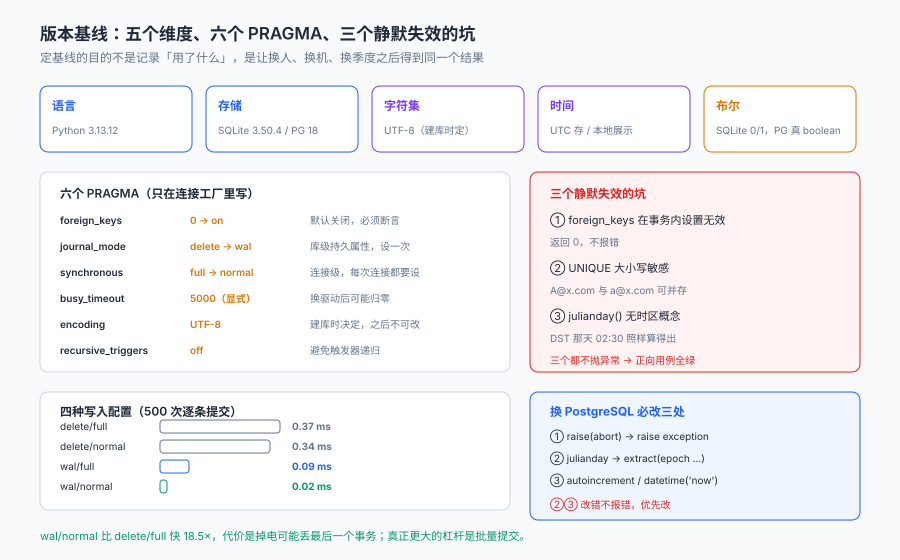

# 技术选型与版本基线：把「能跑」变成「可复现」

架构章定了四个模块和四条契约，但有一批决定没有写下来：**用哪个版本的 Python、SQLite 开哪些 PRAGMA、时间按什么时区存、字符集是什么、换 PostgreSQL 要改哪几行。**

这些决定不写下来，会以三种方式回来找你：本机能跑、同事机器不能跑；开发能跑、联调报错；现在能跑、半年后 SQLite 升级后行为变了。**版本基线的作用不是记录「我们用了什么」，而是让「换一个人、换一台机器、换一个季度」之后仍然得到同一个结果。**

::: tip 当日目标
定下**五条版本基线**（语言 / 存储 / 字符集 / 时间 / 布尔）、**六个 PRAGMA 的取值与理由**、**三个会让约束静默失效的坑**，并给出「换 PostgreSQL 要改哪三处」的清单，每条都能在本机当场验证。
:::

本页判据族 `LNT-A` ~ `LNT-H`，共 8 条。

## 一、当日做了什么

| 动作 | 产物 | 落点 |
| --- | --- | --- |
| 定五条版本基线 | 版本表 + 理由 | 第二节 |
| 定六个 PRAGMA | 初始化脚本的六行 | 第三节 |
| 实测三个静默失效的坑 | 三段可复现的对照 | 第四节 |
| 测四种写入配置 | 8.3× / 18.5× 的差距 | 第五节 |
| 写 PG 迁移清单 | 三处必改 + 两处建议 | 第六节 |



## 二、五条版本基线

| 维度 | 取值 | 理由 | 不定的后果 |
| --- | --- | --- | --- |
| 语言 | **Python 3.13.12** | 标准库 `sqlite3` 自带 3.50.4，不需要装驱动 | 3.11 与 3.13 的 `sqlite3` 默认 `autocommit` 行为不同 |
| 存储（开发） | **SQLite 3.50.4** | 部分唯一索引、`CHECK`、触发器语义齐全 | 低版本（<3.8）没有部分索引，`WHERE` 子句会被忽略 |
| 存储（联调） | **PostgreSQL 18** | 并发写与 `serializable` 隔离 | 只在 SQLite 上验证并发，等于没验证 |
| 字符集 | **UTF-8** | SQLite 只有 UTF-8/UTF-16，`PRAGMA encoding` 固定 | 混用 GBK 备份文件会导致中文乱码且不报错 |
| 时间 | **UTC 存储 + 展示时转换** | 跨时区与夏令时都要能算 | 存本地时间字符串，DST 那天会出现不存在的时间点 |

基线要落到**一个文件**里，不能散在 README、聊天记录和某个人的记忆里：

```text
# 版本基线（写进 README 的「环境」一节，并在 CI 里断言）
python      3.13.12
sqlite      3.50.4          # python -c "import sqlite3;print(sqlite3.sqlite_version)"
postgres    18
charset     UTF-8
timezone    UTC（存储） / Asia/Shanghai（展示）
```

::: warning 「本机装的是 3.13」不等于「项目用 3.13」
`python3 --version` 查的是**当前 shell 的解释器**，而应用可能跑在虚拟环境、容器、或某个 `envs/default` 里。本机实测过两次「命令行 `sqlite3` 是 3.39.5、Python 内置是 3.50.4」的错配——**判据要以应用进程的版本为准**，不是以 shell 的为准。
:::

## 三、六个 PRAGMA：取值与理由

| PRAGMA | 默认值（本机实测） | 本项目的取值 | 为什么 |
| --- | --- | --- | --- |
| `foreign_keys` | **0（关闭）** | `ON` | 默认关闭是历史包袱；不开，`references` 只是注释 |
| `journal_mode` | `delete`（文件库） | `WAL` | 读不阻塞写，单机并发够用 |
| `synchronous` | `2`（FULL） | `NORMAL` | 配合 WAL，掉电最多丢最后一个事务，换来 18.5× 写入 |
| `busy_timeout` | `5000`（Python 驱动设的） | `5000` | 显式写出来，避免换驱动后归零 |
| `encoding` | `UTF-8` | `UTF-8` | 建库时决定，之后不可改 |
| `recursive_triggers` | `0` | `0` | 保持关闭：触发器不再触发触发器，避免递归 |

初始化只需要六行，但必须**在事务之外**执行（下一节解释为什么）：

```python
# db.py —— 连接工厂：六个 PRAGMA 全在这里，业务代码不许再写 pragma
import sqlite3

def connect(path: str) -> sqlite3.Connection:
    con = sqlite3.connect(path, isolation_level=None)   # 手动控制事务
    con.execute("pragma foreign_keys = on")             # 必须在事务外
    con.execute("pragma journal_mode = wal")
    con.execute("pragma synchronous = normal")
    con.execute("pragma busy_timeout = 5000")
    con.execute("pragma recursive_triggers = off")
    assert con.execute("pragma foreign_keys").fetchone()[0] == 1, "FK 未生效"
    return con
```

最后那行 `assert` 不是多余的：**它是唯一能证明「开关真的开了」的东西**，而不是「我写过这一行」。

## 四、三个会让约束静默失效的坑

### 坑一：`foreign_keys` 默认关闭，且在事务内设置无效

本机实测三步：

```text
初始 foreign_keys = 0                      # 默认关闭
自动提交态执行 pragma foreign_keys=on → 1   # 生效
begin 之后执行 pragma foreign_keys=on → 0   # 静默无效，不报错
```

第二行与第三行的差别就是全部问题：**在事务里设置这个 PRAGMA 会被静默忽略**，而 Python 的 `sqlite3` 默认会在第一条 DML 前自动开事务——所以「连接后随手写一行 pragma」很可能落在事务里。

```python
# 错：隐式事务已经开启，pragma 被忽略
con = sqlite3.connect("lh.db")
con.execute("insert into learner(...) values (...)")   # 开启隐式事务
con.execute("pragma foreign_keys = on")               # 无效！

# 对：连接即设，且断言
con = sqlite3.connect("lh.db", isolation_level=None)
con.execute("pragma foreign_keys = on")
assert con.execute("pragma foreign_keys").fetchone()[0] == 1
```

**这个坑的代价不是「约束不生效」，是「你以为它生效了」**：外键关着时，插入孤儿行完全成功，所有正向用例全绿。

### 坑二：`UNIQUE` 是大小写敏感的

本机实测：`A@x.com` 与 `a@x.com` 可以同时插入同一条 `unique` 列（2 行）。对邮箱来说这是缺陷——同一个人的两个写法会变成两份档案。

| 写法 | 行为 | 适用 |
| --- | --- | --- |
| `email text unique` | 大小写敏感 | 区分大小写的标识（如工号） |
| `email text unique collate nocase` | 大小写不敏感 | **邮箱、用户名** |
| 应用层 `lower(email)` 入库 | 取决于是否所有写入都过这一层 | 不推荐（绕过的写入会破功） |

顺带一个相邻的差异：`LIKE` 在默认配置下对 ASCII **不区分大小写**（`'ABC' like 'abc%'` = 1），执行 `pragma case_sensitive_like=1` 后变 0。**别把 `LIKE` 的默认行为当成「精确匹配」。**

### 坑三：`julianday()` 没有时区概念

本机 `julianday('2026-03-08 02:30')` 返回 `2461107.6041666665`——它把这个字符串当成 UTC，**不会因为纽约那天 02:30 不存在而报错**。

| 函数 | 行为 | 用在哪 |
| --- | --- | --- |
| `datetime('now')` | 返回 UTC 的 `YYYY-MM-DD HH:MM:SS` | 落库时间戳 |
| `strftime('%Y-%m-%dT%H:%M:%SZ','now')` | 带 `Z` 的 ISO 8601 | 接口返回 |
| `julianday(x)` | 转成儒略日数（无时区） | 只做**时间差**，不做时区换算 |
| `date(x,'+7 days')` | 日期加减 | 有效期计算 |

结论写进纪律：**时区换算不在 SQL 里做，在应用层做**。SQL 只负责「存 UTC、算差值」。

## 五、四种写入配置的实测

同一台机器、同一个表、500 次逐条提交（每次 `COMMIT`）：

| journal_mode | synchronous | 单次提交耗时 | 相对最慢 |
| --- | --- | --- | --- |
| `delete` | `full` | 0.37 ms | 1.0× |
| `delete` | `normal` | 0.34 ms | 1.1× |
| `wal` | `full` | 0.09 ms | **4.1×** |
| `wal` | `normal` | 0.02 ms | **18.5×** |

这张表的用法不是「选最快的」，而是**知道每一档在拿什么换什么**：

- `delete/full`：每次提交都 fsync 日志，最安全，最慢。
- `wal/normal`：掉电可能丢最后一个事务，但不会损坏数据库。**对「学习进度」这种可重传的数据，这个取舍成立**；对「证书签发」不成立——那一张表要单独考虑 `full`。
- 真正的性能杠杆不是 PRAGMA，是**批量提交**：500 次逐条提交 0.02 ms × 500 = 12 ms，如果合成一个事务，通常还要再降一个数量级。

::: danger 三件事必须写进初始化代码，不能写在文档里
1. **六个 PRAGMA 只能在一个连接工厂里写**：散落到业务代码里，就会出现「这个连接开了 WAL、那个没开」，而 WAL 是**库级持久属性**、`synchronous` 是**连接级**属性——两者混在一起，行为无法预测。
2. **`foreign_keys` 必须断言**：只写不验，等于没写（坑一）。
3. **`journal_mode` 只需设一次**（写进库文件头），重复设在多连接下会互相打断；`synchronous` 每次连接都要设。
:::

## 六、换 PostgreSQL 要改的三处

第 2 周联调要上 PostgreSQL。SQLite 与 PG 在**约束语义**上高度一致（`CHECK`、部分唯一索引、`ON DELETE` 都一样），差异集中在**语法与函数**上：

| # | 差异点 | SQLite 写法 | PG 写法 | 影响面 |
| --- | --- | --- | --- | --- |
| 1 | 触发器体 | `select raise(abort,'STAGE_BACKWARD');` | `raise exception 'STAGE_BACKWARD';`（PL/pgSQL 函数 + `create trigger ... execute function`） | 4 个触发器全部要重写 |
| 2 | 时间差 | `julianday(a) - julianday(b)` | `extract(epoch from (a - b))` 或直接 `a - b`（interval） | 所有「时长」类查询 |
| 3 | 自增与当前时间 | `integer primary key autoincrement` / `datetime('now')` | `generated always as identity` / `now()` | 12 张表的主键与默认值 |

两处「建议一起改」的：

| # | 差异点 | 说明 |
| --- | --- | --- |
| 4 | `INSERT OR IGNORE` | PG 用 `on conflict do nothing`；语义相近但要显式写冲突目标 |
| 5 | 布尔 | SQLite 的 `1=1` 返回 integer `1`；PG 是真 `boolean`，`where flag = 1` 会报类型错 |

**这三处的选择标准不是「哪个好写」，是「哪一处改错了不会报错」**：

1. 触发器改错会报错（好发现）。
2. 时间差改错**不会报错**——`julianday` 写成了 `date`，差值变成「天数取整」，一个 0.5 天的差会变成 0。
3. 默认值改错**也不会报错**——`datetime('now')` 在 PG 里不存在，但如果你用了 `current_timestamp`，它返回的是**带时区的时间**，落进 `text` 列会多出 `+08`。

所以迁移清单要按「静默程度」排序，先改第 2、3 条。

```sql
-- 迁移前的自检：把「只有 SQLite 认识」的写法全找出来
select name, type from sqlite_master
where sql like '%raise(abort%' or sql like '%julianday%'
   or sql like '%datetime(''now'')%' or sql like '%autoincrement%';
```

这条查询在本项目的库上应当返回 **4 行触发器 + 若干默认值**。返回 0 行说明你已经迁移完了，或者你查错了库。**这条查询本身就是「静默差异」的清单**，迁移时逐行改、逐行删。

## 七、下一步

第 1 周还剩两步：

| 步 | 内容 | 交付判据 |
| --- | --- | --- |
| 第 4 步 | 接口契约细化：请求/响应样例 + 错误码表 | 每个命令接口有幂等键与错误码；每个查询接口有分页与排序 |
| 第 5 步 | 库表设计定稿：补索引、补约束、写迁移脚本 | `schema.sql` 空库一次建成功；索引覆盖五条高频查询 |

第 2 周第 1 步会按这一章的连接工厂写「报名」接口。**如果连接工厂没把 `foreign_keys` 断言住，第 2 周的所有外键都会是装饰**——而这件事在功能测试里完全看不出来。

## 八、本页判据

| 判据 | 断言 | 验证方式 |
| --- | --- | --- |
| `LNT-A` | 五条基线集中在一处 | README 与 CI 各能查到同一组版本号 |
| `LNT-B` | 六个 PRAGMA 只在连接工厂里写 | `grep -rn "pragma" app/` 只命中 `db.py` |
| `LNT-C` | `foreign_keys` 有断言 | 连接工厂里有 `assert ... == 1` |
| `LNT-D` | PRAGMA 在事务外执行 | 初始化代码中 `pragma` 早于任何 DML |
| `LNT-E` | 邮箱列大小写不敏感 | `A@x.com` 与 `a@x.com` 只能存一条 |
| `LNT-F` | 时间以 UTC 落库 | 时间戳列无本地时区后缀，接口层做转换 |
| `LNT-G` | 只有 SQLite 认识的写法可枚举 | 第六节那条 `sqlite_master` 查询有输出且行数可解释 |
| `LNT-H` | 写入配置的取舍有记录 | 本文第五节的四行读数与选择理由均在 |

## 验证方式

```shell
# 1. 版本基线（期望 python 3.13.x / sqlite 3.50.x）
python3 -c "import sys,sqlite3;print(sys.version.split()[0], sqlite3.sqlite_version)"

# 2. 六个 PRAGMA 的实际值（期望 1 / wal / 1 / 5000 / UTF-8 / 0）
python3 - <<'PY'
import sqlite3
con = sqlite3.connect("lh.db", isolation_level=None)
for p in ("foreign_keys","journal_mode","synchronous","busy_timeout","encoding","recursive_triggers"):
    print(p, con.execute(f"pragma {p}").fetchone()[0])
PY

# 3. 坑一：事务内设置 foreign_keys 会被忽略（期望第二行仍是 0）
python3 - <<'PY'
import sqlite3
con = sqlite3.connect(":memory:", isolation_level=None)
c = con.cursor()
c.execute("create table p(id integer primary key)")
c.execute("create table ch(id integer primary key, pid integer references p(id))")
c.execute("pragma foreign_keys = on"); print("事务外:", c.execute("pragma foreign_keys").fetchone()[0])
c.execute("begin")
c.execute("pragma foreign_keys = off"); print("事务内:", c.execute("pragma foreign_keys").fetchone()[0])
PY

# 4. 坑二：UNIQUE 大小写敏感（期望 2 行）
sqlite3 lh.db "create table t(e text unique);
               insert into t values ('A@x.com'); insert into t values ('a@x.com');
               select count(*) from t;"

# 5. 迁移自检（期望输出 4 个 trigger）
sqlite3 lh.db "select count(*) from sqlite_master where sql like '%raise(abort%';"
```

第 3 步是本页的核心：**「设置成功」与「设置生效」是两件事**，而 SQLite 对前者不报错、对后者也不报错——只有断言能区分。

## 参考资料

- SQLite 官方文档《PRAGMA Statements》之 `foreign_keys`：明确说明该 PRAGMA 是**连接级**的，且在事务中执行无效。
- SQLite 官方文档《Write-Ahead Logging》：WAL 是**数据库级持久属性**，`synchronous` 是连接级属性。
- SQLite 官方文档《Date And Time Functions》：`julianday()` 返回儒略日数，不做时区换算；`datetime('now')` 返回 UTC。
- PostgreSQL 18 官方文档《CREATE TRIGGER》与《PL/pgSQL RAISE》：`raise exception` 与 SQLite `raise(abort,...)` 的对应关系。
- GB/T 7408—2005《数据元和交换格式 信息交换 日期和时间表示法》：本项目「存 UTC、展示本地」的格式依据。
- 与本项目相邻：[架构边界与四条契约](../Architecture/index.md)、[需求与领域边界](../Requirements/index.md)、[项目总览](../index.md)。
