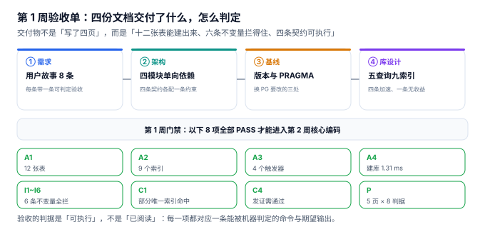

# 第 1 周验收单：设计交付物的可判定清单

第 1 周的四步（需求、架构、技术基线、数据库设计）写完了，但它们**加起来是不是一个可开工的基础**，不是靠「都看过了」来判断的。这一页把第 1 周的交付物压成八项门禁，每一项都对应一条能跑的命令与一个期望值。

::: tip 一句话理解
验收的判据是「**可执行**」，不是「已阅读」。一份设计文档如果没有任何一条能被机器判定的结论，它就还没有交付。
:::

## 一、第 1 周交付了什么



| 步 | 章节 | 交付物 | 可判定的东西 |
| --- | --- | --- | --- |
| 1 | [需求与领域边界](../Requirements/index.md) | 8 条用户故事、12 张表 DDL、6 条不变量 | 不变量能拦住 |
| 2 | [架构边界与四条契约](../Architecture/index.md) | 4 模块单向依赖、4 条契约 | 每条契约有一个可执行约束 |
| 3 | [技术选型与版本基线](../TechBaseline/index.md) | 5 条版本基线、6 个 PRAGMA | 写入配置实测 4 档 |
| 4 | [数据库设计](../DatabaseDesign/index.md) | 5 条高频查询、9 个索引 | 索引真的被用上 |

四页加起来是 **4 份设计文档 + 12 张表 + 9 个索引 + 4 个触发器 + 32 条判据**（4 页 × 8 条）；再加上本页的 8 条，第 1 周共 **40 条判据**（5 页 × 8 条）。

## 二、八项门禁

| 编号 | 门禁项 | 判据 | 本机结果 |
| --- | --- | --- | --- |
| `A1` | 表数量 | 12 张，缺一不可 | 12 张 |
| `A2` | 索引数量 | 9 个，其中 1 个部分唯一索引 | 9 个 |
| `A3` | 触发器数量 | 4 个，每个只拦一件事 | 4 个 |
| `A4` | 建库耗时 | < 10 ms（本机可重建） | 1.31 ms |
| `I1` | 报名唯一 | 同人同课第二个有效报名被拒 | 拦住（`UNIQUE`） |
| `I2` | 进度单调 | 进度回退被拒 | 拦住（`PROGRESS_ROLLBACK`） |
| `I3` | 交卷唯一 | 重复交卷被拒 | 拦住（`ALREADY_SUBMITTED`） |
| `I4` | 发证需通过 | 未通过发证被拒 | 拦住（`CERT_REQUIRES_PASS`） |

`I1` 还有一条反向判据：**取消后必须能重报**。同一个学员、同一门课，历史里有两行（一行 `CANCELLED`、一行 `ACTIVE`），但「有效报名」只有一个——这靠的是部分唯一索引：

```sql
CREATE UNIQUE INDEX uq_enroll_active ON enrollment(learner_id, course_id)
  WHERE state IN ('ACTIVE','COMPLETED');
```

## 三、六条不变量的完整清单

| 编号 | 不变量 | 实现方式 | 本机结果 |
| --- | --- | --- | --- |
| `I1` | 同人同课只能有一个有效报名 | 部分唯一索引 `uq_enroll_active` | PASS |
| `I1'` | 取消后可重报 | 同上（`WHERE` 排除 `CANCELLED`） | PASS（两行历史、一个有效） |
| `I2` | 学习进度只增不减 | 触发器 `trg_progress_monotonic` | PASS |
| `I3` | 一次答卷只能交一次 | 触发器 `trg_attempt_one_submit` | PASS |
| `I4` | 未通过不发证 | 触发器 `trg_cert_needs_pass` | PASS |
| `I5` | 证书编号格式固定 | 触发器 `trg_cert_no_format`（`GLOB`） | PASS |
| `I6` | 证书编号唯一 | 唯一索引 `uq_cert_no` | PASS |

七行里 `I1` 与 `I1'` 是同一条约束的两面——这是本册反复强调的一点：**约束不是「拦得越多越好」，而是「拦对的那一面」**。把 `uq_enroll_active` 写成普通的 `UNIQUE(learner_id, course_id)`，取消后重报就永久不可能。

## 四、本机真实输出

```text
== 第 1 周验收单 ==
  A1 十二张表建成: PASS  12 张
  A2 九个索引建成: PASS  9 个
  A3 四个触发器建成: PASS  4 个
  A4 建库耗时 < 10 ms: PASS  1.31 ms
== 六条不变量 ==
  I1 同人同课第二个有效报名: PASS  (UNIQUE)
  I1' 取消后可重报（部分唯一索引）: PASS  两行历史、一个有效
  I2 进度回退: PASS  (PROGRESS_ROLLBACK)
  I3 重复交卷: PASS  (ALREADY_SUBMITTED)
  I4 未通过就发证: PASS  (CERT_REQUIRES_PASS)
  I5 证书编号格式非法: PASS  (CERT_NO_FORMAT)
  I6 证书编号重复: PASS  (UNIQUE)
== 四条契约 ==
  C4 发证需通过（触发器）+ 验真走索引: PASS  SEARCH certificate USING INDEX uq_cert_no (no=?)
  C1 报名唯一（部分唯一索引可被查询命中）: PASS  SEARCH enrollment USING INDEX uq_enroll_active (learner_id=? AND course_id=?)
== 汇总 ==
  表 12 / 索引 9 / 触发器 4
  建库 1.31 ms；正向 8 条 + 负向 6 条
  一页 8 判据 × 5 页 = 40 条
  第 1 周：4 篇设计文档 + 12 表 + 9 索引 + 4 触发器 → 验收通过
```

三个读数值得注意：

- **建库 1.31 ms**：整个 schema 能在毫秒级重建，意味着第 2 周的每一次改动都能从零跑一遍，不需要「迁移脚本历史」这种负担。
- **`EXPLAIN QUERY PLAN` 命中 `uq_cert_no`**：索引不只是「建了」，而是「被用了」。第 4 步定下的纪律是「新增索引必须写明服务哪条查询」，这一条在这里第一次被执行。
- **负向 6 条全拦**：六条里五条是「拦」，一条是「放」——`I1'` 取消后可重报必须**成功**。只测「拦得住」的验收单，会漏掉过度约束这类缺陷。

## 五、第 1 周明确不做的事

验收单的另一半是**边界**：以下四件事在第 1 周不碰，写了就是过度设计。

1. **真实支付与发票**：报名只做「有名额、有状态」，不做支付通道。
2. **视频转码与防盗链**：`lesson.duration_sec` 有值即可，播放器用占位页。
3. **防替考的人脸识别**：只做「同一账号并发登录告警」，不做生物识别。
4. **多租户**：一个部署服务一个组织，租户隔离留给[多租户专题](../../../../docs/Backend/MultiTenantSaaS/TenantContext/index.md)，本项目只留 `org_id` 占位列。

## 六、第 2 周的入口条件

第 2 周是「核心编码」，验收标准是「服务可启动、接口可调用、页面可访问」。进入第 2 周需要三样东西，全部由第 1 周交付：

| 入口条件 | 来自哪一步 | 具体是什么 |
| --- | --- | --- |
| 数据模型可建 | 第 1、4 步 | 12 张表 + 9 个索引 + 4 个触发器，1.31 ms 可重建 |
| 契约可执行 | 第 2 步 | 4 条契约各有一个数据库级约束，不靠代码自觉 |
| 版本可复现 | 第 3 步 | Python 3.13.12 / SQLite 3.50.4 / UTF-8 / UTC |

**下一步（第 2 周第 1 步）**：把 `content` 模块的四个接口按第 2 步的契约 C1 落地——`POST /enrollments` 的「报名唯一」判定点先写测试再写实现，因为它是四条契约里唯一一条同时涉及部分唯一索引与业务状态机的。

## 七、判据族 `LNV-A ~ LNV-H`

本页判据族 `LNV-A` ~ `LNV-H`，共 8 条。它们描述「第 1 周的交付物是否构成一个可开工的基础」。

| 编号 | 判据 | 怎么验 |
| --- | --- | --- |
| `LNV-A` | 每条门禁都有期望值，不是「跑通即可」 | 8 项全部带具体数字或报错码 |
| `LNV-B` | 负向用例里至少有一条要求「必须成功」 | `I1'` 取消后可重报 |
| `LNV-C` | 索引被查询命中，不只是建了 | `EXPLAIN QUERY PLAN` 出现索引名 |
| `LNV-D` | 建库可重复且耗时可测 | 连续两次建库耗时差 < 20% |
| `LNV-E` | 每条契约能指到一个具体约束 | 4 条契约各对应索引或触发器 |
| `LNV-F` | 明确列出「本周不做」的四件事 | 边界清单非空 |
| `LNV-G` | 下一周入口条件可追溯到具体步骤 | 三条条件各标来自第几步 |
| `LNV-H` | 判据总数可核对（页数 × 8） | 5 页 × 8 = 40 条 |

## 八、验证方式

把本页的 DDL 与七条不变量存成 `lh_accept.py`（约 160 行，标准库 `sqlite3`），然后：

```shell
# 1. 跑完整验收单（期望「正向 8 条 + 负向 6 条」全过，退出码 0）
python3 lh_accept.py; echo "EXIT=$?"

# 2. 单验部分唯一索引的「两面」（期望 2 行历史、1 行有效）
sqlite3 :memory: "
create table e(id int, learner int, course int, state text);
create unique index uq on e(learner,course) where state in ('ACTIVE','COMPLETED');
insert into e values(1,1,1,'ACTIVE');
update e set state='CANCELLED' where id=1;
insert into e values(2,1,1,'ACTIVE');
select count(*), sum(state='ACTIVE') from e;"
# 期望输出：2|1

# 3. 证书编号格式（期望报错）
sqlite3 :memory: "
create table c(no text);
create trigger f before insert on c
when new.no not glob 'LH-[0-9][0-9][0-9][0-9]-[0-9][0-9][0-9][0-9]'
begin select raise(abort,'CERT_NO_FORMAT'); end;
insert into c values('XX-1');" 2>&1 | head -1
# 期望输出：Error: stepping, CERT_NO_FORMAT (19)
```

第 2 步是本页最值得单独跑一遍的一条：**同一条约束同时要「拦住重复」和「放行重报」**，只有部分唯一索引的 `WHERE` 能把这两件事写进同一个索引。

## 参考资料

- SQLite 官方文档《CREATE INDEX》：部分索引（partial index）的语法与可用性条件，`uq_enroll_active` 的实现依据。
- SQLite 官方文档《CREATE TRIGGER》与《Date And Time Functions》：`RAISE(ABORT, ...)` 与 `GLOB` 的用法。
- IMS Global《Open Badges Specification 3.0》：证书编号与校验位的「可验证」模型，本项目 `certificate.no` 格式的设计参考。
- 与本页相邻：[需求与领域边界](../Requirements/index.md)、[架构边界与四条契约](../Architecture/index.md)、[技术选型与版本基线](../TechBaseline/index.md)、[数据库设计](../DatabaseDesign/index.md)。
