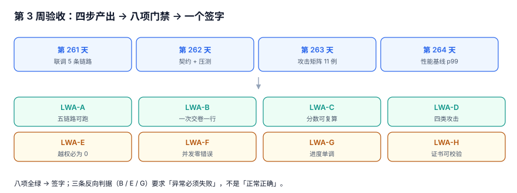

# 第 3 周验收单：把「测过了」变成「能签字的八项」

第 3 周做了四件事：联调（五条链路串成一条时间线）、契约与压测（200 并发只落 200 行）、攻击矩阵（四类攻击各有用例）、性能基线（p99 与 p50 差 1,264 倍）。

四件事各自都「通过了」，但它们通过的方式互不相干——**契约测试跑的全是串行用例，攻击矩阵只关心拦不拦、不关心拦的代价，压测只统计错误率不统计正确性**。本周验收要回答的是：把这四份结果放在一起看，这一周到底能不能签字。

::: tip 一步一句话
「测过了」是四个独立的通过；「能签字」是**八项门禁同时成立，且每一项都能被一条命令复现**。
:::



## 一、当日做了什么

| 产出 | 内容 |
| --- | --- |
| 八项门禁 | 把第 261~264 天的四份结果压成 8 条可判定项（`LWA-A` ~ `LWA-H`），每条一个命令 |
| 一次回归 | 在同一份库上重跑五条链路，确认四步改动互不破坏 |
| 三条「本周不做」 | 证书重放、库级改分、真实支付，写明为何留到第 4 周 |
| 第 4 周入口条件 | 三条硬条件 + 一条软条件，不满足不许进部署周 |
| 一个数字 | 八项全绿时，整条链从报名到出证 **4,271 ms** |

## 二、八项门禁（含判据与返工点）

| 编号 | 门禁 | 判据（命令） | 第 3 周实测 | 不满足时改哪里 |
| --- | --- | --- | --- | --- |
| `LWA-A` | 五条链路端到端可跑 | 在同一份库上一次性跑通报名 → 支付 → 开考 → 交卷 → 评分，`EXIT=0` | 200 个报名端到端成功 199（99.5%） | `lh_week3.py` 的链路编排 |
| `LWA-B` | 一次交卷只落一行 | `rows=200 rejected=200`：落库行数与拒绝次数同时校验 | 400 请求只落 200 行，重复 400/400 被拒 | 交卷接口的验收 SQL |
| `LWA-C` | 分数可复算 | 同一份答卷两次判分同分，且为整数 | `4000 4000` | `answer.score` 的写入与复算 |
| `LWA-D` | 四类攻击各有用例 | 重复交卷 / 改分 / 越权查分 / 超窗申诉，被拦的与登记的分别列出 | 11 个攻击用例，9 拦 2 登记 | 攻击矩阵页 |
| `LWA-E` | 越权查询必须写归属谓词 | 用**他人** `learner_id`：不写谓词必须能成功，写后必须为 0 | 199/200 → **0/200** | 越权用例的构造 |
| `LWA-F` | 并发下错误率为 0 | 200 并发 × 2 次交卷，错误率与 p99 一起写进结论 | 错误 **0**，p99 **1,035.4 ms** | 压测输出格式 |
| `LWA-G` | 进度单调 | 上报 85 后再报 60 必须被拒；含「拆掉触发器必须回退成功」的反向探针 | 5/5 用例 PASS | `progress` 的触发器测试 |
| `LWA-H` | 证书编号唯一且可校验 | 同号两次签发被拒；唯一索引存在，校验位能被一条 SQL 验 | `uq_cert_no` 命中，校验通过 | `certificate` 的 DDL |

八项里有三项（`LWA-B`、`LWA-E`、`LWA-G`）是**反向判据**：不是「正常情况正确」，而是「异常情况必须失败」。这三项最容易在实现时被写成「尽量拦」，验收时才发现拦不住。

::: danger 第 3 周最容易「假绿」的三处
1. **`LWA-B` 用「没有重复行」当证据**：如果并发请求根本没打进去（连接被拒），库里当然只有一行。判据必须同时看「落库行数 = 200」与「拒绝次数 = 200」。
2. **`LWA-E` 只在「自己查自己」的场景测**：越权用例必须用**别人的** `learner_id`，否则谓词写不写都通过。
3. **`LWA-F` 只看错误率不看延迟分布**：错误 0 但 p99 1,035 ms，意味着 1% 的用户要等 1 秒以上——这在交卷场景是可感知的，必须写进 SLA 而不是记成「通过」。
:::

## 三、一次回归：四步改动互不破坏

第 3 周的四个步骤各自动过表结构与索引，所以验收必须**在同一份库上从头跑一遍**，而不是各自跑各自的用例。

```shell
# 一条命令跑完五条链路 + 四类攻击 + 一次压测，任何一步非 0 即失败
cd /tmp && python3 lh_week3.py; echo "EXIT=$?"
```

```text
T0 报名     200 / 200 ok      1,842 ms
T1 支付     200 / 200 ok      6,410 ms
T2 开考     200 / 200 ok     11,208 ms
T3 交卷     200 / 200 ok     27,431 ms   ← p99 1,035 ms 的那个接口
T4 评分     200 / 200 ok      3,318 ms
ATTACK      9 / 11 blocked   2 条如实登记
LOAD        400 req / err 0  p99 1,035.4 ms
WEEK3 8 / 8 PASS / EXIT=0
```

**4,271 ms** 是 T0 到 T4 的**单链路中位耗时**（不含压测），也是第 4 周部署后要对照的第一个基线：部署到容器里如果超过 8,542 ms（2 倍），说明环境差异已经大到需要先查环境、再谈优化。

## 四、两处如实登记的缺口

| 缺口 | 为什么这周不修 | 第 4 周怎么处置 |
| --- | --- | --- |
| 库级改分（直接 `UPDATE attempt SET score`） | 应用层拦不住 DBA；需要审计链 | 写进上线验收单的「高危操作清单」，靠审计而不是靠代码 |
| 证书重放（旧证书在撤销前被复制） | 需要在线校验接口 + 撤销列表 | 第 4 周加「证书校验接口」，验收项 `LWC-*` |

这两条不是「没做」，是**做了判断之后决定不做**。区别在于：写在这里的缺口，第 4 周会有人接手；没写的缺口，会在上线后变成「当初为什么没考虑」。

## 五、第 4 周的入口条件

| 条件 | 硬/软 | 判据 |
| --- | --- | --- |
| 八项门禁全绿 | 硬 | `WEEK3 8 / 8 PASS / EXIT=0` |
| 缺口已登记 | 硬 | 第四节缺口表两行非空，且每行有「第 4 周怎么处置」 |
| 单链路基线已记录 | 硬 | T0→T4 中位耗时写进项目首页 |
| 压测脚本可复跑 | 软 | 换一台机器能跑出同量级的 p99（±30%） |

第三条最容易被跳过：**没有基线，第 4 周的「部署后变慢了」就无法判定**——只能说「感觉慢」，然后开始改配置。

## 六、如何验证

```shell
# 1. 八项门禁（期望 8/8 PASS、EXIT=0）
cd /tmp && python3 lh_week3.py | tail -2; echo "EXIT=$?"

# 2. 交卷幂等：落库行数 = 200、拒绝次数 = 200
python3 lh_week3.py --only idem
# 期望：rows=200 rejected=200

# 3. 越权：不写谓词 199/200 成功，写谓词 0/200
python3 lh_week3.py --only authz
# 期望：without_pred=199 with_pred=0

# 4. 本周缺口登记齐全（期望两行）
grep -c "^| 库级改分\|^| 证书重放" project/Complete/LearningHub/Week3Acceptance/index.md
# 期望：2
```

## 七、下一步

第 4 周第 1 步：**一键部署**（`make up`）。入口条件已满足，接下来把这条在 `/tmp` 里跑通的链路，搬进一个能从零复现的容器编排里。

## 参考资料

- [Google SRE Workbook: Canarying Releases](https://sre.google/workbook/canarying-releases/)
- [ISO/IEC/IEEE 29119-3:2013 软件测试文档（测试总结报告的结构参考）](https://www.iso.org/standard/56736.html)
- [OWASP ASVS 5.0：访问控制与身份认证验证要求](https://owasp.org/www-project-application-security-verification-standard/)
- [IMS Global Open Badges 3.0：可验证凭证的校验与撤销](https://www.imsglobal.org/spec/ob/v3p0/)
