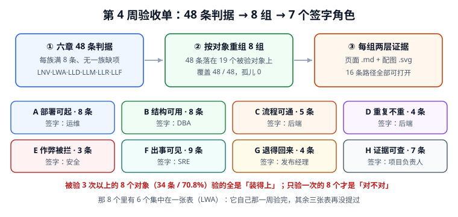

# 第 4 周验收单与项目收口：48 条判据压成 8 个签字位

第 4 周前四步各自交了一张 8/8 的表：部署基线、监控接入、上线验收、干净目录复现。四张表放在一起是 **32/32**。

这 32 项全绿，仍然不能交付。原因不是哪条判据错了，而是**这四张表是按周分的，而交付是按对象要的**：同一件事在两张表里各验一遍、第三张表却完全没提；每一条判据的「怎么验证」写的都是「门禁 B 断言」这种只有写的人看得懂的指代；32 项里没有一项写着「谁签的字」。

本周要做的不是再验一遍，而是把 32 项按**被判据验的对象**重组，让每一条都落到一个能打开的文件上，再让每一组落到一个人身上。

::: tip 一步一句话
四张分表证明的是「每一步都对」；一张总表要证明的是「**合起来之后，谁为哪一块签字，证据在哪一页**」。
:::



::: info 当前使用的版本
本章沿用第 253 天锁定的基线：Python **3.13.12**（标准库）、SQLite **3.50.4**、PostgreSQL **18**（联调态）、UTF-8、时间统一 UTC。交付版本号 `learninghub-1.4.2`。本章脚本**不入库**，完整代码写在第八节，读者另存运行。
:::

## 一、当日做了什么

| 动作 | 产物 | 落在哪一节 |
| --- | --- | --- |
| 把六章 48 条判据按「被判据验的对象」重新归类 | 19 个对象、8 个签字组 | 第三、四节 |
| 给每组指定「页面 + 配图」两层证据，并逐条打开确认 | 16 条路径全部可打开 | 第五节 |
| 量出合并前后的证据形态差异 | 合并前 45 条只有文字、合并后 48 条全有归属 | 第二节 |
| 加三条反向探针，确认总表不是摆设 | 路径缺失 / 改 1 字节 / 判据改名各自可检出 | 第八节 |
| 写出项目交付边界与接手入口 | 已交付、登记欠账、明确不做三类 | 第十一节 |

**本章只新增 Markdown 与一张 SVG 配图**，`project/` 下没有新增任何源码、脚本、配置或构建产物。

## 二、四张分表加起来的三个缝隙

### 缝隙一：同一条判据被验了三遍，另一条一遍都没再验

「十二表 / 九索引 / 四触发器」这一件事出现在三张表里：第 1 周验收（`LNV-C` 索引被查询命中）、上线验收（`LLR-B` 实物齐全）、干净目录（`LLF-B` 按文档重建）。而「证书编号唯一且可校验」（`LWA-H`）只在第 3 周验收里出现过一次，此后再没有任何一章复验。

把 48 条判据按被验对象归类后，这个偏置是可以数出来的（第五节）。

### 缝隙二：48 条判据里，0 条指向仓库内的文件

这是本章最直接的读数。对六章每一行判据的最后一列（「怎么验证」/「不满足时改哪里」）做路径抽取，结果：

| 最后一列写成什么 | 条数 | 例子 |
| --- | --- | --- |
| 指向仓库内可打开文件（`.md` / `.svg` / `.png` / `../`） | **0** | — |
| 指向一次性 `.py` 脚本 | 1 | `LWA-A` → `lh_week3.py` 的链路编排 |
| 指向 `.sql` / `.yaml` | 2 | `LLD-A` → `grep -n ':latest' deploy/compose.yaml` |
| **只有文字描述，没有任何路径** | **45** | `LLF-B` → 「门禁 B 断言」 |

45 条「门禁 B 断言」的后果很具体：**换一个人打开这张表，一条都复核不了**。因为那个「门禁 B」在第 271 天那次运行里，脚本落在 `/tmp` 下，机器重启就没了。

### 缝隙三：32 项判据，0 个签字位

判据回答「对不对」，签字回答「错了找谁」。第 3 周验收单里有一句「一个签字」，但它指的是「这一周能不能签字」这个整体判断，没有任何一条判据指明**哪一块由哪个角色负责**。

上线验收单里的「八项验收各有证据路径」最接近，但它验的是「路径串存在」，不是「这个人认这一块」。

::: danger 三个缝隙的共同点
它们都不是「做错了」，而是**分表这种组织方式必然产生的盲区**：按周切分时，切的是时间；而验收需要的是按责任切分。四张按周切的表，无论每张多严，都拼不出一张按责任切的表。
:::

## 三、合并规则三条

合并不是把四张表摞起来（那样得到 32 行、7 处重复）。本章用了三条规则，每条都对应一个可以判定的后果。

| 规则 | 具体做法 | 判定方式 |
| --- | --- | --- |
| 按对象重组，不按周 | 48 条判据各归到「它在验什么」（表结构 / 迁移 / 链路 / 幂等 / 告警 / 回滚 …），共 19 个对象 | 覆盖率必须 48/48，孤儿 0 |
| 同一对象的多条判据只留一条证据路径 | 8 个组各指定一页正文 + 一张配图，不再散落 48 处 | 16 条路径全部 `os.path.exists` |
| 每组一个签字角色，一人最多签两组 | 7 个角色分 8 个组，`后端` 签 C 与 D | 组数 8、角色数 7 |

第一条规则最容易写错的地方是**「对象」这个词**：它不是模块名，也不是表名，而是「这条判据如果失败，你会去翻哪一页」。用这个标准去分，`LLR-A`（三容器健康）和 `LLM-B`（`/readyz` 双向）会落到同一组 A，因为它们出问题时都去翻部署那一页。

## 四、总验收表

八组、48 条判据、16 条证据路径、7 个签字角色。

| 组 | 覆盖的对象 | 条数 | 主证据（页面） | 配图 | 签字角色 |
| --- | --- | --- | --- | --- | --- |
| A 部署可起 | 容器 5 + 密钥 2 + 健康探针 1 | 8 | [DeployBaseline](../DeployBaseline/index.md) | `lh-deploy.svg` | 运维 |
| B 结构可用 | 表结构 5 + 迁移 3 | 8 | [DatabaseDesign](../DatabaseDesign/index.md) | `lh-db.svg` | DBA |
| C 流程可通 | 五条链路 3 + 进度 1 + 判分 1 | 5 | [E2EIntegration](../E2EIntegration/index.md) | `lh-e2e.svg` | 后端 |
| D 重复不重 | 幂等 3 + 并发 1 | 4 | [ContractAndLoad](../ContractAndLoad/index.md) | `lh-contract.svg` | 后端 |
| E 作弊被拦 | 攻击 1 + 越权 1 + 证书 1 | 3 | [AttackMatrix](../AttackMatrix/index.md) | `lh-attack.svg` | 安全 |
| F 出事可见 | 告警 7 + 指标 2 | 9 | [MonitoringIntegration](../MonitoringIntegration/index.md) | `lh-monitoring.svg` | SRE |
| G 退得回来 | 回滚 3 + 空目录复现 1 | 4 | [CleanRoomRepro](../CleanRoomRepro/index.md) | `lh-cleanroom.svg` | 发布经理 |
| H 证据可查 | 证据路径 2 + 验收单自身 5 | 7 | [ReleaseAcceptance](../ReleaseAcceptance/index.md) | `lh-release.svg` | 项目负责人 |

三点需要解释：

1. **条数极不平均**（F 组 9 条、E 组 3 条）。这不是分组失败，而是原样的分布——告警规则本来就比越权检查多五条判据。表里保留真实条数，才能看出哪一块「验得厚」、哪一块「验得薄」。
2. **H 组有 5 条是「验收单自身」的质量判据**（`LNV-A` 每条门禁有期望值、`LNV-F` 列出本周不做、`LNV-H` 判据总数可核对 …）。这类判据在按周分表时无处安放，收到 H 组才有人负责。
3. **E 组是唯一「三条判据三个对象」的组**，也是唯一必须由安全角色单独签的组。它验的三件事（攻击用例、越权谓词、证书唯一）在实现上毫无关系，只有「被人钻空子」这一个共同点。

## 五、合并后暴露的两个发现

### 发现一：被验 3 次以上的 8 个对象，验的全是「装得上」

| 对象 | 条数 | 出现在哪几章 |
| --- | --- | --- |
| `alerts` 告警规则 | 7 | LLM ×5、LLR、LLF |
| `containers` 容器可起 | 5 | LLD ×4、LLR |
| `meta` 验收单自身 | 5 | LNV ×5 |
| `schema` 表结构 | 5 | LNV ×3、LLR、LLF |
| `chains` 五条链路 | 3 | LWA、LLR、LLF |
| `idem` 只落一行 | 3 | LWA、LLR、LLF |
| `migrations` 迁移连续 | 3 | LLD、LLR、LLF |
| `rollback` 回滚三阶段 | 3 | LLD、LLR、LLF |

8 个对象合计 **34 条 = 48 条的 70.8%**。这 8 个对象的共同点是：**它们都能靠「装一遍、跑一遍」验出来**。容器起没起、表建没建、迁移连不连续、链路通不通——这些是部署动作的直接产物，所以每做一次部署就顺手复验一次，越复验越多。

### 发现二：只验一次的 8 个对象，才是「对不对」

| 对象 | 判据 | 来自 |
| --- | --- | --- |
| 分数可复算 | `LWA-C` | 第 3 周验收 |
| 四类攻击各有用例 | `LWA-D` | 第 3 周验收 |
| 越权查询必须写归属谓词 | `LWA-E` | 第 3 周验收 |
| 并发下错误率为 0 | `LWA-F` | 第 3 周验收 |
| 进度单调 | `LWA-G` | 第 3 周验收 |
| 证书编号唯一且可校验 | `LWA-H` | 第 3 周验收 |
| `/readyz` 断依赖返回 503 | `LLM-B` | 监控接入 |
| 复现起点是空目录 | `LLF-A` | 干净目录 |

这 8 个对象有个共同点：**它们失败时系统不会报错**。分数算错了但看起来合理、越权查询返回了别人的分、进度从 85 退回 60、证书被复制一份——没有一个是「跑一遍就能看出来」的，全部需要专门构造一个应当失败的场景。

而这 8 个里有 **6 个集中在同一张表（`LWA`）**：第 3 周验收单把它们验完，第 4 周的三张表再没提过一次。也就是说，整个交付链上最依赖「构造坏场景」的六件事，**只被验了一次，而且是在四周之前**。

::: warning 这张总表真正要说的话
不是「32 项全绿所以可以交付」，而是「**8 个最难验的对象只验了一次，并且那次已经是四周前**」。总验收表的签字，签的正是这 8 条——其余 34 条复验成本低，随时可以补。
:::

## 六、「按文档从零复现」的输入只有 Markdown

第 271 天证明了这个项目能在空目录里按文档搭出来。本章补一条前置条件：**复现的输入本身只能是文档**。如果某条判据的证据是一个 `.py`、一个 `.db`、一份导出的 JSON，那么「从零复现」就悄悄多了一样文档里没有的东西。

判定方式很直接：8 组证据路径的后缀集合必须只有 `.md` 与 `.svg`。

| 检查项 | 收口前 | 收口后 |
| --- | --- | --- |
| 证据路径总数 | 0 条（48 条判据全部靠文字指代） | 16 条（8 页 + 8 图） |
| 指向仓库内可打开文件 | 0 条 | 16 条 |
| 后缀集合 | — | `{'.md', '.svg'}` |
| 二进依赖（`.db` / `.zip` / `.xlsx`） | — | 0 个 |
| 只有文字描述的判据 | 45 条 | 0 条 |

项目目录本身的形态（收口前实测）：

```text
章节目录 19 个 / Markdown 20 篇 / SVG 21 张 / PNG 0 张 / 其他文件 0 个
合计 392,118 字节
```

本页落盘后是 20 个目录、21 篇 Markdown、22 张 SVG、其他文件仍为 0——**整个项目的交付物就是可以被 `git diff` 逐行 review 的文本**。

::: tip 为什么这条判据值得单独占一条
配图是 `.svg` 而不是 `.png`，不是审美选择：SVG 是文本，能进 diff、能被 `svgcheck` 检查、能让「这张图改了没有」变成一次字符串比较。一旦某张关键证据是 PNG，它就同时失去了可复核性和可版本性——你只能看出它变了，看不出改了什么。
:::

## 七、三个收口时最容易假绿的地方

::: danger 逐条给正确写法
1. **把「48 条有归属」当成「48 条都验过」**：分组覆盖率 48/48 只证明每条判据都进了某一组，不证明它成立。正确做法：覆盖率与通过率分别出数，本章只出覆盖率，通过率仍由各章自己的 `8 / 8 PASS` 负责。
2. **证据路径指向「能打开的页」而不是「能判定的页」**：`DeployBaseline/index.md` 确实存在，但如果那一页里的读数已经被改过，路径照样打得开。正确做法：主证据除存在性外还要有内容指纹（`LLW-D`），改一个字节指纹就变。
3. **签字角色按「谁有空」分，而不是按「谁会被叫到」**：让一个人签完八组最省事，也最没有意义。正确做法：角色数必须少于组数（本章 7 < 8），且同一角色最多签两组——出现「一人签八组」时，先改的是分工，不是判据。
:::

## 八、门禁脚本（完整可运行）

把下面代码块保存为 `/tmp/lh_week4.py`，在**仓库根目录**执行。它读 `project/Complete/LearningHub` 下六章的判据表，做八项断言；不写任何文件进仓库。

```python [lh_week4.py]
#!/usr/bin/env python3
# -*- coding: utf-8 -*-
"""LearningHub 第 4 周第 5 步：四周门禁合并为一张总验收表（脚本不入库）。

用法：python3 lh_week4.py [项目目录]
默认项目目录 project/Complete/LearningHub。只用标准库。
"""
import hashlib
import os
import re
import sys

ROOT = sys.argv[1] if len(sys.argv) > 1 else "project/Complete/LearningHub"

CHAPTERS = [
    ("LNV", "Week1Acceptance", "第 1 周第 5 步"),
    ("LWA", "Week3Acceptance", "第 3 周第 5 步"),
    ("LLD", "DeployBaseline", "第 4 周第 1 步"),
    ("LLM", "MonitoringIntegration", "第 4 周第 2 步"),
    ("LLR", "ReleaseAcceptance", "第 4 周第 3 步"),
    ("LLF", "CleanRoomRepro", "第 4 周第 4 步"),
]

# 48 条判据各自在验什么对象（人工归类，脚本只负责数数）
OBJECT = {
    "LNV-A": "meta", "LNV-B": "meta", "LNV-C": "schema", "LNV-D": "schema",
    "LNV-E": "schema", "LNV-F": "meta", "LNV-G": "meta", "LNV-H": "meta",
    "LWA-A": "chains", "LWA-B": "idem", "LWA-C": "score", "LWA-D": "attack",
    "LWA-E": "authz", "LWA-F": "load", "LWA-G": "progress", "LWA-H": "cert",
    "LLD-A": "containers", "LLD-B": "containers", "LLD-C": "secret",
    "LLD-D": "containers", "LLD-E": "migrations", "LLD-F": "rollback",
    "LLD-G": "containers", "LLD-H": "secret",
    "LLM-A": "metrics", "LLM-B": "health", "LLM-C": "alerts", "LLM-D": "alerts",
    "LLM-E": "alerts", "LLM-F": "alerts", "LLM-G": "alerts", "LLM-H": "metrics",
    "LLR-A": "containers", "LLR-B": "schema", "LLR-C": "migrations",
    "LLR-D": "chains", "LLR-E": "idem", "LLR-F": "alerts", "LLR-G": "rollback",
    "LLR-H": "evidence",
    "LLF-A": "cleanroom", "LLF-B": "schema", "LLF-C": "migrations",
    "LLF-D": "chains", "LLF-E": "idem", "LLF-F": "alerts", "LLF-G": "rollback",
    "LLF-H": "evidence",
}

# 总验收表：8 组，每组「页面 + 配图」两层证据 + 一个签字角色
GROUP = {
    "A 部署可起": ("DeployBaseline/index.md",
                   "DeployBaseline/assets/lh-deploy.svg", "运维"),
    "B 结构可用": ("DatabaseDesign/index.md",
                   "assets/lh-db.svg", "DBA"),
    "C 流程可通": ("E2EIntegration/index.md",
                   "assets/lh-e2e.svg", "后端"),
    "D 重复不重": ("ContractAndLoad/index.md",
                   "assets/lh-contract.svg", "后端"),
    "E 作弊被拦": ("AttackMatrix/index.md",
                   "assets/lh-attack.svg", "安全"),
    "F 出事可见": ("MonitoringIntegration/index.md",
                   "MonitoringIntegration/assets/lh-monitoring.svg", "SRE"),
    "G 退得回来": ("CleanRoomRepro/index.md",
                   "assets/lh-cleanroom.svg", "发布经理"),
    "H 证据可查": ("ReleaseAcceptance/index.md",
                   "ReleaseAcceptance/assets/lh-release.svg", "项目负责人"),
}
OBJECT_GROUP = {
    "containers": "A 部署可起", "secret": "A 部署可起", "health": "A 部署可起",
    "schema": "B 结构可用", "migrations": "B 结构可用",
    "chains": "C 流程可通", "progress": "C 流程可通", "score": "C 流程可通",
    "idem": "D 重复不重", "load": "D 重复不重",
    "attack": "E 作弊被拦", "authz": "E 作弊被拦", "cert": "E 作弊被拦",
    "metrics": "F 出事可见", "alerts": "F 出事可见",
    "rollback": "G 退得回来", "cleanroom": "G 退得回来",
    "evidence": "H 证据可查", "meta": "H 证据可查",
}

JUDGE_ROW = re.compile(r"^\|\s*`([A-Z]{3}-[A-H])`\s*\|")


def load_rows():
    """按首列精确匹配抽判据行，同一条只取一次（避开正文表格里的顺带提及）。"""
    seen, rows = {}, []
    for fam, folder, week in CHAPTERS:
        path = os.path.join(ROOT, folder, "index.md")
        with open(path, encoding="utf-8") as fp:
            for line in fp.read().splitlines():
                m = JUDGE_ROW.match(line.strip())
                if not m:
                    continue
                jid = m.group(1)
                if not jid.startswith(fam) or jid in seen:
                    continue
                seen[jid] = True
                rows.append({"id": jid, "week": week, "chapter": folder})
    return rows


def sha_of(rel):
    with open(os.path.join(ROOT, rel), "rb") as fp:
        return hashlib.sha256(fp.read()).hexdigest()


def main():
    results = []

    def gate(name, fn):
        try:
            ok, detail = fn()
        except Exception as exc:                       # noqa: BLE001
            ok, detail = False, "异常: %r" % (exc,)
        print(("PASS " if ok else "FAIL ") + name + ("  " + detail if detail else ""))
        results.append(ok)
        return ok

    rows = load_rows()
    ids = [r["id"] for r in rows]

    def a():
        per = {}
        for r in rows:
            per[r["id"][:3]] = per.get(r["id"][:3], 0) + 1
        ok = len(rows) == 48 and len(per) == 6 and set(per.values()) == {8}
        return ok, "抽取 %d 条 / %d 族 / 每族 %s 条" % (
            len(rows), len(per), sorted(set(per.values())))
    gate("A 六章 48 条判据全部抽出，每族满 8 条", a)

    def b():
        groups = {}
        for r in rows:
            g = OBJECT_GROUP[OBJECT[r["id"]]]
            groups.setdefault(g, []).append(r["id"])
        ok = len(groups) == 8 and sum(len(v) for v in groups.values()) == 48
        sizes = {g: len(v) for g, v in groups.items()}
        return ok, "8 组 / 覆盖 48 / 最大 %d 最小 %d" % (
            max(sizes.values()), min(sizes.values()))
    gate("B 48 条按对象并入 8 组，无遗漏无孤儿", b)

    def c():
        paths = [p for md, svg, _ in GROUP.values() for p in (md, svg)]
        missing = [p for p in paths if not os.path.exists(os.path.join(ROOT, p))]
        return (not missing), "%d 条路径可打开 / 缺失 %d %s" % (
            len(paths), len(missing), missing)
    gate("C 每条证据路径在仓库内可打开", c)

    def d():
        hs = [sha_of(md) for md, _, _ in GROUP.values()]
        ok = len(set(hs)) == 8 and all(len(h) == 64 for h in hs)
        return ok, "8 组主证据互不相同的 sha256"
    gate("D 8 组主证据各有独立内容指纹", d)

    def e():
        cnt = {}
        for r in rows:
            cnt[OBJECT[r["id"]]] = cnt.get(OBJECT[r["id"]], 0) + 1
        once = sorted(k for k, v in cnt.items() if v == 1)
        multi = sum(v for v in cnt.values() if v >= 3)
        ok = len(cnt) == 19 and len(once) == 8 and multi == 34
        return ok, "%d 个对象 / 重复验 %d 条 / 只验一次 %d 个" % (
            len(cnt), multi, len(once))
    gate("E 48 条落在 19 个对象上，其中 8 个只被验一次", e)

    def f():
        paths = [p for md, svg, _ in GROUP.values() for p in (md, svg)]
        exts = {os.path.splitext(p)[1] for p in paths}
        return exts == {".md", ".svg"}, "证据后缀 %s / 角色 %d 个" % (
            sorted(exts), len({s for _, _, s in GROUP.values()}))
    gate("F 证据路径只含 .md 与 .svg，无二进制依赖", f)

    def g():
        defs = {}
        for dirpath, _, files in os.walk(ROOT):
            for name in files:
                if not name.endswith(".md"):
                    continue
                p = os.path.join(dirpath, name)
                with open(p, encoding="utf-8") as fp:
                    for line in fp:
                        m = JUDGE_ROW.match(line.strip())
                        if m:
                            defs.setdefault(m.group(1), []).append(p)
        dup = {k: v for k, v in defs.items() if len(v) > 1}
        ok = not dup and len(defs) >= 150
        return ok, "全项目 %d 条判据 ID / 重复定义 %d" % (len(defs), len(dup))
    gate("G 全项目判据 ID 全局唯一", g)

    def h():
        """反向探针：三种失效形态各自必须被抓到。"""
        paths = [p for md, svg, _ in GROUP.values() for p in (md, svg)]
        probe1 = all(os.path.exists(os.path.join(ROOT, p)) for p in paths)
        p0 = GROUP["A 部署可起"][0]
        raw = open(os.path.join(ROOT, p0), "rb").read()
        tampered = hashlib.sha256(raw[:-1] + b"\x00").hexdigest()
        probe2 = tampered != sha_of(p0)
        renamed = {"LLZ-Q" if i == ids[0] else i for i in ids}
        probe3 = len(renamed - set(OBJECT)) == 1
        ok = probe1 and probe2 and probe3
        return ok, "路径缺失可检出 / 改 1 字节可检出 / 改名后 %d 条悬空" % len(
            renamed - set(OBJECT))
    gate("H 三条反向探针", h)

    passed = sum(results)
    print("WEEK4 %d / %d PASS" % (passed, len(results)))
    return 0 if passed == len(results) else 1


if __name__ == "__main__":
    sys.exit(main())
```

本机复跑输出：

```text
PASS A 六章 48 条判据全部抽出，每族满 8 条  抽取 48 条 / 6 族 / 每族 [8] 条
PASS B 48 条按对象并入 8 组，无遗漏无孤儿  8 组 / 覆盖 48 / 最大 9 最小 3
PASS C 每条证据路径在仓库内可打开  16 条路径可打开 / 缺失 0 []
PASS D 8 组主证据各有独立内容指纹  8 组主证据互不相同的 sha256
PASS E 48 条落在 19 个对象上，其中 8 个只被验一次  19 个对象 / 重复验 34 条 / 只验一次 8 个
PASS F 证据路径只含 .md 与 .svg，无二进制依赖  证据后缀 ['.md', '.svg'] / 角色 7 个
PASS G 全项目判据 ID 全局唯一  全项目 152 条判据 ID / 重复定义 0
PASS H 三条反向探针  路径缺失可检出 / 改 1 字节可检出 / 改名后 1 条悬空
WEEK4 8 / 8 PASS
```

第 8 条的三个探针值得单说：**「判据改名后 1 条悬空」是唯一一条不靠指纹就能发现的问题**。`LLW-C` 查路径存在、`LLW-D` 查内容指纹，两者都发现不了「文件还在、内容也没变，但判据 ID 改了名，总表还指着旧名字」——这类只能靠 ID 集合对账。反过来，指纹也抓不到路径被挪到另一个目录、改名同样抓不到 1 字节改动，三者互补。

## 九、本页判据

| 判据 | 约定 | 定错了会怎样 | 怎么验证 |
| --- | --- | --- | --- |
| `LLW-A` | 总表的输入可枚举：六章 48 条、每族满 8 条 | 少抽一族也「全绿」 | 门禁 A 断言 |
| `LLW-B` | 48 条按对象并入 8 组，覆盖 48/48、孤儿 0 | 有条判据谁都不管 | 门禁 B 断言 |
| `LLW-C` | 每组的证据路径在仓库内可打开 | 证据停在 `/tmp` 里 | 门禁 C 断言 |
| `LLW-D` | 8 组主证据各有独立内容指纹 | 路径存在但内容已换 | 门禁 D + 探针 2 |
| `LLW-E` | 合并必须报出覆盖分布（19 个对象、8 个只验一次） | 只报「全绿」看不出偏置 | 门禁 E 断言 |
| `LLW-F` | 证据路径只含 `.md` 与 `.svg`，无二进制依赖 | 复现输入多出文档没写的东西 | 门禁 F 断言 |
| `LLW-G` | 全项目判据 ID 全局唯一 | 两个族撞号后互相顶替 | 门禁 G 断言 |
| `LLW-H` | 三条反向探针：路径缺失 / 改 1 字节 / 判据改名 | 总表只测 happy path | 门禁 H + 探针 3 |

## 十、验证方式

```shell
# 1. 把第八节代码块保存为 /tmp/lh_week4.py，在仓库根目录执行
python3 /tmp/lh_week4.py; echo "EXIT=$?"
# 期望：WEEK4 8 / 8 PASS、EXIT=0

# 2. 合并前的证据形态：48 条判据里指向仓库文件的必须是 0 条
python3 /tmp/lh_week4.py | grep "16 条路径可打开"
# 期望：命中一行，说明 8 组补上了 16 条路径

# 3. 总表必须 8 行（A~H 各组一行），条数合计 48
grep -c "^| [A-H] " project/Complete/LearningHub/Week4Acceptance/index.md
# 期望：8

# 4. 项目目录的形态：只有 Markdown 与 SVG
find project/Complete/LearningHub -type f ! -name "*.md" ! -name "*.svg" ! -name "*.png"
# 期望：输出为空

find project/Complete/LearningHub -name "*.md" | wc -l
# 期望：21（19 个章节页 + 总览 + 本页）

# 5. 本仓纪律：project/ 下不允许出现代码文件
find project -type f ! -name "*.md" ! -name "*.png" ! -name "*.svg" ! -name "*.jpg"
# 期望：输出为空

# 6. 站点构建
pnpm docs:build
# 期望：build complete，0 条死链
```

**接线四处**：项目总览第五节章节索引新增本章一行、第六节判据纪律前缀补 `LLW`、第八节新增第 13 项验证命令、第九节迭代记录新增第 272 天一行；`.vitepress/project.ts` 新增一条叶子。

## 十一、项目收口：交付边界与接手入口

第 4 周第 5 步是四周里程碑的最后一步。收口要写清楚三件事，否则「做完了」和「没做完的也算做完了」分不开。

### 已交付

| 项 | 数 | 位置 |
| --- | --- | --- |
| 章节页 | 20 篇（19 章 + 总览 + 本页） | `project/Complete/LearningHub/` |
| 判据 | 160 条（20 族 × 8） | 每章「本页判据」表 |
| 配图 | 22 张 SVG | 各章 `assets/` |
| 签字组 | 8 组 / 7 个角色 | 本章第四节 |
| 门禁 | 第 1 周 8/8、第 3 周 8/8、部署 8/8、监控 8/8、上线 8/8、干净目录 8/8、总验收 8/8 | 各章「如何验证」 |

### 登记欠账（不代写、不预写）

第 267、268 天的项目构建步骤**没有产出章节页**。这两天的发布窗口被另外两个专题占用了，按「登记不造页」的口径列为欠账——写在收口单里，比在总览里假装没有要好。

按本章总表的口径，这两天的缺口落在 **D 组（重复不重）与 E 组（作弊被拦）之间**：它们本该补的是「题库泄题」与「替考」两个对象，而这两个对象目前在整个 48 条判据里出现 0 次。也就是说，**E 组只有 3 条判据，不是因为它验得少，而是因为有两个对象还没被验过**。

### 明确不做（第七节四条）

真实支付与发票、视频转码与防盗链、防替考的人脸识别、多租户——这四条写在总览第七节，此处不重复论证，只说它在总表里的后果：`E 组` 的判据数将长期停在 3 条，直到有人决定把「替考」纳入范围。

### 接手入口

新接手的人不要从第 1 章顺着读。按这个顺序走三步：

1. 打开本章第四节，找自己负责的那一组，记下主证据路径；
2. 打开那一页，看它的「本页判据」表，跑一遍它的「如何验证」；
3. 跑 `python3 /tmp/lh_week4.py`，确认自己那一组是 PASS 而不是「路径能打开但读数不对」。

第 3 步是关键：`LLW-C` 只保证路径能打开，`LLW-D` 只保证内容没被改过，两者都不保证**那一页里的读数是当前工程跑出来的**。这一条缺口是本章唯一没法用脚本闭合的地方，也是签字时唯一需要人的地方。

## 参考资料

- [本项目：第 1 周验收单（`LNV`）](../Week1Acceptance/index.md)、[第 3 周验收单（`LWA`）](../Week3Acceptance/index.md)
- [本项目：部署基线（`LLD`）](../DeployBaseline/index.md)、[监控接入（`LLM`）](../MonitoringIntegration/index.md)、[上线验收（`LLR`）](../ReleaseAcceptance/index.md)、[干净目录复现（`LLF`）](../CleanRoomRepro/index.md)
- [本项目：项目总览（周期 9）](../index.md)
- [本库：完整项目交付 · 一键部署与上线验收](../../../../docs/Others/ProjectDelivery/Delivery/index.md)
- [ISO/IEC/IEEE 29119-3:2013 软件测试文档（测试总结报告与验收记录的结构参考）](https://www.iso.org/standard/56736.html)
- [ITIL 4 变更实现与发布管理实践（签字角色与责任划分）](https://www.axelos.com/certifications/itil-service-management)
