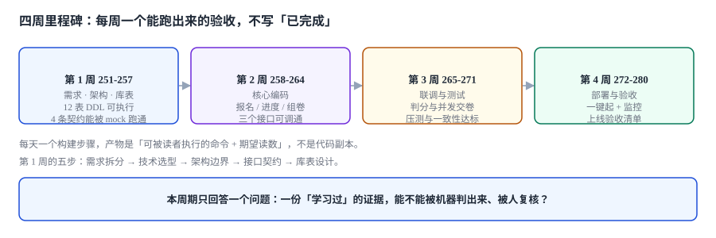
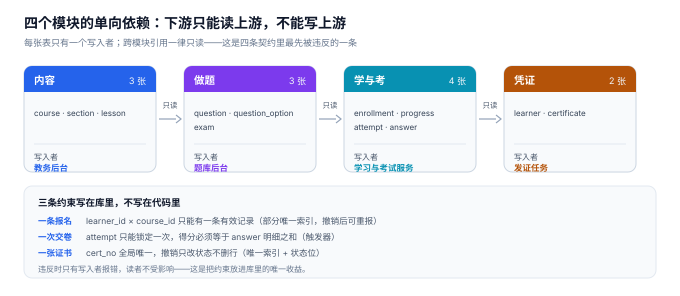

# 在线学习与考核 · 项目总览（周期 9）

从 0 到 1 建一个**在线学习与考核平台**：能选课、能学、能考、能判分、能发证，而且**每一份「学过了」的证据都能被机器判出来、被人复核**。周期 9（第 251-280 天），每天一个构建步骤，每步都留一个能在本机跑出来的验证动作。



::: tip 一句话定位
这个项目不追求「课程多、题型多」，追求**一条学习链上的六个接缝都能被单独验证**：报名会不会重复、进度会不会倒退、题目改了旧卷怎么判、交卷会不会重复计分、证书能不能伪造、成绩能不能复核。
:::

## 一、为什么做这个项目

前八个周期做的是**交易与协作**：下单、履约、开放接口。它们的正确性判据是「钱对不对」「数据一致不一致」。

学习平台不一样：它的产物是**一个人的能力凭证**。凭证错了不会立刻报错，只会在某个需要它的时刻（晋升、执业、年检）变成一次争议。

| 维度 | 交易系统 | 学习平台 |
| --- | --- | --- |
| 核心产物 | 订单、账单 | 进度、成绩、证书 |
| 错的形态 | 金额不平、状态非法 | **分数算错了但看起来合理** |
| 谁会发现 | 对账 | 学员申诉、抽查复核 |
| 可逆性 | 退款、红冲 | 证书撤销、成绩更正（都留痕） |
| 主要风险 | 超卖、重复扣款 | 替考、重复计分、题库泄题 |

## 二、四个模块与十二张表

| 模块 | 核心表 | 一句话职责 |
| --- | --- | --- |
| 内容 | `course` / `section` / `lesson` | 这门课由哪些章节构成，哪几节是必修 |
| 做题 | `question` / `question_option` / `exam` | 题目长什么样、正确答案是什么、一场考试怎么配 |
| 学与考 | `enrollment` / `progress` / `attempt` / `answer` | 谁报了名、学到哪、考了几次、每题选了什么 |
| 凭证 | `learner` / `certificate` | 这个人是谁、拿到过什么证书 |



十二张表共用两个主语：`learner_id` 与 `course_id`。任何一张表里出现「用 `user_id` 代替 `learner_id`」的地方，都是后面「同一个人两个身份」的坑（与[客户身份归并](../../../docs/Backend/CustomerIdentity/index.md)是同一类问题，本项目刻意不引入归并，只保留一个身份源）。

图上那条「只读」的箭头是本项目最容易破的一条边界：**下游读上游的表，永远不写**。`progress` 涨了不等于 `enrollment` 该改状态，`attempt` 交了卷不等于 `certificate` 该发——每一步都只由自己那个模块的写入者推进。领域模型本身（十二张表怎么分组、六条不变量长什么样）放在[第 1 步 · 需求与验收](Requirements/index.md)那一页讲。

## 三、技术选型与理由

| 选择 | 取值 | 理由 |
| --- | --- | --- |
| 语言 | Python 3.13 + 标准库 `http.server` | 第 1~2 周只需「能跑」，框架差异会掩盖判分逻辑的问题 |
| 存储 | SQLite（开发）/ PostgreSQL 18（联调） | 部分唯一索引、`CHECK`、触发器两边语义一致 |
| 判分 | 交卷时一次算完，落 `answer.score` | 支持「题目改版后旧卷按旧答案判」，见[需求与领域边界](Requirements/index.md) |
| 进度 | 事件 + 快照（`progress` 表） | 回放能复算，快照能直接查 |
| 组卷 | 固定卷 + 随机抽题两种 | 随机卷要能「事后还原当时抽了哪几题」 |
| 证书 | 编号 + 校验位 + 可撤销 | 撤销比签发更重要 |
| 前端 | 服务端渲染四个页面 | 第 4 周才做，先保证接口面完整 |

::: warning 选型里唯一「不主流」的一条
判分不用「交卷后异步算」，而是**交卷时同步算完并落库**。异步判分看起来更好扩展，但它把「分数」变成了一个最终一致的值——学员刷新页面看到两个分数时，你没有任何依据说哪个对。同步判分加上「一次交卷」的硬约束，才让 `attempt.score` 成为一个可信的数。
:::

## 四、四周里程碑与验收

| 周 | 目标 | 验收（必须能跑） |
| --- | --- | --- |
| 第 1 周（251-257） | 需求拆分、技术选型、架构边界、接口契约、库表设计 | 十二张表 DDL 可执行；六条不变量各有一次「被拦住」的实测；四条契约各有一次「被拒」的实测（第 251 天需求与领域边界 6/6 PASS；第 252 天架构边界与四条契约 4/4 PASS；第 253 天版本基线与三个静默坑可见证） |
| 第 2 周（258-264） | 核心编码 | 报名、进度上报、组卷三个接口可调通，能跑通一次「报名 → 学完必修 → 开考」（第 256 天报名接口 12/12 用例 PASS，含 200 次并发只落 1 行；第 257 天进度上报 5/5 用例 PASS，含「删掉触发器后回退必须成功」这一条反向探针） |
| 第 3 周（265-271） | 联调与测试 | 判分口径与并发交卷的用例矩阵全绿；重复交卷、成绩篡改两类攻击被拦住 |
| 第 4 周（272-280） | 部署与验收 | 一键起（`make up`）；上线验收清单逐条实测；干净目录能从零复现 |

## 五、章节索引

| 天 | 步骤 | 章节 | 判据族 | 条数 |
| --- | --- | --- | --- | --- |
| 251 | 第 1 周第 1 步 | [需求与领域边界：八条故事、十二张表、六条不变量](Requirements/index.md) | `LNH-A` ~ `LNH-H` | 8 |
| 252 | 第 1 周第 2 步 | [架构边界与四条契约：把「模块划分」写成能拦住人的东西](Architecture/index.md) | `LNA-A` ~ `LNA-H` | 8 |
| 253 | 第 1 周第 3 步 | [技术选型与版本基线：把「能跑」变成「可复现」](TechBaseline/index.md) | `LNT-A` ~ `LNT-H` | 8 |
| 254 | 第 1 周第 4 步 | [数据库设计：五条查询、九个索引、一次迁移](DatabaseDesign/index.md) | `LNS-A` ~ `LNS-H` | 8 |
| 255 | 第 1 周第 5 步 | [第 1 周验收单：设计交付物的可判定清单](Week1Acceptance/index.md) | `LNV-A` ~ `LNV-H` | 8 |
| 256 | 第 2 周第 1 步 | [报名接口：三层守卫、栅栏实测与十二个用例](EnrollmentAPI/index.md) | `LNE-A` ~ `LNE-H` | 8 |
| 257 | 第 2 周第 2 步 | [进度上报：pct 只增不减、三层守卫与五个用例](ProgressReport/index.md) | `LNP-A` ~ `LNP-H` | 8 |

> **第 1 周进度 5/5（本周收口）**：第 1 步交付八条用户故事（每条带一条可判定验收）、十二张表 DDL（本机建库 1.27 ms）、六条不变量（4 个触发器 + 1 个部分唯一索引 + 1 个 `CHECK`，实测 6/6 全部拦住）、四条契约草案；第 2 步把四条契约写成可执行的约束（`UNIQUE` / 触发器），四个负向用例 4/4 被拒、`EXIT=0`，并定下四个模块的单向依赖与同步判分链；第 3 步定下五条版本基线（Python 3.13.12 / SQLite 3.50.4 / PG 18 / UTF-8 / UTC）、六个 PRAGMA 的取值、三个会让约束**静默失效**的坑（`foreign_keys` 在事务内设置无效、`UNIQUE` 大小写敏感、`julianday()` 无时区），以及换 PostgreSQL 必改的三处（实测 `wal/normal` 比 `delete/full` 快 **18.5×**）；第 4 步把五条高频查询的路径钉死——九个索引里 4 个带来 266×~33,929× 的加速，1 个（`(state, submitted_at)`）走了 `SEARCH` 却**一点没快**（选择性只有 10%，回表比全扫还贵），代价是建库 +41.1%、体积 +43.4%、写入 +102%。每章都包含「当日做了什么 / 如何验证 / 下一步是什么」。第 5 步把前四步的交付物压成**八项门禁**：12 张表 / 9 个索引 / 4 个触发器建库 **1.31 ms**、七条不变量（含一条要求「必须成功」的反向判据：取消后可重报）**7/7** 通过、`EXPLAIN QUERY PLAN` 实测命中 `uq_cert_no` 与 `uq_enroll_active`，并显式列出「本周不做」的四件事与第 2 周的三条入口条件。

## 六、判据纪律

- 每个章节 8 条判据，编号 `LNH-A` ~ `LNH-H` 起，**逐章独立**（下一章换新前缀，不复用）。已用前缀：`LNH`（需求）/ `LNA`（架构）/ `LNT`（技术基线）/ `LNS`（数据库设计）/ `LNV`（第 1 周验收）/ `LNE`（报名接口）/ `LNP`（进度上报）。
- 每条判据必须能被一条命令、一条 SQL 或一次人工核对判定，**不写「应当合理」这种话**。
- 判据的「不满足时改哪里」必须指向**具体表或文件**，不能写「优化设计」。

## 七、本周期不做的事（写下来是为了不跑偏）

1. **真实支付与发票**：报名只做到「有名额、有状态」，不做支付通道。
2. **视频转码与防盗链**：`lesson.duration_sec` 有值即可，播放器用占位页。
3. **防替考的人脸识别**：只做「同一账号并发登录告警」，不做生物识别。
4. **多租户**：一个部署服务一个组织，租户隔离留给[多租户专题](../../../docs/Backend/MultiTenantSaaS/TenantContext/index.md)，本项目只留 `org_id` 占位列。

## 八、如何验证今天这一步

```shell
# 1. 目录与配图齐全
ls project/Complete/LearningHub            # 期望：index.md Requirements Architecture TechBaseline DatabaseDesign Week1Acceptance EnrollmentAPI ProgressReport assets
ls project/Complete/LearningHub/assets     # 期望：lh-roadmap.svg lh-model.svg lh-domain.svg lh-arch.svg lh-tech.svg lh-db.svg lh-accept.svg lh-enroll.svg lh-progress.svg

# 2. 十二张表能建出来、六条不变量全部拦得住
python3 lh_req.py; echo "EXIT=$?"
# 期望：INVARIANT 6/6 PASS / EXIT=0

# 3. 架构章的四条契约（期望 4 个 PASS / EXIT=0）
python3 lh_arch.py | grep -c "^PASS"; echo "EXIT=$?"

# 4. 报名接口的十二条用例（期望 12 个 PASS，含 T11 反例探针）
python3 lh_enroll.py | grep -c "^PASS"
# 期望：12

# 5. project/ 下不允许出现代码文件
find project -type f ! -name "*.md" ! -name "*.png" ! -name "*.svg" ! -name "*.jpg"
# 期望：输出为空
```

## 参考资料

- 《教育部等十一部门关于促进在线教育健康发展的指导意见》（教发〔2019〕11 号）：在线课程与学习成果认定的政策背景。
- ISO/IEC 19788-1:2011《信息技术 学习、教育和培训 学习资源元数据 第 1 部分：框架》：课程/章节/课时的元数据结构参考。
- IMS Global《Open Badges Specification 3.0》：可验证凭证（数字徽章）的签发与校验模型，本项目证书编号与校验位的设计参考其「可验证」思路。
- 与本项目相邻：[学籍、选课与排课工程](../../../docs/Backend/AcademicAffairs/index.md)（学历教务的排课与绩点）、[培训与资质认证工程](../../../docs/Backend/TrainingQualification/index.md)（企业侧的资质矩阵与复训）。
