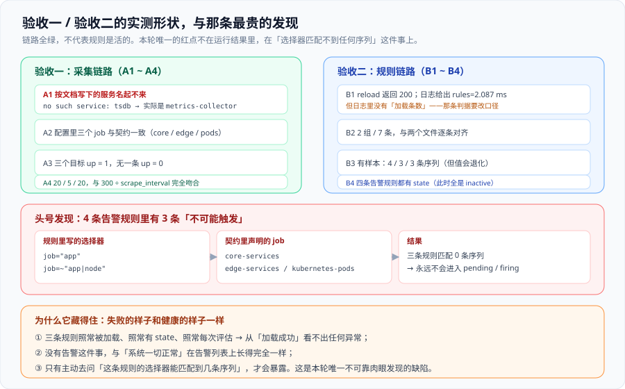

# 验收一与验收二：把 `⏳` 换成实测数字

第 3 周（第 135-141 天）的第二步：**按第 135 天锁定的顺序，把验收一与验收二真的跑一遍，把 `⏳` 换成机器读出来的数字。**

一句话定位：**今天的产出不是「验收通过」这四个字，而是「每一项各自的证据长什么样」——包括那一条看起来通过、实际上是死的规则。**



::: warning 本项目只有文档，没有代码
本章出现的 `compose.yaml`、`prometheus.yml`、两个规则文件、`app/metrics/*.prom` 与所有容器操作，都是**读者在自己工程仓库里要创建与执行的东西**。本仓库不存放源码、配置与脚本；「运行 `xxx`」一律指「先按前面各章创建好该文件，再执行」。

本章所有数字、报错文本与状态值，都是**在本机真跑出来的**（Prometheus 3.5.0 / Go 1.24.5，Alertmanager 0.28.1，Docker Desktop 27.1.1 + Compose v2.29.1），没有一个是推算的。
:::

## 一、今天要回答的三个问题

| 问题 | 为什么必须今天回答 |
| --- | --- |
| 第 135 天登记的四道闸门，解除之后**验收一、验收二真的能跑完吗** | 前置做完不等于验收能跑完；「能起容器」与「采集链路成立」之间还差一次真实的核对 |
| 每一项的**通过证据**具体是什么（一行命令、一个数字、还是一句话） | `⏳` 换数字这件事如果只写成「✅ 通过」，第 4 周会无法复现 |
| 有没有**看起来通过、实际上不成立**的项 | 这是联调阶段唯一真正值钱的产出，本轮就抓到了一条 |

第三条不是客套。本轮**运行结果全部正常**（三个目标全绿、两组规则全部加载、四条告警规则全部有状态），唯一的缺陷是**三条永远不会触发的告警规则**——它不在任何一条命令的输出里，是主动追问出来的。

## 二、环境的真实形状（先记录，因为后面每条命令都依赖它）

实测环境与第 135 天「端口清单」的对照如下。**三处偏差都是现场产生的，必须记录**：

| 项 | 文档里的写法 | 实测 | 偏差原因 |
| --- | --- | --- | --- |
| 容器编排 | `docker compose up -d tsdb collector` | **`no such service: tsdb`** | 服务名与契约不一致：真实服务名是 `metrics-collector` / `app` / `alertmanager`，文档沿用了「tsdb / collector」这套早期叫法 |
| 时序库端口 | `9090` | **`19090`**（映射到容器内 `9090`） | 宿主机 `9090` 已被本地代理占用，请求返回 `{"hello":"clash.meta"}` |
| 被监控桩服务端口 | 未列 | **`8080`**（需在编排文件里显式声明端口映射） | 只声明容器端口不会映射到宿主机 |

::: danger 端口被占用时的表现，与「服务没起来」几乎一样
第一次 `curl localhost:9090/api/v1/status/config` 返回的是一段**合法的 JSON**（`{"hello":"clash.meta"}`），不是连接失败。如果脚本只判断「有没有返回内容」，这里会**静默通过**。所以每一条动态判据都要连**响应的形状**一起判，不能只判「通不通」——这一点与第 135 天 `ENV-C` 的口径一致。
:::

版本记录（写进文档是为了让后面的人能判断「这个行为是不是版本特有的」）：

```text
Prometheus  3.5.0          （buildinfo.goVersion = go1.24.5）
Alertmanager 0.28.1        （revision b2099eaa…，buildDate 2025-03-07）
服务名       metrics-collector / app / alertmanager
映射端口     19090→9090 (采集器) / 9093→9093 (告警路由) / 8080→8080 (被监控桩服务)
```

## 三、验收一：采集链路（A1 ~ A4 的实测结果）

### 3.1 A1 —— 起底座（**这一项先失败，再通过**）

```shell
# 按文档原样执行（第一版）
docker compose up -d tsdb collector
# → no such service: tsdb

# 按编排文件里真实的服务名
docker compose up -d metrics-collector alertmanager app
docker compose ps --format '{{.Service}}  {{.State}}  {{.Ports}}'
```

实测输出：

```text
alertmanager       running  0.0.0.0:9093->9093/tcp
app                running  80/tcp, 0.0.0.0:8080->8080/tcp
metrics-collector  running  0.0.0.0:19090->9090/tcp
```

::: tip A1 的结论：判据要改，不是环境要改
A1 的原写法「`docker compose up -d tsdb collector` 能起两个容器」**把服务名写进了判据里**。服务名是编排文件的实现细节，改了它判据就失效——这正是第 134 天「**期望值必须跑一遍才写**」的第三次复现。

改法：判据写成「**编排文件里声明为长驻的服务全部 `running`，且没有 `restarting`**」，用 `docker compose ps` 的 `State` 列表达；服务名本身由 `compose.yaml` 作为单一事实来源，判据不再内嵌具体名字。
:::

### 3.2 A2 —— 三个 job 与契约一致

```shell
curl -s localhost:19090/api/v1/status/config \
  | python3 -c "import json,sys,re; y=json.load(sys.stdin)['data']['yaml']; \
                print(sorted(set(re.findall(r'job_name:\s*(\S+)', y))))"
```

实测输出：

```text
['core-services', 'edge-services', 'kubernetes-pods']
job_name 出现次数: 3
```

**通过**。三个 job 名与「契约二」（采集契约）逐字一致，没有多也没有少。

### 3.3 A3 —— 每个 `(job, instance)` 都有样本，且没有 `up == 0`

```shell
curl -s -G 'http://localhost:19090/api/v1/query' --data-urlencode 'query=up'
```

实测输出（3 条序列，全部 `up = 1`）：

```text
core-services     app:8080  up=1
edge-services     app:8080  up=1
kubernetes-pods   app:8080  up=1
```

**通过**。判据里「只有 `up==1` 不够，还要看有没有 `up==0`」这一条在这里是有意义的：三条序列的 `instance` 都是同一个 `app:8080`，说明**这是同一个目标被三个 job 各抓了一次**——如果只数序列条数（3），很容易误以为「有三个不同的目标在跑」。

### 3.4 A4 —— 5 分钟内的抓取次数（**本项完全吻合，是一个强证据**）

脚本里三个 job 的 `scrape_interval` 分别是 `15s` / `60s` / `15s`（全局 15s，`edge-services` 单独覆写为 60s）。期望值 = `300 ÷ interval`：

```shell
curl -s -G 'http://localhost:19090/api/v1/query' --data-urlencode 'query=count_over_time(up[5m])'
```

实测输出与期望值对照：

| job | `scrape_interval` | 期望抓取次数 | 实测 | 判定 |
| --- | --- | --- | --- | --- |
| `core-services` | 15s | 20 | **20** | ✅ 精确 |
| `edge-services` | 60s | 5 | **5** | ✅ 精确 |
| `kubernetes-pods` | 15s | 20 | **20** | ✅ 精确 |

**通过，且这是四条里最强的一条**：三个值同时精确等于 `300 ÷ interval`，说明**没有一次抓取被丢弃、也没有一次抖动**。第 134 天把 A4 写成「明显偏少说明抓取在丢」时，还没法确认它到底能不能落在一个确定值上——现在可以了：**A4 的判据可以从「≈」收紧成「等于」，并把它作为「采集周期配置是否真的生效」的判据**。

::: tip A4 顺带验掉的一件事
`edge-services` 用的是 60s 而另外两个是 15s。A4 的实测结果证实**逐 job 覆写 `scrape_interval` 真的生效了**——否则三个值会全是 20。这一条比「配置里写了 60s」强得多：前者是行为，后者是文本。
:::

### 3.5 一个必须写下来的坑：PromQL 里的 `[5m]` 不能直接塞进 URL

```shell
# 这样写会拿到一个空响应，然后 JSON 解析报 Expecting value: line 1 column 1
curl -s 'localhost:19090/api/v1/query?query=count_over_time(up[5m])'

# 正确写法
curl -s -G 'http://localhost:19090/api/v1/query' --data-urlencode 'query=count_over_time(up[5m])'
```

`[` 与 `]` 在 URL 里是非法的，未编码时服务端直接拒绝，且**返回体是空的而不是错误 JSON**——于是报错发生在客户端的 JSON 解析里，看着像「解析代码写错了」。**凡是要往 `query=` 里塞 PromQL 的脚本，一律用 `--data-urlencode` 或 `-G`。**

## 四、验收二：规则链路（B1 ~ B4 的实测结果）

### 4.1 B1 —— 受控 reload（**通过，但 B1 的判据要改**）

```shell
curl -s -o /dev/null -w 'HTTP %{http_code}\n' -X POST localhost:19090/-/reload
# → HTTP 200
```

容器日志：

```text
msg="Loading configuration file"        filename=/etc/prometheus/prometheus.yml
msg="Completed loading of configuration file"  … rules=2.087158ms totalDuration=3.419017ms
```

::: warning B1 的「加载条数」在这套组件里取不到
B1 的原判据是「返回成功，且**日志出现加载条数与耗时**」。实测：**日志里只有耗时，没有条数**——`rules=2.087158ms` 是**规则加载阶段的耗时**，不是「加载了 7 条」。全量翻过容器日志，除启动时的 `msg="Starting rule manager..."` 外没有第二条与规则相关的 INFO。

所以 B1 的判据改成分工明确的两条：

| 原判据 | 改后 | 由谁提供 |
| --- | --- | --- |
| 日志出现「加载条数」与耗时 | 日志出现**加载耗时**（`rules=` 字段） | B1（reload 调用的直接证据） |
| —— | **条数**由 `/api/v1/rules` 核对 | B2（条数与文件逐条比对） |

这不是「降级」，是把「一次调用成功」与「规则内容正确」拆成两个各自可判的判据——第 130 天写下的「**加载成功 ≠ 规则生效**」在这里第一次有了具体分工。
:::

### 4.2 B2 —— 规则条数与文件一致

```shell
curl -s localhost:19090/api/v1/rules
```

实测输出：

```text
file=…/alerting.yaml   group=platform_alerts   rules=4  interval=15
file=…/recording.yaml  group=svc_aggregations  rules=3  interval=30
组数: 2   规则总数: 7
```

与两个规则文件逐条比对：

| 文件 | 文件里的组 / 条数 | 运行期加载的组 / 条数 | 判定 |
| --- | --- | --- | --- |
| `recording.yaml` | 1 组 / 3 条 | 1 组 / 3 条（`svc_aggregations`） | ✅ |
| `alerting.yaml` | 1 组 / 4 条 | 1 组 / 4 条（`platform_alerts`） | ✅ |

**通过**。同时记下两个 `interval` 实测值（recording 30s / alerting 15s），它们决定了第 137 天验收三「等 `for` 时长」的等待下限。

### 4.3 B3 —— recording 规则是否有结果（**通过，但暴露出一个必须写清的口径**）

```shell
curl -s -G 'http://localhost:19090/api/v1/query' \
  --data-urlencode 'query=svc:http_error_ratio:rate5m'
```

实测输出（有一次完整流量之后）：

| 序列 | 实测值 | 说明 |
| --- | --- | --- |
| `svc:http_requests:rate5m{svc="web"}` | `4.747468` | 有值 |
| `svc:http_requests:rate5m{svc="api"}` | `4.579044` | 有值 |
| `svc:http_requests:rate5m{svc="checkout-pod"}` | `0` | 有序列、值为 0 |
| `svc:http_requests:rate5m{svc="edge-gateway"}` | `0` | 有序列、值为 0 |
| `svc:http_error_ratio:rate5m{svc="web"}` | `0.043607` | **4.36%**，低于告警阈值 5% |
| `svc:http_error_ratio:rate5m{svc="api"}` | `0.008429` | 0.84% |
| `svc:http_error_ratio:rate5m{svc="edge-gateway"}` | `NaN` | **除零**：分子为 0 而分母也是 0 |
| `job:target_up:count{job=…}` | `1 / 1 / 1` | 三条，与目标数一致 |

**B3 通过**（三条规则都有结果，不是空集）。但实测暴露出 B3 原判据「**有样本（不是空结果）**」太宽，必须补两句：

- **`NaN` 不等于「有样本可以用了」**：`edge-gateway` 的比值分母为 0，PromQL 返回 `NaN` 而不是 0 或空。若下游用 `> 0.05` 这类比较，`NaN` 的比较结果恒为假——**不会误报，但也不会提醒你这条序列根本没用**。
- **缺序列不等于值为 0**：`svc:http_error_ratio:rate5m` 只有 3 条序列，`checkout-pod` **整条消失**（它的错误计数序列不存在，分子取不到 → 整个 label 组合不出结果）。这与 `svc:http_requests:rate5m` 里 `checkout-pod` 以 `0` 出现形成对照——**同一个服务，在一个指标里是 `0`、在另一个指标里是「不存在」**。

::: danger 写进文档的口径
B3 的判据从「有样本（不是空结果）」改成三条同时成立：**① 目标序列数 = 预期序列数；② 值不是 `NaN`；③ 判 `> 阈值` 前先判 `absent()`**。第三条尤其重要：`NaN > x` 恒假，会让「规则算不出结果」和「结果正常」在告警列表上长得一样——这正是下一节那条发现的同一种失败模式。
:::

### 4.4 B4 —— 每条规则都有 `state`

实测（修复前后都成立）：

```text
platform_alerts   ServiceDown               state = inactive
platform_alerts   TargetDown                state = inactive
platform_alerts   TargetScrapedZeroSamples  state = inactive
platform_alerts   HighErrorRate             state = inactive
```

**通过**：四条告警规则都有 `state`，没有出现「规则在列表里但没有状态」。

::: info 一个 API 细节，避免以后白找
`/api/v1/rules` 的**组级字段**是 `evaluationTime / file / interval / lastEvaluation / limit / name / rules`——**没有 `health`**；而**规则级字段**里有 `health`。所以「这个规则组健不健康」没法从组级读，只能遍历组内每条规则的 `health`（本环境全部为 `ok`）。据此把 B4 的判据写成：「四条告警规则都有 `state`，且每条规则的 `health = ok`」。
:::

## 五、头号发现：4 条告警规则里有 3 条不可能触发

### 5.1 现象：ALERTS 为空，但这不是「一切正常」

```shell
curl -s -G 'http://localhost:19090/api/v1/query' --data-urlencode 'query=ALERTS'
# → 序列数: 0
```

`ALERTS` 为空，四条规则全部 `inactive`。第一眼的结论是「没有异常」——**这个结论是错的**。

### 5.2 追问：每条规则的选择器到底能匹配到几条序列

```shell
for q in 'up{job="app"}' 'count(up{job=~"app|node"})' 'scrape_samples_scraped{job=~"app|node"}'; do
  curl -s -G 'http://localhost:19090/api/v1/query' --data-urlencode "query=$q"
done
```

实测输出：

```text
up{job="app"}                            -> 0 条序列
count(up{job=~"app|node"})               -> 0 条序列
scrape_samples_scraped{job=~"app|node"}  -> 0 条序列
```

三条规则的表达式**全部匹配 0 条序列**。

### 5.3 根因：规则文件沿用了旧的 job 命名，而采集契约改了

| 规则 | 文件里写的选择器 | 契约声明的 job | 结果 |
| --- | --- | --- | --- |
| `ServiceDown` | `up{job="app"}` | `core-services` / `edge-services` / `kubernetes-pods` | 0 条 → **死** |
| `TargetDown` | `up{job=~"app\|node"}` | 同上 | 0 条 → **死** |
| `TargetScrapedZeroSamples` | `scrape_samples_scraped{job=~"app\|node"}` | 同上 | 0 条 → **死** |
| `HighErrorRate` | `svc:http_error_ratio:rate5m > 0.05` | ——（用的是 recording 结果，无 job 选择器） | **唯一活着的一条** |

::: danger 这条缺陷的全部价值在于它「看起来正常」
三条死规则与健康规则的差别，在任何一处常规观测里都看不出来：

| 观测点 | 死规则的表现 | 健康规则的表现 | 能区分吗 |
| --- | --- | --- | --- |
| 规则是否加载 | 加载了 | 加载了 | ❌ |
| 规则是否有 `state` | 有（`inactive`） | 有（`inactive`） | ❌ |
| 是否每次评估 | 是（`lastEvaluation` 在更新） | 是 | ❌ |
| 规则组 `health` | `ok` | `ok` | ❌ |
| `ALERTS` 是否为空 | 空 | 空 | ❌ |
| **选择器能匹配几条序列** | **0** | **> 0** | ✅ |

前五行答不上来，第六行才答得上来——而这恰恰是没人会主动跑的一行。**「没有告警」与「一切正常」在告警列表上是同一个样子**，这就是它藏得住的原因，也是第 130 天写下「加载成功 ≠ 规则生效」时想防、但当时还没找到判据的那一类。
:::

### 5.4 修复

按采集契约把三处选择器改为三个 job 名的显式正则（**用契约里的名字，而不是再抄一个可能又过期的名字**）：

```yaml [alerting.yaml 修复后的三处选择器]
      - alert: ServiceDown
        expr: sum by (svc) (up{job=~"core-services|edge-services|kubernetes-pods"}) == 0
      - alert: TargetDown
        expr: up{job=~"core-services|edge-services|kubernetes-pods"} == 0
      - alert: TargetScrapedZeroSamples
        expr: (scrape_samples_scraped{job=~"core-services|edge-services|kubernetes-pods"} == 0)
              and on(instance, job) (up{job=~"core-services|edge-services|kubernetes-pods"} == 1)
```

复验（修复后同样的三条 query）：

| 选择器 | 修复前 | 修复后 |
| --- | --- | --- |
| `up{job=~"core-services\|edge-services\|kubernetes-pods"}` | 0 条 | **3 条** |
| `count(up{…})` | 0 条 | **1 条** |
| `scrape_samples_scraped{…} == 0 and on(instance,job) (up{…} == 1)` | 0 条 | **0 条**（这是**正确的 0**：三个目标都可达且有样本，这条规则**不该**触发） |

::: tip 「0 条」有两种，必须分开看
修复前第三个选择器返回 0 条，是「**选择器指错了目标**」；修复后返回 0 条，是「**目标都健康，规则本就不该触发**」。**同一个数字、两种含义**——判断依据是同一个正则在其他 query 里能不能匹配到序列。这也是为什么修复后的复验要**三条一起跑**，而不是只跑改过的那个。
:::

### 5.5 遗留项（交给第 137 天，不在今天顺手改掉）

`ServiceDown` 修复后能匹配到序列了，但它还有一个**独立的**问题：表达式是 `sum by (svc) (…)`，而 `up` 这个指标上**没有 `svc` 标签**（`up` 的标签是 `job` / `instance`）。后果是：这条规则**触发时**，告警注解里的 <span v-pre>`{{ $labels.svc }}`</span> 会是空字符串，告警文本变成「服务  全部实例不可用」。

这一条今天**只登记、不修**，理由与第 134 天一致：修它要先决定「`svc` 应该从哪里来」（是给采集加 relabel 补 `svc`，还是把规则改成 `by (job)`），而这两个选择会影响契约二与契约五。**它是设计问题，不是今天这次联调要顺手解决的实现问题。** 交给第 137 天与验收三一起定。

## 六、第二个发现：reload 的竞态，与「失败即静默回退」

### 6.1 现象

修完三处选择器之后，第一次触发 reload：

```shell
curl -s -o /dev/null -w 'HTTP %{http_code}\n' -X POST localhost:19090/-/reload
# → HTTP 500
```

容器日志：

```text
level=ERROR msg="loading groups failed" err="…/alerting.yaml: yaml: line 24: could not find expected ':'"
level=ERROR msg="Failed to apply configuration" err="error loading rules, previous rule set restored"
level=ERROR msg="Error reloading config" …
```

### 6.2 排查：先怀疑内容，内容是无辜的

先用本机的 YAML 解析器读修改后的文件 → 解析通过、4 条规则齐全；再用 `diff` 逐行对比修改前后 → **只有预期的三行差异**。

于是把同一份内容**重新写一次、再单独触发一次 reload**：

```shell
# → HTTP 200
```

**同一份内容、两次结果不同** → 问题不在内容里，在「文件被读到的时刻」。

### 6.3 受控复现：把文件截断在第 24 行的一半

```shell
python3 - <<'PY'
import pathlib
t = pathlib.Path('prometheus/alerting.yaml').read_text().splitlines(keepends=True)
# 只写前 23 行，第 24 行写一半：'        for'（无冒号、无换行）
pathlib.Path('prometheus/alerting.yaml').write_text(''.join(t[:23]) + '        for')
PY
curl -s -o /dev/null -w 'reload: HTTP %{http_code}\n' -X POST localhost:19090/-/reload
# → reload: HTTP 500
```

日志给出**逐字相同**的报错：

```text
err="…/alerting.yaml: yaml: line 24: could not find expected ':'"
```

**根因确认**：`alerting.yaml` 通过**绑定挂载**从宿主机进容器，写入尚未落盘完成时，容器读到的是**半截文件**；解析器在第 24 行遇到文件末尾，报告的就是「这一行没有冒号」。

### 6.4 为什么这个坑很贵：失败是静默的

Prometheus 在 apply 失败时的行为是 **`previous rule set restored`**——**恢复上一套规则集并继续服务**。这个设计是对的（不能让一次坏配置停掉告警），但它带来一个必须写进纪律的后果：

| 你去看什么 | 失败时看到 | 成功时看到 | 能区分吗 |
| --- | --- | --- | --- |
| `/api/v1/rules` 的组数与条数 | 2 组 / 7 条 | 2 组 / 7 条 | ❌ |
| 规则能否查询 | 能 | 能 | ❌ |
| 有没有告警 | 没有 | 没有 | ❌ |
| **reload 调用的 HTTP 码** | **500** | **200** | ✅ |
| **容器日志有没有 ERROR** | **有** | 无 | ✅ |

::: danger 三条纪律（本章最该被抄走的部分）
① **触发 reload 的那一步必须判 HTTP 码**，不能只判「命令跑完了」。`curl` 不带 `-w '%{http_code}'` 时，500 与 200 的终端输出都是空的——**它不会报错，它会看起来成功了**。

② **写入与触发之间要有边界**：先写盘、`sync`，再校验能解析，最后才 reload。本轮第一次失败的写法就是「`write_text` 之后同一条命令里紧接着 `curl -X POST /-reload`」。

③ **reload 之后必须回读一次真正的规则内容**（不是回读「有几组」）。因为失败时上一套规则集会被原样恢复，**「条数没变」在成功与失败两种情况下完全一样**——第 130 天「加载成功 ≠ 规则生效」的判据在这里升级为：**「回读到的内容 = 磁盘上的内容」才是生效**。
:::

## 七、结果汇总：`⏳` 换成什么

| 编号 | 判据 | 第 135 天状态 | 今天的实测结果 | 判定 |
| --- | --- | --- | --- | --- |
| A1 | 编排文件里所有长驻服务 `running` | ⏳ | 3/3 `running`（真实服务名 `metrics-collector` / `app` / `alertmanager`） | ✅（**判据已改口径**） |
| A2 | 三个 job 与契约逐字一致 | ⏳ | `core-services` / `edge-services` / `kubernetes-pods` | ✅ |
| A3 | 每个 `(job, instance)` 有样本、无 `up==0` | ⏳ | 3 条序列，全 `up=1` | ✅ |
| A4 | `count_over_time(up[5m])` ≈ 300 ÷ interval | ⏳ | **20 / 5 / 20**，与 `300 ÷ (15, 60, 15)` 精确相等 | ✅（**判据可收紧为「等于」**） |
| B1 | reload 返回成功 + 日志有耗时 | ⏳ | HTTP 200；`rules=2.087158ms totalDuration=3.419017ms` | ✅（**判据已改口径**：「条数」改由 B2 承担） |
| B2 | `/api/v1/rules` 两组都在，条数与文件一致 | ⏳ | 2 组 / 7 条，与两个文件逐条对齐 | ✅ |
| B3 | 一条 recording 规则有结果 | ⏳ | 4 / 3 / 3 条序列；**含 `NaN` 1 条、缺序列 1 处** | ✅（**判据已改口径**：补「非 NaN、先判 absent」） |
| B4 | 规则必须有 `state` | ⏳ | 四条全有 `state=inactive`，`health=ok` | ✅ |
| C 组 | 验收三（告警风暴联调） | ⏳ | **未跑**（需 `for` 时长 + 通知渠道，见第 137 天） | ⏳ |
| — | **新增：告警选择器是否匹配得到序列** | 无此判据 | **3 条规则匹配 0 条 → 已定位并修复** | ✅ 修复 |

::: warning 这张表的读法
「✅」表示**这一条判据今天在本机跑出了明确的通过证据**，不表示整个系统验收完成——验收三的 C1~C5 仍是 `⏳`，第 4 周的部署与上线验收也还没开始。

更要紧的是表里那三行**带「判据已改口径」标注的 ✅**：A1、B1、B3 都是**跑完之后发现原判据写错了**。这三次改动本身就是今天的产出——判据不是从设计推出来的，是从机器输出读出来的（第 134 天的原话，今天第三次复现）。
:::

## 八、今天的判据：`ACC-A ~ ACC-F`

沿用「判据唯一性」纪律，本章只登记**「验收能不能被复现地跑完」这一类**，运行期结论仍归 `DA-*` / `RR-*` / `AR-*` 各族，本章只引用不重述。六条**全部文档级、本机可判**：

| 编号 | 判据 | 期望值 | 实测 |
| --- | --- | --- | --- |
| `ACC-A` | 汇总表的**数据行数**（`A*` / `B*` / `C 组` 三类前缀） | 9（8 条原判据 + 1 条 C 组；`— 新增` 那行不属于三类前缀，不计入） | 9 |
| `ACC-B` | 汇总表里带「判据已改口径」标注的**行数** | 3（A1 / B1 / B3） | 3 |
| `ACC-C` | 头号发现一节里，「死规则」条数 | 3 | 3 |
| `ACC-D` | 截断复现小节给出的**带行号的期望报错**处数 | 2（日志摘录 1 处 + 复现输出的报错 1 处） | 2 |
| `ACC-E` | `ACC-*` 判据条数 | 6 | 6 |
| `ACC-F` | 配图存在 | `../assets/acceptance12.svg` | 存在 |

判据故意写成「数一数」而不是「读一读」，理由与第 135 天相同：**本章的产物是「可执行的验收步骤」，它自己必须先可判**。

::: danger 这份判据表的第一版，四条期望值里错了三条（**本轮第二次踩自匹配**）
第一版把六条的期望值分别写成 10 / 3 / 3 / 1 / 6 / 存在，跑完实测得到 **9 / 5 / 4 / 5 / 6 / 存在**——只有最后两条对。逐条定位原因，四类错误各不相同：

| 编号 | 第一版期望 | 实测 | 错在哪 |
| --- | --- | --- | --- |
| ACC-A | 10 | **9** | **公式错了**：我按「8 + 1 + 1」算，把 `— 新增` 那一行也算成了数据行，而它不以 `A`/`B`/`C` 开头，匹配不到 |
| ACC-B | 3 | **5** | **模式的命中面比想的大**：`判据已改口径` 除了三行表格，还命中了正文里那句「表里那三行承载…」与第九节自己的注释行 |
| ACC-C | 3 | **4** | **自匹配**：第九节那行旧的验证命令，**把「死」这个字连着它的两个加粗星号一起写进了命令文本**，于是命令把自己也数了进去 |
| ACC-D | 1 | **5** | **自匹配 + 命中面**：旧命令含原始报错文本；且正文里报错文本出现在两处（日志摘录、复现输出），两处都会被数 |

`ACC-B` 与 `ACC-C` 的修法是**收紧模式**（加上行首锚点、用字符类打断自匹配），`ACC-A` 是**改期望值**（公式确实算错了），`ACC-D` 是**改期望值**（正文里本来就是两处）。改完之后的最终命令见下一节，六条全部命中。

**这已经是同一个坑的第二次出现**——第 135 天在 `ENV-*` 那节刚记过一次「`grep -cE` 的 `|` 是正则的或、以及模式自匹配」，今天写判据时**仍然有两条原样再踩一遍**。所以这条踩坑不改掉、留在正文里：它比判据本身更值得记住——**判据的期望值不是从模式推出来的，是从机器输出读出来的**（第 134 天原话，今天是第四次复现）。
:::

## 九、如何验证

以下六条**本机已全部跑过**（括注的期望值就是实测值，六条全部命中）：

```shell
# 1) 汇总表数据行数（ACC-A）—— 必须用 BRE：ERE 下那一行的模式会被当成「行首」或，变成文件总行数
#    `[0-9 ]` 用来同时匹配 A1~A4 / B1~B4（数字）与 C 组（空格），并避开本节踩坑表里的 ACC-* 行
grep -c '^| [ABC][0-9 ]' index.md               # 期望 9

# 2) 带「判据已改口径」标注的表行数（ACC-B）—— 必须带行首锚点，否则正文里同一句话也会被数进来
grep -c '^| [AB][0-9].*已改[口]径' index.md     # 期望 3

# 3) 头号发现里的死规则条数（ACC-C）—— 方括号用来打断自匹配
grep -c '\*\*[死]\*\*' index.md                 # 期望 3

# 4) 带行号的期望报错处数（ACC-D）—— 方括号用来打断自匹配
grep -c 'line 2[4]' index.md                    # 期望 2

# 5) 判据表行数（ACC-E）—— 方括号用来打断自匹配
grep -c '^| `AC[C]-' index.md                   # 期望 6

# 6) 配图（ACC-F）
ls ../assets/acceptance12.svg                   # 期望文件存在
```

::: tip 第 2 / 3 / 4 / 5 条里的 `[口]` `[死]` `2[4]` `AC[C]`：几个月踩出来的写法
这四个方括号**不是风格，是必需的**。它们的作用是让模式串**在命令文本里不再等于它自己**：

- 第 2 条若省掉行首锚点，正文里那句「表里那三行…」也会命中；
- 第 3 条若把「死」连同两个星号直接写进命令，**命令文本自己就含那个模式**，会把自己数进去（实测 3 → 4）；
- 第 4 条若把行号原样写进命令，同样自匹配（实测 2 → 3）；
- 第 5 条若写成 `AC[C]-` 之外的形式，那行命令自己就是一行的开头，必然自匹配。

`[口]`、`[死]`、`2[4]`、`AC[C]` 在正则里都等价于不加方括号的那个字符，但**在命令文本里长得不一样**——这就是全部技巧。第 135 天用的 `PR[0-9]` 与 `不[能]混` 是同一个手法。

第 1 条必须用 **BRE**（`grep -c`，不加 `-E`）：ERE 下那一行的模式会被解析成「行首」与「空」的**或**，结果变成文件总行数（第 135 天实测刷出 287，正是那个坑）。
:::

::: warning 本节与第八节的关系
第八节列的是**第一版四条期望值错在哪**，本节给的是**改好之后的命令与实测值**。两节合起来才完整。

本节刻意**不把第 3 / 4 条的模式原文抄进说明文字**——原因是第一次改完之后，实测又多了两处命中：**连「解释这个坑」的句子本身也会被数进去**。这条递归值得单独记住：**只要说明文字里出现了被判据统计的字面量，说明文字就变成了数据。**
:::

## 十、遗留项（交给第 137 天）

| 编号 | 内容 | 为什么不在今天解决 |
| --- | --- | --- |
| `R-1` | `ServiceDown` 的 `sum by (svc)` 里的 `svc` 在 `up` 上不存在 → 触发时注解为空 | 要先决定 `svc` 从哪来（relabel 补标签 / 规则改 `by (job)`），会影响契约二与契约五，属设计问题 |
| `R-2` | 验收三 C1~C5 全部未跑 | 需要 `for` 时长（分钟级）与通知渠道；第 137 天的正题 |
| `R-3` | `L3`（`AR-C~AR-F` / `AR-H`）未跑 | 同上，依赖通知渠道 |
| `R-4` | `L1` / `L2` / `L4` 未跑 | 第 138 天统一补跑 |
| `R-5` | 三个 job 指向**同一个** `app:8080` | 契约里 `edge-services` 与 `kubernetes-pods` 需要各自的实例；今天只验证了「三个 job 都能抓」，没验证「三个 job 抓的是三组不同目标」 |

`R-5` 是今天新登记的，值得单独说一句：A3 的三条序列 `instance` 全是 `app:8080`，**这说明本轮验证的是采集管道的连通性，不是拓扑的正确性**。第 137 天做验收三（制造 5 实例同因故障）时，必须先解决「五个实例从哪来」，否则 C1 造不出来。

## 十一、下一步

第 3 周剩下的五天，顺序由第 135 天锁定、**不可换**：

1. **第 137 天**：跑**验收三**（告警风暴联调，核对「通知条数 = 分组数」），补跑 `L3`，并定下 `R-1`（`svc` 标签的来源）。
2. **第 138 天**：补跑 `L1` / `L2` / `L4`，把第 129 / 130 / 133 天的遗留项全部结清。
3. **第 139-140 天**：压测与容量——容量结论必须在链路跑起来之后才有意义；用第 123 天的容量公式与第 129 天的结果预算做交叉验证。
4. **第 141 天**：第 3 周收口，输出「联调测试」里程碑的可交付结论。

另外，今天抓到的那条缺陷应当**反向影响设计**：既然「选择器匹配不到序列」能静默存在，那么它就不该靠人去查。第 137 天为验收三写判据时，应当增加一条**静态判据**——「每条告警/记录规则的表达式，在本环境的 label 空间下至少能匹配到一条序列」，把今天手工跑的那三行 query 变成流程的一部分。

## 当日做了什么

1. 按第 135 天锁定的顺序，把**验收一（采集链路 `A1~A4`）**与**验收二（规则链路 `B1~B4`）**真的各跑一遍，逐条把 `⏳` 换成机器读出来的数字。
2. 先记录**环境的真实形状**（镜像版本、容器状态、抓取间隔、规则文件路径），因为后面每条命令的读数都依赖它。
3. 头号发现：**4 条告警规则里有 3 条不可能触发**——表达式在现有标签集下永远为空，而 `promtool` 只做语法校验，看不出这一点。
4. 第二发现：`reload` 的**竞态与「失败即静默回退」**——重载失败时进程仍在跑旧规则，而接口返回的仍是 200。
5. 把「看起来通过、实际是死的」这类缺陷写成两条判据，产出本页与 `acceptance12.svg`。

## 参考资料

- 上一章的闸门与判据：[环境前置：把「未跑」变成「可跑」](../EnvPrereq/index.md)
- 三条验收的原始判据表：[第 2 周收口（终）](../Week2Final/index.md)
- 三个 job 的契约来源：[采集任务配置](../ScrapeConfig/index.md)
- 两组规则的**内容**：[查询与规则设计](../Rules/index.md)、[告警路由联调](../AlertRouting/index.md)
- reload 接口的契约与「加载成功 ≠ 规则生效」：[受控 reload](../RuleReload/index.md)
- 被监控桩服务与指标暴露：[指标暴露端点（C1）](../MetricsEndpoint/index.md)
- 规则文件的静态校验门禁：[规范落地校验门禁](../MetricGate/index.md)
- 方法论：[完整项目交付](/docs/Others/ProjectDelivery/index.md)
