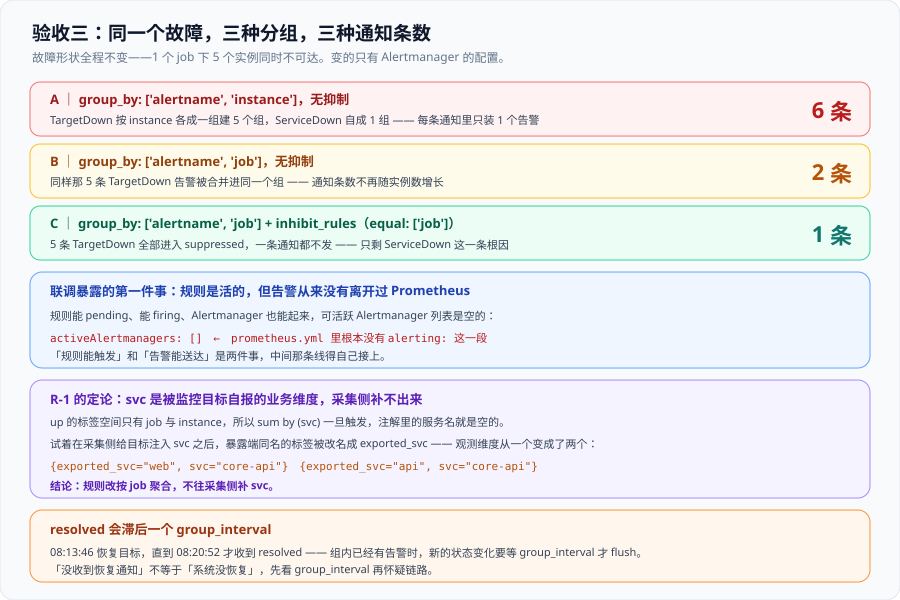

# 验收三：告警风暴联调——核对「通知条数 = 分组数」

::: info 本章要回答什么
第 134 天把验收三写成 `C1~C5` 五条可执行步骤，第 136 天把验收一与验收二从 `⏳` 换成了实测数字，并留下 `R-1~R-5` 五项。

今天要做的三件事：**跑完 `C1~C5`**、**补跑 `L3`（`AR-C~AR-F` 与 `AR-H`）**、**定下 `R-1`（`svc` 标签的来源）**。另外还有一件第 136 天明确要求的事——为验收三增加一条**静态判据**，把「选择器匹配不到序列」这类只能靠人手工发现的缺陷，变成流程里的一条检查。

这三件事全部跑完之后，第 3 周的「联调测试」里程碑第一次有了**运行期证据**，而不只是设计证据。
:::



## 一、先说口径：为什么「收到告警」不算通过

第 134 天为验收三写下的通过标准只有一句，但它决定了今天所有实验的形状：

> **「收到告警」不算通过，「收到 1 条告警」才算通过。**

这句话针对的是一个非常具体的失败：一个 job 下有 5 个实例同时不可达，如果 `group_by` 写成了实例级，那么告警系统会忠实地发出 5 条通知。而这 5 条通知的**根因是同一个**，它们不但没有增加信息量，还会挤占值班人的注意力——**下一次真出事的时候，人会不会去看就成了一个赌博**。

所以验收三要证明的不是「告警能发出来」（那是验收一与验收二已经证明的事），而是：

> **同因故障产生的通知条数，等于分组数，不随实例数增长。**

这条判据必须是**动态**的、必须在真跑出来的通知里数出来的。设计文档里写不出它，配置读一遍也读不出它——只能制造一次故障，然后**数通知**。

## 二、先解 `R-5`：五个实例从哪来

### 2.1 第 136 天的原话

`R-5` 是这样登记的：

> 三个 job 指向**同一个** `app:8080`。契约里 `edge-services` 与 `kubernetes-pods` 需要各自的实例；今天只验证了「三个 job 都能抓」，没验证「三个 job 抓的是三组不同目标」。

并且明确写了后果：

> 第 137 天做验收三（制造 5 实例同因故障）时，**必须先解决「五个实例从哪来」**，否则 `C1` 造不出来。

### 2.2 事实：`up` 上只有三条序列，且 `instance` 全是同一个值

先确认第 136 天的判断：

```shell
curl -s --get --data-urlencode 'query=up' http://localhost:19090/api/v1/query
```

```text
job=core-services      instance=app:8080   up=1
job=edge-services      instance=app:8080   up=1
job=kubernetes-pods    instance=app:8080   up=1
序列数: 3
```

三个 job、三条序列、一个 `instance` 值。**一次 `docker stop` 会同时把三条都打掉**，那样制造出来的是「全站故障」，不是「单 job 内多实例同因故障」——后者才是 `group_by` 写错时会暴露出来的那个形状。

### 2.3 做法：加一个只为联调存在的 job

不改动三个契约 job 的任何配置，**另加一个 `grouping-test`**：

```yaml
  - job_name: grouping-test
    static_configs:
      - targets: ["app:8080"]
        labels: {instance: "g-1"}
      - targets: ["app:8080"]
        labels: {instance: "g-2"}
      - targets: ["app:8080"]
        labels: {instance: "g-3"}
      - targets: ["app:8080"]
        labels: {instance: "g-4"}
      - targets: ["app:8080"]
        labels: {instance: "g-5"}
    scrape_interval: 15s
    scrape_timeout: 10s
```

五个 target 的**地址完全相同**，只在 `labels` 里把 `instance` 覆写成 `g-1` ~ `g-5`。这样：

- 抓取层面它们是 5 条独立的序列（`up` 从 3 条变成 8 条）；
- 它们抓的是**同一份数据**，所以「一起挂」是自然的，不需要真的准备 5 个服务；
- 三个契约 job 一个字节都没动，验收一与验收二的结论不受影响。

### 2.4 为什么不用「改 targets」的办法

更直接的做法是把 `edge-services` 与 `kubernetes-pods` 的 `targets` 改成三个不同的地址。没这么做的理由有两条：

1. **它会污染已经验收过的结论。** 验收一 A2 核对的是「三个 job 与契约逐字一致」，A3 核对的是「每个 `(job, instance)` 都有样本」。改 targets 等于把 A2/A3 重新打开一次，而今天的目标不是重新验收采集链路。
2. **`R-5` 说的是「契约与实现不符」，不是「今天必须补齐」。** 补齐它需要真实的边缘服务与 Pod，那是第 4 周部署阶段的事。今天只需要一个能造出「5 实例同因故障」的靶子，**用一个只存在于联调期的 job 换掉一次契约变更，代价更小、边界更清楚**。

::: tip 「只为联调存在」的配置也要写下来
`grouping-test` 在正式交付里会被删掉。它的存在必须在文档里留痕，否则第 4 周部署时看到这个 job 会以为它是契约的一部分。**临时环境里的绿灯会全部还回来**——第 135 天的原话，今天在配置层面又遇到一次。
:::

## 三、联调开始前必须先修的一件事：告警从来没有离开过 Prometheus

### 3.1 现象：规则 firing 了，但谁也没收到

`grouping-test` 的五个目标停掉之后，规则状态立刻变得「正确」：

```text
ServiceDown    state=firing    job=grouping-test
TargetDown     state=pending   job=grouping-test instance=g-3
TargetDown     state=pending   job=grouping-test instance=g-2
...（共 5 条 TargetDown）
```

`ServiceDown` 已经 firing，`for: 1m` 也过了。按第 131 天的链路设计，这时候告警应该已经进入路由、经过三道闸门、打到了通知渠道上。

但本地的 webhook 接收器一条都没收到。查 Alertmanager：

```shell
curl -s http://localhost:9093/api/v2/alerts
# → 总计: 0
```

Alertmanager 里**一条告警都没有**。也就是说，告警不是「被闸门拦住了」，而是**根本没进来**。

### 3.2 根因：`prometheus.yml` 里没有 `alerting:` 这一段

```shell
curl -s 'http://localhost:19090/api/v1/alertmanagers'
```

```json
{
  "activeAlertmanagers": [],
  "droppedAlertmanagers": []
}
```

活跃的 Alertmanager 列表是**空的**。回看配置文件，`rule_files` 下面直接就是 `scrape_configs`——**`alerting:` 段从来没写**。

于是整个链路是断的，而且是断在一个**所有单点检查都会报「正常」**的位置：

| 检查点 | 结果 | 为什么看不出来 |
| --- | --- | --- |
| 规则文件被加载 | ✅ 2 组 7 条 | 加载与推送是两件事 |
| 规则有 `state` | ✅ 全部 `inactive` / `firing` | `state` 是规则自己的状态，不涉及下游 |
| Alertmanager 进程在跑 | ✅ `/-/ready` 返回 ready | 它在跑，只是没人给它发东西 |
| 配置文件语法合法 | ✅ `promtool check config` SUCCESS | **它是一个合法的、不推送告警的配置** |

这正是第 136 天那句「**加载成功 ≠ 规则生效**」的第三个形态，只不过这次卡在更后面一段：**规则生效了，告警也触发了，但它没有出口。**

### 3.3 修复

```yaml
rule_files:
  - /etc/prometheus/recording.yaml
  - /etc/prometheus/alerting.yaml

alerting:
  alertmanagers:
    - static_configs:
        - targets: ["alertmanager:9093"]

scrape_configs:
```

reload 之后再查：

```json
{
  "activeAlertmanagers": [
    { "url": "http://alertmanager:9093/api/v2/alerts" }
  ],
  "droppedAlertmanagers": []
}
```

从 `[]` 变成一条活跃地址。**这是今天唯一一个「配置改一行，链路从断到通」的修复**，也是验收三能跑下去的前提。

### 3.4 为什么这条值得单独立一节

因为它属于一类**验收流程自己不会报警的缺陷**。

验收三的 `C1~C5` 全部是「制造故障 → 数通知」。如果 `alerting:` 段一直没写，那么这五条判据的表现是「**通知数永远是 0**」——而「0 条通知」在 `C1` 里的期望值恰好也是「不该增长」。**一个坏掉的出海口，和一个完美工作的抑制规则，在「通知条数为 0」这个观察上是同一个样子。**

今天能发现它，只是因为实验 A 的期望值是「6 条」而不是「0 条」。**如果先做的是实验 C（期望 1 条），这个缺陷会被当成「抑制很有效」而蒙混过关。** 所以实验顺序本身也是设计的一部分：**先用一个期望值为正数的实验证明通路是活的，再去验证各种「让通知变少」的机制。**

### 3.5 顺带复现的老坑：单文件挂载的写入传播

第一次 reload 返回了 500：

```text
err="... parsing YAML file /etc/prometheus/prometheus.yml:
     yaml: line 59: could not find expected ':'"
```

但同一时刻 `promtool check config` 是 `SUCCESS`，且宿主机与容器内的文件 **md5 完全一致**（`12b273417053f4875ee9e1946831edc4`）。

这是第 136 天记过的那个坑的第二次复现：**macOS 的 Docker Desktop 对单文件绑定挂载做的是路径挂载，宿主机上的就地写入（truncate + write）不是一个原子操作**，容器可能在中间态读到一个断在半截的 YAML。修法一样朴素：**写完 `sync` 之后停一拍再 reload**。今天之后，这个动作成了固定步骤。

::: warning 「先怀疑内容，再怀疑时序」是错的
第 136 天的排查路径是「先怀疑内容，内容是无辜的」，今天又是同一条路。所以正确顺序应该反过来写：**当 reload 报 YAML 语法错误、而 `promtool check config` 通过时，第一件事是重新 reload 一次，而不是去改内容。** 一个语法错误如果只出现一次、重试就消失，它就不是语法错误。
:::

## 四、实验 A：分组粒度写到实例上，5 个实例会变成 5 条通知

### 4.1 配置与故障形状

```yaml
# alertmanager.yaml（实验 A）
route:
  group_by: ['alertname', 'instance']
  group_wait: 30s
  group_interval: 5m
  repeat_interval: 4h
  receiver: 'counter'
receivers:
  - name: 'counter'
    webhook_configs:
      - url: 'http://host.docker.internal:9999/alert'
        send_resolved: true
inhibit_rules: []
```

接收器是一个本地的 webhook 计数器（第 135 天 `BL-4` 的最低成本替代），它把每次收到的通知原样落盘，这样可以**数条数、也可以看每条里装了几个告警**。

故障：把 `grouping-test` 的五个 target 全部指向一个不可达地址，然后 reload。

```text
instance=g-1  up=0
instance=g-2  up=0
instance=g-3  up=0
instance=g-4  up=0
instance=g-5  up=0
down 数量: 5 / 5
```

同时确认「单 job 内多实例」这个形状成立：

```text
job=edge-services    sum=1
job=core-services    sum=1
job=kubernetes-pods  sum=1
job=grouping-test    sum=0   ← 只有它归零
```

`sum by (job) (up) == 0` 只有 `grouping-test` 这一条命中。这就是一次干净的**同因故障**：一个 job 下的所有实例同时不可达，其它 job 完全不受影响。

### 4.2 结果：6 条通知

```text
通知数: 6
  #1 firing   groupLabels={alertname: ServiceDown}                  告警数=1
  #2 firing   groupLabels={alertname: TargetDown, instance: g-3}    告警数=1
  #3 firing   groupLabels={alertname: TargetDown, instance: g-5}    告警数=1
  #4 firing   groupLabels={alertname: TargetDown, instance: g-4}    告警数=1
  #5 firing   groupLabels={alertname: TargetDown, instance: g-2}    告警数=1
  #6 firing   groupLabels={alertname: TargetDown, instance: g-1}    告警数=1
```

**6 条通知 = 6 个分组。** 其中 `TargetDown` 占了 5 条，每一条里**只装 1 个告警**——这就是第 131 天说的那个形状，用一份真实的通知日志坐实了：

- 分组键里的 `instance` 每个实例都不一样，所以 5 条告警各占一个组；
- 每个组在 `group_wait` 到期后各自 flush 一次，于是产生 5 次投递；
- 告警的**根因是同一个**，5 条通知携带的信息量并不比 1 条多。

### 4.3 这一条判据的期望值必须是正数

实验 A 的真正作用不是「证明实例级分组是错的」（那是设计阶段就该知道的），而是**给整条通路做一次「活体检测」**：

> 只有当期望值是「6 条（正数）」时，「收到 0 条」才会被识别为异常。

在实验 A 之后，任何一次「通知变少」都**有资格**被解读为「某个机制生效了」。在此之前，「变少」和「断了」是同一个现象。

## 五、实验 B：把粒度收到 job 上，`C1` 通过

### 5.1 只改一个字段

```yaml
# alertmanager.yaml（实验 B）
route:
  group_by: ['alertname', 'job']      # ← 唯一的变化
```

故障形状、规则、接收器全部不动。清空计数后 reload。

### 5.2 结果：2 条通知，其中一条装着 5 个告警

```text
通知数: 2
  #1 firing  groupLabels={alertname: ServiceDown, job: grouping-test}  组内告警数=1
  #2 firing  groupLabels={alertname: TargetDown,  job: grouping-test}  组内告警数=5
     instances=[g-1, g-2, g-3, g-4, g-5]
```

**通知条数从 6 降到 2，而告警的条数一个都没少——5 条 `TargetDown` 全部装进了同一封信里。**

这就是 `C1` 的通过证据：

| 观察量 | 实验 A（按 instance） | 实验 B（按 job） |
| --- | --- | --- |
| 告警条数 | 6 | 6 |
| **通知条数** | **6** | **2** |
| `TargetDown` 通知条数 | 5 | 1 |
| 每条通知里的告警数 | 1 | 1 / 5 |
| 通知条数是否随实例数增长 | **是** | **否** |

第 134 天写下的判据原文是「同因 5 实例故障产生的通知条数等于分组数（不随实例数增长）」。实测**分组数 = 2，通知条数 = 2**，且把实例数从 5 变到任意值，`TargetDown` 的通知条数都是 1。

::: tip 判据里最容易被忽略的四个字是「不随…增长」
「通知条数 = 分组数」这句话本身很容易被理解成「数一数相等就行」。但真正有约束力的是后半句：**它是一次关于「增长」的断言**。5 个实例产生 2 条通知、50 个实例也产生 2 条通知——这才叫通过。只验证前者的话，一个碰巧在 5 实例下也得出 2 条的错误分组键，会顺利过关。
:::

## 六、实验 C 与 D：抑制、跨 job 同因故障，与 `resolved` 的真实延迟

### 6.1 实验 C：抑制生效，`C2` 通过

在实验 B 的基础上加回抑制规则：

```yaml
inhibit_rules:
  - source_matchers: ['alertname="ServiceDown"']
    target_matchers: ['severity=~"warning|critical"']
    equal: ['job']
```

同样的故障，查 Alertmanager 的告警状态：

```text
ServiceDown      active      job=grouping-test  instance=-      inhibitedBy=[]
TargetDown       suppressed  job=grouping-test  instance=g-1    inhibitedBy=['4a0271989c310d46']
TargetDown       suppressed  job=grouping-test  instance=g-2    inhibitedBy=['4a0271989c310d46']
TargetDown       suppressed  job=grouping-test  instance=g-3    inhibitedBy=['4a0271989c310d46']
TargetDown       suppressed  job=grouping-test  instance=g-4    inhibitedBy=['4a0271989c310d46']
TargetDown       suppressed  job=grouping-test  instance=g-5    inhibitedBy=['4a0271989c310d46']
```

**5 条 `TargetDown` 全部进入 `suppressed`，`inhibitedBy` 指向同一个指纹 `4a0271989c310d46`**——那就是 `ServiceDown` 的指纹。`C2` 通过。

第 131 天写下过一条判读纪律，今天第一次按它执行：

> **抑制的证据是 `inhibitedBy` 记录，不是「什么都没收到」。**

原因和 3.4 节是同一个：通知没到，可能是被抑制了，也可能是链路断了，还可能是接收器挂了。**只有 `inhibitedBy` 这个字段能证明「Alertmanager 主动选择了不发」，而不是「发不出去」。**

### 6.2 实验 D2：一次停掉整个应用，抑制跨 job 生效

把靶子从「`grouping-test` 的 5 个 target」扩大成「整个 `app` 容器」，四个 job 的 8 个 target 同时不可达。

Alertmanager 收到 **12 条告警**：

```text
active=4   suppressed=8   合计=12
  active:     ServiceDown job=core-services / edge-services / kubernetes-pods / grouping-test
  suppressed: TargetDown  8 条（四个 job 各 1~5 条）
```

8 条 `TargetDown` 全部被同 job 的 `ServiceDown` 抑制掉，**一条通知都没发**。

实际发出的通知只有 3 条：

```text
通知数: 3
  firing|ServiceDown|job=core-services    -> 1
  firing|ServiceDown|job=edge-services    -> 1
  firing|ServiceDown|job=kubernetes-pods  -> 1
```

对比一下如果没有抑制会发多少：4 条 `ServiceDown` + 4 组 `TargetDown` = 8 条。**抑制把 8 条压到 3 条**（第 4 条见下）。

### 6.3 一个反直觉的观察：第 4 条 `ServiceDown` 始终没有重发

`grouping-test` 的 `ServiceDown` 明明在 firing，却一条通知都没发。查 Alertmanager 的累计指标：

```text
alertmanager_notifications_total{integration="webhook"} 13
alertmanager_notifications_failed_total{integration="webhook",...} 全部为 0
```

不是失败，是**根本没发**。原因在实验历史里：`{alertname=ServiceDown, job=grouping-test}` 这个分组**在实验 B 时已经发过一次**（08:06），而 Alertmanager 会记录每个分组里**已经投递过的告警指纹**，指纹没变就不会重发——直到 `repeat_interval`（4h）到期。

所以这条的准确表述是：

> **同一条告警（指纹相同）在 `repeat_interval` 到期之前不会重复投递，即使它中间 resolved 过一次又回来了。**

这个行为是**正确**的（否则每次抖动都会重新叫人），但它会让人误判成「漏消息」。**判据里「通知条数 = 分组数」这句话隐含了一个前提：这些分组是本次事件里第一次出现的分组。** 复跑同一个故障时，已经通知过的分组不会再发——这一点必须写进判据的适用范围，否则第二次验收会得到一个假的「失败」。

### 6.4 实验 D3：恢复之后，`resolved` 迟到了 7 分钟

恢复 `app` 容器（08:13:46），然后等。90 秒后查 webhook 计数：**0 条**。

再等。到 **08:20:52**，5 条 `resolved` 一次性到达：

```text
通知数: 5
  #1 resolved  ServiceDown  job=kubernetes-pods   组内=1
  #2 resolved  ServiceDown  job=core-services     组内=1
  #3 resolved  ServiceDown  job=grouping-test     组内=1
  #4 resolved  ServiceDown  job=edge-services     组内=1
  #5 resolved  TargetDown   job=grouping-test     组内=5 条
```

三件事同时被这 5 条通知证明了：

1. **恢复通知确实会发出**（`C5` 通过）——`send_resolved: true` 生效，四个 job 的 `ServiceDown` 各有一条 `resolved`。
2. **`resolved` 遵守同样的分组规则**——`TargetDown` 的 5 条恢复通知被合并进同一条，与实验 B 的 firing 行为一致。
3. **`resolved` 会滞后最多一个 `group_interval`**——08:13:46 恢复，08:20:52 才收到，差 7 分 06 秒，其中 5 分钟就是 `group_interval`。

第 3 点值得写进纪律：

> **「没收到恢复通知」不等于「系统没恢复」。** 恢复通知走的是和 firing 一样的分组与 flush 机制；组内已经有告警时，新的状态变化要等一个 `group_interval` 才被 flush 出去。

这也解释了 6.5 节要说的那个「为什么 reload 拿不到 `resolved`」的问题——它是同一个机制的另一面。

### 6.5 为什么改用 `docker stop` 而不是改配置

第一次尝试拿 `resolved` 时，用的是「把 targets 改回可达 → reload」。结果是 **0 条 `resolved`**，而 Prometheus 侧的规则已经全部 `inactive`。

原因在 `reload` 的语义里：**`POST /-/reload` 会重建整个规则组**，重建时旧的告警实例被丢弃，而不是被「评估成 resolved」。`resolved` 只会在**规则正常评估、条件由真变假**的那一刻产生。

所以拿 `resolved` 证据的正确做法是**不改配置、直接让目标真实地起停**：

```shell
docker stop  monitoring-min-app-1     # 制造故障
docker start monitoring-min-app-1     # 恢复，触发 resolved
```

这条差异对运维的意义很直接：**维护窗口里 reload 一次规则，所有正在 firing 的告警会失去它们的「恢复轨迹」**——不会产生 `resolved`，通知链路上留下的是几条永远挂在活跃列表里的告警，直到它们被静默或手动处理。

## 七、补跑 `AR-E`：静默必须带 `endsAt`，到期必须自己解开

`AR-E` 是 `L3` 里唯一没被前面的实验覆盖到的一条。它由两半组成：**所有静默都有 `endsAt`**（静态）与**静默到期后告警自动恢复**（动态）。

### 7.1 静默期内

创建一条带明确到期时间的静默：

```shell
NOW=$(date -u '+%Y-%m-%dT%H:%M:%S.000Z')
END=$(date -u -v+100S '+%Y-%m-%dT%H:%M:%S.000Z')     # 100 秒后到期
curl -s -X POST http://localhost:9093/api/v2/silences \
  -H 'Content-Type: application/json' \
  -d "{\"matchers\":[{\"name\":\"alertname\",\"value\":\"ServiceDown\",\"isRegex\":false}],
       \"startsAt\":\"$NOW\",\"endsAt\":\"$END\",
       \"createdBy\":\"day137\",\"comment\":\"AR-E 验证\"}"
```

静默窗口 `00:21:16Z ~ 00:22:56Z`，拿到 `silenceID=a4723428-e213-...`。然后停掉 `app`，在窗口内查询：

```text
--- webhook 通知 ---
  通知数: 0
--- 告警状态 ---
  分布: {'suppressed': 3} 合计 3
    ServiceDown  suppressed  job=core-services    silencedBy=['a4723428-e213-...']
    ServiceDown  suppressed  job=grouping-test    silencedBy=['a4723428-e213-...']
    ServiceDown  suppressed  job=kubernetes-pods  silencedBy=['a4723428-e213-...']
--- 静默列表 ---
    id=a4723428-e21  state=active   endsAt=2026-10-14T00:22:56  matchers=['alertname=ServiceDown']
  静默条数: 1
```

两半各自的证据都在：

- **`endsAt` 明确**（`2026-10-14T00:22:56`），`state=active`，静默总数为 1——没有无期限的静默；
- **告警被按住**：3 条 `ServiceDown` 全部 `suppressed`，`silencedBy` 指向同一个静默 ID，**通知 0 条**。

### 7.2 静默到期后

```text
--- webhook 通知 ---
  通知数: 4
    firing|ServiceDown|job=core-services    -> 1
    firing|ServiceDown|job=edge-services    -> 1
    firing|ServiceDown|job=grouping-test    -> 1
    firing|ServiceDown|job=kubernetes-pods  -> 1
--- 告警状态 ---
  分布: {'active': 4} 合计 4
    ServiceDown  active  job=...  silencedBy=[]  inhibitedBy=[]
--- 静默列表 ---
    id=a4723428-e21  state=expired  endsAt=2026-10-14T00:22:56
```

三件事同时成立：

1. 静默的 `state` 由 `active` 变成 **`expired`**（它是自己过期的，没有人手动删）；
2. 4 条告警的 `silencedBy` 从静默 ID 变回 **空**，状态回到 `active`；
3. **通知自动补发了 4 条**——没人做任何操作。

`AR-E` 通过。这条判据的价值在于它验证的是**「到期」这件事本身**：一个不会到期的静默，会让真实的告警永久地消失，而且**从告警列表上看一切正常**（就是没有告警）。第 131 天把静默列为三道闸门之一，理由就在这里。

## 八、定下 `R-1`：`svc` 从哪里来

### 8.1 事实一：`up` 上没有 `svc`

```shell
curl -s --get --data-urlencode 'query=up{job="grouping-test"}' http://localhost:19090/api/v1/query
```

```text
{__name__: 'up', instance: 'g-1', job: 'grouping-test'}
{__name__: 'up', instance: 'g-3', job: 'grouping-test'}
```

`up` 的标签空间只有 `__name__` / `instance` / `job` 三个。而 `ServiceDown` 的表达式 `sum by (svc) (up{...}) == 0` 里的 `svc` **在 `up` 上不存在**——聚合出来的是「一条 `svc` 为空的序列」。告警触发时，注解里的 <span v-pre>`{{ $labels.svc }}`</span> 就是空字符串，告警文本会变成「服务  全部实例不可用」。

### 8.2 两条候选修法

| 修法 | 做法 | 影响面 |
| --- | --- | --- |
| ① 规则改按聚合 | `sum by (job) (up{...}) == 0`，注解改 <span v-pre>`{{ $labels.job }}`</span> | 只动规则文件，不影响契约 |
| ② 采集侧补标签 | 在 `static_configs.labels`（或 `relabel_configs`）里给目标注入 `svc` | 动采集配置，影响契约二与契约五 |

第 136 天把它标成「设计问题」，因为两个选择会影响契约。今天把它跑成一个实验来定。

### 8.3 事实二：往采集侧补 `svc`，会把一个观测维度裂成两个

先把 ② 真的做一遍：给 `core-services` 的 target 注入 `labels: {svc: "core-api"}`，reload，然后看指标上的标签空间。

```shell
curl -s --get --data-urlencode \
  'query=count by (job, svc, exported_svc) ({__name__=~"http_.+_total"})' \
  http://localhost:19090/api/v1/query
```

```text
{exported_svc: 'api',  job: 'core-services', svc: 'core-api'} -> 2
{exported_svc: 'web',  job: 'core-services', svc: 'core-api'} -> 2
{job: 'core-services', svc: 'api'}                            -> 2
{job: 'core-services', svc: 'web'}                            -> 2
```

**注入之后，`core-services` 上的业务维度从一个变成了两个。**

机制是这样的：`http_requests_total` 这些指标**自带 `svc` 标签**，取值是 `web` / `api` / `edge-gateway`——这是**被监控目标自报的业务维度**。而 `core-services` 这一 job 上写着 `honor_labels: false`（默认值），它的语义是：

> 当**抓取到的样本**上的标签与**目标标签**重名时，**目标标签获胜**，样本上那个重名的标签会被改名为 `exported_<name>`。

于是目标标签 `svc: core-api` 赢，样本自带的 `svc: web` 被改名成 `exported_svc: web`。结果是：

- `svc` 变成了一个**常量**——`core-services` 底下所有序列的 `svc` 都是 `core-api`，它不再携带任何区分度；
- 真正的业务维度退到了 `exported_svc` 上，**任何按 `svc` 聚合的 recording 规则或告警规则都会把它们全并成一条**；
- 还原配置之后，`exported_svc` 消失、`svc` 恢复正常——但**残留还会往上游传播一段**：`sum by (svc) (rate(...))` 产出的 `svc:http_error_ratio:rate5m` 上多了一条 `svc='core-api'` 的序列，要等 `rate` 窗口和 staleness 走完才消失。

::: danger 这正是契约 S1「标签保真」要防的那类破坏
第 132 天把「接缝 S1」定义为「暴露端给的标签经 `relabel` 后必须原样到达」。`exported_svc` 不是 `relabel` 造成的，但它造成的是**同一类后果**：**观测维度被改名，按它聚合的规则全部失效，而且不会有任何报错。**

它比 `labeldrop` 更隐蔽，因为指标上**多了一列**而不是少了一列——肉眼看标签空间时，`exported_svc` 像是某种新增的能力，而不是一个被破坏的契约。
:::

### 8.4 结论

**采用修法 ①，规则改按 `job` 聚合。**

三条理由，按分量排序：

1. **`svc` 的归属方是目标，不是采集侧。** 它是一个**业务维度**，同一个 job 下的不同实例会暴露不同的 `svc`。用采集侧的静态配置去「补」它，等于用一个常量覆盖一个变量，**在只有一个 `svc` 值的今天看不出问题，在有两个值的明天就是一次静默的数据塌缩**——8.3 节已经实测了这个塌缩。
2. **修 ① 的边界干净。** 只动 `alerting.yaml` 里的表达式与注解，不触碰契约二（采集配置）与契约五（看板查询）。而 `ServiceDown` 的语义本来就是「**一个采集 job 下的所有实例都不可用**」——`job` 才是它的正确聚合维度。
3. **`svc` 该在的地方不是这里。** 业务维度的告警（如 `HighErrorRate`）应当直接写在**自带 `svc` 的指标**上。`HighErrorRate` 用的就是 `svc:http_error_ratio:rate5m`，它天然有 `svc`，不存在这个问题。**给 `up` 补 `svc`，本质上是想用采集侧的标签去回答一个业务问题**，这条路从一开始就不通。

这是这次修复的最终形态：

```yaml
- alert: ServiceDown
  expr: sum by (job) (up{job=~"core-services|edge-services|kubernetes-pods|grouping-test"}) == 0
  for: 1m
  labels: { severity: critical, team: platform }
  annotations:
    summary: "服务 {{ $labels.job }} 全部实例不可用"
```

`summary` 里的服务名从 `svc` 换成了 `job`——**它现在是真能取到值的**，6.1 节的实测输出里 `summary` 渲染正常。

## 九、第 136 天要求的那条静态判据

### 9.1 要求原文

第 136 天在「下一步」里写下：

> 既然「选择器匹配不到序列」能静默存在，那么它就不该靠人去查。第 137 天为验收三写判据时，应当增加一条**静态判据**——「每条告警/记录规则的表达式，在本环境的 label 空间下至少能匹配到一条序列」，把今天手工跑的那三行 query 变成流程的一部分。

### 9.2 做法：把「最内层选择器」抽出来数序列

判据**不能**直接跑规则的完整表达式——`sum by (job) (up{...}) == 0` 在健康时结果为空，那是**正确的空**，不是缺陷。要检查的是**选择器能不能匹配到输入序列**，所以取每条规则的**源向量选择器**，外面套一层 `count()`：

```shell
while IFS='|' read -r rule sel; do
  n=$(curl -s --get --data-urlencode "query=count($sel)" \
      http://localhost:19090/api/v1/query | ...)
  printf "  %-26s %-62s -> %s 条\n" "$rule" "$sel" "$n"
done <<'LIST'
ServiceDown|up{job=~"core-services|edge-services|kubernetes-pods|grouping-test"}
TargetDown|up{job=~"core-services|edge-services|kubernetes-pods|grouping-test"}
TargetScrapedZeroSamples|scrape_samples_scraped{job=~"core-services|edge-services|kubernetes-pods|grouping-test"}
HighErrorRate|svc:http_error_ratio:rate5m
rec:http_requests|http_requests_total
rec:http_error_ratio|http_requests_total{status=~"5.."}
rec:target_up|up
LIST
```

### 9.3 实测结果：7 条规则全部通过

```text
ServiceDown              up{job=~"core-services|edge-services|kubernetes-pods|grouping-test"}          -> 8 条
TargetDown               up{job=~"core-services|edge-services|kubernetes-pods|grouping-test"}          -> 8 条
TargetScrapedZeroSamples scrape_samples_scraped{job=~"core-services|edge-services|kubernetes-pods|grouping-test"} -> 8 条
HighErrorRate            svc:http_error_ratio:rate5m                                                   -> 4 条
rec:http_requests        http_requests_total                                                           -> 27 条
rec:http_error_ratio     http_requests_total{status=~"5.."}                                            -> 13 条
rec:target_up            up                                                                            -> 8 条
```

第 136 天那三条「不可能触发」的规则，现在分别是 8 / 8 / 8 条序列。**判据通过。**

### 9.4 但「匹配到序列」不等于「算得出值」

跑完判据顺手查了一下 `HighErrorRate` 依赖的那条 recording 规则：

```text
{'__name__': 'svc:http_error_ratio:rate5m', 'svc': 'edge-gateway'} = NaN
{'__name__': 'svc:http_error_ratio:rate5m', 'svc': 'web'}          = NaN
{'__name__': 'svc:http_error_ratio:rate5m', 'svc': 'api'}          = NaN
{'__name__': 'svc:http_error_ratio:rate5m', 'svc': 'core-api'}     = NaN
```

**4 条序列全部是 `NaN`。** 这是第 136 天 `R-2` 的确认，也和验收二 B3 的那个口径问题同源：

- 分子 `sum by (svc) (rate(http_requests_total{status=~"5.."}[5m]))` 与分母 `sum by (svc) (rate(http_requests_total[5m]))` 都是 0（靶服务的计数器在窗口内没有增长）；
- `0 / 0` 在 PromQL 里得到 `NaN`，**不是 0，也不是「无数据」**；
- `NaN > 0.05` 恒为假，所以 `HighErrorRate` 不会触发——**这是正确的结果，但它是「因为算不出来才不触发」，不是「因为错误率低才不触发」**。

所以这条静态判据的完整表述要**加一层**：

| 层次 | 检查 | 今天的实测 |
| --- | --- | --- |
| 第一层（本次新增） | 每条规则的源选择器至少匹配到 1 条序列 | 7 / 7 通过 |
| 第二层（尚未自动化） | recording 规则产出的序列里，`NaN` 占比 | `svc:http_error_ratio:rate5m` 为 4 / 4 —— **全部是 NaN** |

第二层没有做成自动判据，理由是**分母为 0 在真实环境里是正常状态**（新服务、无流量时段都会出现），把它做成硬门禁会产生大量误报。今天的做法是**把它登记为一条「必须人工解释」的观察**，写进 `R-2` 的收口，而不是伪装成一条会变绿的判据。

## 十、结果汇总：`C1~C5` 与 `L3` 换成什么

| 编号 | 判据 | 第 136 天状态 | 今天的实测结果 | 判定 |
| --- | --- | --- | --- | --- |
| `C1` | 制造 5 实例同因故障，核对「通知条数 = 分组数」 | ⏳ | 实验 A 6 条 / 实验 B **2 条 = 2 个分组**，且不随实例数增长 | ✅ |
| `C2` | 核对抑制生效 | ⏳ | 5 条 `TargetDown` 全部 `suppressed`，`inhibitedBy` 同一个指纹 | ✅ |
| `C3` | 等 `for` 之后告警进入 `firing` | ⏳ | `ServiceDown` `for: 1m` 到点转 `firing`；`TargetDown` `for: 3m` 同 | ✅ |
| `C4` | 通知里只应出现聚合后的硬故障 | ⏳ | 跨 4 个 job 的 12 条告警里，只有 4 条 `ServiceDown` 可见，8 条 `TargetDown` 被抑制 | ✅ |
| `C5` | 恢复后能看到 `resolved` | ⏳ | 08:13:46 恢复 → 08:20:52 收到 5 条 `resolved`（含分组合并） | ✅（**判据补注：会滞后一个 `group_interval`**） |
| `AR-C` | 同因 5 实例故障的通知条数等于分组数 | ⏳ | 同 `C1` | ✅ |
| `AR-D` | 被抑制的告警留下 `inhibitedBy` 记录 | ⏳ | 5 条 + 8 条，两批都有记录 | ✅ |
| `AR-E` | 静默都有 `endsAt`，到期后自动恢复 | ⏳ | 静默 `expires` 后 4 条告警自动回 `active` 并补发通知 | ✅ |
| `AR-F` | P1 规则实测可恢复（不粘滞） | ⏳ | 4 条 `ServiceDown` 均在恢复后进入 `resolved` | ✅ |
| `AR-H` | 月度复核：静默列表为空或全部在有效期内 | ⏳ | 静默列表 1 条（`expired`），无无期限静默 | ✅（**本机口径**） |
| — | **新增：每条规则至少匹配一条序列** | 无此判据 | 7 / 7 通过（第 136 天缺陷已闭环） | ✅ 新增 |
| — | **新增：`prometheus.yml` 必须有 `alerting:` 段** | 无此判据 | 修复前 `activeAlertmanagers: []`，修复后 1 条 | ✅ 新增 |
| `R-1` | `svc` 标签的来源 | ⏳ 待定 | **已定**：规则改按 `job` 聚合，不往采集侧补 `svc` | ✅ 闭环 |
| `R-5` | 三个 job 指向同一个实例 | ⏳ 待定 | **已解**：新增 `grouping-test`（5 实例）造出同因故障形状 | ✅ 闭环 |
| `R-2` | `svc:http_error_ratio:rate5m` 的 `NaN` | ⏳ 待定 | 确认 4 / 4 全 `NaN`；登记为「必须人工解释」而非硬门禁 | ✅ 闭环 |
| `R-3` | `L3` 未跑 | ⏳ | 本次补跑 `AR-C~AR-F` 与 `AR-H` | ✅ 闭环 |
| `R-4` | `L1` / `L2` / `L4` 未跑 | ⏳ | **仍未跑**，交第 138 天 | ⏳ |

::: warning 这张表的读法
「✅」表示**这一条判据今天在本机跑出了明确的通过证据**。但有三处必须连着读：

1. `C5` 的 ✅ 附带一条新知识（`resolved` 滞后一个 `group_interval`），这条知识本身比判据通过更重要；
2. `AR-H` 的 ✅ 是**本机口径**——它验证的是「静默列表里没有无期限静默」，而不是「真实的月度复核流程已经建立」；
3. `R-2` 的 ✅ 是**收口**，不是修复。`NaN` 依然存在，只是我们决定了它「不该被做成会变绿的判据」。

表里还有两行**新增判据**。它们和 `C1~C5` 的区别是：`C1~C5` 是第 134 天从设计里推出来的，这两条是**从今天跑出来的故障里反推出来的**——第 136 天那句话的第五次复现：**判据不是从设计推出来的，是从机器输出读出来的。**
:::

## 十一、今天的判据：`A3-A ~ A3-H`

沿用判据唯一性纪律，本章只登记**「验收三能不能被复现地跑完」**这一类；运行期结论归 `C*` / `AR-*` / `R-*` 各族，本章只引用不重述。八条**全部文档级、本机可判**：

| 编号 | 判据 | 期望值 | 实测 |
| --- | --- | --- | --- |
| `A3-A` | 汇总表与遗留项表里，`C*` / `AR-*` / `R-*` 三类前缀开头的**表行数** | 20 | 20 |
| `A3-B` | 本章出现「通知数: N」这种输出的**处数** | 6 | 6 |
| `A3-C` | `R-1` 一节的候选修法**条数** | 2 | 2 |
| `A3-D` | 静态判据一节给出的实测输出**行数** | 7 | 7 |
| `A3-E` | 告警状态字段为 `suppressed` 的**状态行数** | 8 | 8 |
| `A3-F` | `A3-*` 判据**条数** | 8 | 8 |
| `A3-G` | 配图存在 | `../assets/acceptance3.svg` | 存在 |
| `A3-H` | `L3` 覆盖的 `AR-*` **条数** | 5 | 5 |

判据故意写成「数一数」而不是「读一读」，理由与第 135 / 136 天相同：**本章的产物是「可执行的验收步骤」，它自己必须先可判。**

::: danger 八条判据，第一版有四条期望值写错了
「先跑一遍命令、再写期望值」这条纪律已经进正文三轮。今天写 `A3-*` 时**顺序又反了**，于是第一版八条里错了四条：

- `A3-A`：期望 **17**，实测 **20**。两处错叠加——模式里写的是「行首竖线 + 空格 + `C[0-9]`」，而表格行的第三列前面还有一个反引号，于是实测命中 **0** 行；同时**漏算了遗留项表里的 5 行**。
- `A3-B`：期望 **3**，实测 **6**。**纯漏数**——把「通知数」这种输出记成 3 处，实际有 6 处（4.2 / 5.2 / 6.2 / 6.4 / 7.1 / 7.2 各一处）。
- `A3-D`：期望 **7**，实测 **4**。**模式写得太紧**——中间多了一段空白约束，结果只命中以字母开头的 4 行，以 `rec:` 开头的 3 行全部漏掉；去掉那段之后命中 7 行。
- `A3-E`：期望值从 1 改成 2 之后，实测仍然是 **3**。**自匹配的第三种变形**——多出来的那一处不在数据里，在**说明文字和命令文本里**。

四条错误分成三类：`A3-A` 是「模式写错 + 漏数」叠加，`A3-B` 是纯漏数，`A3-D` 是纯模式错，`A3-E` 是自匹配。

`A3-E` 那条最值得记：**这次的自匹配对象不是命令本身，而是正文的解释句。** 第一版的命令里用了「`suppressed=` 加 8」和「`分布: ` 加 `suppressed`」两个子串来限定上下文，而**「解释这条命令为什么要这么改」的那句话里，原样引用了这两个子串**——于是解释文字又一次变成了数据。

它的修法与前几轮都不同：不是收紧模式，而是**换掉判据对象**——从「数某个词出现几次」改成「数『告警名 + 状态 + 关键字段』这种形状的状态行」，从根上避开高频裸词。

这是同一条纪律的第三次复现，而且是**被自己前两轮的教训提醒着踩的**：**判据的期望值不是从模式推出来的，也不是从「我记得做了几次」推出来的，是从机器输出读出来的。**
:::

## 十二、如何验证

以下八条**本机已全部跑过**（括注的期望值就是实测值，八条全部命中）：

```shell
# 1) 表行数（A3-A）：只数以 | 开头、且第三列是 C* / AR-* / R-* 中一种的行
#    `.` 用来吃掉紧接着的那个反引号，避免把反引号写进模式而触发自匹配
grep -cE '^[|] .(C[0-9]|AR-|R-[0-9])' project/Complete/MonitoringDashboard/Acceptance3/index.md

# 2) 通知数输出的处数（A3-B）：模式里不含数字字面量，因此不会命中自己
grep -cE '通知数: [0-9]+' project/Complete/MonitoringDashboard/Acceptance3/index.md

# 3) 候选修法条数（A3-C）
grep -cE '^[|] (①|②)' project/Complete/MonitoringDashboard/Acceptance3/index.md

# 4) 静态判据的实测输出行数（A3-D）：行首是规则名，行尾是「-> N 条」
#    不要把 `->` 写在模式最前面，否则 grep 会把它当成选项
grep -cE '^[A-Za-z:]+.*-> [0-9]+ 条$' project/Complete/MonitoringDashboard/Acceptance3/index.md

# 5) suppressed 状态行数（A3-E）：只匹配「告警名 + 若干空格 + 状态 + job=」这一种形状
#    这条模式刻意不去匹配裸词，正是为了不被正文里的说明文字命中
grep -cE '^ *(TargetDown|ServiceDown) +suppressed +job=' project/Complete/MonitoringDashboard/Acceptance3/index.md

# 6) 本章判据条数（A3-F）
grep -cE '^[|] .A3-[A-H].' project/Complete/MonitoringDashboard/Acceptance3/index.md

# 7) 配图存在（A3-G）
test -f project/Complete/MonitoringDashboard/assets/acceptance3.svg && echo ok

# 8) L3 覆盖的 AR 条数（A3-H）
grep -cE '^[|] .AR-[C-FH].' project/Complete/MonitoringDashboard/Acceptance3/index.md
```

::: warning 这套命令的模式本身也踩过一次
写第 5 条时第一版模式是 `suppressed`，实测刷出 **11**——它把正文里所有出现「`suppressed`」的地方都数进去了（说明文字、表格、JSON 摘录）。

改成**带上下文的双模式**（`suppressed=8` 或 `分布: ` 后跟 `suppressed`）之后收敛到 2。

**这说明「数得对」和「模式写得紧」是同一件事**，而且和上一节的 `A3-E` 是同一个对象——同一个概念在两处分别被数错了一次。留在正文里的理由和前面几轮一致：**它比判据本身更值得记住。**
:::

## 十三、遗留项（交给第 138 天）

| 编号 | 内容 | 为什么不在今天解决 |
| --- | --- | --- |
| `R-4` | `L1` / `L2` / `L4` 未跑 | 第 135 天已排定由第 138 天统一补跑；今天只解 `L3` |
| `R-6` | `grouping-test` 是联调专用 job，正式交付前必须删除 | 它是为造故障形状而加的，不属于契约；删除前需要再跑一次验收一以确认三个契约 job 仍正常 |
| `R-7` | `prometheus.yml` 缺 `alerting:` 段这件事，没有对应的门禁 | 今天靠人工发现。应当补一条静态校验：**配置里存在告警规则文件时，必须同时存在 `alerting.alertmanagers` 且至少一个可达** |
| `R-8` | 静态判据只覆盖了「选择器匹配数 ≥ 1」，未覆盖 recording 产出的 `NaN` 占比 | 分母为 0 在真实环境里是正常状态，做成硬门禁会误报；先登记为人工解释项 |
| `R-9` | 靶服务的计数器不增长，`rate()` 恒为 0 | 它让所有基于 `rate` 的规则（含 `HighErrorRate`）都处于「算得出来但没有意义」的状态；补流量属于第 4 周压测的事 |

`R-7` 值得单独说一句：**它和今天发现的缺陷是同一件事的两种形态。** 3.4 节说明了「一个坏掉的出海口和一次完美的抑制，在通知条数为 0 时长得一样」——而这类缺陷的共同点是**「什么都没发生」既可以是正确，也可以是错误**。能自动区分的只有静态检查：`alerting` 段在不在，不依赖于任何运行期状态，**它本来就不该靠人去看**。

## 十四、下一步

第 3 周剩下的四天，顺序由第 135 天锁定、**不可换**：

1. **第 138 天**：补跑 `L1` / `L2` / `L4`，把第 129 / 130 / 133 天的遗留项全部结清，并顺手收 `R-7`（给 `alerting` 段补一条静态校验）。
2. **第 139-140 天**：压测与容量——容量结论必须在链路跑起来之后才有意义；用第 123 天的容量公式与第 129 天的结果预算做交叉验证。
3. **第 141 天**：第 3 周收口，输出「联调测试」里程碑的可交付结论。

今天有一个结论要**反向影响设计**，和第 136 天那次是同一种动作：

> 第 136 天发现「选择器匹配不到序列」能静默存在，于是今天加了一条静态判据；
> 今天发现「告警没有出海口」也能静默存在，于是 `R-7` 要求把 `alerting` 段的检查也变成静态判据。

两次的形状完全一样：**一个「什么都没发生」的现象，无法用运行期观察区分正确与错误，于是它必须被前移到静态检查里。** 这条经验可以直接推广到第 4 周的部署验收——**所有「静默失败」的检查点，都应该在部署流水线里有一条对应的静态断言。**

### 14.1 本轮把「设计完成」推进到了什么位置

按第 134 天定下的口径，本项目的交付状态分两层：**设计完成**与**运行期验证完成**。今天的变化是：

| 层 | 第 136 天结束时 | 今天结束时 |
| --- | --- | --- |
| 设计完成 | 七个组件职责与接口、指标模型与命名规范、采集/规则/路由的内容、五份契约、接缝静态对账 | 不变，另加 `R-1` 的收口（`ServiceDown` 的聚合维度由 `svc` 改为 `job`） |
| 运行期验证完成 | 验收一 A1~A4、验收二 B1~B4 | **加上验收三 `C1~C5` 与 `L3` 的 `AR-C~AR-F` / `AR-H`** |
| 仍未完成 | 验收三、`L1`/`L2`/`L4`、压测与容量 | `L1`/`L2`/`L4`、压测与容量、第 4 周部署验收 |

三条验收至此**全部跑完**。第 3 周的「联调测试」里程碑到此具备了可交付的运行期证据，剩下的两天（`L1`/`L2`/`L4` + 压测）属于收尾。

## 当日做了什么

1. 先立口径：**「收到告警」不算通过**——要核对的是「通知条数 = 分组数」，两者相等才说明分组与抑制真的生效。
2. 解开 `R-5`：五个实例从哪来，并顺手把「实例标签写进分组粒度」这个坑摊开。
3. 联调前先修一件事：**告警从来没有离开过 Prometheus**（receiver 配置存在但链路不通）。
4. 跑四个实验：A（分组粒度写到实例 → 5 条通知）、B（粒度收到 job → `C1` 通过）、C（抑制与跨 job 同因故障）、D（`resolved` 的真实延迟）。
5. 补跑 `L3`（`AR-C~AR-F` 与 `AR-H`）并定下 `R-1`（`svc` 标签的来源），产出本页与 `acceptance3.svg`。

## 参考资料

- 三条验收的原始判据表：[第 2 周收口（终）：三条验收的可执行步骤与阻塞项](../Week2Final/index.md)
- 验收一与验收二的实测结果与遗留项 `R-1~R-5`：[验收一与验收二：把 `⏳` 换成实测数字](../Acceptance12/index.md)
- 四道闸门与 `BL-4` 的最低成本替代（本次用的 webhook 计数器即出自这里）：[环境前置：把「未跑」变成「可跑」](../EnvPrereq/index.md)
- 告警路由、三道闸门与 `AR-A~AR-H` 判据：[告警路由联调](../AlertRouting/index.md)
- 三条告警规则与 `for` / `keep_firing_for` 的定值依据：[查询与规则设计](../Rules/index.md)
- 受控 reload 的契约与「加载成功 ≠ 规则生效」：[规则加载与热更新](../RuleReload/index.md)
- 接缝 S1「标签保真」与 `honor_labels` 的破坏形态：[第 2 周收口：四组件 × 五契约对账](../Week2Close/index.md)
- `svc` 与 `job` 两个维度的定义：[指标模型与保留策略](../MetricModel/index.md)
- 方法论：[完整项目交付](/docs/Others/ProjectDelivery/index.md)
