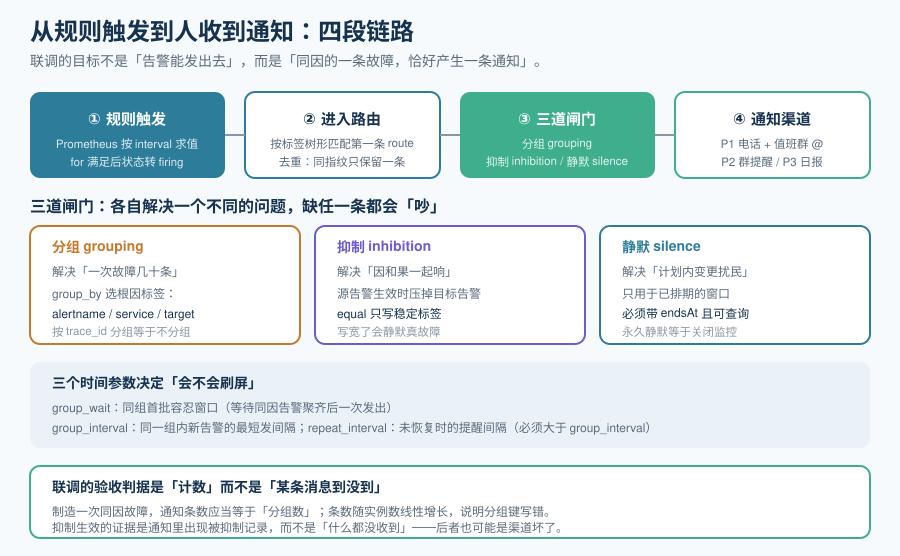

# 告警路由联调

第 126 天把「要不要叫人」写成了规则，第 130 天让规则能在运行时被加载。这一章补上最后一环：**告警真的到达人的手里，而且不是以「几十条」的形式到达**。

## 一句话定位

把第 126 天定稿的三条规则（`TargetDown` / `TargetScrapedZeroSamples` / `ServiceDown`）真正接到通知渠道，并验证「分组 / 抑制 / 静默」三道闸门在**真实告警风暴**下的行为。验收判据不是「收到了一条消息」，而是**「同因的一次故障，恰好产生一条通知」**。



## 一、四段链路：每一段都会独立地出问题

一条告警从「条件成立」到「人看到」，中间要过四段。**联调时必须逐段确认，因为四段的失败表现完全不同。**

| 段 | 职责 | 这一段失败的典型表现 |
| --- | --- | --- |
| ① 规则触发 | 按 `interval` 求值，`for` 满足后转 `firing` | 规则写错：永远不触发，或立即触发（`for: 0s` 用错地方） |
| ② 进入路由 | 按标签在 route 树里匹配第一条 `route`，并按指纹去重 | **默认路由缺失**：告警进了 Alertmanager 但没有任何 route 匹配它 → 静默丢弃 |
| ③ 三道闸门 | 分组、抑制、静默 | 分组键写错 → 一条故障几十条通知；抑制写宽 → 真故障被静默 |
| ④ 通知渠道 | 按 receiver 发到具体渠道并记录发送结果 | 渠道凭据过期、webhook 404 → 告警「发过了」但没人收到 |

::: danger 最隐蔽的一段是 ②
**「告警没响」的排查顺序，绝大多数人是从 ① 开始的，而真正的根因常常在 ②。** Alertmanager 的 route 树是**匹配第一条命中的 route**（除非显式写 `continue: true`），如果没有配默认兜底 route，一条标签不符合任何子 route 的告警会被**静默丢弃**——日志里甚至不会有显眼的报错。

自检口径：把 route 树里的每条 receiver 列出来，确认**每条都被至少一条 route 引用**（无孤儿 receiver），且**存在一条顶部兜底 route**。这条检查写进了 `AR-B`。
:::

## 二、通知渠道分级

渠道分级不是「看喜好」，而是由**打扰成本**反推的。这与 [告警规则与 Alertmanager](/docs/Ops/Monitoring/Alerting/index.md) 里那套三档强度是同一套口径，只是落到具体的 receiver 上。

| 档 | 触发来源 | 渠道 | 升级链路 | 适用 |
| --- | --- | --- | --- | --- |
| **P1** | 聚合后的硬故障（`ServiceDown` 这类已经过分母过滤的） | 电话 / 值班群 `@` | 15 分钟未确认 → 升级到第二值班 | 用户可感知的中断 |
| **P2** | 单点故障、采集异常（`TargetDown`、`TargetScrapedZeroSamples`） | 团队频道 | 30 分钟未处理 → 转 P1（人工或定时） | 有冗余兜住、但需要查 |
| **P3** | 趋势类、容量类 | 日报机器人 | 不升级 | 需要安排但不着急 |

::: warning 一条纪律：**P1 渠道只接聚合后的硬故障**
`TargetDown` 在 200 个实例的规模下，一次网络抖动可以让几十个实例同时 down。如果 `TargetDown` 直接接 P1，值班同学会在凌晨接到几十通电话。

正确做法是**两级聚合**：`TargetDown` 走 P2，再由一条 `ServiceDown`（按「该服务的可用实例占比 < 阈值」判定）走 P1。**「原始告警」与「叫人告警」必须分层，这是不吵的根本机制。**
:::

## 三、完整 `alertmanager.yaml`

```yaml [deploy/alertmanager/alertmanager.yaml]
global:
  resolve_timeout: 5m

# 通知模板（纯文本即可；不要在这里做逻辑判断，判断属于规则层）
templates: []

route:
  # 顶部兜底：不匹配任何子 route 的告警走 default receiver。
  # 没有这一条，未被匹配的告警会被静默丢弃（第 ② 段最常见的坑）。
  receiver: "p3-digest"
  group_by: ["alertname", "service", "env"]
  group_wait: 30s
  group_interval: 5m
  repeat_interval: 4h            # 必须大于 group_interval

  routes:
    # P1：只有聚合后的硬故障才允许打电话
    - matchers: ['severity="critical"']
      receiver: "p1-oncall"
      group_by: ["service", "env"]
      group_wait: 10s            # 硬故障不等：10 秒内聚齐同服务告警就发
      group_interval: 2m
      repeat_interval: 30m       # 未确认则半小时提醒一次
      continue: false

    # P2：单点故障与采集异常
    - matchers: ['severity="warning"']
      receiver: "p2-team"
      group_by: ["alertname", "service", "env"]
      group_wait: 30s
      group_interval: 5m
      repeat_interval: 4h

    # P3：趋势与容量，只进日报
    - matchers: ['severity="info"']
      receiver: "p3-digest"
      group_wait: 5m
      group_interval: 30m
      repeat_interval: 24h

inhibit_rules:
  # 抑制一：目标整体不可达时，不再报「这个目标没有样本」。
  # 两者是同一根因的「因」与「果」，同时响只会让人多看一眼。
  - source_matchers: ['alertname="TargetDown"']
    target_matchers: ['alertname="TargetScrapedZeroSamples"']
    equal: ["instance", "job"]

  # 抑制二：服务级硬故障时，压掉该服务的单点与采集类告警。
  - source_matchers: ['alertname="ServiceDown"']
    target_matchers: ['severity=~"warning|info"']
    equal: ["service", "env"]

  # 抑制三：采集端自身故障（配置/规则加载失败）时压掉全部采集类告警，
  # 因为它会让所有目标「看起来都 down」——这时真正的根因只有一个。
  - source_matchers: ['alertname="RuleLoadFailed"']
    target_matchers: ['severity=~"warning|info"']
    equal: ["env"]

receivers:
  - name: "p1-oncall"
    webhook_configs:
      - url: "http://notify-gateway:8080/p1"      # 由通知网关再转电话与群 @
        send_resolved: true
  - name: "p2-team"
    webhook_configs:
      - url: "http://notify-gateway:8080/p2"
        send_resolved: true
  - name: "p3-digest"
    webhook_configs:
      - url: "http://notify-gateway:8080/p3"
        send_resolved: false
```

::: info 为什么不做通知模板里的逻辑
Alertmanager 的模板只做**渲染**（把标签拼成一句话）。一旦把「什么时候该发」写进模板，规则的可测试性就没了——你会得到一份无法用 `amtool` 静态校验、也无法离线断言的通知文案。**判断留在规则层，渲染留在模板层。**
:::

## 四、怎样制造一次「真实的告警风暴」来联调

这是本章的核心：**不要只测「一条告警能不能发出去」，要测「N 条同因告警会变成几条通知」。**

```shell
# 0) 前置：配置合法性（最便宜也最该先跑）
amtool check-config deploy/alertmanager/alertmanager.yaml
# 期望：SUCCESS，并列出解析到的 receiver 数量

# 1) 制造「同因多实例」场景：把 5 个被监控目标一起停掉
#    目的：验证分组与抑制，而不是验证单条通知
for p in app-1 app-2 app-3 app-4 app-5; do
  docker compose stop "$p"
done

# 2) 观察 Alertmanager 里的活动告警（按分组看，不看单条）
amtool alert query --alertmanager.url=http://localhost:9093
# 期望：活动告警可能有 10 条（5 个 TargetDown + 5 个 TargetScrapedZeroSamples）
#       但按分组聚合后应当只有 1~2 组

# 3) 核对实际发出的通知条数（通知网关侧计数）
curl -s http://notify-gateway:8080/_stats | jq '.sent_total, .by_receiver'
# 期望：sent_total 增量与「分组数」一致；
#       若随实例数线性增长（≈10），说明 group_by 写错了 —— 这是本章最重要的一条判据

# 4) 验证抑制生效：被抑制的告警应当留下记录，而不是凭空消失
amtool alert query --alertmanager.url=http://localhost:9093 --output=json \
  | jq '[.[] | select(.status.inhibitedBy | length > 0) | .labels.alertname] | unique'
# 期望：包含 TargetScrapedZeroSamples（被 TargetDown 抑制）
#       返回空数组有两种可能：抑制没配对，或者根本没触发——必须继续查 ② 段

# 5) 验证静默：创建一个带到期时间的静默，到期后必须自动恢复
amtool silence add alertname=TargetDown --duration=2m --comment="联调：计划内重启"
amtool silence query
# 期望：endsAt 非空且在 2 分钟后；静默期内该告警不再产生通知
#       2 分钟后重新出现通知（这一步验证「静默会自己结束」）

# 6) 验证「告警会恢复」（不粘滞）
for p in app-1 app-2 app-3 app-4 app-5; do docker compose start "$p"; done
amtool alert query --alertmanager.url=http://localhost:9093 | wc -l
# 期望：活动告警回落到 0；若一直挂着，去查第 ① 段的 for 与 keep_firing_for
```

## 五、五个必须避开的坑

::: danger 逐条给出正确写法
1. **`inhibit_rules` 的 `equal` 里写了会变化的标签。**
   `equal` 的语义是「源与目标的这个标签**值相等**时才抑制」。写 `equal: ["alertname"]` 等于条件永不成立（源与目标的 alertname 必然不同），抑制静默失效；写 `equal: ["instance"]` 时要注意端口变化会让它失配。
   **正确写法**：只写**稳定**的标识标签（`service`、`env`、`job`），不写 `instance` 的端口部分（用第 123 天的标签规范里那种归一后的标签）。

2. **`repeat_interval` 小于 `group_interval`。**
   结果不是「更及时」，而是**参数被静默忽略**（Alertmanager 内部取较大者），你以为设成了 30 分钟提醒，实际是 5 分钟一轮。**正确写法**：`repeat_interval > group_interval`，且在配置里写注释说明依据。

3. **`group_by: []`（空数组）**。
   空数组在语义上是「把所有告警聚成一堆」——一次故障会和你所有无关的告警混在一条通知里。**正确写法**：显式列出根因标签；**且不要用 `trace_id`、`request_id` 这类高基数标签**（等于按单条告警分组）。

4. **用静默代替抑制。**
   静默是**人工的、有到期时间的、用于计划内变更的**；抑制是**规则的、自动的、由根因触发的**。用静默处理「每天凌晨的批处理告警」，一周后你会有一堆忘记到期的静默——**而永久静默就是关闭监控**。**正确写法**：周期性、可预测的场景用 `time_intervals`，不用静默。

5. **只验证「发了」，没验证「恢复了」。**
   粘滞告警（该恢复的不恢复）比不告警更伤信任，因为它会让人开始忽略通知。**正确写法**：每条 P1 规则都要有一条「恢复」验证命令，并写进本章的 `AR-F`。
:::

## 六、判据表

| 编号 | 判据 | 类别 | 本机可否判 |
| --- | --- | --- | --- |
| **AR-A** | `amtool check-config` 通过，receiver 与 route 均被解析 | 静态 | ✅ 可判（需 `amtool` 二进制） |
| **AR-B** | 每条 receiver 都被至少一条 route 引用，且存在顶部兜底 route | 静态 | ✅ 可判 |
| **AR-C** | 同因 5 实例故障产生的通知条数等于分组数（不随实例数增长） | 动态 | ⏳ 未跑 |
| **AR-D** | 被抑制的告警在 Alertmanager 里留下 `inhibitedBy` 记录 | 动态 | ⏳ 未跑 |
| **AR-E** | 所有静默都有 `endsAt`，且静默到期后告警自动恢复 | 静态 + 动态 | ⏳ 未跑 |
| **AR-F** | P1 规则实测可恢复（不粘滞），且 `repeat_interval > group_interval` | 静态 + 动态 | ⏳ 未跑 |
| **AR-G** | `inhibit_rules` 的 `equal` 只含稳定标签（无 `alertname`、无高基数标签） | 静态 | ✅ 可判 |
| **AR-H** | 月度复核：静默列表为空或全部在有效期内；通知渠道各档实测可达 | 流程 | ⏳ 未跑 |

::: info 与既有判据族的边界（判据唯一性）
本表**不新增与第 126 天 `RL` 族或第 130 天 `RR` 族重叠的判据**：

- `RL-A~RL-G`（第 126 天）管**规则怎么写**：告警表达式、命名、`for` 取值依据。一条规则可以写法完全正确（RL 全绿）却因为 route 缺兜底而**一条通知都发不出来**。
- `RR-A~RR-H`（第 130 天）管**规则怎么被加载与生效**：热更新入口、原子性、失败保留旧规则。
- `AR-A~AR-H`（本章）管**告警怎么被路由到人**：分组键、抑制的 `equal`、静默的到期、渠道的可达性。

三者是「写对 → 载入 → 送达」三段，**任何一段全绿都不能推出下一段成立**。这是本章刻意独立成判据族的理由。
:::

## 当日做了什么 / 如何验证 / 下一步

**做了什么**：

1. 画出**四段链路**（规则触发 → 进入路由 → 三道闸门 → 通知渠道）并逐段写出失败表现；明确定下本章的排查顺序是**从 ② 段开始**，而不是从规则开始。
2. 定稿**通知渠道三档分级**（P1 电话 + 值班群 `@` / P2 团队频道 / P3 日报），并写死一条纪律：**P1 只接聚合后的硬故障**，`TargetDown` 走 P2、由 `ServiceDown` 触发 P1。
3. 给出完整 `alertmanager.yaml`：三层 `severity` 路由 + **顶部兜底 route** + 三条 `inhibit_rules` + 三个 receiver，并说明「为什么不在通知模板里做逻辑判断」。
4. 定稿**告警风暴联调方法**：不是测单条通知，而是**制造 5 实例同因故障、核对「通知条数 = 分组数」**；并给出「抑制证据是 `inhibitedBy` 记录，而不是什么都没收到」这条判读规则。
5. 把五个坑写成对照式的正确写法，其中两条会**静默失效**：`equal` 写了会变化的标签、`repeat_interval < group_interval`（后者会被 Alertmanager 静默取较大值）。
6. 定稿 `AR-A~AR-H` 判据表，并交代它与第 126 天 `RL` 族、第 130 天 `RR` 族的**判据唯一性**边界（写对 → 载入 → 送达三段不可互相推出）。

**如何验证**：静态三条（`AR-A` / `AR-B` / `AR-G`）在本机可判——`AR-A` 用 `amtool check-config`，`AR-B` 与 `AR-G` 直接核对配置内容（receiver 引用、route 兜底、`equal` 标签集合）。动态五条（`AR-C` / `AR-D` / `AR-E` / `AR-F` / `AR-H`）标 `⏳ 未跑`，原因如实写两条：**本仓不含工程代码**（Alertmanager 与通知网关都要真实运行）、**需要真实的通知渠道**（电话与群 `@` 无法在本机验证）。**不把期望值抄进状态列。**

**下一步**：第 132-134 天完成**第 2 周收口**——把第 128~131 天落地的四个组件（C1 指标暴露、C6 看板数据服务、规则热更新、告警路由）按第 127 天的五份契约逐条对账，输出「核心编码」阶段的验收结论与遗留项清单，为第 3 周（第 135-141 天）的端到端联调、告警实测与容量验证铺路。

## 参考资料

- [监控告警专题](/docs/Ops/Monitoring/index.md)（指标类型、抓取模型与规则设计的方法论基座）
- [监控告警 · 告警设计](/docs/Ops/Monitoring/Alerting/index.md)（分组、抑制、静默的写法与「可行动才告警」）
- [查询与规则设计](../Rules/index.md)（本项目的 `RL` 族判据：规则怎么写；本章三道闸门的第一版在这里定稿）
- [规则加载与热更新](../RuleReload/index.md)（`RR` 族判据：规则怎么载入与生效）
- [接口契约与工程骨架](../Contracts/index.md)（配置三层划分：结构进仓库、值进环境变量、密钥进密钥管理）
- [故障应急体系 · 值班制度](/docs/Ops/IncidentResponse/OnCall/index.md)（「哪条告警有资格变成电话」的判定标准归那边）
- [故障应急体系 · 应急预案与运行手册](/docs/Ops/IncidentResponse/Runbook/index.md)（`runbook_url` 指向的文档要「可执行」，不只是「存在」）
- Alertmanager 配置参考：https://prometheus.io/docs/alerting/latest/configuration/
