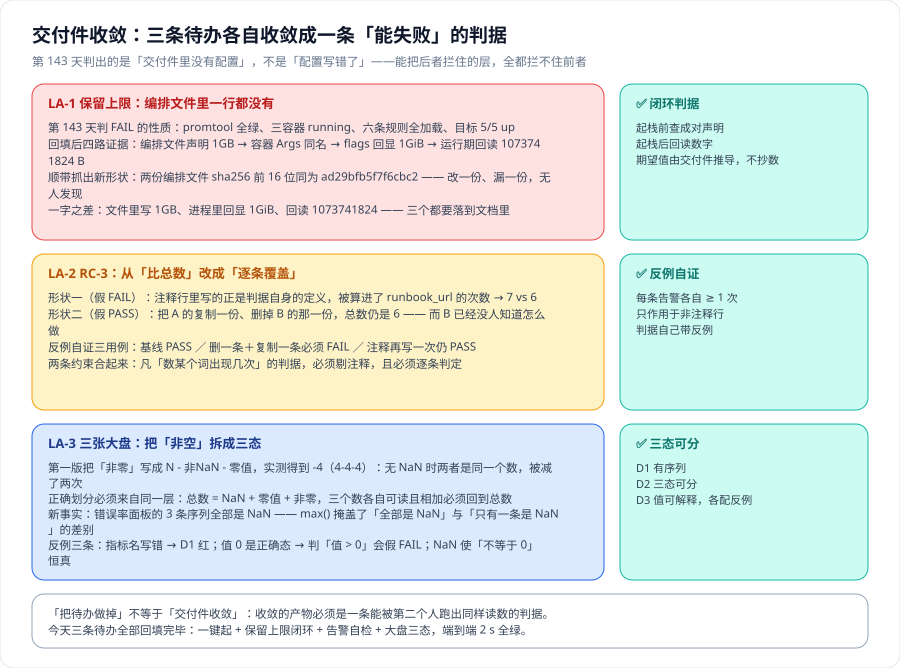

# 交付件收敛：把三条判据侧待办回填成交付件里的配置

第 4 周第 5 步。第 4 周前四步分别解决了「**把联调态收敛成可交付态**」（第 140 天）、「**容量基线重测**」（第 141 天）、「**一键起与大盘可用性**」（第 142 天）、「**上线验收收口**」（第 143 天）。昨天判出了整条验收链上**唯一一条 FAIL**，并立下 `LA-1`~`LA-3` 三条待办。

**今天不加任何功能**，只把这三条做掉——但重点不是「改配置」，而是**把每条待办收敛成一条能被第二个人跑出同样读数的判据**。



::: tip 本页最重要的一句话
**「把待办做掉」不等于「交付件收敛」。** 昨天那条 FAIL 的性质是「**交付件里没有配置**」，它不是语法错误、也不是服务异常——`promtool` 全绿、三容器 running、六条规则全加载、五个目标全 up，**能把后两者拦住的每一层都拦不住它**。

所以处置它不能靠「记住了下次改」，只能靠**给它补一条判据**——而且这条判据必须能回答一个问题：**它怎样才能失败。**
:::

## 一、先把「做掉」拆成两件事

| 待办 | 表面上的动作 | 收敛后的产物（真正要交付的东西） |
| --- | --- | --- |
| `LA-1` | 在编排文件里加一行 `--storage.tsdb.retention.size=1GB` | **闭环判据**：交付件声明 → 进程 flags → 运行期回读，三处一致，且期望值**从交付件推导** |
| `LA-2` | 把 `RC-3` 的 7 改成 6 | **逐条覆盖判据 + 反例自证**：每条告警各自 ≥ 1 次，并用三条用例证明它「能失败」 |
| `LA-3` | 给三张大盘补三条判别式 | **三态划分判据**：总数 = NaN + 零值 + 非零，三个数相加必须回到总数 |

一句话判据：**如果一条待办的产物只是一次「改好了」，而没有多出一条判据，那它就是第 140 天那次错误的重复。**

## 二、`LA-1`：保留上限——一条配置改动，为什么要四路证据

### 2.1 改动前的状态（第 143 天实测）

```shell
grep -rn 'retention.size' /tmp/monitoring-run --include='*.yaml'
# → （无输出）
docker inspect monitoring-min-metrics-collector-1 --format '{{join .Args " "}}'
# → --config.file=/etc/prometheus/prometheus.yml --storage.tsdb.retention.time=15d --web.enable-lifecycle
curl -s --get --data-urlencode 'query=prometheus_tsdb_retention_limit_bytes' localhost:19090/api/v1/query
# → 0
```

`0` 的意思是**没有空间上限**——只有时间上限（`15d`）。两个上限在 Prometheus 里是「先到者触发」，缺一个就等于缺一半保护。

### 2.2 改动与重建

两份编排文件的 `command` 段各加一行：

```yaml
    command:
      - --config.file=/etc/prometheus/prometheus.yml
      - --storage.tsdb.retention.time=15d
      - --storage.tsdb.retention.size=1GB     # ← 第 140 天定的值，今天才落到文件里
      - --web.enable-lifecycle
```

```shell
cd /tmp/monitoring-run && docker compose up -d
# → monitoring-min-metrics-collector-1  Recreate
# → monitoring-min-metrics-collector-1  Recreated
# → monitoring-min-metrics-collector-1  Starting / Started
```

::: warning 这次 `Recreate` 是正确的，不是幂等被破坏
第 143 天用「二次 `up -d` 三行全 `Running`、无 `Recreated`」判幂等。**今天改了 `command`，容器必须重建**——幂等判的是「同样的输入再跑一次不产生副作用」，不是「永远不许重建」。把这两件事混为一谈，会得到一条「改配置反而算违规」的荒唐判据。
:::

### 2.3 四路证据

| # | 证据 | 读数 |
| --- | --- | --- |
| ① | 交付件（编排文件） | `compose.yaml:8` 与 `compose.singlefile.yaml:8` 均为 `--storage.tsdb.retention.size=1GB` |
| ② | 容器启动参数 | <span v-pre>`docker inspect ... --format '{{join .Args " "}}'`</span> → `... --storage.tsdb.retention.time=15d --storage.tsdb.retention.size=1GB --web.enable-lifecycle` |
| ③ | 进程内 flags 回显 | `/-/status/flags` → `storage.tsdb.retention.size = 1GiB` |
| ④ | 运行期暴露的数字 | `prometheus_tsdb_retention_limit_bytes` = **1073741824** |

**为什么四路缺一不可**：

- 只留 ① → 就是昨天那条 FAIL：配置在文件里，但没人知道它有没有生效；
- 只留 ④ → 就是第 141 天那个错：读数是 `1073741824`，但**读数来自一个后来已经不存在的容器状态**。

**① 与 ④ 之间必须有一条能被第二个人复现的连接**，而 ②③ 就是那条连接：② 证明「编排文件决定了进程参数」，③ 证明「进程参数就是进程内生效的值」。

### 2.4 一字之差：写 `1GB`、回显 `1GiB`

① 与 ③ 的字面并不相等：文件里写 **`1GB`**，flags 回显 **`1GiB`**，回读的数字是 **`1073741824`**（= 1024³）。

这不是 bug，是**同一个值的三种写法**——但它正是「口径名 + 获取方式」纪律的一个具体形状：**任何一处引用这个上限时，都必须能说清「以哪一份为准」。** 本项目的口径定为：**以 ④ 的字节数为准**（唯一能被程序直接比较的形式），① 与 ③ 只作为人读的中间证据。

::: danger 闭环里的期望值必须由 ① 推导，不许抄
第 140 天的错误形态就是「把 `1GB` 写进一处文档、把 `1073741824` 写进另一处文档」，而两处**没有任何机制保证一致**。

所以闭环判据里那个期望值是**从编排文件里读出来、当场换算出来的**（`1GB` → `1024³`），不是常量。这样只要有人把文件改成 `2GB` 而忘记改别处，判据会**自己跟着变**，而不是继续拿旧数字比对。
:::

### 2.5 顺带抓出的新形状：两份交付件内容完全相同

```shell
shasum -a 256 compose.yaml compose.singlefile.yaml | awk '{print substr($1,1,16), $2}'
# → ad29bfb5f7f6cbc2 compose.yaml
# → ad29bfb5f7f6cbc2 compose.singlefile.yaml
```

两份编排文件的 sha256 前 16 位**完全相同**。这件事有两个后果：

1. **「多份编排文件」制造的是虚假冗余感。** 改完 `compose.yaml`，另一份「看着也是对的」（因为内容相同）——但 Compose 默认只读 `compose.yaml`，`compose.singlefile.yaml` 要显式 `-f` 才生效。**改了不生效的那一份，等于没改。**
2. **漂移无人发现。** 一旦有人只改一份，两份就开始不一致，而**没有任何一层会发现**：`promtool` 不读编排文件，容器状态也不受影响。

因此 `LA-1` 的判据**不能写成「某一份文件里有」**，必须写成**成对声明**——「声明了 `retention.time` 的地方，必须同时声明 `retention.size`」：

```shell
grep -rl --include='*.yaml' --include='*.yml' 'storage\.tsdb\.retention\.time' . | sort
# 对每一份命中的文件，逐个要求它也含 'storage\.tsdb\.retention\.size'
```

**实测**：命中 **2 份**，两份都成对 ✅。**反例**（把 `compose.singlefile.yaml` 里那一行删掉）：

```text
=== 第 0 层：交付件一致性（保留上限成对声明）===
  ❌ ./compose.singlefile.yaml 声明了 retention.time 但没有 retention.size
```

判据当场判 ❌，并**点名是哪一份文件**——这是「报位置」纪律（第 124 天 `MG` 族）在交付件层的复用。

**这条判据的普适形式**：**一份交付件里成对出现的配置，必须成对声明。** 只声明其中一个的后果不是「少一个功能」，而是「另一个维度没有上限」——而「没有上限」在正常态**永远不会报错**，所以它只能被这种成对判据拦住。

### 2.6 为什么这条判据要放在起栈之前

新判据加在 `bin/one-click-up.sh` 的**第 0 层**——即 `docker compose up -d` **之前**：

```text
=== 第 0 层：交付件一致性（保留上限成对声明）===
  ✅ 2 份声明了 retention.time 的编排文件都同时声明了 retention.size
=== 第 0 步：起栈 ===
```

理由：起完栈再发现交付件缺配置，**你已经把一份不完整的交付件跑起来了**；而「交付件缺配置」恰恰**不会让起栈失败**——这正是昨天它躲过全部检查的原因。

## 三、`LA-2`：`RC-3` 从「比总数」改成「逐条覆盖」

### 3.1 昨天的形状只是两种里的一种

第 143 天登记的是**形状一（假 FAIL）**：注释行里写的正是判据自身的定义，被算进了计数。

```shell
grep -c runbook_url prometheus/alerting.yaml          # → 7（含一行注释）
grep -c '      - alert:' prometheus/alerting.yaml     # → 6
```

今天在写自检用例时又构造出**形状二（假 PASS）**：

| 操作 | `runbook_url` 总数 | 逐条覆盖 |
| --- | --- | --- |
| 基线 | 6 | **6/6** ✅ |
| **A 复制一条 + 删掉 B 的那一条** | **6（不变）** | **5/6** ❌ |

形状二比形状一危险得多：它**不是假红，是假绿**。在总数判据下这份文件完全合格，而实际上有一条告警的处置手册**已经不存在了**——这恰恰是 `runbook_url` 要防的事。

::: danger 两条合起来的结论
凡「数某个词出现了几次」的判据，有**两条**约束，缺一不可：

1. **只作用于非注释行**——否则「把口径写清楚」会让判据变红（而注释的作用恰恰是写清口径）；
2. **逐条判定，而不是比总数**——否则「A 多一条、B 少一条」会被判成合格。
:::

### 3.2 收敛后的判据

`scripts/check-alerts.py` 的 `RC-3` 段落改成**逐条覆盖 + 非注释口径**，并新增 `--selftest`：

```shell
python3 scripts/check-alerts.py --selftest
```

```text
--- RC-3 runbook_url 覆盖（逐条告警 · 非注释口径）---
  ✅ ServiceDown                      runbook_url × 1
  ✅ TargetDown                       runbook_url × 1
  ✅ TargetScrapedZeroSamples         runbook_url × 1
  ✅ HighErrorRate                    runbook_url × 1
  ✅ CollectorScrapeSlow              runbook_url × 1
  ✅ TSDBRetentionSizeTriggered       runbook_url × 1
  → 告警 6 条，runbook_url 共 6 次，未覆盖 0 条

--- RC-3 判据自检（反例自证） ---
  用例 1 基线：6 条告警，未覆盖 0 条 → ✅ PASS
  用例 2 删一条 + 复制一条：总次数 6 → 6（不变），未覆盖 1 条 ['TSDBRetentionSizeTriggered']
                            → ✅ 逐条判据抓得到（总数判据抓不到）
  用例 3 注释里再写一次 runbook_url：6 条告警，未覆盖 0 条 → ✅ PASS（注释不参与计数）
  → 自检结论：全绿 ✅
```

**用例 2 是这一节的核心**：它把「总数判据」与「逐条判据」放在**同一份输入**上对照，两种判据给出**相反结论**。这比任何说明文字都更能证明判据该写成哪一种——也正是「写完一条判据，先问它怎样才能失败」这条纪律的可执行形态。

**用例 3 是回归守卫**：它专门复现第 143 天的形状一。只要有人把注释重新计入计数，用例 3 立刻变红。

## 四、`LA-3`：三张大盘——划分必须来自同一层

### 4.1 第一版算出了一个负数

第一版把「非零序列数」写成「总数 − 非NaN − 零值」：

```text
count(E) − ( count(E) − count(E == E) ) − count(E == 0)
```

对 `svc:http_requests:rate5m`（4 条序列、值全为 0）实测：

```text
4 − 4 − 4 = -4
```

**原因是它把「全量」与「非NaN」当成了两个不同的集合**——而无 NaN 时 `count(E)` 与 `count(E == E)` 是同一个数，于是被减了两次。

**正确的三态必须是对总数的划分，且三份来自同一次取样**：

| 量 | 表达式 | 实测（`svc:http_requests:rate5m`） |
| --- | --- | --- |
| 总数 | `count(E) or vector(0)` | 4 |
| 其中 NaN | `count(E) or vector(0)` − `count(E == E) or vector(0)` | 0 |
| 其中零值 | `count(E == 0) or vector(0)` | 4 |
| 其中非零 | `count(E == E) or vector(0)` − `count(E == 0) or vector(0)` | 0 |

**校验**：0 + 4 + 0 = 4 = 总数 ✅。

::: warning NaN 要用 `E == E` 判，不要用「不等于 0」
IEEE 754 下 `NaN == NaN` 为假，所以 `count(E == E)` 数出来的正是**非 NaN** 的序列数——这是 PromQL 里不依赖字符串比较的 NaN 判别式。反过来，用「值不等于 0」判 NaN 会**恒真**（`NaN != 0` 为真），除零就被静默放行了。

还有一条同族陷阱：`count(<空选择>)` 返回的是**空向量**而不是 `0`。实测 `count(E) - count(E == E)` 在 E 全是 NaN 时返回空向量——**整个差值式退化成空向量**，与「查询写错」不可区分。所以每个 `count(...)` 后面都必须跟 `or vector(0)`；第 143 天推荐的「差值式天然是数字」只在两个操作数都非空时成立。
:::

### 4.2 三条判别式落地

新建 `scripts/check-panels.sh`，对三张大盘的关键表达式各出三个数（`D1 有序列` / `D2 三态可分` / `D3 值可解释`）：

```text
--- 值班总览 ---
  值班总览 业务流量  svc:http_requests:rate5m
    ✅ D1 有序列      count = 4
    ✅ D2 三态可分    NaN 0 + 零值 4 + 非零 0 = 总数 4
    ✅ D3 值可解释    无非零序列，但原因可判定：靶服务无流量，速率恒 0（存在零值序列）
  值班总览 全站请求量  sum(rate(http_requests_total[5m]))
    ✅ D1 有序列      count = 1
    ✅ D2 三态可分    NaN 0 + 零值 1 + 非零 0 = 总数 1
    ✅ D3 值可解释    无非零序列，但原因可判定：静态 .prom 计数不增长（存在零值序列）
--- 服务详情 ---
  服务详情 错误率  svc:http_error_ratio:rate5m
    ✅ D1 有序列      count = 3
    ✅ D2 三态可分    NaN 3 + 零值 0 + 非零 0 = 总数 3
    ✅ D3 值可解释    无非零序列，但原因可判定：分子分母同为 0 → 除零（无零值序列）
  服务详情 服务健康  up
    ✅ D1 有序列      count = 5
    ✅ D2 三态可分    NaN 0 + 零值 0 + 非零 5 = 总数 5
    ✅ D3 值可解释    有 5 条非零序列（业务在动）
--- 自监控 ---
  自监控 序列数   prometheus_tsdb_head_series   → 1 / NaN 0 + 零值 0 + 非零 1 = 1
  自监控 自采集目标  up{job="prometheus"}        → 1 / NaN 0 + 零值 0 + 非零 1 = 1
```

**注意 `D3` 对「值 0」与「NaN」都不判 FAIL**——它们是**有原因的正确态**：前者因为靶服务的计数来自静态 `.prom` 文件、只有压测时才增长（第 139 天登记的 `R-9`），后者因为分子分母同为 0。判据要做的不是把它们标红，而是**证明自己能区分它们**。

### 4.3 三条反例（各配一条）

| 判据 | 反例（必须能被判出来） |
| --- | --- |
| `D1 有序列` | 指标名写错（`no_such_metric_xyz`）→ 裸 `count(...)` 返回**空向量**（与查询写错不可区分）；加 `or vector(0)` 后是 `0` → 判 ❌ |
| `D3 值可解释` | 期望「值 > 0」而实测 `0`（静态 `.prom` 无流量）→ **假 FAIL**；实测聚合值 `0` 而序列数 `7`，两者必须分开判 |
| `D2 三态可分` | `max(svc:http_error_ratio:rate5m)` = `NaN`，而「不等于 0」在 NaN 上**恒真** → 除零被放行 |

```shell
bash scripts/check-panels.sh --selftest
# [反例 1 → D1]   裸 count(...) = EMPTY   /   count(...) or vector(0) = 0        → ✅
# [反例 2 → D3]   聚合值 = 0，序列数 = 7                                          → ✅
# [反例 3 → D2/D3] max = NaN；count(E) - count(E == E) = 3；不加兜底 = EMPTY       → ✅
```

### 4.4 今天新看清的两条事实

1. **错误率面板的 3 条序列「全是 NaN」**，不是「其中一条是 NaN」。第 143 天只看到 `max(svc:http_error_ratio:rate5m)` = `NaN` —— **`max()` 把「全部是 NaN」与「只有一条是 NaN」压成了同一个读数**。三态划分才把它分开：`NaN 3 + 零值 0 + 非零 0 = 3`。
2. **录制规则的聚合比**：`count(http_requests_total)` = **7**（原始序列），`count(svc:http_requests:rate5m)` = **4**（录制产物序列）。差值 3 就是 recording 规则把多个 `job` 的同名指标压进 `svc` 维度后**减少的序列数**——这条正是第 141 天「写入速率由采集侧序列数决定」的现场佐证。

### 4.5 顺带修掉的一处标签错

`check-panels.sh` 的 `D2` 那一行，第一版把 `count(E) - count(E == E)` 的结果标成「**非NaN**」，但那个数算出来的恰恰是 **NaN 的条数**：

```text
第一版输出：✅ D2 三态可分    非NaN 3 + 零值 0 + 非零 0 = 总数 3   ← 3 是 NaN 的条数，标签写反了
修正后：    ✅ D2 三态可分    NaN 3 + 零值 0 + 非零 0 = 总数 3
```

**一个标签写反的判据比没有判据更糟**：读的人会照字面理解，把「3 条正常」当成结论。这与第 138 天「`DA3` 自匹配恒 FAIL」、第 143 天「超宽口径致正常态假阳性」是同一族——**今天第四次遇到「判据的输出与人读到的意思不一致」**。它之所以能被发现，靠的还是那句话：**先问它怎样才能失败**（写不出反例的那一栏，标签错了也看不出来）。

## 五、判据表：`ACV-A` ~ `ACV-H`

八条判据覆盖「三条待办是否真的收敛成交付件里的配置」与「收敛后的判据是否可执行」两类。沿用判据唯一性纪律，本页**不新增与 `LA-*` / `OC-*` / `CB-*` / `RC-*` 重叠的判据**。

| 判据 | 内容 | 怎么验证 | 本机状态 |
| --- | --- | --- | --- |
| `ACV-A` | 保留上限在**交付件**里成对声明（有 `retention.time` 的地方必须有 `retention.size`） | 对每份命中文件逐个 `grep`，未成对的文件数 = 0 | ✅ 已跑（2 份，成对） |
| `ACV-B` | 保留上限的期望值**由交付件推导**，不是常量 | 检查判据里期望值的来源（`1GB` → `1024³`） | ✅ 已跑（1073741824） |
| `ACV-C` | 保留上限的**闭环**成立（① 交付件 → ③ flags → ④ 回读，三处一致） | 三处读数各自打印并比对 | ✅ 已跑（`1GB` / `1GiB` / `1073741824`） |
| `ACV-D` | 数词类判据**只作用于非注释行** | 同一判据在含注释与不含注释两种输入下的读数 | ✅ 已跑（用例 3 PASS） |
| `ACV-E` | 数词类判据**逐条判定**，不比总数 | 构造「A 复制一条 + B 删一条」使总数不变，判据必须变红 | ✅ 已跑（用例 2 FAIL） |
| `ACV-F` | 三张大盘的三态构成对总数的**划分**（相加回到总数） | 三个数相加与总数比对 | ✅ 已跑（每一行都配平） |
| `ACV-G` | 每条新判据**自带至少一条反例**，且反例能跑 | `--selftest` 退出码为 0 且三个用例结论正确 | ✅ 已跑（两处 `--selftest`） |
| `ACV-H` | 交付件一致性判据放在**起栈之前** | `one-click-up.sh` 的执行顺序（第 0 层先于第 0 步） | ✅ 已跑（第 0 层在前） |

## 六、当日做了什么

1. **`LA-1` 回填**：在两份编排文件里补 `--storage.tsdb.retention.size=1GB`，重建采集器容器，拿到**四路证据**（编排文件 / 容器 `Args` / `flags` 回显 / 运行期回读 **1073741824**），并把期望值改成**从交付件推导**。
2. **抓出并处置新形状**：两份编排文件 sha256 前 16 位同为 `ad29bfb5f7f6cbc2`——「多份交付件」是**虚假冗余感**，判据必须写成**成对声明**而不是「某一份里有」。判据落进 `bin/one-click-up.sh` 的**第 0 层**（起栈之前），实测 2 份全绿、删一行当场点名判 ❌。
3. **`LA-2` 回填**：`RC-3` 从「比总数」改成「**逐条覆盖 + 非注释口径**」，新增 `--selftest` 三条用例——基线 PASS、**删一条 + 复制一条（总数不变）必须 FAIL**、注释再写一次仍 PASS。后两条分别证明「判据能失败」与「第 143 天缺陷不复发」。
4. **`LA-3` 回填**：新建 `scripts/check-panels.sh`，把三张大盘的「非空」拆成 `D1 有序列` / `D2 三态可分` / `D3 值可解释`，各配一条反例。**第一版把「非零」写成 `总数 − 非NaN − 零值`，实测得到 `-4`**——三态必须取自同一层的划分（`总数 = NaN + 零值 + 非零`）。
5. **新看清两条事实**：错误率面板的 3 条序列**全是 NaN**（`max()` 把「全部」与「一条」压成同一个读数）；`count(http_requests_total)` **7** → `count(svc:http_requests:rate5m)` **4**，差值 3 就是 recording 的聚合比。
6. **修掉一处标签错**：`D2` 把 NaN 的条数标成「非NaN」——今天第四次遇到「判据输出与人读到的意思不一致」。
7. **端到端复跑**：`bash bin/one-click-up.sh` 全绿，含第 0 层交付件一致性、三级就绪、告警自检、保留上限闭环，**总耗时 2 s**（热启动）。第 143 天的六层验收**唯一那条 FAIL 已关闭**。

## 七、如何验证

```shell
cd /tmp/monitoring-run

# 1) 交付件成对声明（ACV-A）—— 期望：2 份命中，逐份都成对；删任一行为反例
grep -rl --include='*.yaml' 'storage\.tsdb\.retention\.time' . | sort
grep -n 'retention' compose.yaml compose.singlefile.yaml

# 2) 保留上限闭环（ACV-B / ACV-C）—— 期望：① 1GB → ③ 1GiB → ④ 1073741824
bash bin/one-click-up.sh | sed -n '/保留上限闭环/,+2p'

# 3) RC-3 逐条覆盖 + 反例自证（ACV-D / ACV-E）—— 期望：6 条各 ×1；用例 1/3 PASS、用例 2 FAIL 被抓
python3 scripts/check-alerts.py --selftest | sed -n '/RC-3/,$p'

# 4) 三张大盘的三态划分 + 反例（ACV-F / ACV-G）—— 期望：每一行三个数相加等于总数
bash scripts/check-panels.sh --selftest

# 5) 起栈顺序（ACV-H）—— 期望：第 0 层出现在第 0 步之前
bash bin/one-click-up.sh | head -4
```

**预期结果读法**：第 1 步应列出 **2 份**文件且都含 `retention.size`；第 2 步应打印 `① 交付件声明 1GB → ② flags 回显 1GiB → ③ 运行期回读 1073741824 B（期望 1073741824 B，由 ① 推导）`；第 3 步应看到用例 2 的 **`总次数 6 → 6（不变）`** 与 `未覆盖 1 条`——**总数不变而判据仍变红，正是「逐条判定」与「比总数」的区别所在**；第 4 步应看到每一行的 `a + b + c = 总数` 都配平，且三条反例全绿。

## 八、下一步

第 4 周还剩第 146~147 天与整周收口：

| 待办 | 内容 | 归属 |
| --- | --- | --- |
| **交付文档三件套** | 按第 143 天定义的边界真正写出《从零复现指南》/《上线验收清单》/《故障应对索引》，三份各只回答一个问题、各配一个「写了等于没写」的反例 | 本目录 |
| `L3` | 真实通知渠道四项前置（凭据 / 模板 / 限流重试 / `resolved`） | 第 140 天登记，仍未解 |
| 从零复现 | 一台**干净机器**上按《从零复现指南》执行一遍（脏机器上复现成功不构成证据） | 第 143 天登记 |
| 同步性判据的推广 | 「成对声明的配置」目前只有保留上限一对；`L3` 解掉时要按同一条判据检查通知渠道的凭据与模板是否成对 | 本页登记 |

::: tip 下一轮最容易犯的错
**把《从零复现指南》写成《项目总结》。** 第 143 天已经写过这条反例：三份文档的**共同点是以「读者要做的动作」开头**——验收清单的读者是**执行者**，不是评审者。一份读起来很完整的项目总结，对这个项目的上线**没有任何帮助**。

同理，三件套真正的验收方式不是「读一遍觉得写清楚了」，而是**在一台干净机器上照着做一遍**——而这件事恰恰是第 143 天登记、今天仍然 `⏳` 的那一条。
:::

## 参考资料

- Prometheus 官方文档 · Storage（`--storage.tsdb.retention.time` / `.size` 与「先到者触发」）：<https://prometheus.io/docs/prometheus/latest/storage/>
- Prometheus 命令行标志（`1GB` 与 `1GiB` 的解析口径）：<https://prometheus.io/docs/prometheus/latest/command-line/prometheus/>
- Prometheus HTTP API · `/api/v1/status/flags`（进程内实际生效的 flag 值）：<https://prometheus.io/docs/prometheus/latest/querying/api/>
- PromQL 基础 · 空向量与 `vector()` / 比较运算符（`or vector(0)` 兜底、NaN 的比较语义）：<https://prometheus.io/docs/prometheus/latest/querying/basics/>
- Docker Compose · 多文件与默认文件名（`compose.yaml` 优先，`-f` 显式指定）：<https://docs.docker.com/compose/multiple-compose-files/>
- Google SRE Workbook · Launch Coordination Checklist（上线验收清单的形态）：<https://sre.google/workbook/launch-checklist/>
- 本仓相关章节：[上线验收收口](../LaunchAcceptance/index.md)、[一键起与大盘可用性](../OneClickUp/index.md)、[容量基线重测](../CapacityBaseline/index.md)
