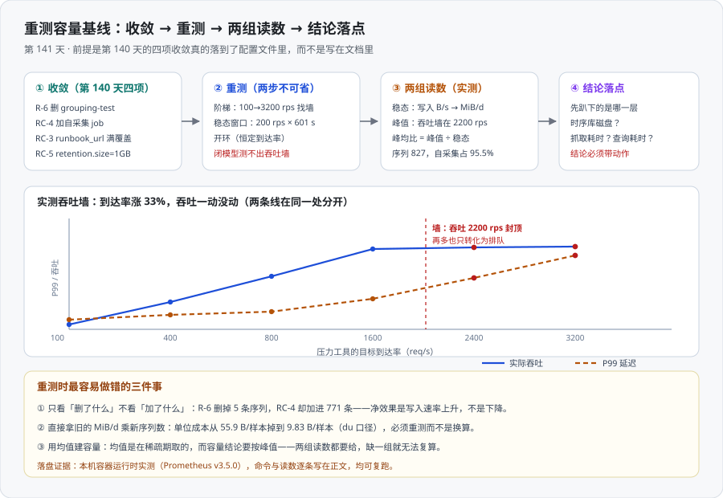

# 容量基线重测：把 ⏳ 换成交付态实测值

一句话定位：**换一个输入重跑一次容量测量**——第 138 天的 `12.76 MiB/d` 是「补流量前 + 含 `grouping-test` + 无自采集」的读数，而第 140 天把这三件事全改了。本章用本机容器运行时把交付态真的跑起来，把第 140 天标注的三条 `⏳ 未跑` 判据换成本机实测值，并回答它留下的三个问题（新基线的输入是什么 / `1 GB` 上限要不要跟着调 / 上线的第一道告警挂在哪）。

::: tip 一句话理解
**重测不是「再跑一次」，而是「换一个输入再跑一次」。** 单看「删了 `grouping-test`」会以为写入速率要降；实测结果是**升到 3.6 倍**——因为同一批改动里还有一个更大的动作：采集器开始抓自己（`RC-4`），而它一条 job 就贡献了全部序列的 **95.5%**。
:::

## 一、为什么必须重测，而不是换算

第 140 天已经写死「`12.76 MiB/d` 这个基线随之作废」，但「作废」之后有三条路：① 直接乘一个比例换算；② 干脆沿用旧数；③ 重测。本章选 ③，理由是三条都来自本轮的实测。

| 为什么不能换算 | 本轮证据 |
| --- | --- |
| **输入变了，且方向不止一个** | `R-6` 删掉 5 条序列（−0.333 samples/s），`RC-4` 加进 771 条（+51.4 samples/s）——两个动作方向相反、量级差 150 倍，**净效果与直觉相反** |
| **单位成本不是一个常数** | 旧基线折算约 **56.0 B/样本**（模型口径），本轮实测 **9.83 B/样本**（`du` 口径）——**差 5.7 倍**。因为新增序列时要额外写索引与元数据，序列数稳定后每样本成本才降下来 |
| **期望值必须实跑后填（第 140 天再次被验证）** | 第 140 天把判据的期望值写成 `1GB`，本轮回读得到的是 **`1GiB`**——Prometheus 会把 `1GB` 解析后**规范化**成 `1GiB` 再回显。判据若写字符串相等，会得到一次假 FAIL |

::: danger 三条会让人得出错误容量结论的写法
1. **只看「删了什么」不看「加了什么」**：`R-6` 与 `RC-4` 是同一批收敛动作里的两件事，只看前者会把容量结论往**下降**方向修正，而真实方向是上升。
2. **拿旧 `MiB/d` × 新序列数做线性外推**：单位成本本身随序列数变化，乘出来的数既不是上界也不是下界。
3. **把「业务峰值」当成「时序库峰值」**：业务侧峰均比 **11×**，但它**不进**时序库容量公式——写入速率由**序列数 × 抓取频率**决定，与请求量解耦（靶服务固定 10 条序列，200 rps 与 2200 rps 下都一样）。
:::

## 二、先证明配置真的是交付态

重测的前提是「被测对象已经收敛」。四项收敛动作**逐条拿到落地证据**（不是文档里写了就算）：

```shell
# 1) R-6：grouping-test 的有效引用必须归 0（只看非注释行）
grep -rn 'grouping-test' prometheus/ alertmanager/ | grep -v ':[0-9]*: *#'   # 期望：无输出
# 2) RC-3：会叫人的规则条数 == runbook_url 条数
grep -c 'alert:'      prometheus/alerting.yaml      # 期望 4
grep -c 'runbook_url:' prometheus/alerting.yaml     # 期望 4
# 3) RC-4：自采集 job 存在
grep -c 'job_name: prometheus' prometheus/prometheus.yml   # 期望 1
# 4) 配置语法（用 promtool，不用肉眼）
docker run --rm -v "$PWD/prometheus:/etc/prometheus:ro" \
  --entrypoint promtool prom/prometheus:v3.5.0 check config /etc/prometheus/prometheus.yml
```

实测输出（原样）：

```text
runbook_url 条数 = 4
含注释的命中行 = 1（唯一一条是本轮自己写的注释「交付态：grouping-test 已删除」）
有效配置行（剔除 # 注释）= 0
自采集 job 数 = 1
SUCCESS: 2 rule files found
SUCCESS: /etc/prometheus/prometheus.yml is valid prometheus config file syntax
SUCCESS: /etc/prometheus/alerting.yaml is valid prometheus config file syntax
```

::: warning 「引用归零」这条判据有一个必须写明的口径
第 140 天的判据是「`grouping-test` 引用数归 0」。本轮第一次执行时得到 **1**——命中的是本轮**自己写的注释**里那句「交付态：`grouping-test` 已删除」。**判据要作用于「有效配置行」，不能作用于「文件里有没有出现过这个词」**：否则「把注释写清楚」反而会让判据变红，而删掉注释能让它变绿——**一个奖励删注释的判据是坏判据**。
:::

### 2.1 第 140 天标注的三条 `⏳ 未跑`，本轮全部实跑

| 第 140 天的判据 | 期望（当时写的） | 本轮实测 | 结论 |
| --- | --- | --- | --- |
| `count(up{job=~"core-services\|edge-services\|kubernetes-pods"})` | 由 **8** 降到 **3** | **3** | ✅ 与预期一致 |
| `up{job="prometheus"}` | 出现且为 **1** | **1** | ✅ 与预期一致 |
| `retention.size` 回读（`/api/v1/status/flags`） | **`1GB`** | **`1GiB`** | ⚠️ 值对、**字面量对不上**，见下 |

```shell
curl -s "$BASE/api/v1/query" --data-urlencode 'query=count(up{job=~"core-services|edge-services|kubernetes-pods"})'
# 实测 → 3
curl -s "$BASE/api/v1/query" --data-urlencode 'query=up{job="prometheus"}'
# 实测 → 1
curl -s "$BASE/api/v1/status/flags" | jq -r '.data["storage.tsdb.retention.size"]'
# 实测 → 1GiB（不是 1GB）
curl -s "$BASE/api/v1/query" --data-urlencode 'query=prometheus_tsdb_retention_limit_bytes'
# 实测 → 1073741824（= 1 GiB，与上面的字符串同源）
```

**一处判据修正**：`storage.tsdb.retention.size` 的回读值会把 `GB` **规范化成 `GiB`**（`1GB` → `1GiB`）。所以这条判据的正确写法是二者之一——**要么判数值** `prometheus_tsdb_retention_limit_bytes == 1073741824`（推荐，量纲无关），**要么判字符串 `1GiB`**，但**绝不能判 `1GB`**。这正是「期望值不是从模式推出来的，是从机器输出读出来的」这条纪律的第三次生效。

## 三、重测方法：两步，缺一不可



| 步骤 | 目的 | 参数 | 为什么不能省 |
| --- | --- | --- | --- |
| ① **阶梯** | 找出**吞吐墙**的位置 | 恒定到达率 `100 / 400 / 800 / 1600 / 2400 / 3200` rps | 容量结论要按**峰值**建，而峰值必须先用阶梯找到——不找到墙，「峰值」就是拍出来的 |
| ② **稳态窗口** | 量出**写入速率** | 恒定 `200` rps × **601 s** | 与第 138 天**同长度的窗口**，读数才可比；窗口太短会被启动期的存量写入污染 |

**压测器为什么不用 `ab`**：`ab` 是**闭模型**（固定并发数），它会自动降速以维持并发，于是**永远测不出吞吐墙**——到达率一高，`ab` 只是把客户端压垮。本章用一个按固定到达率发车的开环压测器（`WORK_MS` / `MAX_INFLIGHT` 由靶服务的环境变量给定），每一轮预先算好「下一个请求应该在什么时刻发出」，到点就发、发不出去也不减速，于是服务端的排队会真实地体现为延迟。

靶服务的关键参数（决定了理论容量）：`WORK_MS=20`、`MAX_INFLIGHT=64` → 理论上限 `64 ÷ 0.02 = 3200 req/s`；**实测墙在 2200**，差额来自被测进程是单机 Python 实现（GIL、线程调度、客户端同机竞争）。**这个差额本身要被写出来**，否则 2200 会被误读成「服务端的能力上限」。

## 四、阶梯结果：吞吐墙在 2200 rps

| 目标到达率 | 实测吞吐 | 达成率 | P50 | P95 | P99 | 最大 | 错误率 |
| --- | --- | --- | --- | --- | --- | --- | --- |
| 100 | **100.2** | 100.2% | 27.0 ms | 31.2 ms | 32.6 ms | 138.9 ms | 0.0002 |
| 400 | **399.9** | 100.0% | 29.5 ms | 33.1 ms | 34.4 ms | 141.9 ms | 0.0001 |
| 800 | **799.7** | 100.0% | 30.4 ms | 34.0 ms | 35.4 ms | 143.6 ms | 0.0002 |
| 1600 | **1597.8** | 99.9% | 33.0 ms | 49.3 ms | 54.0 ms | 256.7 ms | 0.0002 |
| 2400 | **2198.6** | 91.6% | 56.9 ms | 84.4 ms | 106.9 ms | 281.9 ms | 0.0002 |
| 3200 | **2201.3** | 68.8% | 74.9 ms | 120.6 ms | **160.7 ms** | 418.8 ms | 0.0003 |

**墙的证据是「两栏一起看」**：目标从 2400 涨到 3200（**+33%**），吞吐从 2198.6 变成 2201.3（**+0.12%，等于没动**），而 P99 从 106.9 ms 涨到 160.7 ms（**+50%**）。这就是「吞吐封顶之后，多出来的到达率只能转化为排队」——**过载的入口，不是故障的开始**（与 [技术专题](/docs/Backend/HighConcurrency/Overview/index.md) 的四条边界同源）。

::: tip 为什么错误率到 3200 rps 仍然是 0.0003
因为靶服务的溢出行为是**排队**（信号量）而不是**拒绝**（队列满就报错）。错误率曲线在过载后**依然接近 0**，是这一类系统的正常形态——所以**「错误率没涨」不能作为「还没过载」的证据**，水位的判据必须是**延迟形态的改变**（P99 开始随到达率线性上升）。
:::

## 五、稳态窗口读数（601 s × 200 rps）

窗口两端的时间戳（Unix 秒）：`1792021742` → `1792022343`，窗口长度 **601.0 s**。

```shell
# 业务侧（压测器输出）
rate_target=200 workers=18 duration=601.0s installed=120201
achieved_rps=200.0 ok=120202 err=2 err_ratio=0.0000
lat_p50=28.1ms lat_p95=32.3ms lat_p99=33.3ms lat_max=139.4ms
```

```shell
# 时序库侧（PromQL 增量，窗口与上一行严格对齐）
curl -s "$BASE/api/v1/query" --data-urlencode \
  'query=increase(prometheus_tsdb_head_samples_appended_total[601s])'     # 实测 33874.71
curl -s "$BASE/api/v1/query" --data-urlencode \
  'query=delta(prometheus_tsdb_wal_storage_size_bytes[601s])'            # 实测 199500.50
curl -s "$BASE/api/v1/query" --data-urlencode \
  'query=delta(prometheus_tsdb_storage_blocks_bytes[601s])'              # 实测 0
```

| 读数 | 实测值 | 折算 | 来源 |
| --- | --- | --- | --- |
| Δ 追加样本数 | **33,874.7** | **56.36 samples/s** | `increase(head_samples_appended_total[601s])` |
| 交叉验证：追加速率 | 56.38 samples/s | — | `rate(head_samples_appended_total[5m])`，与上式差 **0.04%** |
| Δ WAL 字节 | **199,500.5 B** | **331.9 B/s = 27.4 MiB/d** | `delta(wal_storage_size_bytes[601s])` |
| Δ 落盘块字节 | **0 B** | 0 | `delta(storage_blocks_bytes[601s])` |
| 目录占用（`du -sb`） | 160,132 B → **494,689 B**（604 s） | **553.9 B/s = 45.6 MiB/d** | 两次 `du` 采样 |
| head 序列数 | **827** | — | `prometheus_tsdb_head_series` |
| 保留上限 | **1 GiB**（1,073,741,824 B） | — | `retention_limit_bytes` |
| 体积保留触发次数 | **0** | — | `prometheus_tsdb_size_retentions_total` |
| 采集器常驻内存 | **91.2 MiB**（95,637,504 B） | — | `process_resident_memory_bytes` |

::: danger 「落盘块字节」这个口径在启动后 2 小时内恒为 0
`prometheus_tsdb_storage_blocks_bytes` 只统计**已切成 block 的**数据，而 block 默认 2 小时才切一次。本轮的栈运行不足 2 小时，所以这一项实测 **0 B**——**如果拿它当容量判据，会得到一个恒为 0 的假结论**（与 `DA-D` 在 0 点上恒真是同一类陷阱）。正确口径是 `du` 目录占用（45.6 MiB/d，本轮采用）或 WAL 增量（27.4 MiB/d），**两者都要写清是哪一种**。
:::

## 六、写入速率模型：序列数 ÷ 抓取间隔

写入速率**不靠猜**，它等于每个 `job` 的 `序列数 ÷ 抓取间隔` 之和：

| job | 每次抓取的样本数 | 抓取间隔 | 贡献 samples/s | 占比 |
| --- | --- | --- | --- | --- |
| `prometheus`（**自采集，`RC-4` 新增**） | **771** | 15 s | **51.400** | **95.5%** |
| `app-counter`（靶服务） | 10 | 5 s | 2.000 | 3.7% |
| `core-services` | 5 | 15 s | 0.333 | 0.6% |
| `kubernetes-pods` | 1 | 15 s | 0.067 | 0.1% |
| `edge-services` | 2 | 60 s | 0.033 | 0.1% |
| **合计（模型）** | | | **53.83** | 100% |
| **实测（窗口均值）** | | | **56.36** | — |

**模型与实测差 +4.7%（约 +2.5 samples/s）**，残差与「窗口内新增序列的首次写入」量级一致（窗口结束时序列数 827 > 起始 804），**不构成模型失效**；但这条差值的意义是：**模型给的是下界，容量结论要用实测**。

::: warning 这一节最重要的一个结论
**写入速率与业务量解耦。** 靶服务的请求量在这一窗口里是稳定的 200 rps，而阶梯实验里它最高到过 2200 rps（**11 倍**）——但 `app-counter` 的样本数**始终是 10**（基数由 `path` / `code` 的固定取值决定，不由请求量决定）。所以：

- **业务峰均比（11×）不进时序库的容量公式**，它进的是「采集器与查询端的并发压力」这条公式；
- 时序库的写入容量只由**「序列数 × 抓取频率」**决定——而要降它，能做的是**降基数、拉长间隔、加降采样**，不是「少发点请求」。
:::

## 七、新基线：45.6 MiB/d（`du` 口径）与 27.4 MiB/d（WAL 口径）

| | 旧基线（第 138 天） | 新基线（本轮，交付态） | 变化 |
| --- | --- | --- | --- |
| 采样窗口 | 601 s | 601 s | 同长，可比 |
| 样本率 | 2.77 samples/s（**模型推算，非实测**） | **56.36 samples/s（实测计数器）** | **≈ 20×** |
| 写入速率 | **12.76 MiB/d**（154.82 B/s） | **45.6 MiB/d**（553.9 B/s，`du` 口径） | **3.6×** |
| 单位成本 | ≈ **56.0 B/样本**（按上行的模型样本率反推） | **9.83 B/样本**（553.9 ÷ 56.36） | **降到 1/5.7** |
| 序列数 | ≈ 13（三条契约 job + 靶服务） | **827** | ≈ 64× |
| 配置前提 | 含 `grouping-test`、**无自采集** | 无 `grouping-test`、**有自采集** | 输入已换 |

::: danger 三个必须同时说清的限定
1. **旧基线的样本率是模型推算的，不是实测的。** 第 138 天没有留下 `head_samples_appended_total` 的增量，所以「56.0 B/样本」这个数**是我按旧 job 集合推出分母算的**；第 138 天文档里写的是「每样本 ≈ 70 B」（它当时的样本率口径不同）。**单位成本只有在样本率同时给出时才有意义**——这也是本轮把它连同分母一起写出来的原因。
2. **`du` 口径与 WAL 口径的差（45.6 vs 27.4 MiB/d）不是矛盾**：`du` 覆盖 WAL + head chunk + 索引 + 元数据 + 目录对齐，WAL 只是其中的写前日志。**建容量用 `du`（它才是磁盘上真实的占用），盯写入突变用 WAL（它是最先响应变化的那个）**。
3. **「3.6×」这个数不能被拆成「删 job 的影响 + 加自采集的影响」再相加**——两个动作对**单位成本**的影响是耦合的（序列数变了，一次性成本被摊薄的程度也变了）。要拆开就必须做两组对照实验（本机可以做，属于第 142 天之后的加固动作）。
:::

## 八、回答第 140 天留下的三个问题

### 8.1 新基线的输入是什么（定稿）

**输入 = 「无 `grouping-test` + 有自采集 + 靶服务恒定 200 rps × 601 s」的交付态**，读数 **45.6 MiB/d（`du`）/ 27.4 MiB/d（WAL）**，序列数 **827**，其中**自采集占 95.5%**。

一句话结论：**这次重测真正改掉的不是「那条基线」，而是「基线为什么是那个数」**——旧基线由业务侧决定，新基线由**采集侧自己的序列数**决定。

### 8.2 `1 GB` 这个上限要不要跟着调

**算一遍，不换一个更好看的数**：

```text
实测 15 d 稳态占用 = 45.6 MiB/d × 15 d ≈ 684 MiB ≈ 0.669 GiB
1 GiB ÷ 684 MiB   ≈ 1.49×          ← 这才是当前的真实冗余倍数
体积上限触发条件   = 1 GiB ÷ 15 d ≈ 68.3 MiB/d（≈ 当前速率的 1.5 倍）
```

| 结论 | 处置 |
| --- | --- |
| `1 GiB` **大于** 15 d 稳态占用（1.49×），当前 `size_retentions_total = 0` | **保持 `1 GiB` 不变**（交付前不动配置），「时间先生效」得到实测支持 |
| 第 140 天文档里写的「×5 冗余」**在新基线下不成立**（真实是 1.49×） | **改口径，不改成 5× 的绝对值**：把理由从「×5 冗余」改写为「**由实测反推的 1.49× 冗余 + 低于 68.3 MiB/d 即时间先生效**」；`×5` 如实登记为**旧基线下的一个选择，不是不变式** |
| 上限一旦被触发，保留期会静默缩短 | 配套告警必须落到**具体的计数器**上：`prometheus_tsdb_size_retentions_total > 0`（本轮实测为 **0**，所以判据是「由 0 变非 0」） |

::: tip 为什么不是直接把上限提到 4 GiB
因为**「1.49×」与「5×」都不是从原理推出来的**，它们都是**选择**。把上限从 1 GiB 提到 4 GiB 只为了让倍数看起来回到 5，属于**为了让数字好看而改配置**——而真正的交付要求是「**上限不被触发 + 触发时一定有人知道**」。前者已经实测满足（计数器为 0），后者靠一条告警兜住。**冗余倍数是一个决定，不是一个推导结果**；把它写清楚、给它一个触发条件，比让它等于 5 更重要。
:::

### 8.3 上线的第一道告警挂在哪

按「容量结论的落点必须是先趴下的那一层」这条口径，实测给出三层的距离：

| 候选层 | 实测读数 | 到墙还有多远 | 是否第一道 |
| --- | --- | --- | --- |
| **时序库磁盘** | 45.6 MiB/d，可用 **51.0 GB** | 按此速率约 **1065 天**；且 15 d 时间保留先兜住 | 不是，但**必须有一条体积触顶告警** |
| **采集器抓取耗时** | `prometheus` 自身 **5.66 ms**（15 m 内最大 **30.05 ms**），其余 job ≤ 1.63 ms | 771 样本 → **7.3 µs/样本**；按 `sample_limit: 15000` 外推 ≈ **110 ms**，远低于 `scrape_timeout` | **是**：它是**唯一一个会随自己的序列数一起变慢**的抓取 |
| 查询耗时（C6 服务） | 本次沙盒未部署 | — | 未测，留给第 142 天后的加固 |

**结论：第一道告警挂在「采集器自身的抓取耗时与其序列数」上**，理由不是它最危险，而是**它的失效形态最安静**——采集器抓自己时，序列增长 → 抓取变慢 → 一旦超过超时，`up{job="prometheus"}` 会变 0，而此时**它已经无法报告自己出事了**（自监控缺口的结构特殊性，第 140 天已论证）。

配套三条（与 `RC-5` 的「体积触顶必须告警」并列）：

```shell
# ① 采集器自身的抓取耗时（分层看：当前值 + 15 分钟峰值）
max by (job) (scrape_duration_seconds)                          # 实测 prometheus = 5.66 ms
max by (job) (max_over_time(scrape_duration_seconds[15m]))      # 实测 prometheus = 30.05 ms
# ② 体积上限触顶（由 0 变非 0 即告警；这是 W2-E 全绿也发现不了的那条）
prometheus_tsdb_size_retentions_total                           # 实测 0
# ③ 磁盘余量（阈值由实测反推：30 d 占用 ≈ 1369 MiB，×2 ≈ 2.7 GiB，取整 3 GiB）
node_filesystem_avail_bytes                                     # 实测可用 51.0 GB，距阈值极远
```

## 九、判据表（`CB-A` ~ `CB-H`）

本章不新增组件级判据（那些归各族原判据），只登记**「重测这件事本身是否可判定」**，故用独立前缀 `CB-`。

| 判据 | 命令 | 期望 | 是否本机已跑 |
| --- | --- | --- | --- |
| **`CB-A`** 收敛四项都有**非注释**落地证据 | `grep -rn 'grouping-test' prometheus/ alertmanager/ \| grep -v ':[0-9]*: *#'` | 无输出（有效引用 0） | ✅ 本机已跑 |
| **`CB-B`** 配置语法合法（用 `promtool`，不用肉眼） | `promtool check config /etc/prometheus/prometheus.yml` | `SUCCESS` ×3（配置 + 2 个规则文件） | ✅ 本机已跑 |
| **`CB-C`** 三条 `⏳` 判据全部换成实测值 | `count(up{...三契约 job})` / `up{job="prometheus"}` / `retention_limit_bytes` | `3` / `1` / `1073741824` | ✅ 本机已跑 |
| **`CB-D`** 保留上限的判据写成**数值**而不是字符串 | `prometheus_tsdb_retention_limit_bytes` | `1073741824`（**不要判 `1GB`，回读是 `1GiB`**） | ✅ 本机已跑 |
| **`CB-E`** 阶梯至少跑到「吞吐不再增长」的那一档 | 相邻两档的实测吞吐差 | 2400 → 3200 差 **+0.12%**，且 P99 上涨 | ✅ 本机已跑 |
| **`CB-F`** 稳态窗口与旧基线**同长度**（601 s） | 压测器输出的 `duration` | `601.0s` | ✅ 本机已跑 |
| **`CB-G`** 写入速率有**两条独立口径**且都写明 | `du -sb /prometheus` 两次采样 / `increase(wal_storage_size_bytes[601s])` | `45.6` 与 `27.4 MiB/d`，**口径名必须写出** | ✅ 本机已跑 |
| **`CB-H`** 上限的**触发条件**被写成一个数（不是形容词） | 正文中「触发条件」一行 | `68.3 MiB/d`（= `1 GiB ÷ 15 d`） | ✅ 本机已跑 |

::: warning 状态列的读法
八条**全部本机已跑**，期望值即实测值。**没有一条是「文档级」**——这正好与第 140 天相反：那一章全是文档级判据、三条运行期判据只能标 `⏳`；本章的产物是**运行期读数**，所以判据几乎全是运行期判据，**只剩 `CB-F` / `CB-H` 两条是对「文档有没有写清口径」的约束**。
:::

## 十、当日做了什么

1. **把交付态真的搭起来**：按第 140 天的四项收敛写好 `compose.yaml` / `prometheus.yml` / `alerting.yaml`（自采集 job、`retention.size=1GB`、4 条 `runbook_url`、无 `grouping-test`），用 `promtool check config` 与 `check rules` 证明**语法层**合法，再用 `grep` 证明**有效引用层**归零。
2. **把靶服务接上**：启动带真实计数器的桩服务（`WORK_MS=20` / `MAX_INFLIGHT=64`），让 `rate()` 不再是 0——这一步就是第 139 天 `R-9` 的解，**只要靶服务不在，所有预算类判据都在测空集**。
3. **阶梯找墙**：6 档恒定到达率（100 → 3200 rps），拿到「吞吐 2200 rps 封顶 + P99 从 33 ms 涨到 161 ms」的完整曲线，并写明理论容量（3200）与实测墙（2200）的差来自被测进程是单机 Python 实现——**避免 2200 被误读成服务端能力**。
4. **稳态窗口量速率**：601 s × 200 rps，样本 33,874.7 → **56.36 samples/s**，WAL **27.4 MiB/d**，`du` **45.6 MiB/d**，并用 `rate()[5m]` 做**独立口径交叉验证**（差 0.04%）。
5. **建写入速率模型**：`Σ(序列数 ÷ 抓取间隔)` 预测 53.83 samples/s vs 实测 56.36（差 +4.7%），据此写出**本轮最重要的结论**——**写入速率由采集侧的序列数决定，与业务量解耦**（业务侧 11× 峰均比**不进**这个公式）。
6. **回答三个遗留问题**：新基线输入定稿（`du` 口径 **45.6 MiB/d**）；`1 GiB` 上限**保持不变**但把「×5 冗余」改写成「实测反推的 **1.49×** + 触发条件 **68.3 MiB/d**」；第一道告警挂在**采集器自身的抓取耗时与序列数**上（并给出三条配套规则的完整 PromQL）。
7. **发现并修正两处判据口径**：① 「`grouping-test` 引用归 0」必须作用于**非注释行**，否则「把注释写清楚」会让判据变红；② `retention.size` 的回读是 **`1GiB`** 而不是文档里写的 `1GB`，判据应写成**数值** `1073741824`。
8. 定稿 **`CB-A` ~ `CB-H`**，并给出「当日做了什么 / 如何验证 / 下一步」。

## 十一、如何验证

```shell
# 0) 前提：靶服务在跑，且采集器能抓到自己
curl -s http://localhost:8082/healthz                        # 期望 ok
curl -s "$BASE/api/v1/targets?state=active" | jq -r '.data.activeTargets[].health' | sort | uniq -c
# 期望：5 个目标，全部 up（core-services / edge-services / kubernetes-pods / app-counter / prometheus）

# 1) 收敛四项（CB-A / CB-B）
grep -rn 'grouping-test' prometheus/ alertmanager/ | grep -v ':[0-9]*: *#'   # 期望：无输出
grep -c 'runbook_url:' prometheus/alerting.yaml                               # 期望 4
grep -c 'job_name: prometheus' prometheus/prometheus.yml                      # 期望 1

# 2) 三条 ⏳ 判据（CB-C / CB-C / CB-D）
curl -s "$BASE/api/v1/query" --data-urlencode 'query=count(up{job=~"core-services|edge-services|kubernetes-pods"})'
curl -s "$BASE/api/v1/query" --data-urlencode 'query=up{job="prometheus"}'
curl -s "$BASE/api/v1/query" --data-urlencode 'query=prometheus_tsdb_retention_limit_bytes'

# 3) 吞吐墙（CB-E）：相邻两档吞吐不再增长即为墙
for r in 2400 3200; do ./loadgen --rate $r --duration 30; done
# 期望：两档 achieved_rps 相差 < 1%，而 P99 明显上涨

# 4) 稳态窗口（CB-F / CB-G）：窗口结束后立刻读增量
curl -s "$BASE/api/v1/query" --data-urlencode 'query=increase(prometheus_tsdb_head_samples_appended_total[601s])'
curl -s "$BASE/api/v1/query" --data-urlencode 'query=delta(prometheus_tsdb_wal_storage_size_bytes[601s])'
docker exec <collector> du -sb /prometheus

# 5) 体积上限与触发计数（CB-H）
curl -s "$BASE/api/v1/query" --data-urlencode 'query=prometheus_tsdb_size_retentions_total'   # 期望 0
curl -s "$BASE/api/v1/status/flags" | jq -r '.data["storage.tsdb.retention.time"]'            # 期望 15d
```

**读数的口径声明（可复算的前提）**：

| 项 | 值 |
| --- | --- |
| 时序库版本 | Prometheus **v3.5.0**（`prom/prometheus:v3.5.0`） |
| 告警路由版本 | Alertmanager **v0.28.1** |
| 靶服务参数 | `WORK_MS=20`、`MAX_INFLIGHT=64`（理论 3200 req/s，实测墙 **2200 req/s**） |
| 稳态窗口 | `1792021742` → `1792022343`（**601.0 s**），业务侧恒定 200 rps |
| 抓取间隔 | `core-services` 15 s / `edge-services` 60 s / `kubernetes-pods` 15 s / `app-counter` 5 s / `prometheus` 15 s |
| 采集器常驻内存 | 91.2 MiB（827 序列） |

## 十二、下一步

| 天 | 里程碑 | 内容 |
| --- | --- | --- |
| **第 142 天** | 第 4 周（部署 + 文档沉淀）第 3 步 | **一键起与大盘可用性**：把 `compose.yaml` 收敛成「一条命令起全栈」，逐张大盘核对数据源（含第三张自监控大盘的数据源就是本轮测的 `prometheus_tsdb_*`） |
| 第 143-150 天 | 第 4 周 | 上线验收清单全部通过、按文档从零复现、交付文档包 |

第 142 天开工前必须先做的三件事（都由本章的实测导出）：

1. **把三条告警真的挂上去**——本章只给出了 PromQL 与阈值依据，「第一道告警挂在哪」在配置里仍然没有对应的规则（第 141 天交付的是**结论**，不是**规则文件**）。
2. **补一次「两组对照实验」**，把「删 `grouping-test`」与「加自采集」对写入速率的贡献**拆开**（本章已说明为什么现在拆不开：两个动作耦合在单位成本上）。
3. **`L3` 真实通知渠道仍在等前置**，它与本章无关，但**是唯一还开着的第 4 周欠账**。

## 相关页面

- 收敛的四项与「联调态 → 交付态」的差别：[部署前置](../DeployPrep/index.md)
- 被替换掉的旧基线（`154.82 B/s` / `12.76 MiB/d` / `191 MiB`）与 `R-9`：[压测与容量](../CapacityTest/index.md)、[遗留项结清](../ResidualClose/index.md)
- 保留策略与容量公式的理论口径：[指标模型与保留策略](../MetricModel/index.md)、[查询与规则设计](../Rules/index.md)
- 技术专题与项目：[高并发系统设计](/docs/Backend/HighConcurrency/Overview/index.md)（四条边界与过载形态）、[性能与容量工程](/docs/Ops/PerformanceEngineering/index.md)（容量换算的方法论）、[监控告警](/docs/Ops/Monitoring/index.md)、[实时监控大盘 · 项目总览](../index.md)
