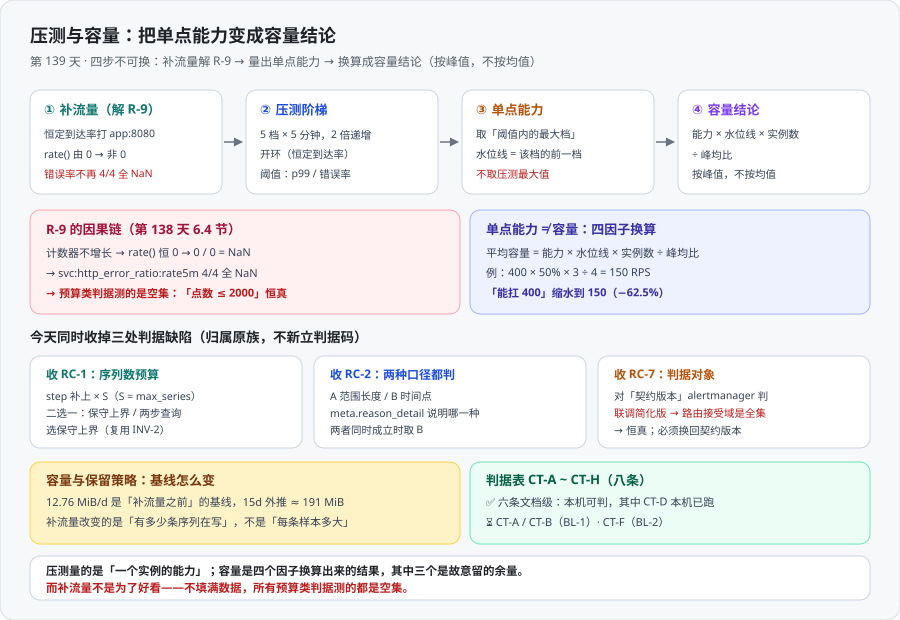

# 压测与容量：把单点能力变成容量结论

周期 5「实时监控大盘」第 3 周（联调测试）第 5 步，**第 139 天**。前三天的三条验收与遗留项跑完之后，链路第一次是「活的」——今天把它**压出数字**，并换算成一句能写进报告的容量结论。

一句话定位：**今天的产出不是「QPS 有多大」，而是「单实例能力是多少、水位线画在哪、这几处判据缺陷怎么收」。**



::: info 本章定位
上面这张图就是本章的四步顺序，**不可换**：先用恒定到达率**补流量**（解 `R-9`，让预算类判据不再测空集）→ 再跑**压测阶梯**（量出能力点）→ 把能力点读成**单点能力 + 水位线** → 换算成**容量结论**（按峰值，不按均值）。

同时收掉 [遗留项结清](../ResidualClose/index.md) 第七节里归属「第 139 天」的三项：`RC-1`（`DA-D` 的序列数预算）、`RC-2`（`DA6` 的 `out_of_retention` 两种口径）、`RC-7`（`W2-F` 的判据对象）。
:::

::: warning 本项目只有文档，没有代码
本章的 `load/rate-fill.js`、`load/ladder.js` 与所有容器 / 压测命令，都是**读者在自己工程仓库里要创建与执行的东西**；本仓库不存放源码、脚本与配置。

判据表的「状态」列**只写当前可执行性**：本机跑过的写实测值，需要容器运行时的标 `⏳ 未跑` 并写明原因。**不把期望值抄进状态列。**
:::

## 一、为什么压测必须排在联调之后

| 理由 | 展开 |
| --- | --- |
| 压测读的是**真实组件打印的数字** | `rate()`、P99、错误率、写入速率只有链路在跑时才有。第 135 天的纪律：**压测必须在链路真的跑起来之后做，否则测的是一个不存在的系统** |
| 补流量**本身就是一项待办** | 第 137/138 天的 `R-9`（靶服务计数器不增长、`rate()` 恒 0）不是缺陷而是**测试环境的一等约束**——它把预算类判据变成了恒真。**压测的头一个动作恰好就是解它** |
| 容量结论要**对上保留策略的基线** | 第 138 天在真实链路上测出了 `154.82 B/s` / `12.76 MiB/d`。容量结论必须解释「压测之后这个基线怎么变」，所以它只能排在测量之后 |

顺序颠倒的代价很具体：先压测、后联调，你拿到的是一组**看起来漂亮但无法归因**的数字——不知道慢在哪一段，也不知道那些「正常」的返回值里有多少是因为组件根本没在干活。

### 1.1 写死一条换算：单点能力 ≠ 容量

压测只给**一个实例**的能力。从它到容量，中间隔四个因子：

```text
可承诺的平均到达率 = 单实例能力 × 水位线 × 实例数 ÷ 峰均比
```

| 因子 | 取错的样子 | 后果 |
| --- | --- | --- |
| **水位线** | 直接拿压测最大值当可用能力（等于水位线 100%） | ρ=0.99 时排队放大 **100 倍**，结论里的延迟根本不成立 |
| **峰均比** | 用平均到达率建容量 | 峰值一到就排队；平均永远不是你要扛的那个数 |
| **实例数** | 忘了冗余（N+1） | 一台挂了整体过载 |
| **单实例能力** | 取压测**最高点**而不是「还在阈值内的最大档」 | 高估能力，实例数偏少 |

四者缺一结论就偏一档，**而且偏的方向都是「偏大」**。**先定水位线，再算实例数**——反过来先定实例数再倒推水位线，等于把延迟放大的代价藏起来。

### 1.2 一个可算的小算例

设定：单实例能力 **400 RPS**、水位线 **50%**、实例数 **3**（2 个够用 + 1 个冗余）、峰均比 **4**。

```text
单实例可用能力 = 400 × 50%  = 200 RPS
峰值承载能力   = 200 × 3    = 600 RPS
可承诺的平均   = 600 ÷ 4    = 150 RPS
反向核对峰值   = 150 × 4    = 600 RPS  ✓
```

**「能扛 400」和「能承诺 150」是同一套数字说出来的两句话。** 400 → 150 缩水 **62.5%**，全部来自三个**故意**的取舍（留一半余量、留一台冗余、按 4 倍峰均比建）。

::: danger 这一节最容易被跳过的一句话
**没有前缀的容量结论不是结论。** 合格写法必须带配置与分位：「单实例 2 核 4 GB、到达率 400 RPS 时 p99 = 210 ms；800 RPS 时 p99 = 640 ms——**膝点在 400 RPS 附近**」。只报一个「最大 800 RPS」，等于把水位线、峰均比、冗余三个因子全部藏起来。水位线为什么不取 80%、峰均比怎么测、USL 峰值在几个节点，见 [容量规划与弹性](/docs/Ops/PerformanceEngineering/Capacity/index.md) 与 [定量建模](/docs/Ops/PerformanceEngineering/Modeling/index.md)——**本章只做换算，不重复讲原理**。
:::

## 二、解 `R-9`：先用补流量把「空集」填满

### 2.1 `R-9` 的完整因果链

[遗留项结清](../ResidualClose/index.md) 6.4 节的原话：**「靶服务计数器不增长；计数增长后 `rate()` 才有意义；在此之前它会让预算类判据恒真」**。拆成四步：

```text
靶服务没有被请求 → http_requests_total 恒定不变
  → rate(http_requests_total[1m]) 恒为 0
    → sum(rate(…5..)) / sum(rate(…)) = 0 / 0 = NaN
      → svc:http_error_ratio:rate5m 4/4 全 NaN → HighErrorRate 的 `> 0.05` 恒假
        → 预算类判据测的是空集：DA-D 在 -1h / -6h 上返回 0 点，「点数 ≤ 2000」恒真
```

**最后一行的「恒真」才是 `R-9` 真正的代价**：`NaN > x` 恒假不会误报，但它**不会提醒你这条序列根本没在用**。这与第 137 天「一个坏掉的出海口和一次完美的抑制，在通知条数为 0 时长得一样」是同一族问题——**什么都不发生，既可能是正确，也可能是错误**。

### 2.2 做法与验证：恒定到达率打 `app:8080`

补流量必须用**恒定到达率**（开环）工具，理由见 3.3。二选一，本章选 **k6**：`constant-arrival-rate` 就是恒定到达率，且 `thresholds` 不达标即非零退出码——**判据写进脚本，不写在人眼里**。备选是 **Vegeta**（`vegeta attack -rate=20 -duration=10m`，单二进制、天然按恒定速率发送）；两者都能解 `R-9`，但**本章两步统一用 k6，避免换工具带来不可比的数字**——运行命令是 `k6 run load/rate-fill.js`。

```javascript [load/rate-fill.js —— 补流量：让计数器真的增长]
import http from 'k6/http';
import { check } from 'k6';

export const options = {
  scenarios: {
    fill: {
      executor: 'constant-arrival-rate',   // 开环：恒定到达率
      rate: 20,                            // 每秒 20 个请求
      timeUnit: '1s',
      duration: '10m',
      preAllocatedVUs: 10,
      maxVUs: 40,
    },
  },
  thresholds: { 'http_req_failed': ['rate<0.01'] },
  summaryTrendStats: ['avg', 'med', 'p(90)', 'p(95)', 'p(99)', 'max'],
};

export default function () {
  // 换成你自己桩服务里「已登记在指标字典中」的业务路由，不是 /metrics 本身
  const res = http.get('http://127.0.0.1:8080/api/items?page=1');
  check(res, { 'status is 200': (r) => r.status === 200 });
}
```

`http_requests_total` 只统计**业务路由**。打 `/metrics` 或一个没有埋点的路径，计数器不会动——**压测跑完了，`rate()` 还是 0**，而你会以为压测没生效。用一次「打之前 / 打之后」的对照把它证伪掉（下文所有 `19090` 都是第 136 天记录的**宿主映射端口**，容器内仍是 `9090`）：

```shell
# 打之前记下总量；手工打一发再读一次，数字没变就说明这条路由不计入该指标
curl -s -G 'http://localhost:19090/api/v1/query' \
  --data-urlencode 'query=sum(http_requests_total)' | jq -r '.data.result[0].value[1] // "无序列"'
curl -s -o /dev/null 'http://127.0.0.1:8080/api/items?page=1'
```

补流量**之前**，两个读数是第 136 / 138 天的实测形状：`rate(http_requests_total[1m])` 全部为 `0`；`svc:http_error_ratio:rate5m` **4 / 4 全部 `NaN`**。跑够两个 `rate` 窗口（≥ 2 分钟）之后再读：

```shell
# 读数一：rate() 必须从 0 变成非 0
curl -s -G 'http://localhost:19090/api/v1/query' \
  --data-urlencode 'query=rate(http_requests_total[1m])' \
  | jq -r '.data.result[] | "\(.metric.route // .metric.job // "-")  \(.value[1])"'
# 读数二：错误率必须从「全 NaN」变成「有数值」
curl -s -G 'http://localhost:19090/api/v1/query' \
  --data-urlencode 'query=svc:http_error_ratio:rate5m' | jq -r '.data.result[] | "\(.metric.svc)  \(.value[1])"'
```

```text
# 读数一：非 0，量级应接近到达率 20 → /api/items  19.83
# 读数二：不再有 NaN（错误率接近 0，桩服务不返回 5xx）
svc="web" 0   svc="api" 0   svc="edge-gateway" 0   svc="core-api" 0
```

::: danger 记进纪律的一句话
**数据填满之前，预算类判据测的是空集。**

`DA-D` 的「点数 ≤ 2000」在 `-1h` / `-6h` 返回 0 点时是**恒真**的，`check-dashboard.sh` 的 `DA5` 同理。所以补流量不是「顺手做的准备」，它是**让这两条判据重新变成判据的前提**——第 138 天把 `R-9` 从「遗留项」升级成「一等约束」指的就是这件事。推论：**任何一条判据，如果它的输入可能为空集，就必须有一条前置检查确认输入非空。**
:::

## 三、压测阶梯：怎么判「已到水位线」

### 3.1 五档阶梯（设计值，需按本机基线校准）

到达率按 **2 倍递增**覆盖 16 倍量程；先在粗定位区间找到膝点，再在区间内以 1.25 倍加密——**阶梯压测是两轮：先粗定位，再细定位**。

| 档 | 到达率 | 时长 | P99 阈值 | 错误率阈值 | 判定 | 下一步动作 |
| --- | --- | --- | --- | --- | --- | --- |
| **L1** | 20 RPS | 3m | p99 < 200ms | < 0.1% | 冒烟 + 预热 | **不计入结论**，只确认脚本与路由通 |
| **L2** | 40 RPS | 5m | p99 < 300ms | < 1% | 线性区 | 继续加压 |
| **L3** | 80 RPS | 5m | p99 < 300ms | < 1% | 开始抬头（线性区边界） | 继续加压 |
| **L4** | 160 RPS | 5m | p99 < 600ms | < 1% | **已过膝点** | **停在这里**，水位线取 L3 |
| **L5** | 320 RPS | 5m | p99 < 1500ms | < 5% | 过载 | 只观察，随后**降回 L2 跑 10 分钟恢复段** |

阈值是**设计值**，不是实测值——真实阈值要在跑完 L1 之后按本机基线校准（第 134 天原话：**期望值必须跑一遍才写**）。五档复用同一份脚本，用环境变量传档位，逐档执行 `for r in 20 40 80 160 320; do k6 run --env RATE=$r load/ladder.js; done`：

```javascript [load/ladder.js —— import 与 http.get 同 rate-fill.js，只换档位与时长]
const RATE = Number(__ENV.RATE || 20);
export const options = {
  scenarios: { ladder: {
    executor: 'constant-arrival-rate',                       // 开环
    rate: RATE, timeUnit: '1s', duration: '5m',
    preAllocatedVUs: Math.max(20, Math.ceil(RATE / 2)), maxVUs: RATE * 4 } },
  thresholds: { 'http_req_duration': ['p(99)<600'], 'http_req_failed': ['rate<0.01'] },
};
```

### 3.2 怎么判「已到水位线」

三个信号**按出现顺序**看，前两个比第三个更早抬头：

| 信号 | 怎么看 | 判据 |
| --- | --- | --- |
| ① p99 / p50 的放大倍数 | 相邻两档比这个比值 | 从 6 倍以内**跳到 10 倍以上**，就是排队开始主导 |
| ② 投入产出的非线性 | 到达率翻倍，单实例利用率涨了多少 | 涨**不到 2 倍**——投入翻倍、收益不到一半 |
| ③ 错误率由 0 变非 0 的第一个点 | 找第一档错误率 > 0 | 它**比彻底崩掉的那一档更有价值**：还在漏，但还能用 |

**水位线的定义**：把「已过膝点」的那一档记作 L(k)，则单实例能力 = **L(k-1) 的到达率**（还在阈值内的最大档，不是压测最大值），水位线 = 让 L(k-1) 的峰值落在单实例能力一半以下的那个利用率。例：若 L4（160 RPS）过膝、L3（80 RPS）仍在阈值内，则**单实例能力取 80 RPS**——不是 160，更不是 320。

::: danger 为什么必须取「阈值内的最大档」而不是「压测最大值」
取最大值是容量估算里最贵的一个错误：它把「系统还能响应」当成了「系统还能服务」。同一份图表里，320 RPS 那一档的 p99 已经 1.5 秒——**它确实返回了 200，但那 1.5 秒就是排队放大的直接读数**。用它算容量，实例数会少一半。

还有一条：**压力段的结论必须包含恢复段**。正确做法是过载跑 5 分钟，再**降回 L2 观察 10 分钟**，记录错误率何时归零、延迟何时回到基线——只看崩溃看不出可用性。
:::

### 3.3 开环与闭环：一句话差别，以及为什么这里必须用开环

| 模型 | 控制什么 | 响应变慢时会怎样 | 测出的是 |
| --- | --- | --- | --- |
| **开环**（open model） | **恒定到达率** | 请求照常到达并堆积，延迟被如实记录 | 「**能力点**」——某到达率下延迟是否仍在阈值内 |
| **闭环**（closed model） | **恒定并发** | 虚拟用户发完一个才发下一个，**发压速率自动下降** | 「给定并发下」的延迟分布 |

**一句话差别：开环问「每秒来多少请求」，闭环问「同时有多少请求在途」。** 这里必须用开环，三个理由：

1. **真实流量是开环的。** 用户不会因为你的接口变慢就少点两下。**闭环工具会替被测系统「体贴地减负」**，于是你永远看不到真正的过载形态。
2. **闭环会系统性低估 p99（协调遗漏）。** 一次持续 1 秒的停顿，在 1000 并发、每人每秒一发的设定下本该影响 1000 个请求样本，闭环模型里**只会被记录成 1 个样本**——系统越卡数字越好看，而且**不报错**。
3. **要的就是能力点，不是并发点。** 容量换算里的「单实例能力」是一个到达率，只有开环能直接测到。

::: tip 一个容易误解的细节
补流量那一步对开环 / 闭环不敏感——计数器只关心「一共发了多少个请求」；但**阶梯那一步不敏感不行**，所以本章两步统一用开环执行器、**中间不换工具**：换工具带来的数字差会和「这次是不是真的压上去了」混在一起，无法归因。方法论、协调遗漏的量化、六个必须锁死的变量见 [压测方法论与工具](/docs/Ops/PerformanceEngineering/LoadTesting/index.md)。
:::

## 四、收 `RC-1`：`DA-D` 的推导式补上序列数预算

**问题**：契约五原式是 `step = max(minStep, ceil((to − from) / max_points))`，它实际约束的是**每条序列**的点数，而「点数预算」的语义（前端一次渲染的点数）是**面板总点数**——**两者相差一个「序列数」因子**。第 138 天用返回 8 条序列的查询实测：`-6h` 得 **4508** 点（超预算 2.25 倍）、`-1d` 得 **3357** 点（超 1.68 倍），而 `-1h` 只 968 点、`-7d` 只 483 点。

**二选一 —— `S` 从哪里来：**

| 方案 | `S` 从哪来 | 优点 | 代价 |
| --- | --- | --- | --- |
| **① 保守上界** | 取面板声明的 `max_series` | 一次查询、无额外延迟、确定性强；**`max_series` 已在 `INV-2` 里被要求必填**，不新增配置项 | 实际序列数 ≪ `max_series` 时**过度降采样**（图变粗） |
| **② 两步查询** | 先 `count(<选择器>)` 得实际 `S`，再查数据 | 降采样不过度，图最细 | 每次翻面板**多一次查询**（延迟 + 新增一个失败面）；`S` 在两次查询之间可能变化（不一致窗口） |

**选型：①（保守上界）。** ① 的代价是「图粗一点」，② 的代价是「多一个失败面」：② 让预算**依赖一次先于数据查询的测量**，而这个测量在大范围上同样要扫全库——**与 `DA-D` 要防的「一次刷新键变成一次攻击」同形**，且它新增的失败模式（`count()` 超时、两次查询之间 `S` 变化）① 一个都不新增。更关键的是 **① 复用的是已存在的配置**：`INV-2` 早已要求「每个面板都声明 `max_points` 与 `max_series`」——`S` 的上界**早就写在配置里了**，只是推导式没读它。

**新推导式（可单测的形式）：**

```text
S    = 该面板声明的 max_series（保守上界，来自 INV-2）
step = snap( max( minStep, ceil( (to − from) × S / max_points ) ), scrape_interval )
断言：ceil( (to − from) / step ) × S  ≤  max_points + (S − 1)
```

断言里的 `+ (S − 1)`：`snap` 把 `step` **向上**对齐到采集间隔的整数倍，这让每条序列的点数最多少 1、也就是让总点数最多**多出 `S − 1` 个点**。写进去的是一个**真的成立**的上界，而不是一个看起来更严格、实际会被自己的取整打破的式子。

**最小单测用例表**（`max_points = 2000`、`minStep = 30s`、`scrape_interval = 15s`、`S = 8`）。**这张表就是单测的用例集**——纯算术，不需要容器、不需要服务；**总点数按理论密度算**（每条序列每个 `step` 都有点），因此与第 138 天的稀疏实测值不同（例如 `-6h` 理论 5760、实测 4508）。

| 用例 | 范围 | 新式 `step` | 新式总点数 | 原式 `step` | 原式总点数 | 断言 |
| --- | --- | --- | --- | --- | --- | --- |
| ① | `-1h` | 30 | 960 | 30 | 960 | 通过 |
| ② | `-6h` | **90** | **1920** | 30 | **5760** | 新式通过 / **原式失败** |
| ③ | `-1d` | **360** | **1920** | 45 | **15360** | 新式通过 / **原式失败** |
| ④ | `-7d` | **2430** | **1992** | 315 | 15360 | 新式通过 / **原式失败** |
| ⑤ | `-30d` | **10380** | **2000** | 1305 | 15896 | 新式通过 / **原式失败** |
| ⑥（反向） | `-6h` | 30 | 5760 | —— | —— | **必须失败**（证明单测真的会红） |

::: tip 第 ⑥ 行是这张表的题眼
它是**「期望为失败」的用例**：`S = 8` 但用**原式**算，总点数 5760 > 2007，断言必须失败。第 138 天第七章的纪律在这里第二次落地——**写完一条判据，先问它怎样才能失败**；只有 ①②③④⑤ 全绿、⑥ 必红的单测，才算把这条约束锁住。

② 的理论值 5760 与第 138 天实测的 **4508** 不同：4508 是**稀疏之后**的实际点数（大量 `NaN` 被过滤，正是 `R-9` 的产物）。**预算判据必须按理论密度守**，否则一补流量就会立刻超预算——这也正好解释 `RC-1` 为什么排在第 139 天：**它必须先于补流量被修好。**
:::

## 五、收 `RC-2`：`DA6` 的 `out_of_retention` 两种口径都判

第 133 天的 `E2E-F` 写的是「`meta.reason` 由**真实保留期**判定」，但没说清是**哪一种**判定。第 138 天 6.6 节实测到 `DA6` 的用例与实现的口径正好错开：

| 口径 | 判据 | 何时有用 | 该给用户的建议 |
| --- | --- | --- | --- |
| **A 范围长度** | `(to − from) > retention` | 用户拖了一个比保留期还宽的窗口 | 「把范围缩小到 15 天内」 |
| **B 时间点** | `from < now − retention` | 用户跳到了保留窗口之前 | 「这段时间的数据已经过期了」 |

`DA6` 的用例是 `from=2000-01-01T00:00:00Z&to=…T01:00:00Z`（范围只有 1 小时）。原实现只判 A，于是 `1h < 15d` 不成立 → 落到 `no_series`；**而正确的答案是 B 口径下的 `out_of_retention`。** 修法是两者任一成立即返回，并带明细：

```text
reason = out_of_retention  当且仅当 (A 成立) 或 (B 成立)
reason_detail：
  range_exceeds_retention     ← 口径 A 成立
  window_before_retention     ← 口径 B 成立（优先级更高）
```

两者同时成立时取 B——**B 更不可恢复**：即使把范围缩小到保留期内，那个时间点依然没有数据，所以先告诉用户。`reason_detail` 是 `reason` 的**从属字段**，只在 `reason = out_of_retention` 时出现，其余两种原因不带——这样 `reason` 的三选一枚举不被破坏（与第 133 天「追加说明、不删除原表述」同纪律，回写契约五时同样是**追加**）。

```json
{
  "panel_id": "overview_error_rate",
  "title": "全站错误率",
  "unit": "percent",
  "series": [],
  "meta": {
    "from": "2000-01-01T00:00:00Z", "to": "2000-01-01T01:00:00Z",
    "step": 30, "generated_at": "2026-10-14T08:20:00Z", "truncated": false,
    "reason": "out_of_retention",
    "reason_detail": "window_before_retention"
  }
}
```

```shell
BASE=${BASE:-http://localhost:8081}
# 正向用例：跳到保留窗口之前（B 口径）——必须给出原因与明细
curl -s "$BASE/api/panels/overview_error_rate?from=2000-01-01T00:00:00Z&to=2000-01-01T01:00:00Z" \
  | jq -r '.meta.reason, .meta.reason_detail'
# 反向用例：正常范围——reason 必须缺省（不能随便给原因）
curl -s "$BASE/api/panels/overview_error_rate?from=-1h" | jq -r '.meta.reason // "无(正常)"'
```

```text
out_of_retention
window_before_retention
无(正常)
```

::: warning 反向用例不是多余的
只跑正向用例，判据就变成「只要返回 `out_of_retention` 就算通过」——**一个永远返回 `out_of_retention` 的实现会顺利过关**。反向用例的意义是把这条退路堵死：正常范围必须**不给原因**。
:::

## 六、收 `RC-7`：`W2-F` 的判据对象改为契约版本

`W2-F` 的口径是「规则产出的 `severity` 取值域 ⊆ 路由接受域」。第 138 天 4.9 节实测发现：沙盒里**当前生效**的是为第 137 天抑制实验压平的**联调简化版**，它的 route 树**没有任何 severity 匹配**——于是「路由接受域是全集」，**这条判据恒真**。同一份判据对着三份配置给出三种结果：

| 版本 | sub-route 数 | severity 匹配 | 判 `W2-F` 会得到 |
| --- | --- | --- | --- |
| 文档定稿版（[告警路由联调](../AlertRouting/index.md)） | **3 层** | critical / warning / info | 能判（两个方向都有差异） |
| `alertmanager.orig.yaml` | 2 | critical, warning, `warning` 或 `critical` | 能判（缺 `info` 一档） |
| **联调简化版（沙盒当前生效）** | **0** | （无） | **恒真** |

**结论：这不是「未跑」，是「跑起来会给出假通过」——比未跑更危险。** 判据对象写死为工程仓库里**受版本控制**的 `deploy/alertmanager/alertmanager.yaml`（3 层 severity 路由 + 兜底 route + 3 条 `inhibit_rules` + 3 个 receiver），规则侧输入是 `deploy/alertmanager/alerting.yaml`；**不取**任何为联调临时压平的版本、也不取容器里挂载的那一份——**运行中生效的配置不是「契约」，只是「当前状态」**。

```shell
AM=deploy/alertmanager/alertmanager.yaml        # 判据对象：契约版本
RULES=deploy/alertmanager/alerting.yaml
# S1 前提：契约版本的路由树必须真的有 severity 接受域；若为 0 说明对象拿错了
grep -cE 'severity(=~|=)"' "$AM"                 # 期望 3（critical / warning / info）
# 抽出两个方向的 severity 集合（两侧都已排序，供 comm 使用）
grep -hoE 'severity: [a-z]+' "$RULES" | awk '{print $2}' | sort -u > /tmp/produced.txt
grep -hoE 'severity(=~|=)"[a-z|]+"' "$AM" | sed 's/severity=~*"//; s/"$//' | tr '|' '\n' | sort -u > /tmp/accepted.txt
# S2-a 方向一：规则产出的每个 severity 都必须有 route 接受（否则静默丢弃）→ 期望：空
comm -23 /tmp/produced.txt /tmp/accepted.txt
# S2-b 方向二：路由接受的每个 severity 都必须有规则产出（否则是死 route）→ 期望：info（需人工确认）
comm -13 /tmp/produced.txt /tmp/accepted.txt
# 反面用例：对象换成联调简化版，S1 必须失败（否则判据是恒真的）→ 期望 0
grep -cE 'severity(=~|=)"' prometheus/alertmanager.stageC.yaml
```

```text
S1 → 3    S2-a 方向一 →（空）    S2-b 方向二 → info    S2 反面用例 → 0
```

::: danger 两个方向必须分开判，且期望值不一样
- **方向一差异必须为空**——非空意味着「告警产出了一个没有 route 接受的 `severity`」，后果是**静默丢弃**（最贵的一类）。
- **方向二差异允许非空**，但**每一条都要写明是不是刻意预留**。本例的 `info` 是第 131 天三层路由里**故意留的一档**（对应 P3 日报），当前没有任何规则产出它——**它是一个有意的死 route**。

把两个方向合并成「集合相等」是错的：它会把「刻意预留」报成缺陷，然后下一个人就会把那一档 route 删掉。而反面用例里的 **0 就是「判据能失败」的证据**——这与第 138 天用真缺陷版本 `prometheus.stage0.yaml` 验证 `R-7` 是同一种手法。
:::

## 七、容量与保留策略：基线怎么变

第 138 天的读数**直接引用、不重算**：601 s 采样、head 增 **93,044 B** → **154.82 B/s = 12.76 MiB/d**、15 d 外推 **≈ 191 MiB**、每样本 **≈ 70 B**。

**关键区分：写入速率取决于「有多少条样本」，不取决于「样本的值」。** `http_requests_total` 从 0 涨到 1,000,000，每条样本仍然是「时间戳 + 一个 float64」。所以补流量**不改变每样本大小**、**不改变序列数**，它改变的是另外两件事：

| 变化 | 机制 | 对容量的影响 |
| --- | --- | --- |
| **原本稀疏 / 为 `NaN` 的序列开始真的有值** | 第 136 天实测 `svc:http_error_ratio:rate5m` 为 3 条有值 + 1 条 `NaN`；补流量后 4 条都有值 | recording 产出**真的落盘**，写入速率上升——**`12.76 MiB/d` 是这一层的下界** |
| **阶梯本身就是大范围查询的压力源** | 逐档打 `-1h` / `-7d` / `-30d` 面板 | 这不是写入而是**读放大**——正是第 129 天结果预算（点数 / 序列 / 资源）要拦的东西 |

还有一处必须连着读：第 138 天已指出**配置变更会在容量曲线上留下台阶**（`grouping-test` 加入后第三个 block 体积大了 3 倍），而它要到第 4 周部署前才删（`R-6`）。**所以 `12.76 MiB/d` 这个基线本身也只对「含 `grouping-test` 的那段时间」成立。**

**为什么容量结论必须按峰值，不按均值：**

1. **磁盘不认均值**——保留期是 `写入速率 × 保留时长`：夜里写得少，磁盘不会因此把空间留出来；按均值建容量等于按「平均水位」修堤。
2. **写入速率本身有峰**——抓取周期对齐造成的脉冲（多 job 同拍）、阶梯每档抬高 `rate` 窗口内的样本活跃度、配置变更一次性抬高序列数**且不回退**。
3. **这个均值恰恰是在稀疏状态下取的**——`12.76 MiB/d` 的采样期里大量序列的值为 0 / `NaN`。**用均值建容量，等于用一个接近空集的输入建容量**——与 `DA-D` 在 0 点上恒真是同一个陷阱。

容量 = `峰值写入速率 × 保留时长 × 副本数`；公式与 15d / 30d / 一年的外推对照见 [容量规划与弹性](/docs/Ops/PerformanceEngineering/Capacity/index.md)，**本章不重算**。

::: danger 压测抬高写入速率之后，被放大的是一条已有缺口
第 138 天的 `W2-E` 实测：保留策略**只有时间一维**，`retention.size = 0B` 表示**没有体积上限**。在 191 MiB 这个量级上它无所谓；但真实规模若是它的 100 倍，**磁盘涨满没人拦**——而第 122 天的失败矩阵把「磁盘写满导致采集停摆」列为不可接受。这正是 `RC-5`（给 `retention.size` 补体积上限）排在第 4 周部署的合理性：**先量出真实速率，再定体积上限**，顺序不能反。
:::

## 八、判据表（`CT-A ~ CT-H`）

按第 127 天的**判据唯一性纪律**，本章**只登记「压测与容量」这一类**。三处判据缺陷的收口（`RC-1` / `RC-2` / `RC-7`）归属原有的 `DA-*` / `E2E-*` / `W2-*` 族，本章**只收口、不新立判据码**；`R-9` 的解除归属「补流量是否让 `rate()` 非 0」，也不与 `EP-*` / `RR-*` / `AR-*` / `S1~S4` / `ACC-*` / `A3-*` / `RC-*` 任何一条重合。

| 编号 | 判据 | 级别 | 状态 |
| --- | --- | --- | --- |
| **`CT-A`** | 补流量后 `rate(http_requests_total[1m])` 由 `0` 变为非 0（即 `R-9` 被解） | 运行期 | `⏳ 未跑`（原因：靶服务在容器里，本机无容器运行时；k6 可本机跑） |
| **`CT-B`** | 补流量后 `svc:http_error_ratio:rate5m` 不再是 4/4 全 `NaN` | 运行期 | `⏳ 未跑`（原因同上） |
| **`CT-C`** | 阶梯脚本用**开环**执行器，且阈值写进脚本而非人眼判读 | 文档级 + 静态 | ✅ 本机可判（对本章脚本块做静态检查） |
| **`CT-D`** | `DA-D` 的新推导式带上序列数，且 `S = 8` 的 5 组用例全部 ≤ 预算、反向用例必超预算 | 文档级 + 纯算术 | ✅ **本机已跑**（第四节用例表） |
| **`CT-E`** | `DA6` 的 `out_of_retention` **两种口径都判**，`reason_detail` 两个枚举值与优先级写死 | 文档级（契约） | ✅ 本机可判（枚举与优先级在第五节逐字存在） |
| **`CT-F`** | `W2-F` 的判据对象是**契约版本** `alertmanager.yaml`，且带一条「期望为失败」的反面用例 | 静态 | `⏳ 未跑`（原因：BL-2 本仓无工程代码，两份 `yaml` 不存在） |
| **`CT-G`** | 单实例能力取「阈值内的最大档」、水位线取该档前一档，不取压测最大值 | 文档级 | ✅ 本机可判（3.2 节纪律逐字存在） |
| **`CT-H`** | 容量结论按**峰值**建，且 `12.76 MiB/d` 被标注为「补流量**之前**的基线」而非最终结论 | 文档级 | ✅ 本机可判（第七节逐字存在） |

::: warning 状态列的读法
六条 ✅ 全部是**文档级**判据——本章的产物是一份「压测与容量的方案」，它自己必须先能被判定。两条 `⏳` 的原因都是**环境**（BL-1 容器运行时 / BL-2 工程代码），**不是设计未定**。**不把期望值抄进状态列**，也不把「跑过了」写成「通过了」。
:::

## 九、当日做了什么

1. 论证**压测为什么排在联调之后**（三条理由），把「单点能力 ≠ 容量」写死成 `能力 × 水位线 × 实例数 ÷ 峰均比`，并给出可算的小算例（400 → 150，缩水 62.5%）。
2. **解 `R-9`**：给出四步因果链（计数器不增长 → `rate()` 恒 0 → `0/0 = NaN` → 预算判据测空集），选定 k6 开环方案、给出 `load/rate-fill.js` 最小脚本与完整命令，并补一条**不能省的准备动作**（先确认路由会被计入 `http_requests_total`）。
3. 给出 `R-9` 解除的**验证命令与预期输出**：`rate(...)` 由 `0` 变非 0、`svc:http_error_ratio:rate5m` 由 4/4 全 `NaN` 变有数值；写下纪律「**数据填满之前，预算类判据测的是空集**」。
4. 设计**五档压测阶梯**（到达率 / 时长 / P99 阈值 / 错误率阈值 / 判定 / 下一步动作），给出「已到水位线」的三个信号与单实例能力的取值纪律，并用**一句话**划清开环与闭环、给出必须用开环的三个理由。
5. **收 `RC-1`**：推导式补上序列数预算，给出「保守上界 `max_series` / 两步查询」的对照与选型理由（选保守上界），写成可单测形式并给出**最小单测用例表**（含一行「期望为失败」的反向用例）。
6. **收 `RC-2`**：`DA6` 的 `out_of_retention` **两种口径都判**，加 `meta.reason_detail` 与从属优先级，给出响应体 `json` 示例与正 / 反两个验证用例。
7. **收 `RC-7`**：把 `W2-F` 的判据对象写死为**契约版本**的 `alertmanager.yaml`，说明为什么不能对着联调简化版判（恒真），给出三段校验命令（含前提检查 S1）与一条反面用例。
8. 说明**容量与保留策略的关系**：直接引用 `154.82 B/s` / `12.76 MiB/d` / 15d 外推 `191 MiB`（不重算），讲清补流量改变的是「有多少条序列真的在写」而不是「每条样本多大」，并说明容量结论为什么按峰值。
9. 产出 **`CT-A ~ CT-H` 八条判据**（只登记「压测与容量」一类），如实标注两条 `⏳ 未跑` 及其原因。

## 十、如何验证

前六条**本机已跑**（括注的期望值就是实测值）；后两条是运行期 / 工程侧判据，只给命令。**不用 `[x]` 打断自匹配**——这些模式串里不含数字与高频裸词，不会被命令自己命中。

```shell
# 1) 阶梯脚本确实用开环执行器（CT-C）—— 闭环执行器一次都不该出现
grep -c "constant-arrival-rat[e]" index.md      # 期望 4
grep -c "constant-vu[s]" index.md               # 期望 0

# 2) 单测用例表的结构（CT-D）
grep -c '^| 用例 |' index.md                    # 期望 1（表头唯一）
grep -c '^| ⑥（反[向]）' index.md               # 期望 1（「期望为失败」的那一行）

# 3) 单实例能力的取值纪律写死（CT-G）
grep -c "阈值内的最大[档]" index.md             # 期望 5

# 4) 基线被标成「补流量之前」（CT-H）
grep -c "12.76 Mi[B]/d" index.md                # 期望 10

# 5) RC-2 的两个枚举值都在（CT-E）
grep -c "window_before_retentio[n]" index.md    # 期望 3
grep -c "range_exceeds_retentio[n]" index.md    # 期望 1

# 6) 配图被引用（每张新建的图都必须被本页引用）
grep -c "assets/capacity-test.sv[g]" index.md   # 期望 1
```

`CT-A` / `CT-B` 的运行期命令见 2.2 节的两条 `curl`；`CT-F` 的静态命令见第六节的三段校验。

::: tip 为什么有的期望值比「直觉上的 2」大
`constant-arrival-rate` 命中 4 次、`12.76 MiB/d` 命中 10 次、`阈值内的最大档` 命中 5 次——**同一句话在正文、表格与脚本里各出现一次**。第 135-138 天连着踩过四轮「自匹配」与「命中面比想的大」，留下的纪律仍然有效：**判据的期望值不是从模式推出来的，是从机器输出读出来的。**
:::

## 十一、下一步

| 天 | 里程碑 | 内容 |
| --- | --- | --- |
| **第 140 天** | 第 3 周（联调测试） | **压测结论与容量估算**：把 `12.76 MiB/d` 外推到真实规模，给出「在什么条件下、哪一层先到水位线、触发什么动作」的容量结论 |
| **第 141 天** | 第 3 周收口 | 输出「联调测试」里程碑的可交付结论；`R-6`（删 `grouping-test`）排到第 4 周部署前 |
| 第 142-150 天 | 第 4 周（部署验收） | 一键部署、监控接入、上线验收清单；`RC-3` / `RC-4` / `RC-5` 在本周收掉 |

第 140 天要回答的三个具体问题：① **外推的输入是哪个数**——`12.76 MiB/d` 是「补流量前 + 含 `grouping-test`」的基线，真实规模的外推必须说清这两处修正各是多少；② **哪一层先到水位线**——时序库磁盘、采集器抓取耗时、还是自研大盘服务的查询耗时，**容量结论的落点必须是「先趴下的那一层」**，不是一个孤零零的实例数；③ **触发什么动作**——第 4 周部署要挂上去的告警（磁盘余量、抓取耗时、查询耗时）分别对应哪个阈值。

## 参考资料

- 本章收口的三项缺陷出处：[遗留项结清：把 `⏳` 逐条换成实测数字](../ResidualClose/index.md)（`RC-1` / `RC-2` / `RC-7` 在「本章新增的待办」表，`R-9` 在第九节的未完成表）
- 三条验收与遗留项 `R-1~R-9`：[验收一与验收二：把 `⏳` 换成实测数字](../Acceptance12/index.md)、[验收三：告警风暴联调](../Acceptance3/index.md)
- 四道闸门与 `BL-1`~`BL-4`：[环境前置：把「未跑」变成「可跑」](../EnvPrereq/index.md)
- `DA-D` 与 `DA6` 的原始口径：[看板数据服务（C6）](../DashboardAPI/index.md)、[大盘数据接口端到端核对](../DashboardE2E/index.md)
- `W2-F` 的原始口径与三份 `alertmanager.yaml` 的对照：[第 2 周收口：四组件 × 五契约对账](../Week2Close/index.md)、[告警路由联调](../AlertRouting/index.md)
- 容量公式与保留策略：[指标模型与保留策略](../MetricModel/index.md)；被压的对象与采集参数：[采集任务配置](../ScrapeConfig/index.md)、[查询与规则设计](../Rules/index.md)
- 三条验收的原始判据表：[第 2 周收口（终）](../Week2Final/index.md)
- 技术专题（原理不在此重复）：[压测方法论与工具](/docs/Ops/PerformanceEngineering/LoadTesting/index.md)、[容量规划与弹性](/docs/Ops/PerformanceEngineering/Capacity/index.md)、[定量建模：并发、排队与扩展性](/docs/Ops/PerformanceEngineering/Modeling/index.md)
- 项目与方法论：[实时监控大盘 · 项目总览](../index.md)、[完整项目目录](../../index.md)、[全栈博客平台](../../BlogPlatform/index.md)、[后端通用模板](../../../Base/BackendTemplate/index.md)、[完整项目交付](/docs/Others/ProjectDelivery/index.md)
