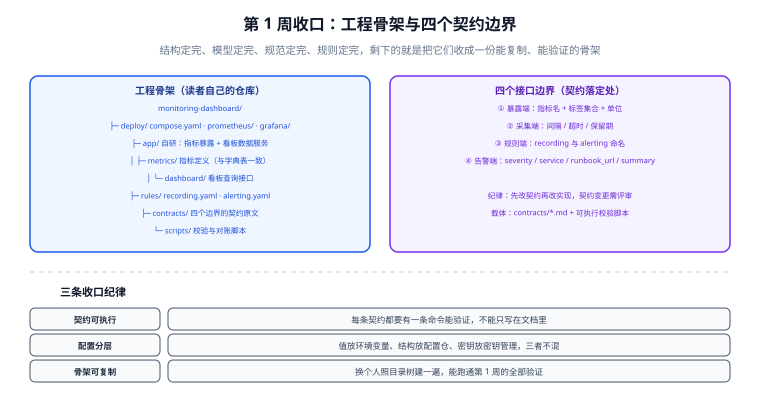

# 接口契约与工程骨架

第 1 周的前五步分别定完了**要做什么**（需求与选型）、**分成哪几个组件**（架构）、**数据长什么样**（指标模型）、**规范怎么拦**（校验门禁）、**配置与规则怎么写**（采集与规则）。今天是第 1 周的**收口日**：把这些产出收成一份**别人能照着复制**的工程骨架，并把四个接口边界的契约**固化成可执行的校验**。

一句话定位：**前面五天产出了「决定」，今天产出「约束」**——约束决定了第 2 周的代码能不能各写各的还不打架。



::: warning 本项目只有文档，没有代码
下面给出的目录结构与配置内容，是**读者在自己的工程仓库里要建立的东西**。本仓库不存放任何源码、脚本与构建文件；「运行 `xxx`」一律指「先按本节创建好该文件，再执行」。
:::

## 与前一天的分工

| 章节 | 它定什么 | 今天要补的是什么 |
| --- | --- | --- |
| [架构细化](../Architecture/index.md) | 七个组件、四个边界的**内容** | 把四条边界**写成契约文件并配上校验命令** |
| [指标模型与保留策略](../MetricModel/index.md) | 指标四层模型、两张字典表 | 把字典表**落进骨架的目录与初始化脚本位置** |
| [规范落地校验门禁](../MetricGate/index.md) | MG1~MG9 九条判据、三个校验点 | 把校验器**挂进骨架的固定位置**，成为可复用资产 |
| [采集任务配置](../ScrapeConfig/index.md) | `scrape.yaml`、目标发现、抓取失败处置 | 把配置**归位**到 `deploy/`，并明确它不进应用镜像 |
| [查询与规则设计](../Rules/index.md) | `recording.yaml` / `alerting.yaml` | 把规则文件**归位**到 `rules/`，纳入随代码提交 |

**今天不新增判据族**（判据唯一性纪律）：需求、模型、门禁、采集、规则各自的判据编号已经定稿，本章只做**归位与固化**，产出的断言编号统一为 `W1-*`（第 1 周收口），并且**只登记「归位是否完成」与「契约是否可执行」两类**。

## 一、工程骨架：读者自己的仓库长什么样

```text
monitoring-dashboard/
├─ deploy/                        # 部署与运维配置（不进应用镜像）
│   ├─ compose.yaml               # 一键起：采集器 / 时序库 / 规则路由 / 可视化
│   ├─ prometheus/
│   │   ├─ scrape.yaml            # 采集任务（第 125 天定稿）
│   │   └─ recording.yaml         # 预聚合规则（第 126 天定稿）
│   ├─ alertmanager/
│   │   ├─ alertmanager.yaml      # 路由 / 分组 / 抑制 / 静默
│   │   └─ alerting.yaml          # 告警规则（第 126 天定稿）
│   └─ grafana/
│       └─ provisioning/          # 数据源与三张大盘的配置（可复现）
├─ app/                           # 自研部分（只需两项）
│   ├─ metrics/                   # ① 业务指标暴露：指标定义与字典表一致
│   ├─ dashboard/                 # ② 看板数据服务：大盘查询接口
│   └─ config/                    # 配置加载（分层见下文）
├─ contracts/                     # 四个接口边界的契约原文
│   ├─ 01-expose.md
│   ├─ 02-scrape.md
│   ├─ 03-rules.md
│   └─ 04-alert.md
├─ sql/                           # 字典表与初始化数据（一次性资产）
│   ├─ schema.sql
│   └─ seed.sql
├─ scripts/                       # 可执行校验与对账
│   ├─ check-contracts.sh         # 四条契约的校验入口
│   ├─ check-metrics.sh           # MG1~MG9 门禁的调用入口
│   └─ reconcile.sh               # 指标对账（与业务库对同一口径）
└─ README.md                      # 起停、验证、排障三件事
```

::: tip 目录划分的两条原则
1. **「配置」与「代码」分开放**：`deploy/` 与 `app/` 分开。理由是它们的**变更节奏与责任人不同**——改采集间隔不该重新构建应用镜像。
2. **契约单独成目录**：`contracts/` 里的四个文件是**跨组件约定**，改它必须走评审；放在别处会变成「顺手改一下」。
:::

## 二、四个接口边界的契约

四个边界的**内容**在第 122 天已经定稿，今天把它们写成契约文件，每个文件都必须回答三句话：**约定是什么、定错的后果是什么、怎么验证它没被破坏。**

### 契约一：暴露端（业务侧 → 采集器）

```text
# contracts/01-expose.md（摘要）
约定：
  - 指标名格式：<service>_<subject>_<unit>，只允许小写与下划线
  - 标签集合：固定为 {service, instance, env}，env ∈ {dev, staging, prod}
  - 禁止把高基数字段（user_id / order_id / path 中的实际值）作为标签
  - 每个指标必须在 metric_def 字典表中有登记，且写明单位与负责人
定错的后果：
  - 高基数标签 → 序列数按乘法爆炸（10 万用户 = 10 万序列）
  - 标签集合不固定 → 同一指标出现两种标签组合，聚合结果分裂
验证（可执行）：
  - curl -s localhost:8080/metrics | grep '^service_orders_total{' | head
  - scripts/check-metrics.sh  → 期望输出 MG1~MG9 全 PASS
```

### 契约二：采集端（采集器 → 时序库）

```text
# contracts/02-scrape.md（摘要）
约定：
  - 抓取间隔 15s，超时 10s（超时 ≤ 间隔的 2/3）
  - sample_limit 按容量公式设定，超出即丢弃并记日志
  - 保留期 raw 15d（必须显式指定，不能依赖默认值）
定错的后果：
  - 超时 ≥ 间隔 → 抓取任务持续堆积，看起来「在采集」实则丢点
  - 保留期用默认值 → 某天磁盘悄无声息被写满
验证（可执行）：
  - promtool check config deploy/prometheus/prometheus.yml
  - curl -s localhost:9090/api/v1/status/flags | grep retention   # 期望 15d
```

### 契约三：规则端（查询语言 → 规则文件）

```text
# contracts/03-rules.md（摘要）
约定：
  - recording 规则命名三段式：level:metric:operations
  - alerting 规则只引用 recording 产出的指标，不在告警里做重计算
  - for 与 keep_firing_for 必须显式写出，禁止依赖默认值
定错的后果：
  - 大盘与告警各算一遍 → 出现「大盘正常、告警却响了」的最贵分歧
  - 默认 for → 抖动引发告警风暴，值班很快开始忽略通知
验证（可执行）：
  - promtool check rules deploy/prometheus/recording.yaml deploy/alertmanager/alerting.yaml
```

### 契约四：告警端（规则路由 → 通知渠道）

```text
# contracts/04-alert.md（摘要）
约定：
  - 每条告警必须带四类标签：severity / service / runbook_url / summary
  - severity ∈ {critical, warning, info}，route 按 severity 分流
  - 每条 critical 告警的 runbook_url 必须指向真实存在的处置文档
定错的后果：
  - 缺 service → 无法按服务抑制，一次故障炸出上百条
  - 缺 runbook_url → 值班第一反应是来问你「怎么办」
  - 缺 summary → 通知里只有指标名，没人看得懂
验证（可执行）：
  - curl -s localhost:9093/api/v2/alerts | grep -o '"severity":"[a-z]*"' | sort | uniq -c
  - 检查 alertmanager.yaml 中每条 route 的 matchers 能从告警标签命中
```

## 三、配置分层：什么该进仓库、什么不该

第 1 周的配置散在四个文件里，收口时必须把「值」与「结构」分开——这是「换环境不用改代码」的前提。

| 类别 | 例子 | 放哪 | 是否进 Git |
| --- | --- | --- | --- |
| **结构**（不随环境变） | 指标定义、标签名、规则表达式、路由结构 | 仓库内配置文件 | 进 |
| **值**（随环境变） | 抓取目标地址、数据库连接串、保留期 | 环境变量 / `.env`（不进 Git，提供 `.env.example`） | 不进（示例进） |
| **密钥** | 通知渠道 token、数据库口令 | 密钥管理 / 环境变量注入 | **绝不进** |

```shell
# 配置对账：确认 .env.example 覆盖了所有被引用的变量（期望无输出）
grep -rhoE '\$\{[A-Z_]+\}' deploy app --include='*.yaml' --include='*.yml' --include='*.ts' \
  | tr -d '${}' | sort -u > /tmp/used.txt
grep -oE '^[A-Z_]+' .env.example | sort -u > /tmp/declared.txt
diff /tmp/used.txt /tmp/declared.txt
# 有差异即失败：用了没声明的变量（换环境必炸），或声明了没人用的变量（噪音）
```

::: danger 注意
**不要把保留期、抓取间隔这类「结构参数」放环境变量**。它们的取值直接决定容量与告警口径：同一个仓库在两个环境跑出不同的保留期，会让「对账」变成一件无法解释的事。判据是——**改了它需要同步改文档/告警的，就属于结构，应该进仓库。**
:::

## 四、本周收口清单（W1-A ~ W1-G）

| 编号 | 断言 | 验证方式 | 状态 |
| --- | --- | --- | --- |
| W1-A | 骨架目录齐全，七个组件各有归位 | 遍历目录，期望 8 个一级目录全部存在 | 未跑（无工程仓库） |
| W1-B | 四个契约文件齐全且各含「约定 / 后果 / 验证」三段 | `grep -c` 统计三段标记，期望 12 | 未跑（无工程仓库） |
| W1-C | 四条契约的校验命令全部可执行且输出符合期望 | `scripts/check-contracts.sh`，期望全 PASS | ⏳ 阻塞（本机无容器运行时） |
| W1-D | 配置对账无差异 | 上文 `diff` 命令，期望无输出 | 未跑（无工程仓库） |
| W1-E | 密钥类内容未进入 Git | `git grep -iE 'token|password' -- '*.yaml'`，期望无命中 | 未跑（无工程仓库） |
| W1-F | README 覆盖起停、验证、排障三件事 | 人工核对三节标题存在 | 未跑（无工程仓库） |
| W1-G | 第 1 周的全部判据可被一条命令复跑 | `scripts/check-contracts.sh && scripts/check-metrics.sh` | ⏳ 阻塞（同上） |

::: tip 实测列纪律
上表的「状态」列**不是实测记录**，而是当前可执行性的如实标注：本机没有容器运行时、也没有可运行的工程仓库，所以涉及动态验证的项一律写 `⏳ 阻塞 + 原因`，涉及静态文件结构的项写 `未跑（无工程仓库）`。**不要把期望值抄进状态列**——那是把判据伪装成结论。
:::

## 五、当日做了什么

1. 定稿工程骨架的目录结构（8 个一级目录），明确「配置与代码分离、契约单独成目录」两条原则；
2. 把四个接口边界写成四份契约文件，每份都含「约定 / 定错的后果 / 可执行验证」三段；
3. 定稿配置三层划分（结构进仓库、值进环境变量、密钥进密钥管理），并给出配置对账命令；
4. 产出 `contracts.svg` 与 `W1-A ~ W1-G` 收口清单；
5. 明确本章**不新增判据族**，把第 122~126 天的判据按「归位」与「可执行」两类收口。

## 六、如何验证

```shell
# 1) 骨架完整性：期望列出 8 个一级目录
ls -d deploy app contracts sql scripts && echo "OK"

# 2) 契约文件完整性：每份都应含三段标记，总计 12 处
grep -c '约定：\|定错的后果：\|验证' contracts/*.md   # 期望每份 3

# 3) 规则与采集配置的静态校验（本机可跑，不需要容器）
promtool check config deploy/prometheus/prometheus.yml
promtool check rules deploy/prometheus/recording.yaml deploy/alertmanager/alerting.yaml

# 4) 配置对账（期望无输出）
diff /tmp/used.txt /tmp/declared.txt

# 5) 密钥不外泄（期望无命中）
git grep -iE 'token|password' -- '*.yaml' || echo "clean"
```

## 七、下一步

- **第 128 天（第 2 周第 1 步）**：核心模块编码起步——**业务侧指标暴露（组件 C1）**。按契约一实现指标定义与 `/metrics` 端点，并用 `check-metrics.sh` 让 MG1~MG9 首次全部跑起来。
- 第 129~134 天依次推进：看板数据服务（C6）、规则文件的加载与热更新、告警路由联调、大盘数据接口、第 2 周收口（服务可启动、接口可调用、看板可访问）。

## 参考资料

- 项目方法论：[完整项目交付](/docs/Others/ProjectDelivery/index.md)
- 理论基座：[监控告警专题](/docs/Ops/Monitoring/index.md)
- 本周前六个章节：[需求拆分与技术选型](../Requirements/index.md)、[架构细化](../Architecture/index.md)、[指标模型与保留策略](../MetricModel/index.md)、[规范落地校验门禁](../MetricGate/index.md)、[采集任务配置](../ScrapeConfig/index.md)、[查询与规则设计](../Rules/index.md)
- 上一周期同类收口方式：[上线发布与结项验收](../../BlogPlatform/ReleaseAcceptance/index.md)
