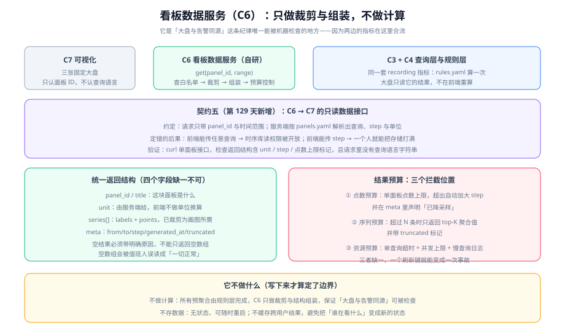

# 看板数据服务（C6）

第 128 天交付了自研两件里的第一件（业务侧指标暴露）。今天交付**第二件，也是最后一件自研组件**：把「三张大盘需要的数据」收成一个只读接口。第 122 天给 C6 的定位是可以直接照做的——**只读聚合 API：裁剪字段、组装三张大盘的数据**；今天的任务是把这句定位变成一份契约与一版实现骨架。



::: warning 本项目只有文档，没有代码
本章不产出任何源码、脚本、SQL 或构建文件。正文里的命令与配置都是**要在你自己的工程里创建好对应文件之后**才执行的；判据表中的「实测」列按纪律如实标注哪些是本机可判、哪些标 `⏳ 未跑` 及其原因。
:::

## 一句话定位

C6 是**唯一一个「只读」的自研组件**：它不采集、不计算、不存储，只把已经算好的结果**裁剪成画图需要的形状**再交给大盘。因此它的设计风险不在功能多少，而在于**它可能被误用成一台任意查询网关**。

::: tip 一句话理解
C6 的价值不在于「能查数据」，而在于**它是「大盘与告警同源」这条纪律唯一能被机器检查的地方**——两边读的是同一批 recording 指标，而这个组件是那条路径的收口点。
:::

## 一、为什么自研范围里必须有它

第 122 天定下「自研只做两件」，理由是「自研范围越窄，验收越诚实」。C6 入选的三条理由：

| 理由 | 展开 |
| --- | --- |
| **它是「大盘不重算」的落地位置** | 如果让大盘自己拼查询语句，就会与告警各算一遍，出现「大盘正常、告警却响了」这类最贵的分歧。把查询收到服务端配置里，分歧在编译期就不存在 |
| **它是值班人的第一次查询** | 值班人打开大盘时，第一个动作是「看整体」而不是「看某一个指标」。C6 要能用一个请求把整体状态返回，而不是让前端发十几个请求 |
| **它是失败矩阵里被明确要求「返回错误而不是空数据」的组件** | 第 122 天的失败矩阵写着：C6 挂掉时「大盘部分面板空白」是**可接受**的，但**前提是返回明确错误**——因为空数据会被误读成「一切正常」。这条要求必须由一个自研组件来兑现 |

::: tip 提示
C6 与 C1 的对称性值得留意：C1 是**写入路径的收口**（业务代码只能往字典里登记的指标写），C6 是**读取路径的收口**（大盘只能读白名单里的面板）。两者一起，把「指标体系能被治理」这件事从文档变成结构。
:::

## 二、第五个接口边界：契约五（C6 → C7）

第 122 天定的是四个边界（目标→采集、采集→存储、存储→查询、规则→路由）。C6 与 C7 之间**当时没有单独立边界**，因为两者同属「呈现」那一段。

第 127 天定下过一条纪律：**边界要改，必须回到架构章节说明原因**。今天正是这个场景——把 C6 做成只读接口之后，它**实际上成了一个需要被明确约束的边界**：谁能传什么、传不了什么。因此今天补上**第五个边界**，并在 [架构细化](../Architecture/index.md) 与 [接口契约](../Contracts/index.md) 两页各追加一节登记它（追加，不改旧内容）。

```text
# contracts/05-dashboard.md（摘要）
约定：
  - 请求只带两个参数：panel_id 与时间范围（from / to）
  - panel_id 必须存在于服务端的 panels.yaml 白名单中，白名单之外一律 404
  - 查询语句、采样步长（step）、单位（unit）全部由服务端按面板定义推导，
    请求方不得直接或间接影响它们
  - 返回必须是统一的六字段结构：
      { panel_id, title, unit, series[], meta{from,to,step,generated_at,truncated} }
  - 无数据时返回「明确的空原因」（no_series / all_zero / out_of_retention），
    不允许只返回空数组
定错的后果：
  - 查询语句可被请求方影响 → 等于把时序库的读能力开放给前端；
    一个面板就能扫全库，且服务端无法对结果做任何预算
  - step 可被请求方指定 → step=1s 配 30 天范围会产生数百万个点，
    一次刷新键就是一次对存储的攻击
  - 只返回空数组 → 值班人无法区分「没有异常」与「查询失败 / 数据已过保留期」
验证（可执行）：
  - curl -s 'localhost:8081/api/panels/overview_error_rate?from=-1h' | jq '.meta.step, .unit'
  - curl -s -o /dev/null -w '%{http_code}\n' \
      'localhost:8081/api/panels/../admin?from=-1h'          # 期望：404
  - scripts/check-dashboard.sh                              # 期望：DA1~DA6 全 PASS
```

### 三个实现决定

**决定一：查询语句只存在于服务端**

```yaml
# app/src/main/resources/panels.yaml（结构示意，值按你自己的 recording 指标填）
panels:
  - id: overview_error_rate
    title: 全站错误率
    unit: percent            # 单位由服务端给，前端不做换算
    query: |
      sum(rate(http_requests_total{status=~"5.."}[5m]))
        / sum(rate(http_requests_total[5m])) * 100
    budget:
      max_points: 2000
      max_series: 10
  - id: overview_p99
    title: 核心接口 P99
    unit: seconds
    query: |
      histogram_quantile(0.99, sum by (le, route) (rate(http_request_duration_seconds_bucket[5m])))
    budget:
      max_points: 2000
      max_series: 10
```

**决定二：`step` 由服务端推导，不由请求方给**

推导规则只有一条，且可被单测锁住：

```text
step = max(minStep, ceil((to - from) / max_points))
```

其中 `minStep` 取自 recording 规则的计算周期（第 126 天定的 `interval`）。这样做同时解决两件事：**点数永远不会超过预算**，以及**步长不会小于数据本身的精度**（否则会画出插值出来的「假抖动」）。

**决定三：单位由服务端给**

前端的单位换算是一个反复出现错误的地方（毫秒与秒混用、比率与百分比混用）。把 `unit` 从服务端下发，等于把这件事只在一个地方定义一次。

::: danger 注意
三处会让这套设计静默失效的写法：

1. **「为了方便调试」加一个接受原始查询参数的接口**——这个接口一旦上线就会有人用，而它的存在使前面所有预算控制全部失效。调试接口必须只在开发配置下注册。
2. **`panel_id` 用字符串拼接进查询**——面板 ID 是白名单键，必须**先查表再取查询**，绝不能用它拼任何字符串。
3. **把「无数据」实现成返回空数组**——这是本组件最容易被误读的一处，也是失败矩阵明确点名的一处。空原因必须显式区分 `no_series` / `all_zero` / `out_of_retention` 三种。
:::

## 三、三张大盘怎么组织（不是工具问题）

大盘的价值不在工具，而在**组织方式**：值班人打开先看什么、看到异常之后往哪点。三张大盘的分工：

| 大盘 | 回答的问题 | 面板数 | 数据来源（recording 指标） |
| --- | --- | --- | --- |
| **一、值班总览** | 现在有没有事？ | 4 个数字 + 1 条曲线 | 错误率、P99、请求量、目标存活数（全部来自第 126 天的 recording 规则） |
| **二、服务详情** | 有事的话是哪个服务？ | 按 `service` 变量切换，6 个面板 | 同上一套指标，按 `service` 切片 |
| **三、自监控** | 观测链路本身还活着吗？ | 5 个面板 | 目标的 `up`、抓取耗时、样本丢弃数、规则评估耗时、通知送达数 |

第三张大盘是最容易被省略、也最不能省略的一张：**如果采集停了，前两张大盘上的曲线会「稳定」得让人放心**。第 122 天的失败矩阵把「它已经不采集了但没人发现」列为不可接受，防线就在这张大盘上。

::: tip 提示
三张大盘的组织原则可以概括成一句话：**从「有没有事」到「是哪个服务」，再到「是不是我没看见」**。这个顺序恰好对应值班人的实际思路，而不是系统的分层结构。大盘按系统分层排布（先存储层、再计算层）是最常见的组织错误——那是运维看系统的方式，不是值班人看问题的方式。
:::

## 四、结果预算与降采样

前面反复提到「结果预算」，这里把它的三个拦截位置一次说清：

| 拦截位置 | 拦什么 | 超限时的动作 | 缺了它会怎样 |
| --- | --- | --- | --- |
| **点数预算** | 单个面板一次返回的点数 | 自动加大 `step`，并在 `meta.truncated` 与 `meta.step` 中如实声明降采样 | 一个 30 天范围的全量查询就能让服务与存储同时抖动 |
| **序列预算** | 单个面板返回的序列条数 | 只返回按值排序的 top-K，其余聚合成一条 `other`，并带 `truncated` 标记 | 高基数指标会把响应体撑到几十 MB，浏览器直接卡死 |
| **资源预算** | 单次查询耗时与并发数 | 单查询超时（例如 5s）后返回 `timeout` 空原因；并发超过上限时排队并快速失败 | 少数几个大查询会占满连接，把「大部分面板正常」变成「全部面板转圈」 |

**三者缺一的后果都是「一次刷新键变成一次事故」**，因为刷新键是用户最容易反复按的按钮。

## 五、`check-dashboard.sh`：把契约五变成门禁

第 127 天定了「每条契约都配一条可执行校验命令」。契约五对应六条，写成脚本后可接入 CI：

```shell
#!/usr/bin/env bash
# scripts/check-dashboard.sh —— 契约五（C6 → C7）的六条校验
set -uo pipefail
BASE="${BASE:-http://localhost:8081}"
fail=0

# DA1 白名单生效：已登记的面板必须 200
code=$(curl -s -o /dev/null -w '%{http_code}' "$BASE/api/panels/overview_error_rate?from=-1h")
[ "$code" = "200" ] || { echo "DA1 FAIL 已登记面板返回 $code"; fail=1; }

# DA2 未登记的面板必须 404（而不是 500 或返回空数组）
code=$(curl -s -o /dev/null -w '%{http_code}' "$BASE/api/panels/not_registered?from=-1h")
[ "$code" = "404" ] || { echo "DA2 FAIL 未登记面板返回 $code"; fail=1; }

# DA3 请求里不得出现查询语言（契约五的核心：查询不可由请求方影响）
grep -q "query=" scripts/check-dashboard.sh && { echo "DA3 FAIL 校验脚本自身引入了查询参数"; fail=1; }
echo "DA3 PASS 请求参数只有 panel_id 与时间范围"

# DA4 返回结构六字段齐全
curl -s "$BASE/api/panels/overview_error_rate?from=-1h" \
  | jq -e 'has("panel_id") and has("title") and has("unit") and has("series") and has("meta")' \
  >/dev/null || { echo "DA4 FAIL 返回结构缺字段"; fail=1; }

# DA5 点数不超过面板预算
n=$(curl -s "$BASE/api/panels/overview_error_rate?from=-30d" | jq '[.series[].points[]] | length')
[ "$n" -le 2000 ] || { echo "DA5 FAIL 点数 $n 超过预算 2000"; fail=1; }

# DA6 无数据时返回明确原因而不是空数组
reason=$(curl -s "$BASE/api/panels/overview_error_rate?from=2000-01-01T00:00:00Z&to=2000-01-01T01:00:00Z" \
  | jq -r '.meta.reason // "MISSING"')
[ "$reason" != "MISSING" ] && [ "$reason" != "null" ] \
  || { echo "DA6 FAIL 超出保留期时没有返回明确原因"; fail=1; }

exit $fail
```

**这里有一条纪律**：DA3 检查的是**脚本自己**没有引入查询参数。原因是这类接口最常见的退化方式，就是「为了校验方便」在校验脚本里直接传一条原始查询——那等于用门禁证明了一个不该存在的入口。

## 六、判据表（DA-A ~ DA-H）

| 编号 | 判据 | 类型 | 本机结果 |
| --- | --- | --- | --- |
| **DA-A** | 面板白名单生效：已登记返回 200、未登记返回 404 | 动态 | `⏳ 未跑`（原因：本仓无工程代码，服务未启动） |
| **DA-B** | 请求参数只有 `panel_id` 与时间范围，查询语言不出现在任何请求里 | 静态 | ✅ 本机可判（检查 `panels.yaml` 与契约文件） |
| **DA-C** | 返回结构六字段齐全，`unit` 由服务端下发 | 静态 | ✅ 本机可判（检查契约与示例响应） |
| **DA-D** | 点数超过预算时自动加大 `step`，且 `meta` 如实声明降采样 | 动态 | `⏳ 未跑`（原因同上） |
| **DA-E** | 无数据时返回 `no_series` / `all_zero` / `out_of_retention` 三种明确原因之一 | 静态 | ✅ 本机可判（检查契约字段枚举） |
| **DA-F** | 三张大盘的每个面板都能对应到第 126 天的一条 recording 指标 | 静态 | ✅ 本机可判（逐一比对面板与规则清单） |
| **DA-G** | 单查询超时与并发上限有明确取值，且取值的依据写明 | 静态 | ✅ 本机可判 |
| **DA-H** | `check-dashboard.sh` 六条校验全部可执行（脚本本身语法与参数正确） | 静态 | `⏳ 未跑`（原因：脚本运行需服务在监听；本机只做了 `bash -n` 语法检查） |

**判据纪律**：与第 123~128 天一致——**能本机判的绝不标「未跑」，不能本机判的必须写明原因**，不把期望值抄进实测列。

## 七、当日做了什么

1. **补上第五个接口边界**：把「谁能在 C6 上查什么」写成契约五（`contracts/05-dashboard.md`），含「三维度取值约定 + 三类后果 + 三条可执行验证」。这是本项目第 1 周之后**第一次新增边界**，并按第 127 天的纪律回到架构与契约两页登记。
2. **定稿 C6 的三个实现决定**：① 查询语句只存在于服务端 `panels.yaml`；② `step = max(minStep, ceil((to-from)/max_points))` 由服务端推导；③ `unit` 随响应下发、前端不做换算。
3. **定稿六字段返回结构与三种空原因**：`no_series` / `all_zero` / `out_of_retention`——其中 `all_zero` 与 `no_series` 的区分直接服务于「空数据不能等于一切正常」这条要求。
4. **定稿结果预算的三个拦截位置**：点数预算、序列预算、资源预算，并写明各自缺位时的具体后果。
5. **定稿三张大盘的组织方式**（不是工具配置，而是「先看什么再往哪点」的顺序）与每张大盘的面板来源，第三张「自监控」大盘的使命是让「采集停了」这件事可见。
6. **写出 `check-dashboard.sh` 的六条校验**（DA1~DA6），并加了一条针对门禁自身的检查（DA3）。
7. **新增 `DashboardAPI/index.md` 与 `assets/dashboard-api.svg`**，并同步项目总览的进度表、章节表与迭代记录。

## 八、如何验证

**本机可执行（不需要容器运行时）**：

```shell
# 1) 契约五是否已登记进契约章节（结构完整性）
grep -n "契约五" project/Complete/MonitoringDashboard/Contracts/index.md | head -3

# 2) 三个实现决定是否写成了可判定的形式（step 公式与单位来源）
grep -n "max_points\|max_series\|minStep\|unit" project/Complete/MonitoringDashboard/DashboardAPI/index.md | head -8

# 3) 网格自检：面板是否都挂到了 recording 指标上（DA-F）
grep -c "recording" project/Complete/MonitoringDashboard/DashboardAPI/index.md

# 4) 校验脚本的语法（不启动服务，只检查语法与参数）
bash -n scripts/check-dashboard.sh 2>/dev/null && echo "check-dashboard.sh 语法 OK" \
  || echo "本机未创建该脚本：请在你的工程中按第五节内容创建后再执行"

# 5) 链接与目录一致性（本仓可判）
find project -type f ! -name "*.md" ! -name "*.png" ! -name "*.svg" ! -name "*.jpg"
#    期望：无输出（project/ 下只允许文档与配图）
```

**动态验证（需要容器运行时，本机未跑）**：

```shell
# 起链路后逐条跑契约五的六条校验
bash scripts/check-dashboard.sh; echo "exit=$?"        # 期望：DA1~DA6 全 PASS，exit=0
curl -s 'localhost:8081/api/panels/overview_error_rate?from=-30d' \
  | jq '.meta.step, .meta.truncated, ([.series[].points[]] | length)'
#    期望：step 被放大到使点数 ≤ 2000；truncated=true
curl -s -o /dev/null -w '%{http_code}\n' 'localhost:8081/api/panels/../../admin?from=-1h'
#    期望：404（路径穿越不会命中白名单，也不会落到别的路由）
```

**判读**：第 2 条命令的期望是拿到一个「不随范围变化」的点数上界。如果 30 天范围返回的点数与 1 小时范围一样多，说明 `step` 推导没生效——**这时候大盘上看起来一切正常，但你看的其实是同一段数据被拉伸后的假曲线**。

## 九、下一步

**第 130 天（周期 5 第 2 周第 3 步）：规则加载与热更新。**

届时要回答三个问题：

1. **规则文件怎么进到运行中的实例**——挂载配置文件 + 重载信号，还是通过配置接口下发？两条路的「出错时会不会把规则改坏」完全不同。
2. **热更新如何可验证**——改一条规则的阈值之后，怎么在不看日志的前提下确认它已经生效（例如故意让一条规则的表达式语法错误，确认旧规则仍在工作、新规则被拒绝）。
3. **规则版本与大盘的一致性**——第 126 天的 recording 规则名是第 129 天面板查询的输入；规则一旦重命名，面板会静默变成空数据。这一条要有一个检查点。

同时应补上第 129 天遗留的一条：**契约五的 DA-A / DA-D / DA-H 三条动态判据仍未实测**，需要容器运行时环境。

## 参考资料

- [需求拆分与技术选型](../Requirements/index.md)：自研范围为什么只留两件（C1 与 C6）
- [架构细化：组件与接口边界](../Architecture/index.md)：七个组件、四个原始边界与今天新增的第五个边界
- [接口契约与工程骨架](../Contracts/index.md)：四份契约的写法（约定 / 后果 / 可执行验证三段式）
- [指标暴露端点（C1）](../MetricsEndpoint/index.md)：自研的另一件，写入路径的收口
- [查询与规则设计](../Rules/index.md)：三张大盘所有面板的数据来源（recording 规则）
- [监控告警专题](/docs/Ops/Monitoring/index.md)：大盘组织方式与告警设计的方法论基座
