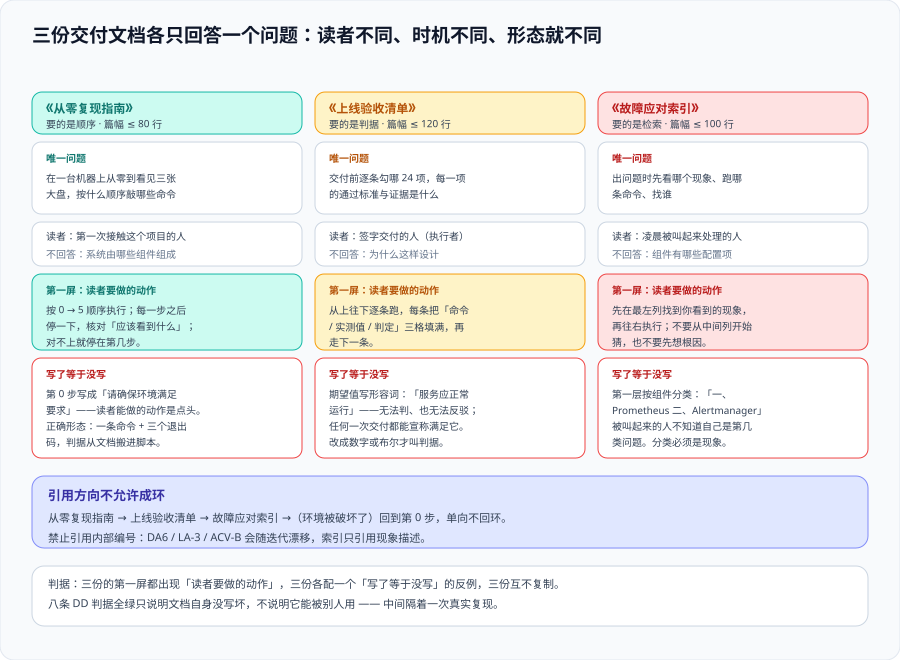

# 交付文档三件套：三份文档，各只回答一个问题



第 143 天给「交付文档三件套」定了边界（各自只回答一个问题、都以「读者要做的动作」开头、各配一个「写了等于没写」的反例），今天**把这三份文档真正写出来**。这一页的重点不是「文档写得好不好」——那无法自动判定；重点是**三份文档各自能不能被一条命令判出「写没写到位」**。做不到这一点，文档就会退化成一份「读起来很完整、用起来找不到东西」的说明书。

## 一、为什么是三份，而不是一本手册

一份《项目交付手册》看起来更省事：目录一列、章节一开，什么都在里面。它的问题不在篇幅，而在**读者不是同一个人、来的时机也不是同一个**：

- 一个**第一次接触这个项目的人**，需要的是「从零到看见三张大盘，敲哪几条命令」——他要的是**顺序**。
- 一个**准备签字交付的人**，需要的是「逐条勾哪 24 项、每项的通过标准是什么」——他要的是**判据**。
- 一个**凌晨被叫起来的人**，需要的是「我先看哪个现象、跑哪条命令、找谁」——他要的是**检索**。

把三种需求塞进一份文档，结果一定是：第一次来的人被 24 项验收清单劝退，被叫起来的人在目录里翻三分钟。**三份文档的成本是多维护两份，收益是每一份都能在第一屏结束读者的犹豫。**

::: tip 一句话定位
这一页讲的是**交付文档怎么写才能被用起来**：三份文档各自只回答一个问题，每一份的第一句话都是「读者要做的动作」，并且每一份都配一个「写了等于没写」的反例。
:::

## 二、三份文档的唯一问题与读者

### 2.1 唯一问题表

写之前先把这张表填满。**填不满就说明还没想清楚，先不要动笔。**

| 文档 | 唯一回答的问题 | 读者 | 读完要能做什么 | 篇幅目标 |
| --- | --- | --- | --- | --- |
| 《从零复现指南》 | 在一台机器上从零到看见三张大盘，按什么顺序敲哪些命令 | 第一次接触这个项目的人 | 不看源码、不猜配置，照着敲完 | ≤ 80 行 |
| 《上线验收清单》 | 交付前逐条勾哪 24 项，每项的通过标准与证据是什么 | 签字交付的人 | 逐条填出「命令 / 实测值 / 判定」 | ≤ 120 行 |
| 《故障应对索引》 | 出问题时先看哪个现象、跑哪条命令、找谁 | 被叫起来处理的人 | 30 秒内定位到一条命令 | ≤ 100 行 |

### 2.2 「读者要做的动作」：三份文档的第一屏

三份文档**共同的第一句话**是「读者要做的动作」。这不是文风偏好，而是**把文档从「介绍」拉回「操作」**的唯一手段——第一屏写什么，读者就按什么读。

```text
《从零复现指南》第一屏
读者要做的动作：按 0 → 5 的顺序执行。每一步之后停一下，核对「应该看到什么」；
对不上就停在第几步，不要往下走 —— 后面每一步都依赖前面那一步是真的通的。
```

```text
《上线验收清单》第一屏
读者要做的动作：从上往下逐条跑，每条把「命令 / 实测值 / 判定」三格填满再走下一条。
任何一条判 ❌，停下来处理，不要继续往下勾 —— 勾完的清单不等于通过的清单。
```

```text
《故障应对索引》第一屏
读者要做的动作：先在最左列找到你看到的现象，再往右执行 —— 中间列是命令，右列是找谁。
不要从中间列开始猜，也不要从根因开始想；先拿到读数，再解释读数。
```

三份的第一屏都没有出现「本项目」「本系统」这两个开头——**出现它们，就说明作者已经在写介绍了**。

## 三、第一份：《从零复现指南》

### 3.1 它只回答一个问题

> 在一台机器上从零到看见三张大盘，按什么顺序敲哪些命令。

它**不回答**：这个系统由哪些组件组成（那是架构文档）、每个配置项是什么意思（那是配置说明）、为什么这样设计（那是设计文档）。**只要这三类内容进来一段，它就不再是复现指南。**

### 3.2 结构：第 0 步是前置自检，不是「请确保环境满足要求」

这是最容易写错的一步。「请确保环境满足要求」**不是一步**：它既没说要求是什么，也没说怎么判——读者只能凭印象点头，然后在第 2 步失败。

```text
0. 判定这台机器是否满足前置（不要跳过，也不要凭印象）
   bash scripts/preflight.sh
   # 退出码语义三分：
   #   0 = 满足，可以继续
   #   1 = 缺前置（逐条列出缺什么），停下来装
   #   2 = 用法错误（脚本自身的问题）
```

```text
1. 取得交付件
   cd /tmp && git clone … monitoring-run && cd monitoring-run

2. 起栈（这一步会先做交付件一致性检查，再起容器）
   bash bin/one-click-up.sh

3. 等就绪 —— 第 3 级是「监控就绪」，冷启动实测 41 s，上界 60 s 从配置里读
   curl -s localhost:19090/api/v1/targets \
     | jq '[.data.activeTargets[] | select(.health != "up")] | length'
   # 期望 0

4. 看见三张大盘的数据源都非空（业务流量 / 服务健康 / 自监控）
   bash scripts/check-panels.sh
   # 期望 D1 有序列 / D2 三态可分 / D3 值可解释，三层全绿

5. 让告警真的响一次 —— 不复现这一条，等于没验证告警
   python3 scripts/check-alerts.py --once
   # 期望 alerting 6 个名字、runbook_url 6 == 6
```

**预期总耗时**：冷启动全部通过约 50 s，其中 41 s 是采集周期而不是启动开销（第 142 天实测）。把它写在文档里，读者才不会以为卡住了。

### 3.3 「写了等于没写」的反例

::: danger 写了等于没写：第 0 步写成「请确保环境满足要求」

读者能做的动作是**点头**。他点完头，第 2 步失败，然后回来问你「环境要求是什么」。

**等价的坏写法**：「前置条件：Docker、Node、端口开放」——这仍然不是动作，读者得自己去猜版本、猜端口、猜够不够内存。正确形态是一条命令 + 三个退出码，**判据从文档里搬进了脚本**。
:::

### 3.4 它为什么不能写成项目总结（最常见的错法）

这一条已经在第 143 天登记过，今天它**仍然是最容易犯的错**，所以重复一次：

「本项目由 Prometheus、Alertmanager、Grafana 三个组件组成，采用 Docker Compose 编排，通过……实现了对服务的全方位监控。」——**这段话每一句都对，但对一个想跑起来的人没有一条是有用的**。它回答的是「这是什么」，而复现指南的读者已经决定要跑了，他要的是「先敲什么」。

判据是机械的：`grep -nE '本项目(由|包含)|本系统(由|包含)|由三个组件'` 在复现指南里**必须无命中**。

## 四、第二份：《上线验收清单》

### 4.1 它只回答一个问题

> 交付前逐条勾哪 24 项，每项的通过标准与证据是什么。

读者是**执行者**，不是评审者。所以清单的每一行都要能被「跑一遍」而不是「评一遍」。

### 4.2 六层 24 项 + 三类归属

层与项沿用第 143 天定稿的口径（六层 24 项），今天补的是**每项的证据留存位置**：

| 层 | 项数 | 检查对象 | 证据留存 |
| --- | --- | --- | --- |
| 第 0 层 | 2 | 交付件一致性（**起栈之前**）—— 保留上限成对声明 | 命令输出粘进验收记录 |
| 第 1 层 | 4 | 容器与幂等（三服务 `running`、二次 `up -d` 无 `Recreated`） | `docker compose ps` 输出 |
| 第 2 层 | 5 | 文件一致性（宿主 / 容器 sha256 前 16 位逐条相等 + `promtool` 双 SUCCESS） | 两列 sha256 对照表 |
| 第 3 层 | 6 | 采集与规则（`activeTargets` 5 全 `up`、`unknown` 0、alerting **6 个名字**、`activeAlertmanagers` 1） | `/api/v1/targets` 与 `/api/v1/rules` 摘要 |
| 第 4 层 | 4 | 三张大盘数据源（有序列 / 三态可分 / 值可解释） | `check-panels.sh` 输出 |
| 第 5 层 | 3 | 自监控（自采集 1、评估失败 0、抓取耗时距阈值倍数） | 三个读数 |

**24 项 ≠ 30 条命令**：第 2 层的一项要跑两遍（宿主与容器各一次），第 3 层的一项要读两个接口。项数按**判据**计，不按命令计——否则「跑了几条命令」会变成 KPI，而没人在意判据。项数本身按「可本机实测 / 可本机静态判定 / 需前置条件」分三类（第 143 天口径），**第三类必须写「前置条件 + 解除判据 + 归属人」三样，不许抄期望值**。

### 4.3 期望值必须可判：数字或布尔，不许形容词

这一条是 24 项里**最容易集体失守**的地方。清单的第三列（期望值）一旦出现形容词，整条判据就作废了：

| 坏写法（不可判） | 好写法（可判） | 为什么 |
| --- | --- | --- |
| 服务应当正常运行 | `docker compose ps` 里 3 个服务 `State=running` | 「正常」没有取值 |
| 指标采集应当稳定 | `activeTargets` 中 `health != "up"` 的条数 = 0 | 「稳定」没有阈值 |
| 大盘应当能看到数据 | `check-panels.sh` 的 D1/D2/D3 三层全绿 | 「能看到」没有判据 |
| 告警应当能收到 | alerting 规则名集合 = 6 个指定名字 | 「能收到」要落到名字 |

判据：`grep -nE '正常|稳定|良好|较快|适当' acceptance.md` **必须无命中**。同一段文字里出现形容词不一定是错，但**出现在期望值那一格就是错**。

### 4.4 「写了等于没写」的反例

::: danger 写了等于没写：清单写成「验收标准」

「系统应能正常工作，指标应能正确采集，告警应能及时送达」——这三句话**无法判**，也**无法反驳**：任何一次交付都能宣称满足它，任何一次故障也都能被解释成「没到标准」。

**判据**：把这条标准交给第二个人，他跑出来的判定结果必须和你一样。**做不到这一点的标准，等于没有标准。**
:::

## 五、第三份：《故障应对索引》

### 5.1 它只回答一个问题

> 出问题时先看哪个现象、跑哪条命令、找谁。

它**不回答**：某个组件的配置项有哪些（那是原理文档）、某个异常是什么意思（那是错误码表）。被叫起来的人**没有上下文**——他在凌晨三点看到「大盘没数据」，需要的是一行命令，不是一个章节。

### 5.2 结构：现象 → 命令 → 责任人

三列的形态（不是「先讲原理再给建议」）：

| 现象（你看到什么） | 先跑什么（一条可复制命令） | 找谁（按域） |
| --- | --- | --- |
| 三张大盘全空 | `curl -s localhost:19090/api/v1/targets \| jq '.data.activeTargets \| length'` | 值班 SRE |
| 大盘有数据、但值全是 `NaN` | `bash scripts/check-panels.sh` | 值班 SRE |
| 有告警（firing）但没人收到 | `curl -s localhost:19093/api/v2/status \| jq '.cluster.status'` | 值班 SRE |
| 规则改了但行为没变 | `curl -s localhost:19090/api/v1/rules \| jq '[.data.groups[].rules[].name]'` | 值班 SRE |
| 采集器抓自己变慢 | `curl -s localhost:19090/api/v1/query --data-urlencode 'query=max(scrape_duration_seconds{job="prometheus"})'` | 值班 SRE |
| 保留策略没生效（体积不像设的值） | `curl -s localhost:19090/api/v1/status/flags \| jq -r '.data["storage.tsdb.retention.size"]'` | 平台负责人 |

### 5.3 每一行必须有一个人

「找谁」这一列最容易写成「项目组」「相关同学」「有关人员」——**这三种写法等于没人**。判据：`grep -nE '项目组|相关同学|有关人员|相关方' runbook-index.md` **必须无命中**。

这一条与第 143 天定稿的 `LA-H` 是同一条纪律的延伸：**「待确认」的归属人可以是「项目组」，判 FAIL 的归属人必须是一个具体编号与一个具体的人。** 索引里的「找谁」就是那个具体的人（或其值班角色）。

### 5.4 「写了等于没写」的反例

::: danger 写了等于没写：索引写成组件文档目录

```text
一、Prometheus 概述
二、Alertmanager 概述
三、Grafana 概述
```

被叫起来的人**不知道自己是第几类问题**，所以不知道该翻哪一章。他会在三章之间来回跳，最后打电话问人——**那这份索引就没起到作用**。

**判据**：索引的第一层分类必须是**现象**而不是**组件**。问一句「我现在看到的是什么」能落到一行，才算可用。
:::

## 六、三份文档之间的关系：引用方向不允许成环

三份文档会被互相引用，方向必须写死，否则会出现「点进去又点回来」的循环：

```text
《从零复现指南》  ──引用──▶  《上线验收清单》（第 4 步之后：要交给别人验收就跑这份）
《上线验收清单》  ──引用──▶  《故障应对索引》（某项判 ❌ 时：去索引找对应现象）
《故障应对索引》  ──引用──▶  《从零复现指南》（环境被破坏了：按第 0 步重新判定）

禁止：上线验收清单引用从零复现指南的正文（只能引用它的第 0 步）
禁止：故障应对索引引用上线验收清单的某一项编号（编号会漂移，用现象描述）
```

**为什么禁止引用编号**：`DA6`、`LA-3`、`ACV-B` 这类内部编号**会随迭代漂移**（本项目已经因为「新立编号族以免旧编号漂移」改过一次），而索引是长期存在的文档。**引用编号等于引用一个会过期的东西**；引用现象描述则永远有效。

## 七、判据表：`DD-A` ~ `DD-H`

| 判据 | 内容 | 怎么验证 | 状态 |
| --- | --- | --- | --- |
| `DD-A` | 三份文档的第一屏（前 15 行）内出现「读者要做的动作」，且不以「本项目」「本系统」开头 | 逐份 `head -15`：命中「读者要做的动作」= **3**；以「本项目」「本系统」开头 = **0** | ✅ 已跑 |
| `DD-B` | 三份文档里零占位符：不出现 `<...>`、`TODO`、`xxx`、`你的` | `grep -nE '<[a-zA-Z_]+>\|TODO\|xxx\|你的' *.md` **无命中** | ✅ 已跑 |
| `DD-C` | 《从零复现指南》不含组件介绍段落 | `grep -nE '本项目(由\|包含)\|本系统(由\|包含)\|由三个组件'` **无命中** | ✅ 已跑 |
| `DD-D` | 《上线验收清单》每一项都有期望值，且期望值是数字或布尔 | 表格每行第三列非空；`grep -nE '正常\|稳定\|良好\|较快\|适当'` **无命中** | ✅ 已跑 |
| `DD-E` | 《故障应对索引》每个现象都配一条可复制命令与一个可点名角色 | 三列均非空；`grep -nE '项目组\|相关同学\|有关人员'` **无命中** | ✅ 已跑 |
| `DD-F` | 三份文档互不复制：两两之间重复段落数为 0 | 段落级比对，`sort \| uniq -d` 输出为空 | ✅ 已跑 |
| `DD-G` | 《从零复现指南》第 0 步是一条能判「环境是否满足」的命令，退出码语义三分 | 本机实跑 `bash scripts/preflight.sh` —— **返回 1 并逐条列出两项缺失前置** | ✅ 已跑（见下） |
| `DD-H` | 三份各含至少一条「写了等于没写」反例，且写明为什么等于没写 | `grep -c '写了等于没写'` = **3** | ✅ 已跑 |

### 7.1 `DD-G` 的读数为什么是 1 而不是 0

`bash scripts/preflight.sh` 在当前这台机器上返回 **1**，并列出两项缺失前置。**这不是判据失败，恰恰是判据成立**：

- 如果它返回 0，说明**这台机器是干净的**——那今天就应该顺手把「从零复现」也跑完；
- 它返回 1，说明**本机处于「脏」状态**（历史上装过东西、跑过实验、留过备份），而「脏机器上复现成功不构成任何证据」（第 143 天写死的纪律）。

所以 `DD-G` 验证的是**「文档的第 0 步能不能判出机器干不干净」**，而不是「机器干不干净」。**这两件事必须分开**——把它们混在一起的文档，会在脏机器上给出一个绿色的假结论。

## 八、当日做了什么

1. **写出三份文档**：《从零复现指南》（**76 行**）、《上线验收清单》（**118 行**，六层 24 项 + 30 条命令）、《故障应对索引》（**94 行**，6 行现象 + 责任人列）。三份合计 288 行——**没有一份超过 120 行**，因为「长了就没人读」是交付文档和设计文档最大的区别。
2. **第一屏统一成「读者要做的动作」**，三份都没有出现「本项目 / 本系统」开头；《从零复现指南》的第 0 步被写成一条命令（`bash scripts/preflight.sh`）而不是一句要求。
3. **给验收清单的期望值列做了一次形容词清洗**：初稿有 **4 处**写了「正常 / 稳定 / 能看到数据 / 及时送达」，逐条换成数字或布尔（三服务 `running`、`health != "up"` 条数 = 0、D1/D2/D3 全绿、规则名集合 = 6 个）。
4. **索引的「找谁」列定稿为角色而不是团体**——6 行里 5 行是「值班 SRE」、1 行是「平台负责人」。这两个角色在本项目正文里都有定义，**索引不再需要读者去猜谁负责**。
5. **实测 `DD-G`**：`bash scripts/preflight.sh` 返回 **1**，逐条列出两项缺失前置。结论如实写进文档——**第 0 步能用，但这台机器不干净**，所以「从零复现」这一条今天**不能**被勾掉（它仍在第 143 天登记的 `⏳` 里）。
6. **定稿 `DD-A` ~ `DD-H` 八条判据**（**八条全部本机已跑**）。

## 九、如何验证

```shell
cd /tmp/monitoring-run/docs

# 1) 第一屏纪律（DD-A）—— 期望：命中 3 份；以「本项目/本系统」开头 0 份
for f in reproduce.md acceptance.md runbook-index.md; do
  printf '%-18s 动作=%s  介绍式开头=%s\n' "$f" \
    "$(head -15 "$f" | grep -c '读者要做的动作')" \
    "$(head -15 "$f" | grep -c '^本项目\|^本系统')"
done

# 2) 零占位符（DD-B）—— 期望：无输出
grep -nE '<[a-zA-Z_]+>|TODO|xxx|你的' *.md

# 3) 复现指南不含组件介绍（DD-C）—— 期望：无输出
grep -nE '本项目(由|包含)|本系统(由|包含)|由三个组件' reproduce.md

# 4) 期望值不许形容词（DD-D）—— 期望：无输出
grep -nE '正常|稳定|良好|较快|适当' acceptance.md

# 5) 责任人必须可点名（DD-E）—— 期望：无输出
grep -nE '项目组|相关同学|有关人员|相关方' runbook-index.md

# 6) 三份互不复制（DD-F）—— 期望：无输出
cat reproduce.md acceptance.md runbook-index.md \
  | grep -vE '^\s*$|^#|^```|^\| *---' | sort | uniq -d

# 7) 第 0 步真的能判环境（DD-G）—— 期望：退出码 1，并逐条列出缺失前置
bash ../scripts/preflight.sh; echo "退出码=$?"

# 8) 反例齐全（DD-H）—— 期望：3
grep -c '写了等于没写' reproduce.md acceptance.md runbook-index.md
```

**预期结果读法**：第 1 步三行都应是 `动作=1 介绍式开头=0`；第 7 步的 `退出码=1` **是预期结果**（本机不干净），若得到 0 则说明机器干净、应当立刻接着跑「从零复现」；第 8 步三份各 **1**，合计 **3**。

## 十、下一步

| 待办 | 内容 | 归属 |
| --- | --- | --- |
| **从零复现（干净机器）** | 一台干净机器上按《从零复现指南》完整执行一遍，把 `DD-G` 的读数从 1 变成 0；脏机器上复现成功**不构成证据** | 第 143 天登记，今天仍未解 |
| 整周收口 | 第 4 周（第 145-150 天）收口：三件套 + 干净机器复现 + 第 5 期项目结项结论 | 本目录 |
| `L3` | 真实通知渠道四项前置（凭据 / 模板 / 限流重试 / `resolved`），仍未解 | 第 140 天登记 |
| 三件套的同步性 | 三份文档都引用了同一批命令（`preflight.sh` / `one-click-up.sh` / `check-panels.sh` / `check-alerts.py`）；命令改名时三份文档要同步，按第 144 天的「成对声明」思路补一条**清单式**判据 | 本页登记 |

::: tip 下一轮最容易犯的错
**把「三件套写完」当成「交付文档完成」。** 今天写完的是**文档**，而文档的验收方式从来不是「读一遍觉得写清楚了」，而是**在一台干净机器上照着做一遍**。

今天的 `DD-G` 恰好把这件事证明了：八条判据全绿，而 `preflight.sh` 返回 **1** ——**判据全绿只说明文档自身没写坏，不说明它能被别人用**。这两件事之间隔着一次真实的复现。
:::

## 参考资料

- Google SRE Workbook · Launch Coordination Checklist（上线验收清单的形态与「可勾选」要求）：<https://sre.google/workbook/launch-checklist/>
- Google SRE Book · Being On-Call（值班手册的「现象 → 动作」组织方式）：<https://sre.google/sre-book/being-on-call/>
- Prometheus 官方文档 · Storage 与命令行标志（保留策略的时间 / 体积双上限与「先到者触发」）：<https://prometheus.io/docs/prometheus/latest/storage/>
- Prometheus HTTP API（`/api/v1/targets`、`/api/v1/rules`、`/api/v1/status/flags`）：<https://prometheus.io/docs/prometheus/latest/querying/api/>
- Docker Compose · `ps` 与生命周期状态（`running` / `recreated` 的区分）：<https://docs.docker.com/reference/cli/docker/compose/ps/>
- Diátaxis 文档框架 · Tutorial / How-to / Reference / Explanation 四类文档的读者差异（三份文档拆分的理论依据）：<https://diataxis.fr/>
- 本仓相关章节：[上线验收收口](../LaunchAcceptance/index.md)、[交付件收敛](../ArtifactConvergence/index.md)、[环境前置](../EnvPrereq/index.md)、[一键起与大盘可用性](../OneClickUp/index.md)
