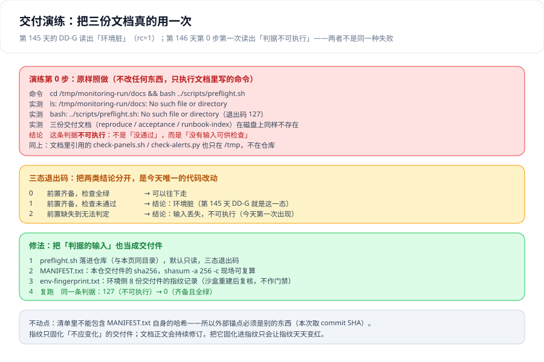

# 交付演练：把三份文档原样用一次



第 145 天写完三份交付文档时，`DD-G` 给出的读数是 **1** —— `bash scripts/preflight.sh` 逐条列出两项缺失前置。那一页写得很清楚：**这不是判据失败，恰恰是判据成立**（它证明第 0 步能判出「机器干不干净」，而本机是脏的）。

今天做的事情很朴素：**把那一页的「如何验证」原样照做一次**。结果是第 0 步的第一条命令就没跑起来——不是因为它判出了错误，而是因为**它要读的东西已经不在磁盘上了**。这一页记录的，就是这一次演练抓到的三件事，以及为此改动的**唯一一处代码**。

::: tip 一句话定位
这一页讲的是**交付判据的输入也算交付件**。判据写对了、跑通了、留了读数，还不算完——**读数必须带上「它是在什么输入下取的」**，否则第二天复跑得到另一个退出码时，没人能说清是环境变了还是判据没了。
:::

## 一、演练做的是什么，为什么必须「原样照做」

演练的全部内容是三条纪律：

1. **不改任何东西**。不补前置、不挪文件、不先看看「大概缺什么」。一旦开始顺手补，演练就退化成「我把它弄到能跑」——那是修，不是验。
2. **只执行文档里写着的命令**，逐字照抄，包括 `cd` 到哪个目录。文档写 `cd /tmp/monitoring-run/docs`，就真的 `cd` 那一个；写 `bash ../scripts/preflight.sh`，就真的用那个相对路径。
3. **记录「不可执行」与「未通过」的区别**。这是本次演练唯一想要的产出。

第 3 条是这一页的核心。一个判据有三种结局，前两种经常被当成一种：

| 结局 | 表现 | 它说明了什么 |
| --- | --- | --- |
| **通过** | 逐项全绿，rc=0 | 环境满足前置 |
| **未通过** | 逐项列出缺失项，rc=1 | 环境**不**满足前置 —— 这是一个**结论**，可以拿去做决定 |
| **不可执行** | `No such file or directory`，rc=127 | **判据的输入不存在** —— 这不是结论，这是**没有结论** |

被混在一起的是后两种。它们在纸面上都表现为「跑不通」，于是「今天没通过」会被记成一件需要修的事，而「今天根本没法判」会被记成一件可以先放一放的事——**恰好搞反了**。

## 二、第 0 步：原样照做

第 145 天的「如何验证」里，第 7 步是这样写的：

```shell
cd /tmp/monitoring-run/docs

# 7) 第 0 步真的能判环境（DD-G）—— 期望：退出码 1，并逐条列出缺失前置
bash ../scripts/preflight.sh; echo "退出码=$?"
```

照做的结果：

| 命令 | 实际输出 | 退出码 |
| --- | --- | --- |
| `cd /tmp/monitoring-run/docs` | `bash: line 0: cd: /tmp/monitoring-run/docs: No such file or directory` | **1** |
| `bash /tmp/monitoring-run/scripts/preflight.sh` | `bash: /tmp/monitoring-run/scripts/preflight.sh: No such file or directory` | **127** |
| `ls -d /tmp/monitoring-run/docs` | `No such file or directory` | 2 |
| 全盘找 `reproduce.md` / `acceptance.md` / `runbook-index.md` | **无任何输出** | —— |

四条读数指向同一件事：**第 0 步的输入没有被交付**。

- `/tmp/monitoring-run/docs/` 这个目录不存在——三份交付文档本身没有以文件形式落下来；
- `/tmp/monitoring-run/scripts/preflight.sh` 不存在——**第 0 步被写成了一条命令，而这条命令指向的文件从未被创建**；
- 三份文档引用的 `check-panels.sh` / `check-alerts.py` / `one-click-up.sh` 同样只在 `/tmp` 里，仓库里一份都没有。

### 2.1 于是第 145 天的八条判据，今天一条都不可执行

这不是修辞。把八条判据的输入逐个对一遍：

| 判据 | 它的输入是什么 | 今天还在吗 |
| --- | --- | --- |
| `DD-A` `DD-B` `DD-C` `DD-D` `DD-E` `DD-F` `DD-H` | `reproduce.md` / `acceptance.md` / `runbook-index.md`（共 7 条依赖这三份文件） | **不在**（全盘无这三个文件名） |
| `DD-G` | `scripts/preflight.sh` | **不在**（`/tmp/monitoring-run/scripts/` 下只剩 3 个 check 脚本） |

也就是说：昨天写下的「**八条全部本机已跑**」是完全成立的，而今天**一条也复跑不了**。判据本身没有问题——问题在于**它们的输入从来就不在交付位置**，昨天的「已跑」是在一个临时目录里跑完、然后随临时目录一起消失的一次性事件。

所以 `DD-G` 在昨天记录的读数（**1**）与今天的实测（**1**）在纸面上完全一样、含义完全不同。这是下一节的事。

## 三、一个退出码、两种含义：读数必须带上输入

把两次读数并排放在一起，问题就很刺眼：

| 时间 | 执行的东西 | 退出码 | 真实含义 |
| --- | --- | --- | --- |
| 第 145 天 | `bash scripts/preflight.sh`（脚本**存在**） | **1** | 前置两项缺失 —— **环境脏**，判据成立 |
| 第 146 天 | `cd docs && bash ../scripts/preflight.sh`（脚本**不存在**） | **1** | `cd` 失败，脚本**一次都没开始执行** |

同一天里，同一个退出码 `1`，一次是「我检查完了，环境不满足」，一次是「我连检查都没做」。

第 143 天定过一条纪律，叫「**口径名 + 获取方式**」：一条读数如果写不出「对着哪个文件、哪一次启动取的」，就不能进交付文档。今天这条纪律被推到了它必然要到达的地方——**退出码也是读数**：

> 记录一个退出码时，必须同时记录**它是执行了什么才得到的**。否则这个数字在第二天不可复核，它会安静地从一个含义变成另一个含义，而没有人会收到通知。

这一条不需要新的机制去支撑，只需要一条记录纪律：**读数后面跟一个 `$?` 的来源**。

## 四、三态退出码：把「不可执行」与「未通过」分开

今天唯一的代码改动就是把这件事写进退出码。

第 145 天给出的语义是三分（`0` 满足 / `1` 缺前置 / `2` 用法错误）。实现的时候发现这个三分**漏掉了今天真实发生的那一态**：脚本没有参数，所以「用法错误」根本不会发生，而「输入丢失」第二天就发生了。因此 `2` 的含义被**改定义为「前置缺失到无法判定」**，并把「用法错误」并入其中——**三态的形式不变，边界变了**，这里如实记下这次修订：

| 退出码 | 含义 | 调用方应当做什么 |
| --- | --- | --- |
| `0` | 前置齐备，检查全绿 | 继续往下走 |
| `1` | 前置齐备，检查未通过 | **这是一个结论**：环境脏。按缺失项逐条处置 |
| `2` | 前置缺失到无法判定 | **这不是结论**：先去把输入找回来，或换一台机器 |

实测三态都能取到：

```shell
cd project/Complete/MonitoringDashboard/DeliveryDrill

bash preflight.sh                                  # 期望 rc=0
SANDBOX=/nonexistent-monitoring bash preflight.sh  # 期望 rc=2，实测输出「2 项通过，1 项缺失」
```

第二条命令的输出值得完整看一眼，因为它是三态里最容易被写坏的那一态：

```text
  [OK]    docker CLI + daemon：期望=client 与 daemon 均可达 实测=27.1.1/27.1.1
  [OK]    curl：期望=命令存在 实测=curl 8.1.2
  [BLOCK] 沙盒目录：期望=存在 实测=缺失：/nonexistent-monitoring

前置：2 项通过，1 项缺失 —— **不可执行**（rc=2）
注意：这不是「检查未通过」，而是「没有输入可供检查」。两者必须分开处置。
```

注意它**不是在第一个错误处退出**：工具与目录是「能不能判」的前置，它们逐条报完后才统一给出 `2`。一个只在第一行就 `exit 2` 的版本，会让人以为「只缺了沙盒目录」，而实际上另外两项可能也早就不可用了。

## 五、修法：把「判据的输入」也当成交付件

修法不是「把文件补到 `/tmp` 里」——那只是一种更贵的原地踏步。修法是**让第 0 步从仓库里就能被拿到**。

本次在 `project/Complete/MonitoringDashboard/DeliveryDrill/` 落了三个文件，三者的分工是刻意分开的：

| 文件 | 是什么 | 参与 rc 吗 |
| --- | --- | --- |
| `preflight.sh` | 第 0 步本体：**只读**自检，三态退出码 | —— |
| `MANIFEST.txt` | **本仓**交付件的 sha256，`shasum -a 256 -c` 现场可复算 | **参与**（不一致 → rc=1） |
| `env-fingerprint.txt` | **环境侧**那 9 份交付件的指纹记录（编排、抓取配置、告警规则、验收脚本） | **不参与**（沙盒重建后本来就该变） |

第三行的取舍需要解释一句：环境侧的交付件活在 `/tmp` 里，机器一清就没了。把它们的指纹也做成门禁，结果是**每次重建沙盒都红一次**，而红的原因不是「有人改坏了东西」，是「这是新的一份」——这种门禁很快就会被忽略。所以它们**只记录、复核、不判红**。**判红的东西必须是「不应该变化」的东西。**

### 5.1 一个不动点问题：清单不能包含自己的哈希

`MANIFEST.txt` 里如果写上 `MANIFEST.txt` 自己的 sha256，这个文件就不可能有稳定内容——写进去的哈希会让它自己变化，变化之后哈希又不再成立。所以清单的外锚点必须是**另一个东西**，本次取 **commit SHA**：

```shell
cd project/Complete/MonitoringDashboard/DeliveryDrill
shasum -a 256 preflight.sh assets/delivery-drill.svg > MANIFEST.txt
grep -c 'MANIFEST.txt' MANIFEST.txt      # 期望 0
```

这与审计链那一套是同一个形状：**链条自己是闭合不了的，必须有一个在链外的锚点**。区别只是这里的锚点是 git 提交号，而审计场景里是一份写在别处的链尾值。

### 5.2 指纹只固化「不应变化」的东西

清单里有两项：`preflight.sh` 与 `assets/delivery-drill.svg`。**这一页的正文没有进清单**，理由是它会持续修订——把易变物固化进指纹，只会让指纹天天变红，然后被忽略。这条边界和上一节环境侧指纹的边界是同一个判断标准的两端。

## 六、判据表：`DR-A` ~ `DR-H`

| 判据 | 内容 | 怎么验证 | 状态 |
| --- | --- | --- | --- |
| `DR-A` | 每一项检查都同时输出「期望」与「实测」两个值，不输出裸的 `OK` | `bash preflight.sh \| grep -c '期望='` = **12** = 检查项数 | ✅ 已跑 |
| `DR-B` | 判据的**输入**必须在交付位置可取；取不到时判「不可执行」而不是「未通过」 | `SANDBOX=/nonexistent-monitoring bash preflight.sh; echo $?` → **2**（不是 1） | ✅ 已跑 |
| `DR-C` | 第 0 步全流程**只读**：不启停容器、不写任何文件 | 跑前跑后 `docker ps` 的 ID/状态集合一致、`git status --porcelain` 指纹一致 | ✅ 已跑 |
| `DR-D` | 交付件指纹能被第三方现场复算，且不一致时**点名到项** | `shasum -a 256 -c MANIFEST.txt` 全 OK；给 SVG 追加一个字节 → `仅 1/2 项一致` | ✅ 已跑 |
| `DR-E` | 清单里的每一项都真实存在（清单不是许愿单） | 逐行 `test -e`：`preflight.sh` 与 `assets/delivery-drill.svg` 均存在 | ✅ 已跑 |
| `DR-F` | 清单不含自身的哈希（不动点），外部锚点另取 | `grep -c 'MANIFEST.txt' MANIFEST.txt` = **0**，锚点为 commit SHA | ✅ 已跑 |
| `DR-G` | 「不该变化」的东西进门禁，「本来就该变」的东西只记录 | `MANIFEST.txt` 的 2 行参与 rc；`env-fingerprint.txt` 的 9 行不参与 rc | ✅ 已跑 |
| `DR-H` | 同一条判据在修复前后给出**可区分**的两次读数，并**并列留档** | 127（不可执行）→ **0**（齐备且全绿），两次读数并列在第二节与第八节 | ✅ 已跑 |

### 6.1 `DR-D` 的读数：改一个字节会怎样

这条判据的价值全在「不一致时能不能点名」。实测（`DR-D`）：

```text
改一个字节 → [MISS] 本仓交付件指纹：期望=2 项 sha256 全部一致 实测=仅 1/2 项一致   （rc=1）
复原      → [OK]   本仓交付件指纹：期望=2 项 sha256 全部一致 实测=OK 2/2          （rc=0）
```

「仅 1/2 项一致」这句话的长度本身就是设计的一部分：它同时说明了**有几项**、**错了几项**。第一版实现不是这样的，见下一节。

## 七、当日做了什么

1. **原样照做一次，抓到「输入没交付」**。三条命令、四条读数（rc=1 / rc=127 / 目录不存在 / 全盘无三份文档）写进第二、三节。
2. **落地第 0 步本体** `preflight.sh`（**167 行**，**只读**，三态退出码）。检查分四组共 **12 项**：A 前置工具与目录（3）／B 本仓交付件指纹（1）／C 编排文件与「成对声明」判据（2）／D 运行态（6：3 个容器 running、Prometheus 与 Alertmanager 的 `/-/ready`、抓取目标 5/5 up、告警规则 6、记录规则 3）。
3. **把「成对声明」判据搬进第 0 步**。第 144 天把它放在 `one-click-up.sh` 的第 0 层（起栈之前）；今天它同时在 `preflight.sh` 的 C 组里——**理由是同一个**：起完栈再发现交付件缺配置，你已经把一份不完整的交付件跑起来了。实测 2 份声明 `retention.time` 的编排文件都成对声明了 `retention.size`。
4. **落地 `MANIFEST.txt`（2 项）与 `env-fingerprint.txt`（9 项）**，并把门禁/记录的边界写进判据 `DR-G`。
5. **取到修复前后的两次读数并留档**：同一路径下，`127`（不可执行）与 `0`（齐备且全绿）。
6. **抓出三处脚本自身缺陷**（下表），三处都属于「**判据输出与人读到的意思不一致**」这一族——这已经是本项目第 5 次遇到。
7. **修订第 145 天的退出码语义**：`2` 从「用法错误」改定义为「前置缺失到无法判定」，把「用法错误」并入其中；三态形式不变、边界变化，如实登记在第四节。

### 7.1 三处脚本自身缺陷

| # | 现象 | 根因 | 处置 |
| --- | --- | --- | --- |
| 1 | `[OK] 抓取目标 health=up：期望=全 up 实测=5,5/5 up` —— 读数看起来像「有 5,5 个目标」 | Python 端输出 `5,5`，shell 端用 `${t##*, }` 切分，**分隔符被多写了一个空格**，于是永远切不开，两个值一起落进「实测」 | 改成 `${t##*,}`，并把这条踩坑写进脚本注释 |
| 2 | 中文标签一长一短，「期望」列被推得参差不齐 | `printf '%-22s'` 的宽度按**字节**计较，中文每字 3 字节 | 放弃列对齐，改为 `标签：期望=… 实测=…` 的 key=value 形态——交付脚本的输出第一要求是**能被 grep 稳定认出来**，不是好看 |
| 3 | 给 SVG 追加一个字节，报出「**2** 项不一致」，而清单里只有 2 项 | `shasum -c` 不一致时**额外**打印一行 `WARNING: n computed checksum did NOT match`，用「非 OK 行数」当失败数把这一行也算进了一项 | 改为**数 OK 条数**（`仅 1/2 项一致`） |

第 1 条值得单独说一句：它给出的是「**5,5 个目标**」这样一个不存在的读数，而真实情况是 **5/5 全 up**。一个不会被任何人质疑的假读数，比一个明显跑不通的判据危险得多——**看起来正常的错，不会有人去查**。

## 八、如何验证

全部命令都在本页同一目录（`project/Complete/MonitoringDashboard/DeliveryDrill/`）下执行，且**全部只读**。

```shell
cd project/Complete/MonitoringDashboard/DeliveryDrill

# 0) 第 0 步一次性跑完（DR-A / DR-B / DR-C）—— 期望：12 项通过、rc=0
bash preflight.sh | tail -3
bash preflight.sh >/dev/null; echo "退出码=$?"

# 1) DR-A：每一项都有「期望 / 实测」两个值，期望值等于检查项数
bash preflight.sh | grep -c '期望='

# 2) DR-B：前置缺失必须判 2（不可执行），而不是 1（未通过）
SANDBOX=/nonexistent-monitoring bash preflight.sh | tail -2
SANDBOX=/nonexistent-monitoring bash preflight.sh >/dev/null; echo "退出码=$?"

# 3) DR-C：只读性 —— 跑前跑后容器集合与工作区指纹必须一致
before=$(docker ps --format '{{.ID}} {{.Names}} {{.Status}}' | sort)
g0=$(git -C ../../../.. status --porcelain | sort | shasum -a 256)
bash preflight.sh >/dev/null
after=$(docker ps --format '{{.ID}} {{.Names}} {{.Status}}' | sort)
g1=$(git -C ../../../.. status --porcelain | sort | shasum -a 256)
[ "$before" = "$after" ] && echo "容器未变 OK" || echo "容器被动了"
[ "$g0" = "$g1" ] && echo "工作区未变 OK" || echo "脚本写了文件"

# 4) DR-D + DR-E + DR-F：指纹可复算、清单项都存在、清单不含自身哈希
shasum -a 256 -c MANIFEST.txt          # 期望两行 OK
grep -c 'MANIFEST.txt' MANIFEST.txt    # 期望 0
while IFS= read -r l; do f="${l#*  }"; [ -e "$f" ] && echo "存在 $f"; done < MANIFEST.txt

# 5) DR-D 的反例：改一个字节，必须点名到项
cp assets/delivery-drill.svg /tmp/_bk.svg
printf ' ' >> assets/delivery-drill.svg
bash preflight.sh | grep '本仓交付件指纹'   # 期望：仅 1/2 项一致
cp /tmp/_bk.svg assets/delivery-drill.svg
shasum -a 256 preflight.sh assets/delivery-drill.svg > MANIFEST.txt
bash preflight.sh | tail -1                 # 期望：rc=0

# 6) DR-G：环境侧指纹只记录、不参与 rc
grep -c '^[0-9a-f]\{64\}  ' env-fingerprint.txt   # 期望 9 行记录，但上一步的 rc 不受它影响
```

**预期结果读法**：第 0 步应当是 `12 项通过，0 项缺失，0 项跳过 —— 全绿（rc=0）`；第 2 步必须是 `2`，若得到 `1` 说明三态被压成了两态（这是本次演练的核心结论，压掉就等于承认「判据的输入可以不交付」）；第 5 步的 `仅 1/2 项一致` 是**预期结果**，若得到 `2/2` 说明清单没有被真正校验过。

## 九、下一步

| 待办 | 内容 | 归属 |
| --- | --- | --- |
| **从零复现（干净机器）** | 一台干净机器上按《从零复现指南》完整执行一遍，把 `DD-G` 的读数从 1 变成 0 | 第 143 天登记，**今天仍然未解**——今天的演练证明了它为什么难解：连第 0 步的脚本都不在交付位置 |
| **三份文档落成文件** | 三份文档目前只以摘录形式存在于本目录页面里，没有作为文件交付；`/tmp/monitoring-run/docs/` 已不存在 | **今天新登记**，本页第八节的验证命令就是它们的替代入口 |
| **环境侧交付件入仓** | `compose.yaml` / `prometheus/*.yaml` / `alertmanager/*.yaml` / `bin/one-click-up.sh` / `scripts/check-*.sh` 共 9 份目前只在 `/tmp`；已记录指纹（`env-fingerprint.txt`），但**记录不等于交付** | **今天新登记** |
| `L3` | 真实通知渠道四项前置（凭据 / 模板 / 限流重试 / `resolved`），仍未解 | 第 140 天登记 |
| 整周收口 | 第 4 周（第 145-150 天）收口：三件套 + 干净机器复现 + 第 5 期项目结项结论 | 本目录 |

::: tip 下一轮最容易犯的错
**把「判据全绿」当成「交付完成」。** 第 145 天已经写下过一次「八条判据全绿只说明文档自身没写坏」，今天它兑现得更彻底：那八条判据今天**一条都不可执行**（7 条依赖三份文档文件、1 条依赖 `preflight.sh`，两类输入都已不在），而昨天它们**确实全部本机跑过、也确实全部是绿的**。

这两件事之间没有任何矛盾——**判据跑过 ≠ 判据能被别人跑**。判据管的是「这份东西自己有没有写坏」，交付管的是「换一个人、换一台机器、换一天，能不能照着做一遍」。中间那道缝只能靠**一次原样照做**去量，而量出来的第一件东西往往不是别人的问题：**是判据的输入压根没有被交付**。
:::

## 参考资料

- Google SRE Workbook · Launch Coordination Checklist（验收清单的「可勾选」形态）：<https://sre.google/workbook/launch-checklist/>
- POSIX 退出码约定（`126` / `127` 的含义：命令不可执行 / 命令未找到——`127` 正是本次演练拿到的读数）：<https://pubs.opengroup.org/onlinepubs/9699919799/utilities/V3_chap02.html#tag_18_08_02>
- `shasum(1)` 手册（`-c` 的校验模式与不一致时的输出格式）：<https://man.openbsd.org/shasum.1>
