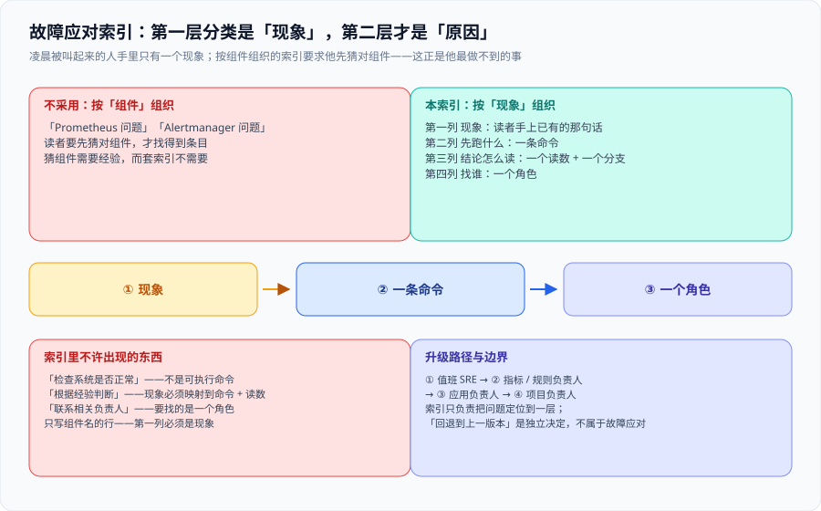

# 故障应对索引

**读者要做的动作：先在第一列找到你看到的现象，再跑第二列的命令，然后按第三列找人。不要在找现象之前先想原因——找原因需要时间，套索引不需要。**



::: tip 为什么第一列是「现象」而不是「组件」
凌晨被叫起来的人手里只有一个现象：「大盘是空的」「告警一直在响」「接口慢了」。他不知道是 Prometheus、Alertmanager 还是靶服务的问题——**按组件组织的索引要求他先猜对组件，这正是他最做不到的事**。
:::

## 一、按现象查（主索引）

| 现象 | 先跑什么 | 结论怎么读 | 找谁 |
| --- | --- | --- | --- |
| 大盘全空，一个点都没有 | `curl -s localhost:9090/api/v1/targets \| jq '.data.activeTargets[].health'` | 有 `down` → 抓取面问题；全 `up` → 看查询选择器 | 值班 SRE |
| 大盘有数据，但某个面板一直空 | 把该面板的表达式粘进 `localhost:9090/graph` 单独跑 | 表达式有结果 → 面板配置问题；无结果 → 标签口径不符 | 指标负责人 |
| 告警一直在响，退不下去 | `curl -s localhost:9093/api/v2/alerts \| jq '.[].status.state'` | `active` 且 `inhibitedBy` 有值 → 抑制链生效；为空 → 看分组与 `repeat_interval` | 值班 SRE |
| 告警该响却一直不响 | `curl -s localhost:9090/api/v1/rules \| jq '.data.groups[].rules[].state'` | 无该规则 → 规则未加载；`inactive` → 表达式或阈值 | 规则负责人 |
| 收到通知但内容里没有可点的链接 | `grep -c runbook_url alertmanager/alerting.yaml` | 数量少于告警条数 → 有规则漏写 `runbook_url` | 规则负责人 |
| 容器起来又退出 | `docker compose ps -a` 与 `docker compose logs --tail=50 <service>` | 退出码 + 日志最后 50 行 | 值班 SRE |
| 一键起脚本卡在第 1 层 | `bash scripts/preflight.sh; echo $?` | `2` → 前置缺失（装运行时）；`1` → 前置未通过（逐条修） | 值班 SRE |
| 同一份配置改完没生效 | <span v-pre>`docker inspect <container> --format '{{.Config.Image}} {{.Created}}'`</span> 与容器内 sha256 | sha256 不等 → 挂载路径或「改了不生效的那一份」 | 值班 SRE |
| 磁盘水位在涨 | 看保留上限：`/-/status/flags` 里的 `storage.tsdb.retention.*` | 只有 `.time` 没有 `.size` → 缺体积上限 | 值班 SRE |
| 页面能开但数据不动 | 看靶服务是否还在：`curl -s localhost:8088/work` | 5xx → 靶服务问题；2xx 但无数据 → 抓取或探针 | 应用负责人 |

## 二、按「我有几分钟」查（优先级索引）

| 你有的时间 | 该做的事 | 不该做的事 |
| --- | --- | --- |
| ≤ 5 分钟 | 只跑主索引第一列对应的**一条**命令，把结果贴进事故频道 | 改配置、重启服务 |
| 5 — 30 分钟 | 按主索引定位到一层；采集证据（`docker compose ps`、目标状态、规则状态） | 在生产上调阈值 |
| > 30 分钟 | 按 [六层验收清单](../Acceptance/index.md) 反向核对，找到第一个不成立的层 | 从「最可疑的地方」开始猜 |

::: danger 注意：事故现场是只读的
没在事发时采到的东西，事后补不回来。**先取证，再动手。** 尤其这三样：容器状态与启动参数、目标健康状态、规则评估状态。重启容器会把第一样永久破坏。
:::

## 三、升级路径

```text
① 值班 SRE  → ② 指标 / 规则负责人（阈值与表达式）
             → ③ 应用负责人（靶服务与业务指标）
             → ④ 项目负责人（判定是否回退到上一版本）
```

**「回退到上一版本」不是故障应对的一部分**，它是[上线验收清单](../Acceptance/index.md)第 1 层与第 2 层之后的独立决定。索引只负责把问题**定位到一层**，不负责决定要不要退。

## 四、这份索引不许出现的东西

| 不许出现 | 为什么 |
| --- | --- |
| 「检查系统是否正常」 | 不是一条可执行的命令 |
| 「根据经验判断」 | 现象必须能映射到**一条命令 + 一个读数** |
| 「联系相关负责人」 | 要找的是**一个角色**，不是一个模糊的称谓 |
| 只写组件名的行（如「Prometheus 问题」） | 第一列必须是**现象**，因为读者先看到的是现象 |

## 参考

- [上线验收清单](../Acceptance/index.md)：六层 24 项与证据形态
- [从零复现指南](../Reproduce/index.md)：把环境搭起来的那一份
- [交付包台账](../index.md)：本索引与三份文档的落地位置
- Google SRE Book · Being On-Call（「现象 → 动作」的组织方式）：<https://sre.google/sre-book/being-on-call/>
