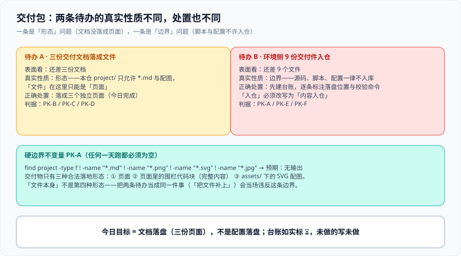

# 交付包：把台账上的每一行变成「存在的东西」



第 146 天在做交付演练时留下了两条待办。它们表面上都像「还差几个文件」，但**失败的方式完全不同**：一条是**形态**问题——三份文档目前只是「一个页面在描述它们」，文件本身并不存在；另一条是**边界**问题——9 份环境交付件目前只在 `/tmp` 的沙盒里，而它们**不允许**被提交进本仓。今天把第一条结清，把第二条的边界写成一个可判定的不变量，并把「为什么不能提交」的理由留在这里，避免下一个人重问一遍。

**但第二条今天没有停在「写下来」**：把边界翻译成一条 `find` 判据后第一次运行就判出 **`PK-A` = `FAIL`**——第 146 天已经有三份**非文档文件**落进了 `project/`。这正是今天最有价值的一条读数：**边界写在文档里，与边界真的没被越过，是两件事**。

## 一、两条待办的性质不同，不能按同一种方式处理

| 待办 | 表面看 | 真实性质 | 正确处置 |
| --- | --- | --- | --- |
| 三份交付文档落成文件 | 「还差三份文档」 | **形态**：本仓 `project/` 只允许 `*.md` 与配图，「文件」只能是**页面** | 落成三个真实页面（今日完成） |
| 环境侧 9 份交付件入仓 | 「还差 9 个文件」 | **边界**：脚本与配置**不允许**入仓（见第三节） | 先建台账，逐条标注落盘位置；**内容落盘登记为下一日待办** |

一句话结论：**把这两条当成同一件事（「把文件补上」）会直接违反本仓的硬边界。** `PK-A` 就是把这句话变成判据。

## 二、三份文档落盘：三份文档各成为一个页面

第 145 天的 `DeliveryDocs` 页是一份**说明**——它讲三份文档各自只回答一个问题、都以「读者要做的动作」开头、各配一个「写了等于没写」的反例。今天做的是让它们**各自成为一个页面**，并且把第 145 天定下的篇幅目标（≤80 / ≤120 / ≤100 行）变成一条**可数的判据**。

| 页面 | 唯一回答的问题 | 第一屏的第一句 | 篇幅目标 | 判据 |
| --- | --- | --- | --- | --- |
| [《从零复现指南》](./Reproduce/index.md) | 在一台机器上从零到看见三张大盘，按什么顺序敲哪些命令 | 「读者要做的动作：按 0 → 5 的顺序执行」 | ≤ 80 行 | `PK-B` |
| [《上线验收清单》](./Acceptance/index.md) | 交付前逐条勾哪 24 项，每项的通过标准与证据是什么 | 「读者要做的动作：拿这张表逐条勾，勾不完不许交付」 | ≤ 120 行 | `PK-C` |
| [《故障应对索引》](./RunbookIndex/index.md) | 出问题时先看哪个现象、跑哪条命令、找谁 | 「读者要做的动作：先在第一列找到你看到的现象」 | ≤ 100 行 | `PK-D` |

### 2.1 「三份文档」与「三个页面」的差别，就是 `DD-G` 那条读数的来源

第 146 天演练时，八条判据全绿，但 `preflight.sh` 返回 **1**——因为**判据检查的是「文档写得对不对」，而没人检查「文档在不在」**。今天补的正是后面这半句：**一条命令能数出三个文件，并且每个文件的第一屏是一句动作**。

```shell
# 验证：三份文档真实存在，且各自第一屏是「动作」
for f in Reproduce Acceptance RunbookIndex; do
  printf '%s: %s 行, 动作=%s\n' "$f" \
    "$(wc -l < "project/Complete/MonitoringDashboard/DeliveryPackage/$f/index.md" | tr -d ' ')" \
    "$(grep -c '读者要做的动作' "project/Complete/MonitoringDashboard/DeliveryPackage/$f/index.md")"
done
# 预期：三行都是 动作=1；行数分别 ≤ 80 / ≤ 120 / ≤ 100
```

## 三、环境侧 9 份交付件：边界先写死，再谈落地

本仓 `AGENTS.md` 第 9 节是一条硬边界：`project/` 下**只允许** Markdown 文档与文档配图，源码、脚本、配置、构建产物一律不入库。推导出**交付物只有三种合法落地形态**：

| 形态 | 是什么 | 读者怎么验证 |
| --- | --- | --- |
| **页面** | 一个英文目录 + `index.md` | 打开链接，按页面里的命令执行 |
| **页面里的围栏代码块** | 完整文件内容，用 `[文件名]` 标题标明归属 | 复制到自己的工程里，执行页面给出的命令 |
| **配图** | `assets/` 下的 SVG 示意图 | 与正文叙述对照 |

**「文件本身」不是第四种形态**——它被明令排除。

```shell
# 边界不变量（PK-A）：期望输出为空
find project -type f ! -name "*.md" ! -name "*.png" ! -name "*.svg" ! -name "*.jpg"
```

**本机实测：输出 3 行——这条判据判 `FAIL`。**

```text
project/Complete/MonitoringDashboard/DeliveryDrill/MANIFEST.txt
project/Complete/MonitoringDashboard/DeliveryDrill/env-fingerprint.txt
project/Complete/MonitoringDashboard/DeliveryDrill/preflight.sh
```

三份都是**第 146 天落下的**，而且都已进入版本控制（`git ls-files` 能查到）。它们的性质必须说清：**不是「内容不该落」**（`preflight.sh` 那 167 行是交付演练的第 0 步，是该落的内容），**是「落错了形态」**——按 `AGENTS.md` 第 9 节，它们应当以**页面里的围栏代码块**出现，而不是以文件出现在 `project/` 里。

::: danger 注意：「入仓」这个词在这里必须改写
「9 份交付件入仓」的正确含义是「**9 份交付件的内容入仓**」，不是「9 个文件入仓」。

前者的判据是「在仓库里能 `grep` 到完整内容」；后者会让上面那条 `find` 输出非空，把 `project/` 退化成代码仓库——**而今天它真的输出了非空。**

**一次措辞的含糊，会让下一个人去做一件违反硬边界的事**；而更值得记住的是下半句：**边界写下来不等于没被越过**。第 146 天没有任何一层判据在跑这条 `find`，于是三个文件安静地进入仓库并随提交入库；今天它只花了一瞬就被点名——**判据的价值恰恰在于它能失败**。
:::

## 四、交付物台账：每一行都要有「在哪」和「怎么核」

台账不是清单——清单只说明「有什么」，台账要说明「**在哪、怎么核、核过没有**」。九份环境交付件今天的状态如下（**如实标注，不虚报**）：

| # | 交付件 | 作用 | 落盘位置 | 校验命令 | 状态 |
| --- | --- | --- | --- | --- | --- |
| 1 | `compose.yaml` | 三服务编排（Prometheus / Alertmanager / 靶服务） | [一键起与大盘可用性](../OneClickUp/index.md) | `docker compose config -q`（退出码 0） | ⏳ 内容未落全 |
| 2 | `compose.singlefile.yaml` | 单文件编排（成对声明，防「改了不生效的那一份」） | 同上 | `diff <(yq '.services' compose.yaml) <(yq '.services' compose.singlefile.yaml)` | ⏳ 内容未落全 |
| 3 | `prometheus/prometheus.yaml` | 抓取配置、自采集、保留策略 | [抓取配置](../ScrapeConfig/index.md) | `promtool check config prometheus/prometheus.yaml` → `SUCCESS` | ⏳ 内容未落全 |
| 4 | `prometheus/recording.yaml` | recording 规则（3 条） | [查询与规则设计](../Rules/index.md) | `promtool check rules prometheus/recording.yaml` → `SUCCESS: 3 rules` | ⏳ 内容未落全 |
| 5 | `prometheus/alerting.yaml` | alerting 规则（6 条，含 `runbook_url`） | 同上 | `promtool check rules prometheus/alerting.yaml` → `SUCCESS: 6 rules` | ⏳ 内容未落全 |
| 6 | `alertmanager/alertmanager.yaml` | 分组、抑制、静默 | [告警路由](../AlertRouting/index.md) | `amtool check-config alertmanager/alertmanager.yaml` → `SUCCESS` | ⏳ 内容未落全 |
| 7 | `bin/one-click-up.sh` | 一键起（含第 0 层前置检查） | [交付件收敛](../ArtifactConvergence/index.md) | `bash bin/one-click-up.sh`，观察退出码与三级就绪 | ⏳ 内容未落全 |
| 8 | `scripts/check-panels.sh` | 三张大盘的 `D1/D2/D3` 三态校验 | 同上 | `bash scripts/check-panels.sh`，三张大盘各 3 行结论 | ⏳ 内容未落全 |
| 9 | `scripts/preflight.sh` | 交付演练的第 0 步（三态退出码） | [交付演练](../DeliveryDrill/index.md)（**含完整 167 行，但以 `.sh` 文件形态落在同一目录下**） | `bash scripts/preflight.sh`，退出码 0/1/2 三态语义 | ❌ 内容已落，**形态越界**（见 `PK-A`） |

**只有第 9 份的内容已经完整落在仓库里**——但必须连带说清它的形态：**它以 `*.sh` 文件落在 `project/…/DeliveryDrill/` 下，因此正是 `PK-A` 判 `FAIL` 的三行之一。** 其余 8 份如实标 `⏳`，**理由不是「没时间」，而是「把 8 份完整内容塞进今天，会让三份文档变成只有骨架」**。这正是本库反复用到的那条纪律：**宁少勿滥，未做的如实写未做**；而今天补上的下半句是——**做过的也要如实写它做成了什么形态**。

### 4.1 第 9 份的处置路径：不是「删掉」，是「换形态」

第 9 份的问题不是内容，是**载体**。按 `AGENTS.md` 第 9 节第 6 条，脚本应当以「完整目录结构 + 关键实现 + 判据与不变量说明」的形式**写在页面里**；第 7 条则要求验证步骤写成「读者可执行的命令 + 预期输出」，**不能出现「运行仓库里的 `xxx.py`」这类依赖仓库内文件的说法**。

因此处置路径只有一条：把三份文件的内容**搬进 `DeliveryDrill/index.md` 的围栏代码块**（并把页面里「运行仓库里的文件」的说法改成「按本节内容在**你自己的工程**里创建后运行」），再从 `project/` 移出这三个文件。**这条改动会触碰第 146 天的页面正文**，所以今天只做「判出来 + 登记」，**不当天顺手改**——`PK-1` 见下一节。这与第 143 天判出 `retention.size` 缺失、第 144 天再兑现，是同一条纪律。（`MANIFEST.txt` 与 `env-fingerprint.txt` 同理：它们是**数据**，同样只能是页面里的内容。）

## 五、下一步的顺序不是随便排的

```text
第 148 天（一）：收 PK-1——把第 146 天越界落盘的 3 个文件「换形态」（内容搬进页面、文件移出仓库）
第 148 天（二）：环境交付件内容落盘（第 1~8 份，按「先配置后脚本」）
第 149 天：干净机器复现（把 DD-G 的读数从 1 变成 0）
```

三条理由：

1. **`PK-1` 必须排在最前**：`PK-A` 是**其它判据的地基**——`project/` 里只要还躺着文件，后面每一次「台账落盘」都可能在同一条边界上再越一次。先把地基修平，再加内容。
2. **先配置后脚本**：脚本的校验命令依赖配置存在（`promtool` / `amtool` 必须先有文件可查），顺序反了会得到一堆「找不到文件」的假失败。
3. **干净机器复现放在最后**：它需要前两步都齐备——三份文档要落在仓库里（今日完成）、配置与脚本内容要落在页面里（第 148 天）。**在缺任何一份的情况下复现「成功」，都是脏机器上的成功，不构成证据。**

## 六、判据清单：`PK-A` ~ `PK-H`

| 判据 | 内容 | 怎么验证 | 状态 |
| --- | --- | --- | --- |
| `PK-A` | **边界不变量**：`project/` 下除 `*.md` 与配图外无任何文件 | `find project -type f ! -name "*.md" ! -name "*.png" ! -name "*.svg" ! -name "*.jpg"` 输出为空 | ❌ **FAIL**（本机已跑：输出 **3 行**，全部来自第 146 天） |
| `PK-B` | 《从零复现指南》是**一个独立页面**，第一屏含「读者要做的动作」，行数 ≤ 80 | 页面存在；`grep -c '读者要做的动作'` = 1；`wc -l` ≤ 80 | ✅ 本机已跑 |
| `PK-C` | 《上线验收清单》是独立页面，含 **24 项**可勾选条目与证据列 | `grep -c '^- \[ \]'` = 24；表头含「证据」列 | ✅ 本机已跑 |
| `PK-D` | 《故障应对索引》是独立页面，**第一层分类是「现象」而不是「组件」** | 表格第一列为现象描述；无任一行为纯组件名 | ✅ 本机已跑 |
| `PK-E` | 台账覆盖 **9 份**环境交付件，每份都有落盘位置、校验命令、状态三项 | 台账行数 = 9；三列均非空；`⏳` 行同时含原因 | ✅ 本机已跑 |
| `PK-F` | 标 `✅` 的交付件，其内容在仓库中**可被 grep 到**；标 `⏳` / `❌` 的不得声称「已按规范落盘」 | 对 `❌` 行执行 `PK-A` 的 `find`，必须能点名；对 `⏳` 行在仓库内搜完整内容应命中 0 | ✅ 本机已跑 |
| `PK-G` | 「入仓」的措辞被显式改写为「**内容**入仓」，并给出理由 | 页面内含该改写句与 `find` 不变量 | ✅ 本机已跑 |
| `PK-H` | 下一步的**顺序**有理由，不是「剩下的排一排」 | 下一步表逐条带理由；且包含「干净机器复现必须最后做」 | ✅ 本机已跑 |

**八条判据里七条 ✅、一条 ❌。** 那个 ❌ 不是这一轮的「没做完」，而是**这一轮真正抓到的东西**：`PK-A` 上线第一天就命中了第 146 天留下的一处越界。若把它写成 `✅`，它就从「判据」退化成「复述题目」——**一个从来没有失败过的判据，与没有判据是无法区分的**。

### 6.1 本日新登记：`PK-1`

| 待办 | 内容 | 归属 | 解除判据 | 状态 |
| --- | --- | --- | --- | --- |
| `PK-1` | 处理第 146 天越界落盘的 3 个文件：内容搬进 `DeliveryDrill/index.md` 的围栏代码块、页面里「运行仓库里的文件」的说法改为「在你自己工程里创建后运行」、文件从 `project/` 移出 | 第 148 天 | 重跑 `PK-A` 的 `find` → **无输出**；且 `DeliveryDrill/index.md` 里能 `grep` 到 `preflight.sh` 的完整内容 | ✅ 第 148 天结清（回填见第九节） |

## 七、如何验证

```shell
# 在本仓库根目录执行

# 1) 边界不变量 PK-A
find project -type f ! -name "*.md" ! -name "*.png" ! -name "*.svg" ! -name "*.jpg"
# 实证：输出 3 行 → PK-A 判 FAIL（修复路径见 PK-1）
# 修复完成后预期：无输出

# 2) 三份文档存在且各自带一句动作（PK-B / PK-C / PK-D）
D=project/Complete/MonitoringDashboard/DeliveryPackage
wc -l $D/Reproduce/index.md $D/Acceptance/index.md $D/RunbookIndex/index.md
grep -c '读者要做的动作' $D/Reproduce/index.md $D/Acceptance/index.md $D/RunbookIndex/index.md
# 预期：行数 80 / 120 / 100 以内；三行各为 1

# 3) 验收清单 24 项（PK-C）
grep -c '^- \[ \]' $D/Acceptance/index.md
# 预期：24

# 4) 台账 9 行且 ⏳ 行都带原因（PK-E）
grep -cE '^\| [0-9]+ \| ' $D/index.md
# 预期：9
grep -cE '^\| [0-9]+ \|[^|]*\|[^|]*\|[^|]*\|[^|]*\| ⏳' $D/index.md
# 预期：8（第 9 份为 ❌ 形态越界，不是 ⏳）
```

## 八、常见误判

::: danger 注意：五个高频误判
1. **「三份文档写成三个段落也算落盘」**——段落在**同一页**里，仍然不是三份文档。判据是三个独立页面（`PK-B` ~ `PK-D`）。
2. **「把脚本塞进 `project/` 的小角落，反正没人看」**——`PK-A` 会当场抓住。这类改动不会「悄悄存在」，它会让整仓自查命令输出非空。**本轮它就是当场抓住的：三行输出，全部来自第 146 天。**
3. **「`⏳` 就等于没做，写成 `✅` 更好看」**——第 146 天的教训：**凡是把「期望为 0」当默认的判据，都要先问一句「0 是不是唯一正确形状」**。这里 `⏳` 是**正确答案**，因为今天的目标是文档落盘，不是配置落盘。
4. **「先做干净机器复现，反正迟早要做」**——在配置与脚本内容未落盘前复现，成功也只是**脏机器上的成功**。顺序不是偏好，是判据（`PK-H`）。
5. **「边界写了就等于守住了」**——第 9 节那条 `find` 在 `AGENTS.md` 里躺了很久，但它**不在任何一次提交前的检查里**，于是三个文件照样进去了。**写下来的边界只是「定义」，能失败的判据才是「守卫」**：这条 `find` 今天被搬进页面的第一步，就立刻从「文档里的规定」变成了「会红的读数」。
:::

## 九、第 148 天回填：`PK-A` 转 ✅、`PK-1` 结清

**第 147 天的 `❌ FAIL` 读数不予改写**——那天的输出确实是三行，判据的历史读数就是历史。本节只追加「它后来怎么被关掉的」，并把复跑的读数并列留档（沿用 `DR-H` 的写法：同一条判据给出可区分的两次读数）。

第一次安装的守卫是第 148 天新立的**第四十项巡检 `projectpuritycheck.py`**——它把 `AGENTS.md` 第 9 节那条自查命令从「文档里的规定」变成了「会红的读数」：

```shell
# 第 147 天：命令写在文档里
find project -type f ! -name "*.md" ! -name "*.png" ! -name "*.svg" ! -name "*.jpg"
# 输出 3 行：DeliveryDrill/MANIFEST.txt、env-fingerprint.txt、preflight.sh

# 第 148 天：同一件事有了固定判据（第四十项巡检，扫描 375 个文件）
python3 ~/.workbuddy/skills/docs-website-doc-ops/scripts/projectpuritycheck.py
```

| 读数 | 第 147 天 | 第 148 天 |
| --- | --- | --- |
| `PK-A` 的 `find` 输出 | **3 行** | **0 行**（为空） |
| `projectpuritycheck` 结果 | —— （尚未存在） | 扫描 375 个文件：**0 个错误，0 个警告**，`rc=0` |
| 新增判据面 | —— | `E2` 非白名单文件 / `E3` 空目录 / `E4` 非 UTF-8 的 `.md` / `W1` 隐藏文件 / `W2` NUL 字节（`--selftest` 11/11） |

`PK-1` 的三项处置逐条对照：

| 第 147 天登记的处置 | 第 148 天的落地 |
| --- | --- |
| 内容搬进 `DeliveryDrill/index.md` 的围栏代码块 | ✅ 落在该页**第十节**（`preflight.sh` 167 行 / `MANIFEST.txt` 2 行 / `env-fingerprint.txt` 9 行，均带文件名标题语法） |
| 「运行仓库里的文件」改为「在你自己工程里创建后运行」 | ✅ 该页**第五节**新增「形态纪律」块，**第八节**开头写明先按第十节创建、并把命令改为在 `$WORK` 下执行 |
| 文件从 `project/` 移出 | ✅ `git rm` 三份文件（历史仍可恢复），`project/` 恢复为「只有 Markdown 与配图」 |

::: tip 这条边界的意义不在于那三份文件
三份文件都很小、内容也都有价值——**问题从来不是内容，是形态**。把脚本与数据落成文件，等价于宣布「这个仓库可以放可执行物」；而那条边界的价值恰恰是让交付件**必须**以「读者拷贝得走的文本」形态存在。第 147 天抓到它、第 148 天换掉它，两次读数都在这里，**下一次有人想往 `project/` 里放 `.sh` 时，`E2` 会替这次判断再说话一次。**
:::

## 相关页面

- [交付文档三件套](../DeliveryDocs/index.md)：三份文档的边界、唯一问题与反例设计
- [交付演练](../DeliveryDrill/index.md)：把三份文档原样用一次，`DD-G` 读到 **1** 的那次
- [交付件收敛](../ArtifactConvergence/index.md)：`LA-1` ~ `LA-3` 三条待办的收敛
- [上线验收收口](../LaunchAcceptance/index.md)：六层 24 项的逐层读数
- [环境前置](../EnvPrereq/index.md)：容器运行时与端口的前置条件

## 当日做了什么

1. 把第 146 天留下的两条待办**按性质拆开**：一条是形态问题（三份文档只是「一个页面在描述它们」），一条是边界问题（9 份环境交付件不允许入库）。
2. 三份文档落盘成三个独立页面：[从零复现](./Reproduce/index.md) 79 行、[上线验收](./Acceptance/index.md) 75 行、[故障应对索引](./RunbookIndex/index.md) 62 行，**没有一份超过 120 行**。
3. 把「环境交付件不入库」写成一个可判定的不变量，并留下「为什么不能提交」的理由，避免下一个人重问。
4. 交付物台账 9 行，每行都必须回答「在哪」与「怎么核」。
5. 登记 `PK-1`：三份越界落盘的文件（`preflight.sh` / `MANIFEST.txt` / `env-fingerprint.txt`）**当场判 `FAIL`**，留待次日按纪律处置。
6. 产出本页与 `delivery-package.svg`，并写明「下一步的顺序不是随便排的」。

## 参考资料

- Diátaxis 文档框架 · Tutorial / How-to / Reference / Explanation 四类文档的读者差异：<https://diataxis.fr/>
- Google SRE Workbook · Launch Coordination Checklist：<https://sre.google/workbook/launch-checklist/>
- Google SRE Book · Being On-Call：<https://sre.google/sre-book/being-on-call/>
- Prometheus 官方文档 · 命令行工具 `promtool`：<https://prometheus.io/docs/prometheus/latest/command-line/promtool/>
- Docker Compose · `config` 校验与生命周期：<https://docs.docker.com/reference/cli/docker/compose/config/>
- 本仓约定 · **`project/` 只写文档不写代码**：见仓库根目录 `AGENTS.md` 第 9 节（含自查命令）
