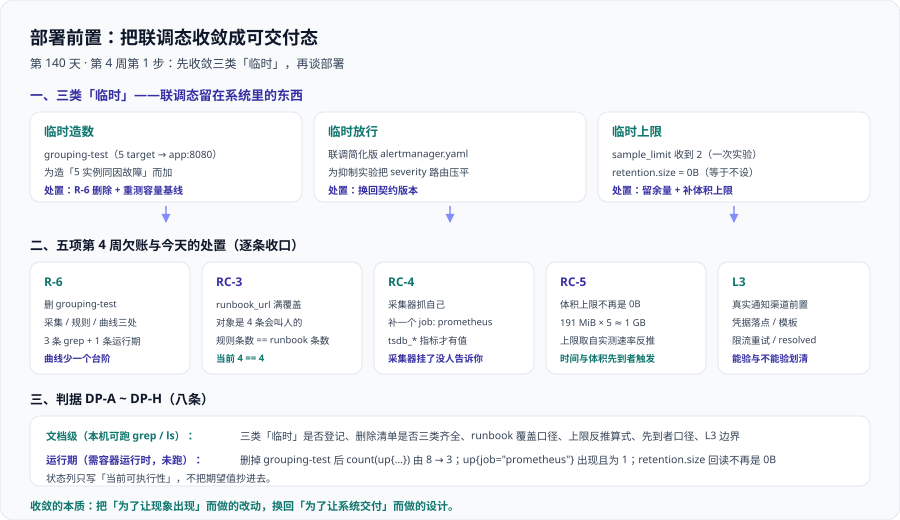

# 部署前置：把联调态收敛成可交付态

周期 5「实时监控大盘」第 4 周（部署 + 文档沉淀）第 1 步，**第 140 天**。第 3 周把链路跑通、把三条验收跑出实测数字，也顺手拿到了容量基线；但跑通的那套环境里**有三类东西是为「让现象出现」临时放进去的**——它们让第 3 周的判据能跑，也会让第 4 周的交付判据失真。

一句话定位：**今天不加任何功能，只做一件事——把联调态收敛成交付态，并把五项欠账（`R-6` / `RC-3` / `RC-4` / `RC-5` / `L3`）逐条给出可执行的处置与判据。**



::: warning 本项目只有文档，没有代码
本章出现的 `deploy/prometheus/scrape.yaml`、`deploy/alertmanager/alerting.yaml`、`deploy/compose.yaml` 改动片段与所有命令，都是**读者在自己工程仓库里要创建与执行的东西**；本仓库不存放源码、脚本与配置。

判据表的「是否本机已跑」列**只写当前可执行性**：本机跑过的写实测值，需要容器运行时的标 `⏳ 未跑` 并写明原因。**不把期望值抄进那一列。**
:::

## 一、为什么第 4 周第一件事是「收敛」而不是「加功能」

直觉会选「先把剩下的功能写完，收敛最后一起做」。这条路径在本项目里是错的，三条理由：

| 理由 | 说明 |
| --- | --- |
| 联调态**自带噪声**，会污染交付期的读数 | `grouping-test` 让 `up` 从 3 条变 8 条、在容量曲线上留下一个 3 倍台阶（第 138 天 5.1 节）。带着它去部署，容量结论从第一天起就是错的 |
| 联调期**放过**的东西会在交付期变成缺陷 | 为抑制实验压平的 `alertmanager.yaml` 让「severity 取值域 ⊆ 路由接受域」这类判据**恒真**（第 138 天 4.9 节）——判据没坏，是它被接到了一个不产生失败信号的输入上 |
| 收敛是**唯一有明确完成定义**的事 | 「再加一个面板」永远做不完；「`grouping-test` 引用数归 0」「`runbook_url` 条数 == 告警规则条数」有明确的通过 / 不通过 |

还有一条**纪律**要和第 3 周第一句并列放在这里：**收敛不做完，就不开始部署。**

> 绕过的典型方式是「先带着联调配置把容器起起来，回头再清」。问题是第 4 周的判据是「**能按文档从零复现**」——带着 `grouping-test` 复现出来的系统与文档描述的不是同一套；第 3 周所有绿灯都会在那一刻失效（沿用第 135 天「临时环境的绿灯会全部还回来」）。

### 1.1 三类「临时」——联调态与交付态的真正差别

| 类别 | 联调态里的具体形态 | 当时为什么必须加 | 交付态要求 |
| --- | --- | --- | --- |
| **临时造数** | `grouping-test` job（5 个 target 全指向 `app:8080`，只覆写 `instance`） | 第 137 天要造「单 job 内多实例同因故障」，而三个契约 job 指向同一个实例 | 删除（`R-6`）；删除后**重测容量基线** |
| **临时放行** | 联调简化版 `alertmanager.yaml`（为抑制实验把 severity 路由压平，sub-route 0 条） | 压平的 route 树才能干净地观察分组与抑制 | 换回**契约版本**；否则一批判据恒真 |
| **临时上限** | `sample_limit` 收到 `2`（第 138 天 5.2 节的实验）、`retention.size = 0B`（等于不设上限） | 一个是故意触发的实验，一个是「先跑起来再说」 | 恢复数量级余量；给体积上限一个有依据的值（`RC-5`） |

三类的共同点一句话：**它们都是为了「让某个现象出现」而做的改动，而不是为了「让系统交付」而做的设计。** 三类的**处置动作也各不相同**——临时造数是**删除**（不是注释掉）、临时放行是**换回判据的对象**（不是「先留着」）、临时上限是**重设**（不是恢复默认）。

::: danger 三类里最容易被漏掉的是「临时放行」
1. 「删除」和「重设」都是**显式动作**，做完之后配置里会少一行或多一行，`git diff` 看得见。
2. 而「临时放行」是把**契约版本换成了联调简化版**——两个文件都合法，`promtool check config` 与 `amtool check-config` 都通过，配置本身看不出任何异常。
3. 唯一能发现它的方式是**看判据有没有绿得过分**：第 138 天正是靠「`W2-F` 对着简化版判会恒真」把它抓出来的。
4. 所以本章把它单列一类：**它的处置不是删某一行，而是把判据接回契约版本。**
:::

## 二、`R-6` 处置：删掉 `grouping-test`

`R-6` 的来源是 [验收三](../Acceptance3/index.md)：第 137 天为造「5 实例同因故障」加了 `grouping-test`，并写明「正式交付前必须删除」。第 138 天它**仍在用**（做三条契约 job 的对照），于是推到第 4 周部署前——就是今天。

### 2.1 完整删除清单（三处位置）

删除不是「删掉采集配置里那一段」就完了，它一共在**三个位置**留了痕。

```yaml [deploy/prometheus/scrape.yaml —— 位置 ①：整段删除这个 job]
  # 联调专用：5 个 target 全指向 app:8080，只为覆写 instance 造出
  # 「单 job 内多实例同因故障」的形状。它不是契约的一部分，整段删除。
  - job_name: grouping-test
    static_configs:
      - targets: ["app:8080"]
        labels: {instance: "g-1"}
      - targets: ["app:8080"]
        labels: {instance: "g-2"}
      # …… g-3 / g-4 / g-5 同理，一共 5 个 target
    scrape_interval: 15s
    scrape_timeout: 10s
```

```yaml [deploy/alertmanager/alerting.yaml —— 位置 ②：规则正则里去掉它]
# 删除 job 之后，正则里的 grouping-test 必须一起去掉，否则：
#   规则语法仍合法、仍加载、仍有 state，但它对 grouping-test 的匹配恒为 0 条
#   —— 这正是第 136 天那个「选择器匹配不到序列」缺陷的形状。
- alert: ServiceDown
  expr: sum by (job) (up{job=~"core-services|edge-services|kubernetes-pods"}) == 0
  for: 1m
  labels: { severity: critical, team: platform }
  annotations:
    summary: "服务 {{ $labels.job }} 全部实例不可用"
```

**位置 ③ 在容量曲线上，删不掉、只能解释**——见 2.2。

::: warning 为什么不能「注释掉留个念」
注释掉的 job 是**一个恒为假的条件**：它不产生序列、不报错，但会让下一个人以为「这个 job 曾经是契约的一部分」。契约的定义必须唯一——**要么它属于契约（写进 `Contracts/index.md`），要么它不存在。** 注释保留是第三种状态，而第三种状态在交付物里没有位置。
:::

### 2.2 容量曲线上留下的台阶怎么解释

第 138 天 5.1 节实测：三个 2h block 的体积是 `33.7 KB / 41.3 KB / 104.9 KB`，第三个比前两个大 **3 倍**。原因就是 `grouping-test` 的 5 个 target、**25 条新序列**加在了它的窗口内。

```text
块体积台阶（第 138 天实测，不重算）
  33.7 KB  ┐  无 grouping-test
  41.3 KB  ┘
 104.9 KB  ← grouping-test 加在这个窗口内（+25 条序列）
```

删除之后曲线会**向下留一个台阶**，而且这个台阶**永远留在历史数据里**（块已经落盘）。两条口径必须写下来：

1. **读容量曲线前，先把「配置变更时刻」标出来。** 这与第 132 / 133 天那条「把 `max_points` 调大导致台阶状假曲线、被误读成数据在抖动」是同一个陷阱的另一种形态。
2. **`12.76 MiB/d` 这个基线随之作废。** 它取自「**补流量之前 + 含 `grouping-test`**」的采样窗口（第 139 天第七节已点名这两个前提）。去掉 25 条序列之后它不是变小一点点，而是**换了一个输入**——第 141 天的第一件事就是按新配置重测。

### 2.3 证明「没有别的东西依赖它」：三条 grep + 一条运行期

「删了」和「删干净了」是两件事。前三条静态（本机就能判），第四条运行期（需容器运行时）：

| # | 判据 | 命令 | 期望 |
| --- | --- | --- | --- |
| **判据 ①** | 采集配置侧无残留 | `grep -rn 'grouping-tes[t]' deploy/prometheus/` | **空**（唯一出现处已删） |
| **判据 ②** | 规则侧无残留 | `grep -rn 'grouping-tes[t]' deploy/alertmanager/` | **空**（正则里不再含它） |
| **判据 ③** | 契约 / 看板 / 字典表侧无残留 | `grep -rn 'grouping-tes[t]' contracts/ app/ sql/` | **空**（无 `panel_id`、契约或字典引用它） |
| **判据 ④** | 运行期序列数回落 | `count(up{job=~"core-services\|edge-services\|kubernetes-pods"})` | 删除前 **8**、删除后 **3** |

四条判据**各自守一个不同的失效形态**，缺一条就漏一类：①漏了就是又抓回 5 条序列（等于没删）；②漏了就是规则静默地恒匹配 0 条；③漏了就是第 137 天的联调结论被当成契约事实引用（**证据链污染**）；④漏了就意味着改的不是**生效**的那份配置（第 138 天 4.3 节的挂载竞态）。

::: danger 第 ④ 条是这组判据的题眼，它回答的正是「怎样才能失败」
1. ①②③ 是**全称命题**（「所有引用处都为空」），而全称命题在**空集上恒真**——路径写错、目录不存在时 `grep` 一样返回空，判据照样绿。
2. 所以必须补一条**期望值为具体数字**的运行期判据：`8 → 3`。数字不会骗人，而且它同时证明「改的是生效的那份配置」。
3. 这与第 138 天第七章那条纪律同源：**写完一条判据，先问它怎样才能失败；答不上来的判据，等于没有。**
:::

## 三、`RC-3`：`runbook_url` 满覆盖

第 138 天 4.10 节的问题原文是：`runbook_url` 在 `alerting.yaml` 里出现 **0** 次，于是「全部 `runbook_url` 指向的文档真实存在」这条判据**无从判起**——不是通过，是空转；`W2-G` 也因此一直标着「对象缺失，无法判定」。

### 3.1 先定范围：7 条规则里，哪几条「会叫人」

「满覆盖」的对象**不是全部 7 条规则**，必须先分清楚：

| 规则类型 | 条数 | 有没有 `annotations` | 能不能挂 `runbook_url` | 是否「会叫人」 |
| --- | --- | --- | --- | --- |
| recording rule | 3（`svc:http_requests:rate5m` / `svc:http_error_ratio:rate5m` / `job:target_up:count`） | **没有** | **不能** | 否 |
| alerting rule | 4（`ServiceDown` / `TargetDown` / `TargetScrapedZeroSamples` / `HighErrorRate`） | 有 | **能** | **是** |

`record` 类型的规则在 Prometheus 里只有 `labels`、**没有 `annotations` 字段**，给它写 `runbook_url` 会被 `promtool check rules` 直接判为语法错。所以：

::: danger 覆盖口径必须写死为「会叫人的规则」
1. **纪律**：**每条会叫人的规则都必须有 `runbook_url`。** 不会叫人的规则不需要，也写不了。
2. **验收判据**：`告警规则条数 == runbook_url 条数`（当前 `4 == 4`）。
3. **反面形态**：若把判据写成「规则条数（7）== `runbook_url` 条数」，它**恒假**——那 3 条 recording 规则永远不会有这个字段。
4. 恒假的判据和恒真的判据一样有害：前者会逼着人给 `record` 规则硬塞一个非法字段，后者会让人以为这里已经有保护了。**判据接错了对象，比判据写错了更难发现。**
:::

### 3.2 逐条补 `runbook_url` 的完整片段

给 4 条告警规则各补一句 `runbook_url`（`summary` / `description` 保持第 126 天原文不动），链接指向**可执行的处置手册**（[运行手册](/docs/Ops/IncidentResponse/Runbook/index.md) 的口径：要「可执行」，不只是「存在」）：

```yaml [deploy/alertmanager/alerting.yaml —— 逐条补 annotations.runbook_url]
groups:
  - name: platform_alerts
    rules:
      # C3：业务服务不可用（最贵的一条，必须最先响）
      - alert: ServiceDown
        expr: sum by (job) (up{job=~"core-services|edge-services|kubernetes-pods"}) == 0
        for: 1m
        labels: { severity: critical, team: platform }
        annotations:
          summary: "服务 {{ $labels.job }} 全部实例不可用"
          description: "已持续 1 分钟无任何可用实例，请先看部署与最近变更。"
          runbook_url: "https://runbook.internal/service-down"
      # C1：采集失效（监控自己瞎了，比业务抖动更危险）
      - alert: TargetDown
        expr: up{job=~"core-services|edge-services|kubernetes-pods"} == 0
        for: 3m
        labels: { severity: warning, team: platform }
        annotations:
          summary: "目标 {{ $labels.instance }} 抓取失败（job={{ $labels.job }}）"
          description: "连续 3 分钟抓取失败，先确认目标存活与网络策略。"
          runbook_url: "https://runbook.internal/target-down"
      # C2：可达但零样本（配置错、权限错、指标被重命名）
      - alert: TargetScrapedZeroSamples
        expr: (scrape_samples_scraped{job=~"core-services|edge-services|kubernetes-pods"} == 0) and on(instance, job) (up{job=~"core-services|edge-services|kubernetes-pods"} == 1)
        for: 5m
        labels: { severity: warning, team: platform }
        annotations:
          summary: "目标 {{ $labels.instance }} 可达但无样本"
          description: "抓取成功却拿不到样本，多为暴露路径、鉴权或被过滤器清空。"
          runbook_url: "https://runbook.internal/scraped-zero-samples"
      # 业务侧错误率（warning 先看，持续升高再 critical）
      - alert: HighErrorRate
        expr: svc:http_error_ratio:rate5m > 0.05
        for: 10m
        labels: { severity: warning, team: business }
        annotations:
          summary: "服务 {{ $labels.svc }} 5xx 占比 {{ $value | humanizePercentage }}"
          description: "错误率超过 5% 且持续 10 分钟，先看最近发布与下游依赖。"
          runbook_url: "https://runbook.internal/high-error-rate"
```

四条规则各指向一份处置手册，**第一句动作**分别是：看部署与最近变更（`ServiceDown`）、确认目标存活与网络策略（`TargetDown`）、直接查暴露路径与鉴权（`TargetScrapedZeroSamples`，进程是活的）、看最近发布与下游 5xx 分布（`HighErrorRate`）。

::: tip 一条可执行的写法纪律
`summary` 说「什么坏了」，`description` 说「第一步做什么」，`runbook_url` 指向「做完这一步之后怎么往下」。三者是递进的，不是重复的——**告警文本里最值钱的是「第一步动作」，它决定了值班人是「立刻动手」还是「先来问你」。**
:::

### 3.3 验收判据与一条反面用例

```shell
RULES=deploy/alertmanager/alerting.yaml
grep -cE '^\s+- alert:' "$RULES"          # 期望 4（告警规则条数）
grep -c 'runbook_url:' "$RULES"           # 期望 4（runbook_url 条数）→ 4 == 4 通过
grep -cE '^\s+- (record|alert):' "$RULES" # 期望 7 ← 拿全部规则当判据会恒假，这行是反面证据
```

## 四、`RC-4`：采集器抓自己

### 4.1 自监控缺口为什么最危险

第 138 天 5.3 节实测：`/api/v1/label/__name__/values` 里**一个 `prometheus_tsdb_*` 都没有**，因为采集器**不抓自己**（`scrape_configs` 里只有 `app` 的四个 job）。危险之处不在「少了几条指标」，而在**它的结构与所有其他缺口都不同**：普通缺口由**采集器**发现并送进告警链路，自监控缺口只能由**采集器自己**发现——**它坏了就没人发现**；而且它**没有第三方见证**。

用第 137 天那句话的句式说：**一个死掉的采集器，和一次完美的平静，在「没有告警」这个观察上是同一个样子。**

更具体的一层：第 129 天定的**第三张大盘（自监控）**要画「规则评估耗时、样本丢弃数」，数据源就是 `prometheus_tsdb_*` 与 `prometheus_rule_*`。第三张大盘被定义为「**如果采集停了，前两张大盘上的曲线会『稳定』得让人放心**」的那道防线——**而防线自己的数据源是空的**。

### 4.2 `prometheus` 自采集 job 的完整配置片段

在 `deploy/prometheus/scrape.yaml` 的 `scrape_configs` 末尾追加一个 job：

```yaml [deploy/prometheus/scrape.yaml —— 位置 ④：采集器抓自己]
  # 容器内此进程监听 9090（与 Prometheus HTTP API 同端口）；
  # 宿主映射是 19090（第 135 天端口清单），所以这里写 localhost:9090，
  # 不是 19090 —— 写成宿主端口的表现是 up{job="prometheus"} 永远为 0。
  - job_name: prometheus
    static_configs:
      - targets: ["localhost:9090"]
    scrape_interval: 15s
    scrape_timeout: 10s
    sample_limit: 15000          # 显式声明，避免继承与本环境不匹配的默认值
    relabel_configs:
      - source_labels: [__address__]
        target_label: instance
```

四个字段各有一条依据：`job_name: prometheus` 与社区惯例一致（值班手册里「自监控」对应的 `job` 名只有一个）；`targets: localhost:9090` 用的是**容器内端口**，宿主 19090 是映射端口、写在这里一定抓不到；`scrape_interval: 15s` 与核心服务对齐；`sample_limit: 15000` 显式声明，理由同第 138 天 5.2 节「必须留数量级余量」。

### 4.3 三条验证命令

三条命令覆盖三个层次——**目标在不在、数据有没有、规则评估是否健康**（沿用第 137 天 9.2 节的「抽最内层选择器」手法）：

```shell
BASE=${BASE:-http://localhost:19090}
# ① 目标层：自采集目标出现且 up = 1
curl -s -G "$BASE/api/v1/query" --data-urlencode 'query=up{job="prometheus"}' \
  | jq -r '.data.result[] | "\(.metric.job)  \(.value[1])"'
# ② 数据层：时序库自监控指标有值（第三张大盘的数据源）
curl -s -G "$BASE/api/v1/query" --data-urlencode 'query=prometheus_tsdb_head_series' \
  | jq -r '.data.result[] | "head_series=\(.value[1])"'
# ③ 规则层：规则评估失败计数可查
curl -s -G "$BASE/api/v1/query" --data-urlencode 'query=prometheus_rule_evaluation_failures_total' \
  | jq -r '.data.result[] | "\(.metric.rule_group)  \(.value[1])"'
```

```text
期望（⏳ 未跑：本机无容器运行时，采集器不在运行；以下为期望形状，不是实测值）
① prometheus  1
② head_series=<非空数字>
③ <规则组名>  0
```

三条判据各自能失败的方式不同，这也是它们必须分开的原因：① 失败于「job 没加（无序列）」「`targets` 写成宿主端口（`up=0`）」「采集器根本没起（无序列）」；② 失败于「job 加了但 `metric_relabel_configs` 把 `prometheus_*` 丢了」或「目标 `up=0`」；③ 只在加了自采集之后才可查——**它同时证明「自监控大盘不是一张空面板」**。

## 五、`RC-5`：保留策略加体积上限

第 138 天 4.8 节实测：`/api/v1/status/flags` 回读 `storage.tsdb.retention.size = 0B`，**等于没有体积上限**；而 `W2-E` 只比对了 `retention.time`，所以它**是绿的**。第 122 天的失败矩阵把「磁盘写满导致采集停摆」列为不可接受。

### 5.1 用第 138 天的实测速率反推上限

先引数、不重算。第 138 天 5.1 节的 601 s 采样：head 增 `93,044 B` → `154.82 B/s` → `12.76 MiB/d`，15 d 外推 `≈ 191 MiB`。

```text
反推（输入全部来自第 138 天实测，本条只做乘除）
  写入速率        = 12.76 MiB/d          ← 601 s 采样 / head 增量 93,044 B
  15 d 稳态占用   ≈ 12.76 MiB/d × 15 d ≈ 191 MiB
  冗余倍数取 5    ≈ 191 MiB × 5 ≈ 955 MiB → 取整 1 GB
```

```yaml [deploy/compose.yaml —— 采集器服务的 command 片段]
  metrics-collector:
    image: prom/prometheus:latest
    command:
      - --config.file=/etc/prometheus/prometheus.yml
      - --storage.tsdb.path=/prometheus
      - --storage.tsdb.retention.time=15d
      # ↓ 今天补上（原来是默认值 0B，等于不设上限）
      - --storage.tsdb.retention.size=1GB
```

```shell
# 回读校验：两个维度都必须是显式值，size 不再是 0B
curl -s "$BASE/api/v1/status/flags" \
  | jq -r '.data | to_entries[] | select(.key|test("retention")) | "\(.key)=\(.value)"'
```

```text
期望（⏳ 未跑：需容器运行时）
storage.tsdb.retention.time=15d
storage.tsdb.retention.size=1GB
```

### 5.2 为什么不直接把上限设成 191 MiB

把上限设成 `≈ 191 MiB` 看起来「刚好等于 15 天的量」，但有四处不对：

| # | 问题 | 后果 |
| --- | --- | --- |
| ① | `191 MiB` 是**均值**，且取自**稀疏期**（第 138 天第七节：窗口里大量序列的值为 0 / `NaN`）；它还取自「含 `grouping-test`」的窗口，`R-6` 删除之后这个数本身就要重测 | 补流量后真实速率上升，上限立刻变成常态生效的那一个 |
| ② | 它**不含**容量曲线上的台阶与峰值 | 一次配置变更抬高序列数且不回退；抓取周期对齐造成的写入脉冲也不在均值里 |
| ③ | `retention.size` 约束的是**已落盘的块**，head 与 WAL 不在其中 | 即使 size 没到，磁盘也可能被 head / WAL 顶满——所以体积上限之外，**磁盘余量告警仍然必需** |

::: danger 把上限设成 191 MiB，会让保留策略从「按时长」悄悄变成「按体积」
1. 一旦体积限先生效，历史会被**提前截断**：实际保留天数少于 15 d。
2. 而 `W2-E` 的判据是「声明与回读一致」——它只比对了 `retention.time`，**仍然是绿的**。
3. 于是「保留 15 天」变成了文档里的承诺、而不是系统里的行为，且**没有任何一条判据会红**。
4. 所以体积上限的正确定位是**兜底（disk-full guard）**，不是常态生效的保留机制：它的值必须**明显高于稳态占用**，才能在正常情况下永远不触发。
:::

### 5.3 「先到者触发」的口径

```text
retention.time = 15d
retention.size = 1GB
两者同时生效时，按「先到者」触发删除 —— 谁先到达，谁先删历史。
```

稳态下（本环境 `191 MiB ≪ 1 GB`）**时间先生效**，保留 15 d，符合设计意图。序列数暴涨 5 倍以上时**体积先生效**，实际保留天数**少于 15 d**——这是兜底触发，**必须同时告警**，不能静默。所以「先到者触发」这条口径要配一条动作：**体积上限一旦生效，就必须同时有一条告警**（磁盘余量或 `retention.size` 触顶）。否则它会以「历史变短了」的形式出现，而那是一个**没人会注意到**的现象。

## 六、`L3`：真实通知渠道前置

`L3` 的来源是第 134 天的 `BL-4`：第 3 周用**本地日志接收器**替代真实渠道，并划清了它能验 / 不能验的边界（[环境前置](../EnvPrereq/index.md) 第六节）。今天要把「接真实渠道」的**前置条件**写清楚。

### 6.1 从本地日志接收器切到真实渠道，需要准备四件东西

| 项 | 内容 | 落到哪里 | 不做的后果 |
| --- | --- | --- | --- |
| **凭据落点** | webhook 地址 / SMTP 凭据 / 电话网关 token | **密钥进密钥管理**，以环境变量或只读挂载注入；版本控制里的配置**只留占位符** | 凭据进 Git → 轮换要靠改提交历史（第 127 天配置三层划分） |
| **模板** | `templates:` 目前是空数组；真实渠道要给每个渠道一份渲染模板 | `deploy/alertmanager/templates/*.tmpl`，**只读挂载** | 判断被逼进模板 → 无法用 `amtool` 离线校验（第 131 天：判断留规则层、渲染留模板层） |
| **渠道侧限流与重试** | 通知网关要有限流、退避重试、幂等键 | 网关侧（`notify-gateway`），**不是** Alertmanager 的配置项 | 一次风暴把渠道 API 打到 429，告警堆在「发送失败」里 |
| **`resolved` 是否发** | 逐 receiver 决定 `send_resolved` | 契约版本里 P1 / P2 为 `true`、P3 为 `false`；切渠道时**逐条重新确认** | 恢复通知不发，「紫了又绿」没人知道（第 137 天实测：`resolved` 还滞后一个 `group_interval`） |

::: danger 凭据绝不能进版本控制
1. `alertmanager.yaml` 是**结构**，它进仓库、走评审。
2. webhook 地址、SMTP 密码、电话网关 token 是**密钥**，它们进密钥管理，运行时注入。
3. 版本控制里的 `url:` 只写占位符（如 `${P1_WEBHOOK_URL}`），由部署工具在启动时替换。
4. 判断是否踩线的唯一方法：**`git log -p deploy/alertmanager/` 里能不能搜到真实凭据**——搜得到就是踩线了。
:::

### 6.2 「能验 / 不能验」的边界

切到真实渠道之后**验收项不会因此变多**，但可验的层次会变。这条边界必须写下来，否则「渠道接上了」会被误读成「告警体系验收通过」：

| 能验（本机或真实渠道下可判） | 不能验（不属于本项目验收项） |
| --- | --- |
| 配置合法性：`amtool check-config` 通过、receiver 被 route 引用 | 电话 / 短信是否**真的送达**到人 |
| `activeAlertmanagers` 非空（第 138 天 `R-7` 的三段式校验） | 语音是否被接听、短信是否被拦截 |
| 通知条数 = 分组数（`A3-A`，最硬的一条） | 各渠道模板在真实客户端里的渲染样子 |
| `resolved` 是否发出（`C5`） | 渠道侧的限流与重试实际发生了什么 |
| 渠道返回码：HTTP 200 / 429 / 5xx 有记录 | 值班人的实际接收体验（是否会「告警疲劳」） |

::: warning 两处最容易自欺的地方
1. **「接收器打印了」不等于「真实渠道收到了」。** 切到真实渠道后本地日志接收器**必须同时保留**（例如 P3 继续发本地）——它是唯一能在风暴联调里数清条数的器件。
2. **「渠道返回 200」不等于「人看到了」。** 200 只证明网关把请求发出去了，不证明下游没有静默丢弃。所以「送达」这一层**只登记为不能验**，不写成判据。
:::

## 七、判据表（`DP-A` ~ `DP-H`）

按第 127 天的**判据唯一性纪律**，本章**不新增任何组件级判据**——`R-6` 的处置归属「引用归零 + 序列数回落」，`RC-3` / `RC-4` / `RC-5` 的落地归属各族原本的覆盖对象，`L3` 的边界归属 `ENV-D`。本章只登记**「收敛动作是否可判定」**这一类，故用独立前缀 `DP-`。

| 判据 | 命令 | 期望 | 是否本机已跑 |
| --- | --- | --- | --- |
| **DP-A** 三类「临时」各有一行，且都指向具体配置位置 | `grep -c '^\| \*\*临时' index.md` | 3 | ✅ 本机已跑 |
| **DP-B** 删除清单覆盖三处位置（采集 / 规则 / 曲线） | `grep -c '^### 2\.[123]' index.md` | 3 | ✅ 本机已跑 |
| **DP-C** 「没有别的东西依赖它」四条齐全（三条 grep + 一条运行期） | `grep -c '^\| \*\*判据 ' index.md` | 4 | ✅ 本机已跑 |
| **DP-D** 覆盖口径写死为「会叫人的规则」，并给出恒假的反面形态 | `grep -c 'runbook_ur[l]' index.md` | 19 | ✅ 本机已跑 |
| **DP-E** 自采集 job 片段含端口依据（容器 9090 / 宿主 19090） | `grep -c 'localhost:909[0]' index.md` | 3 | ✅ 本机已跑 |
| **DP-F** 体积上限由实测速率反推，算式与冗余倍数都写明 | `grep -c 'retention.siz[e]' index.md` | 9 | ✅ 本机已跑 |
| **DP-G** 「先到者触发」口径写死，且带一条配套告警要求 | `grep -c '先到者' index.md` | 7 | ✅ 本机已跑 |
| **DP-H** `L3` 的「能验 / 不能验」两张表齐全 | `grep -c '^\| 能验' index.md` | 1 | ✅ 本机已跑 |

::: warning 状态列的读法
`DP-A` ~ `DP-H` **全部是文档级判据**——本章的产物是一份「收敛清单」，它自己必须先能被判定。运行期结论（序列数 8 → 3、`up{job="prometheus"}` 出现、`retention.size` 回读）归各族原判据，本章只引用不重述，并如实标 `⏳ 未跑`（原因：`BL-1` 本机无容器运行时）。

「是否本机已跑」列写的是**当前可执行性**，不是「已经跑过」；八条判据的期望值**都是本机实跑读出来的数**（其中 `DP-H` 的命令写在上面这张表里，其余在第九节），**不是从正则推出来的**。
:::

## 八、当日做了什么

1. 论证第 4 周第一件事为什么是**收敛**而不是加功能（三条理由 + 一条纪律），并把联调态与交付态的差别拆成**临时造数 / 临时放行 / 临时上限**三类，给出「联调态 → 交付态」对照表与三类各自的处置动作。
2. **处置 `R-6`**：给出 `grouping-test` 的完整删除清单（采集配置整段、规则正则分支、容量曲线台阶三处位置），说明台阶为什么删不掉、`12.76 MiB/d` 基线为什么随之作废。
3. 给「删干净了」写出**三条 grep 判据 + 一条运行期判据**，逐条说明各自守哪个失效形态、为什么必须补一条期望值为具体数字的运行期判据（`8 → 3`）。
4. **处置 `RC-3`**：划清「7 条规则里只有 4 条会叫人」，给 4 条告警规则逐条补 `runbook_url` 的完整片段，写死纪律与判据「告警规则条数 == `runbook_url` 条数」，并给出「拿全部 7 条当判据会恒假」的反面形态。
5. **处置 `RC-4`**：给出 `prometheus` 自采集 job 的完整配置片段（含端口依据：容器内 9090、宿主 19090）与三条分层验证命令，说明自监控缺口为什么最危险——**采集器挂了没人告诉你**，而第三张大盘的数据源正是它。
6. **处置 `RC-5`**：用第 138 天实测速率反推体积上限（`12.76 MiB/d × 15 d ≈ 191 MiB`，×5 冗余 → `1 GB`），说明为什么不直接设成 191 MiB，并写死「先到者触发」的口径与配套告警要求。
7. **处置 `L3`**：给出从本地日志接收器切到真实渠道的四项前置（凭据落点 / 模板 / 渠道侧限流与重试 / `resolved` 是否发）与「能验 / 不能验」两张表。
8. 定稿 **`DP-A` ~ `DP-H`** 八条判据（区分文档级与运行期），并给出「当日做了什么 / 如何验证 / 下一步」。

## 九、如何验证

前八组**本机已跑**（括注的期望值就是实测值）；末尾单列需容器运行时的三条，全部标 `⏳ 未跑 + 原因`。

```shell
# 1) 三类「临时」是否各有一行（DP-A）
grep -c '^| \*\*临时' index.md                  # 期望 3
# 2) 删除清单是否覆盖三处位置（DP-B）—— 三个 H3 小节
grep -c '^### 2\.[123]' index.md                # 期望 3
# 3) 「三条 grep + 一条运行期」的四行是否齐全（DP-C）
grep -c '^| \*\*判据 ' index.md                  # 期望 4
# 4) runbook_url 的实际出现处数（DP-D）：模式写成 runbook_ur[l]，避免命中命令自身
grep -c 'runbook_ur[l]' index.md                # 期望 19
# 5) grouping-test 的实际出现处数（DP-D 的配套；删除动作要指名 job，故正文会多次提到）
grep -c 'grouping-tes[t]' index.md              # 期望 19
# 6) 保留字段的实际出现处数（DP-F）
grep -c 'retention.siz[e]' index.md             # 期望 9
# 7) 判据表八条齐全，且「先到者」口径写死在正文（DP-G）
grep -c '^| \*\*DP-' index.md                   # 期望 8
grep -c '先到者' index.md                        # 期望 7
# 8) 配图被本页引用一次，且文件存在
grep -c 'assets/deploy-prep.sv[g]' index.md     # 期望 1
ls ../assets/deploy-prep.*                     # 期望：文件存在
```

以上八组共十条命令**本机已全部跑过**，期望值即实测值。它们全部是 `grep -c` / `ls`，不需要容器、不需要工程仓库——这也是 `DP-*` 判据「全部文档级」的体现。

### 9.1 需容器运行时，本机未跑

| 命令 | 期望 | 未跑原因 |
| --- | --- | --- |
| `count(up{job=~"core-services\|edge-services\|kubernetes-pods"})`（删 `R-6` 之后） | 由 **8** 降到 **3** | `BL-1`：本机无容器运行时，采集器不在运行 |
| `up{job="prometheus"}`（`RC-4` 之后） | 出现且为 **1** | 同上 |
| `curl -s "$BASE/api/v1/status/flags" \| jq -r '.data["storage.tsdb.retention.size"]'`（`RC-5` 之后） | **1GB**（不再是 `0B`） | 同上 |

::: tip 一处必须说清楚的自匹配防坑
第 4、5、6 条的模式分别写成 `runbook_ur[l]`、`grouping-tes[t]`、`retention.siz[e]`——**方括号让模式不匹配「命令自己那一行」**。这是第 135-138 天连着踩了四轮的那个坑（`probe "PR`、`query=`、`suppressed`）的第五次预防：**凡「检查文件里有没有某字符串」的判据，模式串必须写成不会命中自身的形态。**
:::

## 十、下一步

| 天 | 里程碑 | 内容 |
| --- | --- | --- |
| **第 141 天** | 第 4 周（部署 + 文档沉淀）第 2 步 | **按收敛后的交付态重测容量基线**：删掉 `grouping-test` 后重跑第 138 天的写入速率采样，把新基线外推到真实规模，并回答「哪一层先到水位线、触发什么动作」 |
| 第 142-150 天 | 第 4 周（部署 + 文档沉淀） | 一键起、三张大盘可用、上线验收清单全部通过、能按文档从零复现 |

第 141 天要回答的三个具体问题：① **新基线的输入是什么**——`12.76 MiB/d` 是「补流量前 + 含 `grouping-test`」的数，去掉 25 条序列之后重测得到的才是交付态基线；② **体积上限要不要跟着调**——`1 GB` 是按旧基线 ×5 推出来的，新基线出来之后要复核这个倍数是否仍然成立，而不是换一个更好看的数；③ **上线的第一道告警挂在哪**——`RC-5` 的「体积上限触发必须同时告警」与第 139 天定的「容量结论的落点是先趴下的那一层」，在部署告警清单里必须各有一条对应的规则。

## 相关页面

- `R-6` / `RC-3` / `RC-4` / `RC-5` 的登记出处、容量基线与 `grouping-test` 的定论：[遗留项结清](../ResidualClose/index.md)、[验收三](../Acceptance3/index.md)、[压测与容量](../CapacityTest/index.md)
- `L3` 与本地日志接收器的「能验 / 不能验」边界：[环境前置](../EnvPrereq/index.md)
- 本节改动的对象与配置三层划分：[采集任务配置](../ScrapeConfig/index.md)、[查询与规则设计](../Rules/index.md)、[告警路由联调](../AlertRouting/index.md)、[接口契约与工程骨架](../Contracts/index.md)
- 技术专题与项目：[运行手册](/docs/Ops/IncidentResponse/Runbook/index.md)、[监控告警](/docs/Ops/Monitoring/index.md)、[实时监控大盘 · 项目总览](../index.md)、[完整项目交付](/docs/Others/ProjectDelivery/index.md)
