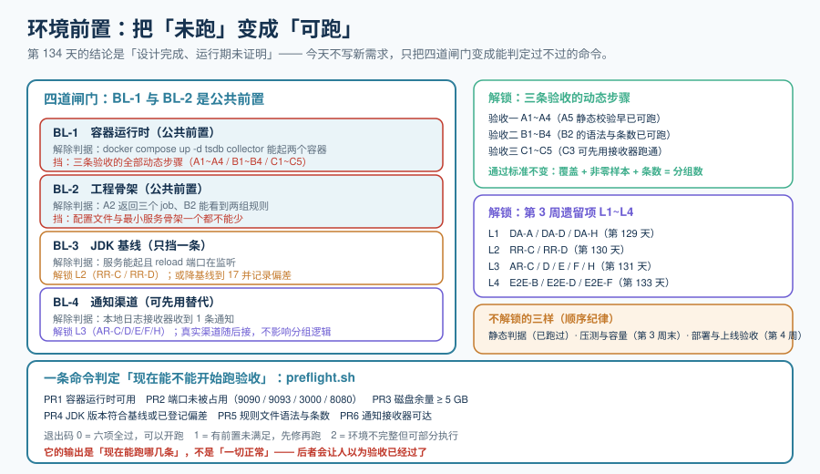

# 环境前置：把「未跑」变成「可跑」

第 3 周（第 135-141 天）的第一步**不是继续写功能，而是把环境前置做成可判定的**。第 134 天的结论已经写得很清楚：14 章设计全部定稿，但**三条验收的运行期证明一条都没跑**，原因不在设计，在**四道前置闸门**。

一句话定位：**今天不给系统加任何新能力，只把「现在能不能开始验收」这个问题变成一个能返回 0 或 1 的命令。**



::: warning 本项目只有文档，没有代码
本章出现的 `scripts/preflight.sh`、目录清单与命令，都是**读者在自己工程仓库里要创建的东西**。本仓库不存放源码与脚本；「运行 `xxx`」一律指「先按本章创建好该文件，再执行」。
:::

## 一、为什么第 3 周的第一件事是环境而不是功能

直觉会选「先把剩下的功能写完，环境最后一起搭」。这条路径在本项目里是错的，三个理由：

| 理由 | 说明 |
| --- | --- |
| 它是**唯一有明确完成定义**的事 | 「继续加功能」永远做不完；「`docker compose up -d` 起两个容器、`curl` 返回三个 job」有明确的通过/不通过 |
| 它把「未跑」从**结论**变成**待办** | 现在每一条 `⏳` 都能指向一道具体闸门（见第二节矩阵），而不是一句「环境不具备」——前者能排期，后者只能搁置 |
| 它决定后 6 天的**顺序** | 压测与容量必须在链路真的跑起来之后做，否则测的是一个不存在的系统；部署与上线验收更在其后 |

还有一条**纪律**必须写在最前面：**前置条件不做完，就不动验收。**

> 绕过的典型方式是「在我本地先临时跑通了」。这和「可复现地跑通」是两件事——第 4 周的验收判据是「**能按文档从零复现**」，用临时环境得到的绿灯，到了那一关会全部还回来。

## 二、四道闸门与它们解锁的判据

四道闸门来自第 134 天的阻塞项台账，**原样搬过来、不做增删**（沿用 `W2F-H` 的「只做合并、不新增需求」纪律）：

| 闸门 | 解除判据（一句话） | 参考耗时 |
| --- | --- | --- |
| BL-1 容器运行时 | `docker compose up -d tsdb collector` 能起两个容器 | 装运行时 + 拉镜像 |
| BL-2 工程骨架 | A2 能返回三个 job；B2 能看到两组规则 | 按第 123-131 天创建配置与最小服务 |
| BL-3 JDK 基线 | 服务能启动并监听 reload 端口 | 装 JDK 25，或降基线到 17 并记录偏差 |
| BL-4 通知渠道 | 本地日志接收器收到 1 条通知 | 起一个接收器，改一处 receiver 配置 |

**闸门之间不是并列关系**，这一点决定了解除顺序：

| 关系 | 内容 |
| --- | --- |
| **BL-1 与 BL-2** 是**公共前置** | 其余两项都要先有一个「能起的服务」才有意义——JDK 决定它能不能起，通知渠道决定它的告警往哪发 |
| **BL-3** **只挡一条** | reload 接口（`L2` 的 `RR-C` / `RR-D`）；采集与规则本身不受影响 |
| **BL-4** **可先用替代** | 分组与抑制逻辑（`C3`、`C4`）不需要真实渠道就能验证，替代方案的边界见第六节 |

它们各自解锁什么：

| 闸门 | 解锁 | 解除后仍不可验证 |
| --- | --- | --- |
| **BL-1** | A1~A4、B1~B4、C1~C5（动态步骤） | 无 |
| **BL-2** | 同上——**与 BL-1 是同一批**，两者缺一不可 | 无 |
| **BL-3** | L2（`RR-C` / `RR-D`） | 无 |
| **BL-4** | L3（`AR-C` / `AR-D` / `AR-E` / `AR-F` / `AR-H`） | 真实渠道的送达率与运营商细节——那不属于本项目的验收项 |

## 三、BL-1 容器运行时：可执行前置检查

「装一个容器运行时」不是前置检查，「**装完之后怎么知道它够用了**」才是。四项检查，任何一项不过都不必往下走：

| 检查 | 命令 | 期望 | 不过会怎样 |
| --- | --- | --- | --- |
| 运行时在线 | `docker info` | 返回 Server 段，无 `Cannot connect` | 后面所有 `compose` 命令都会以「连不上守护进程」失败 |
| Compose V2 形态 | `docker compose version` | 能打印版本（**`docker compose`，子命令形态**） | 用独立二进制的 `docker-compose` 会在 `deploy` 里产生与文档不一致的命令 |
| 端口空闲 | 见下节端口清单 | 五个端口都无监听 | 容器起来了但端口被占，表现为「容器 running、`curl` 连不上别人」 |
| 磁盘余量 | `df -Pk . \| sed -n 2p` | ≥ 5 GB | 时序库写入到一半报 no space，现象是 `up == 1` 但样本不涨，**看着像采集问题** |

### 端口清单（跨文件读配置的一处，必须显式声明来源）

| 端口 | 谁在用 | 出处 |
| --- | --- | --- |
| 9090 | 采集器 + 时序 API（同一个进程） | 第 122 天架构骨架的 `ports: ["9090:9090"]` |
| 9093 | 告警路由 | 第 122 天架构骨架 |
| 3000 | 可视化 | 第 122 天架构骨架 |
| 8080 | **被监控**的最小桩服务 | 第 122 天采集目标 `targets: ["app:8080"]` |
| 8081 | **自研**大盘数据服务 | 第 129 天契约五的 `BASE` 默认值 |

::: danger 8080 与 8081 不能混
它们一个是被监控对象、一个是监控系统自己的组件。混掉的后果很具体：把 `8080` 当成大盘接口去 curl，得到的是桩服务的响应——**看起来有数据，其实是另一套东西**。这也是把端口写成表、而不是散落在命令里的原因。
:::

## 四、BL-2 工程骨架：最小可跑清单

BL-2 是四道闸门里工作量最大的一道。但它有明确的**最小集**：只要能让 A2 与 B2 返回预期结果，其余页面可以后补。

| 目标 | 最小文件 | 来源 |
| --- | --- | --- |
| 采集能跑（A2） | `deploy/prometheus/scrape.yaml`（三个 job） | 第 125 天 |
| 规则能载入（B2） | `deploy/prometheus/recording.yaml`、`deploy/alertmanager/alerting.yaml` | 第 126 天 |
| 告警能路由（C 组） | `deploy/alertmanager/alertmanager.yaml` | 第 131 天 |
| 一键起（A1） | `deploy/compose.yaml` | 第 122 天骨架 |
| 自研服务（B1、L2） | `app/metrics/`、`app/dashboard/`、`app/config/` | 第 128、129 天 |
| 校验入口 | `scripts/check-metrics.sh`、`scripts/check-dashboard.sh` | 第 128、129 天 |

目录结构沿用第 127 天定稿的骨架（`deploy/`、`app/`、`contracts/`、`sql/`、`scripts/`、`README.md`），**不新建层**。三条纪律照抄：

1. `deploy/` 与 `app/` 分开——变更节奏与责任人不同；
2. `contracts/` 单独成目录——改它必须走评审；
3. 结构进仓库、值进环境变量、密钥进密钥管理。

::: tip 最小集的意义
「最小可跑」不是「先粗糙一点」，而是**把「能不能验证」这件事与「功能是否完整」解耦**。三个 job 就能验采集、两组规则就能验加载，剩下的面板与大盘晚一天不影响今天解锁 L1。
:::

## 五、BL-3 JDK 基线：两个选项与偏差记录

工程基线是 **Java 25**，本机是 17。两条路都可以，但**都必须留下痕迹**：

| 选项 | 做法 | 后续影响 | 记录要求 |
| --- | --- | --- | --- |
| A · 装 JDK 25 | 装好并把 `JAVA_HOME` 指向它 | 与契约、CI 一致，没有解释成本 | 不涉及偏差 |
| B · 降基线到 17 | 把工程基线改到 17 | 需要复核是否有 25 才有的语言特性（虚拟线程已正式、结构化并发仍为预览） | **必须在 `README.md` 写明「基线临时降级 + 原因 + 恢复条件」** |

选 B 的真正风险不是「跑不起来」，而是**偏差被遗忘**：三个月后有人按文档装了 25，却发现 CI 在 17 上，两边的行为差异会以「我这儿是好的」的形式出现。

判据只有一条：**服务能启动并监听 reload 端口**（`L2` 的前置）。JDK 版本本身不是判据——版本是手段。

## 六、BL-4 通知渠道：最低成本替代与它的边界

真实渠道（SMTP 凭据或 webhook 接收地址）通常需要审批，而**验收三要验的其实是「分组与抑制对不对」，不是「短信有没有发出去」**。所以先用一个本地日志接收器：

| 步骤 | 动作 |
| --- | --- |
| 1 | 起一个能打印请求体的最小 HTTP 接收器（任意语言，监听一个空闲端口，把方法、路径、JSON 体打到 stdout） |
| 2 | 在 `alertmanager.yaml` 里把 P2 与 P3 的 `receiver` 指向它，**P1 暂时同样指向它**（否则 P1 的验证被渠道挡住） |
| 3 | 跑 `C1` 制造 5 实例同因故障，**数接收器打印了几条** |

**替代能验什么、不能验什么**（这条边界必须写下来，否则「用替代跑了」会被误读成「验收三过了」）：

| 能验 | 不能验 |
| --- | --- |
| 条数是否等于分组数（`C3`，最硬的一条） | 电话/短信是否真的送达 |
| 抑制是否生效（`C4`，看的是 `inhibitedBy`） | 各渠道的模板渲染在真实客户端里的样子 |
| 路由是否命中（四段链路的第 ② 段） | 渠道侧的限流与重试策略 |
| `resolved` 是否发出（`C5`） | 值班人的实际接收体验 |

::: danger 一条不能省的动作
**抑制的证据是 `inhibitedBy` 记录，不是「什么都没收到」。** 用本地接收器时这条更容易被误解——接收器上没打印东西，既可能是被抑制了，也可能是路由根本没命中的。必须回去看告警路由的 `inhibitedBy`，这是第 131 天就写下的判读规则。
:::

## 七、把四道闸门合成一条命令：`preflight.sh`

四道闸门各自都有「检查什么」，但人不会每天都手工过一遍。把它固化成脚本——**这是本章唯一的产物**：

```shell
#!/usr/bin/env bash
# scripts/preflight.sh —— 第 3 周第一件事：判定「现在能不能开始跑验收」
# 退出码：0 = 六项全过；1 = 有前置未满足（下面会列出仍可跑的部分）
set -uo pipefail
cd "$(dirname "$0")/.."

PASS=0
FAILED=()
probe() {                        # probe <名称> <命令...>
  local name="$1"; shift
  if "$@" >/dev/null 2>&1; then echo "OK   $name"; PASS=$((PASS + 1))
  else echo "FAIL $name"; FAILED+=("$name"); fi
}

# ── BL-1 容器运行时与端口（PR1 ~ PR3）─────────────────────────
probe "PR1a 容器运行时可用"      docker info
probe "PR1b compose V2 子命令"   docker compose version
for p in 9090 9093 3000 8080 8081; do
  probe "PR2 端口 $p 空闲"       bash -c "! nc -z 127.0.0.1 $p"
done
probe "PR3 磁盘余量 >= 5 GB"     bash -c '[ "$(df -Pk . | sed -n 2p | awk "{print \$4}")" -ge 5242880 ]'

# ── BL-3 JDK 基线（PR4）──────────────────────────────────────
probe "PR4 JDK 符合基线或已记偏差" bash -c 'java -version 2>&1 | grep -qE "version \"(25|17)"'

# ── BL-2 工程骨架的静态部分（PR5，不需要容器）───────────────
probe "PR5a 采集配置语法"        promtool check config deploy/prometheus/scrape.yaml
probe "PR5b 规则文件语法"        promtool check rules deploy/prometheus/recording.yaml \
                                                       deploy/alertmanager/alerting.yaml

# ── BL-4 通知接收器（PR6）────────────────────────────────────
probe "PR6 通知接收器可达"       curl -sf -o /dev/null http://localhost:8025/

echo
if [ "${#FAILED[@]}" -eq 0 ]; then
  echo "结论：六项全过 → 按 A1 → C5 顺序跑三条验收"
  exit 0
fi
echo "结论：以下前置未满足，先修再跑 —— ${FAILED[*]}"
echo "当前仍可跑（不需要容器）：A5 三处静态校验 / B2 的规则语法与条数 / C3 的分组逻辑（用接收器）"
exit 1
```

三处设计取舍，每一处都是为了「不让人误读输出」：

| 取舍 | 为什么 |
| --- | --- |
| 端口用 `nc -z` 逐个探，而不是 `docker compose ps` | `compose ps` 告诉你容器状态，不告诉你**端口有没有被别人占着**——后者才是「容器 running 但连不上」的常见原因 |
| PR4 接受 17 或 25 | 这一项验的是「能不能起服务」，不是「版本对不对」；把版本当判据会逼出一个假的升级记录 |
| 失败时不只打印 `FAIL`，还打印**仍可跑的部分** | 门禁的输出必须是「现在能跑哪几条」，而不是「一切正常 / 一切不正常」——前者能指导下一步，后者只会让人以为验收已经过了 |

## 八、三条验收的执行环境对照表

把「每条验收需要什么」并列放，是为了让**部分解除**也能推进：BL-1 与 BL-2 好之前，仍有可跑的子集。

| 验收 | 需要的闸门 | 起的容器 | 端口 | 最小可跑子集（今天就能跑） |
| --- | --- | --- | --- | --- |
| 一 · 目标能被采集 | BL-1 + BL-2 | `tsdb` `collector` | 9090、8080 | A5 三处静态校验 |
| 二 · 规则能评估 | BL-1 + BL-2 + BL-3 | 同上 + `alertmanager` | 9090、9093 | B2 的规则语法与条数 |
| 三 · 告警能发出一条 | BL-1 + BL-2 + BL-4 | 同上 | 9093、8081 | C3 的分组逻辑（用本地接收器） |
| 四 · 接口可调用（第 133 天） | BL-1 + BL-2 | 同上 | 8081 | 六段链路的静态五条 |

::: tip 这张表回答的是「今天能不能动」
它和第 134 天的「三条验收 × 阻塞项矩阵」不重复：那张表回答的是**「这一周算不算完成」**（每格要么 ✅ 要么 —），这张表回答的是**「今天可以开始动哪一条」**（每格给一个可跑子集）。前者是判据，后者是排期。
:::

## 九、本章判据（ENV-A ~ ENV-H）

按判据唯一性纪律，本章**不新增任何组件级判据**（`EP-*` / `DA-*` / `RR-*` / `AR-*` / `E2E-*` 各族仍归原章节），只登记两类：**「前置是否可判定」**与**「解锁关系是否登记完整」**。

| 编号 | 判据 | 怎么判（本机可跑） | 状态 |
| --- | --- | --- | --- |
| ENV-A | 四道闸门各自都有「前提条件 + 解除判据」 | `grep -c '^\| BL-' index.md`，期望 4 | ✅ 本机可判 |
| ENV-B | `preflight.sh` 的六项检查与四道闸门一一对应，无孤儿检查、无未覆盖闸门 | 人工核对 PR1~PR6 ↔ BL-1~BL-4 | ✅ 本机可判 |
| ENV-C | 每条被阻塞的判据都指向了具体闸门，不留「原因未知」 | `grep -c 'BL-' index.md` > 0 且第八节表无空行 | ✅ 本机可判 |
| ENV-D | 替代方案写明「能验什么 / 不能验什么」 | 第六节两张表齐全 | ✅ 本机可判 |
| ENV-E | BL-3 的两个选项都给了判定条件与记录要求 | 第五节表两行齐全 | ✅ 本机可判 |
| ENV-F | 端口清单与第 122 天骨架一致，且 8080 与 8081 的用途被写死 | 人工比对第五节端口表与 `Architecture/index.md` | ✅ 本机可判 |
| ENV-G | 退出码语义三分，且失败分支输出「仍可跑的部分」 | 读脚本结尾的 `exit 0` / `exit 1` 与最后一条 `echo` | ✅ 本机可判 |
| ENV-H | 四道闸门全部解除后的执行顺序是唯一的 | 第八节表 + 第 134 天八步最短路径一致 | ✅ 本机可判 |

**八条全部是文档级、本机可判**——这是刻意的：本章的产物是「判定环境的判据」，它自己必须先能被判定。运行期结论仍归各族原判据，本章只引用不重述。

::: warning 状态列不是实测记录
上表「状态」列写的是**当前可执行性**，不是「已经跑过并得到期望值」。`preflight.sh` 本身在本机跑不了（`docker`、`promtool` 都不在），它的正确性依据是**第八节的对照关系**与第十一节的可核对项——**不把期望值抄进状态列**，这是第 127 天定下的纪律。
:::

## 十、当日做了什么

1. 论证了第 3 周第一天为什么是**环境**而不是功能（三条理由 + 一条纪律），并把「不绕路」写成正文而不是备注。
2. 把第 134 天的阻塞项台账原样搬过来，**只做合并、不新增需求**（沿用 `W2F-H`）。
3. 补出四道闸门之间的**非并列关系**：BL-1 与 BL-2 是公共前置、BL-3 只挡一条、BL-4 可先用替代——这决定了解除顺序。
4. 给 BL-1 写四项可执行前置检查（运行时 / Compose 形态 / 端口 / 磁盘），并列出端口清单与**每个端口的出处**。
5. 给 BL-2 划出**最小可跑集**（六个文件 / 目录），把「能不能验证」与「功能是否完整」解耦。
6. 给 BL-3 的两个选项各写判定条件与**记录要求**，并指出选 B 的真正风险是「偏差被遗忘」而不是「跑不起来」。
7. 给 BL-4 定最低成本替代，并**明确划出替代能验什么、不能验什么**（否则「用替代跑了」会被误读成「验收三过了」）。
8. 把四道闸门固化成 `scripts/preflight.sh`（PR1~PR6、退出码 0/1、失败时输出「仍可跑的部分」），并写下三处设计取舍的理由。
9. 产出**三条验收的执行环境对照表**，与第 134 天的矩阵划清分工（一张回答「这周算不算完成」，一张回答「今天能开始动哪条」）。
10. 产出 **ENV-A ~ ENV-H** 八条判据，全部文档级、本机可判；并明确「状态列不是实测记录」。
11. 新增 `EnvPrereq/index.md` 与 `assets/env-prereq.svg`；同步项目总览的进度表、章节列表与迭代记录。**第 3 周起步，全库 15 章。**

## 十一、如何验证

```shell
# 1) 四道闸门是否都登记在台账里（ENV-A）
grep -c '^| BL-' index.md                      # 期望 4

# 2) 八条判据是否齐全（ENV-A ~ ENV-H）
grep -c '^| ENV-' index.md                     # 期望 8

# 3) preflight 的六项检查是否都在（ENV-B）
grep -c 'probe "PR[0-9]' index.md              # 期望 8（PR1a/1b + PR2 + PR3 ~ PR6；PR2 在循环里会对五个端口各跑一次）

# 4) 端口清单是否五个端口齐、且给出 8080/8081 的区分（ENV-F）
grep -cE '^\| (9090|9093|3000|8080|8081) \|' index.md   # 期望 5
grep -c '^::: danger 8080' index.md            # 期望 1

# 5) 替代方案的边界表是否存在（ENV-D）
grep -c '^| 能验' index.md                     # 期望 1

# 6) 配图是否到位
ls ../assets/env-prereq.svg                    # 期望文件存在
```

以上六条**本机已全部跑过**（括注的期望值就是实测值）。它们全部是 `grep -c` / `ls`，不需要容器、不需要工程仓库——这也是本章判据「全部文档级」的体现。

::: tip 三处「命令自己匹配自己」的坑（第 1 步实测踩过）
第一版写下的是 `grep -c '^| BL-'`、`grep -c 'probe "PR'`、`grep -c '8080 与 8081 不能混'` 与 `grep -c '^| 能验 \| 不能验 \|'`，实测分别得到 **287**、**9**、**2** 与 **287**，四条全错，原因各不相同：

1. `grep -cE` 里的 `|` 是**正则的或**，不是字面竖线——`^| BL-` 被解释成「行首」或「` BL-`」，于是**每一行都命中**（287 正是本文件的行数）。前两条里第一条写成 `grep -c`（BRE）才对，第四条则必须去掉正则语义；
2. 更隐蔽的是**自匹配**：`probe "PR`、`8080 与 8081 不能混` 这些字符串**就写在验证命令自己那一行里**，于是命令把自己也数了进去（分别多出 1）。两条的解法不同——前者把模式改成 `probe "PR[0-9]`（命令文本里 `PR` 后面是 `[`，不再匹配），后者用 `不[能]混`（命令文本里 `不` 后面是 `[`，同样不匹配）；
3. 第三条计数前先给第二节的两张关系表**把闸门编号加粗**（`| BL-1 |` → `| **BL-1** |`），使 `^| BL-` 只命中台账那四行——**用改文档去迁就判据是会写反的，这里改文档是因为加粗本身也让关系表更清楚**。

这条踩坑和第 134 天的「期望值必须跑一遍才写」是同一个教训的第二次出现：**判据的期望值不是从模式推出来的，是从机器输出读出来的。**
:::

## 十二、下一步

第 3 周剩下的六天，顺序已经由本节锁定，**不可换**：

1. **第 136 天**：按第八节的顺序跑**验收一与验收二**，把 `⏳` 换成实测数字（含 A4 的期望抓取次数与 B3 的 recording 结果）。
2. **第 137 天**：跑**验收三**（告警风暴联调，核对「通知条数 = 分组数」），并补跑 `L3`。
3. **第 138 天**：补跑 `L1` / `L2` / `L4`，把第 129/130/133 天的遗留项全部结清。
4. **第 139-140 天**：压测与容量——容量结论必须在链路跑起来之后才有意义，用第 123 天的容量公式与第 129 天的结果预算做交叉验证。
5. **第 141 天**：第 3 周收口，输出「联调测试」里程碑的可交付结论。

## 参考资料

- 上一章的入口清单与阻塞项台账：[第 2 周收口（终）](../Week2Final/index.md)
- 端口与骨架出处：[架构细化：组件与接口边界](../Architecture/index.md)、[接口契约与工程骨架](../Contracts/index.md)
- 最小集对应的配置内容：[采集任务配置](../ScrapeConfig/index.md)、[查询与规则设计](../Rules/index.md)、[告警路由联调](../AlertRouting/index.md)
- 自研两件的实现位置：[指标暴露端点（C1）](../MetricsEndpoint/index.md)、[看板数据服务（C6）](../DashboardAPI/index.md)
- 前置检查里的静态校验命令来源：[规范落地校验门禁](../MetricGate/index.md)
- 方法论：[完整项目交付](/docs/Others/ProjectDelivery/index.md)
