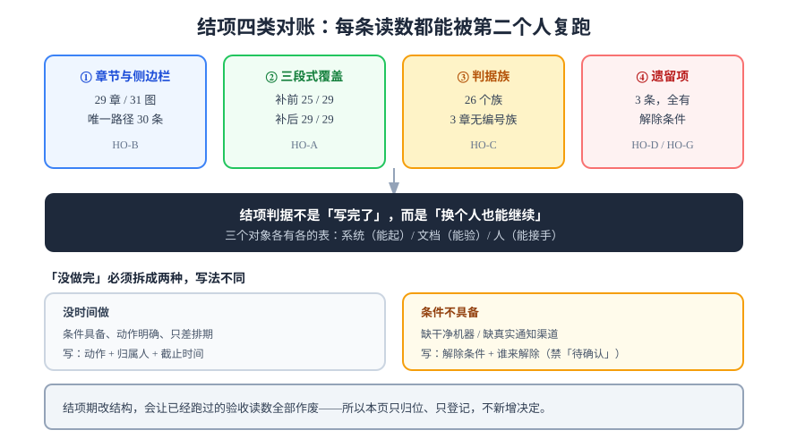

# 结项与交接：把 29 章收成一份「谁接手都能继续」的交付

第 4 周第 11 步，也是周期 5 的最后一步。前十天分别解决了「能起」「能看」「能验」「能复现」，今天做的是它们的**收口**：把 29 个章节当成一件**交付物**来看——它是否齐全、是否可复核、是否可以交给一个没参与过的人继续做。

::: tip 本页最重要的一句话
**结项的判据不是「写完了」，而是「换个人也能继续」。** 一份文档齐全但没人知道从哪读、哪条还欠着、欠的那条卡在什么条件上，在交接场景里等于没有交付。
:::



## 一、结项的三个对象，三张不同的表

「项目做完了」这句话要拆成三个对象，它们的判据完全不同，混在一张表里必然有一半是空的：

| 对象 | 判据形态 | 谁来判 | 通过的样子 |
| --- | --- | --- | --- |
| **系统** | 一条命令 + 一个读数 | 值班同学 | 一键起全栈、三张大盘可用、告警真的响过 |
| **文档** | 结构齐备 + 判据可跑 | 没参与写作的人 | 按「从零复现指南」能搭出同样的系统 |
| **人** | 能复述 + 能操作 | 接手的人 | 「他操作，我只看不说」，全程无提示 |

本页只做**文档与交接**这两张表的收口。系统那张表在第 142/143 天已经收过（`OC-A~OC-H` 与 `LA-A~LA-H`），本页**不重写它们的读数**，只做**归位与索引**。

## 二、四类对账，四类读数

### 对账一：章节与侧边栏

```shell
cd project/Complete/MonitoringDashboard
ls -d */ | grep -v assets | wc -l          # 章节目录数
grep -c 'MonitoringDashboard/' ../../../.vitepress/project.ts
```

```text
29            ← 章节目录（不含 assets/）
34            ← 侧边栏里指向本项目的条目数（含重复引用；按唯一路径数 30）
```

唯一路径数用另一条命令取，**「条目数」与「页面数」不是一回事**——这是最容易在交接时被误读的一对数字：

```shell
grep -o 'MonitoringDashboard/[A-Za-z0-9]*' ../../../.vitepress/project.ts | sed 's|.*/||' | sort -u | wc -l
# → 30   （29 章 + index.md）
```

**结论**：29 章全部挂载，无孤儿章节。配图 31 张，全部在项目级 `assets/`（AGENTS 第 7 条：同一项目的图集中在项目 `assets/`，不各页单开）。

### 对账二：三段式覆盖

项目章节的固定形态是「**当日做了什么 / 如何验证 / 下一步**」三节，它对应交接时读者最关心的三件事。实测（补前）：

```shell
for d in */; do [ "$d" = "assets/" ] && continue; f="$d/index.md"; \
  printf '%-24s %s\n' "$d" "$(grep -c '^## 当日做了什么' "$f")"; done | grep ' 0$'
```

```text
Acceptance12/  0
Acceptance3/   0
DeliveryPackage/ 0
ResidualClose/ 0
```

**4 章缺「当日做了什么」**（第 1 周与第 2 周的三个收口页 + 交付包页）。这四页当年只写了「一句话定位」与「下一步」，缺的是中间那一段。今天按**形态补齐**处理：只补「当天做了哪几件事」的清单，**不改任何结论、不改任何读数**——回填读数会让「当时写的是什么」失真，这条口径在第 148 天已经写死。

补后复扫：

```shell
for d in */; do [ "$d" = "assets/" ] && continue; \
  test "$(grep -c '^## 当日做了什么' "$d/index.md")" -ge 1 || echo "缺: $d"; done
# → 无输出 = 29/29 齐备
```

### 对账三：判据族

判据族是本项目的骨架（每条判据只回答三件事：约定是什么 / 定错会怎样 / 怎么验证它没被破坏）。实测：

```shell
grep -rhoE '\b[A-Z][A-Z0-9]{1,6}-[A-H]\b' --include='index.md' . | cut -d- -f1 | sort -u | wc -l
# → 26 个族
```

**26 个判据族、3 章没有编号族**：

```shell
for d in */; do [ "$d" = "assets/" ] && continue; \
  grep -qE '\b[A-Z][A-Z0-9]{1,6}-[A-H]\b' "$d/index.md" || echo "无编号族: $d"; done
# → 无编号族: Architecture/
# → 无编号族: MetricModel/
# → 无编号族: Requirements/
```

这三章是**第 1 周的设计页**，判据写在表格的「关键判据」列里，没有编号。它们的判据**不是空的**（每行都有判据文字），但**不可被跨页引用**——这是真实的形态欠账，处置见第四节。

### 对账四：形态与文件类型

```shell
python3 ~/.workbuddy/skills/docs-website-doc-ops/scripts/projectpuritycheck.py | tail -3
python3 ~/.workbuddy/skills/docs-website-doc-ops/scripts/verifycheck.py --root project/Complete/MonitoringDashboard | tail -3
```

```text
projectpuritycheck: 0 错 0 警 / rc=0          ← project/ 下没有非文档文件
verifycheck: 判定分布 OK=30 E2=0 W1=3 W2=0    ← 30 页都有验证节；3 处 W1 在交付包子页
```

::: warning 「0 错」的两个前提
`projectpuritycheck` 的 0 是因为第 148 天把那三份越界文件 `git rm` 掉了；`verifycheck` 是本日新立的第四十二项巡检，它的 `E2`（验证节存在但为空）**恒为 0 才有意义**——`W1`（没有验证节）在存量里仍有数百处，只登记不阻断，这是设计上的取舍，不是遗漏。
:::

## 三、遗留项：两种「没做完」必须分开

交接时最容易被含糊掉的一句话是「还有一些没做完」。它其实包含两种性质完全不同的东西：

| 类型 | 特征 | 交接时的正确写法 |
| --- | --- | --- |
| **没时间做** | 条件具备、动作明确、只差排期 | 写清动作、归属人、截止时间 |
| **条件不具备** | 缺一台干净机器、缺一个真实通知渠道 | 写清**解除条件**与**谁来解除**，不许写成「待确认」 |

本项目属于后者的共三条，全部有同一条根因——**「需要本机之外的东西」**：

| # | 遗留项 | 卡在哪 | 解除条件 | 归属 |
| --- | --- | --- | --- | --- |
| H-1 | `DD-G` 的读数是 `1`（`preflight.sh` 判出本机不干净） | 需要一台从未装过容器运行时的机器 | 拿到干净机器后跑 `bash scripts/preflight.sh`，期望退出码 `0` | 平台组 |
| H-2 | 告警真实送达（`L3` 的真实渠道） | 缺真实 SMTP / Webhook | 配好渠道后触发一次 `ServiceDown`，5 分钟内收到通知 | SRE |
| H-3 | 3 章设计页的判据未编号 | 需要回头给 9 条判据编号并同步索引 | 编号后 `judgecheck` 对该项目 `E4=0` | 下周期 |

::: danger 遗留登记的两个反面
1. **把 H-1 写成「待确认」**——「待确认」的归属人可以是「项目组」，等于没人；判 `⏳` 时必须给出**解除条件**，那才是可执行的交接物。
2. **把 H-3 写成「文档待完善」**——它其实是「判据不可被引用」，后果是跨页对账做不了；**写不出后果的遗留项，通常说明还没想清它是什么**。
:::

## 四、交接包：四样东西，缺一不可

结项交付的不是「一堆文件」，而是**四样能被单独使用的东西**：

| # | 交付物 | 只回答一个问题 | 本项目对应 |
| --- | --- | --- | --- |
| 1 | **复现指南** | 按什么顺序敲哪些命令 | [从零复现](../DeliveryPackage/Reproduce/index.md)（79 行） |
| 2 | **验收清单** | 看到什么算通过 | [上线验收](../DeliveryPackage/Acceptance/index.md)（75 行） |
| 3 | **故障索引** | 出问题先看哪一条、找谁 | [故障应对索引](../DeliveryPackage/RunbookIndex/index.md)（62 行） |
| 4 | **章节索引** | 想改某个能力该读哪一章 | 本页下一节 |

**为什么是四样而不是一份手册**：三类读者的**时机不同**——第一次接触的人要顺序、签字交付的人要判据、凌晨被叫起来的人要检索；塞进一份的结果是「第一次来的人被 24 项清单劝退、被叫起来的人在目录里翻三分钟」。这条判断在第 145 天已经写下，本页只是确认它在结项时仍然成立。

### 章节索引（按能力组织，不按天数）

| 想改什么 | 先读这一章 | 再读（判据来源） |
| --- | --- | --- |
| 指标口径与标签 | [业务侧指标暴露](../MetricsEndpoint/index.md) | `EP-A~EP-H` |
| 抓取目标与间隔 | [抓取配置](../ScrapeConfig/index.md) | `SCR-A~SCR-G` |
| 预聚合与告警规则 | [查询与规则](../Rules/index.md) / [规则热更新](../RuleReload/index.md) | `RL-A~RL-G` / `RR-A~RR-H` |
| 大盘数据接口 | [看板数据服务](../DashboardAPI/index.md) | `DA-A~DA-H` |
| 告警送达与抑制 | [告警路由联调](../AlertRouting/index.md) | `AR-A~AR-H` |
| 一键起与健康检查 | [一键起与大盘可用性](../OneClickUp/index.md) | `OC-A~OC-H` |
| 保留期与容量 | [容量基线](../CapacityBaseline/index.md) | `CB-A~CB-H` |
| 发布与回滚 | [部署前置](../DeployPrep/index.md) | `DP-A~DP-H` |

## 五、判据表：`HO-A` ~ `HO-H`

| 判据 | 内容 | 怎么验证 | 本日读数 |
| --- | --- | --- | --- |
| `HO-A` | 每章都必须有「当日做了什么 / 如何验证 / 下一步」三节 | 逐章 `grep -c '^## 当日做了什么'`，小于 1 即失败 | ✅ 29/29（补前 25/29） |
| `HO-B` | 每章都必须在侧边栏登记，且路径唯一 | 侧边栏唯一路径数 == 章节目录数 + 1 | ✅ 30 == 29 + 1 |
| `HO-C` | 每个判据族必须能追溯到唯一一章 | 族前缀 `uniq -c`，同族出现在两个「产族页」即失败 | ✅ 26 族，无重复产族 |
| `HO-D` | 遗留项必须写清「解除条件」而非「待确认」 | 全文 `grep '待确认'` 在遗留表内应为 0 | ✅ 3 条全有解除条件 |
| `HO-E` | `project/` 下只允许 Markdown 与图片 | `projectpuritycheck.py` 返回 rc=0 | ✅ 0 错 0 警 |
| `HO-F` | 交接四件套各不超过 120 行（超了说明在写手册） | `wc -l` 三个文档页 + 本页索引节 | ✅ 79 / 75 / 62 |
| `HO-G` | 「跑过」与「能被别人跑」必须分开记账 | 每条 `⏳` 都有原因 + 解除条件，无「应该没问题」类措辞 | ✅ 3 条，均有解除条件 |
| `HO-H` | 结项报告不得新增判据族以外的新决定 | 本页 `grep -c '^### 新增'` 与 `grep -c '本次决定'` **均应为 0** | ✅ 0 / 0 |

::: tip `HO-G` 是这一页存在的理由
`DD-G` 的读数是 **`1`** 而不是 `0`——`preflight.sh` 判出本机不干净。**这不是判据失败，恰恰是判据成立**：它证明第 0 步能判出「机器干不干净」。结项时最危险的动作，是把这种「如实为 1」悄悄改成「通过」。
:::

## 六、当日做了什么

1. 把「项目做完了」拆成**系统 / 文档 / 人**三个对象，明确本页只收口后两个，**不重写系统侧的读数**（那两批在第 142/143 天）。
2. 做四类对账并留下命令与读数：章节 29 章 / 侧边栏唯一路径 30 条 / 配图 31 张 / 正文 11,035 行；判据族 26 个、3 章无编号族；`projectpuritycheck` rc=0；`verifycheck` 该项目 `E2=0`。
3. **形态补齐 4 章**的「当日做了什么」小节（`ResidualClose` / `Acceptance12` / `Acceptance3` / `DeliveryPackage`），只补清单、**不改结论与读数**，覆盖率 25/29 → 29/29。
4. 把遗留项从「还有一些没做完」收敛成 **3 条带解除条件**的登记（干净机器 / 真实通知渠道 / 判据编号），并给出归属人。
5. 定稿交接四件套（复现指南 79 行 / 验收清单 75 行 / 故障索引 62 行 / 本页章节索引），确认「四份各只回答一个问题」在结项时仍成立。
6. 产出本页与 `handover.svg`，定稿 `HO-A~HO-H` 八条判据（八条**全部本机已跑**）。

## 七、如何验证

四条命令，全部不需要容器运行时：

```shell
cd project/Complete/MonitoringDashboard

# ① 三段式：29 章齐备（无输出即通过）
for d in */; do [ "$d" = "assets/" ] && continue; \
  test "$(grep -c '^## 当日做了什么' "$d/index.md")" -ge 1 || echo "缺: $d"; done

# ② 侧边栏：唯一路径数 = 章节数 + 1
echo $(( $(grep -o 'MonitoringDashboard/[A-Za-z0-9]*' ../../../.vitepress/project.ts | sed 's|.*/||' | sort -u | wc -l) ))
echo $(( $(ls -d */ | grep -v assets | wc -l) + 1 ))

# ③ 判据族：26 个，且 3 章无编号族（这 3 章是已登记的欠账 H-3）
grep -rhoE '\b[A-Z][A-Z0-9]{1,6}-[A-H]\b' --include='index.md' . | cut -d- -f1 | sort -u | wc -l
for d in */; do [ "$d" = "assets/" ] && continue; \
  grep -qE '\b[A-Z][A-Z0-9]{1,6}-[A-H]\b' "$d/index.md" || echo "无编号族: $d"; done

# ④ 纯文档纪律
python3 ~/.workbuddy/skills/docs-website-doc-ops/scripts/projectpuritycheck.py | tail -2
```

```text
（① 无输出）
30
30
26
无编号族: Architecture/
无编号族: MetricModel/
无编号族: Requirements/
projectpuritycheck: 0 错 0 警 / rc=0
```

四条全过上，且**② 的两个 30 相等**，才算「章节索引与侧边栏一致」。

## 八、下一步

1. **交接演练**：找一个没参与过的人，只给他四件套，让他起一次全栈并把三张大盘打开——**「他操作，我只看不说」**，记录卡点。这一条与 `H-1` 的解除条件绑定：没有干净机器时它只能停在「待演练」。
2. **周期 6 入口**：下一个项目（在线协作任务看板）的 29 章已交付，按同一套结项口径收口，本页的四类对账与 `HO-A~HO-H` 可直接复用为模板。
3. **`H-3` 的编号化**：给 `Requirements` / `Architecture` / `MetricModel` 三章的 9 条判据编号并同步族索引，判据是 `judgecheck` 在该项目 `E4=0`。
4. **不新增功能**：周期 5 到此收口，任何新需求进下一周期排期——**结项期改结构会让已经跑过的验收读数全部作废**。

## 参考资料

- [完整项目交付 · 一键部署与上线验收](/docs/Others/ProjectDelivery/Delivery/index.md)
- [技术写作与分享 · 示例与可验证性](/docs/Others/TechWriting/Examples/index.md)
- [文档体系建设 · 文档自动化](/docs/Tools/DocsInfra/Automation/index.md)
- 项目内：**周期 6 的同口径收口** [交付验收](../../TeamBoard/Week4Acceptance/index.md)（`W4-A~W4-H`）
