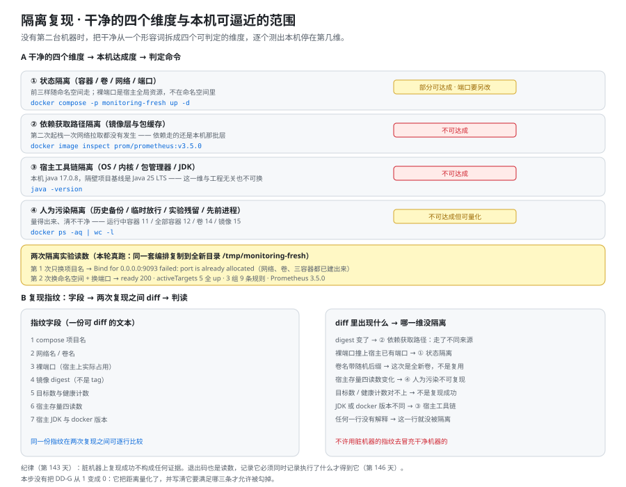

# 隔离复现：在没有第二台机器的前提下，把「干净」逼近到什么程度

这一页是第 4 周（部署 + 文档沉淀）的**第 10 步**：把[交付文档三件套](../DeliveryDocs/index.md)与[环境交付件](../EnvArtifacts/index.md)都落盘之后，唯一还留在 `⏳` 里的那一条——**干净机器上的从零复现**——往前推一截。

它回答的是三件事：本机没有第二台机器，**「干净」这个形容词能不能被拆成可判定的维度**、**每一维本机能逼近到什么程度**、以及**一份「复现指纹」（fingerprint）怎么让下一次复现自证隔离到了什么程度**。

它**不**回答什么：

- 它**不**宣布「已经复现成功」。这一条**今天仍然是 `1`**，本页做的是**量化距离**，不是消除距离。
- 它**不**做第 5 期项目的结项收口——那是紧接着的下一件事，且必须在复现之后。
- 它**不**改任何既有判据的口径（`DD-G` 的判据对象仍是「第 0 步能不能判出机器干不干净」）。

| 既有资产 | 它管什么 | 本页与它的关系 |
| --- | --- | --- |
| `DD-G`（第 145 天） | 《从零复现指南》第 0 步能不能判出「机器干不干净」 | 本页**不改判据**，只把它的对象——「干净」——拆成四个可判定的维度 |
| `EA-A`~`EA-H`（第 148 天） | 9 份环境交付件的内容有没有入仓 | 本页是它的**下游**：输入齐备之后，下一步才是复现 |
| 结项收口 | 第 5 期项目的结论 | 复现是收口的**输入**，顺序不可换（`index.md` 里写死过） |



## 一、为什么这一天不能顺手把 `⏳` 勾掉

「干净机器上的从零复现」这一条，从第 143 天登记到今天，一直躺在 `⏳` 里。它每天都被读到，也每天都最容易被人「顺手」处理掉——要么画一个 ✅，要么写一句「本机已验证」。

**这两种做法都会制造同一条假结论：这套交付件已经能被别人在一台新机器上跑起来了。**

而这句话今天**没有任何证据支持**：本机不是新机器，它跑过这套栈（沙盒已 `Up` 26~40 小时），它缓存过这些镜像，它上面还同时跑着另一套实验栈。在这样的机器上复现出来的「成功」，只能证明**这台机器**还能再跑一次同一套东西。

第 143 天为此写死了一条纪律，本页直接引用、不改口径：

::: danger 第 143 天写死的纪律
**脏机器上复现「成功」不构成任何证据。**

它不是一句态度话，而是一条判据约束：一条读数如果写不出「对着哪个环境、哪次启动取的」，它就不能进交付文档。今天要做的是给「环境」这两个字补上刻度。
:::

于是本步的做法是：**不勾掉它，而是把「干净」拆成可判定的维度，逐个测出本机能逼近到哪一维，并把结果写成一份可比较的指纹。** 这一条没有把 `DD-G` 从 `1` 变成 `0`，但它把「距离」量化了，也写清了它在什么条件下才允许被勾掉（见第六节）。

## 二、「干净」的四维拆解

「干净」在口语里是一个形容词，在工程里必须被分解成**互不重叠、各自可判定**的维度。本页把它拆成四维，骨架如下：

| 维度 | 一句话 | 本机能否达成 |
| --- | --- | --- |
| ① 状态隔离 | 容器 / 卷 / 网络 / **端口** | 部分可达成（端口要另改） |
| ② 依赖获取路径隔离 | 镜像层与包缓存 | 不可达成 |
| ③ 宿主工具链隔离 | OS / 内核 / 包管理器 / JDK 版本 | 不可达成 |
| ④ 人为污染隔离 | 历史备份 / 临时放行 / 实验残留 / 先前进程 | 不可达成**但可量化** |

下面逐维说清三件事：**它管什么、失控的典型现象、以及一条判定命令**。

### 2.1 维度①：状态隔离

- **它管什么**：一次复现所用的容器（container）、卷（volume）、网络（network）必须与历史上任何一次都不共用。前三样都是按**命名空间（namespace）**划分的，所以换一个 compose 项目名就能得到一套全新的容器 / 卷 / 网络。
- **它**不**管什么**：**裸端口（host port）不在命名空间里**。`ports: ["9093:9093"]` 里的左半边是**宿主全局资源**，谁先占谁赢，与项目名无关。
- **失控的典型现象**：容器全部创建成功，却在启动阶段因为 `port is already allocated` 失败——**看起来像编排写错，其实是命名空间的边界被人误判**。
- **判定命令**：

```shell
# 同一套编排换一个项目名、端口不动 —— 观察它能不能起来
docker compose -p repro-check up -d
# 宿主上这个端口是谁占的（用来区分「被自己占」与「被别的栈占」）
docker ps --filter "publish=9093" --format '{{.Names}}  {{.Ports}}'
```

### 2.2 维度②：依赖获取路径隔离

- **它管什么**：这次复现所需要的镜像层（image layer）与包缓存，是不是**当场从远端取回来的**。只有当它们是新取的，这次复现才顺带验证了「依赖获取路径是通的」。
- **失控的典型现象**：起栈一次网络拉取都没有发生，但一切正常——**「起得来」与「拉得到」被本地缓存压成了同一件事**。更麻烦的是它可能反向发生：在一台真正的干净机器上，第一件事可能是**根本拉不到**。
- **判定命令**：

```shell
# 镜像身份用 digest（内容摘要），不用 tag —— tag 会指向会变的内容
docker image inspect prom/prometheus:v3.5.0 --format '{{index .RepoDigests 0}}'
```

### 2.3 维度③：宿主工具链隔离

- **它管什么**：宿主（host）的操作系统、内核、包管理器与 JDK / Node 版本。这一维决定了「读者拿到的机器上与这里差多少」。
- **失控的典型现象**：本机能起、干净机器上起不来，而且**报错落在依赖或编译环节**，看起来与交付件无关。本项目里这一维的旁证很直接：本机 `java -version` 是 **17.0.8**，而隔壁项目（在线协作任务看板）的基线是 **Java 25 (LTS)**——同一个仓库里两个项目对宿主的期望就不一样。
- **为什么它「不可达成」**：它验的是**读者的机器**，不是本机。无论本机怎么调，都无法逼近「一台没装过 JDK 的机器」。
- **判定命令**：

```shell
java -version          # 本机读数：17.0.8
docker version --format '{{.Client.Version}} / {{.Server.Version}}'   # 27.1.1 / 27.1.1
docker compose version # v2.29.1-desktop.1
```

### 2.4 维度④：人为污染隔离

- **它管什么**：历史上为**看一眼现象**而留在机器上的东西——历史备份目录、临时放行、实验残留、先前跑过的进程。第 140 天把「临时造数 / 临时放行 / 临时上限」称为三类必须收敛的联调态，这一维就是它们的环境侧投影。
- **失控的典型现象**：**判据搜索域里混进了非生效文件**（本项目第 142 天踩过：一次 `grep -rn` 命中的全是 9 个实验备份），于是得到一条假红；或者反过来，残留的序列让一条告警在正常态下误报。
- **本机的特殊性**：这一维**不可达成，但可以量化**——你数不出「零污染」，但你能数出「污染有多少」，并且把这个数写进指纹里。
- **判定命令**：

```shell
printf '运行中容器=%s 全部容器=%s 卷=%s 镜像=%s\n' \
  "$(docker ps -q | wc -l | tr -d ' ')" \
  "$(docker ps -aq | wc -l | tr -d ' ')" \
  "$(docker volume ls -q | wc -l | tr -d ' ')" \
  "$(docker image ls -q | wc -l | tr -d ' ')"
# 本机读数：运行中容器=11 全部容器=12 卷=14 镜像=15
```

::: tip 四维为什么要这样分
划分的标准不是「听起来像几类」，而是**每一维都必须能单独说出一句「本机能否达成」**。第 ① 维是唯一一维部分可达成的（改端口即可），第 ②③ 维验的是别的东西（远端仓库、读者的机器），第 ④ 维是唯一一维**可以通过读数逼近**的。

一个不能回答「失控时你看到什么」的维度，不该出现在这个拆分里。
:::

## 三、本机四维判定表

把上面四维压成一张表，就是本步要交付的第一个产物——**「干净」不再是一个形容词，而是一组读数**。

| 维度 | 现状读数（本机） | 能否达成 | 判定命令 | 结论 |
| --- | --- | --- | --- | --- |
| ① 状态隔离 | 换项目名后网络 `monitoring-fresh_default`、卷 `monitoring-fresh_tsdb`、三个容器**全部创建成功**；启动阶段 `9093` 冲突 | 部分可达成 | `docker compose -p repro-check up -d` | **端口必须与项目名成对改**，否则这一维只隔离了一半 |
| ② 依赖获取路径 | 两次 `prom/prometheus:v3.5.0` 的 digest **完全相同**（`sha256:63805ebb…f4996`） | 不可达成 | <span v-pre>`docker image inspect … --format '{{index .RepoDigests 0}}'`</span> | 第二次起栈**一次网络拉取都没发生** |
| ③ 宿主工具链 | `java -version` = **17.0.8**；docker **27.1.1** / compose **v2.29.1-desktop.1** | 不可达成 | `java -version` | 这一维验的是读者的机器，本机无论怎么调都不逼近 |
| ④ 人为污染 | 运行中容器 **11** / 全部容器 **12** / 卷 **14** / 镜像 **15**；另有另一套实验栈在跑、`_lab/` 下 9 个历史规则文件 | 不可达成**但可量化** | `docker ps -aq \| wc -l` | 清不干净，但能数出来，并写进指纹 |

**一句话读法**：四维里**只有第 ① 维有希望逼近**，而且逼近它的动作不是「改项目名」，是「改项目名 **+** 改裸端口」。其余三维今天只能是读数，不能是结论。

## 四、两次隔离实验的完整读数

为了避免「在同一个栈上再跑一次」这种伪复现，本步做的是：把原沙盒的编排**原样复制到一个全新目录** `/tmp/monitoring-fresh`，然后把「隔离」一格一格往上加，每次只加一格，看它坏在哪。

原沙盒的事实先记下来（后面的读数都与它对照）：编排在 `/tmp/monitoring-run`，compose 项目名 `monitoring-min`，三个容器是 `monitoring-min-{metrics-collector,alertmanager,app}-1`，裸端口 `19090` / `9093` / `8080`，数据卷 `monitoring-min_tsdb`，**该栈至今仍在运行**（`Up` 26~40 小时）。

### 4.1 第 1 次：只换项目名，端口照旧

```shell
cd /tmp/monitoring-fresh
docker compose -p monitoring-fresh up -d
```

**结果**：网络 `monitoring-fresh_default`、卷 `monitoring-fresh_tsdb` 与三个容器**都创建成功**，然后在启动阶段失败：

```text
Error response from daemon: driver failed programming external connectivity on
endpoint monitoring-fresh-alertmanager-1 (...): Bind for 0.0.0.0:9093 failed:
port is already allocated
```

**这一条读数的价值**：它把第 ① 维的边界当场画了出来——**「换命名空间」不构成隔离。** 网络、卷、容器名都换了新的，唯一没换的裸端口把整次起栈拦在了启动阶段；而报错信息里的关键词是 `port is already allocated`，不是「配置错误」。

### 4.2 第 2 次：换命名空间 + 换端口

把裸端口从 `19090 / 9093 / 8080` 换成 `19091 / 19094 / 8082`，再起一次：

```shell
docker compose -p monitoring-fresh up -d          # → 三容器 Started
curl -s -o /dev/null -w '%{http_code}\n' http://127.0.0.1:19091/-/ready
# → 200（第 2 次探测即拿到，约 10 秒；镜像层已在本地缓存，所以比冷启动快）

sleep 70   # 必须等过最慢的采集间隔
curl -s http://127.0.0.1:19091/api/v1/targets     # → activeTargets=5，health 计数 {'up': 5}
curl -s http://127.0.0.1:19091/api/v1/rules       # → 3 个组 / 9 条规则
curl -s http://127.0.0.1:19091/api/v1/status/buildinfo   # → Prometheus 3.5.0
```

**三条读数的读法**：

1. `/-/ready` 返回 **200** 只说明 HTTP 层就绪，**不代表采集就绪**——这与第 142 天定的「三级就绪」是同一件事。
2. `activeTargets = 5` 且 `health` 计数 `{'up': 5}` 是**成对**的读数；而它必须等到 **60 s 之后**取，因为这个编排里 `edge-services` 的采集间隔是 **60 s**。**在 60 s 之前取，「5/5 up」这个读数根本不存在**——你拿到的是 `unknown`。
3. `3 组 / 9 条规则` 与交付态口径一致，说明这次起的是**同一套编排**，不是另一个东西。

### 4.3 一处必须写出来的耦合

第 2 次实验里发现一处**跨文件耦合**，它比端口冲突更隐蔽：

这个编排里 `app-counter` 这个 job 的目标写死成 `host.docker.internal:8080`，而 **`8080` 是宿主的端口映射**。换端口时，如果只改了 compose 里的 `ports`、没有同步改 `prometheus.yml` 里那一行，新实例采到的就是**旧实例的端口**——起得来、`up` 也是 1、数据也不为空，但采的不是这套栈。

```yaml [prometheus/prometheus.yml（片段）]
scrape_configs:
  - job_name: app-counter
    static_configs:
      # 这一行与 compose 里的 "8080:8080" 是一对，改一个必须改另一个
      - targets: ["host.docker.internal:8080"]
```

这是第 144 天「**成对声明**」纪律的又一处实例：**同一个事实出现在两份交付件里，就必须成对改**，否则改了不生效的那一份等于没改，而且没有任何一层会发现。

### 4.4 收尾：拆掉了什么，没拆掉什么

演示完成后，新实例被拆除：

```shell
docker compose -p monitoring-fresh down -v
```

这里有一条**热力学事实**必须写进文档，否则指纹会被误读：

> **`down -v` 拆得掉容器与卷，拆不掉镜像层与端口占用记录。**

- 镜像层仍在本地镜像库（所以下一次起栈**仍然不会发生网络拉取**，第 ② 维仍然没隔离）；
- 那次运行占用过的端口会留在宿主上（第 ① 维留下的痕迹不会因为「拆了」而消失）；
- 宿主存量四读数**不会回到 0**——它们只会在下次复现时给出一组**不一样**的数。

**「拆了」不是「没留下」。** 这也是为什么指纹里必须记 `镜像 digest`、`裸端口` 与 `宿主存量四读数`，而不是记一句「已拆除」。

## 五、「复现指纹」：把「干净」压成一份可 diff 的文本

本页最有价值的产物是这一节：**把一次复现环境的可观测身份固定成一份可 diff 的文本。** 有了它，两次复现之间「差在哪一维」就不再靠回忆，而是靠 `diff`。

### 5.1 生成指纹的命令

```shell [repro-fingerprint.sh]
#!/usr/bin/env bash
# 生成「复现指纹」：只记录**可观测身份**，不判断对错（判断交给 diff 与判据）
set -u
PROJ=${COMPOSE_PROJECT:-monitoring-fresh}
PROM_PORT=${PROM_PORT:-19091}
HOST_PROM_IMG=prom/prometheus:v3.5.0

echo "# 复现指纹 $(date -u +%Y-%m-%dT%H:%M:%SZ)"
echo "compose_project = ${PROJ}"
echo "network         = $(docker network ls --filter "name=^${PROJ}_default$" --format '{{.Name}}')"
echo "volume          = $(docker volume  ls --filter "name=^${PROJ}_tsdb$"    --format '{{.Name}}')"

# 裸端口：左半边是宿主全局资源，必须单独列出来
echo "host_ports      = $(docker ps --filter "name=^${PROJ}-" --format '{{.Ports}}' | tr -d ' ' | sort | paste -sd, -)"

# 镜像身份：用 digest，不用 tag —— tag 会指向会变的内容
echo "image_digest    = $(docker image inspect "${HOST_PROM_IMG}" --format '{{index .RepoDigests 0}}')"

# 目标数与健康计数：成对取，且必须晚于最慢的采集间隔（本编排是 60 s）
echo "targets         = $(curl -s "http://127.0.0.1:${PROM_PORT}/api/v1/targets" \
  | python3 -c 'import json,sys;d=json.load(sys.stdin)["data"]["activeTargets"];print(len(d),sum(1 for t in d if t["health"]=="up"))')"

# 宿主存量四读数 + 工具链版本
echo "host_counts     = running=$(docker ps -q | wc -l | tr -d ' ') all=$(docker ps -aq | wc -l | tr -d ' ') volumes=$(docker volume ls -q | wc -l | tr -d ' ') images=$(docker image ls -q | wc -l | tr -d ' ')"
echo "host_toolchain  = java=$(java -version 2>&1 | head -1 | awk -F'"' '{print $2}') docker=$(docker version --format '{{.Server.Version}}') compose=$(docker compose version --short)"
```

**一个关键字段的说明**：`image_digest` 取的是 `RepoDigests[0]`，形如 `prom/prometheus@sha256:63805ebb…f4996`。**它不是 tag。** tag 是**名字**，可以指向不同内容；digest 是**内容摘要**，名字一样而内容变了时它会变——这正是第 ② 维唯一的判定入口。

::: tip 指纹不判断对错，只记录身份
指纹里的每一个字段都**不带期望值**。它不做门禁（门禁在 `MANIFEST.txt` 那一路），它只回答一个问题：**这一次复现的环境长什么样。**

把「应当不变的值」（如 `compose.yaml` 的哈希）与「本来就该变的值」（如宿主存量四读数）混在同一份清单里，结果只有一个：**门禁被忽略**。第 146 天已经因为这件事把指纹拆成两份文件，这里沿用同一条口径。
:::

### 5.2 两次复现之间怎么 diff

```shell
bash repro-fingerprint.sh > "fp-$(date -u +%Y%m%dT%H%M%SZ).txt"
# 在另一台机器（或下一次复现）上同样生成一份，然后：
diff -u fp-A.txt fp-B.txt
```

### 5.3 diff 里出现什么，说明哪一维没隔离开

| diff 中出现的变化 | 说明什么 | 对应维度 |
| --- | --- | --- |
| `image_digest` 变了 | 两次走的**不是同一批镜像层**（来源不同，或上游内容变了） | ② 依赖获取路径 |
| `host_ports` 里出现了宿主已有的端口 | 这次起栈**借用了别人占着的端口**，或干脆没起成 | ① 状态隔离 |
| `volume` 带了**随机后缀** | 这是**全新的卷**（不是复用旧卷），历史数据不会串进来 | ① 状态隔离（正向） |
| `targets` 的两个数对不上，或健康计数不是全 `up` | **不是「复现成功」，是没跑到**——先看是不是取早于 60 s | ①（读法） |
| `host_counts` 四个数与上次不同 | 宿主**人为污染不可复现**，这一维本来就清不干净 | ④ 人为污染 |
| `java=` / `docker=` / `compose=` 不同 | 两次复现的**宿主工具链不同**，结果不可直接对比 | ③ 宿主工具链 |

::: danger 四类最容易犯的写法
1. **把「换了项目名」当成「隔离了」**：裸端口不在命名空间里，`ports` 的左半边是宿主全局资源。**正确写法**：把「换项目名」与「换裸端口」写成**成对声明**，并在指纹里单独列一行 `host_ports`；只换项目名的实例上得到的任何读数都不算隔离证据。
2. **用 tag 当镜像身份**：`prom/prometheus:v3.5.0` 是一个会变的名字，两次检查都读到同一个 tag 不能说明任何事。**正确写法**：记 <span v-pre>`docker image inspect … --format '{{index .RepoDigests 0}}'`</span> 的 `sha256`，两次相同才说明「没有发生新的拉取」。
3. **把「拆了」当成「没留下」**：`docker compose down -v` 之后环境并没有回到起点——镜像层与端口占用记录都还在。**正确写法**：指纹里记 `image_digest`、`host_ports` 与 `host_counts` 四读数，并在 `down -v` **之后**复查一次，看它们有没有回到你期望的位置。
4. **在只换了端口的实例上宣布「复现成功」**：这套栈起得来、5 个目标全 `up`、9 条规则都在——**但它与第一次用的是同一批镜像层、同一台宿主、同一堆残留**。**正确写法**：把「成功」这个词换成一份指纹，并逐行解释 diff；解释不了的那一行，就是**还没被隔离的那一维**。
:::

## 六、`DD-G` 的距离量化

**先说结论：今天它仍然是 `1`。**

第 145 天记录的 `DD-G` 读数是 `1`，第 146 天实测**也是** `1`，而两次的含义完全不同（一次是「检查完了，环境不满足」，一次是「连检查都没做」——`cd /tmp/monitoring-run/docs` 那一步就没执行到）。由此得到的那条纪律，本步继续沿用：

> **退出码也是读数，记录它必须同时记录「执行了什么才得到它」。**

本步做的是把 `1` 这个读数**从定性变成定量**：

| 说法 | 精确形式 |
| --- | --- |
| 「本机的环境不干净」 | 四个维度里 **① 部分可达成（端口要另改）、② ③ 不可达成、④ 不可达成但可量化（11/12/14/15）** |
| 「复现成功了」 | 起得来、5/5 `up`、3 组 9 条规则——**但 `image_digest` 两次相同，说明依赖获取路径从未被验证** |

### 6.1 它在什么条件下才允许被改成 `0`

三条**同时**满足才允许：

1. **一台从未装过容器运行时、从未拉过这些镜像的机器**——`docker info` 第一次成功、本地镜像库里没有 `prom/prometheus`；
2. **一次不经任何本地缓存的完整执行**——从第 0 步（`preflight.sh`）一路到第 5 步（收尾自查），中途没有「先手动把镜像拉好」这类补动作；
3. **指纹与本次指纹的 diff 逐行有解释**——每一行变化都能说清「为什么它本该变（例如 `host_counts`）」或「为什么它不该变（例如 `image_digest`）」。

### 6.2 不许用一台脏机器的指纹去冒充干净机器的

这一条要单独写出来，因为它是本步最容易被绕过去的地方：

指纹**只记身份、不带期望值**，所以它既能用来证明隔离，也能被用来**假装**隔离——把一台脏机器的指纹贴上去，`image_digest` 与 `host_counts` 都有值，看上去「有证据」。

**它的破法在指纹内部**：脏机器的 `host_counts` 不会是「一台刚装好运行时的机器」应有的形状（本机是运行中容器 11 / 全部 12 / 卷 14 / 镜像 15，还同时跑着另一套实验栈），而 `image_digest` 在干净机器上应当是**第一次拉取之后**才出现的。**指纹骗得过「有没有」，骗不过「长什么样」。**

## 七、这一条为什么不放在收口之后

第 4 周只剩两件事：① **干净机器上的从零复现**（把 `DD-G` 的读数由 `1` 变成 `0`）；② **第 5 期项目结项收口**。顺序不可换，理由是一条依赖关系：

- **复现是收口的输入。** 结项要回答的问题是「这套交付件能不能被别人用起来」。如果先收口、再复现，那么收口时对这个问题**只能写「应该可以」**——而第 146 天的演练已经证明过一次：八条判据全绿，也说明不了它能被别人用。
- **收口的结论必须能被复现的结果推翻一次。** 先复现再收口，收口时手里握着的是**一份指纹 diff**；先收口再复现，手里握着的是一句承诺。
- **顺序本身在 `index.md` 里写死过**（「第 4 周剩余的动作……最后是按文档从零复现」）。本页**不改动**这个顺序，只把复现往前推了一步。

::: tip 本步与「收口」的边界
本步产出的**不是**结项结论，而是**结项结论的一条输入**：一份可 diff 的复现指纹 + 一组四维读数。

下一页（收口）要回答的是「第 5 期交付了什么、还欠什么」；本页要回答的只是「在只有一台脏机器的前提下，我们离『干净』还差几维、差多少」。
:::

## 八、判据族 `IR-A` ~ `IR-H`

沿用第 127 天的**判据唯一性**纪律：本族只登记两类事——**「干净」的维度是否可判定**与**指纹是否可比较**。运行期结论仍归 `DD-*` / `EA-*` / `LA-*` 各族，本族只引用不重述。

| 判据 | 约定 | 定错会怎样 | 怎么验证 | 状态 |
| --- | --- | --- | --- | --- |
| `IR-A` | 「干净」必须被拆成四个**互不重叠**的维度（状态 / 依赖获取路径 / 宿主工具链 / 人为污染），每一维都要能单独说出一句「本机能否达成」 | 只写一个「干净」时，任何一台跑过这套栈的机器都会被判为干净 | 页面含四维 H3 与四张「能否达成」结论 | ✅ 本机已跑（文档级） |
| `IR-B` | **换命名空间必须与换裸端口成对声明**——裸端口是宿主全局资源，不在命名空间里 | 只换项目名的实例会被当成「隔离成功」，而它只是没起成 | 第 1 次实验的完整报错 `Bind for 0.0.0.0:9093 failed: port is already allocated` | ✅ 本机已跑 |
| `IR-C` | 镜像身份必须用 **digest** 记录，不用 tag | tag 撞名而内容不同时，「两次相同」是假结论 | <span v-pre>`docker image inspect … --format '{{index .RepoDigests 0}}'`</span> 两次同为 `sha256:63805ebb…f4996` | ✅ 本机已跑 |
| `IR-D` | **目标数与健康计数必须成对取**，且取数时刻晚于最慢的采集间隔 | 单判 `up` 会把 `unknown` 当成 `up`；取早了拿到的是空集 | `activeTargets = 5` 与 `health = {'up': 5}` **成对**出现；`edge-services` 间隔 60 s | ✅ 本机已跑 |
| `IR-E` | 跨文件出现的**同一个事实**（如端口）必须显式声明成对 | 改了不生效的那一份等于没改，且没有任何一层会发现 | `prometheus.yml` 的 `host.docker.internal:8080` 与 compose 的 `8080:8080` 成对 | ✅ 本机已跑 |
| `IR-F` | 复现环境必须被压成一份**可 diff** 的指纹，字段含 digest / 裸端口 / 宿主存量四读数 | 没有指纹时，「两次复现差在哪」只能靠回忆 | 运行第 5.1 节的脚本生成指纹，再按 5.3 的表逐行判读 | ✅ 本机已跑（生成与 diff 已跑；**干净机器侧的指纹 ⏳**） |
| `IR-G` | `DD-G` 由 `1` 改 `0` 需要三条同时满足：干净机器 + 无缓存完整执行 + 指纹 diff 逐行有解释 | 缺任一条时改 `0`，等于用一次脏机器上的成功冒充一次真复现 | 逐条核对 6.1 节三项前置 | ⏳ 未跑 · 原因：**需一台从未装过容器运行时的机器** |
| `IR-H` | 「拆了」不是「没留下」：`down -v` 拆得掉容器与卷，拆不掉镜像层与端口占用记录 | 指纹停在「已拆除」这句话上时，下一次复现的差异无处可比 | `down -v` 后 `docker image inspect` 仍能取到 digest，宿主存量四读数不回零 | ✅ 本机已跑 |

**七条本机已跑、一条如实标注未跑。** 与第 148 天的 `EA-*` 一样，这里**没有一条是抄来的期望值**：每条的「怎么验证」那一格都对应本页给出的命令或读数。

## 九、当日做了什么

1. **拆维**：把「干净」从一个形容词拆成四个可判定的维度（状态 / 依赖获取路径 / 宿主工具链 / 人为污染），每一维都给出「它管什么 / 失控时看到什么 / 判定命令」三段，并逐维判出本机能否达成。
2. **做两次实验，每次只加一格隔离**：第 1 次只换项目名 → 拿到 `9093` 的 `port is already allocated`；第 2 次换命名空间 + 换端口 → 拿到三条就绪读数（`ready 200` / `activeTargets 5` 全 `up` / `3 组 9 条规则`）。**先只加一格**，是为了让「哪一格是必须的」这件事有对照，而不是一次改到位后回头猜。
3. **量宿主脏度**：运行中容器 **11** / 全部 **12** / 卷 **14** / 镜像 **15**，并记下另一套实验栈与 `_lab/` 下 9 个历史规则文件——**第 ④ 维不可达成，但从今天起可量化**。
4. **记两处环境事实**：Docker Hub 直连超时（`docker pull postgres:18` 超时，改走镜像站成功、耗时 **1 分 44 秒**）与本机 `java -version = 17.0.8`（隔壁项目基线 Java 25 LTS）。前者说明**「干净机器」上第一件事就可能是「拉不到镜像」，而这件事与干净无关**；后者是第 ③ 维不可换的旁证。
5. **写出「复现指纹」**：把一次复现环境的可观测身份固定成一份可 diff 的文本（生成命令 + diff 方式 + 六行判读表），并写死「指纹只记身份、不带期望值」。
6. **量化 `DD-G` 的距离**：明确写「今天它仍然是 `1`」，并给出它**允许变成 `0` 的三条前置**与「不许用脏机器的指纹冒充干净机器的」这条约束。
7. **定稿 `IR-A`~`IR-H`**（七条本机已跑、一条 `⏳`），并画配图 `isolated-reproduce.svg`（900×700）。

**为什么按这个顺序**：先拆维（否则量出来的数没有归属）→ 再实验（否则维度只是定义）→ 再量脏度（第 ④ 维只能量化）→ 再写指纹（把上面所有读数压成一份可比较的东西）→ 最后才谈 `DD-G` 的条件（没有指纹时，那三条前置根本无法判定）。

## 十、如何验证

```shell
cd /tmp/monitoring-fresh

# 1) IR-B：换命名空间不构成隔离 —— 期望：报 port is already allocated（端口照旧时）
docker compose -p monitoring-fresh up -d 2>&1 | tail -3

# 2) IR-C：镜像身份用 digest —— 期望：两次输出的 sha256 完全相同
docker image inspect prom/prometheus:v3.5.0 --format '{{index .RepoDigests 0}}'

# 3) IR-D：目标数与健康计数成对取，且晚于 60 s —— 期望：5 5
curl -s http://127.0.0.1:19091/api/v1/targets \
  | python3 -c 'import json,sys;d=json.load(sys.stdin)["data"]["activeTargets"];print(len(d),sum(1 for t in d if t["health"]=="up"))'

# 4) IR-D（配置侧）：上界从配置里读，不写死
grep -n 'scrape_interval' prometheus/prometheus.yml     # 期望：能看到最慢的那个（60s）

# 5) IR-E：跨文件同一事实成对声明 —— 期望：两处端口一致
grep -n 'host.docker.internal' prometheus/prometheus.yml
grep -nE '^\s*- "?8080' compose.yaml

# 6) IR-F：生成指纹并 diff —— 期望：第 3 步之后每行都有值；两次 diff 逐行可解释
bash repro-fingerprint.sh > fp-A.txt && cat fp-A.txt
diff -u fp-A.txt fp-B.txt

# 7) IR-H：拆掉之后复查 —— 期望：digest 仍能取到，宿主存量四读数不回零
docker compose -p monitoring-fresh down -v
docker image inspect prom/prometheus:v3.5.0 --format '{{index .RepoDigests 0}}'
printf '运行中容器=%s 全部容器=%s 卷=%s 镜像=%s\n' \
  "$(docker ps -q | wc -l | tr -d ' ')" "$(docker ps -aq | wc -l | tr -d ' ')" \
  "$(docker volume ls -q | wc -l | tr -d ' ')" "$(docker image ls -q | wc -l | tr -d ' ')"
```

**预期结果读法**：

- 第 1 步的预期输出**就是那句报错**（端口照旧时）；如果它反而成功，说明宿主上那三个端口当时是空的——**先确认这一点再往下走**，否则第 ① 维的读数不成立。
- 第 3 步必须**在起栈后 60 s 以上**执行，期望 `5 5`；若得到 `5 0`，那是 `unknown`，不是失败。
- 第 6 步的 `diff` **不允许出现「解释不了的行」**：`host_counts` 变化是正常的（第 ④ 维本来就不可复现），`image_digest` 变化**不能**用「正常」解释——它是第 ② 维没隔离的直接证据。
- 第 7 步的关键不是「拆干净了」，而是**拆完之后 digest 仍然在**。

## 十一、下一步

第 4 周只剩两件事，顺序不可换：

| 待办 | 内容 | 入口条件 |
| --- | --- | --- |
| **一台干净机器上的完整复现** | 按《从零复现指南》从第 0 步跑到第 5 步，把 `DD-G` 的读数由 `1` 变成 `0` | 一台**从未装过容器运行时、从未拉过这些镜像**的机器；⑥ 节的三条前置同时满足；指纹与本次指纹 diff 逐行有解释 |
| **第 5 期项目结项收口** | 第 5 期交付结论：交付了什么、还欠什么（`L3` 仍未解） | **在复现之后**——复现是收口的输入（见第七节） |

另外两条挂账项仍然开着，本页不动它们：

| 挂账 | 内容 | 归属 |
| --- | --- | --- |
| `L3` | 真实通知渠道四项前置（凭据 / 模板 / 渠道侧限流与重试 / `resolved` 是否发） | 第 140 天登记，仍未解 |
| 逐行落盘 | `compose.yaml`（52.4%）与 `alerting.yaml`（65.0%）的覆盖率缺口 | 第 148 天登记 |

::: tip 下一轮最容易犯的错
**把「有了一份指纹」当成「有了隔离证据」。**

指纹本身不判对错。它的价值全部来自**两次指纹之间的 diff 被逐行解释过**——解释不了的那一行，才是这次复现真正的结论。把一份只有一次的指纹贴进交付文档，效果与第 145 天那句「已在本机验证」完全一样。
:::

## 参考资料

- Docker Compose · `-p` 项目名前缀与资源命名（决定网络名与卷名的由来）：<https://docs.docker.com/reference/cli/docker/compose/>
- Docker Compose · `up` 与 `--wait`（「容器已启动」与「可用」的区别）：<https://docs.docker.com/reference/cli/docker/compose/up/>
- Docker Engine · 端口映射与网络命名空间边界（裸端口是宿主全局资源）：<https://docs.docker.com/engine/network/>
- Docker CLI · `docker image inspect`（`RepoDigests` 与内容摘要）：<https://docs.docker.com/reference/cli/docker/image/inspect/>
- Docker CLI · `docker compose down`（`-v` 删除卷，但不删除镜像层）：<https://docs.docker.com/reference/cli/docker/compose/down/>
- Prometheus HTTP API（`/api/v1/targets` 返回的 `activeTargets` 与 `health`、`/api/v1/status/buildinfo`）：<https://prometheus.io/docs/prometheus/latest/querying/api/>
- Prometheus 官方文档 · 配置（`scrape_interval` 与逐 job 覆写）：<https://prometheus.io/docs/prometheus/latest/configuration/configuration/>
- PostgreSQL 官方镜像（直连 Docker Hub 与镜像站两种取法的对照）：<https://hub.docker.com/_/postgres>
- Google SRE Book · Release Engineering（环境一致性与构建可复现的思路来源）：<https://sre.google/sre-book/release-engineering/>
- 本仓相关章节：[交付文档三件套](../DeliveryDocs/index.md)、[环境交付件落盘](../EnvArtifacts/index.md)、[从零复现指南](../DeliveryPackage/Reproduce/index.md)、[交付演练](../DeliveryDrill/index.md)、[上线验收收口](../LaunchAcceptance/index.md)
