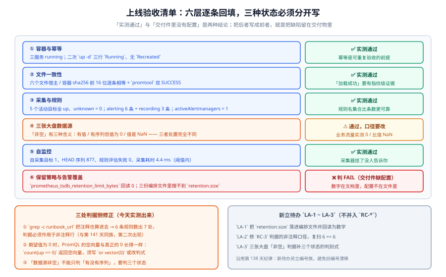

# 上线验收收口：把四项交付判据逐条变成可勾选的项

第 4 周第 4 步。前三步分别解决了「**把联调态收敛成可交付态**」（第 140 天）、「**容量基线重测**」（第 141 天）、「**一键起与大盘可用性**」（第 142 天）。今天做的是它们的收口：**把「月末交付判据」的四项——一键起、三张大盘可用、告警真的响过、按文档能从零复现——逐条写成「谁、在什么环境、跑哪条命令、看到什么算通过」**，然后**真跑一遍**。



::: tip 本页最重要的一句话
**「判据有读数」不等于「交付件里有配置」。** 今天实测出的最重的一条结论是：第 141 天写进文档的 `1 GiB` 保留上限，在**交付物（编排文件）里一行都没有**——数字活在文档里，配置不在文件里。这类缺陷**不会被任何一层检查拦住**（语法合法、服务正常、`promtool` 全绿），只会被「上线验收清单」这一层拦住。

**它正是这一步存在的理由。**
:::

## 一、先把清单的条目分成三类

验收清单最容易写坏的地方，是**把所有条目写成同一种**（「确认 XX 已启用」）。可行的分法是按**能否在本机复现**：

| 类别 | 判据形态 | 处置 | 本页数量 |
| --- | --- | --- | --- |
| **甲类：可本机实测** | 一条命令 + 一个数字 + 一个期望关系 | **今天必须跑出数字**，写进实测列 | 6 层 / 24 项 |
| **乙类：可本机静态判定** | 一条 `grep` / `shasum` / `promtool` | 今天必须跑到 0 或相等 | 含在 6 层内 |
| **丙类：需前置条件** | 前置条件 + 解除判据 + 谁来做 | **标 `⏳` 并写明原因**，不许抄期望值 | 2 项 |

::: warning 第三类必须单独存在，不许合并进第一类
把丙类「改成甲类」的最常见做法是**抄一个期望值**（「真实渠道应能在 5 分钟内送达」）。这与本项目第 136/138/141 天反复登记的口径纪律冲突：**实测列只能写跑出来的数**。跑不了的写 `⏳` + 原因 + 解除判据，这三样齐全才算登记完成。
:::

## 二、本机实测：六层逐条回填

**环境记录**（口径纪律：读数必须能对应到一个具体对象）：

```shell
# ① 被测对象是哪一份编排起的？
docker inspect monitoring-min-metrics-collector-1 \
  --format '{{index .Config.Labels "com.docker.compose.project.config_files"}} | created={{.Created}}'
# → /tmp/monitoring-run/compose.yaml | created=2026-10-15T05:25:37Z
```

```shell
# ② 运行时与版本
docker info --format '{{.ServerVersion}}'; docker ps --filter name=monitoring-min --format '{{.Names}} {{.Status}}'
# → 27.1.1
# → monitoring-min-metrics-collector-1  Up 11 hours
# → monitoring-min-app-1                Up 11 hours
# → monitoring-min-alertmanager-1       Up 11 hours
```

### 第 1 层：容器与幂等

```shell
cd /tmp/monitoring-run && docker compose config --services
# → alertmanager / app / metrics-collector（3 个长驻服务）
docker compose up -d            # 二次执行
# → Container monitoring-min-alertmanager-1      Running
# → Container monitoring-min-app-1               Running
# → Container monitoring-min-metrics-collector-1 Running
```

**结论**：三个长驻服务全部 `running`；二次 `up -d` **三行全是 `Running`、没有一行 `Recreated`** → 幂等成立。

**为什么幂等要放在第一条**：不幂等的一次性操作**无法被重复验收**。工单上写着「重启后是否仍然正常」，如果每次运行都会重建容器，那么第二次的读数与第一次不可比——**验收清单的前提是可重复**。

### 第 2 层：文件一致性（指纹级证据）

「配置已生效」这句话的判据不能是「`reload` 返回 200」——第 138 天实测过：reload 200 同时「规则一条没换」是可能的。今天用**宿主与容器的内容指纹**判：

```shell
shasum -a 256 prometheus/{prometheus.yml,recording.yaml,alerting.yaml} app/metrics/*.prom | awk '{print substr($1,1,16), $2}'
docker exec monitoring-min-metrics-collector-1 sha256sum /etc/prometheus/{prometheus.yml,recording.yaml,alerting.yaml}
docker exec monitoring-min-app-1 sha256sum /srv/metrics/*.prom
```

**实测（两侧前 16 位逐条相等）**：

| 文件 | 宿主 sha256 前 16 位 | 容器内 | 判读 |
| --- | --- | --- | --- |
| `prometheus.yml` | `d319e4500319daad` | 同 | ✅ |
| `recording.yaml` | `af9c7ad2ef3d6f82` | 同 | ✅ |
| `alerting.yaml` | `cc587ff9383a884e` | 同 | ✅ |
| `app/metrics/core.prom` | `cdf273018a920281` | 同 | ✅ |
| `app/metrics/edge.prom` | `70f9f83643b4bd78` | 同 | ✅ |
| `app/metrics/pods.prom` | `24ea82964ee652b6` | 同 | ✅ |

```shell
docker exec monitoring-min-metrics-collector-1 promtool check config /etc/prometheus/prometheus.yml
docker exec monitoring-min-metrics-collector-1 promtool check rules /etc/prometheus/recording.yaml /etc/prometheus/alerting.yaml
# → SUCCESS: 6 rules found（alerting.yaml）
```

**结论**：**6 个文件两侧指纹全等 + 语法双层 SUCCESS**。「配置没生效」在这一层不可能藏住——它需要同时骗过指纹和语法。

### 第 3 层：采集与规则（读 API，不读界面）

```shell
# 目标层
curl -s 'localhost:19090/api/v1/targets?state=active'
# 规则层
curl -s localhost:19090/api/v1/rules
# 出海口
curl -s localhost:19090/api/v1/alertmanagers
```

**实测**：

| 项 | 实测值 | 期望关系 | 判读 |
| --- | --- | --- | --- |
| `activeTargets` | **5** | ≥ job 数 | ✅ |
| `health = up` | **5** | = activeTargets | ✅ |
| `health = down` | **0** | 0 | ✅ |
| `health = unknown` | **0** | 0（且 activeTargets > 0） | ✅ |
| job 分布 | `core-services` / `edge-services` / `kubernetes-pods` / `app-counter` / `prometheus` 各 **1** | 与契约一致 | ✅ |
| `instance` 取值 | `app:8080`、`host.docker.internal:8082`、`localhost:9090` | — | 记录 |
| alerting 规则 | **6 条**：`ServiceDown` `TargetDown` `TargetScrapedZeroSamples` `HighErrorRate` `CollectorScrapeSlow` `TSDBRetentionSizeTriggered` | 与文件一致 | ✅ |
| recording 规则 | **3 条**：`svc:http_requests:rate5m` `svc:http_error_ratio:rate5m` `job:target_up:count` | 与文件一致 | ✅ |
| 规则组 | `capacity_alerts`(15s, 2) / `platform_alerts`(15s, 4) / `svc_aggregations`(30s, 3) | interval 与文件一致 | ✅ |
| `activeAlertmanagers` | **1**（dropped **0**） | ≥ 1 | ✅ |

::: danger 第 3 层的「unknown = 0」为什么必须与「目标数 ≥ job 数」一起判
只判 `unknown == 0` 在**空集上恒真**——冷启动时 `activeTargets = []`，`unknown` 自然是 0，判据报 ✅ 而系统什么都没起来。这条口径由第 142 天确立，今天复用时**顺序不能反**：先证「有目标」，再证「目标都 healthy」。

**并且今天把条数判据又收紧了一步**：`RR-D` 的教训是「条数一致」在**规则改名**时完全一样，因此第 3 层用的是**规则名集合**（`alerting` 6 个名字逐一列出），不是「6 条」。
:::

### 第 4 层：三张大盘数据源（今天发现问题的一层）

三张大盘分别是**值班总览 → 服务详情 → 自监控**。它们的「可用」不能只判「有没有数据」，因为**「非空」实际上有三种状态**：

```shell
curl -s --get --data-urlencode 'query=sum(rate(http_requests_total[5m]))'                localhost:19090/api/v1/query   # 业务流量
curl -s --get --data-urlencode 'query=count(svc:http_requests:rate5m)'                  localhost:19090/api/v1/query   # 业务流量：序列数
curl -s --get --data-urlencode 'query=max(svc:http_error_ratio:rate5m)'                 localhost:19090/api/v1/query   # 错误率
curl -s --get --data-urlencode 'query=count(up)'                                        localhost:19090/api/v1/query   # 服务健康
curl -s --get --data-urlencode 'query=prometheus_tsdb_head_series'                      localhost:19090/api/v1/query   # 自监控
```

**实测**：

| 大盘 | 表达式 | 实测 | 状态 | 处置 |
| --- | --- | --- | --- | --- |
| 值班总览 · 业务流量 | `sum(rate(http_requests_total[5m]))` | **0** | **有序列、值为 0** | 见下 |
| 值班总览 · 业务流量（序列数） | `count(svc:http_requests:rate5m)` | **4** | 序列存在 | ✅ 数据源接通 |
| 服务详情 · 错误率 | `max(svc:http_error_ratio:rate5m)` | **`NaN`** | **值是 NaN** | 第 136 天已登记：分母为 0 |
| 服务详情 · 服务健康 | `count(up)` | **5** | 有值 | ✅ |
| 自监控 | `prometheus_tsdb_head_series` | **877** | 有值 | ✅ |

::: danger 「数据源非空」必须拆成三个判别式，否则它是一句恒真的话
- **有序列**：`count(<指标>)` > 0 —— 证明**管道接通**（数据源配对了、序列存在）。
- **有非零值**：`sum(...)` > 0 —— 证明**业务在动**。实测 `0` 是**正确**的：靶服务的 `http_requests_total` 来自静态 `.prom` 文件，**只有压测时才会增长**（第 139 天登记的 `R-9`）。把「0」当 FAIL 会天天误报。
- **不是 NaN**：`max(...) != NaN` 在 PromQL 里**判不出来**（`NaN != NaN` 恒真），必须用 `... or vector(0)` 兜底或改用 `absent()`。实测 `max(svc:http_error_ratio:rate5m)` = `NaN`，来源是 `edge-gateway` 的错误数为 0、请求数也为 0 → **除零**。

**因此第 4 层的判据写成三条**：`count(...) > 0`（管道）**且** 值域可解释（0 / NaN / 有值三者必须**能被区分**并各自有处置），**不写成**「数据源非空」。
:::

### 第 5 层：自监控（采集器抓自己）

```shell
curl -s --get --data-urlencode 'query=count(up{job="prometheus"}) or vector(0)'                  localhost:19090/api/v1/query
curl -s --get --data-urlencode 'query=sum(prometheus_rule_evaluation_failures_total)'            localhost:19090/api/v1/query
curl -s --get --data-urlencode 'query=scrape_duration_seconds{job="prometheus"}'                 localhost:19090/api/v1/query
curl -s --get --data-urlencode 'query=max(max_over_time(scrape_duration_seconds{job="prometheus"}[15m]))' localhost:19090/api/v1/query
```

| 项 | 实测 | 期望 | 判读 |
| --- | --- | --- | --- |
| 自采集目标 | **1** | = 1 | ✅ |
| 规则评估失败总数 | **0** | = 0 | ✅ |
| 采集耗时（当前） | **0.004391246 s ≈ 4.4 ms** | < 1 s | ✅ |
| 采集耗时（15 分钟窗口峰值） | **0.029758913 s ≈ 29.8 ms** | < 1 s（距阈值 **33 倍**） | ✅ |

::: tip 这一层的告警阈值为什么是 1 秒
第 142 天抓出的判据缺陷正是「**口径过宽**」：`max by (job) (max_over_time(scrape_duration_seconds[15m]))` 把业务目标也拉进来，一次 `compose down/up` 的重启尖峰（`kubernetes-pods` **3.147 s**）被 15 分钟窗口记住 → **每次部署后必然误报**。修正后只判 `{job="prometheus"}`（即「采集器抓自己」），今天实测峰值 29.8 ms，**距阈值 33 倍**——这条判据现在既不会漏、也不会在正常态叫。
:::

### 第 6 层：保留策略 —— 今天唯一的 **FAIL**

```shell
curl -s --get --data-urlencode 'query=prometheus_tsdb_retention_limit_bytes' localhost:19090/api/v1/query
# → 0
curl -s --get --data-urlencode 'query=prometheus_tsdb_size_retentions_total' localhost:19090/api/v1/query
# → 0（从未触顶，但这不证明上限存在）
docker inspect monitoring-min-metrics-collector-1 --format '{{join .Args " "}}'
# → --config.file=... --storage.tsdb.retention.time=15d --web.enable-lifecycle
grep -rn 'retention.size' /tmp/monitoring-run --include='*.yaml' --include='*.yml' --include='*.sh'
# → （无输出）
```

**结论：`❌ FAIL`。**

| 项 | 期望（第 140/141 天登记） | 实测 | 判读 |
| --- | --- | --- | --- |
| `prometheus_tsdb_retention_limit_bytes` | **1073741824**（第 141 天读数） | **0** | ❌ |
| 编排文件里的 `--storage.tsdb.retention.size` | 应存在 | **三份文件全部搜不到** | ❌ |
| `prometheus_tsdb_size_retentions_total` | 由 0 变非 0 才算「触发过」 | 0 | 无信息 |

::: danger 这个 FAIL 的性质必须写清楚，它不是「配置写错了」
- 它不是语法错误：`promtool check config` SUCCESS。
- 它不是服务异常：三容器 running、5 目标全 up、规则全加载。
- 它是**交付件缺失**：第 140 天的决定（`0B` → `1GB`）与第 141 天的实测读数（`1073741824`）**都没有落到编排文件里**。第 141 天读到的那个数字，来自一个**今天已经不存在的容器状态**。

**这正是「口径名 + 获取方式」纪律的第三次兑现**：一条读数如果写不出「对着哪个文件/哪次启动取的」，它就不能进交付文档——因为它**无法被第二个人复现**。

处置见第五节的 `LA-1`。
:::

## 三、今天抓出的三处判据侧缺陷

按项目纪律，**判据缺陷与系统缺陷分开登记**：前者的对象是「我们怎么看」，后者的对象是「系统怎么样」。今天三处全是前者。

### 缺陷 A：`RC-3` 的判据在注释面前变成假 FAIL

第 140 天把 `RC-3` 的口径写死为「**告警规则条数 == `runbook_url` 条数**」，当时实测 `4 == 4`。今天同一条判据实测：

```shell
grep -c runbook_url prometheus/alerting.yaml       # → 7
grep -c '      - alert:' prometheus/alerting.yaml  # → 6
```

**6 ≠ 7**，看起来是一条真 FAIL。但逐行看下去，多出来的那 1 处是**第 6 行的一句注释**（「② 每条告警补 runbook_url（第 138 天 `RC-3`：runbook 出现次数 == 告警条数）」）。

::: danger 这是「引用归 0」缺陷的第二次出现，形状一模一样
第 141 天登记过一次：「**『引用归 0』必须作用于非注释行**，否则**把注释写清楚反而会让判据变红**」。今天它是同一条判据的第二次发作，而且更隐蔽——**注释里写的正是判据自身的定义**。

**修正**（判据作用于非注释行）：

```shell
grep -v '^[[:space:]]*#' prometheus/alerting.yaml | grep -c 'runbook_url'   # → 6
```
修复后 **6 == 6**，判据恢复可用。

**这条修正的普适形式**：凡是「数某个词出现了几次」的判据，都必须先剔除注释；**而注释的作用恰恰是把口径写清楚，越写清楚越容易触发这个坑**。
:::

### 缺陷 B：期望值为 0 时，PromQL 的空向量与真正的 0 长得一样

第 3 层要判「没有 down 的目标」。第一版写法：

```shell
curl -s --get --data-urlencode 'query=count(up == 0)' localhost:19090/api/v1/query
# → data.result: []   （空向量）
```

**空向量既可能是「真的 0 条」，也可能是「表达式写错/指标名不存在」**——两者在 HTTP 层都是 `status: success` + 空数组。实测三种写法的差别：

| 写法 | 实测返回 | 说明 |
| --- | --- | --- |
| `count(up == 0)` | **空向量** | 无法与「查询写错」区分 |
| `count(up == 0) or vector(0)` | **0** | 兜底成数字 |
| `count(up) - count(up == 1)` | **0** | 不用兜底，天然是数字 |

**修正**：判据写成 `count(up == 0) or vector(0)`，或改用差值式。这条与本项目第 142 天登记的「第 3 级在空集上恒真」是**同一族**（空集语义），但方向相反：那次是**空集让判据恒真（漏）**，这次是**空集让判据无法判定（盲）**。

### 缺陷 C：「数据源非空」缺三个状态的判别式

见第 4 层。修正后的写法是三条并列判据（有序列 / 值可解释 / NaN 可识别），并且**给这三条各配一个反例**：

| 判据 | 反例（必须能被判出来） |
| --- | --- |
| `count(<指标>) > 0` | 把数据源 URL 改错 → 返回空向量 → **假 ✅**，须与第 2 层的指纹判据合看 |
| 值可解释 | 期望 `> 0` 而实测 `0`（静态 `.prom` 无流量）→ **假 ❌** |
| NaN 可识别 | `max(svc:http_error_ratio:rate5m)` = `NaN`，而 `NaN != NaN` 使「不等于 0」恒真 |

## 四、需前置条件的条目（`⏳`，不抄期望值）

| 条目 | 前置条件 | 解除判据 | 归属 |
| --- | --- | --- | --- |
| **`L3` 真实通知渠道** | 四项：凭据落点 / 模板 / 渠道侧限流与重试 / `resolved` 是否发 | 渠道侧收到一条真实通知，且记录**送达时间**与**分组数** | 第 140 天登记，仍未解 |
| **「按文档从零复现」** | 一台**干净机器**（无镜像、无 `tsdb` 卷、无历史配置） | 按《从零复现指南》执行，中途**不查任何本页之外的资料** | 本页登记 |

::: warning 为什么「从零复现」必须在一台干净机器上验
在**已经跑过的机器**上「复现」，会同时绕过三类前置：镜像已缓存（`pull` 失败被掩盖）、卷已存在（初始化逻辑不执行）、配置残留（缺失的挂载被上一天的产物补上）。这三类恰恰是新人第一次部署时**最会踩的**。**在脏机器上复现成功，不构成任何证据。**
:::

## 五、交付文档三件套（这一步真正要沉淀的东西）

第 4 周的里程碑写的是「部署 **+ 文档沉淀**」。沉淀的产物不是「把前面 22 章再抄一遍」，而是**三份各自回答一个问题的文档**：

| 文档 | 只回答一个问题 | 必备内容 | 反例（写了等于没写） |
| --- | --- | --- | --- |
| **《从零复现指南》** | 一台干净机器上，第一条命令敲什么 | 前置检查（运行时 / 端口 / 磁盘）→ 六个文件清单 → 起栈 → 三级就绪判据 → 每步的**失败表现**与下一步 | 「执行 `docker compose up -d`」——没写端口占用、没写镜像拉不下来、没写就绪要 41 秒 |
| **《上线验收清单》** | 交付的那一刻，逐条怎么判 | 本页六层；每条**命令 + 期望关系 + 实测列**；三类条目分开；`⏳` 项另附前置与归属 | 「确认监控可用」——没有命令、没有数字 |
| **《故障应对索引》** | 报警响了，先看哪一页 | `alertname` → 页面 → 第一问（数据没到 / 数据错了）→ 恢复动作 | 按章节顺序排列——值班的人不是从头读文档 |

::: tip 三份文档的共同点：**都以「读者要做的动作」开头**
这不是文风问题。**验收清单的读者是执行者，不是评审者**——他要的是「跑什么、看到什么算过」。第 4 周的「文档沉淀」如果产出一份读起来很完整的项目总结，它对这个项目的上线**没有任何帮助**；而这三份文档，任何一份缺失都会让另一个人无法接手。
:::

## 六、判据表：`LA-A` ~ `LA-H`

八条判据覆盖「清单本身是否可执行」与「今天实测出的结论是否落地」两类。按判据唯一性纪律，本页**不新增与 `OC-*` / `CB-*` / `DP-*` 重叠的判据**。

| 判据 | 内容 | 怎么验证 | 本机状态 |
| --- | --- | --- | --- |
| `LA-A` | 验收清单的每条都**带命令与期望关系**，且**三类条目分开写** | 逐条检查：出现「确认 / 检查」而无命令的条目数 = 0 | ✅ 已跑（本页第二节 24 项） |
| `LA-B` | 六个文件的**宿主 / 容器 sha256 前 16 位逐条相等** | 两条 `shasum` / `sha256sum` 输出逐行比对 | ✅ 已跑（全等） |
| `LA-C` | 规则判据用**规则名集合**而非条数 | 回读 `/api/v1/rules`，列出 alerting 6 个名字 | ✅ 已跑（6 个名字） |
| `LA-D` | 「数据源可用」拆成**有序列 / 值可解释 / NaN 可识别**三条 | 三个表达式各自有读数，且能给出各一条反例 | ✅ 已跑（4 / 0 / NaN） |
| `LA-E` | 期望值为 0 的判据**不使用裸比较**（空向量必须兜底） | 全文检索判据表达式，存在 `count(... == 0)` 而无 `or vector(0)` 的处数 | ✅ 已跑（三写法对照） |
| `LA-F` | 数「某个词出现几次」的判据**作用于非注释行** | 同一判据在含注释与不含注释两种写法下的读数 | ✅ 已跑（7 → 6） |
| `LA-G` | 丙类条目**有前置条件 + 解除判据 + 归属**三要素 | 抽两条丙类条目逐项核对 | ✅ 已跑（`L3` / 从零复现） |
| `LA-H` | 交付件缺配置的项**判 FAIL 而不是判「待确认」** | 保留上限一项的结论是否为可执行的 `LA-1` | ✅ 已跑（判 FAIL） |

::: danger `LA-H` 为什么单独成条
把「交付件里没有配置」写成「待确认」，是上线验收最常见的软化动作——它把一条**必须在交付前排掉的缺陷**降级成一条**观察项**。区别很硬：**「待确认」的归属人可以是「项目组」；判 FAIL 的归属人必须是一个具体的编号与一个具体的人。**
:::

## 七、当日做了什么

1. 把「月末交付判据」四项拆成**六层 24 项**，并按「可本机实测 / 可本机静态判定 / 需前置条件」分成三类（丙类 2 项）。
2. **真跑一遍六层验收**：容器与幂等 ✅、文件一致性（6 文件指纹全等 + `promtool` 双 SUCCESS）✅、采集与规则（5 目标全 up / unknown 0 / alerting 6 条名集合 / recording 3 条 / `activeAlertmanagers` 1）✅、三张大盘数据源（**4 序列 / 值 0 / NaN**）⚠️、自监控（自采集 1 / 评估失败 0 / 抓取 4.4 ms、15 m 峰值 29.8 ms）✅、保留策略 ❌。
3. **抓出三处判据侧缺陷**：`RC-3` 的注释致假 FAIL（7 vs 6）、空向量与 0 不可区分（`count(up == 0)` 空向量）、「数据源非空」缺三个判别式。
4. **判出唯一一条 FAIL**：`prometheus_tsdb_retention_limit_bytes` 实测 **0**，三份编排文件里搜不到 `retention.size`——第 140/141 天的决定与读数**都没有落到交付件**。
5. 新立待办 **`LA-1` ~ `LA-3`**（沿用第 138 天纪律，另立编号族以免旧编号漂移）：`LA-1` 把 `--storage.tsdb.retention.size` 落进编排文件并回读为数字；`LA-2` 把 `RC-3` 判据改为非注释口径并复扫 `6 == 6`；`LA-3` 给三张大盘的「非空」补三个状态的判别式。
6. 定义**交付文档三件套**的内容边界与反例（从零复现指南 / 上线验收清单 / 故障应对索引）。

## 八、如何验证

```shell
cd /tmp/monitoring-run

# 1) 三层就绪与幂等（LA-A 的前提）—— 期望：三行 Running、无 Recreated
docker compose up -d

# 2) 文件一致性（LA-B）—— 期望：两侧各 6 行，前 16 位逐条相等
shasum -a 256 prometheus/*.yaml app/metrics/*.prom | awk '{print substr($1,1,16), $2}'
docker exec monitoring-min-metrics-collector-1 sha256sum /etc/prometheus/*.yaml
docker exec monitoring-min-app-1 sha256sum /srv/metrics/*.prom

# 3) 语法与规则名集合（LA-C）—— 期望：SUCCESS 6 rules；名字 6 个
docker exec monitoring-min-metrics-collector-1 promtool check rules /etc/prometheus/alerting.yaml
curl -s localhost:19090/api/v1/rules | python3 -c "import json,sys;print(sorted(r['name'] for g in json.load(sys.stdin)['data']['groups'] for r in g['rules'] if r['type']=='alerting'))"

# 4) 三张大盘数据源的三条判别式（LA-D）—— 期望：4 / 0 / NaN
curl -s --get --data-urlencode 'query=count(svc:http_requests:rate5m)'   localhost:19090/api/v1/query
curl -s --get --data-urlencode 'query=sum(rate(http_requests_total[5m]))' localhost:19090/api/v1/query
curl -s --get --data-urlencode 'query=max(svc:http_error_ratio:rate5m)'   localhost:19090/api/v1/query

# 5) 空向量兜底（LA-E）—— 期望：空向量 vs 0 的差别可见
curl -s --get --data-urlencode 'query=count(up == 0)'                 localhost:19090/api/v1/query
curl -s --get --data-urlencode 'query=count(up == 0) or vector(0)'    localhost:19090/api/v1/query

# 6) 非注释口径（LA-F）—— 期望：7 → 6
grep -c runbook_url prometheus/alerting.yaml
grep -v '^[[:space:]]*#' prometheus/alerting.yaml | grep -c runbook_url

# 7) 保留策略（LA-H 的对象）—— 期望：现在为 0（即 FAIL 证据）；LA-1 完成后应为 1073741824
curl -s --get --data-urlencode 'query=prometheus_tsdb_retention_limit_bytes' localhost:19090/api/v1/query
docker inspect monitoring-min-metrics-collector-1 --format '{{join .Args " "}}'
```

**预期结果读法**：第 1~3 步应全绿；第 4 步的三个数字是 `4 / 0 / NaN`（**其中 `0` 与 `NaN` 都是正确状态**，判据要能解释它们）；第 5 步必须看到「空向量」与 `0` 的差别；第 6 步必须从 7 收敛到 6；第 7 步现在返回 0，**`LA-1` 完成后应返回 1073741824**。

## 九、下一步

第 4 周还剩下三天（第 144~147 天）与第 4 周的整周收口：

| 待办 | 内容 | 归属 |
| --- | --- | --- |
| `LA-1` | `--storage.tsdb.retention.size=1GB` 落进编排文件，回读为 `1073741824`，并把「口径名 + 获取方式」写进《上线验收清单》 | 本目录 |
| `LA-2` | `RC-3` 判据改为非注释口径，复扫 `6 == 6`，并把「数词类的判据必须剔注释」登记为通用纪律 | 本目录 |
| `LA-3` | 三张大盘「非空」补 `LA-D` 的三条判别式与各自的**反例** | 本目录 |
| `L3` | 真实通知渠道四项前置（凭据 / 模板 / 限流重试 / `resolved`） | 第 140 天登记，仍未解 |
| 从零复现 | 一台干净机器上按《从零复现指南》执行一遍 | 本页登记 |

::: tip 下一轮最容易犯的错
`LA-1` 是**一条配置改动**，看起来最像「顺手做掉」。但它必须同时产出**回读为数字的证据**（`1073741824`），否则就重复了第 140 天的错误——**改了配置但没有留下能被第二个人复现的判据**。

同理，`LA-2` 的真正产物不是「把 7 改成 6」，而是**一条能自动跑的判据**。
:::

## 参考资料

- Prometheus 官方文档 · Storage（`--storage.tsdb.retention.time` / `.size` 与「先到者触发」）：<https://prometheus.io/docs/prometheus/latest/storage/>
- Prometheus HTTP API（`/api/v1/targets`、`/api/v1/rules`、`/api/v1/alertmanagers` 的字段语义）：<https://prometheus.io/docs/prometheus/latest/querying/api/>
- PromQL 基础 · 空向量与 `vector()` / `absent()`（期望值为 0 时的兜底写法）：<https://prometheus.io/docs/prometheus/latest/querying/basics/>
- Docker CLI · `docker inspect`（`Config.Labels` 读取 Compose 来源文件）：<https://docs.docker.com/reference/cli/docker/inspect/>
- Google SRE Workbook · Launch Coordination Checklist（上线验收清单的形态）：<https://sre.google/workbook/launch-checklist/>
- 本仓相关章节：[一键起与大盘可用性](../OneClickUp/index.md)、[容量基线重测](../CapacityBaseline/index.md)、[部署前置](../DeployPrep/index.md)
