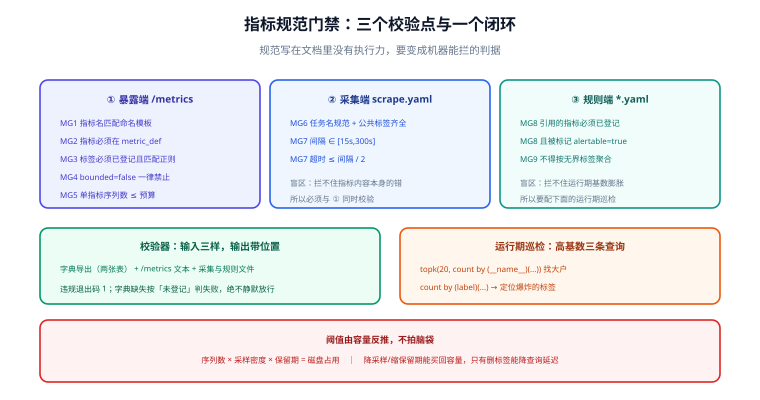

# 规范落地校验门禁：让「命名与标签规范」变成机器能拦的东西

第 123 天把指标命名与标签规范**写成了两张字典表**（`metric_def` / `metric_label_def`），本节要做的是**让它真的生效**：把规范做成一道能拦住错误指标的门禁，并给出高基数（cardinality）爆炸的检测方法。

::: info 本章与第 123 天的分工
第 123 天回答「**规范是什么**」——四层时序模型、基数公式、路径归一、两张字典表；
本章回答「**规范怎么执行**」——在哪三个点校验、每条判据长什么样、违规时怎么拦、基数异常怎么在出事之前发现。
两章合起来才构成「边界一（目标 → 采集）」的完整契约：**前者定义字段，后者定义校验**。
:::

## 为什么必须有门禁

写在文档里的规范**没有执行力**。真实团队里指标失控的路径几乎完全一样：

| 阶段 | 发生什么 | 后果 |
| --- | --- | --- |
| 接入期 | 开发随手加一个 `user_id` 标签，本地看没问题 | 序列数随用户数线性增长 |
| 发布期 | 没人校验，直接上线 | 采集器内存上涨、查询变慢 |
| 爆发期 | 用户量上来后序列数翻十倍 | 采集器 OOM、历史数据被挤掉 |
| 事后 | 发现时已经把磁盘写满 | 只能删数据、加内存，**没有预防** |

这条路径的共同点是：**每一步都是一个可判定的规则，但没有一步被机器检查**。门禁要做的就是把这些规则前移。



## 三个校验点

规范要在**三个位置**分别校验，缺一个都会漏一类问题：

| 校验点 | 校验对象 | 能拦住什么 | 拦不住什么 |
| --- | --- | --- | --- |
| ① 暴露端（业务服务 `/metrics`） | 应用实际输出的指标名与标签 | 代码里写错的指标名、未登记的新指标、高基数标签 | 采集侧配置错误 |
| ② 采集端（采集任务配置） | `scrape_configs` 与目标发现规则 | 任务命名违规、漏加公共标签、抓取间隔与超时越界 | 指标内容本身的问题 |
| ③ 规则端（`recording.yaml` / `alerting.yaml`） | 规则表达式中引用的指标与标签 | 引用不存在的指标、按高基数字段聚合、告警名重复 | 运行期的基数膨胀 |

再加一条**运行期**检查（不是门禁，是巡检）：采集目标的序列数是否越界——这一条对应下面的「高基数检测」。

## 判据清单

门禁的每条判据都必须是**可机械判定**的。本章定稿 MG1~MG9：

| # | 判据 | 校验点 | 级别 |
| --- | --- | --- | --- |
| MG1 | 指标名必须匹配命名模板（`^[a-z][a-z0-9_]*_(total\|seconds\|bytes\|ratio\|count)$` 等）且以单位后缀结尾 | ① | E |
| MG2 | 指标名必须在 `metric_def` 中登记（未登记 = 不许出现） | ① | E |
| MG3 | 标签名必须在 `metric_label_def` 中登记，且取值满足 `value_regex` | ① | E |
| MG4 | `bounded = false` 的标签**禁止出现在任何指标上** | ① | E |
| MG5 | 标签取值集合的估算基数 × 现有组合数 ≤ 单指标序列预算 | ① | E |
| MG6 | 采集任务名匹配 `^[a-z][a-z0-9_-]*$`，且必须带 `env` / `service` 两个公共标签 | ② | E |
| MG7 | 抓取间隔 ∈ [15s, 300s]；单次采集超时 ≤ 间隔的 1/2 | ② | E |
| MG8 | 规则表达式引用的指标名必须全部在 `metric_def` 中、且被标记 `alertable = true` | ③ | E |
| MG9 | 规则里不得出现 `bounded = false` 的标签（除 `by (...)` 的显式聚合白名单外） | ③ | E |

::: warning 为什么全部定成 E（阻断）而不是 W（告警）
这九条都能给出**唯一确定的判定**（要么匹配要么不匹配），不存在「看页面语义才知道算不算问题」的模糊地带。
与第 123 天 `assetweightcheck` 里「500 KB 算不算大」那类**依语义而定**的判据不同：那些只能当线索，这些可以当门禁。
**判据能不能阻断，取决于它是否可机械判定，而不是取决于它重不重要。**
:::

## 校验器怎么实现

校验器是一个**读字典 → 解析目标 → 逐条判定 → 输出位置与退出码**的脚本。它的输入只有三样：

```text
① 字典表导出（metric_def / metric_label_def 的 JSON 导出）
② 目标的 /metrics 文本输出（或采集器的 targets API 快照）
③ 采集配置与规则文件（YAML）
```

输出格式必须**带位置**，否则「报错但不知道改哪儿」会让门禁被绕过：

```text
MG3 E /metrics:app_http_requests_total{user_id="10086"} 
     标签 user_id 未在 metric_label_def 中登记
MG4 E /metrics:app_http_requests_total{path="/api/v1/articles/12345"}
     标签 path 标记为 bounded=false（路径参数未归一）
MG7 E scrape.yaml:job_name=app 采集间隔 10s 低于下限 15s
```

```bash
# 门禁的调用位置：与采集配置、规则文件一起进版本库，在 CI 里跑
python3 scripts/metric_gate.py \
  --dict export/dict.json \
  --metrics http://app:8080/metrics \
  --scrape deploy/scrape.yaml \
  --rules deploy/recording.yaml deploy/alerting.yaml
echo "exit=$?"    # 0 = 全部通过；1 = 存在 E 级（阻断）
```

```python [scripts/metric_gate.py —— 判据 MG2/MG3/MG4 的核心判定]
def check_metric_line(line, dicts):
    name, labels = parse_line(line)
    problems = []

    # MG2：指标名必须已登记
    spec = dicts["metrics"].get(name)
    if spec is None:
        return [("MG2", f"指标 {name} 未在 metric_def 中登记")]

    # MG3：标签必须已登记，且取值符合 value_regex
    for key, value in labels.items():
        lab = dicts["labels"].get(key)
        if lab is None:
            problems.append(("MG3", f"标签 {key} 未登记（指标 {name}）"))
            continue
        if lab["value_regex"] and not re.fullmatch(lab["value_regex"], value):
            problems.append(("MG3", f"标签 {key}={value} 不匹配 {lab['value_regex']}"))

    # MG4：无界标签一律禁止（这是基数爆炸的第一大来源）
    for key in labels:
        if dicts["labels"].get(key, {}).get("bounded") is False:
            problems.append(("MG4", f"标签 {key} 标记为 bounded=false，禁止出现在指标上"))
    return problems
```

::: danger 三个实现纪律
1. **判据要报位置**（文件:行号 或 指标行全文）——只报「有 N 个问题」的门禁会被直接无视。
2. **字典缺失时按「未登记」处理**，不要退化成「跳过校验」：否则字典服务一挂，门禁就静默失效（最危险的失效方向）。
3. **校验器自身要能被自测**：给每条判据至少一个正例与一个反例，且反例必须**恰好**触发该条判据（沿用本仓「失败集合恰好等于期望」的纪律）。
:::

## 高基数检测

门禁管的是「新写进来的」，运行期还要能发现「已经在膨胀的」。三条查询从粗到细：

```text
# ① 谁在贡献序列数：按指标名统计序列数，倒序（先看这个，一眼定位大户）
topk(20, count by (__name__) ({__name__=~".+"}))

# ② 某个指标的标签基数：哪个标签在爆炸
count by (path) (app_http_requests_total)

# ③ 单个标签的取值数量（判断是否无界）
count(count by (path) (app_http_requests_total))
```

| 现象 | 判断 | 处置 |
| --- | --- | --- |
| 某指标序列数 > 预算（如 10 万） | 基数失控 | 回看是哪个标签引入的，按 MG4 处理 |
| 某标签取值数持续增长且无上界 | 无界标签 | 路径参数归一；或降级为日志/追踪字段 |
| 序列数增长但流量没涨 | 维度爆炸（如按用户 ID 打标） | 立即剥离该标签并重建历史 |

::: tip 把「基数」变成有预算的资源
阈值不是拍脑袋定的，而是**由容量反推**：`序列数 × 采样密度 × 保留期 = 磁盘占用`（第 123 天的容量公式）。
所以处置方式也不只有「删标签」一条——降低采样密度、缩短保留期同样能买回容量，但**只有删标签能降低查询延迟**。
:::

## 本日可验证构建步骤

六步，全部可在本机完成（无容器运行时按下表如实标注）：

1. **导出字典**：把 `metric_def` / `metric_label_def` 导出成 `export/dict.json`，确认两个表的行数与第 123 天定稿一致。
2. **写校验器**：按上一节实现 `scripts/metric_gate.py`，含 MG1~MG5（暴露端）五条。
3. **造反例**：手工构造一段含三种违规的 `/metrics` 文本（未登记指标、未登记标签、`bounded=false` 标签），确认三条判据**恰好**各报一次。
4. **接采集端**：把 MG6/MG7 接到 `scrape.yaml`，故意把间隔改成 10s，确认被拦。
5. **接规则端**：把 MG8/MG9 接到 `recording.yaml`，故意引用一个不存在的指标，确认被拦。
6. **接进流水线**：把校验器挂在采集配置变更的 CI 检查里，并跑一次 `echo $?` 确认违规时退出码为 1。

### 判据表

| # | 判据 | 怎么验 | 期望 |
| --- | --- | --- | --- |
| MG-A | 字典导出可读且行数一致 | 比对导出 JSON 与字典表行数 | 完全一致 |
| MG-B | 正例全通过 | 用当前真实 `/metrics` 跑校验器 | exit=0 |
| MG-C | 反例恰好触发对应判据 | 三种违规各造一条 | 三条各报一次、无误报 |
| MG-D | 采集间隔越界被拦 | 间隔改 10s | 报 MG7、exit=1 |
| MG-E | 规则引用不存在指标被拦 | 规则里写 `not_exist_total` | 报 MG8、exit=1 |
| MG-F | 基数查询可复现 | 跑上面三条 PromQL | 返回结果且 topk 稳定 |
| MG-G | 门禁接入流水线 | 在 CI 里改坏配置提 PR | 检查失败、无法合并 |

::: warning 实测列纪律
上表全部是**判据**，不是实测记录。本机若没有可用容器运行时与采集器，实测列一律写 `⏳ 阻塞 + 原因`，
**不把期望值抄进实测列**——这与本项目第 1 周以来的一贯口径一致。
:::

## 当日做了什么

1. 定稿「**规范必须落在三个校验点**」的结构：暴露端、采集端、规则端，并说明任何单点校验的盲区。
2. 把第 123 天的规范草案转成 **MG1~MG9 九条可机械判定的判据**，并论证「为什么它们可以阻断、而体积告警只能当线索」。
3. 给出校验器的实现骨架：输入三样、输出带位置、退出码语义，以及三条实现纪律（报位置 / 字典缺失即未登记 / 自身可自测）。
4. 定稿**高基数检测的三条 PromQL** 与「序列数由容量反推」的阈值口径，明确「降采样/缩保留期/删标签」三种处置的差别。
5. 产出 `metric-gate.svg`，把三个校验点与「校验 → 拦截 → 巡检」的闭环画在一张图上。
6. 给出本日六步可验证构建步骤与 MG-A~MG-G 判据表。

## 如何验证

本日的验证即上面六步与 MG-A~MG-G。核心是两条：

1. **反例必须恰好触发对应判据**（MG-C）——只比「有没有报错」的测试会被别的判据「蒙对」；
2. **字典不可用时必须判失败**（对应实现纪律 2）——把字典文件改名再跑一次，期望是**报错退出**，而不是「全部通过」。

第 2 条是本章最值钱的一条：门禁最危险的失效方式不是「拦得太严」，而是**在依赖缺失时静默放行**。

## 下一步（第 125-127 天）

1. **采集任务与配置**（第 125 天）：服务发现方式、任务分组、抓取失败的处理与告警，落在边界二与失败矩阵 C2 上；本章的 MG6/MG7 直接成为这份配置的验收判据。
2. **查询与规则设计**（第 126 天）：recording rule 与 alerting rule 的划分、评估间隔、抑制与分组，落在边界三与边界四上；本章 MG8/MG9 是它的前置门禁。
3. **接口契约与工程骨架**（第 127 天）：看板数据服务的接口定义与多模块骨架，第 1 周收口。

## 参考资料

- [监控告警专题](/docs/Ops/Monitoring/index.md)：指标类型、抓取模型与告警规则设计的方法论
- [指标模型与保留策略](../MetricModel/index.md)：`metric_def` / `metric_label_def` 两张字典表的定义与容量公式
- [架构细化：组件与接口边界](../Architecture/index.md)：边界一「目标 → 采集」的契约定义
- Prometheus 官方文档 · 命名与标签最佳实践：https://prometheus.io/docs/practices/naming/
- Prometheus 官方文档 · 基数问题：https://prometheus.io/docs/practices/instrumentation/
