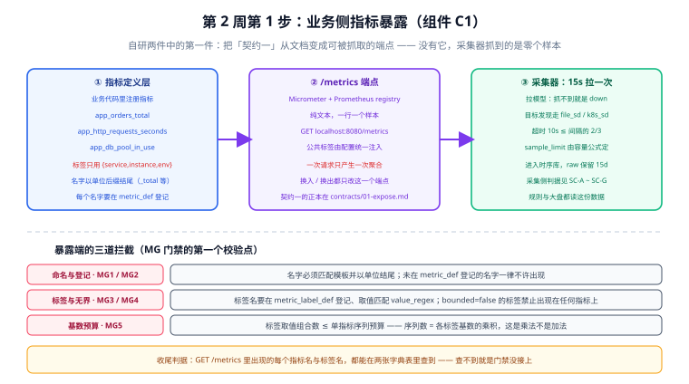

# 指标暴露端点（C1）：让采集器第一次抓到真实样本

第 1 周把「要做什么、分成哪几块、数据长什么样、规范怎么拦、配置与规则怎么写」全部定完了。从今天起进入第 2 周（第 128-134 天）——**核心模块编码**，第一件事是把自研两件里的第一件做出来：**业务侧指标暴露（组件 C1）**。

一句话定位：**前面六天写下的所有判据，都要靠这一个端点才能第一次变成事实。**



::: warning 本项目只有文档，没有代码
下面给出的依赖、配置与代码，是**读者在自己的工程仓库里要建立的东西**。本仓库不存放任何源码、脚本与构建文件；「运行 `xxx`」一律指「先按本节创建好该文件，再执行」。
:::

## 与昨天（第 1 周收口）的分工

| 章节 | 它定什么 | 今天要补的是什么 |
| --- | --- | --- |
| [接口契约与工程骨架](../Contracts/index.md) | 骨架的 8 个一级目录、**契约一（暴露端）的原文** | 把契约一**实现成一个能返回样本的端点** |
| [指标模型与保留策略](../MetricModel/index.md) | 指标命名与标签规范、两张字典表（`metric_def` / `metric_label_def`） | 把字典表里的**前三个指标抄进代码**，并让它们真的出现在 `/metrics` 里 |
| [规范落地校验门禁](../MetricGate/index.md) | MG1~MG9 九条判据、三个校验点 | 让**暴露端这一个校验点第一次跑起来**（MG1~MG5），而不是只写在校验器骨架里 |
| [采集任务配置](../ScrapeConfig/index.md) | `scrape.yaml`、目标发现、抓取失败处置 | 让这份配置**有真东西可抓**——在此之前它抓到的永远是零个样本 |
| [查询与规则设计](../Rules/index.md) | `recording.yaml` / `alerting.yaml` | 让规则里引用的指标名**有真实样本可算** |

**今天的产出边界**：只做**暴露端**。规则加载、告警路由、看板数据接口分别是第 129~134 天的事，本章不碰。

## 为什么第一个编码对象是「暴露端」，而不是「采集器」

直觉上第 2 周应该先搭采集器——毕竟项目叫「监控大盘」，采集器是主角。但顺序其实是被**依赖关系**决定的：

| 理由 | 说明 |
| --- | --- |
| **采集器是现成的，暴露端是自研的** | 第 122 天定死了「自研范围只有两项」——指标暴露（C1）与看板数据服务（C6）。采集器、时序库、规则引擎、可视化都是现成组件，配好就能跑；**今天做的这个端点，是整个项目里为数不多需要自己写的代码** |
| **它是三份下游契约的源头** | 采集端没有样本可抓、规则端没有序列可算、告警端没有条件可判。**先有样本，后面的验证才有对象** |
| **它让第 1 周的文档第一次经受检验** | 命名规范、标签规范、字典表、门禁判据——这些东西写在纸上时都「看起来对」。只有真的注册出一个指标，才会发现「默认指标名 `http_server_requests_seconds` 居然没登记」这类问题 |
| **它是 MG 门禁的第一个校验点** | 暴露端拦内容（命名 / 标签 / 基数），采集端拦配置，规则端拦引用。**校验点写好了不等于跑起来了**，今天才第一次跑 |

::: tip 一句话记住顺序
**永远先让「被监控对象」能被采到，再去配「谁来采」。** 反过来的话，你会在一个空目标上反复调采集配置，把「配置对不对」和「目标有没有数据」两件事混在一起查。
:::

## 三个必须先定死的实现决定

第 1 周没定、今天必须定，而且**定错了第 2 周要返工**的三件事：

| # | 决定 | 结论 | 为什么不能拖 |
| --- | --- | --- | --- |
| 1 | 用哪套客户端库 | **Micrometer + Prometheus registry** | 这决定了指标在代码里长什么样。「先随便埋点、以后再统一」会导致两套埋点风格并存，门禁没法一条命令查完 |
| 2 | 端点路径与格式 | **`/metrics`，Prometheus 文本格式** | 路径写在契约一里（`curl -s localhost:8080/metrics`）。**换路径等于改契约**，不是改配置 |
| 3 | 公共标签从哪来 | **由配置统一注入 `service` / `env`**；`instance` 与 `job` **不注入** | 标签来源一乱，就会出现「同一个服务在不同实例上标签集合不一致」，聚合结果直接分裂 |

::: danger 第 3 条是最容易做错的一个：不要在应用侧注入 `instance` 与 `job`
契约一写的标签集合是 `{service, instance, env}`——那是**最终标签集合**，不是「应用侧要注的三个」。

`instance` 与 `job` 是**采集端（Prometheus）抓取时注入的**。如果应用侧也注一个 `instance`，采集时会撞名，Prometheus 会把你注的那个**重命名为 `exported_instance`**，于是同一个指标出现两套标签形态——**这正好违反契约一的「标签集合固定」**，而且症状很隐蔽：`/metrics` 里看着好好的，进库之后才多出一个 `exported_instance`。

**判据**：全工程搜索应用侧代码里有没有注入 `instance` / `job`，有命中即为缺陷。
:::

## 指标定义层：把字典表抄进代码

第 123 天定稿的 `metric_def` / `metric_label_def` 是**治理表**，今天要把前三个指标落到代码里。先明确名字与类型的对应关系（这是 MG1 的判定依据）：

| 命名后缀 | Prometheus 类型 | 语义 | 例 |
| --- | --- | --- | --- |
| `_total` | Counter | 只增不减的累计计数 | `app_orders_total` |
| `_seconds` | Histogram / Summary | 耗时分布 | `app_http_requests_seconds` |
| `_bytes` | Gauge | 当前占用大小 | `app_jvm_heap_used_bytes` |
| `_count` | Gauge | 当前个数（可增可减） | `app_db_pool_in_use` |
| `_ratio` | Gauge | 0~1 的比例 | `app_cache_hit_ratio` |

今天落地的三个指标（与 `metric_def` 逐字一致）：

| 指标名 | 类型 | 单位 | 标签 | 负责人 | 说明 |
| --- | --- | --- | --- | --- | --- |
| `app_orders_total` | Counter | 次 | `result` ∈ {created, failed} | 订单组 | 按结果拆分的下单次数 |
| `app_http_requests_seconds` | Histogram | 秒 | `method`、`status_class`、`route`（**模板，不是实际路径**） | 平台组 | HTTP 请求耗时 |
| `app_db_pool_in_use` | Gauge | 个 | —— | 平台组 | 数据库连接池当前占用数 |

对应的标签登记（`metric_label_def` 摘录）：

| 标签名 | bounded | value_regex | 说明 |
| --- | --- | --- | --- |
| `result` | true | `^(created\|failed)$` | 取值域固定两个 |
| `method` | true | `^(GET\|POST\|PUT\|DELETE\|PATCH)$` | HTTP 方法 |
| `status_class` | true | `^[1-5]xx$` | **按类聚合**，不是具体状态码 |
| `route` | true | `^/[a-z0-9_/{}:.-]*$` | **路由模板**（`/api/orders/{id}`），不是实际路径 |
| `user_id` | **false** | —— | 无界，**禁止出现在任何指标上**（MG4） |

::: tip `route` 与 `path` 的差别是本章最值钱的一条
`route` 取的是**路由模板**（`/api/orders/{id}`），全站条数是个位数；`path` 取的是**实际路径**（`/api/orders/12345`），条数等于**被访问过的订单数**。

把 `path` 当标签，一个 10 万单的站点就是 10 万个序列——这不是性能问题，是**成本与可用性问题**：序列数失控会先把时序库的内存吃掉。

**判据（MG4）**：任何标记为 `bounded = false` 的标签，只要出现在指标上就判 E 级、直接阻断。
:::

## 实现：`/metrics` 端点

### 依赖

```xml [app/pom.xml]
<!-- 版本由 Spring Boot BOM 统一管理，不要手写 version -->
<dependency>
  <groupId>org.springframework.boot</groupId>
  <artifactId>spring-boot-starter-actuator</artifactId>
</dependency>
<dependency>
  <groupId>io.micrometer</groupId>
  <artifactId>micrometer-registry-prometheus</artifactId>
</dependency>
```

### 配置：端点路径与公共标签

```yaml [app/src/main/resources/application.yml]
management:
  endpoints:
    web:
      base-path: /            # 把它挂到根路径，端点就是 /metrics 而不是 /actuator/metrics
      exposure:
        include: metrics, health
      path-mapping:
        prometheus: metrics   # 端点 id 仍是 prometheus，对外路径改为 /metrics（契约一）
  metrics:
    tags:
      service: ${SERVICE_NAME}   # 值来自环境变量，结构（标签名）留在仓库
      env: ${ENV}
  prometheus:
    metrics:
      export:
        enabled: true
```

::: info 为什么 `base-path` 与 `path-mapping` 要一起改
Spring Boot 的 Actuator 默认把 Prometheus 端点暴露在 `/actuator/prometheus`。契约一写死的是 `/metrics`——**契约是跨组件的约定，不能因为框架默认叫什么就改契约**。

但请注意：改的是**路径**，不是**指标名**。端点地址与指标名是两件事，前者由这里决定，后者由代码与字典表决定。
:::

### 指标定义：把名字写死在定义处，不让调用方传字符串

```java [app/metrics/src/main/java/com/example/monitoring/metrics/OrderMetrics.java]
package com.example.monitoring.metrics;

import io.micrometer.core.instrument.Counter;
import io.micrometer.core.instrument.MeterRegistry;
import org.springframework.stereotype.Component;

@Component
public class OrderMetrics {

    private final Counter created;
    private final Counter failed;

    public OrderMetrics(MeterRegistry registry) {
        // 名字与标签取值都写死在定义处：
        // 调用方只调 onCreate()/onFail()，传不进任何字符串 —— 这是「调用方无法制造高基数」的结构性保证
        this.created = Counter.builder("app_orders_total")
                .tag("result", "created")
                .description("订单创建次数（按结果分）")
                .register(registry);

        this.failed = Counter.builder("app_orders_total")
                .tag("result", "failed")
                .description("订单创建次数（按结果分）")
                .register(registry);
    }

    public void onCreate() {
        created.increment();
    }

    /**
     * 注意参数没有进标签：失败原因只用于日志与告警说明，
     * 若把 reason 原文当标签，取值域就等于「所有可能的错误消息」（无界）。
     */
    public void onFail() {
        failed.increment();
    }
}
```

```java [app/metrics/src/main/java/com/example/monitoring/metrics/PoolMetrics.java]
package com.example.monitoring.metrics;

import io.micrometer.core.instrument.Gauge;
import io.micrometer.core.instrument.MeterRegistry;
import org.springframework.stereotype.Component;

import javax.sql.DataSource;

@Component
public class PoolMetrics {

    public PoolMetrics(MeterRegistry registry, DataSource dataSource) {
        // Gauge 表示「当前值」，可增可减；不要用 Counter 记占用数（Counter 只增不减）
        Gauge.builder("app_db_pool_in_use", dataSource, PoolMetrics::inUse)
                .description("数据库连接池当前占用连接数")
                .register(registry);
    }

    private static double inUse(DataSource ds) {
        // 具体取值方式取决于连接池实现（HikariCP 的 getActiveConnections）
        return ((com.zaxxer.hikari.HikariDataSource) ds).getHikariPoolMXBean().getActiveConnections();
    }
}
```

### HTTP 指标：默认名不满足契约，必须处理

Spring Boot 会**自动**为每个请求记录 `http_server_requests_seconds`。它是一份「白送的指标」，但直接放进监控会有两个问题：

| 问题 | 后果 | 处理 |
| --- | --- | --- |
| 名字不是契约约定的 `app_http_requests_seconds` | 大盘与告警里出现两种命名风格；团队开始怀疑「到底哪套算数」 | 统一改名，或**把它登记进 `metric_def`**（二选一，但要选一个并写进字典表） |
| 默认标签含 `uri`（可能是实际路径） | 若 `uri` 是模板则安全，若被当成实际路径就引入高基数 | 与 `route` 对齐，确认它取的是**模板**；否则重命名为契约里的 `route` |

```java [app/metrics/src/main/java/com/example/monitoring/metrics/MetricsConfig.java]
package com.example.monitoring.metrics;

import io.micrometer.core.instrument.config.MeterFilter;
import org.springframework.context.annotation.Bean;
import org.springframework.context.annotation.Configuration;

@Configuration
public class MetricsConfig {

    /**
     * 把框架默认指标名改成契约约定的名字。
     * MG2「未登记即不许出现」的判据不会因为它是框架白送的而放行 ——
     * 所以这里改名与登记必须二选一，不能两不管。
     */
    @Bean
    MeterFilter renameHttpServerRequests() {
        return MeterFilter.map("http.server.requests", name -> "app_http_requests_seconds");
    }
}
```

::: warning 这一段的具体写法请对照你所用版本的官方文档
Spring Boot 与 Micrometer 的小版本迭代很快，`management.*` 属性键与 `MeterFilter` 的 API 名在不同版本间有过调整。**本节的目的是说明「默认名与契约冲突、必须显式处理」这件事**，具体键名请以你当前版本的行为为准（对照 `application.yml` 的配置元数据或官方文档）。

一条不会错的兜底判据：**改完之后跑一次门禁，MG2 不报未登记、且 `/metrics` 里同时出现新旧名字，就说明改名没生效。**
:::

## 高基数：同一件事必须在三个位置各拦一次

高基数标签是监控系统最常见的自伤方式，而它**不是靠一处检查能拦住的**。今天要建立的是「三个位置各拦一次」的完整链路：

| 位置 | 拦什么 | 判据 | 拦不住什么 |
| --- | --- | --- | --- |
| **业务代码**（定义处） | 让调用方**传不进**可变字符串 | 指标构造只出现在 `metrics/` 包内，业务代码只调方法 | 有人绕过统一类自己 `Counter.builder(...)` |
| **端点输出**（`/metrics`） | 实际出现的标签值是否越界 | MG3：标签值匹配 `value_regex` | 值合法但组合数爆炸（如 `route` × `status_class` × `result`） |
| **门禁脚本**（`check-metrics.sh`） | 登记缺失与基数预算 | MG2 / MG5：未登记即阻断、组合数 ≤ 预算 | 运行期动态出现的未登记标签（需要巡检兜底） |

::: danger 三个位置缺一个，就有一类高基数能漏进来
- 只有**代码约定**：新人加一个 `traceId` 标签，评审没看出来就上线了；
- 只有**端点校验**：等发现时**指标已经写进时序库了**——基数爆炸的代价（内存、成本）已经产生；
- 只有**门禁脚本**：它跑在 CI 里，拦得住「提交进来的」，拦不住「运行期才出现的」。
:::

## 与 MG 门禁对接：让它第一次真的跑起来

第 124 天写好了 `scripts/metric_gate.py`（MG1~MG5，暴露端五条）。今天要做的是**让它有对象可查**：

```shell [scripts/check-metrics.sh（读者工程内）]
#!/usr/bin/env bash
# 暴露端门禁的调用入口（第 124 天定稿的校验器的封装）
set -euo pipefail

# ① 抓一次当前端点输出（采集器抓什么，门禁就查什么）
curl -sf localhost:8080/metrics > /tmp/metrics.txt

# ② 跑 MG1~MG5（暴露端五条）
python3 scripts/metric_gate.py --expose /tmp/metrics.txt \
  --metric-def  sql/seed/metric_def.csv \
  --label-def   sql/seed/metric_label_def.csv

# 期望：MG1~MG5 全 PASS，exit=0
```

::: tip 第一次运行大概率会红——这是好事
第 124 天登记的是**你自己定义的三个指标**，而 `/metrics` 里还有框架白送的几十个（JVM、线程池、HTTP）。**门禁第一次跑几乎一定会报「未登记」**，这恰好证明了门禁是活的，而不是一个恒真断言。

正确做法不是放宽门禁，而是**两条路选一条**：
1. **纳入治理**：把需要长期观察的默认指标逐个登记进 `metric_def`（附单位与负责人）；
2. **显式排除**：在门禁里维护一份「默认指标白名单」，并写明理由与豁免期限。

**不能做的**是把 MG2 改成警告——一旦它不阻断，它就不再是一门门禁，而是一条评论。
:::

## 验收判据 EP-A ~ EP-H

本章的断言编号为 `EP-*`（Endpoint），与第 124 天的 `MG*`、第 125 天的 `SC-*` 并列，不重复。

| 编号 | 断言 | 怎么测 | 预期 | 状态 |
| --- | --- | --- | --- | --- |
| EP-A | `/metrics` 可访问且是文本格式 | `curl -s -o /dev/null -w '%{http_code} %{content_type}\n' localhost:8080/metrics` | `200 text/plain` | ⏳ 未跑（见下） |
| EP-B | 自定义指标已出现且有值 | `curl -s localhost:8080/metrics \| grep '^app_orders_total{'` | 至少两行（`result=created` / `result=failed`） | ⏳ 未跑 |
| EP-C | 标签集合固定，无多余标签 | 取 `app_orders_total` 的标签名并去重 | 只有 `result` + 公共标签；**无 `exported_instance`** | ⏳ 未跑 |
| EP-D | 高基数标签未进来 | `curl -s localhost:8080/metrics \| grep -E '(user_id\|order_id\|trace_id\|path)='` | 无命中 | ⏳ 未跑 |
| EP-E | 门禁 MG1~MG5 全 PASS | `scripts/check-metrics.sh` | exit=0 | ⏳ 未跑 |
| EP-F | 应用侧未注入 `instance` / `job` | `grep -rnE '"(instance\|job)"' app/`（排除测试） | 无命中 | ✅ 静态可判 |
| EP-G | 指标构造只出现在 `metrics/` 包内 | `grep -rln 'MeterRegistry\|Counter.builder' app/ \| grep -v '/metrics/'` | 无输出（或仅在 `MetricsConfig`） | ✅ 静态可判 |
| EP-H | 未登记的默认指标已被处置（登记或显式排除） | 对门禁输出逐条核对：每条未登记项都有登记或排除记录 | 未处置项 = 0 | ⏳ 未跑 |

::: warning 实测列纪律（本项目的固定口径）
上表「状态」列**不是实测记录**，而是**当前可执行性的如实标注**：

- 涉及**动态验证**的项（EP-A ~ EP-E、EP-H）标 `⏳ 未跑`，原因有两条且都在本机可复核——**① 本仓不含工程代码**（`project/` 是纯文档目录，读者需先在自己的工程里建好文件）；**② 本机 JDK 为 17，与工程基线（Java 25 / Spring Boot 4.1）不一致**，无法直接起服务。
- 涉及**文件内容静态判定**的项（EP-F、EP-G）在文件建好后即可在本机执行，故标 `✅ 静态可判`。

**不要把期望值抄进状态列**——那是把判据伪装成结论。第 1 周的 `W1-*` 采用同一口径。
:::

## 当日做了什么

1. 明确第 2 周的**编码起点是暴露端（C1）而不是采集器**，并给出四条依赖理由（现成 vs 自研、下游契约的源头、让第 1 周的文档第一次经受检验、门禁的第一个校验点）。
2. 定死本章的**三个实现决定**：Micrometer + Prometheus registry、端点固定为 `/metrics`、公共标签只注入 `service` / `env`。
3. 把第 123 天的字典表**抄进代码**——三个指标（`app_orders_total` / `app_http_requests_seconds` / `app_db_pool_in_use`）与五条标签登记，逐个给出类型、单位、标签与负责人。
4. 写出**端点实现**：依赖、`application.yml`（`base-path` + `path-mapping` 把端点落到 `/metrics`）、指标定义类、连接池 Gauge，以及处理框架默认指标名与契约冲突的 `MeterFilter`。
5. 建立**高基数的三个拦截位置**（业务代码 / 端点输出 / 门禁脚本），并逐条说明各自拦不住什么——**缺一个位置就有一类高基数能漏进来**。
6. 把 `check-metrics.sh` 与第 124 天的校验器接起来，并预先说明「第一次运行大概率报未登记」**是门禁活着的证据**，给出「纳入治理 / 显式排除」两条正确处置与一条禁止的处置。
7. 产出 `EP-A ~ EP-H` 判据表与 `metrics-endpoint.svg`，并按本项目口径标注实测列。

## 如何验证

**第一组：本机可跑的静态判定（文件建好后即可执行）**

```shell
# ① 应用侧没有注入 instance / job（这两个由采集端注入，注了会被改名成 exported_instance）
grep -rnE '"(instance|job)"' app/ --include='*.java' | grep -v test || echo "OK: 无重复注入"

# ② 指标构造集中在 metrics/ 包（业务代码不自己 builder）
grep -rln 'Counter.builder\|MeterRegistry' app/ --include='*.java' | grep -v '/metrics/' \
  && echo "WARN: 存在绕过统一指标类的构造" || echo "OK: 集中在 metrics/"

# ③ 端点路径与契约一致（期望命中 path-mapping 的 prometheus: metrics 一行）
grep -n 'path-mapping' -A1 app/src/main/resources/application.yml
```

**第二组：需要可运行工程的动态判定（读者在自建工程内执行）**

```shell
# 起服务（读者工程）
mvn -q spring-boot:run

# ① 端点可访问、格式正确（EP-A）
curl -s -o /dev/null -w '%{http_code} %{content_type}\n' localhost:8080/metrics
# 判读：200 且 text/plain；404 说明 base-path/path-mapping 没配对

# ② 自定义指标出现（EP-B）—— 先制造一次业务动作再抓
curl -s localhost:8080/metrics | grep '^app_orders_total{'

# ③ 标签集合固定（EP-C）：取第一行的标签名去重，期望没有 exported_instance
curl -s localhost:8080/metrics | grep '^app_orders_total{' | head -1

# ④ 高基数没进来（EP-D）：期望无命中
curl -s localhost:8080/metrics | grep -E '(user_id|order_id|trace_id|path)=' || echo "OK: 无高基数标签"

# ⑤ 门禁全绿（EP-E）
scripts/check-metrics.sh
```

| 组 | 覆盖判据 | 关键判读 |
| --- | --- | --- |
| 第一组 | EP-F / EP-G | 这两条**不需要起服务**，是「结构性保证」的判据——代码形态对了，高基数在源头就写不出来 |
| 第二组 | EP-A ~ EP-E、EP-H | ③ 与 ④ 要一起看：**标签集合固定**（③）与**取值无高基数**（④）是两回事，前者防「标签形态分裂」，后者防「序列数爆炸」 |

## 下一步

- **第 129 天**：**看板数据服务（组件 C6）**——自研两件里的第二件。它要回答的是「大盘上的每个数字，用哪条查询算出来、多久刷新一次、缓存多久」。
- 第 130~134 天依次推进：规则文件的加载与热更新、告警路由与通知渠道联调、大盘数据接口与三张大盘的组织、第 2 周收口（**验收：服务可启动、接口可调用、页面可访问**）。

## 参考资料

- [接口契约与工程骨架](../Contracts/index.md)：契约一的正本与 `W1-*` 收口清单
- [指标模型与保留策略](../MetricModel/index.md)：`metric_def` / `metric_label_def` 两张字典表的来源
- [规范落地校验门禁](../MetricGate/index.md)：MG1~MG9 与 `metric_gate.py` 的实现骨架
- [采集任务配置](../ScrapeConfig/index.md)：抓取间隔、超时、保留期与目标发现
- 理论基座：[监控告警专题](/docs/Ops/Monitoring/index.md)（指标类型与抓取模型的方法论）
- [云上架构 · 云上安全边界](/docs/Ops/CloudArchitecture/Security/index.md)：暴露端**不能对公网开放**——`/metrics` 会泄漏全部内部指标名，属架构层暴露面
