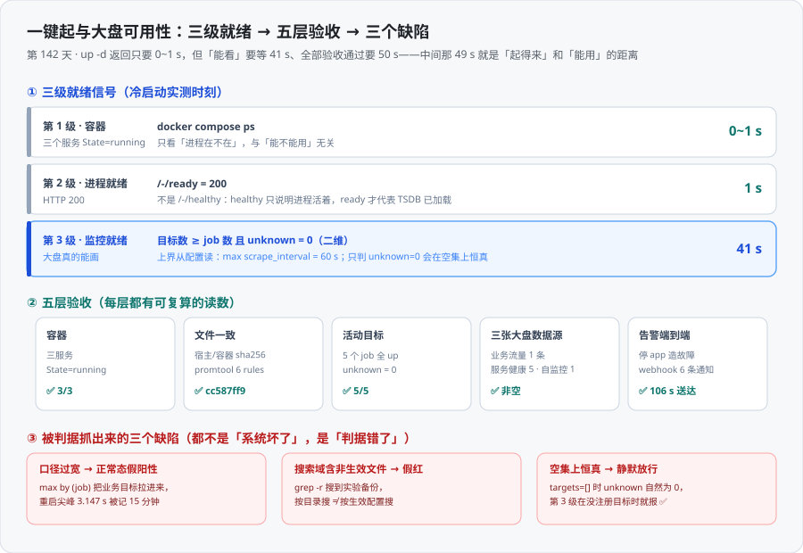

# 一键起与大盘可用性

一句话定位：**把「一条命令起全栈」做成可验收的产物**——不是写下 `docker compose up -d` 就算完，而是回答「返回之后还有什么没完成、每张大盘的数据源到底有没有数、告警到底会不会响」。本轮在沙盒里把冷启动、五层验收、一次完整的故障注入到恢复闭环全部实跑，并把 **三条判据自己的缺陷**抓了出来。



::: tip 一句话理解
**`up -d` 返回只要 0~1 秒，但从那一刻到「大盘真的能画出全部曲线」还要 41 秒，到「五层验收全过」要 50 秒。** 这 49 秒不是启动慢，而是**采集周期**——最慢的那个 job（本沙盒是 `edge-services / 60s`）决定了「所有曲线都有点」的最早时刻。把这段等待写进脚本、把上界从配置里读出来，是「一键起」从口令变成产物的分界线。
:::

## 一、为什么「起得来」不等于「能看」

`docker compose up -d` 的返回值只承诺一件事：**容器已被创建并启动**。它不承诺 Prometheus 的 HTTP 端口能应答，更不承诺任何目标完成过抓取。本轮的实测把这三件事的**距离**量成了数：

| 观测点 | 实测时刻（冷启动） | 与 `up -d` 的间隔 |
| --- | --- | --- |
| `docker compose up -d` 返回 | **0~1 s** | — |
| 三服务 `State=running` | 0~1 s | 0 s |
| `/-/ready` = 200 | **1 s** | 0~1 s |
| 5 个目标全部完成首次抓取 | **41 s** | **40 s** |
| 告警自检全绿（一键起脚本退出） | **50 s** | **49 s** |

也就是说：**一个把判据写成「`up -d` 之后 `/-/ready` 返回 200 即通过」的验收脚本，会在监控还没就绪时就通过**。它会在第 1 秒就宣布成功，而那时 `edge-services` 连一次抓取都还没做过——第三张大盘上「目标存活数」的那条曲线是空的。

::: warning 「起栈耗时」这个词有两个所指，混用会让验收数字好看一半
- **起栈耗时（Compose 口径）**：`down` + `up -d`，实测 **2 s**（`down` 1 s、`up -d` 1 s）
- **可用耗时（用户口径）**：从一条命令到「五层验收通过」，实测 **50 s**

两个数都真实，但**只有第二个能交**。文档里写「起服务只要 2 秒」在技术上是真的，在交付上是误导——因为拿到那条命令的人会在第 3 秒打开大盘，然后看到一张空图。
:::

## 二、三级就绪信号

把「就绪」拆成三级，是因为**三级的失败形态完全不同**，用一条判据盖住会漏掉两级。

### 2.1 第 1 级：容器在跑

```shell
docker compose ps --format '{{.Name}}  {{.State}}'
```

期望三个服务 `State=running`。失败形态是 `Exit 0` / `Exit 1` / `Restarting`——**这一级几乎不会骗人**，因为容器状态是 Compose 直接维护的。

它的问题不是不准，而是**太弱**：一个容器可以 `running` 而里面的进程正在死循环刷日志、端口不通、配置加载失败后仍不退出（Prometheus 在配置解析失败时会直接退出，但别的服务不一定）。

### 2.2 第 2 级：进程就绪

```shell
curl -s -o /dev/null -w '%{http_code}' http://localhost:19090/-/ready   # 期望 200
```

口径上要选 `/-/ready` 而不是 `/-/healthy`：

- `/-/healthy` 回答的是「**进程活着吗**」
- `/-/ready` 回答的是「**能服务查询吗**」——它要等 TSDB 完成 WAL replay、监听端口就绪

::: warning 本轮实测：这一条**没有产生可观测差异**
沙盒里 `/-/healthy` 与 `/-/ready` 在**同一秒**都返回 200（TSDB 数据已存在、WAL replay 极快，1 s 内两个都过）。所以「用 `ready` 而不是 `healthy`」这条在本轮**不是靠实测立住的，是靠语义立住的**——它防的是「TSDB 还在 replay 时 healthy 已经 200」这个场景，而这个场景在本地小 TSDB 上出现不了。

如实登记这一点，比把「两者都是 200」写成「差异被验证」要诚实。**判据的差异只有在特定输入下才显现**，而「本轮输入触发不了它」和「这个判据没用」是两件事。
:::

### 2.3 第 3 级：监控就绪（唯一有等待上界的一级）

这一级的判据必须是**二维**的：

```shell
# 目标数 >= job 数  AND  unknown 的个数 == 0
curl -s "$BASE/api/v1/targets?state=active" | jq -r '
  .data.activeTargets as $t
  | "\($t|length) \([$t[]|select(.health=="unknown")]|length)"'
```

等待上界**从配置里读**，不写死：

```shell
MAXI=$(grep -E 'scrape_interval:' prometheus/prometheus.yml | sed 's/[^0-9]//g' | sort -n | tail -1)
EXPECT=$(grep -c -- '- job_name:' prometheus/prometheus.yml)
```

本沙盒的两个值：`MAXI = 60`（`edge-services`）、`EXPECT = 5`（5 个 job）。

| 为什么是二维 | 本轮反例 |
| --- | --- |
| **只判 `unknown == 0` 会在空集上恒真** | 冷启动时 `activeTargets` 还是 `[]`，`unknown` 个数自然是 **0**，判据当场判「监控已就绪」——而此时**一个目标都没注册** |
| **`EXPECT` 不能用 `- targets:` 行数** | 那样会把 `alerting.alertmanagers` 里那条 `- targets: ["alertmanager:9093"]` 也数进来（本轮实测期望值算成 **6**），于是判据**永远等不满**，假红到超时 |

这两条都不是推测，是本轮脚本的**第一版和第二版**分别踩的（详见第六节）。

## 三、一键起实测

沙盒里固化成 `bin/one-click-up.sh`：起栈 → 三级等待 → 告警自检。冷启动（`compose down` 之后，容器已全部移除）实测输出：

```text
=== 第 0 步：起栈 ===
   up -d 返回于 0 s
=== 第 1 级：容器状态 ===
 monitoring-min-alertmanager-1  running
 monitoring-min-app-1  running
 monitoring-min-metrics-collector-1  running
=== 第 2 级：HTTP 就绪（/-/ready，不是 /-/healthy）===
   ✅ /-/ready = 200（等了 1s）
=== 第 3 级：监控就绪（期望 5 个目标；上界 = max scrape_interval = 60s）===
   ✅ 5 个目标（下界 5）全部完成首次抓取（等了 41s）
   ✅ 全部目标 health=up
=== 验收：告警自检 ===
 ... 全绿 ✅
=== 一键起完成：总耗时 50 s ===
```

**为什么等了 41 s 而不是 60 s**：60 s 是**上界**，不是**期望值**。`edge-services` 的抓取相位取决于容器启动时刻落在它的排期里的哪一段——它可能刚起就被抓，也可能要等满一个周期。所以判据必须写成「等它，最多等 60 s」，而不是「等 60 s」。

::: tip 三级之间的 40 秒差是「采集周期」而不是「启动开销」
把 5 个 job 的间隔列出来就清楚了：

| job | `scrape_interval` | 首次抓取最晚时刻 |
| --- | --- | --- |
| `app-counter` | 5 s | 5 s |
| `core-services` | 15 s | 15 s |
| `kubernetes-pods` | 15 s | 15 s |
| `prometheus`（自采集） | 15 s | 15 s |
| **`edge-services`** | **60 s** | **60 s** |

上界由**最慢的那个**决定，而它恰好是一个业务上不重要的边缘服务。**「阈值取最慢的那个」这件事本身要写进脚本、也要写进文档**，否则下一个人会把它当成「莫名其妙要等一分钟」。
:::

### 3.1 幂等性

同一份 `compose.yaml` 连续跑两次 `up -d`：

```text
 Container monitoring-min-alertmanager-1  Running
 Container monitoring-min-app-1  Running
 Container monitoring-min-metrics-collector-1  Running
```

三个容器全部报 `Running`，**没有 `Recreated`**。这说明「一键起」可以作为**日常操作**重复执行，不会每次重建容器、不会打断正在抓取的 TSDB 进程。

### 3.2 不丢历史

`docker compose down` 默认**不删 named volume**，所以 TSDB 数据保留。实测用两个量证明：

| 指标 | `down`/`up` 之前 | 三次 `down`/`up` 之后 | 读法 |
| --- | --- | --- | --- |
| `prometheus_tsdb_head_series` | 1006 | **1057** | **单调上升**（新序列在加，没有归零重建） |
| `prometheus_tsdb_lowest_timestamp_seconds` | 1791923088 | **1791923088** | **一个数都没变**：最老的那个点还在 |
| `count_over_time(up[6h:5m])` | — | **72** | 正好 `6h ÷ 5m = 72`，6 小时回看里一个采样点都不缺 |

`lowest_timestamp` 是这三个里最有说服力的一个：它**不会因为重启而上升**，所以「重启后它没变」= 「历史没有被截断」。

## 四、五层验收

### 4.1 第 1 层：文件一致（配置真的被容器读到了）

第 138 天已经证明「宿主写文件 + 立刻 reload」是一次竞态——**`200` + 日志 `Completed loading of configuration file`，但规则一条没换**。所以改完配置的落地顺序是固定的：

```shell
# 1) 语法（用 promtool，不用肉眼）
docker exec <collector> promtool check rules /etc/prometheus/alerting.yaml /etc/prometheus/recording.yaml
# 2) 指纹回读：宿主和容器读到的是同一份
H=$(shasum -a 256 prometheus/alerting.yaml | cut -c1-16)
I=$(docker exec <collector> sha256sum /etc/prometheus/alerting.yaml | cut -c1-16)
# 3) 才允许 reload
curl -s -X POST http://localhost:19090/-/reload
```

实测：

```text
SUCCESS: 6 rules found        # alerting.yaml
SUCCESS: 3 rules found        # recording.yaml
宿主 sha256[:16] = cc587ff9383a884e
容器 sha256[:16] = cc587ff9383a884e
reload -> HTTP 200
回读规则名集合 = CollectorScrapeSlow, HighErrorRate, ServiceDown,
                TSDBRetentionSizeTriggered, TargetDown, TargetScrapedZeroSamples
```

::: danger 「条数一致」不够，要比规则名的集合
第 138 天的 `RR-D` 用的是条数，实测发现**规则改名时条数完全一样**。所以回读那一步要取**规则名集合**再比对——它同时是竞态的兜底：竞态的表现正是「reload 成功但什么都没换」，而集合比对会当场发现。
:::

### 4.2 第 2 层：活动目标

```text
  app-counter/host.docker.internal:8082  health=up
  core-services/app:8080                 health=up
  edge-services/app:8080                 health=up
  kubernetes-pods/app:8080               health=up
  prometheus/localhost:9090              health=up
  合计=5  非up=0  unknown=0
```

`app-counter` 指向宿主 `8082`（要用 `host.docker.internal`），其余四个指向容器网络里的服务。**`health` 的第三个取值 `unknown` 必须单独统计**——它既不是 up 也不是 down，是「还没抓过」，而它恰恰是冷启动最常见的那一个。

### 4.3 第 3 层：三张大盘的数据源

三张大盘各自取一条核心指标，逐一确认**有数**：

| 大盘 | 数据源表达式 | 实测条数 |
| --- | --- | --- |
| 第一张 · 业务流量 | `sum(rate(http_requests_total[5m]))` | 1 |
| 第二张 · 服务健康 | `job:target_up:count`（recording 产物） | 5 |
| 第三张 · 自监控 | `prometheus_tsdb_head_series` | 1 |

第三张的这条是第 140 天 `RC-4` 的直接验收点：**在 `prometheus` 自采集 job 加进来之前，`prometheus_tsdb_*` 一个都没有，第三张大盘的数据源是空的**。本轮它返回 `1057`，说明自监控这条防线自己有了数据源。

::: warning 「大盘能打开」和「大盘有数」是两件事
`panels.yaml` 里有 5 个面板，其中两个是**故意查不到序列的探针**（`overview_zero_probe` 用特殊常量 `ZERO`、`nonexistent_metric` 查一个不存在的指标名）。它们的存在让「面板配置合法」能通过而不代表「面板有数据」。

所以这一层的判据不能是「面板数 == 5」，必须是**三个关键表达式各自返回非空**。
:::

### 4.4 第 4 层：告警端到端——真的响一次

**「规则写好了」和「告警能响」之间隔着 Prometheus 评估、Alertmanager 路由、抑制、通知渠道四段。** 本轮用一次真实的故障注入把这条链跑通。

注入动作：`docker stop monitoring-min-app-1`（三个 job 共用这个容器）。

时间线（全部实测）：

| 时刻 | 事件 | 距注入 |
| --- | --- | --- |
| 13:13:47 | `docker stop app` | t=0 |
| 13:14:00 | 首次抓到 `up=0`，规则进 **pending** | +13 s |
| 13:14:47 | `for: 1m` 到期，`ServiceDown` → **firing** | +60 s |
| 13:15:33 | Alertmanager `group_wait: 30s` 到期，**推送 firing** | **+106 s** |
| 13:17:20 | `TargetDown` 的 `for: 3m` 到期 → **被抑制** | +213 s |
| 13:17:27 | `docker start app`（恢复） | +220 s |
| 13:18:30 | 全部规则回 **inactive** | +283 s |
| **13:20:33** | **`resolved` 通知送达** | **+406 s** |

**只做了 9 个观测点，其中两个数最值钱**：

**① 从故障到「有人知道」= 106 s。** 其中 `for: 1m`（60 s）+ `group_wait: 30s`（30 s）+ 抓取间隔（≤15 s）≈ 105 s，实测 106 s 与预算吻合。**这两个等待时长不是开销，是交付物的一部分**——它们决定了值班人被叫醒的最早时刻，也决定了重复抖动会不会变成告警风暴。

**② 从恢复到「有人知道好了」= 406 s，其中系统只用了 63 s。** 系统在 13:18:30 就全部恢复了，但 `send_resolved: true` **不保证 resolved 立刻发**——Alertmanager 受 `group_interval: 5m` 约束，同一组的两次通知之间至少隔 5 分钟。上次推送在 13:15:33，所以 resolved 最早只能等到 13:20:33。

::: danger 抑制规则的表现：6 条告警只送 3 条通知
`docker stop app` 造成的后果是**两个维度**的：`ServiceDown`（整组不可用）× 3 个 job，`TargetDown`（单个目标抓不到）× 3 个 job = **6 条告警**。

实测在 Alertmanager 侧：

```text
ServiceDown  job=core-services    state=active      inhibitedBy=0
ServiceDown  job=edge-services    state=active      inhibitedBy=0
ServiceDown  job=kubernetes-pods  state=active      inhibitedBy=0
TargetDown   job=core-services    state=suppressed  inhibitedBy=1
TargetDown   job=edge-services    state=suppressed  inhibitedBy=1
TargetDown   job=kubernetes-pods  state=suppressed  inhibitedBy=1
```

**通知总数 = 3**（webhook 侧账本，`firing | ServiceDown | job=... x1`，三个 job 各一条）。

`TargetDown` 没有消失——它在 Alertmanager 里是 `suppressed` 状态、`inhibitedBy=1`，**看得见但不叫人**。这正是分层告警要的形态：**信息保留、噪音去掉**。如果抑制规则没生效，一次部署后的容器重启会让值班人收到 6 条而不是 3 条通知，其中 3 条只是在复述同一件事。
:::

### 4.5 通知账本（可复算）

webhook 接收器把每次通知落盘，最终账本：

```text
通知总数 = 6
  firing    | ServiceDown | job=core-services    x1
  firing    | ServiceDown | job=edge-services    x1
  firing    | ServiceDown | job=kubernetes-pods  x1
  resolved  | ServiceDown | job=core-services    x1
  resolved  | ServiceDown | job=edge-services    x1
  resolved  | ServiceDown | job=kubernetes-pods  x1
```

**3 条 firing + 3 条 resolved = 6**，与「6 条告警、3 个分组、一次闭环」完全吻合。账本是判据「通知条数 == 分组数 × 2（firing + resolved）」的直接证据。

## 五、判据抓出来的三个缺陷

本章最有价值的部分不是「跑通了」，而是**三个判据在自己的第一版就错了，且三次都不是「系统坏了」，是「判据错了」**。

### 5.1 口径过宽：告警在正常态就是 pending

新挂的自监控告警 `CollectorScrapeSlow` 第一版写的是：

```shell
max by (job) (max_over_time(scrape_duration_seconds[15m])) > 1
```

**它在正常态进 pending**，实测逐 job 的 15 分钟峰值：

| job | 15m 峰值 | 当前值 |
| --- | --- | --- |
| `kubernetes-pods` | **3.147 s** | 0.0039 s |
| `app-counter` | **1.920 s** | 0.0014 s |
| `core-services` | **1.084 s** | 0.0048 s |
| `edge-services` | 0.438 s | 0.438 s |
| `prometheus` | 0.0121 s | 0.0049 s |
| `grouping-test` | 0.0147 s | — |

当前值都在 4 ms 量级，而 15m 峰值跨过了 1 s 阈值。**两个独立原因**：

1. **口径过宽**：`max by (job)` 把三个**业务目标**也拉进来了。一次 `compose down/up` 造成的容器重建，会让指向 `app:8080` 的三个 job 在重建期间抓取失败/变慢，`max_over_time[15m]` 把「重启时慢了一次」**记住 15 分钟**。于是**每次部署后必然假阳性**，`for: 10m` 一到期就响。
2. **数据残留**：`grouping-test` 在**配置层已经删除**，但它的历史序列在 15 分钟窗口里还活着，`max by (job)` 照样把 `job="grouping-test"` 算出一个值。

::: warning 第 141 天 8.3 节的**原意**是「采集器抓自己」
8.3 节的表格写的是「**`prometheus` 自身 5.66 ms**（15m 内最大 30.05 ms），其余 job ≤ 1.63 ms」，结论也写明「它是**唯一一个会随自己的序列数一起变慢**的抓取」。

也就是说：**这条告警的对象从一开始就只有一个 job，是落地时被写宽的**。修正后：

```shell
max_over_time(scrape_duration_seconds{job="prometheus"}[15m]) > 1
```

实测：命中 `job` 数 = **0**，规则 `state=inactive`，实测峰值 12.1 ms 距阈值 **83 倍**。

顺带解掉一个隐含问题：业务目标的「慢」本来就不该有独立告警——**它们抓不到就是 `TargetDown`，抓到了但慢属于被监控方的性能问题，与采集器容量无关**。把这条口径收窄之后，`capacity_alerts` 组才真的只问「我自己还好吗」。
:::

**这一条的判据**：任何告警在正式挂上之前，必须先确认**它在正常态不响**。本轮的证据是「15m 峰值逐 job 列表」——它同时把两个原因都暴露出来了。

### 5.2 搜索域含非生效文件：判据假红

`R-6` 的判据是第 140 天定稿的：

```shell
grep -rn 'grouping-test' prometheus/ alertmanager/ | grep -v ':[0-9]*: *#'
```

交付态的 `prometheus/` 与 `alertmanager/` 里只有四个生效文件，跑出来是**无输出**（通过）。但沙盒里因为做了几轮对照实验，目录里堆了 **9 个实验备份**（`*.stateA.yaml` / `*.dev.yaml` / `*.stage0.yaml` / `*.orig.yaml` …），于是这条判据当场变红——**命中的全是备份，不是生效配置**。

```text
prometheus//prometheus.stateA.yaml:51:  - job_name: grouping-test
prometheus//alerting.stateA.yaml:5:      expr: ... |grouping-test"}) == 0
prometheus//alerting.dev.yaml:5:         expr: ... |grouping-test"}) == 0
prometheus//prometheus.stage0.yaml:46:   - job_name: grouping-test
```

::: danger 这一条暴露的是**判据的搜索域**问题
`grep -rn 'grouping-test' prometheus/` 这个写法把「**目录里有没有垃圾文件**」也变成了判据的一部分。它有两个相反的失效方向：

| 方向 | 形态 | 后果 |
| --- | --- | --- |
| **假红** | 目录里堆了实验备份 | 判据变红，人去改备份文件——**改错了对象** |
| **假绿** | 目录里只剩生效文件 | 判据为真，但**它并没有验证「生效文件干净」**，只是验证了「目录干净」 |

两个方向都错在**问错了问题**。判据要问的是「**生效的那几份配置里有没有它**」，所以应该**显式列出生效文件**，而不是按目录 glob：

```shell
grep -n 'grouping-test' prometheus/prometheus.yml prometheus/recording.yaml \
                        prometheus/alerting.yaml alertmanager/alertmanager.yaml \
  | grep -v ':[0-9]*: *#'
```

本轮同时做了另一件更彻底的事：**把 9 个实验备份移出配置目录**（`_lab/`），让沙盒的 `prometheus/` 与 `alertmanager/` **等价于真实交付目录**。「一键起」的验收对象本来就应该是交付目录，而不是一个堆了实验残留的工作目录。
:::

**关于那个 `grep -v ':[0-9]*: *#'` 的口径**：它排除的是**整行注释**（`path:N:# 内容`），不是「注释内容」。所以**行尾注释**里的 `grouping-test` 仍然会被命中——本轮实测确认了这一点。这不是 bug，是判据语义比字面更宽：**连说明文字里残留旧 job 名也会被要求清掉**。知道这一点很重要，否则有人会在行尾注释里写一句历史说明，然后发现判据莫名其妙变红。

### 5.3 空集上恒真：第 3 级静默放行

`bin/one-click-up.sh` 的第 3 级第一版只判「`unknown` 的个数 == 0」。冷启动实测输出：

```text
=== 第 3 级：监控就绪 ===
   ✅ 0 个目标全部完成首次抓取（等了 1s）
   非 up 的目标数 = 0
=== 验收：告警自检 ===
 ...
 --- 告警链路：Alertmanager 真的挂上了吗 ---
   ❌ activeAlertmanagers = 0（规则写好了也没人收）
```

第 3 级报 ✅、只等了 1 秒，**而同一时刻告警链路的判据报 ❌**。根因很清楚：容器刚起时 `/api/v1/targets?state=active` 返回 `[]`，`unknown` 的个数在空集上**自然是 0**，「监控已就绪」被判定为通过——**而此时一个目标都还没注册**。

这正是第 140 天写下的那句话的**第二次复现**：「全称命题在空集上恒真」。第一次是 `count(up{…})` 由 8→3 那条，第二次是这里。

修正后是**二维判据**：

```shell
EXPECT=$(grep -c -- '- job_name:' prometheus/prometheus.yml)
# ...
if [ "$total" -ge "$EXPECT" ] && [ "$unk" -eq 0 ]; then ... fi
```

::: tip 值得记住的是「两组判据互相兜底」这件事
第 3 级静默放行的同一时刻，**告警自检那条判据抓到了问题**（`activeAlertmanagers = 0`）。两条判据覆盖的是不同的对象——一条问「目标注册完了吗」，一条问「Alertmanager 挂上了吗」——但它们在冷启动这个场景里**指向同一个根因**：监控链路还没建起来。

所以「一键起」不能只有一条判据。「三级就绪」保证**采集侧**可用，「告警自检」保证**告警侧**可用，两者都不是对方的超集。
:::

**顺带修掉的第二个错**：`EXPECT` 第一版用 `grep -c -- '- targets:'`，把 `alerting.alertmanagers` 里那一条 `- targets: ["alertmanager:9093"]` 也数进来（期望值算成 **6**，实际 5），判据**永远等不满、假红到超时**。改用 `- job_name:` 计数（一个 job 至少一个 target，是**下界**，比较用 `>=`）。

### 5.4 第四个缺陷：连自检脚本自己都有一个解析 bug

`scripts/check-alerts.py` 第一版跑出来：

```text
  ❌ CollectorScrapeSlow               不存在的指标: m
```

`m` 来自表达式里的范围选择器 `[15m]`——**时长单位 `m` 被当成裸标识符抽了出来**。修法是解析顺序里先剥掉范围选择器：

```python
no_range = re.sub(r"\[\s*[0-9]+(?:[smhdwy][0-9]*)*\s*\]", " ", expr)
```

修完整理，6 条告警全绿。**这个 bug 的价值在于它证明了这个脚本真的在解析表达式**——如果它只是「把规则名列一遍然后打勾」，就永远不会读出一个多余的 `m`。

## 六、空数据源告警：一种四层伪装的失效

第 141 天 8.3 节的第三条口径是**磁盘余量**，字面写法是 `node_filesystem_avail_bytes`。本沙盒**没有部署 node_exporter**，这条指标在指标名空间里根本不存在（实测 `node_*` / `filesystem*` / `disk*` 命中 **0 个**）。

本轮把它当作「**期望为失败的输入**」挂上去，观察它的失效形态：

```text
promtool check rules   →  SUCCESS: 7 rules found        （语法合法）
POST /-/reload         →  HTTP 200                       （配置已应用）
/api/v1/rules          →  name=DiskSpaceLow  health=ok  state=inactive
                          alerts=0  lastError=无         （一切「正常」）
check-alerts.py        →  ❌ DiskSpaceLow  不存在的指标: node_filesystem_avail_bytes
```

**四层全部"正常"，唯一戳破它的是第五个检查。** 这就是「静默失效」的完整伪装：

| 层 | 回答的问题 | 为什么这一层发现不了 |
| --- | --- | --- |
| `promtool` | 语法合法吗 | PromQL 里**引用一个不存在的指标名是合法的** |
| `/-/reload` | 配置应用了吗 | 应用了，规则确实在 `/api/v1/rules` 里 |
| `/api/v1/rules` | 规则健康吗 | `health=ok` 只表示**求值没报错**，空向量不是错误 |
| 规则状态 | 在告警吗 | `state=inactive` 在「指标不存在」和「指标正常」两种情况下**完全一样** |
| **引用检查** | **它引用的东西存在吗** | ← 只有这一层能分开 |

::: warning 本轮的处置：**不挂这条规则**，而是如实登记为待前置
8.3 节说「必须有一条体积触顶告警」，① （抓取耗时）与 ②（`size_retentions_total > 0`）本轮都落地了，**③（磁盘余量）没有落地**——因为它的数据源不在。

交付态里的选择是：

- **不写** `node_filesystem_avail_bytes` 版本（写了就是静默失效，比不写更危险：它让人以为「有告警兜着」）
- 把它登记为 **`⏳` 待前置**：需要先部署 node_exporter（或任何暴露文件系统余量的收集器），前置到位后再挂
- 判据由 `check-alerts.py` 的 `OC-G` 长期兜住：**任何一条告警引用了不存在的指标，都会被当场点名**

这条处置本身就是「第 140 天口径」的一次应用：**判据的期望值必须实跑后填**。8.3 节写「必须有一条体积触顶告警」是对的，但它写给的是**具名指标**，而那个指标在这个沙盒里不存在。
:::

`scripts/check-alerts.py` 的实现口径（判据 `OC-G`）：从每条告警的 `expr` 里抽标识符，**先剥范围选择器、再剥 `{}` 里的标签匹配器、再剥字符串字面量、再剥函数调用**，剩下的与「指标名空间 ∪ recording 产物名」求差集。差集非空即判为该条告警静默失效。

## 七、判据表（`OC-A` ~ `OC-H`）

沿用各族原判据的编号纪律，本章用独立前缀 `OC-`（OneClick），只登记**「一键起这件事本身是否可判定」**。

| 判据 | 命令 | 期望 | 是否本机已跑 |
| --- | --- | --- | --- |
| **`OC-A`** 一条命令起全栈且**幂等** | `docker compose down && docker compose up -d` 连跑两次 | 起栈 2 s；第二次三容器报 `Running`，**无 `Recreated`** | ✅ 本机已跑 |
| **`OC-B`** 就绪信号**分级**且第 3 级有等待上界 | `bin/one-click-up.sh` 的三级输出 | 第 1 级 `running` / 第 2 级 `/-/ready` 200 / 第 3 级等到 5 个目标全抓过（实测 **41 s**，上界 `max scrape_interval` = 60 s） | ✅ 本机已跑 |
| **`OC-C`** 文件一致：宿主与容器读到同一份 | 宿主 `shasum -a 256` vs 容器 `sha256sum` | 前 16 位相等（实测 `cc587ff9383a884e`）；`promtool check rules` → `SUCCESS: 6 rules` | ✅ 本机已跑 |
| **`OC-D`** 活动目标数达标**且**无 `unknown`（二维） | `/api/v1/targets?state=active` | 目标数 ≥ job 数（5 ≥ 5）**且** `unknown = 0`；**只判后者会在空集上恒真** | ✅ 本机已跑 |
| **`OC-E`** 三张大盘各有一个**非空**数据源 | 三个关键表达式的 `/api/v1/query` | 业务流量 **1** / 服务健康 **5** / 自监控 **1**（条数均 > 0） | ✅ 本机已跑 |
| **`OC-F`** 告警**端到端真的响一次**并闭环 | 停 `app` → 查 webhook 账本 → 恢复 | 6 条告警 → **3 条通知**（抑制生效）；注入到送达 **106 s**；恢复到 resolved **406 s** | ✅ 本机已跑 |
| **`OC-G`** 无**空数据源**告警（引用检查，非语法检查） | `python3 scripts/check-alerts.py` | 交付态 **0** 条；拿 `node_filesystem_avail_bytes` 当输入 → **命中**（且 `promtool` / `reload` / `health` 三层全为「正常」） | ✅ 本机已跑 |
| **`OC-H`** 重启**不丢历史** | `prometheus_tsdb_lowest_timestamp_seconds` / `head_series` / `count_over_time(up[6h:5m])` | 三次 `down`/`up` 后 `lowest_ts` **仍是 `1791923088`**；`head_series` **1006 → 1057** 单调升；6h 回看 **72** 点（= 6h ÷ 5m） | ✅ 本机已跑 |

::: warning 状态列的读法
八条**全部本机已跑**，期望值即实测值。

与第 141 天（`CB-*` 八条全运行期判据）不同的是，本章的 `OC-A` / `OC-B` / `OC-C` / `OC-H` **同时约束脚本与文档**：`OC-B` 要求「上界从配置读」写进脚本、`OC-H` 要求三个读数都写出来。而 `OC-G` 是八条里**唯一一条自带「期望为失败」用例**的判据——它的价值不来自「交付态跑绿」，而来自「拿一个必然失败的输入跑红」。
:::

## 八、当日做了什么

1. **把交付态的告警规则落地**。`alerting.yaml` 从联调态改成交付态，三处差别逐条可 grep：① 三条 `platform` 规则的 job 正则删掉 `grouping-test`；② 每条告警补 `runbook_url`（`alert: 6` == `runbook_url: 6`，满足第 138 天 `RC-3` 的相等式而非「等于 4」）；③ 新增 `capacity_alerts` 组，把第 141 天 8.3 节的 ① ② 落地。落地顺序固定为「`promtool` → 指纹回读 → `reload` → 规则名集合回读」。
2. **把「一键起」做成产物**：`bin/one-click-up.sh`（起栈 + 三级等待 + 告警自检）与 `scripts/check-alerts.py`（五组检查，含空数据源检测）。冷启动实测 **50 s 全绿**，热启动幂等。
3. **做完一次完整的故障闭环**：注入 → pending → firing → 抑制 → 通知 → 恢复 → resolved，9 个观测点，两个时间常数（**106 s** / **406 s**）都是实测。
4. **把沙盒收敛成交付目录**：9 个实验备份移出 `prometheus/` 与 `alertmanager/`，让「一键起」的验收对象等价于真实交付目录。
5. **抓出四个缺陷，全部是判据侧**：告警口径过宽（重启尖峰 + 残留序列）、判据搜索域含非生效文件、第 3 级空集恒真、自检脚本的范围选择器解析 bug。四处都留了「修正前 / 修正后」的对照读数。

## 九、如何验证

```shell
cd /tmp/monitoring-run

# OC-A / OC-B：一条命令起全栈，三级就绪 + 幂等
docker compose down && ./bin/one-click-up.sh          # 期望：总耗时约 50 s，全绿
./bin/one-click-up.sh                                  # 再跑一次：三容器 Running，无 Recreated

# OC-C：文件一致
docker exec monitoring-min-metrics-collector-1 \
  promtool check rules /etc/prometheus/alerting.yaml   # 期望 SUCCESS: 6 rules found
shasum -a 256 prometheus/alerting.yaml | cut -c1-16
docker exec monitoring-min-metrics-collector-1 \
  sha256sum /etc/prometheus/alerting.yaml | cut -c1-16

# OC-D：目标数（二维，空集上不恒真）
curl -s 'http://localhost:19090/api/v1/targets?state=active' | jq -r '
  .data.activeTargets as $t | "total=\($t|length) unknown=\([$t[]|select(.health=="unknown")]|length)"'
# 期望 total=5 unknown=0

# OC-E：三张大盘的数据源
for q in 'sum(rate(http_requests_total[5m]))' 'job:target_up:count' 'prometheus_tsdb_head_series'; do
  curl -s http://localhost:19090/api/v1/query --data-urlencode "query=$q" \
    | jq -r --arg q "$q" '"\($q) -> \(.data.result|length) 条"'
done

# OC-F：告警端到端（约 2 分钟出 firing，约 7 分钟出 resolved）
curl -s -X DELETE http://localhost:9999/alert       # 清空账本
docker stop monitoring-min-app-1
sleep 110 && curl -s http://localhost:9999/alert | jq .   # 期望 firing 3 条
docker start monitoring-min-app-1
# 约 6 分钟后再查：期望通知总数 6（3 firing + 3 resolved）

# OC-G：空数据源检测（交付态应 0 条）
python3 scripts/check-alerts.py                       # 期望：静默失效告警 0 条，全绿

# OC-H：重启不丢历史
curl -s http://localhost:19090/api/v1/query \
  --data-urlencode 'query=prometheus_tsdb_lowest_timestamp_seconds' | jq -r '.data.result[0].value[1]'
# 期望 1791923088（多次 down/up 后不变）
curl -s http://localhost:19090/api/v1/query \
  --data-urlencode 'query=count_over_time(up[6h:5m])' | jq -r '.data.result[0].value[1]'
# 期望 72（= 6h ÷ 5m）
```

**`OC-G` 的「期望为失败」用例**（这一条比跑绿更重要）：

```shell
# 把 8.3 节 ③ 的字面写法挂上去，再跑自检 —— 期望被点名
cat >> prometheus/alerting.yaml <<'YAML'
      - alert: DiskSpaceLow
        expr: node_filesystem_avail_bytes{mountpoint="/"} < 3221225472
        for: 5m
        labels: { severity: critical, team: platform }
        annotations:
          summary: "磁盘余量不足 3 GiB"
          runbook_url: "https://runbook.internal/monitoring/disk-space-low"
YAML
docker exec monitoring-min-metrics-collector-1 promtool check rules /etc/prometheus/alerting.yaml
curl -s -X POST http://localhost:19090/-/reload
python3 scripts/check-alerts.py     # 期望：❌ DiskSpaceLow  不存在的指标: node_filesystem_avail_bytes
```

同时观察 `promtool` 报 `SUCCESS`、`reload` 回 `200`、`/api/v1/rules` 报 `health=ok` ——**三层全绿而问题真实存在**，这正是这条判据存在的理由。

## 十、下一步

| 天 | 里程碑 | 内容 |
| --- | --- | --- |
| **第 143 天** | 第 4 周（部署 + 文档沉淀）第 4 步 | **上线验收清单**：把本章的五层验收扩成一份可逐条打勾的清单，加上「从零复现」——在一台干净机器上按文档走一遍，把所有隐含前提（宿主 8082 的靶服务、9999 的 webhook 接收器、`host.docker.internal` 的可用性）显式化成前置检查 |
| 第 144-150 天 | 第 4 周 | 交付文档包：架构、契约、运维手册、告警处置手册（`runbook_url` 指向的内容要真的写出来） |

第 143 天开工前必须先做的三件事（都由本章的实测导出）：

1. **`runbook_url` 现在指向的是 `https://runbook.internal/...`，这个域名不存在。** 本章把「告警条数 == `runbook_url` 条数」这条判据满足了，但**判据满足 ≠ 链接可达**——跑一遍 6 条 runbook 链接，把不可达的如实登记，并在处置手册里补上真实内容（或换成本仓库内的相对路径）。
2. **三个「宿主侧隐含前提」要写成前置检查**：靶服务 `8082`（不起它，`R-9` 的流量是空的）、webhook 接收器 `9999`（不起它，`OC-F` 的账本永远是 0）、`host.docker.internal`（Linux 上默认不可用，要加 `extra_hosts`）。本章实测时**前两个都需要手动起**，这就是「一键起」还没真正一键的地方。
3. **8.3 节 ③ 的磁盘余量告警仍待前置**（需要 node_exporter）。它不能靠「写进配置文件」解决——写了就是静默失效；要么补前置，要么把「不部署 node_exporter」这个决定和它的**接受的风险**一起写进交付文档。

## 相关页面

- 交付态的收敛动作与五项欠账的处置：[部署前置](../DeployPrep/index.md)
- 三条自监控口径的来源与容量结论：[容量基线重测](../CapacityBaseline/index.md)
- 本章修正的两条告警口径所属的规则族：[告警规则设计](../Rules/index.md)、[告警路由](../AlertRouting/index.md)
- 竞态与「reload 成功但规则没换」的原始实测：[遗留项结清](../ResidualClose/index.md)、[规则热加载](../RuleReload/index.md)
- 三张大盘的面板契约与预算：[大盘 API](../DashboardAPI/index.md)、[端到端联调](../DashboardE2E/index.md)
- 技术专题与项目：[监控告警](/docs/Ops/Monitoring/index.md)、[性能与容量工程](/docs/Ops/PerformanceEngineering/index.md)、[实时监控大盘 · 项目总览](../index.md)
