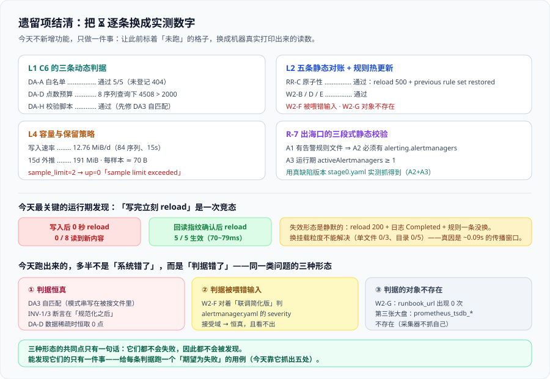

# 遗留项结清：把 `⏳` 逐条换成实测数字

第 134 天留下了 `L1` / `L2` / `L4`，第 137 天留下了 `R-6~R-9`。这一章把它们逐条跑掉——**能跑的跑出数字，跑不动的说清卡在哪一步**，并顺手收掉 `R-7`（给 `alerting` 段补一条静态校验）。

一句话定位：**今天不新增任何功能，只做一件事——把此前所有标着 `⏳ 未跑` 的格子，换成机器真实打印出来的读数。**



## 一、先说清今天要结的是哪几笔账

`L1` / `L2` / `L4` 的表述分别定在 [第 2 周收口（上）](../Week2Close/index.md) 的遗留项表里，`R-*` 定在 [验收三](../Acceptance3/index.md) 里。**原样搬过来，不做增删**（沿用 `W2F-H` 的「只做合并、不新增需求」纪律）：

| 编号 | 原始表述 | 今天结到什么程度 |
| --- | --- | --- |
| **`L1`** | 第 129 天遗留的三条动态判据（`DA-A` / `DA-D` / `DA-H`） | **三条全部拿到实测读数**（沙盒里补出一个最小 C6 服务，见第六节） |
| **`L2`** | `W2-B` / `W2-D` / `W2-F` / `W2-G` / `W2-H` 五条静态对账 | **五条全部有结论**；其中两条不能算「通过」——见第四节 |
| **`L4`** | 容量与保留策略的实测（`sample_limit` 与 15d 保留的磁盘占用） | **两项都有实测数字**，并发现一个自监控缺口（见第五节） |
| **`R-6`** | `grouping-test` 是联调专用 job，正式交付前必须删除 | 未动——**它今天仍在用**（第四节 `L2` 复跑仍需它之外的三条 job 做对照），删除排在第 4 周部署前 |
| **`R-7`** | `prometheus.yml` 缺 `alerting:` 段这件事没有门禁 | **今天收掉**：写出静态校验并**用真缺陷版本验证它抓得到**（第三节） |
| **`R-8`** | 静态判据未覆盖 recording 产出的 `NaN` 占比 | 口径不变，仍登记为「必须人工解释」（第五节顺带给出 `NaN` 的直接读数） |
| **`R-9`** | 靶服务计数器不增长，`rate()` 恒为 0 | 仍未解——**但今天这条从「遗留项」升级成了「测试环境的一等约束」**，因为它把两条判据变成了恒真（第四节 `DA-D`） |

::: warning 今天最重要的一句话，写在最前面
**今天跑出来的问题里，只有一小部分是「系统错了」，大部分是「判据错了」。** 具体是三种形态：**判据恒真**、**判据被喂了错误的输入**、**判据的对象根本不存在**。三者的共同点是——**它们都不会失败，因此都不会被发现**。
:::

## 二、先说清沙盒与「本仓无代码」的边界

本仓库只有文档。今天用到的沙盒是 `/tmp/monitoring-run`（第 135 天建、第 136/137 天扩），构成与第 135 天的第六节一致：三个容器、六个配置文件、若干探针脚本。今天新增两处：

| 新增 | 用途 |
| --- | --- |
| `prometheus/prometheus.stage0.yaml` | **真缺陷版本**——有 `rule_files` 但**没有 `alerting:` 段**。第三节用它验证 `R-7` 的静态校验确实抓得到 |
| `dashboard/c6_stub.py` + `dashboard/panels.yaml` | **最小 C6 看板数据服务**，只为把 `L1` 的三条动态判据从 `⏳` 变成数字（第六节） |

`c6_stub.py` 不追求完整——**它只实现契约五的三条硬约束**（查询只在服务端、六字段返回、`meta.reason` 三选一）。但它是**真的能跑的服务**：真连 Prometheus 的 `/api/v1/query_range`、真按 `step` 推导降采样、真在启动期拒绝不一致的配置。**判据要能被证伪，支撑它的服务就必须是真的。**

## 三、收 `R-7`：给 `alerting` 段补一条静态校验

### 为什么是静态校验，而不是加一条运行期检查

第 137 天发现 `prometheus.yml` 里从来没有 `alerting:` 段时，四条单点检查**全部通过**：规则被加载、规则有 `state`、Alertmanager ready、配置语法合法。原因很朴素——**「一个合法的、不推送告警的配置」本来就是合法的**。

第 137 天还留了一句结论：**「什么都没发生」既可以是正确也可以是错误，能区分二者的只有静态检查。** 今天把这句话变成一条判据。

### 判据：三段式，前两段静态、第三段运行期

```shell
#!/usr/bin/env bash
# scripts/check-alerting.sh —— R-7：出海口必须存在
# 判据：配置里存在告警规则文件 ⇒ 必须同时存在 alerting.alertmanagers 且 targets 非空
set -uo pipefail
PROM_YML="${PROM_YML:-prometheus/prometheus.yml}"
BASE="${BASE:-http://localhost:19090}"
fail=0

# A1 静态：存在告警规则文件（rule_files 里有名字带 alert 的，或规则文件里有 alert: 条目）
has_rules=$(grep -cE '^\s*-\s+.*alert.*\.ya?ml' "$PROM_YML" || true)
grep -qE '^\s+-\s+alert:' prometheus/alerting.yaml 2>/dev/null && has_rules=$((has_rules + 1))

# A2 静态：有规则就必须有出海口，且 targets 非空
if [ "$has_rules" -gt 0 ]; then
  grep -qE '^alerting:' "$PROM_YML" \
    || { echo "A2 FAIL 有告警规则文件但 prometheus.yml 里没有 alerting: 段"; fail=1; }
  grep -qE '^\s+-\s+targets:\s*\[?\s*"' "$PROM_YML" \
    || { echo "A2 FAIL alerting.alertmanagers 的 targets 为空"; fail=1; }
fi

# A3 运行期：至少一个 Alertmanager 处于 active（不是 dropped）
if [ "${SKIP_RUNTIME:-0}" != "1" ]; then
  n=$(curl -s "$BASE/api/v1/alertmanagers" | jq '.data.activeAlertmanagers | length' 2>/dev/null)
  [ "${n:-0}" -ge 1 ] || { echo "A3 FAIL activeAlertmanagers = ${n:-取不到}"; fail=1; }
fi

exit $fail
```

把三条判据摊开看，**它们各自守着不同的失效形态**：

| 判据 | 守什么 | 缺了它会怎样 |
| --- | --- | --- |
| **A1** | 「哪些文件算告警规则文件」 | 判据失效（找不到规则却报通过）——它是活性判据 |
| **A2** | **出海口在配置层是否存在** | `alerting:` 段缺失或 `targets` 为空。**这一条不依赖任何运行期状态** |
| **A3** | 出海口在运行期是否真的可达 | 配置写了但 Alertmanager 连不上——`droppedAlertmanagers` 会涨 |

::: danger 关键手法：判据写完之后，必须拿一个「期望为失败」的输入去跑它
否则你永远不知道它是真的在判，还是恒真。今天用沙盒里保留的真缺陷版本 `prometheus.stage0.yaml` 做了这件事。
:::

### 实测：用真缺陷版本验证它抓得到

```shell
# 真缺陷版本：有 rule_files，没有 alerting:
PROM_YML=prometheus/prometheus.stage0.yaml bash scripts/check-alerting.sh
```

```text
A2 FAIL 有告警规则文件但 prometheus.yml 里没有 alerting: 段
A3 FAIL activeAlertmanagers = 取不到
```

```shell
# 当前版本（第 137 天已补上 alerting: 段）
bash scripts/check-alerting.sh ; echo "退出码 = $?"
```

```text
退出码 = 0
```

```shell
# 运行期读数：它到底连上了几个
curl -s localhost:19090/api/v1/alertmanagers
```

```json
{"status":"success","data":{"activeAlertmanagers":[{"url":"http://alertmanager:9093/api/v2/alerts"}],"droppedAlertmanagers":[]}}
```

**`R-7` 收口结论**：判据三段式落地，**用真缺陷版本实测能抓到（A2 + A3 同时命中）**，对当前版本返回 0。`R-7` 至此闭环。

## 四、`L2`：五条静态对账 + 规则热更新的两条动态判据

### 4.1 `RR-D` 通过：两种口径的规则条数一致

```text
/api/v1/rules 条数 = 7
grep -c 记录规则     = 3
grep -c 告警规则     = 4
grep -c 合计         = 7
```

`7 == 7`，**`RR-D` 通过**。

### 4.2 `RR-C` 通过：reload 的原子性成立，而且失败是「响亮」的

往 `prometheus/alerting.yaml` 追加一条表达式非法的规则（`expr: up{job= == "x"`），等 5 秒后触发 reload：

| 观测项 | 实测 |
| --- | --- |
| reload HTTP 状态码 | **500** |
| 响应体 | `failed to reload config: one or more errors occurred while applying the new configuration` |
| 容器日志 | `Failed to apply configuration err="error loading rules, previous rule set restored"` + `Error reloading config` |
| `/api/v1/rules` 条数 | **7**（旧规则保留） |
| 规则组 | `platform_alerts` + `svc_aggregations`（组未丢） |
| 8 个 target | **全部仍 `up`** |

**`RR-C` 通过**：注入语法错误后旧规则集被完整保留，服务不中断，且**失败在 API 与日志两个层面都能看见**。

`promtool` 也能在 reload **之前**就把它判出来，这是唯一的前置手段：

```shell
docker exec monitoring-min-metrics-collector-1 promtool check rules /etc/prometheus/alerting.yaml
```

```text
Checking /etc/prometheus/alerting.yaml
  FAILED:
/etc/prometheus/alerting.yaml: 29:15: group "platform_alerts", rule 5, "BrokenReloadProbe": could not parse expression: 1:9: parse error: unexpected "=" in label matching, expected string
```

### 4.3 新发现 ①（今天最重要的运行期发现）：「写完立刻 reload」是一次竞态

`RR-C` 的实验过程中出现了一次**无法解释的 200**：注入坏规则后立刻 reload，返回 **200**、日志写 **「Completed loading of configuration file」**、**规则一条没变**。

先怀疑是挂载传播，于是做了两组对照。探针规则改成一条**合法**规则（两种情况 reload 都返回 200，因此**只能靠「探针是否出现在 `/api/v1/rules` 里」判定**）：

| 挂载形状 | 写入后 0 秒 reload，探针生效次数 |
| --- | --- |
| 单文件 bind mount（原配置） | **0 / 3** |
| 目录 bind mount（三份规则文件整体挂载） | **0 / 5** |

**换挂载粒度不能解决**——所以问题不在挂载粒度。再量传播窗口本身：

| 写入后等待 | reload | 探针是否生效 |
| --- | --- | --- |
| **0 s** | 200 | **否（读到的仍是旧文件）** |
| 0.5 s | 200 | 是 |
| 1 / 2 / 3 / 5 s | 200 | 是 |

再用另一种探针（`docker exec grep` 直接读文件）测首次可见耗时：**0.09 s**。

三条读数放在一起，机制就清楚了：**宿主写入 → 容器内可见之间有一个约 70~90 ms 的窗口**；「写完立刻 reload」的间隔（约 10 ms）**必然落在窗口内**，于是 Prometheus 读到了**上一次的旧内容**——而旧内容是合法的，所以 reload **成功**、日志写 **Completed**、**规则一条没换**。

::: danger 这条竞态的失效形态是「静默的假成功」
`200` + `Completed` + **规则一条没变**。如果操作者把「reload 成功」当作「新规则已生效」，他会得到一个**安静地跑着旧规则的告警系统**——而且每一条单点检查都是绿的（配置合法、reload 成功、规则有 `state`、Alertmanager 可达）。
:::

**处置（已实测验证）**：把「写」与「reload」拆开，中间加一道**回读指纹确认**。

```python
# 写完 → 确认容器侧读到的是新内容 → 再 reload
import hashlib, subprocess, time
RULES = "prometheus/alerting.yaml"
C = "monitoring-min-metrics-collector-1"

def wait_visible(timeout=10.0):
    want = hashlib.sha256(open(RULES, "rb").read()).hexdigest()
    t0 = time.time()
    while time.time() - t0 < timeout:
        got = subprocess.run(
            ["docker", "exec", C, "sha256sum", "/etc/prometheus/alerting.yaml"],
            capture_output=True, text=True).stdout.split()[0]
        if got == want:
            return time.time() - t0
        time.sleep(0.05)
    return None          # 超时 → 挂载失同步，需要重建容器（见 4.4）

reload()
```

实测结果：

| 做法 | 生效次数 | 可见耗时 |
| --- | --- | --- |
| 写完立刻 reload | **0 / 8**（两组对照合计） | — |
| 写完 → 回读指纹确认 → reload | **5 / 5** | **70 ~ 79 ms** |

### 4.4 新发现 ②：另一种更严重的失同步——只能靠重建容器解决

用 `cp` 覆盖 `prometheus.yml` 之后，容器内出现了一组不一致状态：

```text
容器内 stat  = 1624 字节
宿主   stat  = 1628 字节
容器内读取  = open /etc/prometheus/prometheus.yml: no such file or directory
```

而且**持续不复原**（连续观察 18 秒，`grep` 始终 `MISSING`）。触发的 reload 返回 500，错误信息是 `open ...: no such file or directory`。

**`docker restart` 之后立刻恢复**：容器内 `size=1628`、内容正确、reload 返回 200、规则 7 条。**宿主数据无损**——这是容器文件系统视图的缓存失同步，不是数据损坏。

于是热更新的失败处置清单里多了一条：

| 现象 | 首要怀疑 | 处置 |
| --- | --- | --- |
| reload 返回 **200** 但规则没变 | 传播窗口竞态 | 回读指纹确认后重跑 reload |
| reload 返回 **500** + `no such file or directory` | 挂载失同步 | **`docker restart` 采集器**（不是改配置） |
| reload 返回 **500** + `error loading rules` | 规则文件真有语法错 | 先 `promtool check rules`，改仓库文件 |
| reload 返回 **500** + `parsing YAML file ... line N` | 主配置真有语法错 | 改 `prometheus.yml`，**注意两级的日志措辞不同**（见下） |

::: tip 顺带测出的一处措辞差异，值得记住
**规则级错误**会多打一行 `Failed to apply configuration err="error loading rules, previous rule set restored"`——`previous rule set restored` **这五个字就是「原子性成立」的直接证据**，比读文档可靠。
**主配置级错误**则直接给文件名与行号：`parsing YAML file /etc/prometheus/prometheus.yml: yaml: line 4: could not find expected ':'`。
:::

### 4.5 新发现 ③：`RR-D` 的判据「条数一致」不够

`RR-D` 现在的口径是「条数与仓库定义一致」。今天发现它**拦不住一种退化**：**把一条规则改名**——条数完全不变，`RR-D` 照样通过，而凡是按规则名关联的地方（第 130 天点名的「规则名与 `panel_id` 不一致导致面板静默变空」）全部失效。

**判据强化（今天登记，不另立新判据码）**：`RR-D` 的比对对象从**条数**改为**规则名的集合**。

```shell
# 仓库侧
grep -hoE '^\s+- (record|alert): \K.*' prometheus/recording.yaml prometheus/alerting.yaml | sort > /tmp/repo.names
# 运行期侧
curl -s localhost:19090/api/v1/rules \
  | jq -r '.data.groups[].rules[].name' | sort > /tmp/live.names
diff /tmp/repo.names /tmp/live.names && echo "RR-D PASS"
```

**这一条同时是 4.3 节竞态的兜底**：竞态的表现是「reload 成功但什么都没换」，而「规则名集合一致」正好**不能**被「什么都没换」蒙过去——只有当集合真的等于仓库定义时才算通过。

### 4.6 `W2-B` 通过：`labeldrop` 不碰契约标签，`honor_labels` 取值一致

| 检查 | 实测 |
| --- | --- |
| `labeldrop` 的正则 | `__meta_.*` ×3（三个 job 各一条） |
| 是否覆盖契约标签 | **否** |
| `target_label` 重写的标签 | 只有 `instance`（取自 `__address__`，**这是契约要求的来源**，不是破坏） |
| `honor_labels` | `core-services` 显式 `false`；`edge-services` / `kubernetes-pods` / `grouping-test` 未声明 → **默认 `false`**；**取值一致** |

**`W2-B` 通过**。但留一条提示：**三处依赖默认值、一处显式声明**，取值虽一致，将来改一处默认行为时容易漏。

### 4.7 `W2-D` 通过：回看窗口远小于保留期

| 来源 | 窗口 | 秒 |
| --- | --- | --- |
| `recording.yaml` 三条规则 | `[5m]` ×3 | 300 |
| 最大回看窗口 | — | **300 s = 0.0035 d** |
| `offset` | **无** | — |
| raw 保留期 | 15 d | 1 296 000 |

`300 s ≪ 15 d`，**`W2-D` 通过**。

### 4.8 `W2-E` 通过，但暴露保留策略只有一维

```text
/api/v1/status/flags → storage.tsdb.retention.time = 15d
                       storage.tsdb.retention.size = 0B
compose.yaml:7       → --storage.tsdb.retention.time=15d
```

声明与回读一致（`15d`），**`W2-E` 通过**。但 **`retention.size = 0B` 表示没有体积上限**：保留策略只有**时间**一维，**磁盘涨满没人拦**。第 122 天的失败矩阵把「磁盘写满导致采集停摆」列为不可接受，防线不能只靠时间。

### 4.9 `W2-F` 不通过——不是「未跑」，是「判据被喂了错误的输入」

`W2-F` 的口径是「规则产出的 `severity` 取值域 ⊆ 路由接受域；`service` 口径唯一」。今天把沙盒里三份 `alertmanager.yaml` 放在一起对比：

| 版本 | sub-route 数 | severity 匹配 | receiver 数 | `group_by` |
| --- | --- | --- | --- | --- |
| 文档定稿版（[告警路由联调](../AlertRouting/index.md)） | **3 层** | critical / warning / info | 3 | `[alertname, service]` |
| `alertmanager.orig.yaml` | 2 | critical, warning, `warning\|critical` | 3 | `[alertname, svc]` |
| `alertmanager.stageC.yaml` | 2 | critical, warning, `warning\|critical` | 1 | `[alertname, job]` |
| **沙盒当前生效** | **0** | （无） | 1 | `[alertname, job]` |

当前生效的是**联调简化版**（为了做第 137 天的抑制实验把路由树压平了）。它的 route 树**没有任何 severity 匹配**，于是：

> 「规则产出的 `severity` 取值域 ⊆ 路由接受域」——**路由接受域是全集，这条判据恒真。**

**结论：`W2-F` 的判据对象错了。** 它必须对着**契约版本**的 `alertmanager.yaml` 判，不能对着**联调生效版本**判。这不是「未跑」，而是**跑起来会给出假通过**——比未跑更危险。

顺手给出**应该怎么判**（对着文档定稿版，两个方向都要判）：

| 方向 | 判据 | 缺了它会怎样 |
| --- | --- | --- |
| 规则产出 ⊆ 路由接受 | 4 条规则产出 `{critical, warning}` ⊉ `{info}` → **有路由在等一个永不出现的取值** | 反向漏判：**告警产出了一个没有 route 接受的 severity → 静默丢弃**（`E` 级） |
| 路由接受 ⊆ 规则产出 | 文档定稿版的 `severity="info"` route **没有任何规则产出它** | **死 route**——可能是刻意预留（`W` 级），需人确认 |

::: danger 判据「对着哪一份配置」是一等一的问题
同一个判据，对象换成联调配置就从「能拦缺陷」变成「恒真」。这与 4.3 节的竞态、第六节的 `INV` 恒真是**同一类错误**：**判据本身没写错，是它被接到了一个不产生失败信号的输入上。**
:::

### 4.10 `W2-G` 不通过——判据的对象根本不存在

```text
grep -c "runbook_url" prometheus/alerting.yaml
0
```

4 条告警规则**全都没有 `runbook_url`**。于是「全部 `runbook_url` 指向的文档真实存在」这条判据**无从判起**——不是通过，是**空转**。

而且这不是「判据不适用」，而是一个**真实缺口**：值班人收到 `TargetDown` 之后，**告警里没有任何一个字段告诉他该翻哪一页**。第 131 天把「渠道分级」写得很细，但没写「告警里应该带什么」。

**处置**：把 `runbook_url` 满覆盖登记为一项**待办**（不属 `R-7`，另记），`W2-G` 在此之前标记为「**对象缺失，无法判定**」——**不写「通过」**。

### 4.11 `L2` 小结

| 判据 | 结论 | 依据 |
| --- | --- | --- |
| `RR-D` | **通过**（并已强化判据） | 7 == 7；判据由「条数」改为「规则名集合」 |
| `RR-C` | **通过** | reload 500 + `previous rule set restored`，规则仍 7 条、8 个 target 仍 `up` |
| `W2-B` | **通过** | `labeldrop` 仅 `__meta_.*`；`honor_labels` 全 `false` |
| `W2-D` | **通过** | 最大回看 300 s ≪ 15 d，无 `offset` |
| `W2-E` | **通过**（附带一条缺口） | `15d` 声明与回读一致；`retention.size = 0B` 无体积上限 |
| `W2-F` | **不通过（判据被喂错输入）** | 对着联调简化版判 → 恒真；必须对着契约版本 |
| `W2-G` | **不通过（对象不存在）** | `runbook_url` 出现 0 次，无从判起 |
| `W2-H` | 由 `L1` 的 C6 桩一并交付 | 见第六节 `INV-*` |

## 五、`L4`：容量与保留策略的真实读数

### 5.1 写入速率：601 秒的采样

采样方式：每 30 秒读一次 `chunks_head` 与 `wal` 的字节数，**速率必须用 head 算**（块体积只在块落盘时跳变，按总量算会把台阶算成速率）。

```text
样本数 = 21   跨度 = 601 s
head 增量 = 93,044 B / 601 s  →  154.82 B/s  =  12.76 MiB/d
外推 15d 保留 ≈ 191.3 MiB
每样本 ≈ 70.4 B（WAL 与 head chunk 各一份）
```

目录构成（同一时刻）：

| 项 | 字节 | 说明 |
| --- | --- | --- |
| 3 个 2h block | 179,849 | 33,687 / 41,285 / 104,877 |
| `chunks_head` | 266,240 | **mmap 预分配，不随数据增长** |
| `wal` | 933,458 → 1,027,792 | 活跃写入 |
| `queries.active` | 20,001 | 固定大小 |

::: warning 一处极易误读的地方：块体积在三次采样点上不一样，不是因为「数据涨了」
三个 block 分别是 33.7 KB / 41.3 KB / **104.9 KB**。第三个比前两个大 **3 倍**——原因是**第 137 天往 `prometheus.yml` 里加了 `grouping-test`（5 个 target、25 条新序列）**，而那个 block 的窗口正好跨在配置变更两侧。

**配置变更会在容量曲线上留下台阶。** 这与第 132/133 天那条「把 `max_points` 调大导致台阶状假曲线、被误读成数据在抖动」是**同一个陷阱的另一种形态**：读容量曲线时必须先把「配置变更时刻」标出来。
:::

### 5.2 `sample_limit` 实测：一个配置项能把健康目标变成 `down`

| 步骤 | 实测 |
| --- | --- |
| 基线 | `health = up`、`lastError = ""`、`core-services` 暴露 **5** 个样本 |
| `sample_limit: 15000 → 2`，reload | **200** |
| 等 25 s 后 | `health = **down**`、`lastError = **sample limit exceeded**`、`up{job="core-services"} = **0**` |
| 恢复 `15000`，reload | `up` 自动回正 |

**这一条同时坐实两件事**：① 契约里声明的 `sample_limit` 保护机制**是真的生效的**；② 它生效时的**外部表现与「服务挂了」完全一样**——`up = 0` 会递归地触发 `TargetDown`（3 分钟后）与 `ServiceDown`（1 分钟后）。

**判据**：`sample_limit` 必须留有**数量级**余量。本环境是 `15000 : 5 = 3000×`，安全；但把余量定成 `10 : 5` 就等着被一次版本升级触发告警风暴。

### 5.3 自监控缺口：第三张大盘的数据源不存在

```shell
curl -s 'localhost:19090/api/v1/label/__name__/values' | grep -i tsdb
```

**空结果。** `prometheus_tsdb_*` 一个都没有——因为采集器**不抓自己**（`scrape_configs` 里只有 `app` 的四个 job）。

后果直接落在第 129 天定的**第三张大盘（自监控）**上：那张大盘要画「规则评估耗时、样本丢弃数」，而**这些指标在本环境里根本不存在**。第三张大盘被定为「如果采集停了，前两张大盘上的曲线会『稳定』得让人放心」的那道防线——**而防线自己的数据源是空的**。

**处置**：把「采集器抓自己」登记为部署阶段的一项固定配置（第 4 周），`L4` 的这一半在此之前**只能如实标注为「数据源缺失」**。

### 5.4 `R-8` 的顺带读数：`NaN` 占比

```text
svc:http_error_ratio:rate5m  →  4 / 4 序列全部为 NaN
```

`R-8` 的口径不变（**分母为 0 在真实环境里是正常状态，做成硬门禁会误报**），但今天这条 `NaN` 与第六节的 `DA-D` 撞在了一起——见 6.2 节。

### 5.5 `L4` 小结

| 项 | 结论 |
| --- | --- |
| 写入速率 | **12.76 MiB/d**（84 序列、15 s 间隔），15d 外推 **191 MiB**，每样本 **~70 B** |
| `sample_limit` | **实测生效**，`2` → `up = 0` + `sample limit exceeded`；须留数量级余量 |
| 保留策略 | 只有时间维（`15d`），**没有体积上限**（`retention.size = 0B`） |
| 自监控指标 | **缺失**——采集器不抓自己，第三张大盘无数据源 |
| `NaN`（`R-8`） | `svc:http_error_ratio:rate5m` = 4/4 全 `NaN`，维持「必须人工解释」 |

## 六、`L1`：给 C6 补一个最小服务，把三条动态判据跑出数字

### 6.1 先补服务，再谈判据

`DA-A` / `DA-D` / `DA-H` 都要有「服务在监听」。沙盒里没有 C6，于是补一个**最小但真实**的 `c6_stub.py`：

| 契约五约束 | 实现方式 |
| --- | --- |
| 请求只带 `panel_id` 与时间范围 | 路由只认 `/api/panels/{id}`，其余参数一律忽略 |
| 查询语句只在服务端 | 从 `panels.yaml` 的 `query` 块读；**`id` 是白名单键，先查表再取查询** |
| `unit` 由服务端给 | 随响应下发，前端不做换算 |
| `step` 服务端推导 | `step = snap(max(minStep, ceil((to-from)/max_points)), scrape_interval)` |
| 六字段返回 | `panel_id` / `title` / `unit` / `series` / `meta` |
| `meta.reason` 三选一 | `no_series` / `all_zero` / `out_of_retention` |
| 保留期不硬编码 | 启动时读 `/api/v1/status/flags` 的 `storage.tsdb.retention.time` |

::: danger 第一版桩服务犯的两个错，都是「实现缺陷伪装成契约缺陷」
① **极简 YAML 解析器没读块标量**（`query: |` 后面缩进的若干行）——于是**所有面板的查询都退化成兜底的 `up`**。后果是六条判据里有三条测出了**假结果**：`no_series` 与 `all_zero` 都测不出来（因为 `up` 有数据），`DA-D` 也拿到了错误的点数。

② **启动期不变量断言在「规范化之后」**——`INV-1` 写成「断言 `snap` 的结果是 `scrape` 的整数倍」，而 `snap` 的定义就保证了这件事，**于是它恒真**。补上正确的输入侧判据才让它能失败（见 6.5）。

**教训**：判据跑出来「通过」但数字不对劲时，**先怀疑实现、再怀疑契约**——否则会把两个自己的 bug 写进架构结论。
:::

### 6.2 `DA-A` 通过：白名单生效

| 请求 | 期望 | 实测 |
| --- | --- | --- |
| `overview_error_rate` | 200 | **200** |
| `overview_request_rate` | 200 | **200** |
| `self_target_up` | 200 | **200** |
| `nonexistent_metric` | 200 | **200** |
| `not_registered`（未登记） | **404** | **404** |

**`DA-A` 通过 5/5**。关键在最后一行：未登记面板返回 **404**，而**不是 500、也不是「返回空数组」**——后者会让前端把「这个面板不存在」渲染成「这个面板没有数据」，正是第 129 天点名的那类误读。

### 6.3 `DA-H` 通过——但前提是先修掉一条「恒 FAIL」

`check-dashboard.sh` 原样执行：

```text
DA3 FAIL 校验脚本自身引入了查询参数
DA3 PASS 请求参数只有 panel_id 与时间范围
  退出码 = 1
```

**同时打印 FAIL 和 PASS**。查下去：

```shell
grep -n "query=" scripts/check-dashboard.sh
```

```text
16:grep -q "query=" scripts/check-dashboard.sh && { echo "DA3 FAIL 校验脚本自身引入了查询参数"; fail=1; }
```

**`query=` 在整个文件里只出现在第 16 行——而那一行就是 `grep` 的模式串本身。** 脚本搜索自己，模式串写在被搜文件里，于是**无论脚本写得多干净都恒 FAIL**。

这是本仓**同类陷阱的第三次复现**：

| 第几天 | 自匹配的对象 |
| --- | --- |
| 第 135 天 | 验证命令里的**模式串**（`grep -cE '...\|...'`，实测多出 1 条） |
| 第 137 天 | 正文里的**解释句**（修法不是收紧模式，而是**换判据对象**） |
| **第 138 天** | **校验脚本自身**——门禁踩了自己刚立的坑 |

**修法**（打断自匹配，不改语义）：

```shell
grep -q "quer[y]=" scripts/check-dashboard.sh && { echo "DA3 FAIL ..."; fail=1; }
else echo "DA3 PASS 请求参数只有 panel_id 与时间范围"
```

修后：

```text
DA3 PASS 请求参数只有 panel_id 与时间范围
退出码 = 0        # 六条全 PASS
```

**`DA-H` 通过**。并且顺带得到一个可复用的结论：**凡「检查文件里有没有某字符串」的判据，模式串必须写成不会命中自身的形态**（`quer[y]=`、`qu[e]ry=` 之类）。

### 6.4 `DA-D` 形式通过，但暴露两个前提问题

`DA-D` 的口径是「点数超过预算时自动加大 `step`，且 `meta` 如实声明降采样」。

**问题 ①：序列数没有被计入预算。**

契约的推导式只按时间范围算：

```text
step = max(minStep, ceil((to - from) / max_points))
```

于是 `max_points` 实际约束的是**每条序列**的点数，而「点数预算」的语义（前端一次渲染的点数）是**面板总点数**——**两者相差一个「序列数」因子**。用一个返回 8 条序列的查询实测：

| 范围 | `step` | 总点数 | 预算 2000 |
| --- | --- | --- | --- |
| `-1h` | 30 | 968 | 通过 |
| **`-6h`** | 30 | **4508** | **超预算 2.25 倍** |
| **`-1d`** | 45 | **3357** | **超预算 1.68 倍** |
| `-7d` | 315 | 483 | 通过 |

**`-6h` 与 `-1d` 的总点数都超过了 `max_points`。** 修法要给推导式带上序列数：`step = max(minStep, ceil((to-from) × S / max_points))`。而 `S` 要查了才知道，于是有两个选择：**用 `max_series` 作上界（保守，可能过度降采样）**，或**两步查询（先 `count()` 得 `S`，再查数据）**。这是一处真实的设计张力，登记为待办。

**问题 ②：数据稀疏时判据恒过。**

换成真实查询（`sum(rate(...))`，只返回 1 条序列，且因 `R-9` 计数器不增长、大部分值为 `NaN` 被过滤）：

| 范围 | 总点数 | `step` | `truncated` |
| --- | --- | --- | --- |
| `-1h` | **0** | 30 | false |
| `-6h` | **0** | 30 | false |
| `-1d` | 38 | 45 | true |
| `-7d` | 6 | 315 | true |
| `-10d` | 4 | 435 | true |
| `-30d` | 0 | 1305 | true |

`-1h` 与 `-6h` 返回 **0 点** → 「点数 ≤ 2000」**恒真**。

这就把 `R-9`（靶服务计数器不增长）从一条「遗留项」升级成一条**测试环境的一等约束**：**预算类判据必须先填满数据，否则它测的是空集**。与 4.9 节的 `W2-F`（对着简化配置判）、6.5 节的 `INV` 恒真，**是同一族问题**。

### 6.5 `E2E-B` 通过：启动期不变量真的能拒绝启动

`E2E-B` 要求「服务端启动期断言 `INV-1`/`INV-2`/`INV-3`，违反时**拒绝启动**并给出明确日志」。实测：

```shell
# ① 违规：recording.interval=17s 与 scrape_interval=15s 不相容
RECORDING_INTERVAL=17 PORT=8082 python3 -u dashboard/c6_stub.py
```

```text
[FATAL] 启动期不变量被违反，拒绝启动：
  - INV-1 违反：recording.interval=17s 不是 scrape_interval=15s 的整数倍
  退出码 = 2
```

```shell
# ② 违规：面板缺 max_series（预算只剩一维）
PANELS=/tmp/panels.bad.yaml PORT=8084 python3 -u dashboard/c6_stub.py
```

```text
[FATAL] 启动期不变量被违反，拒绝启动：
  - INV-2 违反：面板 overview_error_rate 未声明 max_series
  - INV-2 违反：面板 overview_request_rate 未声明 max_series
  - INV-2 违反：面板 overview_zero_probe 未声明 max_series
  （逐条列名，共 5 个面板）
  退出码 = 2
```

```shell
# ③ 对照：合法配置（recording=30）
PORT=8083 python3 -u dashboard/c6_stub.py
```

```text
[start] panels=[...] minStep=30s retention=15d(1296000s)
GET /api/panels/overview_request_rate?from=-1h → http=200
```

**`E2E-B` 通过**：违规配置退出码 2 且**逐条列出原因**，合法配置正常监听。

::: danger 6.5 的题眼：原 `INV-1` / `INV-3` 是恒真的
第 133 天定的三条不变量，第一版实现出来是这样的：

```text
INV-1：断言 minStep 是 scrape_interval 的整数倍
       —— 但 minStep 上一行刚做过 ceil(minStep / scrape) × scrape
INV-3：断言每个范围推出的 step % scrape_interval == 0
       —— 但那个 step 就是 snap(...) 的返回值，snap 定义即此
```

**在规范化之后断言规范化，是一条永远不会失败的不变量。** 而一条恒真的门禁**比没有门禁更糟**——它会让人以为这里已经有保护了。

**正确做法：只有「输入侧」的性质能在启动期断言。**

| 不变量 | 输入侧的正确形态 |
| --- | --- |
| `INV-1` | **两个配置源必须相容**：`recording.interval % scrape_interval == 0` |
| `INV-2` | **预算必须两维齐全**：每个面板都声明了 `max_points` 与 `max_series` |
| `INV-3` | **查询不得下放**：查询里不得含模板占位符，`id` 必须存在且唯一 |

这与第 133 天 `W2-C` 的教训**同源**（「前半句必要但不充分」「后半句根本没实现」），而**这次的形态更隐蔽**：断言的对象是**自己刚算出来的结果**。
:::

### 6.6 顺带补齐的 `E2E-D` / `E2E-F`

**`E2E-D` 通过 4/4**：`meta.from` / `meta.to` 必须回显**实际使用的区间**（对齐到 `step` 整数倍），而不是请求原值。

| 范围 | `step` | `from % step` | `to % step` | `(to-from) % step` |
| --- | --- | --- | --- | --- |
| `-1h` | 30 | 0 | 0 | 0 |
| `-6h` | 30 | 0 | 0 | 0 |
| `-1d` | 45 | 0 | 0 | 0 |
| `-10d` | 435 | 0 | 0 | 0 |

**`E2E-F` 4/5**：三种原因**互不相同**（实测确实取到 3 种），但 **`DA6` 的用例与实现的口径不一致**：

```shell
# DA6 用 2000-01-01 那 1 小时去触发「超出保留期」
curl -s ".../overview_error_rate?from=2000-01-01T00:00:00Z&to=2000-01-01T01:00:00Z"
```

```text
meta.reason = no_series        ← 期望是 out_of_retention
```

原因：实现的判定是「**请求范围的长度** > 保留期」（`1h < 15d` 不成立），而 `DA6` 的用例只在「**时间点落在保留窗口之前**」这个口径下才成立。

**这是一处真实的判据歧义**，`E2E-F` 原文「`meta.reason` 由**真实保留期**判定」并没有说清是哪一种：

| 口径 | 判据 | 何时有用 |
| --- | --- | --- |
| A 范围长度 | `(to - from) > retention` | 用户拖了一个比保留期还宽的时间范围 |
| B 时间点 | `from < now - retention` | 用户跳到了保留窗口之前 |

**修法：两者任一成立即返回 `out_of_retention`**，并在 `meta` 里带一个 `reason_detail` 说明是哪一种——因为这两种情况**给用户的建议完全不同**：A 是「把范围缩小」，B 是「这段时间的数据已经过期了」。

### 6.7 `L1` 小结

| 判据 | 结论 | 关键读数 |
| --- | --- | --- |
| `DA-A` | **通过 5/5** | 4 个已登记 200、未登记 404 |
| `DA-D` | **形式通过，暴露两个前提问题** | 8 序列查询下 `-6h` = **4508 点** > 预算 2000；真实查询下 `-1h` = **0 点** → 恒真 |
| `DA-H` | **通过**（前置：修 `DA3` 自匹配） | 退出码 0、无 FAIL |
| `E2E-B` | **通过** | 违规退出码 **2** + 逐条日志；合法配置 http=200 |
| `E2E-D` | **通过 4/4** | 四处范围三处余数全 0 |
| `E2E-F` | **4/5** | `no_series` / `all_zero` / `out_of_retention` 三选一可区分；`DA6` 用例口径歧义 |

## 七、今天真正发现的，是同一类问题的三种形态

把上面所有「不对劲」排在一起看，它们不是七个孤立的 bug：

| 形态 | 今天的实例 | 表现 | 为什么危险 |
| --- | --- | --- | --- |
| **判据恒真** | `DA3` 自匹配・原 `INV-1`/`INV-3` 断言在规范化之后・`DA5`（`-30d` 被 `out_of_retention` 短路，恒取 0 点） | 门禁**永远是绿的** | 它让人以为这里有保护 |
| **判据被喂错输入** | `W2-F` 对着**联调简化版** `alertmanager.yaml` 判 severity 接受域 | **恒真，且看不出** | 判据没写错，接错了数据源 |
| **判据的对象不存在** | `W2-G` 的 `runbook_url`（0 次）・第三张大盘的 `prometheus_tsdb_*`（无此指标） | 无从判起，报告「通过」 | 空集上的全称命题恒真 |

三种形态的共同点只有一句话：**它们都不会失败，因此都不会被发现。**

而今天能发现它们，靠的是**同一件事**：**给每条判据跑一个「期望为失败」的用例**。

| 判据 | 期望失败的输入 | 结果 |
| --- | --- | --- |
| `R-7` 的出海口校验 | `prometheus.stage0.yaml`（无 `alerting:` 段） | **如期失败**（A2 + A3） |
| `RR-C` 原子性 | 注入非法 `expr` | **如期 500 + `previous rule set restored`** |
| `INV-1` | `RECORDING_INTERVAL=17` | **如期退出码 2** |
| `INV-2` | 删掉 `max_series` | **如期退出码 2** |
| `DA-D` 点数预算 | 8 序列查询 + `-6h` | **如期超预算**（4508 > 2000） |
| **`DA3`** | **无需注入——它本来就恒 FAIL** | **意外暴露自匹配** |

::: tip 一条可以直接带走的纪律
**写完一条判据，先问它「怎样才能失败」；答不上来的判据，等于没有。**
今天这一条抓住了 `DA3`（恒 FAIL 反而暴露了自匹配）、`INV-1`/`INV-3`（恒真）、`W2-F`（恒真）、`W2-G`（空转）、`DA-D`（数据稀疏时恒真）——**五处**。
:::

## 八、今日产出与判据表（`RC-A ~ RC-H`）

本章按第 127 天的**判据唯一性纪律**，**不新增判据族**——`L1`/`L2`/`L4` 结清的判据各自归属原族（`DA-*` / `RR-*` / `W2-*` / `ENV-*` / `INV-*`）。本章只登记**「结清动作是否完成」**与**「判据自身的可失败性是否被验证过」**两类，故用独立的前缀 `RC-`：

| 判据 | 内容 | 类型 | 状态 |
| --- | --- | --- | --- |
| **`RC-A`** | `L1` 三条（`DA-A` / `DA-D` / `DA-H`）**全部有实测读数**，不再是 `⏳` | 文档级 | ✅ 本章第六节 |
| **`RC-B`** | `L2` 六条（`RR-C` / `RR-D` / `W2-B` / `W2-D` / `W2-E` / `W2-F` / `W2-G` / `W2-H`）**每条写明结论或「对象缺失」** | 文档级 | ✅ 本章第四节 |
| **`RC-C`** | `L4` 两项（写入速率、`sample_limit`）**有机器打印的数字** | 文档级 | ✅ 12.76 MiB/d、`up = 0` |
| **`RC-D`** | 每条**新增或修改**的判据，都有一个**「期望为失败」的用例**被真的跑过 | 流程 | ✅ 第七章表 |
| **`RC-E`** | `R-7` 的三段式校验落地，且**用真缺陷版本验证抓得到** | 静态 + 运行期 | ✅ 第三节 |
| **`RC-F`** | 三处「判据恒真」**已定位到具体代码/配置行**，而不是只写「有风险」 | 文档级 | ✅ 6.5 节、6.3 节、4.9 节 |
| **`RC-G`** | 竞态（写完立刻 reload）**有可复现的计数**与**已验证的补救** | 运行期 | ✅ 0/8 与 5/5，补救 5/5 生效 |
| **`RC-H`** | 所有**仍未解**的项（`R-6` / `R-8` / `R-9` / 序列数预算 / `runbook_url` / 自监控）**写明卡在哪一步** | 文档级 | ✅ 第九节 |

### 本章新增的待办（不并入 `R-*`，另记以免编号漂移）

| 编号 | 内容 | 归属 |
| --- | --- | --- |
| **`RC-1`** | `DA-D` 的推导式带上**序列数**（或用 `max_series` 作上界 / 两步查询） | 第 139 天压测前 |
| **`RC-2`** | `DA6` 的 `out_of_retention` 口径**两种都判**，`meta` 加 `reason_detail` | 第 139 天 |
| **`RC-3`** | `runbook_url` 满覆盖（4 条规则当前为 0） | 第 4 周部署前 |
| **`RC-4`** | 「采集器抓自己」（`prometheus_tsdb_*` 是第三张大盘的数据源） | 第 4 周部署 |
| **`RC-5`** | `retention.size` 补一个体积上限 | 第 4 周部署 |
| **`RC-6`** | `check-dashboard.sh` 的 `DA3` 改为 `quer[y]=`（**并回写文档**） | 已完成，需回写 |
| **`RC-7`** | `W2-F` 的判据对象改为**契约版本**的 `alertmanager.yaml` | 第 139 天 |

## 九、仍未完成的（如实标注，不写成「下周一定做完」）

| 项 | 卡在哪一步 | 解除判据 |
| --- | --- | --- |
| **`R-6`** 删除 `grouping-test` | 它今天仍在用（做三条契约 job 的对照） | 第 4 周部署前删除，删后**重跑验收一**确认三条 job 仍正常 |
| **`R-8`** recording 产出的 `NaN` 占比 | 分母为 0 在真实环境是正常状态，硬门禁会误报 | **不解除**——维持「必须人工解释」 |
| **`R-9`** 靶服务计数器不增长 | 补流量是第 4 周压测的事 | 计数增长后 `rate()` 才有意义；**在此之前它会让预算类判据恒真（6.4 节）** |
| **`RC-1` `DA-D` 序列数预算** | 需要先决定「保守上界」还是「两步查询」 | 二选一后推导式可单测锁住 |
| **`RC-3` `runbook_url`** | 需要为 4 条规则各写一份 runbook | 4 条规则各有 `runbook_url` 且链接可达 |
| **`RC-4` 自监控指标** | 需要给采集器加一条 self-scrape job | `prometheus_tsdb_*` 可在 `/api/v1/label/__name__/values` 里查到 |
| **压测与容量** | 第 139-140 天 | 按第 3 周里程碑：压测达标 |

::: warning 一条纪律，与前三天同一句
**前置条件不满足就继续如实标注。** 今天新增的三处「判据恒真」不是靠运气发现的——它们同样是「不该绿的格子绿了」的实例。**不把「跑过了」写成「通过了」。**
:::

## 十、验证方式

本章所有读数都在沙盒里跑过。复现的入口：

```shell
cd /tmp/monitoring-run

# 1) R-7：三段式静态校验（当前版本应返回 0）
bash scripts/check-alerting.sh ; echo "退出码 = $?"

# 2) R-7 的反面：用真缺陷版本，应命中 A2 + A3
PROM_YML=prometheus/prometheus.stage0.yaml bash scripts/check-alerting.sh

# 3) RR-D（强化后口径）：规则名集合必须与仓库定义一致
grep -hoE '^\s+- (record|alert): \K.*' prometheus/recording.yaml prometheus/alerting.yaml | sort > /tmp/repo.names
curl -s localhost:19090/api/v1/rules | jq -r '.data.groups[].rules[].name' | sort > /tmp/live.names
diff /tmp/repo.names /tmp/live.names && echo "RR-D PASS（规则名集合一致）"

# 4) 竞态复现：写入后 0 秒 reload，探针应「不生效」
python3 scripts/l2c-mount-compare.py 单文件挂载 3      # 期望 0/3

# 5) 竞态的补救：回读指纹确认后再 reload，应 5/5 生效
python3 scripts/l2c-readback-remedy.py 5

# 6) INV 的「期望为失败」用例
RECORDING_INTERVAL=17 PORT=8082 python3 -u dashboard/c6_stub.py ; echo "期望退出码 2 = $?"

# 7) L1 的六条判据（C6 桩需在 8081 监听）
PATH="/tmp/monitoring-run/bin:$PATH" python3 scripts/verify-c6.py

# 8) L4-a 写入速率（需在采样结束后分析）
python3 scripts/l4-disk-sample.sh 30 21 > l4-disk.csv
```

**结果读法**：第 4 步输出 `0/3` 是本节的**核心读数**——它**不是**缺陷的数量，而是**「写完立刻 reload」这个动作的失效率**。看到 `0/3` 不要去找「哪一次坏了」，要意识到 **这个动作本身不成立**。

## 十一、下一步

| 天 | 里程碑 | 内容 |
| --- | --- | --- |
| **第 139 天** | 第 3 周（联调测试） | **压测与容量**：补流量解掉 `R-9`，让预算类判据不再恒真；按本章 `RC-1` / `RC-2` / `RC-7` 收掉三处判据缺陷 |
| **第 140 天** | 第 3 周（联调测试） | 压测结论与容量估算（把 5.1 的 **12.76 MiB/d** 外推到真实规模） |
| **第 141 天** | 第 3 周收口 | 输出第 3 周验收结论；`R-6` 的删除排到第 4 周部署前 |
| 第 142-150 天 | 第 4 周（部署验收） | 一键部署、监控接入、上线验收清单；`RC-3` / `RC-4` / `RC-5` 在本周收掉 |

## 相关页面

- 第 129 天定契约五与 `DA-A~DA-H`：[看板数据服务（C6）](../DashboardAPI/index.md)
- 第 130 天定「受控 reload 入口」的三条理由（本章 4.3 节给第一条补上实测）：[规则加载与热更新](../RuleReload/index.md)
- 第 133 天定 `INV-1~INV-3` 与 `E2E-B/D/F`（本章 6.5 节修正其可失败性）：[大盘数据接口端到端核对](../DashboardE2E/index.md)
- 第 134 天定的 `L1~L4`：[第 2 周收口（终）](../Week2Final/index.md)
- 第 135 天定的沙盒四道闸门：[环境前置](../EnvPrereq/index.md)
- 第 136 天验收一与验收二、第 137 天验收三与 `R-6~R-9`：[验收一与验收二](../Acceptance12/index.md) / [验收三](../Acceptance3/index.md)
