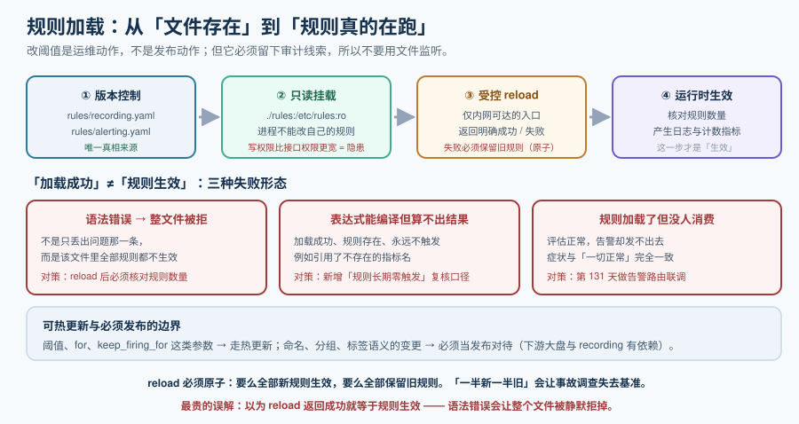

# 规则加载与热更新

第 126 天把规则**写成文件**（`recording.yaml` / `alerting.yaml`），第 127 天把它**作为契约固定下来**，第 128 与第 129 天交付了自研两件。今天要解决的是这两者之间那个一直没被正面回答的问题：

> **规则文件写好了，谁把它读进去？改了之后，怎么在不重启进程的前提下生效？**

这不是配置管理的小事。监控系统有一个其他系统少见的特性：**规则是运维动作，不是发布动作**。业务代码改阈值要走一次完整发布，而值班的人在大促前把一条错误率阈值从 5% 调到 3%，**不应该、也不可能等一次发布**。



::: warning 本项目只有文档，没有代码
本章不产出任何源码、脚本或构建文件。正文里的配置与命令都是**要在你自己的工程里创建好对应文件之后**才执行的；判据表按本项目固定纪律标注哪些本机可判、哪些标 `⏳ 未跑` 及其原因。
:::

## 一句话定位

本章把规则文件从「一堆躺在仓库里的 YAML」变成「**一个正在跑的进程里真实生效、可观测、可回滚的运行时状态**」，并规定它与发布流程的边界。

::: tip 一句话理解
规则加载这一步的价值，不在于「能读文件」，而在于**把「加载成功」和「规则生效」这两件事区分开**。它们之间的差距，就是监控系统最典型的一次静默失效。
:::

## 一、规则进到引擎里的三种方式

| 方式 | 机制 | 生效时机 | 代价 |
| --- | --- | --- | --- |
| **启动加载** | 进程启动时读一次文件，之后不再读 | 需要**重启进程** | 一次重启 = 一段监控盲区（恰恰是大促前最不该有的） |
| **信号 / 接口热更新** | 收到信号或请求后重读规则文件 | 秒级 | 需要暴露一个受控入口（本章的口径） |
| **文件监听** | 进程 watch 文件变化后自动重读 | 秒级 | 入口控制弱：**谁挂载的文件谁就能改规则**，权限边界不清晰 |

三者的差别不在「快慢」，而在**变更入口是不是清晰可控**。文件监听看起来最省事，但它把「改规则」的权限交给了**能写那个目录的任何人**——包括在容器里 `kubectl exec` 上去改文件的人，且**改动不会留下任何应用层日志**。

::: danger 一个必须写下来的判断：不要用文件监听
1. **错误认知**：「监听文件更自动，改完就生效，不用触发」。
2. **实际问题**：① 规则变更**没有审计线索**（谁改的、什么时候、改了什么，应用侧一无所知）；② 挂载卷的写入权往往比「调用 reload 接口」的权限**更宽**；③ 文件写入不是原子的，监听可能在文件写到一半时触发重读。
3. **正确做法**：**改动只通过受控入口（HTTP `POST /-/reload` 一类）触发**，配合「配置文件来自只读挂载、由流水线写入」的两段式。这样变更入口、审计与权限三者都清晰。
:::

## 二、为什么必须热更新

三条理由，按重要性排序：

1. **改阈值是运维动作**。值班人在事故中要把一条噪声规则调宽、或者把一条漏报规则收紧，这个动作必须在**分钟级**完成，而不是等下一次发布窗口。
2. **重启进程 = 制造一次盲区**。重启期间目标不可抓取、规则不评估——**在事故进行中重启监控，是把问题放大**。
3. **规则变更的频率高于代码变更**。同一个二进制的规则文件可能一周改三次，而代码一周发一次；把两者绑在一个发布节奏上，会逼着团队**不改规则**（因为成本太高），于是规则逐渐失真。

::: warning 说明
反过来说：**不是所有规则都适合热更新**。涉及 recording 规则**命名与语义**的变更（第 126 天定的三段式命名）会影响已有查询与大盘，那类改动必须当**发布**对待——因为下游有依赖。本章的口径是：**阈值与 `for` / `keep_firing_for` 这类参数走热更新；命名、分组、标签语义的变更走发布。** 这条边界要写进契约（见第 127 天的 `contracts/` 纪律）。
:::

## 三、「加载成功」不等于「规则生效」

这是本章最重要的一节。规则加载有三种典型失败，症状完全不同：

| 失败形态 | 表现 | 为什么隐蔽 |
| --- | --- | --- |
| **语法错误 → 整文件被拒** | 加载报错，**该文件里的所有规则都不生效**（不是只丢出问题的那一条） | 报错在加载时出现一次，之后**再也没有任何信号**；大盘上看起来只是"少了几条告警" |
| **表达式能编译但算不出结果** | 加载成功、规则存在、**永远不触发**（例如引用了不存在的指标名） | 没有任何错误。它安静地躺在那里，看起来在保护你 |
| **规则加载了但没人消费** | 规则评估正常，告警却发不出去（路由未接） | 症状与"系统一切正常"**完全一致**——直到真的出事 |

::: danger 三种失败的处理方式，一条比一条重要
1. **语法错误必须让「加载」这个动作失败，而不是部分成功**。部分成功的规则集是最坏的形态：你以为有 40 条规则在跑，实际只有 33 条。做法：加载后**核对规则数量**，数量不符则整个 reload 动作失败并保留旧规则。
2. **reload 必须原子**：要么全部新规则生效，要么全部保留旧规则。**不允许**出现"一半新一半旧"——那会让事故调查彻底失去基准。
3. **「表达式算不出结果」必须有自己的告警**（第 126 天定的 `TargetScrapedZeroSamples` 是同一思路的抓取侧版本；规则侧对应的是"规则长期零触发"与"规则引用的指标不存在"）。**没有这条告警，规则失活永远不会被发现。**
:::

::: tip 「规则长期零触发」为什么需要一个单独的判断
一条告警规则**从来不响**有两种可能：系统一直健康，或者**规则本身就是坏的**。这两者在数轴上完全一样。
务实的做法不是给每条规则设阈值，而是给**一组规则**设一个观察口径：例如「某条规则连续 30 天零触发且其依赖指标存在」→ 列入月度复核清单。**它不阻断，但它让"规则失活"从不可能发现变成可以被发现。**
:::

## 四、热更新的实现口径

本项目采用的方式与三条实现纪律：

```yaml
# deploy/compose.yaml 片段（摘要）
services:
  rules-reloader:
    image: <监控组件镜像>
    volumes:
      - ./rules:/etc/rules:ro      # 只读挂载：进程不能改自己的规则
    command:
      - --config.file=/etc/rules/recording.yaml
      - --config.file=/etc/rules/alerting.yaml
    # 热更新入口只在内部网络可达
```

```text
规则变更的两段式：
  ① 流水线（或值班人）修改仓库中的 rules/*.yaml 并提交
  ② 部署侧把新文件同步到挂载目录 → 调用受控 reload 入口

reload 入口的三条纪律：
  1. 只在内网可达，不对公网暴露
  2. 必须返回明确的成功 / 失败，且失败时**保留旧规则**
  3. 每次调用都要产生一条日志与一个计数指标（否则审计无从谈起）
```

```shell
# 一次受控的 reload 与核对（关键：比对前后规则数量）
before=$(curl -sS http://monitor.internal:9090/api/v1/rules | jq '[.data.groups[].rules[]] | length')
curl -sS -X POST http://monitor.internal:9090/-/reload
after=$(curl -sS http://monitor.internal:9090/api/v1/rules | jq '[.data.groups[].rules[]] | length')
echo "reload 前 $before 条，后 $after 条"
# 期望：两个数字相等（参数类变更）；若变更本身增删了规则，则应等于"预期值"而不是"相等"
```

**为什么一定要比对这个数字**：语法错误会让**整个文件**被拒。如果只检查"reload 接口返回 200"，你会以为成功了——**而实际发生的是规则静默消失**。

## 五、验证：四条本机可判的检查

```shell
# 1. 规则文件本身合法（这是最便宜也最该前置的一步，第 127 天已在契约里要求）
promtool check rules rules/recording.yaml rules/alerting.yaml
# 期望：SUCCESS，且打印出解析到的规则条数

# 2. 配置文件引用的规则文件都存在（捕获"改了路径但没同步"）
promtool check config rules/config.yaml
# 期望：SUCCESS；失败时输出会指出缺失的文件

# 3. 加载失败时旧规则必须保留（故意注入一个语法错误）
cp rules/alerting.yaml /tmp/alerting.bak
printf '  - bad\n' >> rules/alerting.yaml     # 造一个缩进错误
curl -sS -X POST http://monitor.internal:9090/-/reload ; echo "rc=$?"
curl -sS http://monitor.internal:9090/api/v1/rules | jq '[.data.groups[].rules[]] | length'
# 期望：reload 明确报错，且规则条数等于注入前的数量（旧规则仍在）
mv /tmp/alerting.bak rules/alerting.yaml && curl -sS -X POST http://monitor.internal:9090/-/reload

# 4. 规则数量与仓库里的定义数量一致（防"部分成功"）
grep -c "^- alert:\|^  - alert:" rules/alerting.yaml
# 期望：与第 3 步查到的 alert 类规则条数一致
```

## 六、五个必须避开的坑

::: danger 规则加载与热更新的五个坑
1. **认为 reload 返回 200 就等于成功**。语法错误会让整个文件被拒，接口依然可能返回成功。**必须核对规则数量。**
2. **允许"部分成功"**。一半新规则一半旧规则会让事故调查失去基准；reload 必须原子。
3. **用文件监听代替受控入口**。变更没有审计线索、权限边界比接口更宽、还可能读到写了一半的文件。
4. **规则的持久化与运行态不一致**。有人直接改了容器里的文件，但没改仓库——**下次重启会静默回滚**，而没人知道中间几天用的是一份不在版本控制里的规则。
5. **把命名与语义变更也走热更新**。那类变更下游有依赖（大盘查询、recording 引用），必须当发布对待；只有阈值类参数适合热更新。
:::

## 七、判据表

| 编号 | 判据 | 类型 | 判定方式 |
| --- | --- | --- | --- |
| **RR-A** | 规则文件通过 `promtool check rules` | 静态 | **本机可判**（需安装 promtool） |
| **RR-B** | 配置引用的规则文件均存在 | 静态 | **本机可判**（`promtool check config`） |
| **RR-C** | reload 失败时旧规则保留（原子性） | 动态 | 注入语法错误后验证规则条数不变 ⏳ 未跑（本机无容器运行时） |
| **RR-D** | reload 前后规则条数与仓库定义一致 | 动态 | 比对 `/api/v1/rules` 与 `grep -c` 的结果 ⏳ 未跑（需服务在监听） |
| **RR-E** | reload 入口不对公网暴露 | 静态 | **本机可判**（检查 compose / 网关配置中的端口绑定与网络声明） |
| **RR-F** | 规则的持久化来源是版本控制（挂载为只读） | 静态 | **本机可判**（配置里挂载带 `:ro`） |
| **RR-G** | 每次 reload 产生日志与计数指标 | 静态 | 检查组件配置中 reload 相关日志与指标开关 |
| **RR-H** | 「规则长期零触发」进入月度复核清单 | 流程 | 复核清单文件中存在该条目（人工确认） |

::: warning 判据唯一性说明
本表**不新增与 RL 族重叠的判据**。第 126 天的 `RL-A~RL-G` 管的是**规则怎么写**（命名、分组、抑制、`for` 取值依据）；`RR` 族管的是**规则怎么被加载与生效**。两者判据对象不同，不存在替代关系——一条规则可以写法完全正确（RL 全绿）却从来没被加载成功（RR 全红）。
:::

## 当日做了什么 / 如何验证 / 下一步

**做了什么**：

1. 定稿热更新的**方式与入口**——采用受控 HTTP reload，明确**不用文件监听**，并写出三条理由（审计、权限边界、原子性）。
2. 定稿**规则变更的两段式**：改动进版本控制 → 同步到只读挂载 → 调用受控 reload；进程不能改自己的规则文件。
3. 划出**可热更新与必须发布**的边界：阈值与 `for` / `keep_firing_for` 走热更新；命名、分组、标签语义的变更走发布，并回写进第 127 天的契约纪律。
4. 把「**加载成功 ≠ 规则生效**」的三种失败形态落成可检查项，其中「部分成功」被明确禁止（reload 必须原子，失败保留旧规则）。
5. 定稿 `RR-A~RR-H` 判据表，并交代它与第 126 天 `RL` 族的**判据唯一性**边界。
6. 新增「规则长期零触发」的月度复核口径，让"规则失活"从不可能发现变成可以被发现。

**如何验证**：静态三条（`RR-A` / `RR-B` / `RR-E` / `RR-F` / `RR-G`）在本机可判——本节已给出 `promtool check rules` 与 `promtool check config` 两条命令及预期输出，配置类判据通过检查 compose 文件中的 `:ro` 挂载与端口声明即可确认。动态三条（`RR-C` / `RR-D`）与流程一条（`RR-H`）本机标 `⏳ 未跑`，原因如实写两条：**本仓不含工程代码**、**reload 接口需要服务在监听**。**不把期望值抄进状态列。**

**下一步**：第 131 天进入**告警路由联调**——把第 126 天定稿的 `TargetDown` / `TargetScrapedZeroSamples` / `ServiceDown` 三条规则真正接到通知渠道，验证「分组 / 抑制 / 静默」三道闸门在真实告警风暴下的行为；同时把今天新开的「规则长期零触发」复核口径接进第 141 天的容量与稳定性验证。

## 参考资料

- [监控告警专题](/docs/Ops/Monitoring/index.md)（指标类型、抓取模型与规则设计的方法论基座）
- [监控告警 · 告警设计](/docs/Ops/Monitoring/Alerting/index.md)（阈值、分组、抑制、静默的写法）
- [查询与规则设计](../Rules/index.md)（本项目的 `RL` 族判据：规则怎么写）
- [接口契约与工程骨架](../Contracts/index.md)（规则文件的契约与配置三层划分）
- [故障应急体系 · 应急预案与运行手册](/docs/Ops/IncidentResponse/Runbook/index.md)（为什么"改一条阈值"必须能在分钟级完成）
