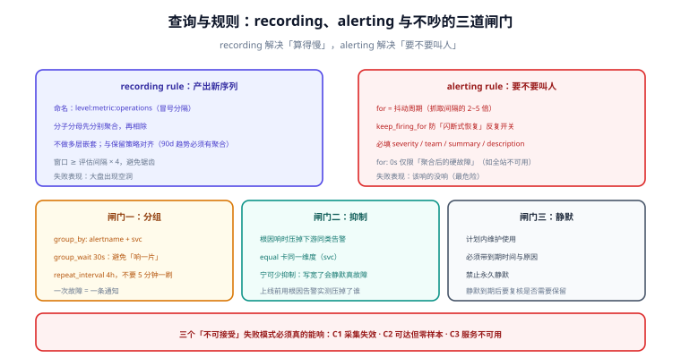

# 查询与规则设计：recording、alerting 与「不吵」的边界

第 123 天定义了指标模型与保留策略（`recording.yaml` 的雏形），第 124 天把规范变成了门禁（MG8/MG9 校验规则引用），第 125 天定稿了采集任务。本节把**规则本身**设计完：哪些计算该固化成 recording rule、哪些条件该做成告警、告警怎么分组抑制才不吵，以及它如何对上第 122 天登记的三个「不可接受」失败模式。

::: info 本节与相邻章节的分工
- **第 123 天**（[指标模型与保留策略](../MetricModel/index.md)）答「保留多久、怎么降采样」——`recording.yaml` 在那时只是雏形；
- **第 124 天**（[规范落地校验门禁](../MetricGate/index.md)）答「规则里引用的指标必须已登记且可告警」——MG8/MG9 是本节的前置门禁；
- **本节**答「**规则怎么写、评估多久、什么条件下才允许叫醒人**」，并把它对应到失败矩阵的 C1/C2/C3。
:::



## 两类规则：先把边界划清

| | recording rule | alerting rule |
| --- | --- | --- |
| 产出 | 一条**新的时间序列** | 一条**待发送的告警** |
| 作用 | 预计算、降采样、跨序列聚合 | 阈值判定 + `for` 持续时间 |
| 存储 | 结果会落库（占序列数与磁盘） | 不落库（状态在告警组件内） |
| 评估失败的表现 | 大盘出现空洞 | 该响的没响（**最危险**） |
| 设计判据 | 「这条 SQL 被反复执行且结果稳定吗」 | 「**这条信息需要有人现在动手吗**」 |

::: tip 一句话判据
**recording 解决「算得慢」，alerting 解决「要不要叫人」。** 把「慢查询」写进告警规则，就是把性能问题伪装成故障——它每晚都会响一次，直到所有人学会忽略它。
:::

## recording rule 设计

### 命名规范

沿用社区通行的三段式（与第 123 天的指标命名规范一致）：

```text
level:metric:operations
  例：job:http_requests:rate5m        按 job 聚合的 5 分钟请求速率
      instance:node_cpu:ratio         按实例的 CPU 使用率（已归一）
      svc:http_error_ratio:rate5m     按服务聚合的错误率（分子分母先算好再相除）
```

| 段 | 含义 | 反例 |
| --- | --- | --- |
| `level` | 聚合维度（`job` / `instance` / `svc` / 全局） | 不写维度（无法判断可不可以再加标签） |
| `metric` | 基础指标名 | 自造缩写（`cpu2`） |
| `operations` | 运算与窗口（`rate5m` / `sum` / `ratio`） | 省略窗口（5m 还是 1h？） |
| 分隔符 | **冒号**（`:metric:` 必须带冒号，避免与现有指标冲突） | 用下划线（会与指标名混淆） |

### 三条实现纪律

1. **不引用告警规则**：规则之间只能引用「已产出的序列」，不能反向依赖；否则评估顺序不确定，会出现随机空洞。
2. **不做多层嵌套**：`A → B → C` 的链式 recording 会让一次评估失败沿链放大。**一层预聚合 + 一层业务聚合**足够；更深的需求说明指标设计有问题。
3. **与保留策略对齐**：第 123 天定的是 raw 15d + 聚合 90d，所以「需要看 90 天趋势」的指标**必须**有 recording 产出，否则 15 天前的数据在原始序列里已经不存在。

```yaml [recording.yaml —— 本节定稿的核心规则]
groups:
  - name: svc_aggregations
    interval: 30s
    rules:
      # ① 按服务聚合的请求速率（跨实例求和后再算速率，避免实例抖动放大）
      - record: svc:http_requests:rate5m
        expr: sum by (svc) (rate(http_requests_total{job="app"}[5m]))

      # ② 错误率：分子分母分别聚合后相除（不能先算比率再平均）
      - record: svc:http_error_ratio:rate5m
        expr: |
          sum by (svc) (rate(http_requests_total{job="app",status=~"5.."}[5m]))
          /
          sum by (svc) (rate(http_requests_total{job="app"}[5m]))

      # ③ 采集健康：目标是否真的在产出样本（对应第 125 天的 SC 判据）
      - record: job:target_up:count
        expr: count by (job) (up)
```

::: danger recording rule 的四个高频错误
1. **先算比率再平均**：`avg(rate(ok)/rate(total))` 与 `sum(rate(ok))/sum(rate(total))` 结果不同，前者在流量不均时严重失真——**分子分母必须先分别聚合**。
2. **忘了 `by (...)` 的维度一致性**：分子带 `svc`、分母不带，除完只剩空标签，规则静默产出空序列。
3. **窗口小于评估间隔**：`rate(...[2m])` 却每 30s 评估，会出现锯齿；窗口至少是间隔的 4 倍。
4. **把 recording 当告警用**：产出「错误率」但没人看，也没接告警，等于白算一份序列。
:::

## alerting rule 设计

一条告警规则要回答三件事：**判定条件、持续时间、以及被叫醒的人能否立刻行动**。

```yaml [alerting.yaml —— 与失败模式矩阵 C1/C2/C3 对齐]
groups:
  - name: platform_alerts
    rules:
      # C3：业务服务不可用（最贵的一条，必须最先响）
      - alert: ServiceDown
        expr: sum by (svc) (up{job="app"}) == 0
        for: 1m
        labels:
          severity: critical
          team: platform
        annotations:
          summary: "服务 {{ $labels.svc }} 全部实例不可用"
          description: "已持续 1 分钟无任何可用实例，请先看部署与最近变更。"
          runbook_url: "https://runbook.internal/service-down"

      # C1：采集失效（监控自己瞎了，比业务抖动更危险）
      - alert: TargetDown
        expr: up{job=~"app|node"} == 0
        for: 3m
        labels:
          severity: warning
          team: platform
        annotations:
          summary: "目标 {{ $labels.instance }} 抓取失败"
          description: "连续 3 分钟抓取失败，先确认目标存活与网络策略。"

      # C2：可达但零样本（配置错、权限错、指标被重命名）
      - alert: TargetScrapedZeroSamples
        expr: |
          (scrape_samples_scraped{job=~"app|node"} == 0)
          and on(instance, job) (up{job=~"app|node"} == 1)
        for: 5m
        labels:
          severity: warning
          team: platform
        annotations:
          summary: "目标 {{ $labels.instance }} 可达但无样本"
          description: "抓取成功却拿不到样本，多为暴露路径、鉴权或被过滤器清空。"

      # 业务侧错误率（分级：warning 先看，持续升高再 critical）
      - alert: HighErrorRate
        expr: svc:http_error_ratio:rate5m > 0.05
        for: 10m
        labels:
          severity: warning
          team: business
        annotations:
          summary: "服务 {{ $labels.svc }} 5xx 占比 {{ $value | humanizePercentage }}"
          description: "错误率超过 5% 且持续 10 分钟，先看最近发布与下游依赖。"
```

### `for` 与 `keep_firing_for`

| 参数 | 作用 | 定值依据 |
| --- | --- | --- |
| `for` | 条件持续多久才算真告警 | **抖动周期**：抓取间隔的 2~5 倍；业务指标通常 5~10m |
| `keep_firing_for` | 条件恢复后继续保持多久 | 避免「闪断式恢复」造成告警反复开关（建议 5m） |
| `interval` | 评估间隔 | 与数据分辨率匹配：30s 原始数据用 30s；聚合指标可放宽到 1m |

::: warning `for: 0s` 是告警噪音的第一来源
瞬时抖动（一次抓取失败、一个 500）会立刻叫人，而人到了现场往往发现「已经好了」。
**唯一适合 `for: 0s` 的是「不能容忍任何窗口的硬故障」**（如全站不可用），且必须是聚合后的条件（`sum by (svc) (up) == 0`），而不是单实例的 `up == 0`。
:::

### 标签与注解：告警必须「有主」「可行动」

| 字段 | 必填 | 作用 | 反面例子 |
| --- | --- | --- | --- |
| `severity` | ✅ | 决定路由与叫醒方式 | 不写 → 所有告警同级 |
| `team` / `owner` | ✅ | **有主**：谁来处理 | 只写 `team: all` |
| `summary` | ✅ | 一句话说清「什么坏了」 | 只写指标名 |
| `description` | ✅ | 说清现象与**第一步动作** | 复制 summary |
| `runbook_url` | 建议 | 指向处置手册 | 写在个人聊天记录里 |

## 分组、抑制与静默：不吵的三道闸门

```yaml [alertmanager.yaml —— 路由与抑制片段]
route:
  group_by: ['alertname', 'svc']      # 同一服务同一告警合并成一条通知
  group_wait: 30s                     # 首次通知前等一会，避免「响一片」
  group_interval: 5m
  repeat_interval: 4h                 # 未恢复时的重复提醒间隔（不要 5 分钟一刷）
  receiver: 'default'
  routes:
    - matchers: ['severity="critical"']
      receiver: 'oncall'
      repeat_interval: 1h
    - matchers: ['severity="warning"']
      receiver: 'team-channel'

inhibit_rules:
  # 服务全挂时，抑制它的下游告警：一个根因只叫人一次
  - source_matchers: ['alertname="ServiceDown"']
    target_matchers: ['severity=~"warning|critical"']
    equal: ['svc']
```

| 闸门 | 解决什么 | 定值要点 |
| --- | --- | --- |
| **分组**（group_by） | 一次故障产生几十条通知 | 按「同根因」聚合：`alertname + svc` |
| **抑制**（inhibit） | 根因与后果同时响 | 用 `equal` 卡住同一维度，**宁可少抑制** |
| **静默**（silence） | 计划内维护 | **必须带到期时间与原因**，禁止永久静默 |

::: danger 抑制写错的代价
`equal` 维度写得过宽（如只按 `alertname`），会把**不相关的告警一起压掉**：
故障期间「安静得出奇」，事后才发现真正的故障被抑制了。
**抑制规则上线前，必须用「制造一个根因告警」的方式验证它到底压掉了哪些。**
:::

## 与失败模式矩阵的对应

第 122 天登记了三个「不可接受」的失败模式，本节的规则必须能覆盖它们：

| 编号 | 失败模式 | 对应告警 | 判据 |
| --- | --- | --- | --- |
| C1 | 采集静默失效（监控瞎了） | `TargetDown` | 停掉一个目标，3 分钟内必须响 |
| C2 | 抓取成功但零样本 | `TargetScrapedZeroSamples` | 暴露路径改错，5 分钟内必须响 |
| C3 | 业务服务不可用 | `ServiceDown` | 停掉全部实例，1 分钟内必须响 |

**这三条是本节最有价值的产出**：它们把「看不见的失效」变成了「能被机器发现的现象」。

## 本日可验证构建步骤

1. **写规则文件**：把上面的 `recording.yaml` 与 `alerting.yaml` 放进部署目录。
2. **静态校验（本机可跑）**：用 `promtool check rules` 校验语法与表达式（无容器运行时也可用二进制）。
3. **过门禁**：跑第 124 天的校验器，确认 MG8（引用的指标都已登记且 `alertable = true`）与 MG9（未按无界标签聚合）通过。
4. **起链路**：`docker compose up -d`，确认规则被加载（`/api/v1/rules` 能看到两组规则）。
5. **触发 C1**：停掉一个被监控目标 → 观察 `TargetDown` 由 inactive 变 pending，`for` 到期后变 firing。
6. **触发 C3**：停掉业务服务全部实例 → 确认 `ServiceDown` 在 1 分钟内 firing，且**下游告警被抑制**（抑制规则生效）。

### 判据表

| # | 判据 | 怎么验 | 期望 |
| --- | --- | --- | --- |
| RL-A | 规则语法与表达式合法 | `promtool check rules` | 全部 SUCCESS |
| RL-B | 规则已被加载 | `/api/v1/rules` | 两组规则、条数与文件一致 |
| RL-C | recording 产出可查 | 查询 `svc:http_error_ratio:rate5m` | 有值且标签含 `svc` |
| RL-D | C1 能触发 | 停目标 | pending → firing（≤ 3m） |
| RL-E | C2 能触发 | 改错暴露路径 | pending → firing（≤ 5m） |
| RL-F | C3 能触发 | 停全部实例 | firing（≤ 1m） |
| RL-G | 抑制生效且不过度 | 同时制造 C3 与下游告警 | 下游被抑制，无关告警仍在 |

::: warning 实测列纪律
上表是**判据**，不是实测记录。本机若没有可用容器运行时，实测列一律写 `⏳ 阻塞 + 原因`；
RL-A / RL-B（静态校验部分）若有二进制可在本机实跑并如实记录。
**不把期望值抄进实测列。**
:::

## 当日做了什么

1. 划清 **recording 与 alerting 的边界**：前者解决「算得慢」，后者解决「要不要叫人」。
2. 定稿 recording rule 的**命名三段式**与三条实现纪律（不引用告警规则、不做多层嵌套、与保留策略对齐）。
3. 定稿 `recording.yaml`：服务请求速率、错误率（**分子分母先分别聚合**）、目标计数三条核心预聚合。
4. 定稿 `alerting.yaml`：把第 122 天的三个「不可接受」失败模式落成 `TargetDown` / `TargetScrapedZeroSamples` / `ServiceDown` 三条告警，并补一条业务错误率分级告警。
5. 给出 `for` / `keep_firing_for` / `interval` 的**定值依据**（抖动周期、数据分辨率），并说明 `for: 0s` 的适用范围。
6. 定稿分组、抑制、静默三道闸门的配置片段与「宁可少抑制」的纪律。
7. 产出 `rules-design.svg` 与本日六步构建步骤、RL-A~RL-G 判据表。

## 如何验证

本日的验证即上面六步与 RL-A~RL-G。核心是三条：

1. **三个失败模式必须真的能响**（RL-D/E/F）——只校验语法通过不算数；
2. **抑制不能过度**（RL-G）——必须同时验证「该压的压掉、不该压的还在」；
3. **recording 的结果标签符合预期**（RL-C）——空标签的规则会静默产出无意义序列。

## 下一步（第 127 天）

**接口契约与工程骨架**：看板数据服务的接口定义与多模块骨架，第 1 周收口。同时把第 122 天的四个边界落成代码里的常量与校验，并把本周的规则、采集、指标字典串成可启动的最小工程。

## 参考资料

- [Prometheus 官方文档 · Recording rules](https://prometheus.io/docs/prometheus/latest/configuration/recording_rules/)
- [Prometheus 官方文档 · Alerting rules](https://prometheus.io/docs/prometheus/latest/configuration/alerting_rules/)
- [Prometheus 官方文档 · 命名与聚合最佳实践](https://prometheus.io/docs/practices/rules/)
- [Alertmanager 官方文档 · 分组、抑制与静默](https://prometheus.io/docs/alerting/latest/alertmanager/)
- 本库相邻章节：[指标模型与保留策略](../MetricModel/index.md)、[规范落地校验门禁](../MetricGate/index.md)、[采集任务配置](../ScrapeConfig/index.md)
