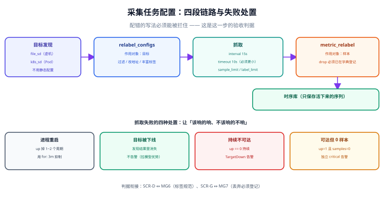

# 采集任务配置：把「目标」变成「稳定的序列流」

本页是周期 5「实时监控大盘」第 1 周的第 5 步，承接第 122 天的**边界二（采集 → 存储）**与失败矩阵里的 **C2（目标抓取失败未被发现）**，并把第 124 天定稿的 **MG6 / MG7 两条判据**落到具体的配置文件上。做完这一步，系统应该能回答：「哪些目标在被采集、每个目标每 15 秒产生多少条样本、抓不到的时候谁会被叫醒」。



::: warning 本页只有文档，没有代码
本节给出的 `scrape.yaml`、`relabel` 规则与校验命令都是**内容**：请先在你的工程里按本节创建对应文件，再执行命令。仓库不存放源码与配置文件。
:::

## 为什么这一步不能跳

第 122 天把五段链路拆成七个组件时，「采集」被划成「用现成的抓取器，自研为零」。当时的判断是对的，但**划成现成 ≠ 不用设计**：采集器的行为 100% 由配置决定，而配置写错的表现极其隐蔽——

| 配错的写法 | 表面现象 | 真实后果 |
| --- | --- | --- |
| 忘了加 `honor_labels` 的取舍 | 一切正常 | 目标自带的 `job` 标签被覆盖，两个环境的序列被合并 |
| `relabel` 里写错 `source_labels` | 目标仍被采集 | 标签缺失，按环境筛选的告警永远不触发 |
| 只发现、不过滤 | 多采集了几十个目标 | 基数超出第 123 天算出的容量上限 |
| 没有 `for` 的抓取失败告警 | 告警响了 | 每次滚动发布都响一片，告警迅速失去可信度 |

**这一步的验收判据不是「能跑」，而是「配错的写法能被拦住」。** 这正是第 124 天 MG6 / MG7 存在的理由。

## 目标发现：五条路，选一条就够

「目标从哪来」是配置的第一个决定。低基数场景不需要服务发现，硬上只会带来运维面：

| 方式 | 配置源 | 适合 | 代价 |
| --- | --- | --- | --- |
| **静态**（`static_configs`） | 手写在配置里 | 目标少（< 20）、变化极少 | 扩容要改配置 + 重载 |
| **文件发现**（`file_sd_configs`） | 一个 JSON / YAML 文件 | 目标由脚本或 CMDB 生成 | 需要一个「生成文件」的角色 |
| **DNS 发现**（`dns_sd_configs`） | DNS 记录（SRV / A） | 已有 DNS 做服务注册 | 依赖 DNS 的缓存与 TTL |
| **K8s 发现**（`kubernetes_sd_configs`） | API Server 的对象 | 目标是 Pod / Service | 需要 RBAC 与角色选择（见下） |
| **注册中心发现**（Consul / Nacos 等） | 注册中心 | 已有服务注册体系 | 多一跳依赖，标签语义要映射 |

::: tip 本项目的选择：文件发现 + K8s 发现双轨
第 122 天的边界二定义的是「**目标 → 采集**」，判据是「新增一个目标不需要改采集器代码」。据此选：

- **虚机 / 裸机上的服务**（含自研的看板服务）走 **`file_sd_configs`**：由部署脚本生成目标文件，采集器只负责读。
- **K8s 内的负载**（第 4 周才有）走 **`kubernetes_sd_configs`**，用 `role: pod` + 注解开关（`prometheus.io/scrape: "true"`）控制纳入范围。

**不选静态**的理由很直接：静态配置意味着「加一台机器要改采集配置并重载」，这会让「扩容」与「改监控」耦合在一起——这是失败矩阵里 C1（扩容漏配监控）的成因。
:::

## 任务分组：`job` 是唯一的分组单位

`job` 不是「一个抓取任务」，而是**一组成员、同一套抓取参数的目标**。分组维度只有两个可用：

| 分组维度 | 例子 | 好处 | 代价 |
| --- | --- | --- | --- |
| **按抓取参数** | `interval: 15s` 的核心服务 / `interval: 60s` 的边缘服务 | 高频目标不被低频拖慢 | 同一个服务可能出现在两个 job 里 |
| **按归属团队** | 支付组 / 内容组 | 权责清晰，告警好路由 | 参数差异要靠 `relabel` 表达 |

::: danger 不要按「服务名」建 job
「每个微服务一个 job」是最常见的写法，也是最快失效的写法：100 个服务就是 100 个 job，配置文件变成一坨复制粘贴，抓取参数想统一调一次要改 100 处。

**正确做法是按「抓取参数 + 归属」分组（通常 5~10 个 job），服务差异用标签表达**（`service="order"`），筛选与告警都基于标签——这也是第 123 天标签规范里「标签承载维度、job 承载策略」的口径。
:::

## 一份完整的抓取配置

```yaml [scrape.yaml]
global:
  scrape_interval: 15s          # 默认抓取间隔
  scrape_timeout: 10s           # 必须小于 interval，否则会「每次都超时」
  evaluation_interval: 15s      # 规则评估间隔（第 126 天用）

scrape_configs:
  # ① 核心服务：15s，虚机/裸机，目标由部署脚本写入文件
  - job_name: core-services
    file_sd_configs:
      - files: ["/etc/collector/targets/core-*.json"]
        refresh_interval: 30s
    scrape_interval: 15s
    scrape_timeout: 10s
    honor_labels: false          # 目标自带的标签不得覆盖采集端标签
    sample_limit: 15000          # 单次抓取的样本数上限（对齐第 123 天容量公式）
    label_limit: 40
    relabel_configs:
      - source_labels: [__meta_filepath]        # 从文件名推断环境
        regex: ".*/core-(\\w+)\\.json"
        target_label: env
        replacement: "$1"
      - source_labels: [__address__]
        target_label: instance
      - regex: "__meta_.*"                      # 清理发现阶段产生的元标签
        action: labeldrop

  # ② 边缘服务：60s，目标少、变化慢
  - job_name: edge-services
    file_sd_configs:
      - files: ["/etc/collector/targets/edge-*.json"]
    scrape_interval: 60s
    scrape_timeout: 20s
    relabel_configs:
      - source_labels: [__address__]
        target_label: instance
      - regex: "__meta_.*"
        action: labeldrop

  # ③ K8s Pod：第 4 周启用，用注解做纳入开关
  - job_name: kubernetes-pods
    kubernetes_sd_configs:
      - role: pod
    relabel_configs:
      - source_labels: [__meta_kubernetes_pod_annotation_prometheus_io_scrape]
        action: keep
        regex: "true"                            # 只有显式开启注解的 Pod 才采集
      - source_labels: [__meta_kubernetes_pod_annotation_prometheus_io_path]
        action: replace
        target_label: __metrics_path__
        regex: "(.+)"
      - source_labels: [__meta_kubernetes_namespace]
        target_label: namespace
      - source_labels: [__meta_kubernetes_pod_name]
        target_label: pod
      - regex: "__meta_.*"
        action: labeldrop
```

::: danger 四条会静默改变数据的配置
1. **`scrape_timeout` 大于等于 `scrape_interval`**：上一轮还没拉完下一轮就开始了，表现为「抓取目标不稳定地 down」。**必须严格小于**。
2. **`honor_labels: true` 用在多环境共存的采集器上**：目标自带的 `env` 会覆盖采集端打的 `env`，两个环境的同名序列被合并，**告警按环境筛选时全部命中**。
3. **`relabel_configs` 里 `source_labels` 写错**：不报错，只是那个标签变成了空字符串（或 `replacement` 原样），后续按它筛选的规则永远不生效。
4. **没有 `labeldrop` 清理 `__meta_*`**：K8s 发现会产生十几个元标签，全保留会让序列数（基数）翻数倍——**这正是第 123 天容量公式里的「路径归一」要防的东西**。
:::

## 重标记：`relabel_configs` 与 `metric_relabel_configs` 的分工

名字很像，作用时机完全不同，混用是「配置改了对但没效果」的主因：

| | `relabel_configs` | `metric_relabel_configs` |
| --- | --- | --- |
| **作用对象** | **目标**（还没抓取） | **样本**（已经抓到手） |
| **时机** | 抓取前，决定「采不采、用什么地址采」 | 抓取后、入库前，决定「留不留」 |
| **典型用途** | 过滤目标、改写 `__address__`、丰富标签 | 丢弃噪声指标、删除高基数标签、限流 |
| **后果** | 目标直接不出现（`up` 都没有） | 目标存在，但指标少了 |

::: warning 「过滤」和「丢弃」的语义差别要写进值班手册
某条序列不见了，值班的人第一步要能判断是**目标没被采集**（`relabel_configs` 过滤）还是**指标被丢弃**（`metric_relabel_configs`）。判别方法很简单：

- 查 `up{job="..."}`：**目标都不在** → 过滤问题；
- `up` 在、但某个指标查不到 → 丢弃问题（去查 `metric_relabel_configs` 与 MG7 的登记表）。
:::

**`metric_relabel_configs` 的第一条纪律（对齐 MG7）**：任何 `drop` 必须**先在指标字典 `metric_def` 里登记**，并写明「为什么可以丢」。未登记的丢弃等于「偷偷缩短了观测面」，出了问题没人能复原现场。

```yaml [metric_relabel_configs 示例（含登记要求）]
    metric_relabel_configs:
      # 丢弃高基数且无人使用的调试指标（已在 metric_def 登记 reason=debug_only）
      - source_labels: [__name__]
        regex: "go_gc_duration_seconds_created|debug_.*"
        action: drop
      # 删除高基数标签：路径统一收敛到路由模板（对齐第 123 天「路径归一」）
      - source_labels: [uri]
        regex: "/order/\\d+"
        target_label: uri
        replacement: "/order/{id}"
```

## 抓取失败的处理：让「抓不到」变成一条可信的告警

目标抓不到是常态（发布、重启、网络抖动），所以处理要点不是「不响」，而是**「该响的响、不该响的不响」**：

| 情况 | 表现 | 处置 |
| --- | --- | --- |
| 目标进程重启 | `up` 掉 1~2 个周期 | 用 `for: 3m` 抑制（对应 job 的抓取间隔 × N） |
| 目标被下线（缩容） | 目标从发现结果里消失 | **不告警**（没有序列就没有告警）——这是「拉模型」的天然优势 |
| 目标持续不可达 | `up == 0` 持续 | 告警，并带上 `instance` 与 `job` |
| 目标可达但**采到 0 条样本** | `up == 1` 但 `scrape_samples_scraped == 0` | **单独一条告警**——这是「进程活着但业务指标没暴露」的典型，最容易被漏 |

```yaml [recording / alerting 规则片段（第 126 天细化）]
groups:
  - name: scrape-health
    rules:
      - alert: TargetDown
        expr: up == 0
        for: 3m                        # 与 15s 间隔配合：约 12 个周期，压掉重启抖动
        labels: { severity: warning }
        annotations:
          summary: "目标 {{ $labels.instance }} 抓取失败（job={{ $labels.job }}）"
      - alert: TargetScrapedZeroSamples
        expr: up == 1 and scrape_samples_scraped == 0
        for: 5m
        labels: { severity: critical }   # 进程活着却没指标，比 down 更危险
        annotations:
          summary: "{{ $labels.instance }} 端口通了但采到 0 条样本"
```

::: tip 两条「抓取器自身健康」的判据
监控系统必须有**自监控**，否则它坏了没人知道。最小两条：

1. `scrape_duration_seconds > scrape_timeout * 0.8` 持续 → 抓取即将超时（容量或目标问题）。
2. `scrape_samples_scraped` 环比骤降 50% 以上 → 目标指标变少了（可能是有人删了埋点）。第 4 周的「自监控」一节会把它接入大盘。
:::

## 本日可验证构建步骤

### 判据表（SC-A ~ SC-G）

| 编号 | 判据 | 通过标准 | 实测 |
| --- | --- | --- | --- |
| SC-A | 采集链路能起 | 启动采集器 + 一个暴露 `/metrics` 的目标，查询 `up{job="core-services"}` 返回 `1` | ⏳ 未跑 + 原因：本机无容器运行时 |
| SC-B | 目标来自发现而非写死 | 向目标文件**追加**一个目标并保存，30 秒内 `up` 出现新实例，**未重启采集器** | ⏳ 未跑 + 原因：同上 |
| SC-C | `scrape_timeout < scrape_interval` | 配置校验命令通过（见下） | ⏳ 未跑 + 原因：同上 |
| SC-D | 元标签被清理 | `count by (__name__)({__name__=~"up"})` 查询结果中该序列**不含 `__meta_*` 标签** | ⏳ 未跑 + 原因：同上 |
| SC-E | 抓取失败告警生效 | 停掉目标进程，`for` 时长后 `TargetDown` 进入 firing | ⏳ 未跑 + 原因：同上 |
| SC-F | 「0 样本」告警独立于 down | 构造「端口通但无指标」的目标，只有 `TargetScrapedZeroSamples` 触发、`TargetDown` **不**触发 | ⏳ 未跑 + 原因：同上 |
| SC-G | 丢弃指标已登记（MG7 衔接） | 校验器扫描全部 `metric_relabel_configs` 的 `drop`，未在 `metric_def` 登记的条目数为 0 | ⏳ 未跑 + 原因：同上 |

### 配置期静态校验（不需要容器，本机即可跑）

```shell
# ① 本地配置语法与语义校验（用采集器自带的检查模式，只读不启动服务）
promtool check config scrape.yaml

# ② 超时与间隔关系（SC-C）：所有 job 的 scrape_timeout 必须严格小于 scrape_interval
python -c "
import yaml,sys
c=yaml.safe_load(open('scrape.yaml'))
g=c.get('global',{}); gi=g.get('scrape_interval','15s'); gt=g.get('scrape_timeout','10s')
def sec(s): return int(str(s).rstrip('smh') or 0)
bad=[]
for j in c['scrape_configs']:
    i=j.get('scrape_interval',gi); t=j.get('scrape_timeout',gt)
    if sec(t)>=sec(i): bad.append(j['job_name'])
print('FAIL',bad) if bad else print('PASS 超时严格小于间隔')
"

# ③ 元标签清理（SC-D）：每个 job 都必须有 labeldrop __meta_.*
python -c "
import yaml
c=yaml.safe_load(open('scrape.yaml'))
miss=[j['job_name'] for j in c['scrape_configs']
      if not any(r.get('action')=='labeldrop' and '__meta_' in str(r.get('regex','')) for r in j.get('relabel_configs',[]))]
print('FAIL',miss) if miss else print('PASS 元标签已清理')
"

# ④ 丢弃项已登记（SC-G / MG7）：drop 的指标名必须出现在 metric_def
python -c "
import yaml,re,sys
c=yaml.safe_load(open('scrape.yaml'))
drops=[]
for j in c['scrape_configs']:
    for r in j.get('metric_relabel_configs',[]) or []:
        if r.get('action')=='drop': drops += [x for x in re.split(r'\\\\|', str(r.get('regex',''))) if x]
defs=open('metric_def.sql').read()
un=[d for d in drops if d.replace('.*','') not in defs]
print('FAIL 未登记: '+str(un)) if un else print('PASS 丢弃项全部已登记')
"
```

预期：① 无输出（`SUCCESS`）；②③④ 各输出一行 `PASS`。

1. **先跑配置校验器，再起服务**：`promtool check config` 能在不启动服务的前提下拦掉大部分语法与语义错误（含 `scrape_timeout` 关系、规则表达式语法）。
2. **目标文件手工追加一次**：这是 SC-B 的最小验证方式，比改配置重载快得多，也更能证明「发现」真的是发现。
3. **把「0 样本」这条告警单独构造一次**：最省事的做法是让目标返回空 body 但 HTTP 200——它验证的是「进程活着 ≠ 指标在被采集」，这是本项目最容易被忽略的一条。

## 当日做了什么

1. 定稿**目标发现方式**：虚机/裸机走 `file_sd_configs`（部署脚本生成目标文件）、K8s 走 `kubernetes_sd_configs`（注解开关）；明确**不用静态配置**，把「扩容漏配监控」（失败矩阵 C1）从根上排除。
2. 定稿**任务分组口径**：`job` 按「抓取参数 + 归属」分（5~10 个），服务差异用标签表达，禁止「一服务一 job」。
3. 产出完整的 `scrape.yaml`：三个 job、`sample_limit` 对齐第 123 天容量公式、`honor_labels` 与 `labeldrop` 的取舍写死在注释里。
4. 划清 **`relabel_configs`（目标）与 `metric_relabel_configs`（样本）** 的边界，并给出值班侧的一句话判别法（先看 `up` 在不在）。
5. 定稿**抓取失败的四种处置**，把「目标不可达」与「可达但 0 样本」拆成两条独立告警（后者更危险、更易漏）。
6. 产出 `scrape-config.svg` 与 SC-A~SC-G 判据表；其中 SC-G 直接复用第 124 天 MG7 的登记要求，**丢弃指标未登记即视为缺陷**。

## 如何验证

1. 跑上面四段静态校验，期望 `PASS` × 3 + `promtool` 无输出。**这四段不需要任何容器运行时，任何机器上都能跑**，因此它们是本页唯一的「已跑」部分。
2. SC-A~SC-G 的**动态**部分（能起、能发现、告警真的响）需要容器运行时；本机没有，**全部如实标注为「未跑 + 原因」**，不把期望值抄进实测列。
3. 两条自检的边界：静态校验**只覆盖配置文本**，它证明不了「目标真的被采到」。谁在什么环境跑过动态部分，就把结果回填到判据表——**没跑过的不许标 ✅**。

## 下一步（第 126 天）

第 126 天做**查询与规则设计**：recording rule 与 alerting rule 的划分、评估间隔与 `for` 的配合、分组与抑制怎么让告警不吵。本页给出的两条抓取健康告警（`TargetDown` / `TargetScrapedZeroSamples`）会作为**规则设计的第一组样例**被正式纳入规则文件，并在那一页补齐抑制与分组。

## 参考资料

- [监控告警专题](/docs/Ops/Monitoring/index.md)：抓取模型与告警设计的方法论（本页只落项目侧配置）
- [Prometheus 官方文档 · Configuration（`scrape_configs`）](https://prometheus.io/docs/prometheus/latest/configuration/configuration/)
- [Prometheus 官方文档 · Relabeling 与 `labeldrop`](https://prometheus.io/docs/prometheus/latest/configuration/configuration/#relabel_config)
- [Prometheus 官方文档 · 警示「不要静态配置一切」的目标发现](https://prometheus.io/docs/prometheus/latest/configuration/configuration/#file_sd_config)
- [架构细化：组件与接口边界](../Architecture/index.md)：边界二与失败矩阵 C1/C2 的定义
- [指标模型与保留策略](../MetricModel/index.md)：容量公式与「路径归一」的来由
- [规范落地校验门禁](../MetricGate/index.md)：MG6 / MG7 与本页 SC-D / SC-G 的衔接
